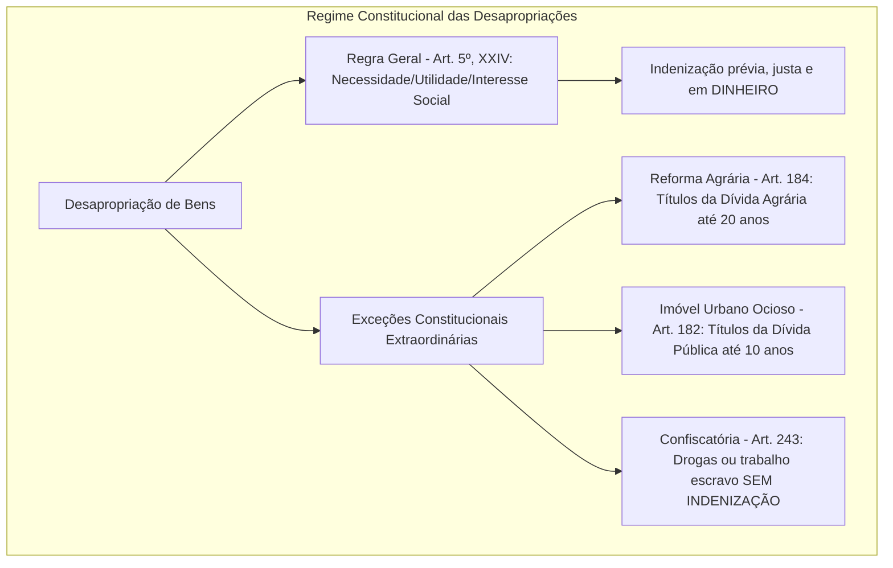
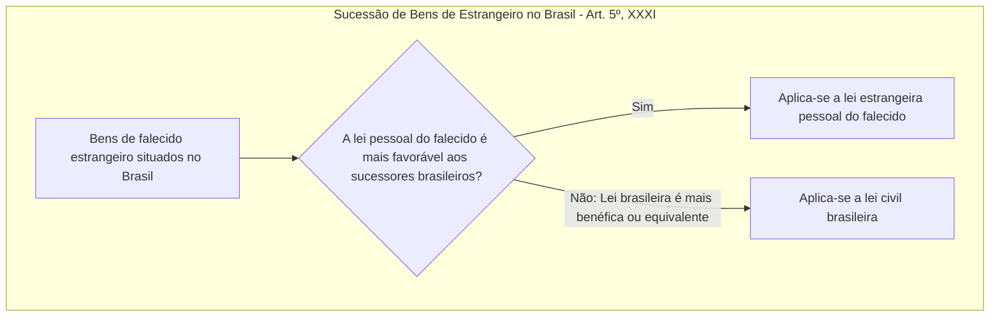

O fecho da primeira parte do artigo 5º reúne garantias estruturais da vida em sociedade e da circulação econômica e política. Entre os incisos XIV e XXXI da Constituição Federal de 1988, encontram-se disciplinados o acesso à informação, a liberdade de locomoção, o direito de reunião pacífica, a liberdade associativa, o estatuto constitucional da propriedade privada com suas formas de intervenção e a sucessão de bens. Neste capítulo, estudamos as condições de exercício de cada direito, a jurisprudência fixada pelo Supremo Tribunal Federal e as distinções práticas cobradas em certames públicos.

> [!objetivos]
> - Compreender os limites do acesso à informação, o sigilo da fonte jornalística e a amplitude da liberdade de locomoção em tempo de paz.
> - Dominar os requisitos constitucionais do direito de reunião e a interpretação do STF sobre a inexigibilidade de aviso prévio formal (Tema 855).
> - Analisar a liberdade de associação, diferenciando os regimes de suspensão de atividades e dissolução compulsória e as regras de representação judicial.
> - Explicar a função social da propriedade, distinguindo a desapropriação comum das modalidades extraordinárias e da requisição administrativa.
> - Identificar as balizas da impenhorabilidade da pequena propriedade rural, dos direitos autorais e da sucessão de bens de estrangeiros no Brasil.

## Acesso à informação e liberdade de locomoção (artigo 5º, incisos XIV e XV)

O artigo 5º, inciso XIV, da Carta da República consagra a publicidade e a transparência como princípios reitores da sociedade democrática, assegurando a todos o **acesso à informação** e resguardando o **sigilo da fonte** quando necessário ao exercício profissional.

O direito de acesso à informação confere ao cidadão a prerrogativa de buscar, receber e difundir dados de interesse coletivo ou individual sob a guarda de órgãos públicos. Como contraponto funcional, o constituinte protegeu o sigilo da fonte, garantia direcionada prioritariamente aos profissionais de imprensa. O jornalista possui o direito legal de não revelar a identidade de informantes que lhe repassaram dados sigilosos.

Essa prerrogativa profissional harmoniza-se plenamente com a proibição do anonimato esculpida no inciso IV. Caso a notícia divulgada venha a acarretar prejuízos inverídicos ou difamatórios a terceiros, o jornalista e o veículo de imprensa responderão civil e penalmente pelos excessos, figurando como autores jurídicos da veiculação informativa.

Por sua vez, o artigo 5º, inciso XV, assegura a **liberdade de locomoção** no espaço geográfico nacional:
- A garantia aproveita a qualquer pessoa (brasileiros e estrangeiros), autorizando o ato de entrar no país, permanecer em seu território ou dele sair transportando seus bens;
- O exercício dessa faculdade opera plenamente **em tempo de paz**;
- Trata-se de típica norma de **eficácia contida**, subordinada às balizas e restrições estabelecidas pelo legislador ordinário.

Em razão de sua eficácia contida, as leis infraconstitucionais podem estabelecer requisitos para o ingresso de turistas, regras de imigração e exigências alfandegárias para o transporte internacional de mercadorias. Da mesma forma, em situações excepcionais de anormalidade constitucional, a locomoção sofre limitações legítimas. Durante o **estado de sítio**, a Constituição autoriza o Presidente da República a determinar a obrigação de permanência em localidade determinada (CF, art. 139, I).

O instrumento processual adequado para proteger a liberdade de locomoção contra ameaça ou violência decorrente de ilegalidade ou abuso de poder é o ***habeas corpus*** (art. 5º, LXVIII).

## Liberdade de reunião (artigo 5º, inciso XVI)

O direito de reunião constitui uma das garantias políticas mais expressivas do regime democrático, operando como verdadeira "liberdade-condição" para o exercício da liberdade de expressão e de manifestação política:

> [!lei] CF, art. 5º, XVI
> todos podem reunir-se pacificamente, sem armas, em locais abertos ao público, independentemente de autorização, desde que não frustrem outra reunião anteriormente convocada para o mesmo local, sendo apenas exigido prévio aviso à autoridade competente;

A norma constitucional subordina o exercício da reunião pacífica a condições taxativas:
1. **Fins estritamente pacíficos**: reuniões violentas, tumultuárias ou voltadas a desordens perdem a tutela constitucional;
2. **Ausência de armas**: o porte de armas, ainda que lícito individualmente, é incompatível com o caráter coletivo da manifestação desarmada;
3. **Locais abertos ao público**: praças, avenidas, ruas e parques de uso comum do povo;
4. **Não frustração de reunião preexistente**: a manifestação não pode coincidir com outro evento popular já convocado com antecedência para o mesmo espaço físico;
5. **Inexigibilidade de autorização estatal**: o Poder Executivo não detém poder de conceder ou negar alvará para passeatas públicas;
6. **Exigência de prévio aviso**: comunicação destinada a viabilizar a organização do trânsito viário e a segurança pública.

A tabela a seguir sistematiza esses requisitos essenciais.

| Requisito constitucional | Finalidade da exigência | Consequência jurídica do descumprimento |
| --- | --- | --- |
| Pacífica e sem armas | Segurança coletiva e integridade física | Dissolução legítima pelas forças de segurança |
| Local aberto ao público | Acesso amplo ao espaço democrático | Espaços privados exigem anuência do proprietário |
| Não frustração de outra reunião | Prevenção de conflitos territoriais | Prevalece a manifestação convocada em primeiro lugar |
| Independe de autorização | Vedação ao controle ideológico prévio | O Poder Público não pode condicionar o evento a licença |
| Prévio aviso à autoridade | Organização do trânsito e policiamento | Interpretação flexibilizada pelo Tema 855 do STF |

Quanto à exigência de prévio aviso, o Supremo Tribunal Federal fixou tese paradigmática no **Tema 855 de Repercussão Geral (RE 806.339)**. A Corte Suprema assentou que o prévio aviso não depende de notificação formal ou protocolização de ofício perante as repartições públicas. A divulgação prévia do ato em redes sociais, cartazes ou meios de comunicação que permita ao Poder Público tomar ciência da marcha é suficiente para atender ao mandamento constitucional.

> [!jurisprudencia] STF, Tema 855 (RE 806.339)
> O Supremo Tribunal Federal fixou que a finalidade do aviso prévio no direito de reunião consiste em permitir ao Poder Público organizar o tráfego viário e garantir a segurança, bastando a divulgação pública prévia do ato (como em redes sociais), sem necessidade de ofício burocrático formal, não sendo a reunião ilícita pela simples falta de notificação.

No julgamento da ADPF 187 ("Marcha da Maconha"), o STF confirmou que reuniões públicas em defesa de alterações legislativas e de descriminalização de condutas são lícitas. A vedação incide apenas no consumo ou incentivo direto ao uso de entorpecentes no decurso do evento.

Caso a autoridade pública crie embaraços arbitrários ao exercício da manifestação pacífica, o remédio constitucional cabível para garantir o direito de reunião é o **mandado de segurança**, e não o *habeas corpus*.

## Liberdade de associação (artigo 5º, incisos XVII a XXI)

A liberdade de associação consagra o direito permanente de indivíduos se reunirem para a consecução de objetivos comuns. Difere da reunião pela sua nota de estabilidade e durabilidade no tempo.

Para que se configure uma associação, a doutrina exige três elementos cumulativos:
- **Pluralidade de pessoas**: agrupamento de ao menos dois indivíduos;
- **Estabilidade e permanência**: vínculo associativo contínuo, não eventual;
- **Ato de vontade livre**: adesão deliberada em torno de uma finalidade lícita.

A existência fática da associação prescinde da aquisição de personalidade jurídica civil. As garantias constitucionais alcançam tanto associações registradas em cartório quanto entidades informais não registradas.

O regime constitucional das associações orienta-se pelos seguintes postulados:

1. **Plenitude para fins lícitos (inciso XVII)**: é vedada terminantemente a criação e o funcionamento de associações de **caráter paramilitar**. Conforme a doutrina, o caráter paramilitar caracteriza-se pela disciplina bélica, hierarquia rígida, porte de armamentos e treinamento de combate para intimidação, independentemente da denominação ou uso de uniformes.
2. **Independência de autorização (inciso XVIII)**: a constituição de associações e, na forma da lei, a de cooperativas independem de licença do Estado, sendo vedada qualquer intromissão do Poder Público em sua gestão interna. Enquanto a criação de associações é norma de eficácia plena, a disciplina das cooperativas depende de integração legislativa infraconstitucional.
3. **Dissolução e suspensão de atividades (inciso XIX)**:
   - A **dissolução compulsória** definitiva exige decisão judicial com **trânsito em julgado**;
   - A **suspensão temporária de atividades** exige decisão judicial fundamentada, **sem necessidade de trânsito em julgado**.
4. **Liberdade de associação positiva e negativa (inciso XX)**: ninguém é compelido a associar-se nem a permanecer associado. No Tema 922 (RE 820.823), o STF assentou que é inconstitucional condicionar a desfiliação do associado ao pagamento prévio de taxas ou penalidades estatutárias.
5. **Representação processual e autorização expressa (inciso XXI)**: as associações, quando contam com anuência específica dos associados, possuem prerrogativa para atuar em juízo ou fora dele na defesa de seus integrantes.

A tabela a seguir compara as medidas judiciais restritivas aplicáveis às entidades associativas.

| Medida jurídica restritiva | Exigência constitucional | Gravidade institucional |
| --- | --- | --- |
| Suspensão temporária de atividades | Decisão judicial motivada (sem trânsito) | Provisória; cessa atos externos durante o processo |
| Dissolução compulsória definitiva | Decisão judicial com trânsito em julgado | Extinção definitiva da pessoa jurídica |

> [!atencao] Dissolução compulsória versus suspensão
> Memorize para as provas: a dissolução compulsória da associação exige trânsito em julgado da sentença judicial. A mera suspensão cautelar de atividades prescinde do trânsito em julgado, bastando decisão judicial motivada.

> [!bizu] Macete para dissolução e suspensão
> Para não confundir na hora da prova:
> - **Dissolver**: ato final e definitivo, exige decisão com trânsito em julgado (não cabe mais recurso).
> - **Suspender**: ato provisório e cautelar, exige apenas decisão judicial (basta decisão interlocutória).

No tocante ao inciso XXI, o Supremo Tribunal Federal fixou, no RE 573.232/SC, que a atuação da associação configura **representação processual**, e não substituição processual. O representante atua em nome alheio na defesa de interesses dos filiados.

Por essa razão, a associação precisa de **autorização expressa** dos associados para ajuizar ações ordinárias. Não basta autorização genérica prevista no estatuto social: a anuência deve ser concedida individualmente ou deliberada em assembleia geral específica convocada para esse fim. Somente os associados que autorizaram expressamente a demanda antes da propositura da ação poderão executar o título executivo judicial favorável.

> [!jurisprudencia] STF, RE 573.232 e representação associativa
> O artigo 5º, XXI, consagra hipótese de representação processual, exigindo autorização expressa dos associados (por manifestação individual ou aprovação em assembleia específica), sendo ineficaz a previsão estatutária genérica para conferir legitimação ativa à entidade em ações ordinárias.

Em contrapartida, quando se trata de **mandado de segurança coletivo** (CF, art. 5º, LXX), a associação atua como substituta processual extraordinária, dispensando a juntada de autorizações individuais dos filiados (STF, Súmula 629).

## Propriedade, desapropriação e requisição (artigo 5º, XXII a XXVI)

O direito de propriedade (inciso XXII) é protegido como garantia fundamental do indivíduo, mas submete-se ao dever incontornável de cumprir a sua **função social** (inciso XXIII). Trata-se de direito relativo com eficácia contida. A propriedade que não atende aos fins econômicos, ambientais e trabalhistas fixados na ordem jurídica sujeita-se à intervenção expropriatória do Estado.

A **desapropriação comum** (inciso XXIV) constitui procedimento pelo qual o Poder Público transfere compulsoriamente a propriedade privada para o patrimônio público com base em três fundamentos: **necessidade pública**, **utilidade pública** ou **interesse social**. A regra geral impõe que a indenização seja **prévia, justa e em dinheiro**.

A própria Constituição, todavia, estabelece modalidades sancionatórias extraordinárias em que a compensação não é paga em moeda corrente:

1. **Desapropriação para reforma agrária (art. 184)**: privativa da União, incide sobre imóvel rural que descumpre sua função social. A indenização é realizada mediante **títulos da dívida agrária (TDA)**, resgatáveis em até 20 anos a partir do segundo ano de emissão, com cláusula de correção monetária. As benfeitorias úteis e necessárias, contudo, são indenizadas em dinheiro.
2. **Desapropriação urbana sancionatória (art. 182, § 4º, III)**: privativa do Município, recai sobre solo urbano não edificado, subutilizado ou não utilizado. A indenização opera-se mediante **títulos da dívida pública municipal**, aprovados pelo Senado Federal, com resgate em até 10 anos em parcelas anuais, iguais e sucessivas.
3. **Desapropriação confiscatória (art. 243)**: expropriação imediata de imóveis rurais ou urbanos onde forem localizadas plantações ilegais de substâncias psicotrópicas ou a exploração de trabalho escravo. A expropriação é realizada sem **nenhuma indenização** ao proprietário e sem prejuízo de outras sanções penais.

O esquema gráfico abaixo demonstra as modalidades de desapropriação existentes no texto constitucional.

> [!exemplo] Desapropriação confiscatória
> O proprietário de fazenda onde a fiscalização flagra trabalhadores submetidos a condições análogas às de escravo perde a propriedade por expropriação confiscatória (CF, art. 243), revertendo a terra à União sem qualquer indenização pecuniária.

Distinta da desapropriação é a **requisição administrativa** (inciso XXV). Em caso de **iminente perigo público**, a autoridade competente pode utilizar temporariamente bens móveis, imóveis ou serviços privados, assegurando-se ao proprietário **indenização ulterior, se houver dano**.

A requisição tem natureza temporária, unilateral e compulsória. A propriedade permanece com o particular, ocorrendo apenas o uso provisório da posse pelo Estado. Diferentemente da desapropriação, a indenização na requisição só existirá se houver prejuízo patrimonial real comprovado, sendo descabido pagamento prévio ou remuneração locatícia presumida. O STF pacificou que um ente político não pode requisitar administrativamente bens de outro ente da Federação (ex.: Estado requisitar insumos municipais), sob pena de ruptura do pacto federativo.

A tabela comparativa a seguir destaca os pontos de distinção entre esses institutos.

| Parâmetro | Desapropriação comum | Requisição administrativa |
| --- | --- | --- |
| Natureza do ato | Transferência definitiva do domínio | Utilização fática temporária da posse |
| Motivação legal | Necessidade, utilidade pública ou interesse social | Situação emergencial de iminente perigo público |
| Momento da indenização | Prévia, justa e em dinheiro | Ulterior e condicionada à ocorrência de dano efetivo |
| Perda da propriedade | Sim, o bem passa em definitivo ao Estado | Não, a titularidade continua com o particular |

> [!pegadinha] Indenização na requisição administrativa
> A indenização na requisição administrativa não é prévia nem automática. Ela ocorre a posteriori (*ulterior*) e unicamente *se houver dano*. Inexistindo depreciação ou avaria no bem requisitado, nada será devido ao particular pelo uso estatal.

No tocante à **pequena propriedade rural** (inciso XXVI), o constituinte estabeleceu a garantia da **impenhorabilidade**. O imóvel rural não pode ser penhorado para pagamento de dívidas contraídas em decorrência da atividade produtiva, desde que trabalhado pela família.

O STF assentou que o benefício da impenhorabilidade abrange a pequena propriedade rural familiar composta por mais de uma matrícula contígua, desde que a área total somada permaneça inferior a quatro módulos fiscais (ARE 1.038.507). Ampliando essa salvaguarda, o STJ pacificou que a pequena propriedade familiar trabalhada no campo não pode ser penhorada sequer para saldar débitos alheios à exploração agrícola, com esteio no artigo 833, VIII, do Código de Processo Civil.

Ligada à função social, a usucapião especial rural (CF, art. 191) confere a propriedade de imóvel rural de até 50 hectares àquele que, não sendo dono de outro imóvel, o torne produtivo com seu trabalho ou de sua família e nele fixe residência por cinco anos contínuos e sem oposição.

## Propriedade intelectual e herança (artigo 5º, incisos XXVII a XXXI)

Os incisos XXVII a XXIX do artigo 5º resguardam as produções intelectuais e as invenções do engenho humano:

- **Direitos do autor (incisos XXVII e XXVIII)**: ao autor pertence o direito exclusivo de utilizar, publicar ou reproduzir sua obra intelectual. Esse direito é vitalício em favor do criador e transmissível aos seus herdeiros pelo tempo que a legislação fixar (na Lei 9.610/1998, o prazo de proteção patrimonial aos sucessores perdura por 70 anos após o falecimento do autor). A Constituição tutela expressamente a reprodução da voz e da imagem humana, inclusive nas atividades desportivas. O STF julgou inconstitucional lei estadual que isentava o pagamento de direitos autorais em eventos sem fins lucrativos (ADI 6151), por ofensa ao patrimônio do criador.
- **Propriedade industrial (inciso XXIX)**: a proteção às invenções industriais, marcas, patentes, nomes de empresas e criações industriais visa ao interesse social e ao desenvolvimento econômico. Diferentemente da obra artística autoral (que pertence vitaliciamente ao autor), o privilégio de exploração concedido aos inventores industriais tem natureza **estritamente temporária**, após o que o invento cai em domínio público.

Por fim, os incisos XXX e XXXI disciplinam a sucessão *mortis causa*:
- O **direito de herança** (inciso XXX) foi alçado a garantia fundamental em 1988, garantindo a transmissão do patrimônio aos sucessores legítimos e testamentários;
- A **sucessão de bens de estrangeiros situados no país** (inciso XXXI) segue uma regra de proteção especial aos herdeiros nacionais.

O preceito estabelece que a partilha dos bens de estrangeiros situados no Brasil será disciplinada pela lei brasileira em favor do cônjuge ou dos filhos brasileiros, **sempre que a lei pessoal do falecido (*de cujus*) não lhes seja mais benéfica**.

O fluxograma abaixo detalha a escolha da norma aplicável à herança de bens situados no Brasil.

Não se aplica automaticamente a lei brasileira em todos os casos. Se a lei civil do país de origem do estrangeiro conferir maior quinhão, vantagens tributárias ou direitos protetivos superiores aos herdeiros brasileiros, ela prevalecerá sobre a legislação nacional.

> [!pegadinha] Sucessão de bens de estrangeiros situados no Brasil
> É falsa a tese de que a partilha sucessória de patrimônio pertencente a estrangeiro e localizado no Brasil estará invariavelmente submetida às regras civis nacionais. A Constituição assegura a incidência da norma estrangeira quando ela conferir maior benefício aos sucessores brasileiros.

## Mapa do capítulo

A tabela a seguir consolida as diretrizes e regras fixadas nos incisos XIV a XXXI do artigo 5º, proporcionando uma revisão integrada dos direitos de informação, reunião, associação, propriedade e sucessão.

| Inciso analisado | Garantia constitucional e contornos essenciais | Precedentes e balizas jurisprudenciais |
| --- | --- | --- |
| Art. 5º, XIV e XV | Acesso à informação; sigilo da fonte; locomoção livre em tempo de paz | Eficácia contida; *habeas corpus* tutela locomoção |
| Art. 5º, XVI: Reunião | Pacífica, sem armas, local público, sem autorização, com aviso prévio | Tema 855 do STF: dispensa notificação formal por ofício |
| Art. 5º, XVII a XXI | Liberdade associativa plena; veda paramilitar; representação expressa | Dissolução (trânsito em julgado); RE 573.232 (autorização) |
| Art. 5º, XXII a XXIV | Propriedade condicionada à função social; desapropriação comum em dinheiro | Títulos da dívida agrária (art. 184) e municipal (art. 182) |
| Art. 5º, XXV: Requisição | Iminente perigo público; uso compulsório; indenização se houver dano | Temporária e unilateral; vedada entre entes federados |
| Art. 5º, XXVI: Rural | Pequena propriedade rural familiar impenhorável por dívida produtiva | ARE 1.038.507 (até 4 módulos); REsp 1.591.298 do STJ |
| Art. 5º, XXVII a XXIX | Direitos autorais (vitalícios ao autor) × Propriedade industrial (temporária) | ADI 6151: veda isenção estadual de direitos autorais |
| Art. 5º, XXX e XXXI | Direito de herança; bens de estrangeiro seguem lei mais favorável aos herdeiros | Aplica a norma mais benéfica ao cônjuge/filhos brasileiros |

### Para fixar

- O sigilo da fonte jornalística protege o sigilo da apuração, respondendo o profissional pelos eventuais abusos veiculados.
- A liberdade de locomoção em tempo de paz tem eficácia contida, sendo protegida judicialmente pelo remédio do *habeas corpus*.
- O direito de reunião independe de autorização do Poder Público, e a ausência de aviso formal prévio não a torna ilícita (Tema 855 do STF).
- Associações só podem ser compulsoriamente dissolvidas por decisão judicial transitada em julgado, bastando decisão judicial para a suspensão.
- A atuação judicial de associações exige autorização expressa dos associados, não bastando permissão genérica estatutária (RE 573.232).
- A desapropriação comum exige necessidade, utilidade pública ou interesse social com indenização prévia, justa e em dinheiro.
- A desapropriação para reforma agrária (União) utiliza títulos da dívida agrária, e a urbana sancionatória (Município) títulos da dívida pública.
- A requisição administrativa em iminente perigo público é temporária e gera indenização ulterior unicamente se houver prejuízo patrimonial comprovado.
- A pequena propriedade rural familiar é impenhorável para dívidas da produção, abrangendo áreas contíguas de até quatro módulos fiscais.
- A sucessão de bens de estrangeiros situados no país segue a lei que for mais benéfica ao cônjuge ou aos descendentes brasileiros.
