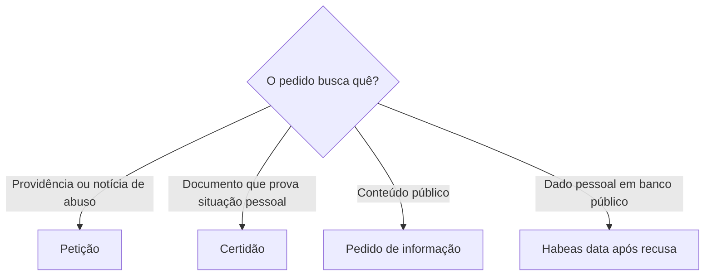

Este capítulo reúne garantias que limitam a atuação estatal e organizam a relação entre pessoa e Poder Público: defesa do consumidor, acesso a informações, petição, certidões, acesso à Justiça e proteção contra mudanças retroativas. A banca costuma trocar as finalidades dos instrumentos ou apresentar como absoluta uma garantia que admite limites. A leitura comparativa ajuda a reconhecer qual direito foi afetado e qual providência pode corrigi-lo.

> [!objetivos]
> - Identificar a finalidade dos incisos XXXII a XXXVI do art. 5º.
> - Diferenciar direito de petição, certidão, informação pública e habeas data.
> - Explicar inafastabilidade da jurisdição e suas hipóteses específicas de requerimento prévio.
> - Distinguir direito adquirido, ato jurídico perfeito e coisa julgada.

## Defesa do consumidor e acesso à informação

A Constituição determina que o Estado promova, na forma da lei, a defesa do consumidor (art. 5º, XXXII). A proteção é concretizada principalmente pelo Código de Defesa do Consumidor e também orienta a ordem econômica. Em prova, é importante perceber que a previsão constitucional não autoriza o Estado a ignorar relações de consumo quando uma entidade presta serviço público ou atua no mercado. As regras específicas dependem da relação jurídica e da legislação aplicável.

O inciso XXXIII assegura a todos o direito de obter dos órgãos públicos informações de interesse particular, coletivo ou geral, no prazo legal. O sigilo é exceção: a própria Constituição ressalva informação cujo segredo seja imprescindível à segurança da sociedade e do Estado. A Lei de Acesso à Informação organiza pedidos e transparência. O dever de publicidade alcança a Administração direta e indireta, observadas as hipóteses legítimas de sigilo e a proteção de dados pessoais.

> [!lei] CF, art. 5º, XXXIII
> todos têm direito a receber dos órgãos públicos informações de seu interesse particular, ou de interesse coletivo ou geral, que serão prestadas no prazo da lei, sob pena de responsabilidade, ressalvadas aquelas cujo **sigilo** seja imprescindível à segurança da sociedade e do Estado;

> [!exemplo]
> Uma candidata pede à corporação cópia dos critérios usados na correção de uma etapa de concurso. Em princípio, trata-se de informação de interesse particular que deve ser fornecida, sem prejuízo da proteção de dados de terceiros.

A tutela do acesso não deve ser confundida com o habeas data. Este último protege informações relativas à própria pessoa do impetrante em registros ou bancos de dados governamentais ou de caráter público. Se alguém pretende conhecer estudo administrativo geral ou obter documento institucional, a via adequada pode ser um pedido administrativo e, diante de ilegalidade, mandado de segurança; o habeas data não é instrumento para consultar dados alheios ou toda informação pública.

> [!pegadinha]
> A banca pode afirmar que qualquer negativa de informação gera habeas data. A finalidade do habeas data é pessoal e delimitada; informação pública geral não se converte em dado pessoal só porque o requerente a solicitou.

## Petição, certidão e gratuidade

O inciso XXXIV assegura a todos, sem pagamento de taxas, duas faculdades. O direito de petição dirige-se aos Poderes Públicos para defender direitos ou combater ilegalidade ou abuso de poder. A obtenção de certidão em repartição pública serve à defesa de direitos e ao esclarecimento de situação de interesse pessoal. São direitos de natureza administrativa, não dependem de advogado e podem ser exercidos por pessoa física ou jurídica, brasileira ou estrangeira.

| Instrumento | Para que serve | Exemplo |
| --- | --- | --- | 
| Petição | Defender direito ou impugnar ilegalidade ou abuso | Solicitar apuração de desconto funcional indevido | 
| Certidão | Provar situação pessoal ou defender direito | Obter certidão sobre tempo de serviço próprio | 
| Acesso à informação | Conhecer informação pública particular, coletiva ou geral | Pedir critérios gerais de distribuição de vagas | 
| Habeas data | Conhecer ou retificar dados da própria pessoa em banco público | Corrigir dado funcional inexato em cadastro público | 

A gratuidade constitucional de petição e certidão não elimina requisitos razoáveis de identificação e delimitação do pedido. A Lei 9.051/1995 prevê prazo de quinze dias para expedição de certidões voltadas à defesa de direitos e ao esclarecimento de situações. Se houver recusa ilegal, pode caber mandado de segurança. A cobrança de taxa como condição para exercer o direito constitucional é incompatível com o inciso XXXIV.

> [!bizu]
> Petição: pedir providência ou combater abuso. Certidão: obter prova formal. Acesso à informação: conhecer conteúdo público. Habeas data: acessar ou corrigir dado pessoal próprio.

## Acesso à Justiça e segurança jurídica

O princípio da inafastabilidade está no art. 5º, XXXV: a lei não pode excluir do Judiciário lesão ou ameaça a direito. O Brasil adota jurisdição una; decisões administrativas podem ser submetidas ao controle judicial, ainda que a Administração tenha encerrado seu processo. Como regra, não é necessário esgotar recursos administrativos antes de ajuizar ação.

Há situações em que a Constituição ou a jurisprudência exige um passo anterior delimitado. Ações relativas à disciplina e às competições desportivas só chegam ao Judiciário depois de esgotadas as instâncias da Justiça Desportiva, que deve decidir em até sessenta dias (art. 217, §§ 1º e 2º). Para habeas data, exige-se resistência ou omissão quanto ao acesso ou à retificação. Em matéria previdenciária, o STF exige prévio requerimento administrativo para caracterizar pretensão resistida, mas não o esgotamento dos recursos internos. Essas hipóteses não autorizam afirmar que toda demanda dependa de processo administrativo.

O inciso XXXVI protege direito adquirido, ato jurídico perfeito e coisa julgada contra prejuízo causado por lei nova. Direito adquirido é aquele cujos requisitos já foram cumpridos sob a lei anterior; expectativa surge quando ainda falta requisito. Ato jurídico perfeito é o que se consumou conforme a lei vigente ao tempo em que foi praticado. Coisa julgada é a decisão judicial que não pode mais ser alterada por recurso ordinário cabível.

| Garantia | Núcleo protegido | Teste prático | 
| --- | --- | --- |
| Direito adquirido | Situação incorporada por cumprimento dos requisitos | Todos os requisitos já estavam preenchidos? |
| Ato jurídico perfeito | Ato concluído segundo a lei da época | O ato já se consumou? |
| Coisa julgada | Estabilidade da decisão judicial definitiva | Não cabe mais recurso? |

> [!atencao]
> Segurança jurídica não significa congelar a legislação. A lei nova pode disciplinar fatos futuros e expectativas, mas não pode retirar as garantias do inciso XXXVI. No Direito Penal, há regra própria de retroatividade da lei mais benéfica.

## Mapa do capítulo

| Tema | Regra essencial | Instrumento ou limite |
| --- | --- | --- |
| Consumidor | Estado deve promover defesa na forma da lei | CDC concretiza a proteção |
| Informação | Acesso a informações públicas é regra | Sigilo constitucionalmente justificado é exceção |
| Petição e certidão | Gratuitas para todos | Finalidades distintas no inciso XXXIV |
| Jurisdição | Lesão ou ameaça pode ser levada ao Judiciário | Exceções pontuais de requerimento ou instância prévia |
| Segurança jurídica | Lei não prejudica direito adquirido, ato perfeito e coisa julgada | Expectativa não equivale a direito adquirido |

### Para fixar
- A informação pública pode ser particular, coletiva ou geral.
- Habeas data trata de dados da própria pessoa do impetrante.
- Petição combate ilegalidade ou abuso; certidão esclarece situação de interesse pessoal.
- A gratuidade do inciso XXXIV não depende de prova de pobreza.
- Regra geral: não se exige esgotamento da via administrativa.
- A Justiça Desportiva deve ser provocada antes do Judiciário em matéria disciplinar e competitiva.
- Direito adquirido pressupõe requisitos já cumpridos.
- Coisa julgada protege decisão judicial definitiva.

## Relações de consumo e limites da responsabilidade

A defesa do consumidor é direito fundamental e princípio da ordem econômica (art. 170, V). O Estado deve proteger a parte vulnerável por legislação, fiscalização e tutela administrativa e judicial. O Código de Defesa do Consumidor organiza direitos básicos, responsabilidade por produtos e serviços, práticas comerciais e mecanismos de defesa coletiva. Em matéria bancária, o STF reconheceu a incidência do CDC sobre serviços e operações das instituições financeiras (ADI 2.591); isso não substitui a análise de cada contrato nem autoriza o julgador a fixar juros sem observar o regime jurídico aplicável.

O transporte aéreo internacional ilustra a convivência entre fontes. No Tema 210, o STF reconheceu a prevalência das convenções internacionais de Varsóvia e Montreal, promulgadas pelo Brasil, sobre regras internas de responsabilidade quanto a danos materiais ligados a transporte internacional. A tese tem limite: em julgamentos posteriores, o Supremo distinguiu danos extrapatrimoniais, para os quais a tese do Tema 210 não impõe automaticamente os limites convencionais. A banca pode retirar essa delimitação e afirmar que as convenções prevalecem para qualquer dano; a generalização é incorreta.

> [!exemplo]
> Passageiro pede ressarcimento por bagagem extraviada em voo internacional. O enquadramento de prejuízo econômico deve considerar a convenção internacional aplicável e o Tema 210. Se o pedido for por dano moral, a questão exige análise distinta, pois o STF delimitou a tese e não estendeu automaticamente os limites convencionais a danos extrapatrimoniais.

## Publicidade, sigilo e direito de peticionar

O direito de informação não elimina a intimidade nem transforma todos os documentos em acesso irrestrito. A Lei de Acesso à Informação estabelece publicidade como diretriz e enumera transparência ativa e passiva, classificação de informações e proteção de dados pessoais. O órgão deve indicar a razão legal da restrição, não basta invocar genericamente “interesse público”. A informação pessoal recebe tratamento específico, e a segurança da sociedade ou do Estado pode justificar sigilo nos casos legais. A restrição precisa ser adequada à finalidade protegida e limitada ao necessário.

Uma informação sobre a remuneração de agente público no exercício de suas funções pode ser divulgada com dados necessários ao controle social, conforme jurisprudência do STF, porque há interesse público associado ao uso de recursos públicos. Isso não autoriza publicar indiscriminadamente toda informação privada da pessoa. A Administração deve separar dados funcionais sujeitos à transparência de dados pessoais sem relação necessária com a finalidade pública.

> [!pegadinha]
> O fato de um documento estar em órgão público não faz com que todos os seus dados sejam públicos. A regra de publicidade convive com sigilo legal, intimidade e proteção de dados; a resposta depende do conteúdo e da finalidade do acesso.

O direito de peticionar é uma forma direta de participar da Administração e provocar resposta, mas não equivale ao direito de ação. Qualquer pessoa pode formular pedido aos Poderes Públicos para defender direito ou combater ilegalidade ou abuso; não precisa demonstrar interesse econômico próprio para noticiar ilegalidade. O pedido pode ser feito sem advogado, mas deve permitir identificar a providência solicitada. A autoridade deve encaminhá-lo e apreciá-lo segundo as regras administrativas pertinentes.

A certidão é documento expedido por repartição pública para provar situação de interesse pessoal ou viabilizar a defesa de direito. Ela não é o mesmo que uma resposta a pedido de acesso. A Lei 9.051/1995 estabelece prazo de 15 dias para certidões requeridas a órgãos públicos da União, Estados, Distrito Federal e Municípios, observado o objeto previsto na lei. O prazo não pode ser confundido com prazo geral de resposta a todo pedido de informação, regido por disciplina distinta. A certidão pode ser usada para demonstrar tempo de serviço, vínculo funcional ou situação cadastral própria.

| Situação do interessado | Pedido inicial | Tutela judicial se houver recusa ilegal |
| --- | --- | --- |
| Quer provocar apuração de abuso | Direito de petição | Mandado de segurança pode assegurar o processamento ou resposta devida |
| Precisa de prova formal de situação própria | Certidão | Mandado de segurança, se presentes direito líquido e certo e prova documental |
| Quer acessar relatório público geral | Pedido pela LAI | Mandado de segurança pode proteger acesso, conforme o caso |
| Quer conhecer ou retificar cadastro próprio | Pedido direto ao controlador do dado | Habeas data após resistência ou omissão |

O não atendimento a petição não transforma automaticamente a questão em habeas data. O remédio adequado dependerá do direito lesado e do tipo de informação. A pessoa que pede certidão quer um documento com valor probatório; a pessoa que pede habeas data busca acesso ou correção de dado pessoal mantido em banco abrangido pela Constituição. A diferença entre esses pedidos resolve muitas questões.

## Acesso à Justiça, recursos administrativos e duplo grau

A inafastabilidade da jurisdição veda excluir do Poder Judiciário lesão ou ameaça a direito. O interessado pode buscar o Judiciário ainda que não tenha esgotado toda instância administrativa, e decisões administrativas não adquirem coisa julgada material contra o particular. O processo administrativo pode continuar ou ser encerrado conforme a relação entre as vias, mas a Administração não tem a última palavra jurisdicional.

O STF reconhece hipóteses específicas de requerimento prévio. No Tema 350, a concessão inicial de benefício previdenciário depende de pedido ao INSS e de indeferimento ou demora além do prazo para análise; não se exige recorrer até o fim da cadeia administrativa. O requerimento é dispensável quando a posição administrativa é notória e reiteradamente contrária, bem como em algumas hipóteses de revisão, restabelecimento ou manutenção de benefício já concedido, se não depender de fato novo. Também há condição constitucional para ações sobre disciplina e competições desportivas: primeiro se esgotam as instâncias da Justiça Desportiva, sujeita ao limite temporal do art. 217, § 2º. Habeas data exige resistência ao pedido de acesso ou retificação, pois, sem conflito, falta necessidade de tutela judicial.

> [!esquema] Quando há requisito prévio
> - Regra geral: acesso direto ao Judiciário sem esgotamento administrativo.
> - Benefício previdenciário inicial: requerimento e resistência ou demora, sem exaurimento de recursos.
> - Disciplina ou competição desportiva: esgotar instâncias desportivas.
> - Habeas data: comprovar recusa ou omissão sobre dado pessoal.

A reclamação constitucional por descumprimento de súmula vinculante pela Administração também tem requisito de esgotamento das vias administrativas, conforme lei específica. É uma hipótese restrita, não uma condição geral para ajuizar ações. Uma banca pode misturar essa regra com a reclamação apresentada contra decisão judicial; é preciso identificar quem descumpriu o enunciado e qual lei se aplica.

O acesso à jurisdição não assegura recurso contra toda decisão nem duplo grau ilimitado. A Constituição estabelece competências originárias em que há julgamento por um tribunal, sem uma segunda instância ordinária. A Convenção Americana de Direitos Humanos contém garantia de recorrer da sentença penal a juiz ou tribunal superior para a pessoa condenada; sua aplicação deve ser lida no âmbito penal e em conjunto com a estrutura constitucional. Portanto, a fórmula correta é que o duplo grau não é princípio constitucional absoluto para toda espécie de processo, embora existam garantias convencionais e recursos previstos para situações específicas.

O Supremo também protege o acesso ao Judiciário contra barreiras econômicas desproporcionais. A Súmula 667 do STF considera incompatível com a Constituição taxa judiciária calculada sem limite máximo sobre o valor da causa. A Súmula Vinculante 28 impede exigir depósito prévio como condição para ajuizar ação destinada a discutir exigibilidade de crédito tributário. Isso não significa que todo processo seja gratuito: custas podem ser previstas, com mecanismos de assistência e gratuidade para quem comprovar os requisitos legais.

## Estabilidade das relações jurídicas

Segurança jurídica protege confiança legítima e previsibilidade. O direito adquirido se distingue da expectativa porque no primeiro os requisitos materiais foram satisfeitos na vigência da lei antiga. Uma reforma pode alterar requisitos para o futuro e alcançar situações ainda em formação, respeitadas regras de transição, mas não pode apagar direito já incorporado. Ato jurídico perfeito se examina pela lei do tempo em que se concluiu o ato; a coisa julgada protege a decisão definitiva, sem impedir mecanismos excepcionais previstos na Constituição e na lei, como ação rescisória dentro dos pressupostos e prazo legais.

A irretroatividade do inciso XXXVI não proíbe toda retroação benéfica. A Súmula 654 do STF impede a entidade que editou lei retroativa benéfica de invocar a garantia de irretroatividade contra o beneficiário. No Direito Penal, há comando autônomo de retroatividade da lei mais favorável. A regra que protege o indivíduo não pode ser instrumentalizada pelo próprio Estado para retirar vantagem que ele concedeu por lei.

| Pergunta de prova | Identifique | Exemplo funcional |
| --- | --- | --- |
| Os requisitos já foram cumpridos? | Direito adquirido | Servidor completou todos os critérios para aposentadoria antes de mudança legislativa |
| O negócio ou ato já se consumou? | Ato jurídico perfeito | Contrato celebrado e concluído conforme legislação vigente no momento |
| A decisão ainda admite recurso comum? | Coisa julgada | Sentença definitiva protegida contra reabertura ordinária do mérito |
| A situação ainda dependia de condição? | Expectativa de direito | Pessoa ainda não cumpriu tempo ou requisito essencial |

> [!bizu]
> Leia o fato no tempo: requisito completo aponta a direito adquirido; ato concluído aponta ato perfeito; decisão irrecorrível aponta coisa julgada. Situação incompleta é, em regra, expectativa.

## Informação pública e transparência proporcional

A resposta a um pedido deve ser útil e suficientemente clara para que o cidadão entenda a decisão administrativa. O órgão pode indicar que a informação já está disponível em transparência ativa, orientar o canal responsável ou justificar uma negativa com fundamento legal. A simples remessa do requerente entre unidades sem decisão não satisfaz o dever de transparência. Quando há parte sigilosa e parte pública, a Administração deve avaliar fornecimento parcial, com ocultação apenas do trecho protegido, em vez de negar todo o documento sem exame.

A proteção da intimidade também não impede controle de atos funcionais. Dados sobre o exercício do cargo, despesas públicas e critérios de política administrativa podem ser relevantes à fiscalização social. O equilíbrio consiste em divulgar o que permite controle e preservar dado particular sem relação necessária com a atividade estatal. O pedido não precisa explicar motivação para acessar informação pública; a restrição deve estar ligada ao sigilo legal, não à opinião do requerente.

> [!exemplo]
> Um agente pede os critérios gerais de escala de serviço e recebe resposta que contém nome e contato pessoal de servidores. O órgão pode fornecer as regras de escala e resguardar dados privados sem relação com o pedido.

## Revisão, petição e controle judicial

Se a Administração deixa de responder pedido formulado no prazo pertinente, o interessado pode provocar a instância recursal administrativa prevista em lei ou buscar tutela jurisdicional. O mandado de segurança exige prova documental do protocolo, do conteúdo pedido, do prazo aplicável e da omissão ou negativa. Não basta alegar genericamente que “o órgão não informa”: é preciso demonstrar o pedido e a obrigação específica de resposta. Na certidão, identifique a situação pessoal ou a defesa de direito que justifica a emissão.

O direito de petição pode ser exercido para denunciar ilegalidade mesmo que o requerente não seja diretamente atingido. Já para obter certidão, o texto constitucional liga a finalidade à defesa de direitos e esclarecimento de situação de interesse pessoal. A resposta administrativa pode ser questionada quando houver recusa arbitrária, mas o peticionário não adquire, só por protocolar, o direito de obter a providência substantiva que pediu. A Administração deve analisar e decidir conforme competência, legalidade e procedimento.

> [!pegadinha]
> Peticionar assegura protocolar e obter apreciação adequada; não garante que o pedido seja deferido. Certidão prova uma situação; não substitui acesso a informação pública geral nem investigação do mérito de um processo administrativo.

## Mapa do capítulo

| Tema | Regra essencial | Ponto de atenção |
| --- | --- | --- |
| Defesa do consumidor | Dever estatal e princípio econômico | CDC alcança serviços bancários; convenções aéreas têm âmbito delimitado |
| Informação | Acesso a conteúdo público é regra | Sigilo e intimidade devem ter fundamento |
| Petição | Defesa de direitos ou combate a ilegalidade/abuso | Provoca análise, sem assegurar deferimento |
| Certidão | Prova formal para defesa de direito ou situação pessoal | Em regra, emissão gratuita; prazo legal específico |
| Jurisdição | Lesão ou ameaça pode ser submetida ao juiz | Requisitos prévios são exceções delimitadas |
| Segurança jurídica | Protege direito adquirido, ato perfeito e coisa julgada | Expectativa não tem igual proteção |

### Para fixar
- O CDC alcança serviços bancários, conforme entendimento do STF na ADI 2.591.
- O Tema 210 trata de limites de responsabilidade material no transporte aéreo internacional; não se estende automaticamente a dano moral.
- O pedido de certidão previsto na Lei 9.051/1995 tem prazo legal de 15 dias, dentro de seu âmbito.
- Pedido de acesso a informação pública não exige motivação do solicitante.
- A publicidade pode ceder a sigilo legal, segurança e intimidade em casos justificados.
- Direito de petição não significa direito automático ao deferimento do pedido.
- Tema 350 exige requerimento previdenciário inicial, mas não esgotamento dos recursos administrativos.
- Duplo grau não é garantia absoluta em todo processo ou competência originária.
- A irretroatividade protege situações consolidadas; expectativa de direito é distinta.
