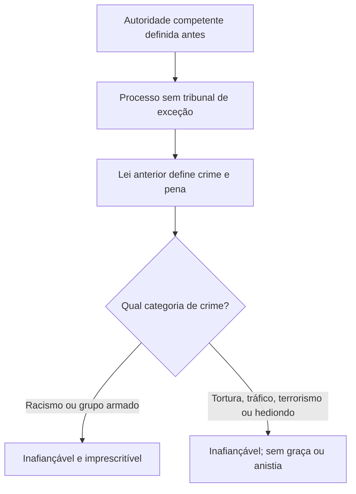

A Constituição protege a pessoa contra tribunais criados para julgar um caso específico e estabelece garantias penais que condicionam a punição estatal. Também reconhece o Tribunal do Júri com competência constitucional mínima e princípios próprios. Esses temas aparecem em questões de literalidade e em enunciados que misturam competência, legalidade e regras sobre crimes graves.

> [!objetivos]
> - Distinguir tribunal de exceção de juízo competente previamente definido.
> - Enumerar os princípios constitucionais do júri e sua competência mínima.
> - Aplicar legalidade e anterioridade penal.
> - Diferenciar racismo de tortura, tráfico, terrorismo e crimes hediondos quanto à fiança, graça, anistia e prescrição.

## Juiz natural e Tribunal do Júri

O art. 5º, XXXVII, proíbe juízo ou tribunal de exceção: ninguém pode ser submetido a órgão criado depois do fato para julgar determinada pessoa ou situação. A garantia se completa no inciso LIII, segundo o qual ninguém será processado nem sentenciado senão pela autoridade competente. O juiz natural decorre de regras gerais e anteriores de organização judiciária, distribuição e competência. A especialização de varas é válida quando definida por critérios abstratos; não se confunde com criar um tribunal sob medida para um caso.

> [!lei] CF, art. 5º, LIII
> Ninguém será processado nem sentenciado senão pela autoridade competente.

O júri é reconhecido pela Constituição e tem quatro garantias expressas: plenitude de defesa, sigilo das votações, soberania dos veredictos e competência para os crimes dolosos contra a vida. A plenitude de defesa, própria do júri, admite defesa técnica e autodefesa mais amplas que a defesa no procedimento comum. O sigilo resguarda a liberdade dos jurados ao votar. A soberania impede que o tribunal substitua livremente o veredicto, embora a lei permita novo julgamento em hipóteses recursais. A competência mínima alcança homicídio, induzimento ao suicídio, infanticídio e aborto quando dolosos, consumados ou tentados, conforme a lei penal.

> [!pegadinha]
> Soberania dos veredictos não significa irrecorribilidade absoluta. O sistema admite recurso e, em situação legal, novo julgamento, sem que o tribunal de apelação simplesmente condene ou absolva no lugar dos jurados.

A competência do júri é mínima, não exclusiva para qualquer crime que envolva morte. Crime culposo contra a vida não integra a competência constitucional do júri. Se houver conexão com crime doloso contra a vida, as regras processuais podem atrair o julgamento conjunto pelo júri, observado o procedimento legal.

## Legalidade penal e irretroatividade

O art. 5º, XXXIX, consagra legalidade e anterioridade: uma conduta só pode ser punida como crime e ter pena se lei anterior a tiver previsto. Em termos práticos, o Estado não pode criar crime por analogia contra o acusado, costume ou ato administrativo. A lei penal deve descrever a conduta e prever a consequência antes do fato. A reserva legal exige lei em sentido formal para definir crimes e penas.

O inciso XL determina que a lei penal nova só alcança fatos anteriores quando favorecer a pessoa acusada. A lei mais grave só alcança fatos praticados depois de sua vigência; a lei mais benéfica pode retroagir e alcançar processos em curso e condenações definitivas, nos limites aplicáveis. A abolitio criminis elimina a tipicidade penal do fato e faz cessar a execução e os efeitos penais da condenação, sem apagar automaticamente efeitos civis. Lei temporária ou excepcional segue disciplina legal própria quanto aos fatos praticados durante sua vigência.

> [!exemplo]
> Uma lei que aumenta a pena de determinado crime entra em vigor na segunda-feira. Conduta praticada no domingo continua sujeita ao regime anterior, ainda que a investigação comece depois da mudança.

> [!bizu]
> Na sucessão de leis penais, compare a regra antiga e a nova e aplique a mais favorável ao caso concreto; a lei mais severa não volta no tempo.

## Discriminação e crimes de tratamento constitucional rigoroso

O inciso XLI manda punir discriminação atentatória dos direitos e liberdades fundamentais. O inciso XLII trata especificamente do racismo: crime inafiançável e imprescritível, sujeito à reclusão, conforme a lei. A Lei 7.716/1989 tipifica condutas resultantes de discriminação ou preconceito de raça, cor, etnia, religião ou procedência nacional. O STF reconheceu que a injúria racial integra o gênero racismo para fins constitucionais, de modo que também é imprescritível. A legislação penal foi posteriormente ajustada para explicitar essa disciplina.

No inciso XLIII, tortura, tráfico ilícito de entorpecentes e drogas afins, terrorismo e crimes hediondos são inafiançáveis e insuscetíveis de graça ou anistia. A Constituição também determina responsabilização dos mandantes, executores e daqueles que, podendo evitar esses crimes, se omitirem. O inciso XLIV confere aos atos de grupos armados dirigidos a romper a ordem constitucional e o Estado Democrático o regime de inafiançabilidade e imprescritibilidade.

| Categoria constitucional | Fiança | Graça e anistia | Prescrição |
| --- | --- | --- | --- |
| Racismo | Inafiançável | Não há vedação expressa no inciso XLII | Imprescritível |
| Tortura, tráfico, terrorismo e hediondos | Inafiançáveis | Insuscetíveis | Regra geral de prescrição permanece |
| Ação de grupo armado contra ordem constitucional e Estado Democrático | Inafiançável | Sem vedação textual específica no inciso XLIV | Imprescritível |

A vedação a fiança não significa que a pessoa necessariamente permanecerá presa durante todo o processo: prisão cautelar depende dos requisitos legais. Do mesmo modo, a vedação de graça e anistia não deve ser confundida com indulto, embora a legislação e a jurisprudência restrinjam a concessão de benefícios para crimes hediondos e equiparados. Em questão, responda com a combinação constitucional exata e não amplie uma vedação além de seu texto sem base legal.

> [!atencao]
> Racismo e ação de grupos armados contra a ordem constitucional são inafiançáveis e imprescritíveis. Tortura, tráfico, terrorismo e crimes hediondos são inafiançáveis e não admitem graça ou anistia, mas a Constituição não os declara imprescritíveis.

## Mapa do capítulo

### Para fixar
- Juízo de exceção é criado para caso determinado; especialização geral e prévia é compatível com juiz natural.
- O júri tem plenitude de defesa, sigilo das votações, soberania dos veredictos e competência mínima para crimes dolosos contra a vida.
- Não há crime nem pena sem lei anterior.
- Lei penal mais benéfica retroage; lei mais grave não.
- Racismo é inafiançável e imprescritível.
- Tortura, tráfico, terrorismo e crimes hediondos são inafiançáveis e insuscetíveis de graça ou anistia.
- Esses crimes do inciso XLIII não são, só por essa previsão, imprescritíveis.
- A ação de grupo armado contra a ordem constitucional é inafiançável e imprescritível.
## Juiz natural, promotor natural e competência previamente fixada

A garantia do juiz natural exige que a competência decorra de regras gerais conhecidas antes do fato e que a causa seja julgada por órgão imparcial. Ela alcança órgãos de julgamento constitucionalmente previstos mesmo quando não integram o Poder Judiciário. Regras de competência não podem ser moldadas depois da ocorrência para selecionar o julgador de um réu específico. A distribuição entre varas especializadas pode ser legítima se adotar critérios abstratos e respeitar a competência constitucional de outros órgãos.

A exigência de imparcialidade também sustenta a ideia de promotor natural: o órgão de acusação deve ser definido por critérios prévios e impessoais, sem designação casuística para um processo. Isso protege a independência da atuação ministerial e a igualdade processual. Em prova, o princípio é mais amplo que a proibição de criar um tribunal ad hoc; abrange o respeito às regras objetivas de competência.

## Competência do júri e suas exceções

O Tribunal do Júri tem competência constitucional mínima para crimes dolosos contra a vida. O conjunto inclui homicídio, induzimento, instigação ou auxílio a suicídio ou automutilação nos casos tipificados, infanticídio e aborto, desde que presentes os elementos do dolo e as regras processuais. Crime culposo contra a vida não entra nessa competência mínima. O júri é presidido por juiz togado e decide por jurados; a quantidade e a forma de seleção seguem o Código de Processo Penal, não devem ser confundidas com o número de garantias constitucionais do inciso XXXVIII.

A competência pode atrair infrações conexas segundo a legislação processual, mas não se pode deslocar o núcleo constitucional do júri por lei estadual ou por criação de vara especializada. A competência do júri prevalece sobre foro especial estabelecido exclusivamente por Constituição estadual, conforme Súmula Vinculante 45 do STF. Já prerrogativa de foro prevista diretamente na Constituição Federal pode alterar a competência, se presentes os requisitos firmados pelo Supremo, inclusive relação entre o crime e o cargo nas hipóteses pertinentes.

> [!exemplo]
> Um agente público com foro criado apenas pela Constituição estadual é acusado de homicídio doloso. A regra estadual não afasta automaticamente o julgamento pelo júri. Se a prerrogativa tiver fundamento direto na Constituição Federal e incidir segundo os critérios jurisprudenciais, a análise de competência será diferente.

O latrocínio é roubo qualificado pelo resultado morte e, apesar da morte, é classificado como crime patrimonial. A competência é do juiz singular, e não do júri (Súmula 603 do STF). Esse exemplo demonstra por que a prova não deve usar apenas a presença de resultado morte para identificar a competência: é preciso classificar o tipo penal e verificar o elemento subjetivo em relação à morte.

A plenitude de defesa é garantia específica do júri e amplia a defesa técnica e a autodefesa perante jurados leigos. O sigilo das votações protege a liberdade de decidir, sem eliminar a publicidade dos demais atos processuais cabível. A soberania dos veredictos impede substituição livre da conclusão dos jurados pelo tribunal, mas não exclui recursos previstos em lei; em hipóteses excepcionais, pode haver novo julgamento pelo júri. Portanto, “soberano” não significa que toda decisão seja irrecorrível.

> [!esquema] Competência do Tribunal do Júri
> - Crime doloso contra a vida: regra constitucional do júri.
> - Crime culposo contra a vida: competência comum, salvo atração processual por conexão legal.
> - Latrocínio: juiz singular, conforme Súmula 603 do STF.
> - Foro criado só por Constituição estadual: prevalece o júri, conforme SV 45.

## Lei penal no tempo e mudança legislativa

A legalidade penal impede que o Estado defina crime ou pena sem lei anterior. O princípio envolve reserva legal, anterioridade e determinação: o tipo deve permitir que a pessoa compreenda quais condutas são proibidas. Analogia pode favorecer o acusado quando admitida, mas não pode criar crime nem aumentar pena contra ele. Um ato administrativo pode complementar aspecto técnico quando a lei estabelece os elementos essenciais, mas não pode substituir a lei na definição central da infração penal.

A sucessão de leis pode assumir formas distintas. A lei nova incriminadora cria crime ou pena para conduta antes não punida; não alcança fato anterior. A novatio legis in pejus torna a situação mais grave e também não retroage. A novatio legis in mellius favorece o réu e pode retroagir, inclusive após condenação definitiva, enquanto não estiver integralmente exaurida a execução penal. Se uma lei deixa de considerar crime o fato, há abolitio criminis, que extingue efeitos penais da condenação e a execução, sem desfazer automaticamente obrigações civis decorrentes.

| Mudança legislativa | Exemplo abstrato | Aplicação temporal |
| --- | --- | --- |
| Lei incriminadora | Nova lei passa a punir conduta antes lícita | Só fatos posteriores à vigência |
| Novatio in pejus | Aumenta pena ou elimina benefício penal | Não retroage |
| Novatio in mellius | Reduz pena ou amplia causa de diminuição | Retroage para beneficiar |
| Abolitio criminis | Revoga a tipicidade de uma conduta | Alcança fatos anteriores, cessando efeitos penais |

Lei temporária tem duração previamente delimitada; lei excepcional vigora enquanto persistir uma circunstância anormal que a justificou. Em regra, ambas continuam aplicáveis ao fato praticado durante sua vigência mesmo depois de cessada a duração ou a situação excepcional, se assim determinar a disciplina legal: é ultratividade. A finalidade é evitar que a pessoa se beneficie simplesmente porque o prazo da lei acabou depois de praticar a conduta. Não confunda ultratividade com retroatividade de lei mais benéfica: são problemas temporais diferentes.

> [!exemplo]
> Durante uma emergência reconhecida, lei excepcional pune desvio de insumos destinados a salvamento. A emergência termina, mas a regra penal pode continuar sendo aplicada ao desvio ocorrido enquanto ela vigorava, observadas as normas sobre vigência e sucessão de leis.

## Discriminação e mandados constitucionais de proteção

O inciso XLI determina que a lei puna discriminações que atinjam direitos e liberdades fundamentais. O inciso XLII dá tratamento expresso ao racismo: inafiançabilidade, imprescritibilidade e reclusão. A Lei 7.716/1989 tipifica delitos de discriminação por raça, cor, etnia, religião ou procedência nacional. Racismo não se limita a ofensa individual: pode abranger prática dirigida a grupo e a injúria racial, que a Lei 14.532/2023 inseriu como modalidade da legislação de crimes raciais. A ação penal da injúria racial é pública incondicionada segundo a redação legal vigente.

No HC 82.424, o STF entendeu que discriminação antissemita pode constituir racismo para fins constitucionais. Na ADO 26 e no MI 4.733, a Corte enquadrou condutas homofóbicas e transfóbicas na proteção penal contra racismo enquanto persistir a omissão legislativa, com a ressalva de que liberdade religiosa não protege discurso de ódio ou incitação à discriminação. A interpretação exige examinar a conduta; não transforma toda manifestação religiosa ou crítica em crime.

> [!atencao]
> O inciso XLI é comando para que a lei puna formas de discriminação atentatórias a direitos. A jurisprudência do STF sobre homotransfobia supre omissão legislativa enquanto não houver disciplina específica, mas deve ser aplicada sem apagar as liberdades constitucionais exercidas licitamente.

Para as categorias de crimes rigorosamente tratadas nos incisos XLII a XLIV, a combinação jurídica é mais importante do que o rótulo genérico “crime grave”. Racismo e ação de grupo armado contra a ordem constitucional são imprescritíveis e inafiançáveis. Tortura, tráfico, terrorismo e crimes hediondos são inafiançáveis e não admitem graça ou anistia; não recebem por isso a qualificação de imprescritíveis. A lei define quais infrações são hediondas e as consequências penais correspondentes, mas não pode ampliar por analogia o conjunto constitucional de crimes imprescritíveis.

A distinção entre reclusão e detenção também pode aparecer em questões sobre racismo. A Constituição menciona reclusão para o racismo; a detenção não substitui esse comando. A diferença entre as espécies de pena privativa de liberdade decorre do Código Penal e interfere nos regimes iniciais que podem ser fixados, sem tornar automática uma modalidade de regime em toda condenação. O regime concreto depende da pena aplicada e dos requisitos legais.

## Mapa do capítulo

| Garantia | Conteúdo | Regra de prova |
| --- | --- | --- |
| Juiz natural | Órgão imparcial definido por competência prévia | Proíbe seleção casuística de julgador |
| Júri | Defesa plena, sigilo, soberania e crimes dolosos contra a vida | Latrocínio vai ao juiz singular |
| Legalidade | Lei prévia e determinada define crime e pena | Analogia não pode agravar situação penal |
| Sucessão de leis | Lei mais favorável retroage; lei mais gravosa não | Lei temporária pode ter ultratividade |
| Racismo | Inafiançável, imprescritível e punido com reclusão | Injúria racial integra a legislação antirracismo |
| Crimes do inciso XLIII | Inafiançáveis e sem graça ou anistia | Não são imprescritíveis por esse inciso |

### Para fixar
- Juiz natural abrange competência previamente fixada e imparcialidade.
- O júri tem competência constitucional mínima para crimes dolosos contra a vida.
- Latrocínio é julgado por juiz singular, segundo a Súmula 603 do STF.
- Foro previsto só em Constituição estadual não afasta júri, conforme SV 45.
- Lei incriminadora e novatio in pejus não retroagem.
- Novatio in mellius retroage; abolitio criminis cessa efeitos penais.
- Lei excepcional ou temporária pode ser ultra-ativa para fato praticado durante sua vigência.
- Racismo é inafiançável, imprescritível e punido com reclusão.
- Tortura, tráfico, terrorismo e hediondos não são imprescritíveis por previsão do inciso XLIII.

O foro por prerrogativa não deve ser presumido a partir do cargo mencionado no enunciado. Verifique se o foro está previsto na Constituição Federal, em Constituição estadual ou apenas em lei. Essa fonte normativa interfere na relação com o júri. A SV 45 resolve a hipótese de prerrogativa criada exclusivamente por Constituição estadual; ela não elimina foros estabelecidos diretamente pelo texto federal. A competência também pode depender de que o fato tenha sido praticado durante o exercício do cargo e em razão das funções, segundo a jurisprudência pertinente.

A legalidade é especialmente importante para crimes que dependem de complementação técnica. A lei deve fixar os elementos essenciais da conduta, ainda que permita a ato normativo atualizar parâmetros técnicos definidos. A pessoa não pode receber sanção penal com base em proibição criada depois do fato ou em interpretação imprevisível que amplie o tipo contra ela. Em contrapartida, norma interpretativa posterior mais benigna pode orientar casos pretéritos, desde que não seja uma inovação incriminadora disfarçada.

A retroatividade da lei penal benigna não se limita ao momento entre fato e sentença. Pode operar mesmo depois de condenação definitiva, pois a garantia afeta a própria execução da pena. Ao comparar regimes, observe se a alteração reduz o mínimo ou máximo da sanção, cria causa de diminuição, retira qualificadora ou deixa de criminalizar a conduta. A mudança mais benéfica deve ser aplicada; a mais gravosa não alcança fato pretérito.

A expressão “racismo” recebe interpretação constitucional ampla, que protege grupos contra discriminação e não apenas uma cor de pele determinada. O STF reconheceu que discriminação antissemita contra a comunidade judaica configura racismo. A injúria racial, dirigida a pessoa determinada mediante elemento racial, foi incorporada pela legislação como modalidade de crime racial e recebe tratamento constitucional compatível com a imprescritibilidade. O vocábulo “branco” não restringe a proteção: a tutela decorre do conteúdo discriminatório e do grupo atingido, não de uma fórmula cromática limitada.

Reclusão e detenção são espécies distintas de pena privativa de liberdade. A reclusão admite início em regimes fechado, semiaberto ou aberto, conforme o caso; a detenção começa em regra nos regimes semiaberto ou aberto, ressalvadas situações legais de transferência. A individualização impede que a espécie nominal da pena, isoladamente, determine o regime em toda condenação. O juiz deve considerar quantidade de pena e circunstâncias legais e fundamentar a escolha.

Para não confundir os incisos XLII a XLIV, associe cada característica a seu suporte constitucional. Racismo e ação armada contra a ordem constitucional são inafiançáveis e imprescritíveis. Tortura, tráfico, terrorismo e crimes hediondos são inafiançáveis e não admitem graça ou anistia. A distinção também impede que se atribua a uma categoria imprescritibilidade só por ela ser grave ou estar submetida a regime mais severo.

## Mapa do capítulo

| Tema | Síntese |
| --- | --- |
| Juiz natural e júri | Competência prévia, imparcialidade e julgamento popular de crime doloso contra a vida |
| Legalidade no tempo | Lei penal posterior benéfica pode retroagir; lei prejudicial não |
| Discriminação | Racismo é inafiançável e imprescritível; lei especifica os tipos |
| Crimes do inciso XLIII | Inafiançabilidade e proibição de graça ou anistia, sem imprescritibilidade constitucional |

### Para fixar
- Juiz natural vincula julgador a regras gerais e imparciais anteriores ao caso.
- O Tribunal do Júri julga crimes dolosos contra a vida, respeitadas competências constitucionais.
- Latrocínio, por ser crime patrimonial, é julgado por juiz singular.
- A lei penal mais benigna pode retroagir inclusive após condenação definitiva.
- Lei temporária e excepcional podem ter ultratividade quanto ao fato praticado durante a vigência.
- Racismo inclui a injúria racial nos termos da legislação vigente.
- A ação armada contra a ordem constitucional é inafiançável e imprescritível.
- Crimes do inciso XLIII não se tornam imprescritíveis apenas por serem hediondos ou equiparados.
