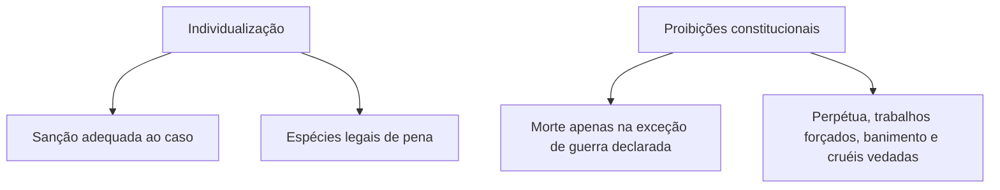

A Constituição combina limites ao poder de punir com a exigência de que a resposta penal considere o caso concreto. Este capítulo detalha a intranscendência da pena, as espécies de sanção admitidas, as proibições constitucionais e a relação entre inafiançabilidade, graça, anistia e prescrição. A distinção entre essas consequências é recorrente em questões de direitos fundamentais.

> [!objetivos]
> - Explicar a responsabilidade pessoal pela pena e a extensão patrimonial permitida.
> - Reconhecer as espécies de pena previstas constitucionalmente.
> - Diferenciar as penas proibidas e a exceção constitucional à pena de morte.
> - Comparar os regimes dos incisos XLIII e XLIV do art. 5º.

## Pessoalidade e individualização

O art. 5º, XLV, consagra a intranscendência: nenhuma pena passa da pessoa do condenado. A consequência penal recai sobre quem foi condenado, e não sobre familiares. A própria Constituição admite que a obrigação de reparar o dano e o perdimento de bens sejam executados contra sucessores, mas somente até o limite do patrimônio transferido. Não há transferência de pena criminal nem responsabilidade patrimonial ilimitada dos herdeiros.

O inciso XLVI determina que a lei regule a individualização da pena e apresenta um rol exemplificativo de espécies: privação ou restrição da liberdade, perda de bens, multa, prestação social alternativa e suspensão ou interdição de direitos. Individualizar significa ajustar a sanção à infração e à situação do condenado, dentro dos limites legais, em etapas legislativa, judicial e executória. A lista é aberta porque o texto diz “entre outras”.

> [!exemplo]
> Um condenado deixa patrimônio para seus filhos. A reparação civil fixada na condenação pode alcançar os bens herdados até o valor recebido; a pena de prisão, porém, não pode ser cumprida pelos filhos.

> [!pegadinha]
> Intranscendência não impede toda consequência patrimonial após a morte. Reparação e perdimento podem alcançar sucessores, limitados ao patrimônio transferido, sem converter herdeiros em condenados.

## Penas proibidas e exceção

O inciso XLVII lista as sanções proibidas: morte, exceto na hipótese constitucional de guerra declarada; prisão perpétua; trabalho forçado; banimento; e pena cruel. A proibição de perpetuidade impede sanção sem limite final, mas não deve ser confundida com uma pena longa que tenha duração legal determinada. A Constituição não define sozinha o catálogo de delitos ou o cálculo da sanção: a legislação penal detalha esses pontos.

A sanção capital é reservada à situação de guerra declarada, na forma prevista para a competência do Presidente da República no art. 84, XIX. A autorização do Congresso Nacional é exigida, ressalvado o referendo posterior se a agressão estrangeira ocorrer entre sessões legislativas. Fora desse cenário excepcional, o Estado não pode aplicar pena de morte.

> [!lei] CF, art. 5º, XLVII
> não haverá penas:
> a) de morte, salvo em caso de **guerra declarada**, nos termos do art. 84, XIX;
> b) de caráter perpétuo;
> c) de trabalhos forçados;
> d) de banimento;
> e) cruéis;

## Regimes constitucionais rigorosos

É necessário separar as categorias constitucionais em vez de presumir que todo crime grave tem o mesmo regime. Racismo e ação de grupos armados contra a ordem constitucional e o Estado Democrático são inafiançáveis e imprescritíveis. Tortura, tráfico ilícito de entorpecentes, terrorismo e crimes hediondos são inafiançáveis e insuscetíveis de graça ou anistia. O inciso XLIII também prevê responsabilidade dos mandantes, executores e de quem, podendo evitar o crime, se omitir.

| Categoria | Inafiançável | Imprescritível | Sem graça ou anistia |
| --- | --- | --- | --- |
| Racismo | Sim | Sim | Não indicado pelo inciso XLII |
| Tortura, tráfico, terrorismo e hediondos | Sim | Não por essa regra constitucional | Sim |
| Grupo armado contra ordem constitucional e Estado Democrático | Sim | Sim | Não indicado pelo inciso XLIV |

A fiança é uma forma de contracautela ligada à liberdade provisória, não uma pena. A inafiançabilidade, portanto, não determina prisão automática: a prisão preventiva exige pressupostos próprios. Prescrição limita temporalmente a pretensão punitiva ou executória; graça é clemência individual e anistia é benefício concedido por lei para fatos definidos. A prova pode apresentar um dos institutos no lugar do outro.

> [!atencao]
> Não marque como imprescritíveis os crimes do inciso XLIII apenas porque são inafiançáveis e não admitem graça ou anistia. O texto constitucional reserva imprescritibilidade ao racismo e à ação de grupo armado do inciso XLIV.

## Mapa do capítulo

### Para fixar
- A pena não passa da pessoa do condenado.
- Reparação e perdimento podem atingir sucessores até o valor herdado.
- As penas do inciso XLVI são exemplificativas.
- A Constituição veda pena perpétua, trabalhos forçados, banimento e penas cruéis.
- Pena de morte só se admite em guerra declarada, nos termos constitucionais.
- Inafiançabilidade não equivale a prisão cautelar automática.
- Racismo é imprescritível; crimes do inciso XLIII não o são por essa regra.
- Ação de grupo armado contra a ordem constitucional também é imprescritível.

## Extradição e limites constitucionais

Extradição é cooperação entre Estados pela qual um Estado entrega uma pessoa ao outro para responder a processo penal ou cumprir pena. Quando o Brasil pede a entrega a país estrangeiro, a extradição é ativa; quando outro Estado pede ao Brasil, é passiva. O inciso LI do art. 5º estabelece proteção diferenciada conforme a nacionalidade. Brasileiro nato não é extraditado pelo Brasil. Brasileiro naturalizado pode ser entregue em duas situações constitucionais: crime comum praticado antes da naturalização ou comprovado envolvimento em tráfico ilícito de drogas, sem limite temporal para essa segunda hipótese. A condição de cônjuge ou de pai/mãe de brasileiro não impede, por si, a extradição (Súmula 421 do STF).

O estrangeiro pode ser extraditado, exceto por crime político ou de opinião, conforme o inciso LII. A classificação do delito como político depende do caso concreto e é apreciada pelo Supremo Tribunal Federal. Asilo político e extradição não são necessariamente incompatíveis: a concessão administrativa de asilo não elimina automaticamente a competência judicial de analisar o pedido. A condição de refugiado igualmente não bloqueia de modo absoluto toda solicitação; deve-se examinar a relação entre os fatos do pedido, a base do reconhecimento e a legislação aplicável.

| Pessoa reclamada | Regra constitucional brasileira | Exceção relevante |
| --- | --- | --- |
| Brasileiro nato | Não pode ser extraditado | Perda válida da nacionalidade altera a condição jurídica da pessoa |
| Brasileiro naturalizado | Proteção contra entrega | Crime comum anterior à naturalização ou comprovado envolvimento em tráfico de drogas |
| Estrangeiro | Pode ser extraditado se atendidos os requisitos legais | Não se concede por crime político ou de opinião |
| Português equiparado | A proteção aplicável segue os direitos de equiparação reconhecidos | Incidem os limites constitucionais e convencionais pertinentes |

A Lei de Migração exige base jurídica para cooperação: tratado entre os Estados ou promessa de reciprocidade nas hipóteses previstas. A extradição passiva tem uma fase administrativa de recebimento e instrução, uma etapa judicial perante o STF e, se autorizada, a fase de entrega sob responsabilidade do Poder Executivo. A competência originária do STF para processar e julgar a extradição solicitada por Estado estrangeiro está no art. 102, I, g, da Constituição. O exame judicial confere legalidade e requisitos, e não reavalia livremente a conveniência política como se fosse tribunal penal do Estado requerente.

Para autorizar a entrega, o STF verifica, entre outros pontos, identidade da pessoa, documentação, dupla tipicidade, ausência de extinção da punibilidade pertinente, natureza não política do delito e garantias mínimas de processo. Dupla tipicidade significa que o fato deve corresponder a infração penal tanto no Brasil como no Estado requerente, embora a nomenclatura dos crimes possa ser diferente. Não basta que o Estado requerente atribua um rótulo penal que não tenha correspondência criminal no Brasil.

> [!exemplo]
> Um Estado estrangeiro pede a entrega de uma pessoa naturalizada brasileira por fato ocorrido antes da naturalização. A análise começa pela exceção do art. 5º, LI; depois, o STF verifica os requisitos legais, como dupla tipicidade e documentação. A nacionalidade adquirida não encerra o exame, mas também não autoriza entrega automática.

O art. 5º, XXXVII e LIII, também orienta a análise: não se admite entrega se a pessoa for julgada por tribunal de exceção. Se o Estado requerente prevê pena de morte fora da hipótese admitida no Brasil, deve haver garantia de comutação; pena perpétua também demanda adequação aos limites aceitos pelo ordenamento brasileiro. Há uma atualização relevante em relação a textos antigos: o Código Penal passou a prever limite geral de cumprimento de 40 anos após a Lei 13.964/2019, mas o art. 96 da Lei de Migração mantém, para a condição de extradição, a comutação a pena privativa de liberdade com limite máximo de 30 anos. Assim, não se deve aplicar automaticamente o limite geral de execução penal ao compromisso específico exigido para extraditar.

> [!atencao]
> Cuidado com fontes que apontam 40 anos como limite para a comutação na extradição. O limite legal específico do art. 96, III, da Lei 13.445/2017 é 30 anos, embora o limite geral de cumprimento de penas no Código Penal tenha sido elevado para 40 anos.

A autorização do STF é controle judicial da legalidade e procedência. A efetivação da entrega envolve decisão do Presidente da República como chefe de Estado, observados os tratados e os limites jurídicos da cooperação. Se o STF negar o pedido, o Executivo não pode entregar a pessoa. O STF já esclareceu que a entrega não é um ato exclusivamente judicial: a cooperação internacional envolve a representação externa da República e a disciplina de tratado.

## Individualização, execução e integridade dos presos

A individualização prevista no art. 5º, XLVI, opera em diferentes momentos. Primeiro, o legislador define sanções e faixas sem impor uma resposta invariável a todos os casos. Depois, o juiz fixa a pena concreta, com fundamentação e critérios legais. Na execução, o regime e os benefícios também devem considerar requisitos da lei e a situação individual. Uma proibição absoluta que dispense toda análise pessoal pode esvaziar a garantia. O STF declarou inconstitucional a imposição de cumprimento integralmente fechado que impedia qualquer progressão para crimes hediondos, e editou a Súmula Vinculante 26 para orientar a análise judicial dos requisitos objetivos e subjetivos, com exame criminológico fundamentado quando necessário.

A Súmula Vinculante 56 estabelece que a falta de estabelecimento adequado não autoriza manter condenado em regime mais gravoso. O juízo da execução deve observar parâmetros definidos pelo STF e buscar solução compatível com o regime devido. Isso não significa liberdade automática quando há falta de vaga; significa que a deficiência estrutural do Estado não permite agravar a situação prisional sem fundamento.

As penas devem ser executadas em estabelecimentos distintos conforme natureza do delito, idade e sexo do apenado (inciso XLVIII). A Constituição protege a integridade física e moral dos presos (XLIX), e garante às presidiárias condições para permanecer com os filhos durante o período de amamentação (L). A perda da liberdade não retira direitos fundamentais compatíveis com a custódia. Em situação de superlotação ou violação estatal, a responsabilidade e a reparação dependem de prova e do regime jurídico correspondente, mas a proteção constitucional não desaparece.

> [!bizu]
> Para classificar cada garantia penal, faça uma tabela mental: “qual pena?”, “qual restrição?”, “qual consequência?”. Fiança diz respeito à possibilidade de liberdade mediante garantia; prescrição limita o tempo para punir; graça e anistia afastam efeitos penais por formas diferentes de clemência.

## Mapa do capítulo

| Grupo | Conteúdo essencial | Referência de prova |
| --- | --- | --- |
| Intranscendência | Pena pessoal; reparação/perdimento limitados ao patrimônio transferido | Inciso XLV |
| Individualização | Rol exemplificativo e análise em lei, sentença e execução | Incisos XLVI e SV 26 |
| Penas vedadas | Perpétua, forçados, banimento e cruéis; morte só em guerra declarada | Inciso XLVII |
| Extradição | Proteção varia por nacionalidade e hipótese constitucional | Incisos LI e LII; art. 102, I, g |
| Execução | Regime deve corresponder à lei e à condição individual | SV 26 e SV 56 |
| Custódia | Integridade e garantias específicas de mulheres presas | Incisos XLVIII a L |

### Para fixar
- A extradição ativa é solicitada pelo Brasil; na passiva, o Estado estrangeiro pede entrega ao Brasil.
- Brasileiro nato não é extraditado; naturalizado pode ser nas hipóteses constitucionais do inciso LI.
- Estrangeiro não é extraditado por crime político ou de opinião.
- Dupla tipicidade exige correspondência criminal do fato nos dois países, sem exigir identidade de nomenclatura.
- Cabe ao STF analisar legalidade e procedência da extradição requerida por Estado estrangeiro.
- O limite da comutação exigida na extradição (30 anos) não se confunde com o limite geral de cumprimento no CP (40 anos).
- As SV 26 e 56 impedem, respectivamente, vedação absoluta à progressão e regime mais gravoso só por falta de vaga adequada.
- Integridade física e moral dos presos é assegurada pela Constituição.

A análise não é uma revisão do mérito da acusação como se o STF julgasse o delito estrangeiro. O Supremo confere se os pressupostos constitucionais e legais estão presentes, e a defesa pode discutir a identidade, defeitos essenciais de documentação e impedimentos jurídicos à entrega. A autoridade estrangeira deve apresentar documentos autenticados e informações suficientes sobre o fato e sua tipificação. A concordância do extraditando, por si só, não converte a cooperação em entrega automática: os requisitos de legalidade e de proteção de direitos permanecem relevantes.

A extradição também deve respeitar a especialidade: a pessoa entregue não pode ser processada por fato anterior diferente daquele que fundamentou o pedido, salvo exceções previstas em tratado ou com consentimento brasileiro. O Estado requerente assume compromissos relacionados ao cômputo do tempo de prisão cumprido no Brasil, à não entrega subsequente a terceiro Estado sem consentimento, à ausência de agravamento por motivo político e à vedação de tortura ou tratamento cruel, desumano ou degradante. Essas condições concretizam a proteção constitucional dos direitos humanos no campo da cooperação penal.

> [!pegadinha]
> O STF autorizar o pedido não significa que o Presidente esteja obrigado a efetivar a entrega em qualquer circunstância. Mas uma negativa judicial de extradição impede o Executivo de entregar a pessoa com base naquele pedido.

A distinção entre penas constitucionais e compromissos extradicionais também merece atenção. A Constituição brasileira admite excepcionalmente pena de morte em guerra declarada, mas um pedido comum de extradição não pode ser atendido sem as garantias de comutação exigidas. O Brasil tampouco entrega alguém para ser julgado por tribunal de exceção. Essas condições permitem cooperar com outro Estado sem abandonar as garantias constitucionais mínimas.

A proteção dos presos completa a individualização. A separação por natureza do delito, idade e sexo ajuda a adequar a execução e a reduzir riscos de violação. A regra sobre amamentação protege a convivência materno-infantil durante etapa específica, sem transformar a custódia em suspensão geral dos direitos da criança ou da mãe. A Administração penitenciária deve adotar condições compatíveis com a dignidade e com a finalidade legal da execução.

A responsabilidade estatal por condições prisionais pode gerar reparação quando demonstrados dano e nexo com atuação ou omissão estatal, mas a questão de prova costuma testar a regra constitucional: integridade física e moral deve ser respeitada mesmo sob custódia. A prisão restringe a locomoção e outros direitos definidos em lei, não autoriza violência ou tratamento degradante.

> [!esquema] Da extradição à entrega
> - Pedido estrangeiro recebido pelos canais oficiais e instruído com base jurídica.
> - Análise judicial pelo STF dos requisitos constitucionais, legais e documentais.
> - Se houver impedimento, o pedido é negado e a entrega não pode ocorrer.
> - Se autorizada, a etapa de efetivação cabe ao Executivo sob os compromissos assumidos pelo Brasil.

A prova pode explorar a diferença entre o limite da pena no país requerente e o tempo máximo de execução admitido no Brasil. Se houver risco de pena incompatível, o compromisso de comutação deve ser suficiente e juridicamente válido antes da entrega. Registre o regime especial da Lei de Migração: seu limite legal específico não foi alterado automaticamente pela mudança do art. 75 do Código Penal. A reforma elevou o máximo geral de cumprimento no Brasil, mas não substituiu o limite expresso da garantia extradicional.

A responsabilização por crime praticado por agente estatal durante a custódia também pode envolver responsabilização penal, civil e administrativa, cada qual com requisitos próprios. Para o candidato, basta não confundir essa possibilidade com transferência de pena aos familiares: a intranscendência impede a sanção penal contra terceiros, enquanto o Estado deve preservar a pessoa sob sua guarda.

