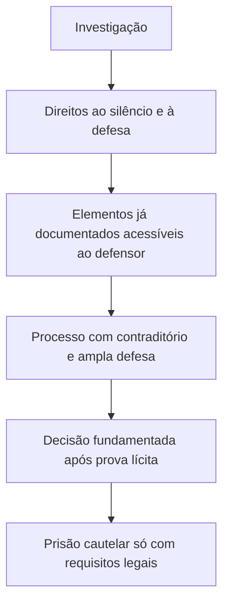

Este capítulo integra o estudo dos direitos e deveres individuais e coletivos e reúne garantias que condicionam a privação da liberdade e dos bens e a aplicação de sanções. Contraditório, ampla defesa, licitude da prova e presunção de inocência operam em conjunto, mas não são sinônimos. O capítulo também aborda identificação criminal, publicidade processual e comunicação da prisão, temas em que a banca costuma trocar regra e exceção.

> [!objetivos]
> - Identificar as dimensões do devido processo legal.
> - Distinguir contraditório de ampla defesa.
> - Aplicar a regra de inadmissibilidade de provas ilícitas.
> - Reconhecer as hipóteses constitucionais de prisão e as garantias do preso.

## Devido processo, contraditório e defesa

O inciso LIV do art. 5º proíbe que alguém seja privado da liberdade ou de seus bens sem devido processo legal. A garantia tem dimensão formal, que exige procedimento previsto e respeito às etapas legais, e dimensão material, que impede medidas arbitrárias ou desproporcionais. Aplica-se a processos judiciais e, com adequações, a procedimentos administrativos que possam afetar direitos.

O inciso LV assegura contraditório e ampla defesa a quem participa de processo perante juiz ou Administração, assim como a toda pessoa submetida a acusação. Contraditório é ciência dos atos relevantes e oportunidade real de responder e influenciar a decisão. Ampla defesa compreende defesa técnica quando exigida e autodefesa, além de meios e recursos admitidos. Não se confunde oportunidade de participar com direito a vencer: a autoridade pode decidir contra a parte depois de garantir procedimento justo.

> [!exemplo]
> Em processo disciplinar, o servidor deve conhecer a imputação, acessar elementos pertinentes e ter prazo para se manifestar e produzir provas lícitas. A Administração não pode aplicar sanção surpresa com base em fato que nunca foi submetido à defesa.

> [!pegadinha]
> Contraditório não é apenas receber uma notificação. Deve haver possibilidade de participação efetiva antes da decisão, ressalvadas medidas urgentes sujeitas a controle posterior quando a lei e a Constituição permitirem.

## Provas ilícitas e presunção de inocência

O inciso LVI torna inadmissíveis as provas obtidas por meios ilícitos. A exclusão alcança o processo e pode repercutir nas provas derivadas quando houver nexo causal, observadas as exceções reconhecidas no ordenamento, como fonte independente. O julgador não pode justificar a violação de direito fundamental apenas porque a prova parece útil. Prova ilícita não se confunde com prova produzida sem formalidade secundária; a análise depende do direito violado e da forma de obtenção.

O inciso LVII impede afirmar culpabilidade penal antes que se torne definitiva a condenação. Trânsito em julgado significa que não cabe recurso capaz de alterar a condenação. A garantia orienta tratamento processual, ônus probatório e execução da pena. Não impede medidas cautelares pessoais quando houver previsão legal, decisão fundamentada e requisitos concretos, pois prisão cautelar não é antecipação legítima de pena.

| Garantia | Pergunta que responde | Conteúdo central |
| --- | --- | --- |
| Devido processo | O procedimento é justo e previsto? | Protege contra privação arbitrária de direitos |
| Contraditório | A parte pôde conhecer e responder? | Participação e influência |
| Ampla defesa | Houve meios adequados de defesa? | Defesa técnica e autodefesa, conforme o caso |
| Prova lícita | A prova foi obtida legalmente? | Prova ilícita é inadmissível |
| Presunção de inocência | Quando há culpabilidade definitiva? | Após trânsito em julgado da condenação |

## Identificação, publicidade e prisão

A pessoa civilmente identificada não será submetida à identificação criminal, salvo hipóteses previstas em lei (inciso LVIII). A Lei 12.037/2009 disciplina essas exceções, como dúvida sobre a identidade ou documento insuficiente, observadas as condições legais. Identificação criminal inclui processos oficiais de identificação; não deve ser confundida com coleta de prova em qualquer situação investigativa.

A publicidade dos atos processuais é regra, mas a lei pode restringi-la quando necessário para resguardar a intimidade ou atender interesse social legítimo (inciso LX). A restrição deve ser justificada, e não transforma todo processo em segredo. A publicidade permite controle social e transparência; a proteção da vítima, de crianças ou de dados sensíveis pode justificar limitação proporcional.

O inciso LXI admite prisão em flagrante ou por decisão judicial fundamentada e formalizada por escrito, com exceção das hipóteses de transgressão disciplinar militar ou crime propriamente militar que a lei definir. O juízo responsável e um familiar ou contato indicado devem ser informados sem demora sobre a custódia e o lugar em que ela ocorre (LXII). O preso tem direito de conhecer seus direitos, permanecer calado, receber assistência familiar e de advogado e identificar responsáveis por sua prisão ou interrogatório (LXIII e LXIV). Prisão ilegal deve ser relaxada pelo juiz; liberdade provisória é cabível quando a lei permitir.

> [!lei] CF, art. 5º, LXI
> ninguém será preso senão em flagrante delito ou por ordem escrita e fundamentada de autoridade judiciária competente, salvo nos casos de **transgressão militar ou crime propriamente militar**, definidos em lei;

> [!atencao]
> Relaxamento corrige prisão ilegal; revogação desfaz prisão cautelar que deixou de ser necessária; liberdade provisória substitui a custódia quando admitida. Não use esses termos como equivalentes.

## Mapa do capítulo

| Situação | Garantia aplicável | Resultado esperado |
| --- | --- | --- |
| Sanção sem chance de resposta | Contraditório e ampla defesa | Oportunidade efetiva de participação |
| Prova obtida por violação de direito | Art. 5º, LVI | Inadmissibilidade processual |
| Condenação ainda recorrível | Presunção de inocência | Não há culpabilidade definitiva |
| Prisão fora das hipóteses constitucionais | Art. 5º, LXI e LXV | Relaxamento da prisão ilegal |

### Para fixar
- Devido processo protege liberdade e bens contra privação arbitrária.
- Contraditório combina ciência e possibilidade de resposta.
- Ampla defesa assegura meios defensivos adequados.
- Prova obtida ilicitamente é inadmissível.
- A Constituição fixa o trânsito em julgado como marco da culpabilidade.
- Identificação criminal é excepcional para quem já tem identificação civil.
- Prisão exige flagrante ou ordem judicial, ressalvadas hipóteses militares legais.
- A prisão e o local devem ser comunicados imediatamente.
## Proporcionalidade no devido processo

O devido processo não se limita a seguir etapas formais. Na dimensão material, impede medidas estatais excessivas ou arbitrárias e orienta a proporcionalidade. O exame costuma ser apresentado em três perguntas encadeadas: a medida é adequada para alcançar um objetivo legítimo? É necessária ou há alternativa eficaz menos restritiva? Em sentido estrito, os benefícios que ela produz justificam o peso imposto ao direito? Uma restrição pode passar pelo primeiro teste e falhar nos demais. A proporcionalidade também exige proteção suficiente: o Estado não deve deixar direitos fundamentais sem tutela efetiva.

> [!exemplo]
> Uma regra de segurança restringe temporariamente o acesso a uma área durante operação de salvamento. É preciso verificar se a restrição contribui para proteger pessoas, se uma barreira menor seria suficiente e se a área e o período limitados guardam equilíbrio com o risco.

## Contraditório, defesa e investigação preliminar

Contraditório significa conhecer os atos e elementos que podem influenciar a decisão e poder responder a eles em momento útil. Ampla defesa permite usar meios lícitos de defesa, apresentar documentos, formular perguntas e, no processo penal, exercer autodefesa e defesa técnica nos termos legais. O direito ao silêncio e a vedação à autoincriminação protegem contra a obrigação de colaborar com a própria acusação. A autoridade pode registrar a recusa, mas não deve tratá-la como confissão nem extrair dela culpabilidade.

O inquérito policial é procedimento administrativo de investigação anterior ao processo. Como regra, não se desenvolve sob contraditório pleno, pois diligências podem exigir sigilo e a investigação ainda reúne elementos. Isso não torna o inquérito um espaço sem direitos: o investigado conserva o direito de não se autoincriminar, de permanecer em silêncio e de ser assistido por advogado. Provas produzidas exclusivamente na investigação, sem confirmação em juízo sob contraditório, não bastam sozinhas para condenar, ressalvadas provas cautelares, não repetíveis ou antecipadas nos termos legais.

A Súmula Vinculante 14 assegura ao defensor acesso aos elementos já documentados que interessem à defesa em investigação realizada por órgão de polícia judiciária. A súmula não obriga a revelar previamente diligência ainda em curso cujo conhecimento possa frustrar o resultado. Assim, diferencie prova já juntada aos autos e providência investigativa ainda não executada. O sigilo não pode ser usado para esconder da defesa elemento já incorporado e relevante ao representado.

> [!pegadinha]
> Investigação preliminar não é processo disciplinar punitivo. Não existe contraditório pleno em toda diligência investigativa, mas continuam valendo direitos como silêncio, não autoincriminação e acesso às provas já documentadas pertinentes à defesa.

## Sindicância e processo disciplinar

Sindicância pode ser investigação preliminar ou procedimento capaz de aplicar sanção, a depender da lei e dos efeitos possíveis. Se servir apenas para colher informações antes de eventual processo disciplinar, a exigência de contraditório pode surgir na etapa posterior. Se a sindicância puder, por si, impor penalidade, a pessoa afetada precisa de oportunidade de defesa. O nome dado ao expediente não controla a garantia; importa o que a Administração pode decidir e o efeito concreto da apuração.

No processo administrativo disciplinar, contraditório e ampla defesa devem ser respeitados. A Súmula Vinculante 5 do STF estabelece que a falta de advogado no PAD, por si, não viola a Constituição. Isso não dispensa a Administração de comunicar a acusação, permitir acesso aos autos e conceder oportunidade real de apresentar defesa e prova. A ausência de defesa técnica profissional não equivale a ausência de qualquer defesa.

| Procedimento | Finalidade típica | Garantia principal |
| --- | --- | --- |
| Inquérito policial | Apurar fato penal e autoria antes da ação | Direitos do investigado; acesso a elementos já documentados |
| Sindicância investigativa | Reunir informação para decidir se abre processo | Contraditório pleno pode ocorrer no processo posterior |
| Sindicância punitiva | Apurar e aplicar sanção diretamente | Defesa e contraditório antes da penalidade |
| PAD | Apurar responsabilidade funcional com sanção possível | Contraditório e ampla defesa no procedimento |

## Prova ilícita e prova derivada

A Constituição exclui do processo prova obtida com violação a direitos fundamentais ou regras legais de obtenção. Interceptar comunicação sem ordem judicial quando a lei exige autorização, entrar em domicílio fora das hipóteses constitucionais ou extrair confissão por coação são exemplos de obtenção ilícita. A exclusão não deve ser confundida com erro formal sem impacto na confiabilidade ou nos direitos: o julgador precisa identificar o vício e sua consequência.

Provas derivadas de uma fonte ilícita também podem ser contaminadas quando foram alcançadas por causa do ato inicial. Há exceções reconhecidas em lei, como ausência de nexo causal e fonte independente, em que a prova seria descoberta por caminho autônomo lícito. A análise não é automática: é necessário identificar a sequência causal e demonstrar a independência da fonte. O Estado não pode aproveitar uma violação e depois alegar que o resultado era conveniente.

> [!exemplo]
> Policiais acessam ilegalmente um aparelho e encontram endereço de depósito. Se a diligência seguinte só foi possível por causa dos dados obtidos irregularmente, a defesa pode contestar também essa prova derivada. Se o mesmo endereço já constava de fonte autônoma lícita, o juiz avalia a exceção de fonte independente.

> [!atencao]
> Prova ilícita é inadmissível. Para prova derivada, verifique nexo causal e exceções legais; não trate toda prova posterior como automaticamente contaminada nem presuma fonte independente sem demonstrá-la.

## Processo, decisão e prisão cautelar

A presunção de inocência impede que a pessoa seja tratada como culpada antes de condenação definitiva. O ônus de provar a acusação é do Estado, e dúvida relevante conduz à solução favorável ao acusado. A regra não torna impossível toda prisão antes do encerramento dos recursos: prisão preventiva e outras cautelares podem ser impostas se previstas em lei, apoiadas em fatos concretos, necessárias e fundamentadas. Gravidade abstrata do tipo penal, sem elementos do caso, não basta por si só.

Prisão em flagrante deve ser comunicada à autoridade judicial e à família ou pessoa indicada pela pessoa custodiada. O juiz controla a legalidade e necessidade da custódia. Prisão ilegal é relaxada; se a prisão preventiva perdeu seus fundamentos, pode ser revogada; se houver direito à liberdade provisória, a pessoa aguarda o processo solta sob as condições admitidas. A comunicação imediata permite controle e assistência e não se confunde com prazo para apresentação do preso em audiência, que decorre de normas processuais específicas.

| Medida ou garantia | Quando se aplica | Efeito |
| --- | --- | --- |
| Relaxamento | Prisão ilegal | Reconhece vício de origem e encerra a custódia ilegal |
| Revogação | Medida cautelar válida deixou de ser necessária | Cessa a cautelar por mudança de fundamentos |
| Liberdade provisória | Lei admite responder fora da prisão | Pode ser com ou sem fiança e com condições legais |
| Presunção de inocência | Processo ainda sem condenação definitiva | Impõe tratamento e ônus probatório compatíveis |

A identificação criminal também tem regra e exceções. A pessoa identificada civilmente não deve ser submetida à identificação criminal de rotina; a Lei 12.037/2009 prevê hipóteses como dúvida de identidade, documento insuficiente ou necessidade relacionada à investigação, conforme requisitos legais. A coleta deve ser justificada e proporcional. Identificação não pode ser utilizada como punição antecipada ou exposição pública do investigado.

Publicidade processual favorece controle e confiança na Justiça, mas pode ser restringida por lei para proteger intimidade ou interesse social. A decisão de limitar o acesso deve identificar o risco e o alcance necessário. Segredo de justiça não significa que a própria parte e seu defensor sejam privados das informações indispensáveis à defesa. Em processo administrativo também pode haver proteção de dados e reserva de investigação, desde que fundada em lei e aplicada de modo proporcional.

> [!bizu]
> Pergunte quem precisa acessar o dado, para qual finalidade e em que fase. Público em geral, parte do processo e defensor não têm necessariamente o mesmo nível de acesso.

A jurisprudência dominante do STF complementa essas regras e deve ser lida com atenção à natureza de cada enunciado. Súmula Vinculante obriga os demais órgãos do Judiciário e a Administração direta e indireta; súmula comum sintetiza orientação do tribunal, mas não tem o mesmo efeito vinculante; precedente de repercussão geral resolve questão constitucional em processos sujeitos à tese. A autoridade deve observar a fonte aplicável, sem tratar qualquer decisão isolada como se fosse súmula vinculante.

No processo penal, a defesa pode questionar se o dado que levou à prisão ou à acusação foi obtido de forma válida. Se a investigação encontra um objeto por meio de prova nula e, a partir dele, identifica outras fontes, o juiz avalia se os resultados são frutos do primeiro ato ou se derivam de caminho independente. “Frutos da árvore envenenada” é uma metáfora para a prova derivada contaminada; ela não substitui a análise concreta de nexo, causalidade e exceções legais. O indiciado não deixa de ter garantias por ainda não ser réu em processo.

> [!pegadinha]
> A fase pré-processual pode ser sigilosa em relação a diligências ainda não executadas, mas não permite ocultar da defesa prova já documentada que seja relevante ao representado.

## Mapa do capítulo

| Garantia | Pergunta de controle |
| --- | --- |
| Devido processo | A medida é legal, justa e proporcional? |
| Contraditório | A pessoa pôde conhecer e contestar o que influencia a decisão? |
| Ampla defesa | Houve meios efetivos de defender-se? |
| Prova lícita | A obtenção respeitou direitos e garantias? |
| Presunção de inocência | Existe condenação definitiva? |
| Publicidade | Há razão legal concreta para restringi-la? |

### Para fixar
- Proporcionalidade examina adequação, necessidade e equilíbrio estrito.
- Investigação preliminar não elimina direitos do investigado.
- SV 14 alcança provas já documentadas relevantes à defesa, não diligências futuras em curso.
- PAD exige contraditório e defesa; advogado não é obrigatório em todo PAD pela SV 5.
- Depósito prévio não pode ser exigido para recurso administrativo (SV 21) nem para ação tributária (SV 28).
- Prova ilícita é inadmissível; prova derivada exige análise causal e das exceções legais.
- Prisão cautelar depende de requisitos legais e fundamentação concreta.
- Identificação criminal de pessoa civilmente identificada depende de exceção legal.
- Publicidade é regra com restrições justificadas para intimidade ou interesse social.

A gravação de conversa e a interceptação de comunicação não são a mesma coisa. A gravação feita por um dos interlocutores, conforme as circunstâncias e a finalidade, pode ser lícita mesmo sem autorização judicial; já a interceptação por terceiro, em regra, depende de decisão judicial e dos requisitos legais para investigação criminal ou instrução penal. A prova deve ser avaliada pela forma de obtenção, pelo direito afetado e pela autenticidade do registro. Um arquivo de áudio pode ser contestado quanto a edição, contexto e identificação de quem fala.

Quando uma decisão administrativa pode afetar diretamente situação funcional, o procedimento precisa permitir que a pessoa conheça os fatos relevantes e apresente sua versão antes da sanção, salvo medida provisória legal que exija contraditório diferido e controle posterior. Uma sindicância que só reúne informação não autoriza, por si, aplicar penalidade sem defesa. A autoridade deve distinguir investigação, acusação formal e decisão punitiva para não antecipar o resultado.

> [!exemplo]
> Se um processo funcional usa mensagem de áudio apresentada por terceiro, o servidor pode contestar autenticidade e contexto, pedir acesso ao registro e apresentar contraprova. A autoridade deve decidir a admissibilidade com motivação, em vez de tratar toda gravação como automaticamente lícita ou ilícita.

A exclusão de prova ilícita não impede o julgador de considerar elementos autônomos obtidos por caminho lícito. A acusação, porém, deve demonstrar a independência dessa fonte, e não apenas afirmar que a prova surgiria de qualquer modo. Uma busca posterior que repete o mesmo dado encontrado em extração ilegal pode continuar contaminada. A defesa pode pedir que tanto o elemento originário quanto seus frutos causais sejam afastados, e a decisão deve explicar a relação entre eles.

A Súmula Vinculante 21 impede que a Administração condicione a admissibilidade de recurso administrativo a depósito ou arrolamento prévio de dinheiro ou bens. A razão é prática: o requisito econômico pode impedir que a pessoa sequer obtenha revisão. A SV 28 aplica proteção semelhante no acesso ao Judiciário para discutir crédito tributário. Não se trata de extinguir todo requisito de forma ou prazo; a vedação atinge garantia financeira prévia que se torne barreira desproporcional ao recurso.

> [!bizu]
> Antes de aceitar uma prova, pergunte: quem a obteve, por qual meio, com que autorização, se há nexo com outra prova ilícita e se foi submetida a contestação efetiva.
