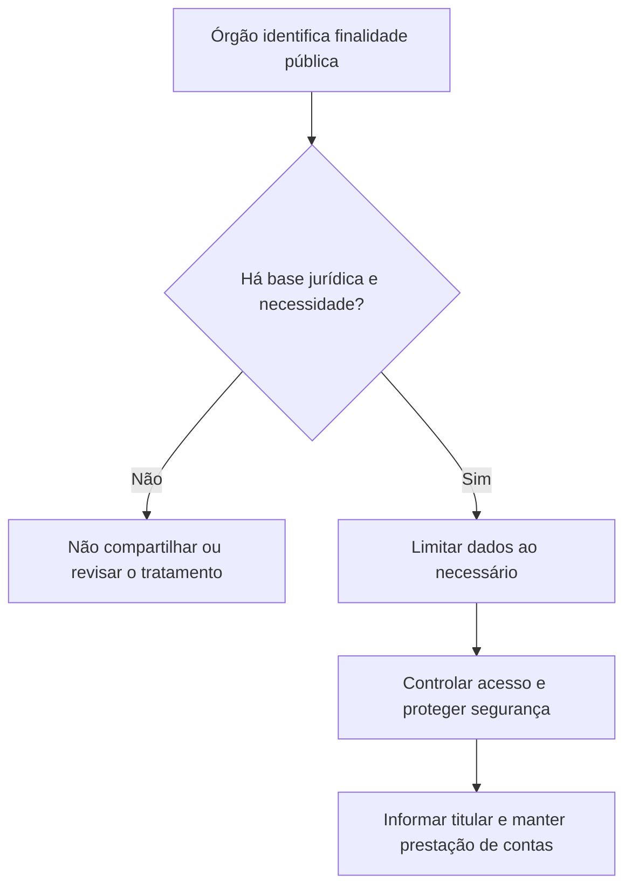

As garantias finais do art. 5º protegem pessoas presas, disciplinam prisão civil, asseguram assistência jurídica a quem não pode pagar e estabelecem direitos de cidadania processual. O texto constitucional também protege dados pessoais, inclusive digitais, e prevê aplicação imediata dos direitos fundamentais. A banca costuma cobrar o alcance literal dessas regras e a distinção entre proteção constitucional e regulamentação legal.

> [!objetivos]
> - Enumerar as garantias constitucionais da pessoa presa.
> - Aplicar a regra e a exceção de prisão civil por dívida.
> - Distinguir gratuidade de HC e HD de assistência jurídica integral.
> - Explicar duração razoável do processo, proteção de dados e aplicação imediata dos direitos.

## Direitos da pessoa presa e prisão civil

O preso deve ser informado de seus direitos, inclusive o de permanecer calado; tem direito à assistência da família e de advogado e à identificação dos responsáveis pela prisão e pelo interrogatório (art. 5º, LXIII e LXIV). A prisão ilegal deve ser imediatamente relaxada pela autoridade judiciária. Ninguém pode ser mantido preso quando a lei admitir liberdade provisória, com ou sem fiança. Essas garantias valem desde o início da custódia e não dependem de condenação.

A Constituição veda a prisão para cobrança de dívidas, mas abre exceção textual para devedor de alimentos que, podendo pagar, não o faz sem justificativa; também menciona o depositário infiel (inciso LXVII). Contudo, a Convenção Americana sobre Direitos Humanos e a interpretação do STF afastam a prisão do depositário infiel em qualquer modalidade. Na prática constitucional vigente, subsiste a possibilidade de prisão civil do devedor de alimentos, segundo requisitos legais e processuais.

> [!pegadinha]
> A literalidade do inciso LXVII ainda menciona depositário infiel, mas a prisão civil por essa causa é ilícita conforme a interpretação consolidada do STF. A exceção efetiva é a dívida alimentar.

> [!exemplo]
> A pessoa que não paga pensão pode sofrer prisão civil se presentes os requisitos legais da execução de alimentos. O devedor de uma obrigação comercial comum não pode ser preso apenas por não pagar.

## Assistência, gratuidade e reparação

O Estado prestará assistência jurídica integral e gratuita a quem comprovar insuficiência de recursos (inciso LXXIV). Assistência jurídica abrange orientação e defesa judicial e extrajudicial; não é o mesmo que gratuidade de um ato específico. A Constituição prevê gratuidade das ações de HC e HD e, na forma da lei, dos atos necessários ao exercício da cidadania (LXXVII). Também prevê, para os reconhecidamente pobres, registro civil de nascimento e certidão de óbito gratuitos (LXXVI).

O Estado indeniza o condenado por erro judiciário e quem permanecer preso além do tempo fixado na sentença (LXXV). O direito não significa indenização automática em toda absolvição: deve haver os pressupostos de responsabilidade estatal e nexo com o erro ou excesso de prisão. Diferencie reparação por prisão indevida da revisão criminal, que busca corrigir a condenação.

| Garantia | Destinatário ou condição | Alcance |
| --- | --- | --- |
| Assistência jurídica integral | Insuficiência de recursos comprovada | Orientação e defesa ampla |
| Habeas corpus e habeas data | Qualquer impetrante | Ações gratuitas |
| Registro de nascimento e óbito | Reconhecidamente pobres, na forma legal | Gratuidade registral específica |
| Indenização | Condenado por erro ou preso além da pena | Reparação conforme responsabilidade estatal |

## Duração razoável e proteção de dados

O inciso LXXVIII assegura a todos, nos âmbitos judicial e administrativo, duração razoável do processo e meios que garantam celeridade. Não estabelece prazo único para todo procedimento. A razoabilidade depende da complexidade, da conduta das partes, da atuação estatal e do impacto da demora. A Administração deve organizar seus processos de modo a decidir sem atraso injustificado.

O inciso LXXIX, incluído pela Emenda Constitucional 115/2022, assegura proteção de dados pessoais, inclusive nos meios digitais, nos termos da lei. É direito fundamental autônomo que orienta coleta, uso, armazenamento e compartilhamento de informações identificáveis. Não impede todo tratamento de dados: este deve ter base e finalidade legítimas, com salvaguardas legais. O habeas data pode permitir conhecimento e retificação de dados próprios em bancos públicos, enquanto outros mecanismos de proteção de dados têm objetos e vias próprios.

> [!lei] CF, art. 5º, § 1º
> As normas definidoras dos direitos e garantias fundamentais têm aplicação imediata.

Aplicação imediata significa que os direitos fundamentais irradiam efeitos desde a Constituição, mas não quer dizer que toda norma seja completa ou dispensada de regulamentação. O § 2º confirma que o catálogo não exclui direitos decorrentes do regime, dos princípios constitucionais e de tratados internacionais. Pelo § 3º, tratados de direitos humanos que superam o quórum qualificado de deliberação em cada uma das Casas passam a ter a mesma posição hierárquica das emendas constitucionais. O § 4º reconhece a submissão do Brasil à jurisdição do Tribunal Penal Internacional a cuja criação tenha aderido.

> [!atencao]
> “Aplicação imediata” não é sinônimo de eficácia plena em todos os casos. Algumas garantias podem exigir legislação para definir procedimentos, sem que isso autorize ignorar seu núcleo constitucional.

## Mapa do capítulo

| Dispositivo | Conteúdo-chave |
| --- | --- |
| LXIII a LXVI | Informação, silêncio, assistência, relaxamento e liberdade provisória |
| LXVII | Vedação de prisão civil por dívida, com exceção alimentar vigente |
| LXXIV a LXXVII | Assistência jurídica, indenização e gratuidades determinadas |
| LXXVIII | Duração razoável em processo judicial e administrativo |
| LXXIX | Proteção de dados pessoais, inclusive digitais |
| §§ 1º a 4º | Aplicação imediata, abertura do catálogo, tratados qualificados e TPI |

### Para fixar
- O preso tem direito ao silêncio e à assistência familiar e jurídica.
- Prisão ilegal deve ser relaxada; liberdade provisória é direito quando a lei admitir.
- A prisão civil por dívida alimentar pode subsistir; a do depositário infiel não.
- Assistência jurídica integral gratuita exige insuficiência de recursos.
- Habeas corpus e habeas data são ações gratuitas.
- Duração razoável vale nos processos judiciais e administrativos.
- Proteção de dados é direito fundamental também no ambiente digital.
- Aplicação imediata não torna toda norma completa nem elimina regulamentação.
## Custódia, comunicação e identificação dos agentes

As garantias acompanham a pessoa desde que a liberdade seja restringida. A pessoa presa deve receber informação compreensível sobre os direitos que pode exercer, inclusive a opção de não responder a perguntas que possam incriminá-la. A comunicação da prisão ao juízo e à pessoa indicada deve ocorrer sem demora. A identificação dos responsáveis pela custódia e pelo interrogatório permite responsabilização por abuso e preserva trilha de auditoria sobre a operação. O silêncio não pode ser usado como admissão de culpa.

O relaxamento é a resposta judicial a prisão ilegal. Ele se distingue da revogação de prisão cautelar que, embora válida quando decretada, deixou de ser necessária. A liberdade provisória é medida cabível quando os requisitos legais permitirem que a pessoa responda fora do cárcere, com ou sem fiança e, quando necessário, sob condições. A autoridade policial pode cumprir decisões e arbitrar fiança nas hipóteses legais, mas não substitui o juiz no relaxamento judicial de prisão ilegal.

A Súmula Vinculante 11 limita o uso de algemas a situações excepcionais de resistência, risco concreto de fuga ou perigo à integridade física do preso ou de terceiros. A justificativa deve ser registrada por escrito, e o uso irregular pode gerar responsabilidade do agente e invalidar o ato processual relacionado. A contenção não deve ser rotineira nem usada como forma de exposição pública. A avaliação é contextual e exige demonstrar por que a medida menos restritiva era insuficiente.

> [!exemplo]
> Durante deslocamento de preso que ameaça agredir um policial e tenta fugir, a equipe documenta os fatos concretos que justificam algemas. A mera gravidade abstrata da acusação, sem resistência ou risco demonstrado, não basta.

A audiência de custódia permite apresentação célere do preso a juiz para examinar legalidade, necessidade e condições da prisão, além de verificar alegações de maus-tratos. A disciplina processual prevê apresentação em até 24 horas, contadas da prisão, ressalvadas regras legais específicas aplicáveis. A audiência não serve para decidir a culpa pelo crime; seu objeto imediato é a situação da custódia e as medidas cautelares cabíveis.

## Prisão civil, gratuidade e assistência jurídica

A Constituição proíbe prisão civil por dívida, com exceção textual da obrigação alimentar voluntariamente e sem justificativa inadimplida e do depositário infiel. A interpretação vigente, contudo, afasta a prisão do depositário infiel em qualquer modalidade, segundo a Súmula Vinculante 25 do STF e a Convenção Americana. Assim, a prisão civil efetivamente admitida é a do devedor de alimentos, nos requisitos legais. Ela não pune toda dívida: é medida coercitiva específica e não substitui a cobrança patrimonial.

O Estado deve oferecer assistência jurídica integral e gratuita a quem comprovar insuficiência de recursos. A assistência abrange orientação e defesa em diferentes esferas e não se limita ao pagamento de advogado em processo judicial. As ações constitucionais para proteger locomoção ou dados pessoais não têm custas, independentemente de renda. A Constituição também garante, aos reconhecidamente pobres e na forma da lei, gratuidade de atos específicos de registro civil de nascimento e certidão de óbito. Não se deve transportar a exigência de hipossuficiência de uma garantia para outra.

| Garantia de acesso | Exige insuficiência de recursos? | Alcance essencial |
| --- | --- | --- |
| Assistência jurídica integral | Sim, comprovada | Orientação e defesa jurídica ampla |
| Habeas corpus e habeas data | Não | Gratuidade da ação constitucional |
| Registro de nascimento e certidão de óbito | Para as gratuidades constitucionais, sim, nos termos legais | Atos civis expressamente indicados |
| Direito de petição e certidão | Não | Exercício gratuito para todos, nas finalidades do inciso XXXIV |

O Estado também tem dever de indenizar condenado por erro judiciário e quem permaneça preso além do período fixado na sentença. Para obter reparação, é preciso demonstrar hipótese constitucional e os pressupostos da responsabilidade pública. Absolvição posterior, por si só, não demonstra automaticamente erro indenizável em toda situação; avaliam-se decisão, dano e nexo conforme o regime aplicável.

## Duração razoável e tutela da proteção de dados

A duração razoável alcança processos judiciais e administrativos. Não há prazo único aplicável a toda causa; a avaliação pondera complexidade, comportamento das partes, diligência estatal e consequências do atraso. O Poder Público deve dar andamento eficiente e oferecer instrumentos que reduzam demora evitável. A garantia não elimina contraditório nem autoriza decisão apressada sem instrução necessária.

A proteção de dados pessoais foi expressamente incluída como direito fundamental pela Emenda Constitucional 115/2022 e alcança também o ambiente digital. Dados pessoais são informações relacionadas a pessoa identificada ou identificável; o tratamento inclui coleta, uso, armazenamento, consulta, compartilhamento e eliminação. A Lei Geral de Proteção de Dados estabelece princípios, bases legais, direitos dos titulares e deveres de segurança. O consentimento é uma das bases, mas não a única; o Poder Público pode tratar dados para finalidade pública prevista em lei, com transparência e salvaguardas.

O STF reconheceu a autonomia da proteção de dados ao suspender compartilhamento amplo de dados pessoais sem finalidade e salvaguardas suficientes durante a pandemia (ADI 6.387 e ações conexas). Em decisões posteriores sobre compartilhamento entre órgãos públicos, o Tribunal admitiu a possibilidade desde que respeitados finalidade, necessidade, segurança e direitos constitucionais. A pergunta correta não é se todo compartilhamento é vedado, mas se tem base legítima, objetivo definido, acesso controlado e mecanismos para evitar uso incompatível.

> [!pegadinha]
> Ser órgão público não libera uso irrestrito de base cadastral. Transparência estatal e proteção de dados devem conviver: a finalidade e a necessidade do compartilhamento precisam ser demonstráveis.

## Direitos fundamentais e tratados internacionais

O § 1º manda atribuir a maior efetividade possível às normas que definem direitos fundamentais, ainda que algumas dependam de lei para procedimentos ou detalhes. Aplicação imediata significa que o intérprete deve reconhecer eficácia jurídica desde logo, não que todo direito tenha alcance ilimitado ou dispense regulamentação. A própria Constituição prevê garantias dependentes da lei, mas o núcleo do direito vincula o Estado.

O § 2º abre o catálogo constitucional: outros direitos podem decorrer do regime democrático, dos princípios adotados ou de tratados dos quais o Brasil seja parte. Tratado de direitos humanos que passa pelo rito constitucional qualificado recebe hierarquia equivalente a emenda. Tratado de direitos humanos incorporado sem esse rito tem status supralegal segundo o STF: abaixo da Constituição, acima da legislação ordinária. Tratados comuns ingressam com hierarquia legal, se observados os requisitos de incorporação.

Entre os tratados aprovados com equivalência constitucional estão a Convenção sobre os Direitos das Pessoas com Deficiência, o Tratado de Marraqueche sobre acesso a obras publicadas por pessoas cegas ou com deficiência visual e a Convenção Interamericana contra o Racismo. Tratados não são todos automaticamente emendas constitucionais; o rito é decisivo. A leitura deve distinguir assinatura internacional, aprovação congressional, ratificação e promulgação interna.

> [!esquema] Hierarquia de tratados
> - Tratado de direitos humanos aprovado pelo rito qualificado: equivalente a emenda constitucional.
> - Tratado de direitos humanos aprovado pelo rito ordinário: status supralegal, conforme STF.
> - Tratado comum incorporado: hierarquia legal, sem equivalência constitucional automática.

O Brasil submete-se à jurisdição do Tribunal Penal Internacional cuja criação aceitou. O Estatuto de Roma prevê competência sobre genocídio, crimes contra a humanidade, crimes de guerra e crime de agressão. A cláusula não cria tribunal brasileiro nem altera a competência penal doméstica para qualquer infração; estabelece a aceitação da jurisdição internacional nos termos do tratado.

> [!atencao]
> Um tratado de direitos humanos só recebe hierarquia equivalente a emenda quando aprovado pelo quórum e procedimento reforçados. A matéria do tratado, sozinha, não basta para atribuir status constitucional formal.

A abertura do catálogo de direitos fundamentais não é uma autorização para inventar garantias sem base constitucional. O intérprete precisa identificar se o direito deriva de princípio, regime ou tratado e demonstrar como ele protege a dignidade, a liberdade ou a participação política. A Constituição também contém direitos fora do art. 5º, e seus parágrafos de abertura ajudam a interpretar esse conjunto de modo sistemático. A posição formal do dispositivo não é o único critério para reconhecer fundamentalidade material.

No caso dos tratados de direitos humanos, é preciso distinguir aprovação qualificada de aprovação ordinária. A Convenção sobre os Direitos das Pessoas com Deficiência e seu Protocolo Facultativo foram aprovados com status equivalente a emenda. O Tratado de Marraqueche também foi incorporado segundo esse rito. A Convenção Interamericana contra o Racismo recebeu igual tratamento. Já a Convenção Americana sobre Direitos Humanos não passou pelo rito constitucional qualificado e tem status supralegal segundo o STF, o que permitiu afastar normas legais conflitantes sem revogar a Constituição.

> [!pegadinha]
> “Supralegal” significa acima de leis ordinárias e abaixo da Constituição. Não quer dizer que o tratado foi aprovado como emenda nem que prevalece contra a Constituição.

A proteção de dados é relevante para a atividade policial e administrativa porque órgãos públicos mantêm cadastros, registros de ocorrência, imagens, biometria e informações funcionais. A finalidade institucional pode justificar o tratamento, mas não o compartilhamento indiscriminado. Devem ser definidos os dados indispensáveis, quem terá acesso, por quanto tempo e como será registrada a consulta. A pessoa titular pode exercer direitos previstos em lei, salvo limites legítimos ligados à investigação, segurança pública ou outras hipóteses normativas. Uma exceção legal não remove a obrigação de segurança e controle.

O direito fundamental de proteção de dados dialoga com intimidade, vida privada, honra e imagem. Se um banco incorreto impede o exercício de um direito, pode haver pedido de correção pela via administrativa e, nas condições constitucionais, habeas data. Se o problema é vazamento ou uso incompatível, a tutela pode envolver autoridade de proteção de dados e vias judiciais próprias. Não confunda o remédio constitucional específico com todo o sistema de proteção de dados pessoais.

A duração razoável também deve ser avaliada em processos de custódia. Demora sem justificativa para levar a pessoa à apreciação judicial prejudica controle de legalidade e acesso à defesa. Por outro lado, a celeridade não permite ignorar exame médico necessário, ouvir a defesa ou verificar circunstâncias que possam indicar violência. O objetivo é uma decisão rápida e informada, capaz de responder à legalidade da prisão e aos riscos atuais.

O Tribunal Penal Internacional atua de forma complementar aos sistemas penais nacionais e possui jurisdição definida por tratado. Sua lista de crimes não deve ser confundida com crimes estaduais ou federais comuns. O Brasil se submete à jurisdição porque aderiu à criação do Tribunal, mas cada caso depende de competência temporal, material e de admissibilidade previstas no Estatuto de Roma. A simples gravidade política de um delito não basta para deslocar seu julgamento ao TPI.

## Mapa do capítulo

| Matéria | Regra principal | Limite ou exceção |
| --- | --- | --- |
| Direitos da pessoa presa | Silêncio, assistência, identificação dos agentes e controle judicial | Algema exige justificativa excepcional |
| Prisão civil | Vedada por dívida em geral | Subsiste por alimentos; depositário infiel não pode ser preso |
| Acesso à justiça | Assistência gratuita a quem comprovar insuficiência | HC e HD gratuitos independentemente de renda |
| Processo | Duração razoável judicial e administrativa | Deve conviver com defesa e instrução adequada |
| Dados | Proteção fundamental inclusive digital | Compartilhamento público exige base e salvaguardas |
| Tratados | Catálogo de direitos é aberto | Status depende do conteúdo e do rito de incorporação |

### Para fixar
- O preso deve ser informado sobre o silêncio e pode indicar pessoa para receber notícia da custódia.
- A SV 11 restringe algemas a situações excepcionais justificadas por escrito.
- Audiência de custódia controla legalidade e necessidade, não decide culpa.
- A prisão civil do depositário infiel é ilícita; subsiste a hipótese alimentar.
- Assistência jurídica integral gratuita depende de insuficiência comprovada; HC e HD são gratuitos para todos.
- Proteção de dados é direito fundamental expresso desde a EC 115/2022.
- Compartilhamento de dados pelo Estado requer finalidade legítima, necessidade e segurança.
- Tratado de direitos humanos só equivale a emenda se aprovado pelo rito qualificado.
- Tratado de direitos humanos incorporado sem esse rito tem status supralegal segundo o STF.
- O Estatuto de Roma enumera quatro categorias de crimes sob a jurisdição do TPI.

