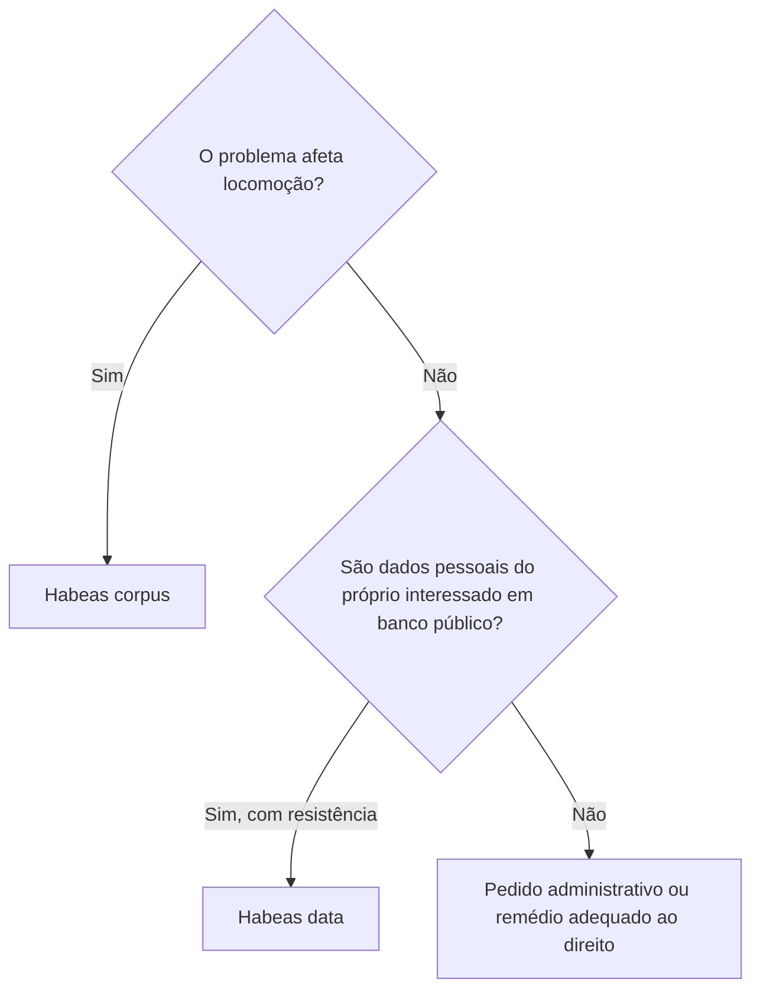
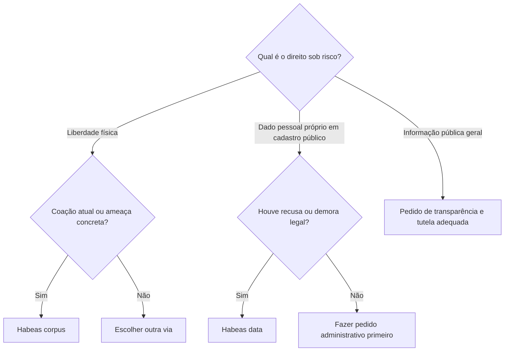

O estudo dos direitos e garantias fundamentais inclui remédios constitucionais que protegem bens diferentes. HC e HD são gratuitos, mas cada qual atende a uma necessidade distinta. O primeiro tutela a liberdade de locomoção contra ilegalidade ou abuso de poder; o segundo permite conhecer ou corrigir informações pessoais em registros públicos ou de caráter público. Saber identificar o bem jurídico ameaçado resolve boa parte das questões e evita escolher o instrumento errado.

> [!objetivos]
> - Reconhecer cabimento e espécies de habeas corpus.
> - Identificar legitimidade ativa e passiva no habeas corpus.
> - Explicar quando cabe habeas data e qual requerimento prévio é necessário.
> - Comparar os dois remédios constitucionais.

## Habeas corpus: liberdade de locomoção

O art. 5º, LXVIII, determina a concessão de habeas corpus quando uma pessoa estiver submetida ou exposta a risco concreto de restrição ilegal do direito de ir e vir. É ação constitucional de natureza penal, gratuita, que protege o direito de ir, vir e permanecer. Pode ser repressivo ou liberatório, quando a coação já existe, ou preventivo, quando há ameaça concreta e se expede salvo-conduto.

Qualquer pessoa pode impetrar habeas corpus em favor próprio ou de terceiro, sem necessidade de advogado. Também pode ser impetrado pelo Ministério Público. O paciente é a pessoa cuja liberdade está em risco; o impetrante provoca o Judiciário; a autoridade coatora é quem pratica ou mantém a coação. O paciente pode ser pessoa física, pois pessoa jurídica não tem liberdade corporal. Não se exige forma complexa: a petição identifica, tanto quanto possível, quem sofre a coação, quem a pratica e os motivos.

> [!lei] CF, art. 5º, LXVIII
> conceder-se-á "habeas-corpus" sempre que alguém sofrer ou se achar ameaçado de sofrer violência ou coação em sua **liberdade de locomoção**, por ilegalidade ou abuso de poder;

> [!exemplo]
> Uma autoridade ameaça prender pessoa sem ordem judicial e sem situação de flagrante. Havendo ameaça concreta e ilegal, pode ser impetrado habeas corpus preventivo em favor do paciente.

O habeas corpus pode combater prisão ilegal, excesso de prazo incompatível com a lei, falta de justa causa e outras coações que afetem diretamente a liberdade. Não é via para discutir qualquer direito ou substituir recurso ordinário quando não há reflexo na locomoção. A Constituição prevê sua gratuidade; a inexistência de advogado obrigatório facilita o acesso urgente à jurisdição.

> [!pegadinha]
> Quem impetra não precisa ser o paciente. Em questão, o terceiro que ajuíza é impetrante e a pessoa ameaçada é paciente.

## Habeas data: dados pessoais

O habeas data autoriza o titular a consultar informação pessoal mantida por órgão estatal ou cadastro de acesso público e a corrigir dado inexato, salvo quando a lei permitir preferência por procedimento reservado judicial ou administrativo (art. 5º, LXXII). A Lei 9.507/1997 também prevê anotação de explicação ou contestação sobre dado verdadeiro, mas justificável, nos termos legais.

Em regra, é necessário demonstrar resistência administrativa: recusa de acesso, omissão no prazo legal ou negativa de retificação. A exigência confirma que o Judiciário será chamado a resolver uma pretensão efetivamente resistida. O direito é personalíssimo quanto à informação: o remédio versa sobre dados do próprio impetrante, não sobre informações genéricas de interesse público nem sobre cadastro de outra pessoa.

> [!exemplo]
> Uma servidora encontra em cadastro público registro incorreto sobre sua qualificação profissional e pede correção. Após negativa administrativa, pode buscar habeas data para retificar a informação pessoal.

> [!atencao]
> Para obter cópia de ato administrativo geral ou relatório institucional, o caminho não é habeas data. A finalidade do pedido deve ser conhecer, retificar ou complementar dado relativo ao próprio impetrante.

## Comparação e escolha do remédio

| Critério | Habeas corpus | Habeas data |
| --- | --- | --- |
| Bem protegido | Liberdade de locomoção | Informação pessoal do impetrante |
| Hipótese típica | Prisão ou ameaça ilegal | Acesso, retificação ou anotação de dado pessoal |
| Impetrante | Qualquer pessoa, em favor próprio ou alheio | Titular do dado, observada a lei |
| Advogado | Não é requisito constitucional | Ação judicial segue representação processual aplicável |
| Gratuidade | Expressa na Constituição | Expressa na Constituição |
| Requerimento prévio | Não é regra geral | Resistência administrativa necessária |

A escolha é guiada pelo resultado pretendido. Se o pedido é cessar ou prevenir coação física, avalie habeas corpus. Se é acessar ou corrigir dados próprios em banco abrangido, avalie habeas data. Se a pessoa busca informação pública sobre tema geral, usa a Lei de Acesso à Informação e, se necessário, o instrumento judicial adequado ao caso, em geral mandado de segurança.

## Mapa do capítulo

| Problema | Remédio | Regra decisiva |
| --- | --- | --- |
| Coação à liberdade física | HC | Atual ou iminente; ilegalidade ou abuso |
| Ameaça de prisão ilegal | HC preventivo | Salvo-conduto pode prevenir a coação |
| Dado pessoal inacessível ou inexato | HD | Pedido ligado ao impetrante e resistência administrativa |
| Informação pública geral | LAI/MS, conforme o caso | Não é habeas data |

### Para fixar
- Habeas corpus protege liberdade de locomoção contra ilegalidade ou abuso.
- Pode ser preventivo ou repressivo e é gratuito.
- Qualquer pessoa pode impetrar em favor próprio ou alheio.
- Paciente é quem sofre a coação; impetrante é quem provoca o juízo.
- Habeas data trata de informação pessoal do próprio impetrante.
- Para habeas data, é necessária resistência ou omissão administrativa.
- Informação pública geral não se transforma em dado pessoal.
- Ação de habeas data é gratuita por previsão constitucional.
## Espécies e legitimidade no habeas corpus

O habeas corpus repressivo busca fazer cessar restrição atual e ilegal à locomoção. O preventivo atua diante de ameaça concreta, para evitar a prisão ou impedimento e permitir salvo-conduto. Pode-se também falar em habeas corpus suspensivo quando a ordem de prisão já foi expedida, mas ainda não executada; o objetivo é impedir que a coação se concretize. As classificações descrevem o momento da tutela, não criam direitos distintos.

A legitimidade para impetrar é ampla: pessoa natural ou jurídica, brasileira ou estrangeira, pode provocar o Judiciário em favor de pessoa física. O paciente é sempre pessoa natural, pois é sua locomoção que a ordem protege. O Ministério Público e a Defensoria Pública também podem impetrar, e o juiz pode conceder a ordem de ofício no âmbito de sua competência ao identificar coação ilegal. Não se exige procuração especial nem advogado para ajuizar HC, embora a assistência profissional possa ser útil.

A autoridade coatora pode ser agente estatal ou particular. O ponto decisivo é que sua conduta produza restrição ilegal à locomoção, como quando entidade privada impede a saída de pessoa de um local sem fundamento jurídico. O writ é dirigido ao órgão judicial competente para revisar o ato, normalmente superior à autoridade que praticou a coação. Não se impetra contra o próprio juiz perante ele mesmo como se fosse recurso interno.

## Liminar e cabimento direto ou indireto

A liminar em habeas corpus é possível para impedir que a demora do julgamento mantenha uma coação grave. O juízo provisório exige plausibilidade jurídica do pedido e risco concreto de dano durante a tramitação. Não é decisão final: pode ser revista após informações da autoridade e exame mais amplo. Como o procedimento é célere, a liminar não é automática em toda impetração; deve haver urgência que a justifique.

A ameaça à locomoção pode ser direta ou indireta. É direta quando há prisão, detenção ou proibição física de deslocamento. Pode ser indireta quando a decisão contestada, embora não determine prisão de imediato, esteja em processo penal e possa conduzir a pena privativa de liberdade. Medida cautelar que restrinja deslocamento, proibição de aproximação ou quebra de sigilo em investigação criminal podem, conforme o contexto, ser examinadas por HC se houver nexo real com risco de prisão ou com a liberdade de ir e vir.

> [!exemplo]
> Uma cautelar criminal impede que o investigado se aproxime de locais essenciais à sua rotina e prevê prisão se houver descumprimento. Se a defesa sustenta que a medida é ilegal e restringe sua locomoção, pode pedir exame por habeas corpus, demonstrando o vínculo com o direito protegido.

O HC exige prova pré-constituída do constrangimento e não comporta instrução probatória extensa. Se a controvérsia depende de perícia complexa, testemunhas ou reconstrução detalhada de fatos, a via pode ser inadequada. A prova documental deve permitir ao juiz verificar rapidamente a coação e a ilegalidade alegada. A simplicidade do rito é uma vantagem para urgência, mas um limite para questões que exigem dilação.

## Quando o habeas corpus não é a via adequada

O remédio só tutela a liberdade de locomoção. Por isso, em regra, não serve para discutir multa sem risco de prisão, advertência ou demissão em processo administrativo, perda de patente, suspensão de direitos políticos ou cobrança meramente patrimonial. Também não se usa quando a pena privativa de liberdade já foi integralmente cumprida e não resta efeito concreto sobre a locomoção. A Súmula 693 do STF afasta HC para impugnar condenação apenas pecuniária, e a Súmula 695 trata de pena extinta.

No âmbito militar, há limite constitucional específico para questionar o mérito de punição disciplinar, mas o controle de legalidade formal pode ser possível. Competência da autoridade, respeito ao procedimento e existência de fundamento legal podem ser examinados sem substituir o comando disciplinar em avaliação de conveniência. Não se deve confundir revisão do mérito com controle de legalidade.

O STF não admite, segundo orientação sumulada, HC originário ao Plenário contra decisão de Turma ou do próprio Plenário proferida em habeas corpus ou recurso correlato. A Súmula 606 reflete a lógica de competência e hierarquia entre órgãos. Antes de escolher a via, identifique quem praticou o ato e qual órgão tem competência para apreciá-lo; a urgência não altera as regras de competência.

| Situação | HC tende a caber? | Razão |
| --- | --- | --- |
| Prisão sem justa causa ou prolongada além da lei | Sim | Afeta diretamente a locomoção |
| Multa isolada, sem risco de prisão | Não | Não restringe ir, vir ou permanecer |
| Ato administrativo com sanção funcional | Não | Não há coação de locomoção |
| Cautelar criminal com risco de prisão | Pode caber | Há vínculo potencial com liberdade física |
| Prova controversa que exige perícia extensa | Em regra, não | HC não comporta dilação probatória ampla |
| Mérito de punição disciplinar militar | Não | Controle de mérito é vedado pela regra constitucional específica |

> [!bizu]
> Para HC, faça o teste “há risco físico de prisão, detenção ou limitação de deslocamento?”. Se não, considere outro instrumento; se sim, avalie ilegalidade, prova pré-constituída e competência.

## Habeas data: pedido, conteúdo e prova da resistência

Além de conhecer e retificar dados, a Lei 9.507/1997 permite pedir anotação de contestação ou explicação sobre informação verdadeira, mas justificável e pendente de solução. O titular precisa antes solicitar o acesso ou a correção à entidade. A inicial deve comprovar recusa ou falta de decisão dentro dos prazos legais: mais de dez dias para pedido de acesso; mais de quinze dias para retificação ou anotação. Esses prazos são próprios do habeas data e não devem ser generalizados para pedido de informação pública sob a Lei de Acesso à Informação.

Banco de caráter público não se limita a arquivo mantido diretamente pelo Estado. A lei inclui registro cujas informações sejam transmitidas a terceiros ou que não sejam de uso privativo da entidade que as mantém. O critério é a finalidade e disponibilidade do registro. Um cadastro de pessoa mantido por entidade privada de consulta pública pode, conforme seus atributos, integrar o âmbito do remédio.

O habeas data não permite acesso amplo a dados de terceiros nem substitui pedido de certidão. Também não serve para obter documento geral produzido pelo órgão, ainda que o requerente tenha interesse no assunto. Se uma pessoa deseja saber quais dados pessoais constam em cadastro público ou corrigi-los, pode usar HD após resistência; se busca relatório público geral, requer acesso pela legislação de transparência e avalia o remédio adequado em caso de recusa.

> [!lei] Lei 9.507/1997, art. 7º, III, e art. 8º, parágrafo único
> Art. 7° Conceder-se-á habeas data: (...)
> III - para a anotação nos assentamentos do interessado, de contestação ou explicação sobre dado verdadeiro mas justificável e que esteja sob pendência judicial ou amigável.
> Art. 8° (...) Parágrafo único. A petição inicial deverá ser instruída com prova:
> I - da recusa ao acesso às informações ou do decurso de mais de **dez dias** sem decisão;
> II - da recusa em fazer-se a retificação ou do decurso de mais de **quinze dias**, sem decisão; ou
> III - da recusa em fazer-se a anotação a que se refere o § 2° do art. 4° ou do decurso de mais de quinze dias sem decisão.

### Comparação final

| Elemento | Habeas corpus | Habeas data |
| --- | --- | --- |
| Natureza e bem | Penal; liberdade física | Civil; informação pessoal |
| Titular protegido | Pessoa natural, como paciente | Titular da informação |
| Quem pode provocar | Qualquer pessoa, inclusive pessoa jurídica, em favor de alguém | Titular do dado, conforme lei |
| Pedido prévio | Não é pressuposto geral | Requer resistência ou demora administrativa |
| Prova | Constrangimento demonstrado de plano | Identificação do dado e recusa/omissão |
| Gratuidade | Sim | Sim |
| Resultado | Cessa ou previne coação | Acesso, retificação ou anotação |

## Mapa do capítulo

| Questão de triagem | Resposta | Caminho |
| --- | --- | --- |
| Há privação ou ameaça real de deslocamento? | Sim | HC, se a ilegalidade puder ser demonstrada de plano |
| Pessoa jurídica quer impetrar por alguém preso? | Sim | Pode provocar; paciente será pessoa física |
| O caso exige prova oral ou pericial extensa? | Sim | HC tende a ser via inadequada |
| O titular quer dado próprio em cadastro público? | Sim | HD após resistência ou decurso do prazo legal |
| O pedido é documento público geral? | Sim | Lei de acesso e instrumento adequado, não HD |

### Para fixar
- HC repressivo combate coação atual; preventivo protege contra ameaça concreta; suspensivo mira ordem ainda não cumprida.
- Qualquer pessoa pode impetrar HC em favor de pessoa natural; pessoa jurídica não é paciente.
- HC pode ser dirigido contra ato de particular que restrinja ilegalmente a locomoção.
- Liminar exige plausibilidade e risco na demora, e pode ser revista.
- Prova da coação deve ser pré-constituída; HC não comporta instrução extensa.
- HC não é via para multa isolada nem sanção administrativa sem reflexo na locomoção.
- Lei 9.507/1997 prevê acesso, retificação e anotação de contestação sobre dado próprio.
- Para HD, a recusa ou demora legal no pedido administrativo precisa ser demonstrada.
- Ação de HC e ação de HD são gratuitas por regra constitucional.

A jurisprudência do STF e do STJ complementa a literalidade constitucional em pontos de cabimento, mas a questão deve sempre guardar relação com o bem protegido. Súmula é enunciado de orientação consolidada e não deve ser confundida com súmula vinculante, tese de repercussão geral ou decisão isolada. Para resolver situação concreta, identifique primeiro a ameaça à liberdade ou a informação pessoal; depois, veja o que a jurisprudência dominante estabelece sobre competência, prova pré-constituída e limites do remédio.

O cabimento do habeas corpus depende de consequência possível sobre a liberdade física, não apenas de uma ilegalidade em abstrato. A pessoa pode ter violação patrimonial, funcional ou de privacidade sem que isso permita HC. Se a ilegalidade gerar risco de prisão em investigação criminal, o vínculo indireto pode existir; se tramitar apenas em processo administrativo sem possibilidade de custódia, a via não é apropriada. A distinção evita usar o writ como atalho para qualquer disputa jurídica.

A proteção de direitos coletivos e sociais pode aparecer em processos estruturais, mas habeas data continua ligado a dado individual do titular. Para corrigir uma informação compartilhada entre órgãos, o interessado deve indicar qual registro o identifica, qual dado está errado ou inacessível e qual resposta recebeu do responsável. O pedido claro facilita identificar o órgão competente, medir o prazo de resposta e demonstrar resistência necessária à ação. O remédio não autoriza uma busca genérica por informações de toda uma categoria de pessoas.

> [!pegadinha]
> HC não é “ação para qualquer ilegalidade urgente”; precisa haver ameaça à locomoção. HD não é “ação de acesso a qualquer banco”; o dado deve dizer respeito ao impetrante e haver recusa ou demora legalmente relevante.

## Mapa do capítulo

| Direito em foco | Requisito ou limite | Resposta constitucional |
| --- | --- | --- |
| Liberdade física | Coação ou ameaça concreta, demonstrável de plano | Habeas corpus individual ou coletivo nas hipóteses reconhecidas |
| Cadastro pessoal | Dado próprio em registro público ou de caráter público | Habeas data após recusa ou demora legal |
| Sanção sem risco de prisão | Não afeta locomoção | Outro remédio ou ação adequada |
| Informação pública ampla | Não é dado do próprio titular | Pedido de transparência e tutela correspondente |

### Para fixar
- HC e HD são garantias gratuitas, mas um protege locomoção e outro, informação pessoal.
- Qualquer pessoa pode provocar HC em favor de pessoa natural; o paciente não pode ser pessoa jurídica.
- Ameaça concreta basta para habeas corpus preventivo; a coação não precisa estar consumada.
- Habeas corpus exige prova pré-constituída e não admite extensa fase de produção probatória.
- Punição administrativa sem risco de prisão não se ataca por HC.
- O habeas data pode incluir anotação de explicação ou contestação de dado verdadeiro, mas justificável.
- Recusa ou prazo legal vencido deve ser provado para habeas data.
- Pedido sobre informação geral não se enquadra no objeto pessoal do HD.

