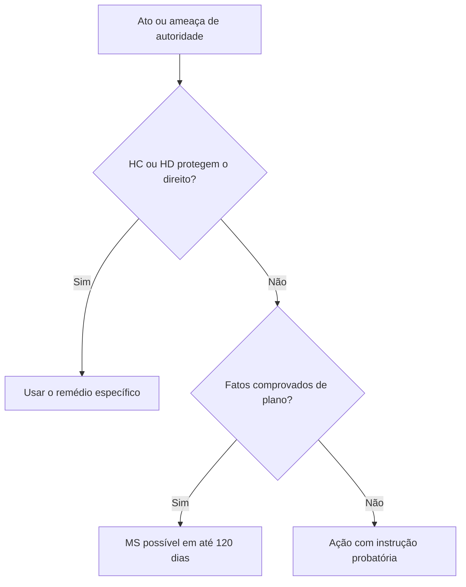
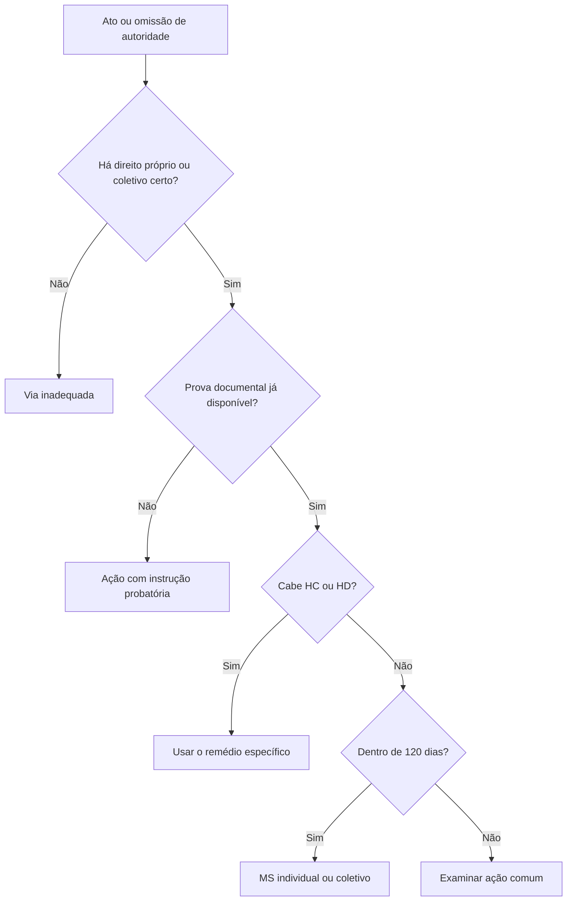

O mandado de segurança protege direito líquido e certo contra ilegalidade ou abuso de poder quando não couber habeas corpus nem habeas data. É remédio residual e documental: o impetrante precisa demonstrar os fatos essenciais com prova já disponível, pois não há fase para investigação ampla. A versão coletiva permite que legitimados constitucionais defendam interesses de seus membros ou associados.

> [!objetivos]
> - Definir direito líquido e certo e o caráter residual do mandado de segurança.
> - Identificar autoridade coatora, prazo e hipóteses de não cabimento.
> - Enumerar os legitimados do mandado de segurança coletivo.
> - Distinguir representação de substituição processual.

## Cabimento e prova pré-constituída

Pelo art. 5º, LXIX, cabe mandado de segurança quando prova documental imediata demonstrar violação de posição jurídica individual que não esteja coberta por HC ou HD, imputável a agente estatal ou a pessoa privada que esteja exercendo função pública delegada. Direito líquido e certo não é direito sem discussão jurídica; significa que os fatos relevantes podem ser comprovados de plano, sem dilação probatória. Controvérsia sobre interpretação do direito, por si só, não impede o writ.

O remédio pode ser repressivo, para desfazer lesão já ocorrida, ou preventivo, diante de justo receio de violação. A autoridade coatora é quem pratica o ato ou tem poder para corrigir a ilegalidade; a pessoa jurídica interessada integra a relação processual conforme a lei. Não cabe contra ato de gestão comercial de empresa estatal ou concessionária, nem para atacar lei em tese (Súmula 266 do STF). Também não é substituto universal de recurso ou ação própria.

> [!exemplo]
> Uma candidata tem documento oficial que comprova a aprovação, mas a autoridade nega matrícula por critério não previsto no edital. Se não houver controvérsia factual e a lesão estiver documentada, pode haver direito líquido e certo tutelável por mandado de segurança.

> [!pegadinha]
> “Líquido e certo” não significa que o direito precise ser incontroverso em tese. O foco é a prova dos fatos; questão puramente jurídica pode ser examinada no mandado.

## Prazo, liminar e limites

O prazo para impetrar é de 120 dias contados da ciência, pelo interessado, do ato impugnado (Lei 12.016/2009, art. 23). Trata-se de prazo decadencial previsto em lei. O ato omissivo exige atenção à natureza da omissão e ao momento em que a obrigação se torna exigível. A decadência do mandado de segurança não elimina necessariamente o direito material, que pode ser discutido por via ordinária se não houver outro impedimento.

A lei admite liminar quando houver fundamento relevante e risco de ineficácia da ordem ao final. A autoridade é notificada para prestar informações e dá-se ciência à representação judicial da pessoa jurídica. A sentença concessiva pode ficar sujeita a reexame necessário nos termos legais; não há condenação em honorários advocatícios de sucumbência, conforme a jurisprudência sumulada. Custas seguem o regime legal aplicável, sem confundir o mandado com habeas corpus e habeas data, que são constitucionalmente gratuitos.

> [!lei] Lei 12.016/2009, art. 23
> O direito de requerer mandado de segurança extinguir-se-á decorridos **120 (cento e vinte) dias**, contados da ciência, pelo interessado, do ato impugnado.

## Mandado de segurança coletivo

O inciso LXX atribui legitimidade coletiva a partido que possua bancada no Congresso e também a entidades representativas de trabalhadores, categorias profissionais e associações que preencham requisitos constitucionais de constituição, tempo de atividade e pertinência com os interesses defendidos. O requisito temporal de um ano está ligado à associação; não se estende ao partido, sindicato ou entidade de classe. O STF reconhece que a entidade de classe pode impetrar em favor da categoria sem autorização individual de cada associado (Súmula 629). A Súmula 630 admite defesa de parte da categoria.

No mandado coletivo há substituição processual: o legitimado atua em nome próprio para proteger direito alheio dentro de sua finalidade. Isso difere da representação processual, em que alguém atua em nome de representados e pode haver necessidade de autorização conforme a hipótese. O instrumento tutela direitos coletivos e individuais homogêneos de seus integrantes, não direitos difusos sem vínculo com o grupo legitimado.

| Legitimado coletivo | Condição principal | Exigência de autorização individual |
| --- | --- | --- |
| Partido político | Representação no Congresso Nacional | Não para o MS coletivo nos limites constitucionais |
| Sindicato | Defesa de interesses da categoria | Não, em substituição processual |
| Entidade de classe | Pertinência com a categoria | Não, conforme Súmula 629 do STF |
| Associação | Constituição e funcionamento há um ano | Não no MS coletivo, respeitada a finalidade |

## Mapa do capítulo

| Ponto | Regra |
| --- | --- |
| Residualidade | Não cabe quando o direito é protegido por HC ou HD |
| Prova | Fatos comprovados de plano; controvérsia jurídica pode existir |
| Prazo | 120 dias da ciência do ato |
| Coletivo | Partido, sindicato, entidade de classe e associação com um ano |
| Súmulas | 266: lei em tese; 629 e 630: legitimidade coletiva |

### Para fixar
- Mandado de segurança protege direito líquido e certo residual.
- Direito líquido e certo exige prova pré-constituída dos fatos.
- Controvérsia jurídica não impede automaticamente o mandado.
- Não cabe mandado de segurança contra lei em tese, conforme Súmula 266 do STF.
- O prazo legal é de 120 dias da ciência do ato.
- O requisito de um ano aplica-se à associação.
- Entidade de classe não precisa de autorização individual dos associados.
- O mandado coletivo opera por substituição processual.
## Autoridade coatora e legitimidade individual

O ato questionado pode ser ação ou omissão. Autoridade coatora é quem praticou o ato ou dispõe de poder jurídico para desfazê-lo; apontar apenas a chefia máxima do órgão sem verificar a competência pode levar a erro de endereçamento. Se o ato foi praticado por agente privado no exercício de função pública delegada, o mandado pode alcançá-lo quanto a essa atribuição. Atos de gestão comercial de empresa estatal ou concessionária ficam fora do writ por regra expressa da Lei 12.016/2009.

Podem impetrar a modalidade individual pessoas naturais ou jurídicas, brasileiras ou estrangeiras, domiciliadas no país ou fora dele, desde que titularizem direito próprio. Também se reconhece capacidade processual a certas universalidades, como espólio ou massa falida, e a órgãos públicos para defender prerrogativas institucionais. O Ministério Público pode agir nos limites de suas funções constitucionais. A legitimidade depende de interesse jurídico concreto; cidadão não impetra em nome próprio apenas para fiscalizar legalidade abstrata sem direito afetado.

Ato vinculado e discricionário podem ser impugnados quando ilegais ou praticados com abuso. No ato vinculado, a lei predetermina os elementos da decisão; no discricionário, há margem de escolha dentro da lei. Discricionariedade não autoriza arbitrariedade: o Judiciário pode controlar competência, finalidade, motivo e respeito a direitos, embora não substitua a Administração na escolha legítima entre opções legais.

> [!exemplo]
> Uma comandante recebe requerimento funcional que deve ser decidido em prazo previsto e permanece sem resposta. Comprovado protocolo, dever de decidir e atraso injustificado, a omissão pode ser questionada por mandado de segurança se o direito estiver documentalmente demonstrado.

## Prazo, liminar e decisões

O prazo para impetrar é decadencial de 120 dias, contado da ciência oficial do ato impugnado (Lei 12.016/2009, art. 23). O prazo não se suspende nem se interrompe segundo a Súmula 632 do STF. Se for perdido, o interessado pode usar ação ordinária quando ainda houver direito e não tiver ocorrido prescrição ou outro impedimento. A decadência do writ não apaga automaticamente o direito material.

A liminar depende de fundamento relevante e risco de ineficácia da decisão final se o ato continuar produzindo efeitos. A ADI 4.296 afastou vedações legais que impediam de forma absoluta a medida em determinadas matérias. Logo, o juiz analisa urgência e probabilidade no caso concreto; não existe proibição abstrata só porque o tema envolve tributo ou vantagem funcional. A liminar pode ser revista e não antecipa necessariamente o julgamento final.

A sentença que concede segurança em primeiro grau está sujeita a remessa necessária quando a lei assim determina, mas pode haver execução provisória nos limites legais. Não há honorários sucumbenciais no mandado de segurança, conforme orientação consolidada do STF e do STJ; isso não significa gratuidade universal de custas. O impetrante também pode desistir da ação sem anuência do réu, segundo entendimento do STF, inclusive após decisão favorável, observados os efeitos e a situação processual.

| Decisão ou evento | Consequência típica | Base de atenção |
| --- | --- | --- |
| Liminar concedida | Suspende ato ou protege provisoriamente direito | Urgência e plausibilidade; decisão provisória |
| Segurança concedida em primeiro grau | Pode ser submetida à remessa necessária | A lei prevê reexame, sem impedir execução provisória legal |
| Perda do prazo de 120 dias | MS não pode ser usado | Ação comum pode subsistir conforme direito material |
| Desistência do impetrante | Pode ocorrer sem anuência da parte contrária | Entendimento do STF |

## Hipóteses de não cabimento

O mandado não substitui recurso judicial com efeito suspensivo nem recurso administrativo que já impeça a produção do dano. Também não pode desconstituir decisão judicial transitada em julgado. Há exceção reconhecida quanto à omissão administrativa: mesmo existindo recurso com efeito suspensivo, pode caber MS para obrigar a autoridade a praticar ato devido, como esclarece a Súmula 429 do STF.

Não se impetra MS contra lei em tese, isto é, norma geral e abstrata que ainda não produziu lesão concreta ao impetrante. Lei de efeitos concretos pode ser questionada porque atua materialmente como ato administrativo individualizado. O writ também não é sucedâneo de ação direta de inconstitucionalidade, reclamação ou recurso: deve haver direito individual ou coletivo certo e ato de autoridade identificável.

Ato jurisdicional pode ser impugnado por MS somente em situação excepcionalíssima, quando não exista recurso adequado e haja ilegalidade manifesta ou teratologia, sem substituir o sistema recursal. Não cabe usar o mandado contra decisão do próprio STF em hipóteses vedadas pela jurisprudência. A decisão com efeito suspensivo, transitada em julgado ou atacável por recurso ordinário não deve ser contornada por mandado de segurança.

> [!pegadinha]
> O prazo de 120 dias não transforma todo direito em decadente. Ele limita o uso do mandado de segurança; outras ações podem permanecer possíveis, conforme a natureza e a prescrição do direito discutido.

## Substituição processual e direitos protegidos no coletivo

No mandado de segurança coletivo, o legitimado não precisa apresentar autorização individual dos substituídos para cada impetração. Partido com representação no Congresso defende interesses de seus integrantes ou relacionados à sua finalidade; sindicato e entidade de classe protegem a categoria; associação atua em favor dos associados e deve observar pertinência temática. O STF admite impetração por entidade de classe em favor de parte da categoria, e não exige autorização nominal (Súmulas 629 e 630).

O objeto coletivo alcança direitos coletivos em sentido estrito e individuais homogêneos ligados ao grupo, não a tutela indistinta de direitos difusos da sociedade. Direito coletivo pertence a grupo ou categoria determinável, unido por relação jurídica base; individual homogêneo tem origem comum e titulares identificáveis, ainda que cada um tenha situação própria. A associação deve defender finalidade compatível com seus objetivos estatutários.

| Categoria tutelada | Titulares | Exemplo de direito coletivo | Adequação do MS coletivo |
| --- | --- | --- | --- |
| Direitos individuais homogêneos | Pessoas identificáveis com origem comum | Servidores de uma turma sujeitos à mesma regra administrativa | Pode caber se houver prova pré-constituída e legitimado adequado |
| Direitos coletivos em sentido estrito | Grupo, classe ou categoria determinável | Prerrogativa funcional comum de uma categoria | Pode caber dentro da finalidade do legitimado |
| Direitos difusos | Pessoas indeterminadas ligadas por circunstância de fato | Proteção ambiental geral | Em regra, tutela por ação coletiva própria, não MS coletivo |

A Constituição exige representação parlamentar do partido, mas não impõe ao partido tempo mínimo de existência para esse remédio. A lei e a jurisprudência precisam ser lidas por legitimado: o requisito anual está associado à associação, não pode ser generalizado sem cuidado. O sindicato tem legitimidade ampla para interesses da categoria sem autorização individual; a associação precisa demonstrar pertinência entre objetivo estatutário e direito defendido.

> [!bizu]
> No MS coletivo, pense em “legitimado + pertinência + direito de grupo + prova prévia”. Não exija procuração individual de substituídos; não confunda substituição processual com representação associativa.

A jurisprudência dominante dos tribunais superiores completa a leitura da Constituição e da Lei 12.016/2009. As Súmulas 266, 429, 629, 630 e 632 do STF organizam, respectivamente, o ataque a lei em tese, a omissão apesar de recurso administrativo, a substituição processual por entidade de classe, a defesa de parte da categoria e o prazo decadencial. A ADI 4.296 também é relevante para compreender que o exame de liminar não pode ser afastado em bloco por proibições legais abstratas. Em prova, diferencie súmula vinculante de súmula comum: os enunciados acima são orientação sumulada, não todos súmulas vinculantes.

> [!bizu]
> Lembre a sequência: objeto residual, fato provado de plano, prazo de 120 dias, legitimado correto e ausência de meio suspensivo equivalente. Depois verifique se existe liminar ou exceção específica.

## Mapa do capítulo

| Pergunta | Resposta útil |
| --- | --- |
| Quem praticou ou pode corrigir o ato? | Identificar autoridade coatora e pessoa jurídica interessada |
| Os fatos precisam de prova futura? | Se sim, MS não é adequado |
| O ato já está coberto por recurso suspensivo? | Em regra, não cabe MS, ressalvada omissão |
| O requerente é legitimado coletivo? | Verificar categoria, representação e pertinência |

### Para fixar
- O mandado de segurança pode atacar ato ou omissão de autoridade e agente privado delegado.
- Discricionariedade não autoriza arbitrariedade; o controle judicial alcança legalidade e abuso.
- O prazo decadencial é 120 dias da ciência oficial do ato.
- O STF afastou vedações legais absolutas à liminar em matérias específicas; urgência é analisada no caso.
- Não cabe MS contra lei em tese, decisão transitada em julgado ou quando há recurso suspensivo eficaz.
- Súmula 429 permite MS contra omissão mesmo havendo recurso administrativo suspensivo.
- Partido precisa de representação no Congresso; associação precisa comprovar um ano e pertinência temática.
- Súmulas 629 e 630 dispensam autorização individual e admitem defesa de parte da categoria.
