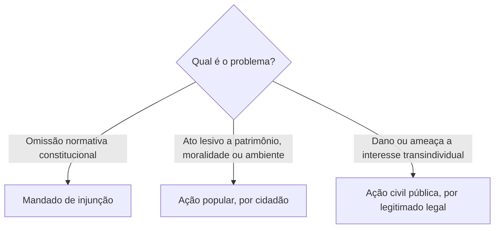
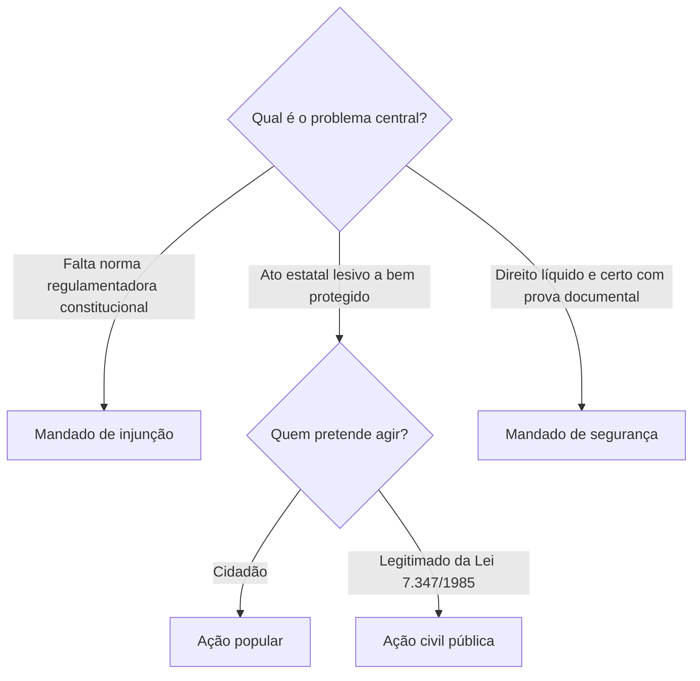

Este capítulo conclui o estudo dos remédios constitucionais com três instrumentos de tutela de alcance e função distintos. Mandado de injunção enfrenta omissão normativa que impede exercício de direito constitucional; ação popular permite ao cidadão questionar ato lesivo a bens constitucionalmente protegidos; ação civil pública promove proteção coletiva por legitimados definidos em lei. A comparação evita atribuir a um instrumento a finalidade de outro.

> [!objetivos]
> - Identificar os requisitos e efeitos do mandado de injunção.
> - Reconhecer legitimados para o mandado de injunção coletivo.
> - Distinguir ação popular de ação civil pública.
> - Comparar objetos, legitimidade e gratuidade da tutela coletiva.

## Mandado de injunção

O art. 5º, LXXI, prevê mandado de injunção quando a falta de norma regulamentadora torna inviável o exercício de direitos e liberdades constitucionais ou prerrogativas da nacionalidade, soberania e cidadania. A omissão pode ser total ou parcial. Deve haver dever constitucional de regulamentar e nexo entre a ausência normativa e a impossibilidade concreta de exercer o direito. Não basta discordar de lei existente ou pedir regulamentação de matéria puramente infraconstitucional.

A Lei 13.300/2016 disciplina o mandado individual e coletivo. Qualquer pessoa natural ou jurídica titular do direito prejudicado pode impetrar a modalidade individual. A ação é dirigida contra o Poder, órgão ou autoridade responsável pela edição da norma. No MI coletivo, podem atuar Ministério Público, partido político com representação no Congresso, organização sindical, entidade de classe, associação com um ano de funcionamento e Defensoria Pública, observadas as finalidades e condições legais.

> [!exemplo]
> A Constituição assegura um direito cujo exercício depende de lei regulamentadora que o órgão competente, apesar de dever fazê-lo, não editou. Se a lacuna impede concretamente a fruição do direito, cabe examinar mandado de injunção.

A decisão reconhece a mora e, em regra, fixa prazo para edição da norma e condições para o exercício do direito caso a omissão persista. A eficácia é limitada às partes até a norma regulamentadora, mas a lei permite extensão ultra partes ou erga omnes quando isso for inerente ou indispensável ao exercício do direito. Esse modelo concretista busca evitar que a falta legislativa torne a garantia inócua, sem afastar os parâmetros legais.

> [!pegadinha]
> Mandado de injunção não é o instrumento para declarar inconstitucional uma lei existente por seu conteúdo; sua causa é a falta de norma regulamentadora que inviabiliza direito constitucional.

## Ação popular

O art. 5º, LXXIII, legitima qualquer cidadão a propor ação popular para obter a invalidação de conduta prejudicial a bens estatais ou de entidades vinculadas ao poder público, à probidade administrativa, à natureza e à memória cultural. Cidadão, para essa finalidade, é pessoa física no gozo dos direitos políticos; pessoa jurídica não tem legitimidade ativa, conforme orientação consolidada. A ação pode prevenir a prática de ato lesivo ou buscar sua invalidação, conforme o caso.

O autor fica isento de custas judiciais e ônus da sucumbência, salvo comprovada má-fé. A lesividade não depende sempre de prejuízo financeiro: pode decorrer da ofensa à moralidade ou a outros bens protegidos, conforme a jurisprudência. O Ministério Público acompanha a ação e pode assumir sua continuidade nas hipóteses legais, mas não substitui o cidadão como legitimado originário para propor ação popular. Não cabe usá-la como sucedâneo de recurso contra decisão judicial.

> [!atencao]
> O cidadão propõe ação popular. A legitimidade do Ministério Público para ação civil pública não se transfere automaticamente para a ação popular.

## Ação civil pública

A ação civil pública é instrumento de tutela coletiva previsto no art. 129, III, da Constituição e na Lei 7.347/1985. Protege patrimônio público e social, meio ambiente e outros interesses difusos e coletivos; em conjunto com o sistema coletivo, também pode tutelar direitos individuais homogêneos. Pode pedir condenação em dinheiro ou obrigação de fazer ou não fazer, inclusive para prevenir dano e enfrentar omissões estatais ilegais.

A legitimidade é concorrente e definida em lei: Ministério Público, Defensoria Pública, entes federativos, entidades da Administração indireta e associações que preencham requisitos legais de tempo de constituição e pertinência temática. O cidadão isolado não propõe ação civil pública. Se o Ministério Público não for autor, deve intervir como fiscal da ordem jurídica, nos termos legais. A ação não é privativa do MP.

| Ação | Legitimidade principal | Objeto | Gratuidade ou regime |
| --- | --- | --- | --- |
| Mandado de injunção | Titular prejudicado; rol próprio no coletivo | Omissão normativa que inviabiliza direito constitucional | Conforme regras legais e assistência aplicável |
| Ação popular | Cidadão | Anular ato lesivo a bens constitucionais | Autor de boa-fé isento de custas e sucumbência |
| Ação civil pública | Legitimados da Lei 7.347/1985 | Tutela coletiva de bens e interesses protegidos | Regime próprio da lei coletiva |

## Procedimento, efeitos e limites da tutela coletiva

No mandado de injunção, a petição deve expor a omissão, a norma constitucional que impõe a regulamentação, o titular afetado e o impedimento concreto. A autoridade ou órgão responsável é chamado a prestar informações no rito previsto na Lei 13.300/2016, e a decisão pode reconhecer a mora sem transformar o processo em discussão abstrata sobre toda a política legislativa. A lei permite que a solução seja revista se houver mudança relevante nas circunstâncias de fato ou de direito. Em caso de norma editada depois da decisão, seus efeitos sobre a situação individual seguem o regime legal, preservada a segurança das relações já constituídas.

A ação popular tem caráter desconstitutivo e preventivo: pode pedir que um ato ainda não executado seja sustado, além de buscar invalidação e consequências reparatórias quando a lesão já ocorreu. A petição identifica o ato, os responsáveis e o bem protegido. A Lei 4.717/1965 prevê a participação dos entes interessados e dos beneficiários do ato para que o resultado alcance quem efetivamente contribuiu para a ilegalidade ou recebeu vantagem. A sentença pode produzir efeitos patrimoniais e determinar recomposição, conforme o pedido e a prova. O cidadão não precisa demonstrar ser pessoalmente prejudicado; atua na defesa do interesse público na condição política exigida pela Constituição.

Na ação civil pública, a escolha do pedido deve corresponder ao tipo de interesse e à extensão da ameaça. Uma obrigação de não fazer pode impedir a continuidade de uma prática; uma obrigação de fazer pode impor medidas de recuperação ou correção; e a condenação pecuniária pode reparar o dano coletivo. O resultado pode destinar-se ao fundo previsto na lei quando não for possível recompor diretamente o bem lesado. A tutela coletiva organiza pretensões comuns e reduz decisões incompatíveis, mas não elimina automaticamente a possibilidade de situações individuais exigirem liquidação ou execução própria.

A legitimidade deve ser examinada junto com a pertinência do objeto. O Ministério Público possui atribuição constitucional para defender interesses difusos e coletivos, mas isso não apaga a legitimidade dos demais entes e associações previstos na lei. A associação precisa demonstrar que seu objeto institucional guarda relação com o direito transindividual e, em regra, cumprir o requisito temporal legal; a dispensa judicial desse requisito depende de interesse social manifesto. A Defensoria Pública pode agir dentro de suas funções institucionais em favor de grupos vulneráveis. Essa análise evita dois erros recorrentes: afirmar que qualquer pessoa pode propor ACP e afirmar que somente o MP pode fazê-lo.

A ação popular e a ACP podem coexistir diante de um mesmo contexto, mas cada processo deve ter pedido e legitimidade próprios. O cidadão pode questionar a validade de ato lesivo por ação popular; o legitimado coletivo pode, em ACP, buscar prevenção, reparação ou obrigação voltada ao interesse transindividual. O juízo deve evitar duplicidade de reparação, preservar coerência entre decisões e considerar a extensão dos grupos beneficiados. Nenhuma dessas vias dispensa prova do fato, da ilegalidade ou ameaça relevante e do vínculo entre a providência solicitada e o bem protegido.

## Mapa do capítulo

| Instrumento | Núcleo | Quem provoca |
| --- | --- | --- |
| MI | Falta de norma que impede direito constitucional | Titular ou legitimado coletivo legal |
| Ação popular | Anulação de ato lesivo | Cidadão |
| ACP | Proteção de interesses coletivos | Legitimados do art. 5º da Lei 7.347/1985 |

### Para fixar
- MI exige omissão normativa e inviabilidade de exercer direito constitucional.
- MI pode ser individual ou coletivo e é regulado pela Lei 13.300/2016.
- A decisão pode fixar prazo e condições para exercício do direito.
- Ação popular só pode ser proposta por cidadão.
- Autor de ação popular não paga custas ou sucumbência, salvo má-fé.
- ACP protege interesses coletivos e pode pedir dinheiro ou obrigação de fazer ou não fazer.
- A ACP tem legitimados legais concorrentes e não é exclusiva do Ministério Público.
- Ação popular e ACP têm objetos e legitimidades distintos.
## Pressupostos e alcance do mandado de injunção

O mandado de injunção protege a efetividade de direito constitucional quando uma omissão normativa, total ou parcial, impede seu exercício. É necessário que a Constituição imponha dever de regulamentar, que a falta dessa norma seja a causa da inviabilidade e que tenha transcorrido prazo razoável para edição. O pedido não se baseia apenas em demora política: deve apontar qual prerrogativa constitucional ficou sem condições jurídicas de ser exercida.

Normas constitucionais de eficácia limitada dependem de complemento para produzir plenamente certos efeitos. A ausência de norma pode ser absoluta, quando nada foi disciplinado, ou parcial, quando a regulamentação existente não cobre elemento indispensável. A omissão parcial pode tornar a garantia impraticável mesmo sem vazio completo. O impetrante precisa demonstrar o nexo causal entre lacuna e impedimento concreto, como a impossibilidade de obter prestação ou exercer liberdade prevista na Constituição.

> [!exemplo]
> Se a Constituição garante uma prerrogativa de nacionalidade que depende de lei e nenhuma regra permite requerê-la, o interessado deve mostrar o direito constitucional, a obrigação de legislar, a falta de disciplina e a impossibilidade efetiva que enfrenta. O simples desejo de obter uma lei mais conveniente não basta.

O MI não serve para contestar norma existente apenas porque a parte a considera inadequada, nem para suprir falta de regulamentação de direito criado por lei ordinária sem fundamento constitucional. Também não cabe diante de matéria em que o legislador tenha apenas faculdade de agir, sem mandamento constitucional obrigatório, ou para pedir regra de medida provisória ainda não convertida em lei. Não se usa MI quando o direito já tem disciplina suficiente, ainda que exista divergência sobre sua interpretação.

> [!lei] Lei 13.300/2016, art. 2º
> Conceder-se-á mandado de injunção sempre que a falta **total ou parcial** de norma regulamentadora torne inviável o exercício dos direitos e liberdades constitucionais e das prerrogativas inerentes à nacionalidade, à soberania e à cidadania.
> Parágrafo único. Considera-se parcial a regulamentação quando forem insuficientes as normas editadas pelo órgão legislador competente.

## Legitimidade, competência e rito do MI

Na modalidade individual, pode impetrar quem seja titular do direito, liberdade ou prerrogativa inviabilizada; pessoa natural ou jurídica pode ser titular conforme a natureza do direito. No polo passivo figura o Poder, órgão ou autoridade que deveria editar a norma. A competência depende da autoridade omissa: o STF julga hipóteses previstas no art. 102, I, q, da Constituição; o STJ exerce competência indicada no art. 105, I, h, quando a omissão couber a órgão, entidade ou autoridade federal, ressalvadas competências de outros tribunais. A identificação exata da autoridade é essencial para escolher o tribunal.

A Lei 13.300/2016 admite MI coletivo. Podem impetrá-lo o Ministério Público, em hipóteses de relevância institucional ou social; partido com representação no Congresso para direitos relacionados aos integrantes ou finalidade partidária; organização sindical, entidade de classe e associação que cumpram requisitos de existência, tempo e pertinência; e Defensoria Pública em tutela relevante de direitos humanos ou de pessoas necessitadas. A exigência de um ano e pertinência temática recai sobre a associação, e o texto legal dispensa autorização especial dos representados nos casos ali previstos.

| Legitimado no MI coletivo | Finalidade principal | Condição que deve ser verificada |
| --- | --- | --- |
| Ministério Público | Ordem jurídica, regime democrático ou interesses indisponíveis | Relevância institucional ou social da tutela |
| Partido político | Direito de integrantes ou ligado à finalidade partidária | Representação no Congresso Nacional |
| Sindicato ou entidade de classe | Direito da categoria ou de parte dela | Pertinência com a finalidade representativa |
| Associação | Direito dos associados | Constituição e funcionamento há ao menos um ano e pertinência estatutária |
| Defensoria Pública | Direitos humanos e de necessitados | Relevância e adequação às funções institucionais |

A decisão do MI não é liminar para o juiz substituir imediatamente o legislador sem ouvir o órgão responsável. A Lei prevê reconhecimento da mora e fixa prazo razoável para que a norma seja produzida; persistindo omissão, o juízo estabelece condições para o exercício do direito ou para que a pessoa ajuíze ação própria. A decisão tem eficácia limitada às partes até a edição da norma, mas pode alcançar grupo maior quando isso for inerente ou indispensável ao exercício do direito (Lei 13.300/2016, art. 9º). A norma regulamentadora superveniente pode modificar os efeitos futuros conforme a lei, resguardados os efeitos já produzidos nos limites legais.

> [!pegadinha]
> A lei adotou como regra eficácia subjetiva entre as partes, com possibilidade de extensão ultra partes ou erga omnes se necessária ao exercício do direito. Não responda que todo MI sempre produz efeitos gerais nem que o juiz só comunica a omissão sem concretizar o direito.

## Ação popular: legitimidade e bens tutelados

A ação popular permite que cidadão questione judicialmente conduta prejudicial aos recursos públicos, à probidade administrativa, à natureza ou à memória histórica e cultural. Cidadão, nesse contexto, é pessoa física no exercício dos direitos políticos, demonstrado usualmente por título eleitoral ou certidão equivalente. Estrangeiro sem cidadania política, pessoa jurídica e partido não podem propor ação popular em nome próprio. É possível atuação preventiva para impedir que ato produza lesão e repressiva para buscar sua anulação depois.

A lesividade não exige sempre prejuízo financeiro aos cofres públicos. O Tema 836 do STF firmou que o cidadão pode impugnar, separadamente, lesão ao patrimônio material, moral, cultural ou histórico. Ilegalidade ou ofensa à moralidade pode bastar, ainda que não haja cálculo de perda pecuniária. Isso não dispensa demonstrar o ato e sua relação com bem protegido: o autor deve apontar a ilegalidade ou lesividade pertinente.

> [!exemplo]
> Um eleitor descobre que a prefeitura autorizou obra em área de proteção histórica sem observar requisito legal. Mesmo antes da execução da obra, pode ajuizar ação popular preventiva se demonstrar sua condição de cidadão e a lesividade potencial do ato.

Os réus incluem a entidade em nome da qual o ato foi praticado, agentes que autorizaram, praticaram ou deixaram ocorrer a lesão e beneficiários diretos, nos termos da Lei 4.717/1965. O órgão público pode contestar ou, se isso favorecer o interesse público, atuar ao lado do autor. A ação não é via para atacar decisão jurisdicional típica nem para rever sentença: contra decisão judicial usam-se recursos e ações processuais próprios. Também não há foro por prerrogativa só porque o ato envolve Presidente da República ou parlamentar; a competência segue regras comuns aplicáveis à ação.

O Ministério Público deve acompanhar a ação popular, promover a produção de prova e atuar na defesa da ordem jurídica. Pode cumprir ônus processuais que o autor negligencie e, se o cidadão desistir ou abandonar a causa, pode assumir sua continuidade se houver interesse público. Não pode ajuizar originariamente ação popular como substituto geral do cidadão, nem desistir depois de assumir a continuidade. O autor de boa-fé é isento de custas e sucumbência; a exceção é má-fé comprovada.

| Elemento da ação popular | Regra | Exemplo de armadilha |
| --- | --- | --- |
| Autor | Cidadão no exercício dos direitos políticos | MP e pessoa jurídica não são legitimados originários |
| Objeto | Ato lesivo a patrimônio, moralidade, ambiente ou bens culturais | Não exige dano pecuniário concomitante em todos os casos |
| Momento | Preventiva ou repressiva | Não precisa aguardar dano consumado |
| Ministério Público | Fiscaliza, auxilia e pode assumir continuidade | Não se torna autor originário por regra geral |
| Ônus financeiro | Autor de boa-fé não paga custas ou sucumbência | Má-fé comprovada afasta a isenção |

## Ação civil pública e tutela coletiva

A ação civil pública está prevista no art. 129, III, e regulamentada pela Lei 7.347/1985. Embora não esteja no rol de remédios do art. 5º, integra o sistema de defesa judicial de interesses coletivos e complementa a ação popular. Pode prevenir ou reparar danos ao meio ambiente, consumidor, patrimônio público e social, ordem urbanística e outros interesses difusos e coletivos definidos em lei. Também tutela direitos individuais homogêneos, quando os interesses individuais decorrem de origem comum e são protegidos coletivamente pelo sistema processual.

A ação pode pedir condenação em dinheiro ou obrigação de fazer ou não fazer (Lei 7.347/1985, art. 3º). Pode servir para interromper poluição, exigir recuperação ambiental ou impedir política pública manifestamente omissa, desde que o pedido respeite a competência judicial e os parâmetros de controle de legalidade. O juiz pode conceder tutela de urgência se os requisitos legais estiverem presentes; a ACP não se limita à reparação financeira posterior.

A legitimidade é concorrente: Ministério Público, Defensoria Pública, União, Estados, Distrito Federal e Municípios; autarquias, empresas públicas, fundações e sociedades de economia mista; e associações com pelo menos um ano de constituição e finalidade estatutária relacionada ao bem protegido. O juiz pode dispensar o requisito temporal da associação se houver manifesto interesse social, pela dimensão ou característica do dano ou pela relevância do bem jurídico. Cidadão individual não propõe ACP. Se o MP não atuar como autor, intervém obrigatoriamente como fiscal da ordem jurídica.

| Legitimado para ACP | Abrangência e requisito | Diferença em relação à ação popular |
| --- | --- | --- |
| Ministério Público | Defesa de interesses transindividuais | Pode propor originariamente ACP, mas não ação popular em regra |
| Defensoria Pública | Direitos coletivos e de grupos vulneráveis, dentro de suas funções | A legitimidade decorre de lei e pertinência da tutela |
| Entes federativos | Interesses relacionados às atribuições e bens tutelados | Não precisam ter condição de cidadão |
| Entidades da Administração indireta | Proteção coletiva conforme finalidade institucional | Podem ser autoras da ACP |
| Associação | Um ano de existência e pertinência temática, salvo dispensa judicial legal | Prazo pode ser dispensado por interesse social manifesto |

A ACP não é exclusiva do Ministério Público. O STF reconhece a legitimidade do MP para proteger consumidores em questões de mensalidades escolares (Súmula 643) e interesses individuais homogêneos de relevância social. A ação coletiva não serve para substituir ações tributárias individuais nem para discutir, em tese, relação fiscal sem interesse coletivo tutelável; a legitimidade depende do objeto e dos titulares. A Lei 7.347/1985 impede adiantamento de determinadas despesas e restringe condenação da associação autora, salvo má-fé, sob regime próprio.

> [!lei] CF, art. 129, III
> Art. 129. São funções institucionais do Ministério Público: (...)
> III - promover o inquérito civil e a **ação civil pública**, para a proteção do patrimônio público e social, do meio ambiente e de outros interesses difusos e coletivos;

## Como escolher entre os instrumentos

A ação popular e a ACP podem proteger alguns bens semelhantes, mas diferem na legitimação e na forma de participação. Cidadão atua na ação popular e busca anular ato lesivo; legitimados legais propõem ACP para tutela ampla coletiva, inclusive obrigação de fazer ou reparação. O mandado de injunção, por sua vez, não parte de ato lesivo: sua causa é a falta de norma constitucionalmente exigida que impede exercer direito. A comparação impede que a banca troque autor ou objeto.

> [!bizu]
> MI combate omissão normativa; ação popular exige autor cidadão e visa anular ato lesivo; ACP exige legitimado legal e protege interesses coletivos por diversos tipos de pedido.

> [!atencao]
> O fato de uma matéria envolver meio ambiente ou patrimônio público não torna automaticamente adequada qualquer ação. Identifique se há omissão normativa, ato concreto lesivo ou dano coletivo e confira a legitimidade de quem pretende ajuizar.

## Procedimento, efeitos e limites da tutela coletiva

No mandado de injunção, a petição deve expor a omissão, a norma constitucional que impõe a regulamentação, o titular afetado e o impedimento concreto. A autoridade ou órgão responsável é chamado a prestar informações no rito previsto na Lei 13.300/2016, e a decisão pode reconhecer a mora sem transformar o processo em discussão abstrata sobre toda a política legislativa. A lei permite que a solução seja revista se houver mudança relevante nas circunstâncias de fato ou de direito. Em caso de norma editada depois da decisão, seus efeitos sobre a situação individual seguem o regime legal, preservada a segurança das relações já constituídas.

A ação popular tem caráter desconstitutivo e preventivo: pode pedir que um ato ainda não executado seja sustado, além de buscar invalidação e consequências reparatórias quando a lesão já ocorreu. A petição identifica o ato, os responsáveis e o bem protegido. A Lei 4.717/1965 prevê a participação dos entes interessados e dos beneficiários do ato para que o resultado alcance quem efetivamente contribuiu para a ilegalidade ou recebeu vantagem. A sentença pode produzir efeitos patrimoniais e determinar recomposição, conforme o pedido e a prova. O cidadão não precisa demonstrar ser pessoalmente prejudicado; atua na defesa do interesse público na condição política exigida pela Constituição.

Na ação civil pública, a escolha do pedido deve corresponder ao tipo de interesse e à extensão da ameaça. Uma obrigação de não fazer pode impedir a continuidade de uma prática; uma obrigação de fazer pode impor medidas de recuperação ou correção; e a condenação pecuniária pode reparar o dano coletivo. O resultado pode destinar-se ao fundo previsto na lei quando não for possível recompor diretamente o bem lesado. A tutela coletiva organiza pretensões comuns e reduz decisões incompatíveis, mas não elimina automaticamente a possibilidade de situações individuais exigirem liquidação ou execução própria.

A legitimidade deve ser examinada junto com a pertinência do objeto. O Ministério Público possui atribuição constitucional para defender interesses difusos e coletivos, mas isso não apaga a legitimidade dos demais entes e associações previstos na lei. A associação precisa demonstrar que seu objeto institucional guarda relação com o direito transindividual e, em regra, cumprir o requisito temporal legal; a dispensa judicial desse requisito depende de interesse social manifesto. A Defensoria Pública pode agir dentro de suas funções institucionais em favor de grupos vulneráveis. Essa análise evita dois erros recorrentes: afirmar que qualquer pessoa pode propor ACP e afirmar que somente o MP pode fazê-lo.

A ação popular e a ACP podem coexistir diante de um mesmo contexto, mas cada processo deve ter pedido e legitimidade próprios. O cidadão pode questionar a validade de ato lesivo por ação popular; o legitimado coletivo pode, em ACP, buscar prevenção, reparação ou obrigação voltada ao interesse transindividual. O juízo deve evitar duplicidade de reparação, preservar coerência entre decisões e considerar a extensão dos grupos beneficiados. Nenhuma dessas vias dispensa prova do fato, da ilegalidade ou ameaça relevante e do vínculo entre a providência solicitada e o bem protegido.

## Mapa do capítulo

| Instrumento | Causa do pedido | Legitimidade central | Efeito típico |
| --- | --- | --- | --- |
| Mandado de injunção | Omissão que inviabiliza direito constitucional | Titular individual ou legitimado coletivo legal | Condições para exercer o direito enquanto faltar norma |
| Ação popular | Ato lesivo a patrimônio, moralidade, ambiente ou cultura | Cidadão | Anulação ou prevenção da lesão |
| Ação civil pública | Ameaça ou dano a interesse transindividual | Legitimados da Lei 7.347/1985 | Dinheiro, obrigação de fazer ou de não fazer |

### Para fixar
- MI exige dever de regulamentar, omissão, nexo causal e impedimento concreto ao exercício do direito.
- MI coletivo pode ser impetrado por MP e Defensoria nos casos da Lei 13.300/2016.
- A decisão do MI é inter partes como regra, com extensão possível quando indispensável.
- Ação popular é ajuizada por cidadão e pode ser preventiva ou repressiva.
- Tema 836 dispensa prova de prejuízo material aos cofres como condição universal da ação popular.
- O MP acompanha ação popular e pode assumir sua continuidade, mas não é autor originário por regra geral.
- ACP tem legitimados concorrentes definidos em lei e não é exclusiva do MP.
- ACP permite condenação em dinheiro e obrigações de fazer ou não fazer.
- Pessoa isolada não propõe ACP; cidadão é o legitimado típico da ação popular.
