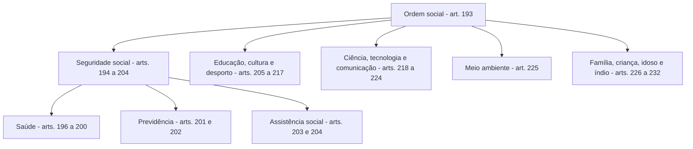

O Estado não existe só para se abster. Além de garantir que ninguém invada a sua liberdade, ele precisa entregar escola, posto de saúde, aposentadoria e auxílio a quem não tem como se sustentar. Essa é a promessa dos direitos sociais, e ela custa dinheiro. Daí nasce o conflito que a prova explora: o direito existe, o caixa é limitado e alguém decide o que cabe no orçamento. Este capítulo monta a base dessa discussão: a lista do art. 6º, a ordem social, a reserva do possível, o mínimo existencial e a vedação ao retrocesso. Os dois capítulos seguintes entram nos direitos dos trabalhadores.

> [!objetivos]
> - Listar os direitos sociais do art. 6º e reconhecer a natureza de cada um.
> - Situar os direitos sociais no conjunto dos direitos fundamentais e explicar sua aplicação imediata.
> - Diferenciar reserva do possível, mínimo existencial e vedação ao retrocesso.
> - Identificar quando o Judiciário pode determinar a entrega de uma prestação social.
> - Evitar as trocas que a banca faz entre direito social, direito individual e norma programática.

## O que são direitos sociais

Direito social é a pretensão a uma **prestação positiva** do Estado ou a uma proteção especial a quem está em situação de vulnerabilidade. Em vez de exigir que o Estado não faça, ele exige que o Estado faça: construa a escola, contrate o médico, pague o benefício. Por isso são chamados de direitos de **segunda dimensão**, ao lado dos direitos econômicos e culturais, embora a doutrina atual prefira falar em dimensões que se acumulam, e não em gerações que se substituem.

Essa origem histórica explica o vocabulário. Os direitos de primeira dimensão nasceram das revoluções liberais e pediam abstenção: liberdade de ir e vir, propriedade, voto. Os sociais vieram com a industrialização e o constitucionalismo social do século XX, quando ficou claro que a liberdade sem condições materiais é fachada. A Constituição de 1988 combinou as duas coisas no mesmo texto, e é essa mistura que o examinador cobra: o mesmo artigo 5º que protege a liberdade de expressão convive com o artigo 6º que promete moradia.

### A lista do art. 6º

O art. 6º é um rol **aberto na prática e fechado no texto**: a Constituição lista os direitos, e novas prestações entram por emenda. É o caso da moradia, incluída pela Emenda Constitucional 26/2000, e do transporte, incluído pela Emenda Constitucional 90/2015. Guarde essas duas, porque são as alterações mais cobradas em prova.

A lista atual tem onze itens. Vale guardar o texto, porque a banca cobra a falta de um deles.

> [!lei] CF, art. 6º
> São direitos sociais a educação, a saúde, a alimentação, o trabalho, a moradia, o transporte, o lazer, a
> segurança, a previdência social, a proteção à maternidade e à infância, a assistência aos desamparados, na
> forma desta Constituição.

A tabela abaixo organiza cada item pelo tipo de prestação que ele representa, o que ajuda a responder questões
sobre a natureza do direito.

| Direito social | Prestação típica | Observação de prova |
| --- | --- | --- |
| Educação | Serviço público universal | Dever do Estado e da família (art. 205) |
| Saúde | Serviço de acesso universal e igualitário | Dever do Estado (art. 196) |
| Alimentação | Política de segurança alimentar | Incluída no rol de 1988 |
| Trabalho | Proteção da relação de emprego | Detalhado no art. 7º |
| Moradia | Habitação e regularização fundiária | Incluída pela EC 26/2000 |
| Transporte | Mobilidade urbana e coletiva | Incluída pela EC 90/2015 |
| Lazer | Acesso a atividades culturais e esportivas | Sem lei própria de regência |
| Segurança | Segurança pública como dever do Estado | Art. 144 |
| Previdência social | Benefício contributivo | Art. 201 |
| Proteção à maternidade e à infância | Proteção especial | Art. 6º e art. 227 |
| Assistência aos desamparados | Benefício não contributivo | Art. 203 |

A lista termina com a expressão "na forma desta Constituição". Ela parece detalhe, mas não é: significa que o direito social existe como **direito constitucional** e que o seu modo de entrega é definido pelos artigos seguintes. O direito à saúde é universal, e o artigo 199 admite a participação da iniciativa privada em caráter complementar. O direito à previdência é contributivo, e o artigo 201 fixa os requisitos. Quem lê a lista sem os artigos de regência erra as questões de detalhe.

> [!atencao] Moradia e transporte entraram por emenda
> O art. 6º original de 1988 não tinha moradia nem transporte. Moradia veio pela EC 26/2000; transporte, pela EC 90/2015. Se a questão afirmar que a moradia já estava no texto original, está errada. Se afirmar que o transporte é direito social, está certa.

### Direitos sociais e direitos fundamentais

A pergunta clássica: os direitos sociais são direitos fundamentais? A resposta que a prova espera é **sim**. O art. 5º, § 1º, manda aplicar imediatamente as normas que definem direitos e garantias fundamentais, e o art. 6º está no Título II, que trata justamente disso. Além disso, o § 2º do art. 5º abre o catálogo para direitos decorrentes do regime e dos princípios adotados, o que alcança tratados internacionais.

Daí decorrem três consequências práticas.

Primeiro, os direitos sociais **não são mera promessa** sem eficácia: produzem deveres de proteção e de não retrocesso e podem ser exigidos em juízo.

Segundo, eles se submetem ao regime dos direitos fundamentais: aplicação imediata, eficácia horizontal (valem também nas relações entre particulares, em certa medida) e proteção contra emenda tendente a aboli-los, na leitura que estende o art. 60, § 4º, IV.

A visão tradicional chama os direitos sociais de segunda dimensão e os de primeira de liberdades negativas. A visão atual prefere "dimensão" a "geração", porque direitos não se substituem: os sociais convivem com os individuais, e ambos continuam em vigor.

Terceiro, a **universalidade** não significa gratuidade para todos em todo serviço. Saúde pública é gratuita no atendimento, mas a educação superior pública também é gratuita, e a previdência é contributiva. Direito social não é sinônimo de serviço gratuito.

> [!pegadinha] "Norma programática" não é sinônimo de norma sem efeito
> A banca gosta da frase "os direitos sociais são normas programáticas, logo não podem ser exigidos judicialmente". A primeira parte é aceitável como descrição do grau de detalhamento; a segunda é falsa. O Supremo reconhece a exigibilidade judicial de prestações sociais, sobretudo quando está em jogo o mínimo existencial.

## A ordem social e os blocos de prestação

Os direitos sociais não vivem sozinhos no art. 6º. Eles ganham corpo no Título VIII, dedicado à **ordem social**, que começa no art. 193: seguridade social, educação, cultura, desporto, ciência e tecnologia, comunicação, meio ambiente, família e proteção especial. Conhecer esse mapa evita procurar a regra de detalhe no artigo errado.

O esquema abaixo mostra como a ordem social se organiza a partir do art. 193.

A **seguridade social** é o bloco mais cobrado. O art. 194 a define como conjunto integrado de ações dos poderes públicos e da sociedade, destinado a assegurar saúde, previdência e assistência. Os três componentes têm lógicas diferentes, e a diferença é explorada em prova:

- **Saúde**: direito de todos e dever do Estado, **independente de contribuição** (art. 196).
- **Previdência social**: **contributiva**, em regime geral de filiação obrigatória, com cobertura de doença, invalidez, morte, idade avançada, maternidade, desemprego involuntário e apoio à família (art. 201).
- **Assistência social**: prestada a quem dela necessitar, **sem exigir contribuição**, com objetivos de proteção à família, à maternidade, à infância, à adolescência e à velhice e de garantia de um salário mínimo de benefício mensal ao idoso e ao portador de deficiência que comprovem não ter meios de prover a própria manutenção (arts. 203 e 204).

A tabela seguinte compara os três componentes, que é o tipo de comparação que rende questão.

| Componente | Exige contribuição? | Destinatário | Norma-base |
| --- | --- | --- | --- |
| Saúde | Não | Todos | Art. 196 |
| Previdência | Sim | Segurados e dependentes | Art. 201 |
| Assistência social | Não | Quem dela necessitar | Art. 203 |

> [!bizu] Seguridade em três palavras
> **Saúde é para todos, previdência é para quem contribui, assistência é para quem precisa.** Se a assertiva disser que a assistência social é contributiva, está errada; se disser que a saúde depende de contribuição, também.

O art. 194, parágrafo único, fixa os **objetivos** da seguridade: universalidade da cobertura e do atendimento, uniformidade e equivalência dos benefícios às populações urbanas e rurais, seletividade e distributividade na prestação, irredutibilidade do valor dos benefícios, equidade na forma de participação no custeio, diversidade da base de financiamento e caráter democrático e descentralizado da gestão. Esses sete objetivos aparecem em questões de múltipla escolha com a troca de uma palavra, em geral "uniformidade" por "igualdade" ou "irredutibilidade" por "impenhorabilidade".

> [!exemplo] Três pedidos, três portas
> Uma família chega ao mesmo balcão com três pedidos. Pede consulta médica: entra pela saúde, sem contribuição. Pede aposentadoria por idade do pai que sempre recolheu: entra pela previdência, com contribuição. Pede o benefício mensal para a avó de 70 anos sem renda: entra pela assistência, também sem contribuição, mas com comprovação de miserabilidade. O mesmo órgão pode atender aos três, e o regime jurídico de cada um é diferente.

## Reserva do possível

Reserva do possível é o argumento de que os direitos sociais dependem de **recursos financeiros disponíveis**. O Estado não gasta o que não tem, e a alocação de verbas é decisão política do legislador e do administrador, não do juiz. A doutrina alemã a formulou em três planos, e a prova cobra os três:

- **existência fática** dos recursos: o dinheiro precisa existir de fato;
- **disponibilidade jurídica**: a verba precisa estar prevista no orçamento e não pode estar comprometida com outra finalidade legal;
- **razoabilidade da pretensão**: o que se pede deve ser proporcional ao que se pretende gastar.

No Brasil, o Supremo enfrentou o tema na **ADPF 45**, em que se discutiu a legitimidade do controle judicial de políticas públicas. Ficaram duas balizas: o Judiciário não substitui o administrador na escolha de prioridades orçamentárias, mas a reserva do possível **não pode ser invocada como escudo** para descumprir o mínimo existencial.

Duas armadilhas aparecem com frequência. A primeira é transformar a reserva do possível em **limite absoluto**: se assim fosse, bastaria alegar falta de verba para não cumprir nenhum direito social. A segunda é transformá-la em **argumento irrelevante**: ela é real e serve de base para decisões que reconhecem a impossibilidade concreta de determinada prestação.

> [!pegadinha] Reserva do possível não é cheque em branco
> A banca escreve: "a reserva do possível autoriza o Estado a deixar de fornecer medicamento essencial por falta de previsão orçamentária". Errado. Falta de previsão orçamentária não afasta a proteção do mínimo existencial, e o remanejamento de verbas é medida cabível.

## Mínimo existencial

Mínimo existencial é o **núcleo essencial** de condições materiais sem as quais a dignidade humana não se realiza: alimentação, saúde básica, moradia mínima, educação fundamental, acesso à justiça. A ideia é que existe um piso abaixo do qual o Estado não pode se omitir, qualquer que seja a alegação orçamentária.

A consequência jurídica é a **justiciabilidade**: o particular pode pedir em juízo a prestação que integra esse núcleo, e o juiz pode condenar o Estado a entregá-la. Não é preciso esperar por política pública completa; a omissão concreta que atinge o mínimo é atacável.

> [!exemplo] Medicamento e vaga em creche
> Um paciente com doença crônica recebe prescrição de medicamento não padronizado, e a secretaria alega falta de previsão. Uma mãe pede vaga em creche para o filho de dois anos e recebe a resposta de que não há vagas. Nos dois casos, o Judiciário tem reconhecido o dever de prestar, porque a omissão atinge saúde e educação infantil, áreas do núcleo existencial. A solução costuma vir por bloqueio de verbas ou por determinação de atendimento em rede conveniada.

Dois cuidados evitam erro. Mínimo existencial não é **máximo de direitos**: é piso, não teto, e não transforma todo pedido em obrigação judicial. E ele não se confunde com **mínimo vital**, ligado à sobrevivência biológica e à impenhorabilidade de valores.

> [!atencao] Dois critérios que a jurisprudência usa
> Na análise de pedidos de prestação social, o Supremo costuma verificar a **essencialidade** da prestação para a dignidade e a **razoabilidade** do pedido diante dos recursos existentes. Prestação essencial + pedido razoável tende a ser deferida; prestação não essencial ou pedido desproporcional tende a ser negada.

## Como o Judiciário efetiva a prestação

Reconhecido o direito, falta a parte prática: fazer o Estado entregar. A execução de sentença que impõe prestação social segue caminhos próprios, e o Supremo admite medidas coercitivas quando a omissão se repete. As três mais cobradas são o **sequestro de verbas**, o bloqueio de valores e a determinação de atendimento pela rede privada conveniada. A ideia é que a efetivação não fique dependente da boa vontade do gestor que descumpriu a ordem.

A implementação por planos de ação também ganhou espaço: em vez de uma ordem isolada, o juízo negocia prazos e etapas com o gestor, o que reduz a chance de inadimplência.

No caso dos medicamentos, a análise passa por três filtros: o registro na **ANVISA**, a incorporação no sistema público e a comprovação da necessidade no caso concreto. Fármaco registrado e não incorporado não é negado automaticamente; experimental ou sem registro, a tendência é negar, porque falta a base mínima de segurança.

> [!exemplo] Execução com prazo e multa
> Município condenado a entregar medicamento de uso contínuo não cumpre a ordem em 30 dias. O juiz fixa multa diária, bloqueia verba da secretaria de saúde e autoriza a compra em farmácia credenciada, com ressarcimento pelo ente. A medida não substitui a política pública: garante o cumprimento naquele caso.

## Vedação ao retrocesso

Vedação ao retrocesso, também chamada de **efeito cliquet**, é a regra de que o Estado não pode reduzir o nível de proteção social já conquistado sem compensação ou justificativa constitucionalmente aceitável. A metáfora é a do catraca: ela gira em um sentido e trava no outro. O direito social avança e não volta ao patamar anterior.

O fundamento está na combinação entre dignidade humana, segurança jurídica e proteção da confiança. O cidadão organiza a vida contando com a prestação; suprimi-la de repente frustra essa confiança e esvazia o próprio direito.

Daí não se segue que nenhuma alteração seja possível. A doutrina admite mudanças, desde que observados três requisitos:

- **motivação** séria e baseada em dados sobre a necessidade da mudança;
- **proporcionalidade**, com escolha de meio menos gravoso;
- **compensação** ou criação de alternativa equivalente para o grupo atingido.

O exemplo clássico é a alteração de critérios de cálculo de benefício previdenciário. O Supremo já admitiu mudanças por emenda constitucional, porque a Constituição não congela o regime, mas exige que a alteração preserve o **núcleo essencial** e observe a irredutibilidade do valor dos benefícios. Não se admite, por outro lado, extinção pura e simples de benefício sem qualquer substituto para quem já o recebia.

> [!pegadinha] Cliquet não é imutabilidade
> A banca costuma dizer que "a vedação ao retrocesso impede qualquer reforma previdenciária". É falso. O que se veda é a supressão injustificada de proteção já assegurada, não a mudança de regras com motivação e proporcionalidade.

## Como a banca monta a questão

Quatro movimentos se repetem. O primeiro é a **troca de artigo**: atribuir ao art. 6º uma regra do art. 201. O segundo é a **generalização**: "todos os direitos sociais são gratuitos", o que ignora a previdência contributiva. O terceiro é o **absolutismo**: reserva do possível como limite total ou cliquet como congelamento. O quarto é a **troca de nome**: chamar de mínimo existencial o que é reserva do possível.

A tabela fixa a diferença em uma linha por instituto.

| Instituto | Pergunta que responde | Ideia central |
| --- | --- | --- |
| Reserva do possível | Quanto o Estado pode gastar? | Depende dos recursos existentes e da previsão orçamentária |
| Mínimo existencial | O que o Estado não pode deixar de entregar? | Piso de dignidade, exigível em juízo |
| Vedação ao retrocesso | O que o Estado não pode retirar? | Proteção já conquistada não regride sem justificativa |
| Progressividade | Como o direito avança? | Ampliação gradual, conforme os recursos |

A distinção entre o que é exigível de imediato e o que depende de implementação gradual gera dúvida. A resposta útil é: o direito existe desde já e produz deveres; a forma de entrega, em alguns casos, depende de implementação por lei e orçamento. Os direitos sociais são, primariamente, prestações positivas, mas não apenas isso. Eles também impõem ao Estado o dever de não desmontar o que já foi construído, e é aí que a vedação ao retrocesso entra.

## Mapa do capítulo

| Tema | Regra que decide a questão | Onde está |
| --- | --- | --- |
| Lista de direitos sociais | Onze itens; moradia (EC 26/2000) e transporte (EC 90/2015) | Art. 6º |
| Aplicação imediata | Direitos sociais são direitos fundamentais | Art. 5º, § 1º |
| Saúde | Para todos, sem contribuição | Arts. 196 a 200 |
| Previdência | Contributiva e de filiação obrigatória | Arts. 201 e 202 |
| Assistência social | Sem contribuição, para quem necessitar | Arts. 203 e 204 |
| Reserva do possível | Limite real, mas não oponível ao mínimo existencial | ADPF 45 |
| Mínimo existencial | Núcleo de dignidade, exigível em juízo | Doutrina e jurisprudência |
| Retrocesso | Proteção conquistada não regride sem justificativa | Efeito cliquet |

### Para fixar

- O art. 6º lista onze direitos sociais e termina com "na forma desta Constituição", que remete aos artigos de detalhe.
- Moradia entrou pela EC 26/2000; transporte, pela EC 90/2015.
- Direitos sociais são direitos fundamentais e têm aplicação imediata (art. 5º, § 1º).
- Saúde é universal e não contributiva; previdência é contributiva; assistência é não contributiva e para quem necessitar.
- A seguridade social reúne saúde, previdência e assistência, com objetivos do art. 194, parágrafo único.
- Reserva do possível tem três planos: existência fática, disponibilidade jurídica e razoabilidade.
- A reserva do possível não pode ser oposta ao mínimo existencial (STF, ADPF 45).
- Mínimo existencial é piso de dignidade, não catálogo de todo pedido social.
- Vedação ao retrocesso (efeito cliquet) exige motivação, proporcionalidade e compensação para reduzir proteção.
- Direito social não é sinônimo de serviço gratuito: a previdência é o contraexemplo clássico.
