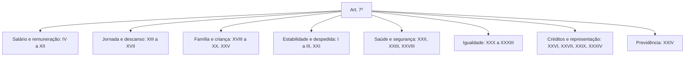

O art. 7º é o artigo mais longo da Constituição em matéria de direitos individuais do trabalhador: são trinta e quatro incisos, mais o parágrafo único que trata dos domésticos. Nenhuma prova cobra os trinta e quatro; a banca escolhe uns dez e cobra o detalhe. Este capítulo organiza o artigo por blocos temáticos, para que você saiba onde procurar cada regra, e destaca os números que decidem questão: 44 horas, 8 horas, 50%, um terço, 120 dias, 5 anos, 16 anos. O capítulo seguinte cuida dos direitos coletivos (arts. 8º a 11) e do regime dos domésticos.

> [!objetivos]
> - Situar o art. 7º no capítulo dos direitos sociais e identificar seu destinatário.
> - Agrupar os incisos por tema: salário, jornada, família, saúde, igualdade e créditos.
> - Memorizar os números cobrados: jornada, adicional, férias, licença, prescrição e idade mínima.
> - Distinguir as normas de eficácia plena das que dependem de lei.
> - Reconhecer os direitos do art. 7º aplicáveis ao servidor público ocupante de cargo.

## Quem é o destinatário do art. 7º

O caput fala em **trabalhadores urbanos e rurais**. A expressão tem duas funções. A primeira é igualar as duas categorias: não existe mais regime constitucional diferente para quem trabalha no campo, e a lei não pode dar ao rural menos do que o art. 7º assegura. A segunda é delimitar: o artigo trata da relação de **emprego**, isto é, do trabalho prestado por pessoa física a empregador, com pessoalidade, habitualidade, onerosidade e subordinação. Quem trabalha por conta própria não é empregado e não invoca o art. 7º pela via direta.

O caput termina com uma abertura: "além de outros que visem à melhoria de sua condição social". Essa cláusula permite que a lei ordinária, a convenção coletiva e o contrato criem direitos melhores. O art. 7º é **piso**, não teto. Negociação coletiva que reduz direito previsto em inciso é, em regra, inconstitucional, salvo quando a própria Constituição autoriza a flexibilização, como ocorre na irredutibilidade de salário (inciso VI) e na jornada (incisos XIII e XIV).

> [!lei] CF, art. 7º, caput
> São direitos dos trabalhadores urbanos e rurais, além de outros que visem à melhoria de sua condição social:

A frase é curta e explica a lógica do artigo inteiro: o rol é mínimo e a melhoria é sempre possível.

Um terceiro destinatário merece atenção: o **servidor público ocupante de cargo**. Ele não tem todos os direitos do art. 7º. O art. 39, § 3º, aplica a ele uma lista fechada: incisos IV, VII, VIII, IX, XII, XIII, XV, XVI, XVII, XVIII, XIX, XX, XXII e XXX. Fora dessa lista, o servidor segue o regime próprio do cargo, e não a Consolidação das Leis do Trabalho. Guarde a lógica: o que a Constituição estendeu ao servidor foi o núcleo de **remuneração, jornada e proteção familiar**, não a estabilidade do emprego privado.

| Destinatário | Norma aplicável | Observação |
| --- | --- | --- |
| Empregado urbano ou rural | Art. 7º, todos os incisos | Rol mínimo, ampliável |
| Trabalhador doméstico | Art. 7º, parágrafo único | Lista própria (capítulo seguinte) |
| Servidor ocupante de cargo | Art. 39, § 3º | Lista fechada de incisos |
| Trabalhador avulso | Art. 7º, XXXIV | Igualdade com o empregado permanente |
| Autônomo e estagiário | Sem vínculo de emprego | Não invocam o art. 7º diretamente |

> [!pegadinha] Art. 7º não é código do trabalho completo
> A banca escreve que "o servidor público tem direito a adicional de insalubridade e a seguro-desemprego por força do art. 7º". Errado. A lista do art. 39, § 3º, não inclui os incisos II, III e XXIII. O servidor pode receber essas vantagens se a lei do cargo prever, mas o fundamento não é a aplicação automática do art. 7º.

## O mapa dos trinta e quatro incisos

Decorar trinta e quatro incisos é inviável e desnecessário. O caminho é agrupar por assunto. O esquema abaixo mostra os blocos que a prova usa para montar alternativas.

Com o mapa na cabeça, a questão deixa de ser decoreba. Se o enunciado fala de descanso semanal, você já sabe que a resposta está entre os incisos XIII a XVII e não precisa varrer o artigo.

### Salário e remuneração

Este é o bloco mais cobrado, porque reúne números e vedações.

O **salário mínimo** (inciso IV) é fixado por lei, com valor único em todo o país, e precisa cobrir as necessidades vitais do trabalhador e da família: moradia, saúde, alimentação, educação, transporte, lazer, vestuário, higiene e previdência. Duas regras vêm no mesmo inciso e são exploradas à exaustão: os reajustes periódicos preservam o poder aquisitivo, e é **vedada a vinculação do salário mínimo para qualquer fim**. A vedação impede usá-lo como indexador de dívidas, de multas ou de benefícios, prática comum no passado que realimentava a inflação.

Note o alcance da palavra "unificado": o valor é o mesmo em todo o território, e nenhum estado ou município pode fixar mínimo menor. Piso salarial regional é outra coisa, e só existe quando a lei o cria para determinada categoria.

O **piso salarial** (inciso V) é proporcional à extensão e à complexidade do trabalho. Não confunda com salário mínimo: o piso é da categoria, fixado em lei ou em norma coletiva, e pode ser superior ao mínimo.

A **irredutibilidade** (inciso VI) é a regra, e a exceção é a redução por **convenção ou acordo coletivo**. Só isso. Lei não pode reduzir salário, e decisão unilateral do empregador muito menos. A banca troca "convenção coletiva" por "decisão do empregador" ou por "lei ordinária" e a assertiva fica errada.

O **décimo terceiro salário** (inciso VIII) tem por base a remuneração integral ou o valor da aposentadoria. O **trabalho noturno** (inciso IX) é remunerado acima do diurno, e essa diferença não se confunde com hora extra. A **retenção dolosa do salário** (inciso X) é crime, e o inciso diz apenas isso: a tipificação está na lei penal, e a Constituição fixa a criminalização.

A **participação nos lucros ou resultados** (inciso XI) é **desvinculada da remuneração**. Isso significa que o valor recebido não integra salário, não serve de base para encargos e não se reflete em férias ou 13º. A participação na gestão da empresa é excepcional e depende de lei.

O **salário-família** (inciso XII) é devido por dependente, mas apenas para o trabalhador de **baixa renda**, conforme a lei define. A expressão "baixa renda" é constitucional e não pode ser ignorada: não é benefício para todo dependente de qualquer salário, e a lei fixa a faixa de renda e o valor por filho.

A tabela reúne os números e as vedações do bloco.

| Inciso | Direito | Regra que decide |
| --- | --- | --- |
| IV | Salário mínimo | Lei, unificado, vedada vinculação para qualquer fim |
| V | Piso salarial | Proporcional à extensão e complexidade |
| VI | Irredutibilidade | Exceção: convenção ou acordo coletivo |
| VII | Remuneração variável | Garantia de nunca ficar abaixo do mínimo |
| VIII | 13º salário | Base: remuneração integral ou aposentadoria |
| IX | Trabalho noturno | Adicional superior ao diurno |
| X | Retenção de salário | Crime quando dolosa |
| XI | PLR | Desvinculada da remuneração |
| XII | Salário-família | Apenas para baixa renda |

> [!pegadinha] PLR não é salário
> Se a questão disser que a participação nos lucros integra a remuneração para efeito de férias e 13º, está errada. O inciso XI é expresso: a PLR é desvinculada da remuneração. E a retenção de salário só é crime quando **dolosa**; retenção por dificuldade financeira sem dolo é ilícito trabalhista, não penal.

> [!bizu] Onde está o número?
> Mínimo: lei. Piso: categoria. 13º: remuneração integral. PLR: fora do salário. Retenção: crime se dolosa. Quatro frases resolvem metade das questões do bloco.

### Jornada e descanso

O inciso XIII fixa a jornada normal em **oito horas por dia e quarenta e quatro na semana**, e permite duas alterações: compensação de horários e redução da jornada, ambas mediante **acordo ou convenção coletiva**. A compensação é o banco de horas; a redução é a jornada menor, que pode vir de norma coletiva ou de lei. Repare que a Constituição não proíbe jornada maior: ela fixa o padrão normal e deixa o excedente para a hora extra.

O inciso XIV trata dos **turnos ininterruptos de revezamento**, com jornada de **seis horas**, salvo negociação coletiva. A expressão "salvo negociação coletiva" foi incluída pela Emenda Constitucional 24/1999 e é muito cobrada: a prorrogação em turno ininterrupto depende de norma coletiva, não de decisão do empregador.

O **repouso semanal remunerado** (inciso XV) deve cair de preferência no domingo, sem obrigação absoluta. O comércio abre aos domingos e compensa a folga em outro dia, e a Constituição admite esse arranjo.

A **hora extra** (inciso XVI) é remunerada com acréscimo de, no mínimo, **cinquenta por cento** sobre o valor normal. "No mínimo" significa que norma coletiva pode fixar percentual maior, nunca menor.

As **férias** (inciso XVII) são anuais e pagas com acréscimo de pelo menos **um terço** sobre a remuneração habitual. Esse terço é irrenunciável e não pode ser suprimido por negociação coletiva, porque integra o mínimo constitucional.

> [!exemplo] Escala de plantão e banco de horas
> Um pelotão trabalha em escala de 24 por 72 horas, e o comando quer compensar as horas excedentes com folgas. A compensação exige previsão em acordo ou convenção coletiva, com controle de jornada. Se não houver norma coletiva, o excedente é hora extra com adicional de 50%. Trocar a folga por "abono" sem previsão legal não resolve.

### Família, maternidade e infância

A **licença à gestante** (inciso XVIII) dura **120 dias**, com manutenção do emprego e da remuneração. A licença-paternidade (inciso XIX) tem prazo definido em lei e, enquanto a lei não vem, o ADCT fixa **cinco dias**. Programas de empresa cidadã ampliam a licença, mas a regra constitucional é essa.

O inciso XX protege o **mercado de trabalho da mulher** por incentivos específicos. Ele é frequentemente lido em conjunto com o inciso XXX, que proíbe diferença de salário, de função e de critério de admissão por motivo de **sexo, cor, idade** ou **estado civil**. A Lei 14.611/2023 deu efetividade a essa proibição, com relatórios de transparência salarial e multas para desigualdade injustificada.

O inciso XXV garante **creche e pré-escola gratuitas** para filhos e dependentes, do nascimento aos cinco anos. A redação veio da Emenda Constitucional 53/2006, que trocou "zero a seis anos" por "até cinco anos". A creche é obrigação do Estado e também do empregador, na forma da lei, e a idade é detalhe cobrado em prova: aos seis anos a criança já está no ensino fundamental, e o direito muda de fundamento.

| Direito | Número | Observação |
| --- | --- | --- |
| Licença-gestante | 120 dias | Sem prejuízo de emprego e salário |
| Licença-paternidade | 5 dias (ADCT) | Até lei regulamentar |
| Creche e pré-escola | Até 5 anos | Redação da EC 53/2006 |
| Proteção do mercado da mulher | Incentivos | Art. 7º, XX |

> [!atencao] Cinco dias não é regra legal, é regra transitória
> Enquanto não houver lei regulamentando a licença-paternidade, aplica-se o ADCT, art. 10, § 1º: cinco dias. A banca costuma dizer que a Constituição fixa "cinco dias" no inciso XIX; o inciso manda seguir a lei, e o prazo vem do ato das disposições transitórias.

### Estabilidade, despedida e aviso prévio

O inciso I protege o emprego contra a dispensa arbitrária ou sem justa causa e remete a uma lei complementar, que deve prever indenização compensatória. É uma **norma de eficácia limitada**: depende de lei complementar que nunca foi editada. Por isso, na prática, a proteção funciona pelo FGTS e pela multa de 40%, previstos no ADCT e na lei do fundo. A doutrina discute se a omissão do legislador autoriza o juiz a reconhecer estabilidade provisória; prevalece que não, pela falta de parâmetro para medir a indenização.

O inciso II assegura o **seguro-desemprego** quando a dispensa não foi provocada pelo trabalhador, e o inciso III trata do **FGTS**. O inciso XXI determina que o **aviso prévio** cresça com o tempo de serviço, nunca abaixo de **trinta dias**, conforme a lei. A Lei 12.506/2011 acrescenta três dias por ano completo, até o limite de sessenta dias, o que resulta em aviso de até noventa dias contando os trinta básicos.

> [!pegadinha] Lei complementar que não existe
> A assertiva "a despedida arbitrária depende de lei ordinária" está errada: o inciso I exige lei **complementar**. E "o aviso prévio é sempre de trinta dias" também está errada: é proporcional, com mínimo de trinta.

### Saúde, segurança e acidentes

O inciso XXII manda reduzir os riscos do trabalho por meio de regras de segurança, higiene e saúde ocupacional. O inciso XXIII garante adicional para atividades **penosas, insalubres ou perigosas**, na forma da lei. O adicional é pago em razão da condição do trabalho, e não porque o empregado sofreu dano.

O inciso XXVIII trata do **seguro de acidentes**, custeado pelo empregador, e ressalva que ele **não afasta o dever de indenizar** quando houver dolo ou culpa. A leitura correta é cumulativa: o seguro não substitui a responsabilidade civil. Quem recebe o benefício previdenciário pode também cobrar indenização por dano moral ou material, e as duas verbas têm fundamentos distintos.

> [!atencao] Seguro e indenização se somam
> O inciso XXVIII usa a expressão "sem excluir". Seguro pago não apaga o dever de indenizar. A banca inverte e escreve que o seguro exclui a indenização; é falso.

### Igualdade e proteção da criança

O inciso XXX veda tratar pessoas de modo diferente no salário, na função exercida ou na seleção para o emprego em razão de **sexo, cor, idade ou estado civil**. O inciso XXXI estende a proibição ao **trabalhador com deficiência**, no salário e na admissão. O inciso XXXII impede separar **trabalho manual, técnico e intelectual** como se houvesse hierarquia entre eles.

O inciso XXXIII é o mais cobrado do bloco e tem três regras encaixadas: proíbe trabalho **noturno, perigoso ou insalubre a menores de dezoito anos**; proíbe **qualquer trabalho a menores de dezesseis**; e abre a exceção da **aprendizagem a partir dos quatorze anos**. A idade de dezesseis veio da Emenda Constitucional 20/1998, que antes permitia trabalho a partir de quatorze, salvo noturno, perigoso ou insalubre.

> [!atencao] Três idades, três regras
> 14 anos: mínimo para aprendiz. 16 anos: mínimo para trabalho comum. 18 anos: mínimo para trabalho noturno, perigoso ou insalubre. Trocar qualquer uma dessas idades é o erro clássico.

### Créditos, automação e trabalhador avulso

O inciso XXIX fixa a prescrição dos créditos trabalhistas em **cinco anos**, com limite de **dois anos** contados do fim do contrato. São dois prazos com funções diferentes: o de cinco anos limita o período que pode ser cobrado; o de dois anos limita o tempo para ajuizar a ação depois da saída. Quem sai do emprego e espera três anos perde a ação, ainda que o crédito tenha apenas um ano.

O inciso XXVI reconhece as **convenções e acordos coletivos de trabalho**, e o inciso XXVII prevê proteção em face da **automação**, na forma da lei, norma ainda sem regulamentação específica. O inciso XXXIV garante **igualdade de direitos entre o trabalhador com vínculo permanente e o trabalhador avulso**.

> [!jurisprudencia] STF, RE 958.252 e ADPF 324
> O Supremo declarou lícita a terceirização de qualquer atividade, inclusive a atividade-fim, e afastou a responsabilidade solidária automática da empresa contratante. A responsabilidade passa a ser subsidiária, na forma da lei, quando houver culpa na fiscalização.

## Normas de eficácia plena e normas que dependem de lei

Uma das questões mais finas do art. 7º é saber quais incisos valem por si e quais dependem de regulamentação. As normas de eficácia plena e aplicabilidade imediata produzem efeito sem lei. As de eficácia limitada precisam de lei para produzir todos os efeitos.

A tabela reúne os casos que a doutrina aponta como dependentes de regulamentação.

| Inciso | Conteúdo | Situação |
| --- | --- | --- |
| I | Proteção contra despedida arbitrária | Depende de lei complementar |
| XX | Incentivos à mão de obra feminina | Depende de lei ordinária |
| XXIII | Adicional de penosidade | Depende de lei para a penosidade |
| XXVII | Proteção em face da automação | Depende de lei ordinária |

O adicional de **insalubridade e periculosidade** tem regulamentação na Consolidação das Leis do Trabalho; a **penosidade** é a parte que aguarda lei. É por isso que provas dizem que o adicional de penosidade "depende de regulamentação" e que os demais "são autoaplicáveis".

> [!esquema] Três camadas do art. 7º
> - **Números que não mudam**: 8 horas, 44 semanais, 50% de adicional, um terço de férias, 120 dias de licença, 30 dias de aviso, 5 e 2 anos de prescrição, 14, 16 e 18 anos de idade.
> - **Vedações**: vinculação do mínimo, redução de salário fora de norma coletiva, discriminação por sexo, idade, cor, estado civil ou deficiência.
> - **Dependem de lei**: proteção contra despedida arbitrária, penosidade, automação e incentivos à mulher.

## O militar e o art. 7º

Para o militar, a resposta é direta: o art. 7º não se aplica ao militar. O vínculo não é de emprego, é de **natureza estatutária e hierárquica**, disciplinado pela Constituição e pelo estatuto da corporação. Não há contrato de trabalho, não há FGTS, não há seguro-desemprego e não há negociação coletiva.

A Constituição reforça essa exclusão em dois pontos. O art. 142, § 3º, IV, proíbe ao militar a **sindicalização e a greve**. O art. 42 cuida dos militares dos estados e do Distrito Federal e remete à lei estadual o regime, com as regras de inatividade e de remuneração. O estatuto federal dos militares (Lei 6.880/1980) serve de modelo, mas cada estado edita o seu.

Na prática, a consequência é que vantagens como adicional de insalubridade, adicional noturno ou hora extra não entram pela porta do art. 7º. Elas dependem de previsão no estatuto ou em lei específica, e muitas vezes têm nome e cálculo próprios, como o adicional de tempo de serviço e as gratificações por atividade. A banca explora isso ao afirmar que o bombeiro militar tem direito ao adicional de insalubridade "por força do art. 7º, XXIII": o fundamento está errado, ainda que a vantagem exista na lei estadual.

> [!exemplo] Bombeiro militar e jornada
> Um soldado do Corpo de Bombeiros cumpre escala de 24 horas de serviço por 72 de descanso. A jornada não é regida pelo inciso XIII, porque não há relação de emprego. A escala decorre do estatuto e do regulamento da corporação, e a eventual compensação segue essas normas, não o banco de horas da lei trabalhista.

> [!pegadinha] Greve de militar é inconstitucional
> Dizer que o militar tem direito de greve, ainda que por analogia com o servidor civil, é erro. A Constituição veda expressamente a sindicalização e a greve ao militar (art. 142, § 3º, IV), e o Supremo já reconheceu a incompatibilidade da greve com a hierarquia e a disciplina.

## O que a banca cobra

O padrão é sempre o mesmo: um número certo trocado por outro, ou uma exceção transformada em regra. As trocas mais comuns são 44 por 40 horas, 50% por 100% no adicional de hora extra, um terço por metade nas férias, cinco por seis anos na prescrição, 18 por 16 anos no trabalho noturno e 120 por 180 dias na licença-gestante.

Há também as trocas de **natureza**. A PLR vira salário; o seguro-acidente vira substituto da indenização; a licença-paternidade vira regra constitucional de cinco dias em vez de norma transitória; a despedida arbitrária vira dependente de lei ordinária.

| Número | Regra correta |
| --- | --- |
| 8 e 44 | Jornada diária e semanal |
| 6 | Turno ininterrupto de revezamento |
| 50% | Adicional mínimo de hora extra |
| 1/3 | Acréscimo de férias |
| 120 dias | Licença-gestante |
| 30 dias | Aviso prévio mínimo, com proporcionalidade |
| 5 e 2 anos | Prescrição trabalhista |
| 14, 16 e 18 | Aprendiz, trabalho comum e trabalho noturno ou insalubre |

> [!pegadinha] "No mínimo" é parte da regra
> O adicional de hora extra é "no mínimo 50%" e a jornada é "não superior a 8 e 44". As expressões permitem melhoria por norma coletiva. Questão que afirma "a Constituição fixa exatamente 50%" perde o "no mínimo" e erra.

## Mapa do capítulo

| Bloco | Incisos | Regra central | Pegadinha frequente |
| --- | --- | --- | --- |
| Salário | IV a XII | Mínimo por lei, irredutibilidade, PLR fora do salário | PLR como salário; retenção sem dolo |
| Jornada | XIII a XVII | 8/44, 6 em turno, 50%, férias + 1/3 | Turno prorrogado sem norma coletiva |
| Família | XVIII a XX, XXV | 120 dias, 5 dias, creche até 5 anos | Licença-paternidade como regra do inciso |
| Despedida | I a III, XXI | Lei complementar, FGTS, aviso proporcional | Lei ordinária; aviso fixo |
| Saúde | XXII, XXIII, XXVIII | Redução de riscos, adicionais, seguro cumulativo | Seguro que exclui indenização |
| Igualdade | XXX a XXXIII | Sexo, idade, cor, deficiência, manual/técnico | Idades do trabalho do menor |
| Créditos | XXVI, XXVII, XXIX, XXXIV | Prescrição 5 e 2 anos, avulso igual | 5 anos sem o limite de 2 |
| Previdência | XXIV | Aposentadoria na forma da lei | Regime próprio do servidor |

### Para fixar

- O art. 7º alcança trabalhadores urbanos e rurais e é rol mínimo, ampliável por lei e por norma coletiva.
- O servidor ocupante de cargo recebe apenas os incisos listados no art. 39, § 3º.
- Salário mínimo é fixado em lei, unificado, e é vedada sua vinculação para qualquer fim.
- Salário só se reduz por convenção ou acordo coletivo.
- A PLR é desvinculada da remuneração; a retenção de salário só é crime se dolosa.
- Jornada normal: 8 horas diárias e 44 semanais; turno ininterrupto: 6 horas, salvo norma coletiva.
- Hora extra tem adicional mínimo de 50%; férias têm acréscimo de pelo menos um terço.
- Licença-gestante de 120 dias; licença-paternidade de 5 dias vem do ADCT; creche até 5 anos.
- Despedida arbitrária depende de lei complementar; aviso prévio é proporcional, mínimo de 30 dias.
- Créditos trabalhistas prescrevem em 5 anos, com limite de 2 anos após a extinção do contrato.
