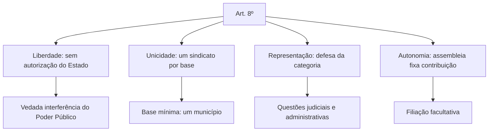
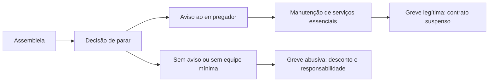

Os direitos coletivos são o lado organizado do trabalho. Em vez de olhar para o contrato de cada empregado, a Constituição olha para o grupo: o sindicato que representa a categoria, o acordo que fixa o piso, a greve como instrumento de pressão e a participação nos colegiados públicos. São os arts. 8º a 11, e eles têm lógica própria: liberdade de associação de um lado, unicidade sindical do outro. O capítulo fecha com o regime dos empregados domésticos, que a Emenda Constitucional 72/2013 aproximou do trabalhador comum e que tem lista própria de direitos.

> [!objetivos]
> - Explicar a liberdade sindical e a unicidade imposta pelo art. 8º, II.
> - Distinguir contribuição confederativa, contribuição sindical e mensalidade.
> - Diferenciar acordo e convenção coletiva e identificar quem negocia.
> - Aplicar as regras da greve, inclusive no serviço público e nos serviços essenciais.
> - Listar os direitos do empregado doméstico e os que dependem de lei.

## Liberdade sindical

O art. 8º começa pela liberdade. A lei não pode exigir autorização do Estado para fundar sindicato; basta o registro no órgão competente. E o Poder Público não pode interferir nem intervir na organização sindical. Essas duas vedações são o núcleo da autonomia: o sindicato nasce da vontade dos trabalhadores e conduz a própria vida sem tutela do governo.

Essa liberdade não é absoluta. A Constituição impõe a **unicidade sindical**: só uma entidade representativa da mesma categoria profissional ou econômica em cada base territorial, e essa base não pode ser menor que a área de um município. É um modelo híbrido, que combina liberdade de criação com monopólio de representação. A Convenção 87 da Organização Internacional do Trabalho defende liberdade plena, e o Brasil nunca a ratificou justamente por causa da unicidade.

> [!lei] CF, art. 8º, II
> É vedada a criação de mais de uma organização sindical, em qualquer grau, representativa de categoria profissional ou econômica, na mesma base territorial, que será definida pelos trabalhadores ou empregadores interessados, não podendo ser inferior à área de um Município.

O esquema abaixo mostra como as regras do art. 8º se encaixam.

A unicidade convive com a **liberdade de filiação**, e essa é a distinção que mais confunde. O trabalhador não é obrigado a se filiar nem a continuar filiado (art. 8º, V). O sindicato é único, mas a adesão é voluntária. Se a prova disser que "o empregado é obrigado a se filiar ao sindicato da categoria", está errada.

A mesma disciplina alcança os **trabalhadores rurais** e as colônias de pescadores, por força do parágrafo único do art. 8º, atendidas as condições da lei. A fundação de sindicato rural segue as mesmas regras: assembleia de trabalhadores, base territorial mínima de um município e registro no órgão competente, sem autorização prévia do Estado.

O sindicato representa a categoria em **questões judiciais ou administrativas**, inclusive nas ações que defendem direitos individuais homogêneos. Ele também participa obrigatoriamente das negociações coletivas (art. 8º, VI), o que explica por que acordo firmado sem sindicato não produz efeito coletivo. E o aposentado filiado mantém o direito de votar e de ser votado na entidade (art. 8º, VII).

> [!atencao] Aposentado filiado vota
> O inciso VII é curto e esquecido. O aposentado que continua filiado não perde voz nem voto na organização sindical. Questão que afirma o contrário está errada.

### Contribuições: três nomes, três regimes

Aqui está a maior fonte de erro do capítulo. Existem três valores diferentes, e a prova troca um pelo outro.

| Contribuição | Base | Obrigatória? | Quem decide |
| --- | --- | --- | --- |
| Sindical (imposto sindical) | Um dia de trabalho por ano | Só com autorização expressa | Lei, com desconto autorizado |
| Confederativa | Assembleia da entidade | Só para filiados | Assembleia geral |
| Mensalidade | Estatuto do sindicato | Só para filiados | Estatuto |

A **contribuição confederativa** é fixada pela assembleia geral e descontada em folha para custeio do sistema confederativo. O Supremo firmou que ela só é exigível de quem é filiado. A súmula é curta e resolve a questão.

> [!jurisprudencia] STF, Súmula 666
> A contribuição confederativa de que trata o art. 8º, IV, da Constituição só é exigível dos filiados ao sindicato respectivo.

A **contribuição sindical** era o antigo imposto sindical, equivalente a um dia de salário por ano. Com a reforma trabalhista de 2017, o desconto passou a depender de autorização expressa e individual do empregado. O Supremo confirmou a mudança na ADI 5.794, e hoje não se admite cobrança automática. A **mensalidade** é a contribuição associativa comum, definida no estatuto, e só alcança filiados.

> [!pegadinha] Confederação e sindicato não se confundem
> A contribuição confederativa não é obrigatória para o trabalhador não filiado, ainda que tenha sido aprovada em assembleia. A banca costuma dizer que "a assembleia pode impor a contribuição a toda a categoria"; isso valia no regime anterior e hoje é inconstitucional.

### Estabilidade do dirigente sindical

O art. 8º, VIII, protege quem se candidata a cargo de direção ou representação sindical: a dispensa fica vedada desde o registro da candidatura e, se eleito, até um ano depois do fim do mandato, salvo falta grave. A proteção alcança o suplente. O objetivo é impedir que a pressão econômica esvazie a representação.

A estabilidade é **provisória e limitada ao número de dirigentes** que a lei fixa. Não se estende a todo filiado nem a quem apenas participa de assembleia. E a falta grave precisa ser apurada com contraditório, sob pena de nulidade da dispensa.

> [!exemplo] Candidato demitido no dia seguinte
> Um empregado registra candidatura a delegado sindical na segunda-feira e é demitido na quarta, sem inquérito. A dispensa é nula, porque a estabilidade começa no registro da candidatura. Se ele tivesse sido eleito, a proteção duraria até um ano após o mandato, e a empresa só poderia dispensá-lo se ele cometesse falta grave, comprovada em procedimento próprio.

## Negociação coletiva

Negociação coletiva é o processo em que empregadores e trabalhadores, por meio de suas entidades, ajustam condições de trabalho. O resultado aparece em dois instrumentos, e a diferença entre eles é cobrada com frequência.

| Instrumento | Quem participa | Alcance |
| --- | --- | --- |
| Acordo coletivo | Sindicato dos empregados e uma ou mais empresas | Apenas os empregados daquelas empresas |
| Convenção coletiva | Sindicato dos empregados e sindicato patronal | Toda a categoria na base territorial |

A **convenção** é mais ampla: envolve as duas entidades sindicais e vale para a categoria. O **acordo** é mais restrito: envolve o sindicato profissional e uma empresa ou grupo, e vale só para aqueles empregados. Trocar os nomes é o erro mais comum em prova.

A Constituição reconhece esses instrumentos no art. 7º, XXVI, e exige a participação do sindicato nas negociações (art. 8º, VI). Daí decorre uma consequência prática: acordo firmado diretamente entre empresa e comissão de empregados, sem sindicato, não substitui a norma coletiva. A reforma trabalhista admitiu a negociação com representantes eleitos em alguns temas, mas a regra constitucional da participação sindical continua valendo para a negociação coletiva típica.

O conteúdo da negociação encontra limites na Constituição. Direitos indisponíveis não podem ser suprimidos, e a flexibilização só é possível onde a própria Constituição autoriza, como na redução de salário (art. 7º, VI) e na jornada (art. 7º, XIII e XIV). É a razão pela qual a cláusula que reduz férias ou suprime o terço constitucional é nula, ainda que assinada por todos.

A negociação também não serve para afastar normas de segurança e higiene do trabalho. Essas regras protegem a integridade física do empregado e não são disponíveis, de modo que a cláusula que dispensa o uso de equipamento de proteção, por acordo, é inválida. O mesmo vale para a despedida de gestante e para a proteção do menor: são normas de ordem pública, acima da vontade das partes.

> [!pegadinha] Acordo não vale como convenção
> Se a questão diz que "o acordo coletivo é firmado entre sindicatos patronal e profissional e alcança toda a categoria", está trocando os institutos. Essa descrição é da convenção coletiva.

## Direito de greve

Greve é a suspensão coletiva do trabalho, temporária e pacífica, decidida pelos trabalhadores para pressionar o empregador. A Constituição assegura o direito (art. 9º) e atribui aos próprios trabalhadores a decisão sobre a oportunidade e os interesses a defender. Não há necessidade de autorização prévia de sindicato ou de órgão público para deflagrar a greve, embora a lei exija assembleia e aviso.

> [!lei] CF, art. 9º, caput
> É assegurado o direito de greve, competindo aos trabalhadores decidir sobre a oportunidade de exercê-lo e sobre os interesses que devam por meio dele defender.

A greve legítima **suspende o contrato de trabalho**: o empregado não trabalha e não recebe, mas o tempo de serviço conta para efeitos previdenciários e o contrato continua. A greve abusiva produz outro efeito: permite desconto dos dias parados e responsabiliza o sindicato por danos.

A lei de greve (Lei 7.783/1989) fixa o procedimento: assembleia, comunicação ao empregador com antecedência mínima de 48 horas, e 72 horas nos serviços essenciais. Também proíbe o **lockout**, que é a paralisação da empresa para pressionar os empregados.

### Serviços essenciais

O art. 9º, § 1º, manda a lei definir os serviços essenciais e as necessidades inadiáveis da população, que devem ser atendidas durante a greve. A Lei 7.783/1989 traz a lista e impõe a manutenção de equipes mínimas. Quando o serviço essencial é paralisado sem atendimento mínimo, a greve pode ser declarada abusiva.

### Greve no serviço público

O art. 37, VII, reconhece o direito de greve do servidor, "nos termos e nos limites definidos em lei específica". Como a lei específica não foi editada, o Supremo resolveu a omissão: nos mandados de injunção 670, 708 e 712, determinou a aplicação da lei de greve do setor privado, no que couber. Vale o mesmo procedimento, com adaptações.

Ainda assim, há limitações próprias do serviço público: continuidade do serviço, manutenção de equipe mínima e impossibilidade de paralisar atividades essenciais sem atendimento. E o desconto dos dias parados é a regra, com exceção quando a greve é considerada legítima e a administração deu causa.

Cuidado com uma confusão: o **militar** não tem direito de greve (art. 142, § 3º, IV), e essa vedação alcança os militares estaduais, como bombeiros e policiais militares. Greve de militar é inconstitucional, sem discussão sobre lei específica.

A tabela abaixo contrasta os dois regimes, que é a comparação pedida nas questões discursivas.

| Aspecto | Setor privado | Serviço público |
| --- | --- | --- |
| Norma de regência | Lei 7.783/1989 | Lei 7.783/1989, por injunção |
| Aviso ao empregador | 48 horas; 72 em serviço essencial | Mesmo prazo, adaptado ao órgão |
| Efeito no vínculo | Suspensão do contrato | Suspensão da remuneração |
| Desconto dos dias | Abusiva: desconta | Regra: desconta, salvo greve legítima |
| Limite específico | Serviço essencial com equipe mínima | Continuidade do serviço público |

O movimento grevista que descumpre o aviso ou deixa a população sem atendimento mínimo perde a proteção. É o que a lei chama de abuso do direito de greve, com consequências para o sindicato e para os participantes.

> [!atencao] Greve de bombeiro militar
> O bombeiro militar não pode fazer greve nem se sindicalizar. A proibição está no art. 142, § 3º, IV, aplicável aos militares dos estados. Associação de bombeiros pode existir com fins recreativos e de representação, mas não com natureza sindical e sem direito de paralisação.

## Participação e representação

O art. 10 garante voz a empregados e empregadores dentro de **colegiados de órgãos públicos** sempre que a pauta envolva interesse profissional ou previdenciário do grupo. É a base da representação em conselhos de previdência, de saúde do trabalhador e de órgãos tripartites. Chama-se participação **institucional** ou orgânica, porque ocorre dentro do Estado.

O art. 11 trata da representação **na empresa**. Acima de duzentos empregados, a Constituição assegura a eleição de um representante dos trabalhadores, cuja atribuição é exclusivamente a interlocução direta com o empregador. Três detalhes decidem a questão: o número é **duzentos** (e não cem, nem quinhentos), a atribuição é apenas essa conversa direta, e a eleição é feita pelos empregados, sem exigência de vínculo sindical.

| Artigo | Forma de participação | Onde ocorre |
| --- | --- | --- |
| Art. 10 | Colegiados de órgãos públicos | Conselhos e órgãos do Estado |
| Art. 11 | Representante eleito | Empresas com mais de 200 empregados |
| Art. 8º, VI | Negociação coletiva | Relação entre entidades sindicais |

> [!bizu] Duzentos na empresa, um na base
> Art. 11: mais de 200 empregados, um representante, finalidade exclusiva de entendimento direto. Art. 8º, II: um sindicato por base territorial, nunca menor que um município. Dois números para não esquecer: 200 e um.

## Empregados domésticos

Até 2013, o trabalhador doméstico tinha apenas uma fração dos direitos do art. 7º. A **Emenda Constitucional 72/2013** deu nova redação ao parágrafo único e ampliou o catálogo, e a **Lei Complementar 150/2015** regulamentou a matéria. O resultado é um regime próprio, com 22 direitos assegurados, alguns de aplicação imediata e outros condicionados.

O parágrafo único lista os incisos aplicáveis. A divisão é o que a prova cobra, e ela tem uma lógica: os direitos ligados a salário, jornada, férias e proteção da família foram assegurados direto; os que dependem de estrutura (FGTS, seguro-desemprego, seguro-acidente, creche) ficaram condicionados à lei e à simplificação tributária.

A comparação com o trabalhador urbano e rural ajuda a fixar o alcance da emenda. O doméstico recebeu o núcleo de proteção, mas não recebeu tudo: a lista é expressa, e o intérprete não pode ampliá-la por analogia.

| Grupo | Como funciona | Direitos incluídos |
| --- | --- | --- |
| Aplicação direta | Valem desde a emenda, sem depender de regulamentação | Salário mínimo, irredutibilidade, 13º, jornada normal, repouso, hora extra, férias com terço, licença-gestante, aviso prévio, aposentadoria e proteção contra discriminação |
| Dependem de lei | Exigem regulamentação e simplificação tributária | Proteção contra dispensa arbitrária, seguro-desemprego, FGTS, adicional noturno, salário-família, creche e seguro-acidente |

A LC 150/2015 deu corpo ao segundo grupo. O FGTS do doméstico é recolhido em conta específica, com alíquota reduzida e depósito compensatório para a dispensa sem justa causa. O seguro-desemprego é de um salário mínimo, em até três parcelas, para quem trabalhou pelo menos quinze meses nos últimos dois anos. O adicional noturno segue o percentual legal, e o intervalo para repouso e alimentação é de uma a duas horas.

### Quem é empregado doméstico

A definição legal tem quatro elementos e um corte temporal. É doméstico quem presta serviço **contínuo, subordinado, oneroso e pessoal** a pessoa ou família, em finalidade não lucrativa, no âmbito da residência, por **mais de dois dias na semana**. Quem trabalha uma ou duas vezes por semana, como a diarista, não é empregado doméstico e presta serviço autônomo.

O elemento da **finalidade não lucrativa** afasta o empregado de empresa que trabalha na casa do patrão. O critério é o destino do serviço, não o local. Motorista particular, cozinheira, babá e cuidador de idoso entram no regime; o caseiro de sítio de recreio também, e o de sítio produtivo, em regra, não.

> [!exemplo] Duas diaristas, dois regimes
> Uma diarista limpa a casa de uma família às terças e quintas, duas vezes por semana. Não atinge o requisito de mais de dois dias, então não é empregada doméstica: emite recibo e recolhe como autônoma. Outra trabalha de segunda a sexta na mesma casa, com horário fixo. Essa é doméstica, com carteira assinada, FGTS e todos os direitos do regime.

> [!pegadinha] Doméstico não é empregado comum
> A EC 72/2013 não estendeu todo o art. 7º ao doméstico: estendeu os incisos do parágrafo único. Dizer que o doméstico tem direito a adicional de insalubridade por força do art. 7º, XXIII, é errado, porque esse inciso não está na lista. Dizer que tem direito a férias com um terço é certo.

### O que mais cai no regime doméstico

A banca costuma cobrar a **data** da mudança (2013), o **número** de dias por semana (mais de dois) e a **natureza** da lei regulamentadora (lei complementar). Também cobra a diferença entre o FGTS comum e o do doméstico, e o teto do seguro-desemprego, de um salário mínimo.

Três direitos do art. 7º ficaram de fora do regime doméstico e costumam aparecer como pegadinha: o adicional de insalubridade, a participação nos lucros e a proteção contra a automação. Nada impede que a lei estadual ou o contrato criem vantagem melhor, mas o fundamento não é a aplicação automática do artigo.

> [!atencao] O que mudou e o que não mudou
> A EC 72/2013 igualou o doméstico ao trabalhador urbano em vários pontos, mas não em todos. Continuam fora a insalubridade, a participação nos lucros e a estabilidade do dirigente sindical nos moldes do art. 8º. O regime é próprio, e a lista do parágrafo único é fechada.

Um detalhe de organização ajuda: o doméstico não pode ser transferido para outro empregador, não tem jornada em turno ininterrupto de revezamento e não participa de negociação coletiva por categoria econômica. O sindicato dos domésticos existe para representação, mas a negociação típica se dá com cada família.

## Mapa do capítulo

| Tema | Regra | Pegadinha |
| --- | --- | --- |
| Liberdade sindical | Sem autorização do Estado, vedada intervenção | Confundir com unicidade |
| Unicidade | Um sindicato por base, mínimo um município | Base estadual obrigatória |
| Filiação | Ninguém é obrigado a filiar-se ou permanecer | Filiação obrigatória |
| Contribuição confederativa | Só para filiados (Súmula 666) | Cobrança de toda a categoria |
| Contribuição sindical | Só com autorização expressa (ADI 5.794) | Desconto automático |
| Dirigente sindical | Estabilidade da candidatura a um ano após o mandato | Alcançar todo filiado |
| Acordo e convenção | Acordo: empresas; convenção: categoria | Nomes trocados |
| Greve | Decisão dos trabalhadores, aviso e serviço essencial | Autorização prévia |
| Greve no serviço público | Aplica-se a lei de greve por injunção | Greve de militar |
| Art. 11 | Mais de 200 empregados, um representante | Cem empregados |
| Domésticos | EC 72/2013 e LC 150/2015, mais de 2 dias | Todo o art. 7º aplicável |

### Para fixar

- A lei não exige autorização do Estado para criar sindicato, e o Poder Público não pode interferir na entidade.
- Só existe um sindicato por categoria em cada base territorial, nunca menor que um município.
- Ninguém é obrigado a se filiar nem a permanecer filiado ao sindicato.
- A contribuição confederativa só é exigível dos filiados (STF, Súmula 666).
- A contribuição sindical depende de autorização expressa desde a reforma trabalhista (ADI 5.794).
- O dirigente sindical tem estabilidade do registro da candidatura até um ano após o mandato, salvo falta grave.
- Acordo coletivo é com uma ou mais empresas; convenção é entre sindicatos e alcança a categoria.
- A greve é decidida pelos trabalhadores; a lei de greve exige assembleia e aviso prévio.
- Serviço público segue a lei de greve por aplicação determinada em mandado de injunção; militar não faz greve.
- Doméstico é quem trabalha mais de dois dias por semana, e seu regime vem da EC 72/2013 e da LC 150/2015.
