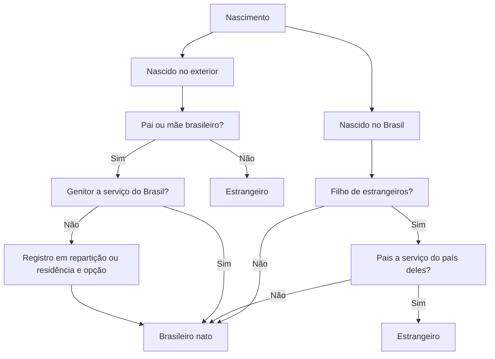

Nacionalidade é o vínculo jurídico que liga a pessoa a um Estado e define quem é brasileiro para todos os efeitos: voto, cargo público, proteção diplomática, extradição e serviço militar. O tema tem pouca teoria e muita regra, e é justamente por isso que rende questão: a banca cobra hipótese por hipótese, com atenção especial às mudanças recentes. Este capítulo cobre os critérios de atribuição, a naturalização, os cargos privativos de brasileiro nato, a perda da nacionalidade depois da Emenda Constitucional 131/2023, a condição dos portugueses e os símbolos nacionais.

> [!objetivos]
> - Explicar a diferença entre nacionalidade originária e derivada e entre nacionalidade e cidadania.
> - Aplicar as três alíneas do art. 12, I, a casos concretos de nascimento no Brasil e no exterior.
> - Identificar as vias de naturalização e os requisitos de cada uma.
> - Reconhecer os cargos privativos de brasileiro nato e as restrições ao naturalizado.
> - Descrever as duas hipóteses de perda da nacionalidade vigentes e o regime dos portugueses.

## Nacionalidade e cidadania não são a mesma coisa

A primeira confusão a desfazer é conceitual. **Nacionalidade** é o vínculo com o Estado, que faz da pessoa um nacional brasileiro. **Cidadania**, no sentido técnico da Constituição, é a capacidade de participar da vida política: votar, ser votado, propor ação popular. Um brasileiro nato que teve os direitos políticos suspensos continua sendo nacional; apenas não exerce a cidadania naquele período. Do mesmo modo, o português equiparado tem direitos de brasileiro, mas não é nacional e não vota aqui.

A nacionalidade se classifica em dois tipos. A **originária** ou primária é atribuída pelo nascimento, por critério definido na Constituição, e não depende de vontade nem de autorização do Estado. A **derivada** ou secundária é adquirida depois, por naturalização, com base na lei e em requerimento do interessado. A distinção importa porque a Constituição trata os dois grupos de modo diferente em pontos específicos, como os cargos privativos e a extradição.

O tema se encaixa no capítulo dos direitos e garantias fundamentais, e a nacionalidade é tratada pela doutrina como pressuposto de vários deles. Sem nacionalidade, a pessoa não vota, não ocupa cargo público e não tem proteção diplomática. Por isso a Constituição se preocupa também com a **apatridia**: a Lei de Migração prevê o reconhecimento da condição de apátrida e abre caminho para a naturalização de quem não tem outra nacionalidade, em linha com os compromissos internacionais assumidos pelo Brasil.

| Critério | Como funciona | Exemplo |
| --- | --- | --- |
| *Ius soli* | Nacionalidade pelo lugar do nascimento | Filho de estrangeiros nascido no Brasil |
| *Ius sanguinis* | Nacionalidade pelo vínculo de sangue | Filho de brasileiro nascido no exterior |
| Misto | Combinação dos dois, com condição | Nascido no exterior que opta depois da maioridade |

O Brasil adota o *ius soli* como regra geral, com temperamento, e o *ius sanguinis* em hipóteses expressas. O esquema abaixo resume a atribuição, que é o ponto mais cobrado do capítulo.

## Brasileiros natos

O art. 12, I, traz três alíneas, e cada uma resolve uma situação de nascimento. Vale ler cada texto com atenção aos detalhes que decidem a questão.

> [!lei] CF, art. 12, I
> São brasileiros natos: a) os nascidos na República Federativa do Brasil, ainda que de pais estrangeiros, desde que estes não estejam a serviço de seu país; b) os nascidos no estrangeiro, de pai brasileiro ou mãe brasileira, desde que qualquer deles esteja a serviço da República Federativa do Brasil; c) os nascidos no estrangeiro de pai brasileiro ou de mãe brasileira, desde que sejam registrados em repartição brasileira competente ou venham a residir na República Federativa do Brasil e optem, em qualquer tempo, depois de atingida a maioridade, pela nacionalidade brasileira.

### Nascido no Brasil

A alínea "a" adota o *ius soli*. Quem nasce em território brasileiro é brasileiro nato, ainda que os pais sejam estrangeiros. A ressalva é única e estreita: os pais não podem estar **a serviço do seu país**. Um diplomata alemão em serviço em Brasília que tem filho aqui não transmite a nacionalidade brasileira ao filho, porque o critério da territorialidade é afastado pela regra de cortesia internacional.

Repare que a expressão é "a serviço de seu país", e não "a serviço de qualquer país". O funcionário de organismo internacional, em regra, não se enquadra na ressalva, porque não está a serviço de um Estado estrangeiro. A distinção é fina, mas já apareceu em prova.

O território, para esse fim, inclui navios e aeronaves brasileiros, ainda que em alto-mar ou em espaço aéreo estrangeiro, quando públicos ou a serviço do Estado. Em embarcação privada em alto-mar, a nacionalidade segue a regra do pavilhão.

### Nascido no exterior com genitor a serviço do Brasil

A alínea "b" é a mais simples e a mais esquecida. Filho de pai brasileiro **ou** de mãe brasileira, nascido no exterior, é brasileiro nato se **qualquer** dos genitores estiver a serviço da República Federativa do Brasil. Não se exige registro nem opção: a nacionalidade é atribuída no nascimento.

Quem está a serviço do Brasil? Diplomatas, militares em missão, servidores cedidos a organismos internacionais, agentes em missão oficial. Um brasileiro que trabalha em empresa privada no exterior não está nessa condição, e o filho dele entra na alínea "c".

### Nascido no exterior sem serviço do Brasil

A alínea "c" é a que muda de acordo com a vontade ou o registro. O filho de brasileiro nascido no exterior é brasileiro nato se for **registrado em repartição brasileira competente** (consulado ou cartório) ou se **vier a residir no Brasil e optar, depois da maioridade**, pela nacionalidade brasileira. As duas vias são alternativas, e a redação atual é da Emenda Constitucional 54/2007.

Essa emenda corrigiu um problema antigo. Antes de 2007, o texto exigia a opção depois da maioridade mesmo para quem já tinha registro, o que criava a figura do brasileiro "nato sob condição". Hoje, quem é registrado no consulado é nato definitivo desde o nascimento; quem não foi registrado pode vir residir no Brasil e, aos dezoito anos, optar.

A opção é **ato personalíssimo**, feito pelo próprio interessado depois da maioridade, perante juiz federal. Não pode ser feita por procuração nem por representante, e não há prazo para exercê-la: "em qualquer tempo" significa exatamente isso.

> [!exemplo] Três irmãos, três situações
> Um casal brasileiro trabalha em Portugal. O primeiro filho nasce quando o pai está cedido ao consulado: é nato pela alínea "b". O segundo nasce dois anos depois, quando o pai já trabalha em empresa privada, e é registrado no consulado: é nato pela alínea "c", na primeira via. O terceiro nasce sem registro consular e vem ao Brasil aos dez anos: é brasileiro nato, mas depende de, ao completar dezoito anos, residir no país e optar pela nacionalidade.

> [!atencao] Opção não é naturalização
> Quem nasce no exterior e opta pela nacionalidade brasileira **não se naturaliza**. Ele é brasileiro nato, porque a nacionalidade já existia desde o nascimento e a opção apenas a confirma. A banca troca os institutos e apresenta a opção como forma de naturalização.

| Alínea | Situação | Condição |
| --- | --- | --- |
| a | Nascido no Brasil | Pais estrangeiros não a serviço do país deles |
| b | Nascido no exterior | Genitor brasileiro a serviço do Brasil |
| c | Nascido no exterior | Registro consular ou residência com opção após a maioridade |

## Brasileiros naturalizados

A naturalização é ato de soberania: o Estado concede a nacionalidade a quem a requer e cumpre os requisitos. A Constituição fixa duas hipóteses e remete à lei para os detalhes.

> [!lei] CF, art. 12, II
> São brasileiros naturalizados: a) os que, na forma da lei, adquiram a nacionalidade brasileira, exigidas aos originários de países de língua portuguesa apenas residência por um ano ininterrupto e idoneidade moral; b) os estrangeiros de qualquer nacionalidade, residentes na República Federativa do Brasil há mais de quinze anos ininterruptos e sem condenação penal, desde que requeiram a nacionalidade brasileira.

A alínea "b" é a **naturalização extraordinária**. Ela tem três requisitos constitucionais: residência por mais de quinze anos ininterruptos, ausência de condenação penal e requerimento do interessado. Cumpridos os três, a naturalização é **direito subjetivo**, e não ato discricionário do Estado. A Emenda Constitucional 3/1994 reduziu o prazo de trinta para quinze anos.

A alínea "a" é a **naturalização ordinária**, regulada pela Lei de Migração. Ela exige capacidade civil, residência por prazo legal, leitura e escrita da língua portuguesa, idoneidade moral, ausência de condenação penal e exercício de profissão ou posse de bens suficientes. Para quem vem de país de língua portuguesa, a Constituição reduz a residência a **um ano ininterrupto** e mantém a exigência de idoneidade moral.

| Via | Base | Requisitos centrais | Natureza |
| --- | --- | --- | --- |
| Extraordinária | Art. 12, II, b | 15 anos ininterruptos, sem condenação penal, requerimento | Direito subjetivo |
| Ordinária | Art. 12, II, a | Requisitos da lei, inclusive residência e língua | Ato do Estado |
| Países de língua portuguesa | Art. 12, II, a, parte final | 1 ano ininterrupto e idoneidade moral | Facilitada |
| Especial | Lei de Migração | Cônjuge de brasileiro, filho de brasileiro, quem tem cargo público | Prevista em lei |

A naturalização **especial** e a **provisória** são criações da lei, não da Constituição. A especial atende cônjuge ou companheiro de brasileiro, filho de brasileiro e pessoa que tenha prestado serviço ao país. A provisória é para criança ou adolescente que tenha chegado ao Brasil antes dos dez anos e resida aqui; ela se converte em definitiva se o interessado manifestar vontade, no prazo legal, e não houver condenação penal.

> [!pegadinha] Quinze anos é "mais de quinze"
> A Constituição exige **mais de** quinze anos ininterruptos. Quem completou exatamente quinze anos ainda não preenche o requisito. Além disso, a naturalização extraordinária não depende de boa saúde nem de renda, mas exige requerimento expresso: não é automática.

## Cargos privativos de brasileiro nato

O art. 12, § 2º, proíbe a lei de distinguir entre natos e naturalizados, salvo nas hipóteses da própria Constituição. A principal dessas exceções está no § 3º, que reserva sete cargos a quem é nato. A lista é fechada e cai quase sempre em prova.

| Grupo | Cargo privativo de nato |
| --- | --- |
| Executivo | Presidente e Vice-Presidente da República |
| Legislativo | Presidente da Câmara dos Deputados |
| Legislativo | Presidente do Senado Federal |
| Judiciário | Ministro do Supremo Tribunal Federal |
| Defesa | Ministro de Estado da Defesa |
| Diplomacia | Carreira diplomática |
| Forças Armadas | Oficial das Forças Armadas |

Duas observações ajudam a fixar. Primeiro, a lista não inclui todos os ministros: só o da Defesa. Segundo, não inclui governador, senador ou deputado, cargos abertos ao naturalizado. O mnemônico que circula usa as iniciais dos cargos, e o ponto de atenção é não incluir "Ministro da Justiça" nem "Presidente de Tribunal de Contas".

Além dos cargos, o naturalizado sofre outras distinções legítimas. Ele pode ser **extraditado** por crime comum cometido antes da naturalização ou por envolvimento com tráfico de drogas, antes ou depois de se naturalizar (art. 5º, LI). Pode perder a nacionalidade se a naturalização for cancelada por fraude. E não pode ocupar cargo que a lei reserve a natos por motivo de segurança nacional.

> [!bizu] Os sete cargos
> Presidente, Vice, presidente da Câmara, presidente do Senado, ministro do STF, ministro da Defesa e a carreira diplomática, além de oficial das Forças Armadas. Todos os demais cargos são abertos ao naturalizado, salvo restrição legal específica.

## Portugueses com residência permanente

O art. 12, § 1º, cria uma figura singular. O português que aqui reside de forma permanente recebe os **direitos de brasileiro**, desde que Portugal trate os brasileiros da mesma maneira, com as ressalvas da própria Constituição. Chama-se de quase nacionalidade ou estatuto de igualdade, e decorre do Tratado de Amizade celebrado entre Brasil e Portugal.

Três consequências precisam ficar claras.

Primeiro, o português **não se torna brasileiro**. Ele continua português, e a equiparação é de direitos, não de nacionalidade.

Segundo, a equiparação **não alcança** os cargos privativos de brasileiro nato nem os direitos políticos. O português equiparado não vota, não pode ser votado e não pode ser ministro do STF. Também não ocupa cargo da carreira diplomática nem oficial das Forças Armadas.

Terceiro, a reciprocidade é **condição de eficácia**: se Portugal deixar de tratar brasileiros como iguais, a equiparação pode ser suspensa. O estatuto exige residência permanente e, para participação em determinados atos, o cumprimento de requisitos do tratado.

> [!atencao] Equiparado não é naturalizado
> A banca escreve: "o português com residência permanente no Brasil adquire a nacionalidade brasileira". Errado. Ele recebe direitos, mantém a nacionalidade portuguesa e não adquire capacidade eleitoral.

## Perda da nacionalidade

Até 2023, a Constituição previa a perda da nacionalidade quando o brasileiro adquiria outra nacionalidade, com duas exceções: reconhecimento da nacionalidade originária pela lei estrangeira e imposição de naturalização como condição de permanência ou de exercício de direitos no país estrangeiro. A **Emenda Constitucional 131/2023** mudou o regime e retirou essa hipótese.

Hoje, o art. 12, § 4º, prevê apenas duas causas de perda:

> [!lei] CF, art. 12, § 4º
> Será declarada a perda da nacionalidade do brasileiro que: I - tiver cancelada sua naturalização, por sentença judicial, em virtude de fraude relacionada ao processo de naturalização ou de atentado contra a ordem constitucional e o Estado Democrático; II - fizer pedido expresso de perda da nacionalidade brasileira perante autoridade brasileira competente, ressalvadas situações que acarretem apatridia.

A primeira causa é **sanção**: cancela-se a naturalização obtida por fraude ou a de quem atentou contra a ordem constitucional, por sentença judicial. Ela só alcança o naturalizado, porque o nato não teve processo de naturalização para cancelar.

A segunda causa é **opção**: o brasileiro, nato ou naturalizado, pede expressamente a perda. A ressalva sobre apatridia impede que o pedido deixe a pessoa sem nacionalidade alguma. Quem tem outra nacionalidade pode pedir; quem não tem continua brasileiro, ainda que queira deixar de ser.

| Situação | Antes da EC 131/2023 | Hoje |
| --- | --- | --- |
| Aquisição voluntária de outra nacionalidade | Podia gerar perda | Não gera perda |
| Cancelamento judicial da naturalização | Por atividade nociva ao interesse nacional | Por fraude no processo de naturalização ou atentado contra a ordem constitucional e o Estado Democrático |
| Pedido expresso do interessado | Não havia previsão | Perda, salvo apatridia |

No pedido expresso, a perda é declaratória, e não automática: depende de declaração da autoridade competente, hoje o Ministério da Justiça, com posterior comunicação. É por isso que ter duas nacionalidades nunca retirou direitos automaticamente. A perda produz efeitos a partir da declaração, e o interessado pode discutir o ato no Judiciário.

> [!pegadinha] Dupla nacionalidade não é perda
> Depois da EC 131/2023, adquirir outra nacionalidade não faz ninguém perder a brasileira. A assertiva que ainda repete a regra antiga está desatualizada. A única perda por vontade própria é o pedido expresso, e mesmo ele cede diante do risco de apatridia.

## Extradição e nacionalidade

Nacionalidade e extradição andam juntas, e a diferença entre nato e naturalizado aparece com força aqui. O art. 5º, LI, só abre uma exceção à regra de não entregar brasileiro a outro país: o **naturalizado**, quando o crime comum foi cometido antes da naturalização ou quando há envolvimento comprovado com tráfico de entorpecentes, antes ou depois do ato.

A regra protege o nato de forma absoluta. Ele nunca é entregue a outro país para responder a processo criminal, ainda que o crime tenha sido cometido no exterior. Isso não impede a responsabilização no Brasil, pelo princípio da jurisdição universal em alguns crimes, nem a entrega ao Tribunal Penal Internacional, autorizada pelo art. 5º, § 4º, em razão de tratado de que o Brasil é parte.

O naturalizado tem proteção menor, e a lógica é a do tempo: quem se naturalizou não usa a nova nacionalidade para escapar de crime praticado antes. Se o crime for posterior e não for de tráfico, a extradição não é admitida.

| Situação | Nato | Naturalizado |
| --- | --- | --- |
| Crime comum antes da naturalização | Não extraditável | Extraditável |
| Tráfico de drogas | Não extraditável | Extraditável |
| Crime comum posterior à naturalização | Não extraditável | Não extraditável |
| Entrega ao Tribunal Penal Internacional | Admissível | Admissível |

> [!pegadinha] Nato nunca, naturalizado às vezes
> A banca escreve que "o brasileiro naturalizado não pode ser extraditado em nenhuma hipótese". Errado: as duas hipóteses do art. 5º, LI, alcançam o naturalizado. E dizer que o nato pode ser extraditado por crime hediondo também está errado: para o nato, a vedação é total, salvo a entrega ao tribunal internacional.

## Língua e símbolos nacionais

O art. 13 resolve duas questões de identidade. A primeira: o **português é o idioma oficial** do país. A segunda: são símbolos nacionais a **bandeira, o hino, as armas e o selo**. Estados, Distrito Federal e municípios podem ter símbolos próprios.

| Símbolo | Uso típico | Norma |
| --- | --- | --- |
| Bandeira | Hasteada em repartições e cerimônias | Lei 5.700/1971 |
| Hino nacional | Executado em solenidades oficiais | Lei 5.700/1971 |
| Armas nacionais | Documentos e atos oficiais | Lei 5.700/1971 |
| Selo nacional | Autenticação de atos do Estado | Lei 5.700/1971 |

A língua oficial não impede o uso de outras línguas. A Constituição reconhece aos indígenas o direito de usar suas línguas e processos próprios de aprendizagem (art. 231), e a Lei 10.436/2002 reconhece a Língua Brasileira de Sinais como meio legal de comunicação e expressão. Nenhuma delas substitui o português como idioma oficial, e é isso que a prova cobra: Libras é meio de comunicação, não idioma oficial alternativo.

Os símbolos têm uso regulado pela Lei 5.700/1971. A bandeira é hasteada em repartições e cerimônias, o hino é executado em solenidades oficiais e as armas e o selo aparecem em documentos do Estado. O descumprimento das regras de uso pode gerar responsabilidade administrativa, e a norma não permite alteração dos símbolos por lei estadual ou municipal: cada ente pode criar os seus próprios, mas não mexer nos nacionais.

> [!atencao] Libras não é idioma oficial
> A Lei 10.436/2002 reconhece a Libras como meio legal de comunicação e expressão, com tratamento adequado nos serviços públicos. Dizer que a Libras é o segundo idioma oficial do Brasil é erro. O idioma oficial é um só, o português (art. 13).

Alguns municípios criaram leis declarando línguas indígenas como cooficiais em âmbito local. O tema é polêmico, porque o art. 13 fixa o idioma oficial da República e os símbolos, e a competência municipal para dispor sobre assuntos de interesse local não alcança a definição de idioma nacional. Em prova objetiva, a resposta segura é: o português é o idioma oficial; línguas indígenas e Libras têm proteção constitucional e legal, sem status de idioma oficial nacional.

## Mapa do capítulo

| Tema | Regra que decide | Detalhe de prova |
| --- | --- | --- |
| Nato no Brasil | *Ius soli* temperado | Pais estrangeiros não podem estar a serviço do país |
| Nato no exterior | Genitor a serviço do Brasil | Não exige registro nem opção |
| Nato no exterior sem serviço | Registro consular ou residência e opção | Opção após a maioridade, ato personalíssimo |
| Naturalização extraordinária | 15 anos, sem condenação, requerimento | Direito subjetivo |
| Extradição | Nato não é extraditado | Naturalizado pode, nas hipóteses do art. 5º, LI |
| Naturalização ordinária | Requisitos da lei | País de língua portuguesa: 1 ano e idoneidade |
| Cargos privativos | Sete cargos | Só o ministro da Defesa está na lista |
| Português equiparado | Direitos de brasileiro, com ressalvas | Não é nacional e não vota |
| Perda | Fraude ou pedido expresso | EC 131/2023 acabou com a perda por dupla nacionalidade |
| Símbolos | Bandeira, hino, armas e selo | Estados e municípios têm símbolos próprios |

### Para fixar

- Nacionalidade é vínculo com o Estado e cidadania é capacidade eleitoral; ter uma não garante a outra.
- Quem nasce no Brasil é nato, salvo se os pais estrangeiros estiverem a serviço do país deles.
- No exterior, o filho de brasileiro é nato se o genitor estiver a serviço do Brasil; sem isso, depende de registro consular ou de residência com opção após os dezoito anos.
- A opção pela nacionalidade é ato personalíssimo, não é naturalização e pode ser feita em qualquer tempo após os dezoito anos.
- A naturalização extraordinária exige mais de quinze anos ininterruptos, nenhuma condenação penal e requerimento do interessado.
- Para originários de país de língua portuguesa, a Constituição pede um ano ininterrupto e idoneidade moral.
- São privativos de nato: Presidente, Vice, presidentes da Câmara e do Senado, ministro do STF, ministro da Defesa, carreira diplomática e oficial das Forças Armadas.
- A perda da nacionalidade, após a EC 131/2023, decorre de cancelamento judicial da naturalização ou de pedido expresso, ressalvada a apatridia; dupla nacionalidade não a gera.
- O português com residência permanente recebe direitos de brasileiro, mas não se naturaliza nem vota; o idioma oficial segue sendo o português, com bandeira, hino, armas e selo como símbolos.
- O brasileiro nato nunca é extraditado; o naturalizado pode ser, por crime anterior ou tráfico de drogas.
