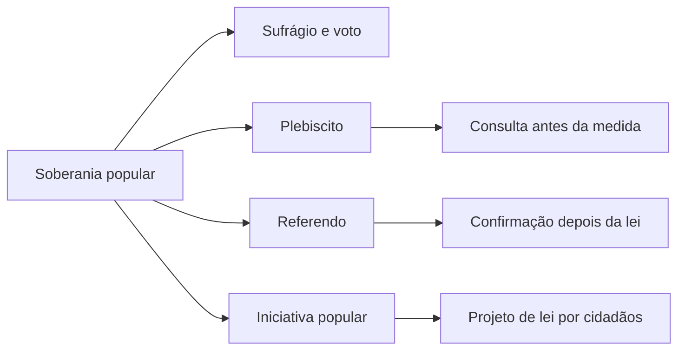

Direitos políticos são os instrumentos que permitem ao cidadão participar do poder: votar, ser votado, propor projeto de lei, opinar em plebiscito. A Constituição trata do assunto nos arts. 14 a 16, e a prova cobra basicamente três coisas: as idades mínimas, as regras do alistamento e do voto, e as condições para se candidatar. Este capítulo cobre a estrutura da soberania popular, a capacidade eleitoral ativa (votar) e a passiva (ser votado). As inelegibilidades, a perda e a suspensão de direitos e a anterioridade eleitoral ficam para o capítulo seguinte, porque formam um bloco de regras negativas.

> [!objetivos]
> - Distinguir soberania popular, sufrágio e voto, e identificar os três instrumentos do art. 14.
> - Aplicar as regras de alistamento obrigatório e facultativo por faixa de idade.
> - Listar as condições de elegibilidade e as idades mínimas de cada cargo.
> - Explicar a situação eleitoral do militar e do conscrito.
> - Reconhecer a diferença entre capacidade ativa, capacidade passiva e inelegibilidade.

## A soberania popular e seus instrumentos

A Constituição abre com a ideia de que todo poder emana do povo, que o exerce por meio de representantes eleitos ou diretamente. O art. 14 dá forma a essa ideia: a soberania popular aparece no **sufrágio universal**, no voto **direto e secreto** e de **valor igual**, e também em três instrumentos de participação direta.

| Instrumento | Como funciona | Momento |
| --- | --- | --- |
| Plebiscito | O povo aprova ou rejeita uma medida antes de ela ser tomada | Antes |
| Referendo | O povo ratifica ou rejeita norma já editada | Depois |
| Iniciativa popular | Cidadãos apresentam projeto de lei ao Legislativo | Antes do processo legislativo |

A diferença entre plebiscito e referendo é de **tempo**, não de efeito. No plebiscito, a consulta vem antes da decisão política e autoriza ou veta o caminho. No referendo, a lei já existe e a consulta confirma ou rejeita a sua vigência. Trocar os dois é o erro mais frequente do tema.

A **iniciativa popular** tem requisitos numéricos fixados no art. 61, § 2º, para projetos de lei federal. O projeto precisa de assinaturas equivalentes a **um por cento** dos eleitores do país, espalhadas por **cinco estados** no mínimo, e cada um desses estados deve contribuir com pelo menos **três décimos por cento** do seu eleitorado. No âmbito municipal, a Constituição remete à lei orgânica e admite iniciativa de cinco por cento do eleitorado.

> [!atencao] Plebiscito e referendo são convocados por decreto legislativo
> A convocação cabe ao Congresso Nacional, por decreto legislativo, e a consulta é feita pela Justiça Eleitoral. Não há convocação por decreto do Executivo nem por resolução do tribunal eleitoral. Em prova, o verbo "convocar" tem sujeito certo: o Congresso.

O voto é **direto**, isto é, o eleitor escolhe o candidato sem intermediários; é **secreto**, para proteger a liberdade de escolha; e tem **valor igual** para todos, o que veda o voto plural ou censitário. Essas três características aparecem em assertivas de múltipla escolha com a troca de uma delas.

## Capacidade eleitoral ativa

Capacidade eleitoral ativa é o direito de **votar**. Ela nasce com o alistamento eleitoral, que é o cadastro na Justiça Eleitoral. A Constituição não trata todos os brasileiros do mesmo modo: divide o alistamento e o voto em obrigatórios e facultativos.

> [!lei] CF, art. 14, §§ 1º e 2º
> O alistamento eleitoral e o voto são: I - obrigatórios para os maiores de dezoito anos; II - facultativos para: a) os analfabetos; b) os maiores de setenta anos; c) os maiores de dezesseis e menores de dezoito anos. Não podem alistar-se como eleitores os estrangeiros e, durante o período do serviço militar obrigatório, os conscritos.

A tabela seguinte organiza as faixas, que é o que a banca cobra em forma de caso concreto.

| Situação | Alistamento e voto |
| --- | --- |
| Menor de 16 anos | Proibido |
| 16 e 17 anos | Facultativo |
| 18 a 70 anos | Obrigatório |
| Maior de 70 anos | Facultativo |
| Analfabeto, em qualquer idade | Facultativo |
| Estrangeiro | Proibido |
| Conscrito durante o serviço militar obrigatório | Proibido |

Três detalhes decidem questão. O primeiro: o **analfabeto** vota, e o voto é facultativo; ele não pode ser impedido de se alistar. O segundo: o **maior de setenta anos** está dispensado, mas se quiser votar pode, porque a facultatividade é uma opção. O terceiro: o **conscrito** não se alista enquanto durar o serviço militar obrigatório; depois, alista-se normalmente.

O alistamento é a porta de entrada e tem consequências práticas. Quem não se alista nem justifica a ausência fica em situação irregular e sofre restrições: não obtém passaporte, não toma posse em cargo público, não recebe salário de função pública, não participa de concorrência pública. São as chamadas **sanções eleitorais**, que não se confundem com perda de direitos políticos.

> [!exemplo] Três eleitores, três regras
> Um jovem de dezessete anos quer votar e é filiado a um partido: pode se alistar, porque o voto é facultativo nessa idade. Uma senhora de setenta e dois anos decide não votar mais: está dispensada, sem multa. Um soldado no serviço militar obrigatório tenta se alistar: não pode enquanto durar o serviço, e deve aguardar a dispensa para tirar o título.

> [!pegadinha] Facultativo não é proibido
> A banca escreve que "o analfabeto não pode votar" ou que "o maior de setenta anos está proibido de votar". As duas estão erradas. Nesses casos o voto é **facultativo**: quem quiser vota, quem não quiser não é penalizado.

## Capacidade eleitoral passiva

Capacidade eleitoral passiva é a **elegibilidade**: a possibilidade de ser escolhido para um cargo eletivo. Ela pressupõe a capacidade ativa, mas exige mais. A Constituição lista as condições no art. 14, § 3º, e deixa à lei a regulamentação.

> [!lei] CF, art. 14, § 3º
> São condições de elegibilidade, na forma da lei: I - a nacionalidade brasileira; II - o pleno exercício dos direitos políticos; III - o alistamento eleitoral; IV - o domicílio eleitoral na circunscrição; V - a filiação partidária; VI - a idade mínima de: a) trinta e cinco anos para Presidente e Vice-Presidente da República e Senador; b) trinta anos para Governador e Vice-Governador de Estado e do Distrito Federal; c) vinte e um anos para Deputado Federal, Deputado Estadual ou Distrital, Prefeito, Vice-Prefeito e juiz de paz; d) dezoito anos para Vereador.

O mnemônico das condições é **NACIDO**: nacionalidade, alistamento, capacidade (pleno exercício), idade, domicílio e filiação. Como todo mnemônico, serve para ordenar a memória, e a prova cobra cada item isoladamente.

A **idade mínima** é o item mais explorado. A tabela abaixo organiza por idade, que é a forma como a questão aparece.

| Idade | Cargos |
| --- | --- |
| 35 anos | Presidente, Vice-Presidente e Senador |
| 30 anos | Governador e Vice-Governador |
| 21 anos | Deputado federal, estadual e distrital; Prefeito e Vice-Prefeito; juiz de paz |
| 18 anos | Vereador |

A elegibilidade é um dos direitos e garantias fundamentais de participação, e o art. 14 integra o catálogo que o art. 5º, § 1º, manda aplicar imediatamente. Repare em duas assimetrias que a banca explora. O **Senador** exige 35 anos, a mesma idade do Presidente, embora o mandato seja de oito anos e o cargo represente o estado. O **juiz de paz** exige 21 anos, e não 18, porque está no grupo dos cargos de 21. E o Vereador é o único cargo de 18 anos.

A idade é aferida na **data da posse**, e não no registro da candidatura. Quem completa a idade exigida até a posse pode concorrer. Esse detalhe resolve questões que apresentam candidato com idade faltando poucos dias.

> [!atencao] Idade conta na posse
> A verificação da idade mínima ocorre no momento da posse, conforme a jurisprudência eleitoral. Candidato que tem 34 anos no registro e completa 35 antes da posse do cargo de Senador está apto.

O **domicílio eleitoral** precisa estar na circunscrição do cargo. Não se exige residência, e sim vínculo eleitoral com o território. Já a **filiação partidária** é condição de elegibilidade, e o Brasil não admite candidatura avulsa: quem não é filiado a partido não pode concorrer.

> [!pegadinha] Candidatura avulsa não existe
> A Constituição exige filiação partidária como condição de elegibilidade. Assertiva que admita candidato sem partido, por "notável saber" ou "apoio popular", está errada. O STF já declarou a incompatibilidade da candidatura avulsa com o modelo constitucional.

### O militar e a elegibilidade

O militar é caso especial e cai muito em prova de corporação. O art. 14, § 8º, diz que o **militar alistável é elegível**, atendidas duas condições ligadas ao tempo de serviço:

| Tempo de serviço | Consequência |
| --- | --- |
| Menos de dez anos | Deve afastar-se da atividade |
| Mais de dez anos | É agregado pela autoridade superior e, se eleito, passa à inatividade na diplomação |

A lógica é proteger a hierarquia e a disciplina. Quem tem pouco tempo deixa a carreira para se candidatar; quem tem mais de dez anos fica agregado, sem exercer o cargo militar, e só se desliga definitivamente se for eleito. Se não for eleito, retorna à atividade.

Há uma diferença de consequências que a prova cobra. O afastamento de quem tem menos de dez anos é **definitivo**: ele sai da carreira para concorrer. A agregação de quem tem mais de dez anos é **temporária**: o militar fica à disposição, sem comando de tropa, e retorna se a eleição não vier. Só a diplomação produz a passagem automática à inatividade.

Há uma tensão constitucional que vale conhecer: o art. 142, § 3º, V, proíbe ao militar em serviço ativo a filiação partidária, e o art. 14, § 3º, V, exige filiação para a candidatura. A saída prática é o afastamento ou a agregação, que permite cumprir a exigência sem violar a vedação da vida de quartel.

> [!exemplo] Bombeiro militar candidato
> Um capitão do Corpo de Bombeiros com doze anos de serviço quer disputar uma vaga de deputado estadual. Ele pede agregação à autoridade superior, faz a filiação partidária no período permitido e concorre. Se vencer, passa à inatividade no ato da diplomação; se perder, volta à atividade.

## Capacidade ativa, passiva e inelegibilidade

As três expressões parecem sinônimas, mas não são, e a diferença rende questão conceitual.

| Conceito | Pergunta que responde | Exemplo |
| --- | --- | --- |
| Capacidade ativa | Posso votar? | Alistamento e voto |
| Capacidade passiva | Posso ser votado? | Condições de elegibilidade |
| Inelegibilidade | Estou impedido de me candidatar? | Direitos políticos negativos |

A capacidade passiva é a regra geral: preenchidas as condições, o cidadão pode se candidatar. A **inelegibilidade** é restrição: mesmo preenchendo as condições, a pessoa não pode concorrer em razão de uma situação específica. É por isso que a doutrina chama as inelegibilidades de **direitos políticos negativos**, tema do capítulo seguinte.

Há ainda a distinção entre inelegibilidade **absoluta** e **relativa**. A absoluta afasta o cidadão de qualquer eleição, em qualquer tempo, como ocorre com o analfabeto e o inalistável. A relativa vale para determinado cargo ou território e por prazo definido, como a inelegibilidade reflexa dos parentes do chefe do Executivo. Essa classificação importa porque a absoluta não se afasta por desincompatibilização, e a relativa, em regra, pode.

Duas inelegibilidades, porém, estão no próprio art. 14 e convém fixar desde já: são inelegíveis os **inalistáveis** e os **analfabetos** (§ 4º). O inalistável é o estrangeiro e o conscrito; o analfabeto vota, mas não pode ser votado. Essa assimetria é clássica: o analfabeto tem capacidade ativa facultativa e não tem capacidade passiva.

> [!bizu] Analfabeto vota, mas não é votado
> Voto facultativo para o analfabeto; inelegibilidade absoluta para o mesmo analfabeto. Duas regras, um só personagem. Guardar essa dupla evita a troca mais comum do tema.

## Mapa do capítulo

| Tema | Regra | Pegadinha |
| --- | --- | --- |
| Instrumentos | Plebiscito, referendo e iniciativa popular | Inverter plebiscito e referendo |
| Voto | Direto, secreto e de valor igual | Voto plural ou censitário |
| Alistamento | Obrigatório de 18 a 70 anos | Proibir o voto do analfabeto |
| Facultativo | 16 e 17, maior de 70, analfabeto | Tratar facultativo como proibido |
| Proibição | Estrangeiro e conscrito | Conscrito depois do serviço |
| Condições | Nacionalidade, alistamento, capacidade, idade, domicílio, filiação | Candidatura avulsa |
| Idades | 35, 30, 21 e 18 anos | Idade aferida na posse |
| Militar | Menos de 10 anos: afasta; mais de 10: agrega | Agregação sem eleição |
| Inelegíveis | Inalistáveis e analfabetos | Analfabeto vota e não é votado |

### Para fixar

- A soberania popular se exerce pelo sufrágio e por plebiscito, referendo e iniciativa popular.
- Plebiscito é consulta anterior à medida; referendo é confirmação posterior de lei.
- A convocação de plebiscito e referendo cabe ao Congresso Nacional, por decreto legislativo.
- Voto obrigatório dos 18 aos 70 anos; facultativo para 16 e 17, maior de 70 e analfabeto.
- Estrangeiro e conscrito em serviço militar obrigatório não podem se alistar.
- Condições de elegibilidade: nacionalidade brasileira, pleno exercício dos direitos políticos, alistamento, domicílio eleitoral, filiação partidária e idade mínima.
- Idades: 35 para Presidente, Vice e Senador; 30 para Governador e Vice; 21 para Deputado, Prefeito, Vice-Prefeito e juiz de paz; 18 para Vereador.
- A idade mínima é verificada na data da posse, não no registro da candidatura.
- O militar com menos de dez anos de serviço se afasta; com mais de dez, é agregado e vai à inatividade se eleito.
- Inalistáveis e analfabetos são inelegíveis; o analfabeto, porém, vota se quiser.
