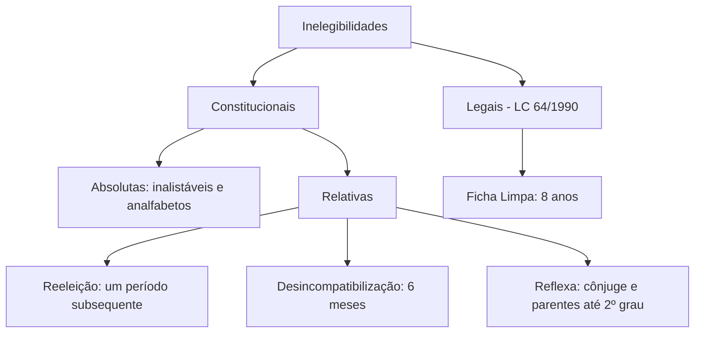
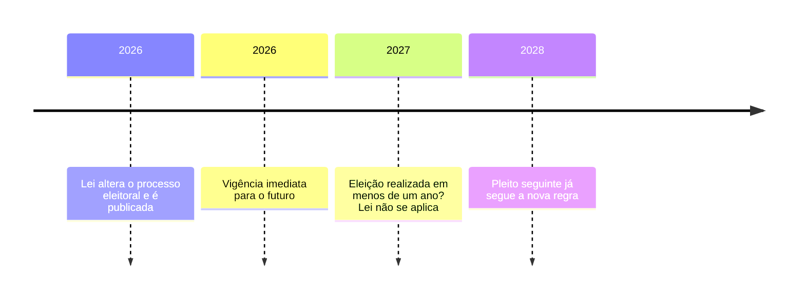

O capítulo anterior mostrou quem pode votar e quem pode ser votado. Este trata do contrário: das restrições. São os chamados direitos políticos negativos, que se dividem em dois grupos. As **inelegibilidades** impedem a candidatura sem retirar o direito de votar. A **perda** e a **suspensão** atingem os próprios direitos políticos e afastam o cidadão do processo eleitoral por inteiro, ainda que temporariamente. O capítulo fecha com o princípio da anterioridade eleitoral, que funciona como trava de segurança contra mudanças de regra perto da eleição.

> [!objetivos]
> - Classificar as inelegibilidades em absolutas, relativas e legais.
> - Aplicar as regras de reeleição, desincompatibilização e inelegibilidade reflexa.
> - Identificar as hipóteses da Lei da Ficha Limpa e o prazo de oito anos.
> - Distinguir perda de suspensão dos direitos políticos e reconhecer as cinco causas do art. 15.
> - Explicar o alcance do art. 16 e por que ele não alcança emenda constitucional.

## O que são direitos políticos negativos

Direito político negativo é o impedimento ao exercício da participação política. A Constituição usa duas técnicas diferentes, e a distinção tem consequência prática.

A **inelegibilidade** atinge apenas a capacidade passiva: o cidadão continua votando, pode se filiar a partido, pode participar de campanha, mas não pode ser candidato naquele pleito ou naquele cargo. Ela pode ser absoluta, quando afasta de qualquer eleição, ou relativa, quando alcança determinado cargo, território ou período.

A **perda** e a **suspensão** atingem a capacidade ativa e a passiva ao mesmo tempo: o cidadão deixa de votar e de ser votado. A perda é definitiva, e a suspensão é temporária, durando enquanto persistir a causa.

| Instituto | Atinge votar? | Atinge ser votado? | Duração |
| --- | --- | --- | --- |
| Inelegibilidade absoluta | Não | Sim, em qualquer eleição | Enquanto durar a causa |
| Inelegibilidade relativa | Não | Sim, em cargo ou território | Prazo ou condição |
| Suspensão | Sim | Sim | Enquanto durar a causa |
| Perda | Sim | Sim | Definitiva, salvo reaquisição |

> [!atencao] Cassação é proibida
> A Constituição veda a **cassação** de direitos políticos. Cassar significa retirar o direito como sanção política, sem previsão legal e sem processo. Perda e suspensão só ocorrem nas hipóteses do art. 15, e a diferença está no procedimento e na definitividade.

## Inelegibilidades constitucionais

As inelegibilidades previstas na própria Constituição se dividem em absolutas e relativas. As absolutas estão no § 4º do art. 14: são inelegíveis os **inalistáveis** e os **analfabetos**. Como visto no capítulo anterior, o analfabeto vota, mas não pode ser votado.

As relativas aparecem nos §§ 5º a 7º e tratam de três situações: reeleição, desincompatibilização e parentesco. O esquema abaixo organiza o conjunto.

### Reeleição

O art. 14, § 5º, permite uma única reeleição para o período seguinte aos chefes do Executivo: Presidente, governador, prefeito e quem os tenha sucedido ou substituído no curso do mandato. A regra vale para o mesmo cargo e para um único período subsequente. Não existe reeleição ilimitada, e não existe terceiro mandato consecutivo.

Atenção a três detalhes. Primeiro, a regra alcança quem **sucedeu** ou **substituiu** o titular, o que inclui o vice que assumiu definitivamente. Segundo, o limite é de **um** período subsequente: quem já foi reeleito uma vez não pode se candidatar de novo na eleição seguinte, mas pode voltar depois de um intervalo. Terceiro, a reeleição é para o mesmo cargo; a troca de cargo exige desincompatibilização.

> [!pegadinha] Sucessor também conta
> A banca costuma tratar a reeleição como direito apenas de quem foi eleito. O § 5º inclui expressamente quem sucedeu ou substituiu o titular, o que impede o vice que assumiu de alegar que está no primeiro mandato "de verdade".

### Desincompatibilização

Para concorrer a outro cargo, o chefe do Executivo precisa renunciar ao mandato até **seis meses antes** do pleito (art. 14, § 6º). A regra existe para evitar o uso da máquina administrativa em benefício da candidatura. O prazo é contado do pleito, e não da convenção partidária.

A renúncia fora do prazo gera inelegibilidade. E a exigência não se aplica apenas ao titular: alcança quem o substituiu, na forma da lei. A desincompatibilização também aparece em outros cargos e funções, com prazos definidos na LC 64/1990, como o afastamento de servidores de determinadas funções.

### Inelegibilidade reflexa

O art. 14, § 7º, atinge o **cônjuge** e os parentes de sangue, afins ou adotivos até o **segundo grau**. A restrição vale no território em que o titular exerce o mandato — Presidência, governo ou prefeitura — e alcança também quem substituiu o chefe do Executivo nos seis meses que antecedem a eleição. A ressalva é para quem já ocupa mandato eletivo e disputa a reeleição.

A lógica é impedir a concentração familiar do poder. A restrição é territorial: vale no território de jurisdição do titular. O parente pode concorrer em outro estado ou município, desde que observe as demais regras.

> [!jurisprudencia] STF, Súmula Vinculante 18
> Separar-se ou divorciar-se durante o mandato não libera o cônjuge da inelegibilidade reflexa do art. 14, § 7º. A súmula fecha a porta da separação de última hora.

A súmula resolve a tentativa mais óbvia de burla: o divórcio de última hora. Se o casal se separa durante o mandato, o ex-cônjuge continua inelegível no território. O mesmo raciocínio alcança a união estável, reconhecida pela jurisprudência como relação apta a gerar a inelegibilidade reflexa.

Dois pontos completam o regime. A inelegibilidade reflexa **não alcança** o parente que já era titular de mandato eletivo e disputa a reeleição, porque a própria Constituição ressalva essa hipótese. E ela não se aplica quando o titular renunciou ao mandato mais de seis meses antes do pleito, porque aí não há mais jurisdição a proteger.

> [!exemplo] Irmã do prefeito
> O prefeito de uma cidade do agreste pernambucano está no segundo mandato e sua irmã quer disputar a prefeitura. Ela é parente de segundo grau e está no território de jurisdição do titular: é inelegível, ainda que ele não possa mais se reeleger. Se ela fosse vereadora e buscasse a reeleição, a ressalva constitucional a salvaria.

### Vice, sucessão e o efeito da inelegibilidade

A posição do vice merece atenção porque a prova gosta de combinar reeleição e sucessão. Quem assume o mandato em caráter definitivo, por morte, renúncia ou afastamento do titular, conta esse período para o limite de reeleição: não pode alegar que está no primeiro mandato. Já o vice que apenas substitui o titular em licenças curtas não assume o mandato para esse fim.

Quando o cabeça de chapa é considerado inelegível, a solução depende do momento. Antes da eleição, o partido pode substituir o candidato, observados os prazos da lei eleitoral. Depois de proclamado o resultado, a inelegibilidade leva à cassação do registro e à posse do vice, se ele for elegível; não havendo vice, convoca-se nova eleição.

> [!atencao] Vice não herda a inelegibilidade do titular
> A inelegibilidade reflexa atinge cônjuge e parentes, não o vice. Se o governador é cassado por inelegibilidade, o vice assume, desde que não tenha causa própria de inelegibilidade. A banca gosta de estender a restrição a quem não é parente.

## Inelegibilidades legais e a Lei da Ficha Limpa

O art. 14, § 9º, autoriza lei complementar a criar outras inelegibilidades, para proteger a probidade, a moralidade e a normalidade das eleições. A lei complementar é a **LC 64/1990**, profundamente alterada pela **LC 135/2010**, conhecida como Lei da Ficha Limpa.

As hipóteses mais cobradas são estas:

- condenação criminal por **decisão colegiada** por crimes graves, como os praticados contra a administração pública, o patrimônio público, a fé pública, a economia popular e a dignidade sexual;
- condenação por **improbidade administrativa** dolosa que implique, ao mesmo tempo, prejuízo ao erário e enriquecimento ilícito;
- **demissão** do serviço público em processo disciplinar;
- **rejeição de contas** relativas ao exercício de cargo público, por órgão competente;
- **renúncia** ao mandato para evitar a cassação;
- condenação por **abuso de autoridade**;
- inclusão em lista de órgãos de proteção ao crédito por inadimplência de obrigações eleitorais, quando a lei assim prevê.

O prazo é de **oito anos**, mas o marco inicial mudou. A Lei Complementar 219/2025 alterou a contagem da Lei das Inelegibilidades e antecipou o começo do prazo em várias hipóteses, que antes só corriam depois do fim do mandato ou do cumprimento da pena. A mudança é questionada no Supremo (ADI 7881), ainda sem julgamento final nem liminar; até a decisão, valem os marcos da LC 219/2025.

Para a condenação criminal, a lei passou a contar os oito anos **da própria condenação**, e não do cumprimento da pena. A exceção são os crimes contra a administração pública e os tipos listados em itens específicos do rol legal, que continuam a gerar inelegibilidade da condenação colegiada até oito anos **após o cumprimento da pena**. É por isso que, nesses casos, o condenado recupera a liberdade e continua inelegível.

| Hipótese | Marco inicial do prazo | Duração |
| --- | --- | --- |
| Condenação criminal colegiada (regra geral) | Data da condenação | 8 anos |
| Crimes contra a administração pública e itens 6 a 10 do rol | Cumprimento integral da pena | 8 anos |
| Improbidade administrativa dolosa | Condenação por órgão colegiado | 8 anos |
| Demissão do serviço público | Data da decisão | 8 anos |
| Perda do mandato por quebra de decoro | Decisão que decretar a perda | 8 anos |
| Renúncia para evitar cassação | Data da renúncia | 8 anos |

A mesma lei reforçou o critério do **dolo** na improbidade e criou o Requerimento de Declaração de Elegibilidade, documento pelo qual o interessado pede à Justiça Eleitoral o reconhecimento prévio de sua situação. Ela também fixou prazos de afastamento para autoridades policiais civis e militares em exercício no município, tema que interessa diretamente a quem serve em corporação militar.

A constitucionalidade da Lei da Ficha Limpa foi confirmada pelo Supremo, que reconheceu a validade da inelegibilidade fundada em condenação por órgão colegiado, sem exigir o trânsito em julgado. O argumento central é que a inelegibilidade não é pena, mas condição de elegibilidade, e por isso não se aplica o princípio da presunção de inocência do mesmo modo. A contagem dos prazos, alterada pela LC 219/2025, é objeto de ação direta em curso: se trechos forem derrubados, os marcos descritos acima podem voltar à regra anterior.

A inelegibilidade é verificada no **registro de candidatura**, e não no dia da posse, nem no da diplomação. O pedido de registro é analisado pela Justiça Eleitoral, que examina as condições de elegibilidade e as causas de inelegibilidade conhecidas até aquele momento. A impugnação ao registro segue rito próprio, com prazo curto, e a decisão pode levar ao indeferimento do registro ou à cassação posterior, se a causa surgir no curso da campanha.

> [!pegadinha] Colegiado, não singular
> A lei exige condenação por **órgão colegiado**. Decisão de primeira instância, ainda que condenatória, não gera a inelegibilidade. A banca troca "colegiado" por "transitada em julgado" e a assertiva fica errada.

## Perda e suspensão dos direitos políticos

O art. 15 é curto e costuma aparecer em questão de múltipla escolha com uma hipótese inventada. Vale memorizar as cinco causas e a regra de ouro: cassação é vedada.

> [!lei] CF, art. 15
> É vedada a cassação de direitos políticos, cuja perda ou suspensão só se dará nos casos de: I - cancelamento da naturalização por sentença transitada em julgado; II - incapacidade civil absoluta; III - condenação criminal transitada em julgado, enquanto durarem seus efeitos; IV - recusa de cumprir obrigação a todos imposta ou prestação alternativa, nos termos do art. 5º, VIII; V - improbidade administrativa, nos termos do art. 37, § 4º.

| Causa | Natureza | Efeito |
| --- | --- | --- |
| Cancelamento da naturalização | Perda | Definitiva |
| Incapacidade civil absoluta | Perda, na leitura tradicional | Enquanto durar |
| Condenação criminal transitada em julgado | Suspensão | Enquanto durarem os efeitos |
| Recusa de obrigação a todos imposta | Perda | Definitiva |
| Improbidade administrativa | Suspensão | Conforme a decisão |

A primeira causa é a única perda por decisão judicial que atinge a nacionalidade derivada: cancelada a naturalização por sentença transitada em julgado, o naturalizado perde os direitos políticos. A quinta causa é a improbidade administrativa, e aqui há uma mudança legislativa importante: a Lei 14.230/2021 passou a exigir **dolo** para a configuração do ato de improbidade, o que reduziu o alcance da hipótese.

A segunda causa exige leitura atualizada. O Estatuto da Pessoa com Deficiência (Lei 13.146/2015) mudou o regime das incapacidades e afirma que a deficiência não afeta o exercício de direitos políticos. A hipótese do art. 15, II, continua no texto, mas deve ser interpretada de forma restritiva, para não esvaziar a proteção da convenção internacional sobre direitos das pessoas com deficiência.

A terceira causa é a mais comum na prática. A condenação criminal transitada em julgado **suspende** os direitos políticos enquanto durarem os efeitos da condenação. Cumprida a pena e extinta a punibilidade, os direitos retornam, ressalvada a inelegibilidade da Lei da Ficha Limpa, que corre por prazo próprio.

A quarta causa trata da recusa de cumprir obrigação legal a todos imposta ou prestação alternativa. É o caso do objetor de consciência que se recusa ao serviço militar e também à prestação alternativa: perde os direitos políticos.

> [!atencao] Suspensão termina, inelegibilidade continua
> Quem cumpre pena por crime comum tem os direitos políticos suspensos durante a execução. Terminada a pena, a suspensão acaba. Mas a inelegibilidade de oito anos da Ficha Limpa pode continuar, porque tem fundamento e prazo próprios. São dois relógios diferentes.

> [!bizu] As cinco do art. 15
> Naturalização cancelada, incapacidade absoluta, condenação transitada, recusa de obrigação a todos imposta e improbidade. Cinco causas, nenhuma a mais. Se a alternativa inventar "condenação em primeira instância" ou "cassação por decisão do Congresso", está errada.

## Princípio da anterioridade eleitoral

O art. 16 é uma das travas mais importantes do sistema. Uma lei que mexa no **processo eleitoral** começa a valer no dia em que é publicada, mas fica **fora da eleição** marcada para menos de doze meses depois desse início. É a chamada anualidade ou anterioridade eleitoral.

> [!lei] CF, art. 16 (parte final)
> […] não se aplicando à eleição que ocorra até um ano da data de sua vigência.

Três finalidades justificam a regra: preservar a **segurança jurídica** do processo, garantir **igualdade de chances** entre candidatos e impedir o **casuísmo**, isto é, a mudança de regra para beneficiar ou prejudicar alguém em pleito próximo.

A contagem é feita a partir da **vigência** da lei, e não da publicação. Como a lei eleitoral entra em vigor na data da publicação, as duas datas normalmente coincidem. O prazo de um ano é contado até a data da eleição, e a consequência é a inaplicabilidade, não a inconstitucionalidade: a lei vale para o pleito seguinte, não para o iminente.

Aqui está o ponto mais fino: nem toda norma eleitoral é norma de **processo** eleitoral. A jurisprudência distingue o direito eleitoral material, que trata de quem pode ser candidato e de como se adquire e perde o mandato, do processo eleitoral, que cuida das etapas, prazos e formas da eleição. A distinção decide se a lei nova incide ou não no pleito seguinte, e o Supremo já enfrentou o tema em casos concretos, como na aplicação da Lei da Ficha Limpa.

A regra do art. 16 alcança **lei**, e não emenda constitucional. Uma emenda que altere o processo eleitoral não se submete à anualidade, porque o poder constituinte derivado não está limitado por norma infraconstitucional de transição. Isso não significa passe livre: a emenda continua sujeita às cláusulas pétreas e ao controle de constitucionalidade.

> [!pegadinha] Anualidade vale para lei, não para emenda
> A banca escreve que "a emenda constitucional que altera o processo eleitoral só vale um ano depois". Errado. O art. 16 fala em lei. Emenda constitucional tem regime próprio, com limite apenas nas cláusulas pétreas.

> [!atencao] Inaplicável não é inválida
> A lei publicada a menos de um ano da eleição não é inconstitucional nem revogada: ela simplesmente não se aplica àquele pleito. Dizer que a norma "é nula por violar a anualidade" é erro de técnica.

## Impugnação do mandato eletivo

O art. 14, §§ 10 e 11, completa o sistema com a **ação de impugnação de mandato eletivo** (AIME). O mandato pode ser questionado na Justiça Eleitoral em até **quinze dias** após a **diplomação**, desde que o autor apresente prova de abuso do poder econômico, corrupção ou fraude. A ação corre em segredo de justiça, e o autor responde por litigância temerária ou de má-fé.

A AIME não se confunde com a ação de investigação judicial eleitoral (AIJE) nem com o recurso contra a diplomação. O prazo curto e o marco na diplomação são os detalhes cobrados. Depois dos quinze dias, a via própria é outra, e a consequência pode ser a cassação do mandato por decisão da Justiça Eleitoral, com a posse do sucessor.

| Ação | Prazo | Marco inicial | Objeto |
| --- | --- | --- | --- |
| AIME | 15 dias | Diplomação | Abuso econômico, corrupção ou fraude |
| AIJE | Antes da eleição | Fato e conhecimento | Abuso de poder |
| Recurso contra diplomação | Prazo recursal | Proclamação do resultado | Validade dos votos |

O cabimento da AIME é restrito a esses três vícios: abuso do poder econômico, corrupção e fraude. Quem quer discutir inelegibilidade ou descumprimento de programa partidário deve usar outra via, e a escolha errada leva à extinção do processo sem análise do mérito. Como o prazo é de quinze dias e corre da diplomação, perder o marco significa perder a ação.

## Mapa do capítulo

| Tema | Regra | Pegadinha |
| --- | --- | --- |
| Conceito | Inelegibilidade atinge só a capacidade passiva | Confundir com perda |
| Absolutas | Inalistáveis e analfabetos | Analfabeto vota |
| Reeleição | Um único período subsequente | Sucessor também conta |
| Desincompatibilização | Renúncia até 6 meses antes do pleito | Contar da convenção |
| Reflexa | Cônjuge e parentes até 2º grau, no território | Divórcio não afasta (SV 18) |
| Ficha Limpa | Condenação colegiada, 8 anos | Exigir trânsito em julgado |
| Perda | Naturalização cancelada, recusa de obrigação | Cassação vedada |
| Suspensão | Condenação transitada, improbidade | Suspensão e inelegibilidade têm prazos distintos |
| Anterioridade | Lei não vale para eleição em até 1 ano | Aplicar a emenda constitucional |

### Para fixar

- Inelegibilidade atinge a capacidade passiva; perda e suspensão atingem também o direito de votar.
- A Constituição veda a cassação de direitos políticos; perda e suspensão só nas hipóteses do art. 15.
- São inelegíveis absolutos os inalistáveis e os analfabetos.
- Presidente, governador e prefeito podem se reeleger para um único período subsequente, incluindo quem os sucedeu.
- Para concorrer a outro cargo, o chefe do Executivo renuncia até seis meses antes do pleito.
- Cônjuge e parentes até segundo grau do chefe do Executivo são inelegíveis no território, e o divórcio no curso do mandato não afasta a restrição (SV 18).
- A Lei da Ficha Limpa exige condenação por órgão colegiado e gera inelegibilidade de oito anos, contados, em regra, da condenação, e não do cumprimento da pena (LC 219/2025).
- Art. 15: cancelamento da naturalização, incapacidade civil absoluta, condenação transitada, recusa de obrigação a todos imposta e improbidade.
- A improbidade exige dolo desde a Lei 14.230/2021; a suspensão por condenação dura enquanto durarem os efeitos da pena.
- A lei que altera o processo eleitoral não se aplica à eleição realizada em até um ano de sua vigência, e essa trava não alcança a emenda constitucional, que segue apenas as cláusulas pétreas.
