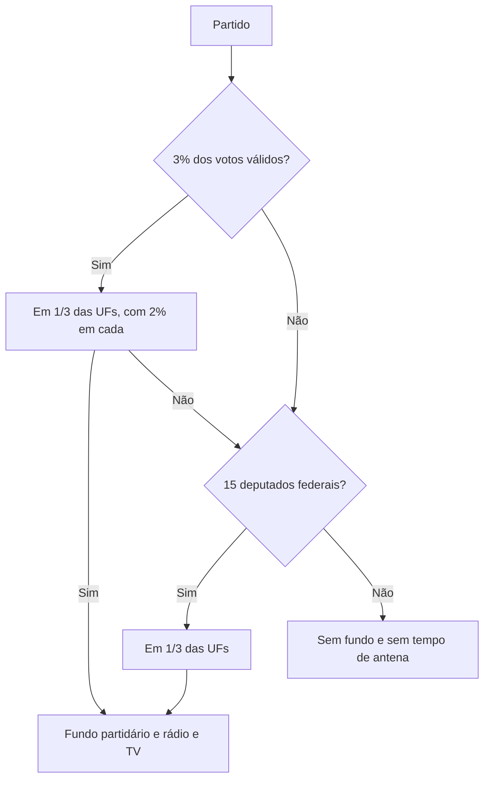

Partido político é a pessoa jurídica que organiza a vontade política do eleitorado e disputa eleições. A Constituição dá liberdade para criar, fundir, incorporar e extinguir partidos, mas impõe condições: caráter nacional, prestação de contas, vedação de recursos estrangeiros e proibição de organização paramilitar. Sobre essa base, três reformas recentes mudaram o desenho do sistema: a Emenda Constitucional 97/2017 criou a cláusula de barreira e proibiu coligações proporcionais; a 117/2022 constitucionalizou as cotas de gênero; e a 133/2024 reservou recursos para candidaturas de pessoas pretas e pardas. Este capítulo trata das regras do art. 17 e das três emendas, com a tabela de transição que a prova cobra.

> [!objetivos]
> - Listar os preceitos do art. 17 e explicar como o partido adquire personalidade jurídica.
> - Aplicar a cláusula de barreira e o regime de transição até 2030.
> - Explicar o que acontece com o parlamentar eleito por partido que não atinge a cláusula.
> - Distinguir coligações majoritárias e proporcionais e o fim da verticalização.
> - Reconhecer as cotas de gênero e raciais criadas pelas emendas de 2022 e 2024.

## A liberdade partidária e seus limites

O art. 17 começa com uma liberdade ampla: é livre a criação, a fusão, a incorporação e a extinção de partidos. Não há autorização do Congresso Nacional nem controle prévio de conteúdo ideológico. Essa liberdade, porém, é condicionada a quatro valores e a quatro preceitos.

Os valores protegidos são o **regime democrático**, a **soberania nacional**, o **pluripartidarismo** e os **direitos fundamentais**. Eles funcionam como moldura: um partido que defenda a supressão violenta da democracia não pode se valer da liberdade de organização para fazê-lo.

Os preceitos estão nos incisos do caput e devem ser memorizados.

| Preceito | Conteúdo |
| --- | --- |
| Caráter nacional | O partido precisa atuação em todo o país, não apenas local |
| Recursos estrangeiros | Proibido receber dinheiro de entidade ou governo de fora |
| Prestação de contas | Obrigatória perante a Justiça Eleitoral |
| Funcionamento parlamentar | Regulado pela lei |

O inciso II é explorado com uma pegadinha simples: a vedação alcança recursos de **entidade ou governo estrangeiros**, sem qualquer exceção por "ausência de subordinação". Quem recebe dinheiro de fundação estrangeira sem subordinação ao governo de lá continua violando o dispositivo.

O § 4º acrescenta a proibição de **organização paramilitar**. O partido é associação civil de fins políticos, e não grupo armado. A regra tem história: nasceu para impedir a reprodução de milícias políticas no período de redemocratização.

> [!atencao] Personalidade jurídica vem do registro civil
> O partido adquire personalidade jurídica na forma da **lei civil** e, depois, registra o estatuto no Tribunal Superior Eleitoral. O registro no TSE não cria a pessoa jurídica; ele confere aptidão eleitoral. A banca inverte a ordem e diz que a personalidade nasce com o registro no TSE.

A tabela abaixo organiza as etapas, que é a forma como a questão costuma aparecer.

| Etapa | Onde ocorre | Efeito |
| --- | --- | --- |
| Constituição e registro civil | Cartório de pessoas jurídicas | Aquisição da personalidade jurídica |
| Registro do estatuto | Tribunal Superior Eleitoral | Funcionamento como partido político |
| Funcionamento parlamentar | Casas legislativas | Direito de atuação conforme a lei |

## Autonomia e coligações

O § 1º dá ao partido autonomia para montar a própria estrutura, escolher e manter seus órgãos, definir como funciona por dentro e decidir sobre coligações nas eleições **majoritárias**. Duas mudanças aparecem no texto.

A primeira é a **vedação de coligações nas eleições proporcionais**. Deputado federal, deputado estadual, deputado distrital e vereador não podem se coligar. A regra vale desde as eleições de 2020. A razão é técnica: no sistema proporcional, a coligação distorcia a representação, porque o eleitor votava em um candidato e elegia outro, de partido diferente, por causa da soma de votos da chapa.

A segunda é o fim da **verticalização**. O partido não é obrigado a repetir, nos estados e municípios, a coligação feita para a eleição presidencial. Cada esfera decide o seu arranjo nas eleições majoritárias.

| Eleição | Coligação permitida? |
| --- | --- |
| Presidente, governador, senador, prefeito | Sim |
| Deputado federal, estadual, distrital e vereador | Não, desde 2020 |

> [!pegadinha] Senador é majoritário
> A eleição para o Senado é majoritária, e por isso admite coligação. A confusão aparece porque o senador integra o Congresso ao lado dos deputados. O critério é o sistema eleitoral, não a casa legislativa.

O § 1º também determina que os estatutos estabeleçam normas de **disciplina e fidelidade partidária**. Essa previsão ganhou reforço com a Emenda Constitucional 111/2021, que inseriu o § 6º e constitucionalizou a perda do mandato por desligamento do partido.

A regra alcança deputados federais, estaduais, distritais e vereadores — cargos proporcionais. Quem se desliga do partido pelo qual foi eleito perde o mandato, salvo se o partido concordar ou se houver outra justa causa prevista em lei. Senadores, governadores e presidentes não entram nessa regra, porque foram eleitos pelo sistema majoritário, em que o vínculo pessoal com o eleitor é maior.

> [!bizu] Fidelidade só no proporcional
> Perde o mandato quem sai do partido: deputado e vereador. Não perde: senador, governador, prefeito e presidente. Guarde o critério do sistema eleitoral, e a lista sai sozinha.

## A cláusula de barreira

Cláusula de barreira, ou cláusula de desempenho, é o conjunto de exigências que o partido precisa cumprir para ter direito aos recursos do **fundo partidário** e ao **tempo gratuito de rádio e televisão**. Ela não extingue o partido que não a cumpre: apenas retira esses dois benefícios.

O art. 17, § 3º, fixa dois critérios **alternativos**. Basta cumprir um deles.

| Critério | Exigência |
| --- | --- |
| Votos | 3% dos válidos para a Câmara, em no mínimo um terço dos estados, com 2% em cada um |
| Bancada | 15 deputados federais, espalhados por no mínimo um terço dos estados |

A palavra que decide a questão é **alternativamente**. O partido não precisa dos votos e da bancada: um caminho basta. E há uma segunda exigência embutida nos dois critérios, que é a **distribuição territorial**: não adianta concentrar votos ou bancada em um estado só.

A cláusula só produz efeito pleno a partir das eleições de **2030**. Até lá, vale um regime de transição, com exigências menores a cada pleito. A tabela abaixo reúne os números, que são o item mais cobrado do capítulo.

| Legislatura seguinte a | Votos mínimos | Bancada mínima |
| --- | --- | --- |
| 2018 | 1,5%, com 1% em cada UF | 9 deputados |
| 2022 | 2%, com 1% em cada UF | 11 deputados |
| 2026 | 2,5%, com 1,5% em cada UF | 13 deputados |
| 2030 | 3%, com 2% em cada UF | 15 deputados |

A lógica é de **enrijecimento gradual**: as exigências sobem a cada eleição, e o partido tem tempo para se adaptar, seja crescendo, seja fundindo com outro. Note que a exigência de distribuição territorial está presente em todas as fases: um terço das unidades da Federação.

> [!bizu] A escada 1,5 - 2 - 2,5 - 3
> Votos: 1,5% em 2018, 2% em 2022, 2,5% em 2026 e 3% em 2030. Bancada: 9, 11, 13 e 15. As duas sequências sobem de dois em dois deputados e de meio ponto em meio ponto. O piso interno também sobe: 1%, 1%, 1,5% e 2%.

Antes da Emenda 97/2017, a Lei 9.096/1995 já previa uma cláusula de barreira mais rígida, de 5% dos votos. O Supremo declarou essa regra inconstitucional em 2006, por entender que ela sufocava as minorias políticas e comprometia o pluripartidarismo.

> [!jurisprudencia] STF, ADI 1.351
> O Supremo julgou inconstitucional a cláusula de barreira de 5% prevista na Lei dos Partidos Políticos, por violar o direito das minorias e o modelo pluralista. A Emenda 97/2017 veio depois, com exigências menores e progressivas, e passou a ter base constitucional.

## O parlamentar do partido sem cláusula

O § 5º resolve uma situação que parece paradoxal: um candidato pode se eleger por um partido que não atinge a cláusula de barreira. Nesse caso, ele **mantém o mandato** e pode se filiar a outro partido que tenha cumprido os requisitos, sem perder o cargo.

A regra é uma exceção à fidelidade partidária, e a razão é óbvia: o partido não tem direito a fundo nem a tempo de televisão, e o parlamentar ficaria ilhado. A mudança de partido é facultativa, não obrigatória.

> [!lei] CF, art. 17, § 4º
> É vedada a utilização pelos partidos políticos de organização paramilitar.

Há um detalhe que cai em prova: a nova filiação **não conta** para a distribuição do fundo partidário nem do tempo de rádio e televisão. O partido que recebe o parlamentar não ganha mais dinheiro nem mais propaganda por causa disso. É uma forma de impedir que a regra vire instrumento de captação de recursos.

> [!exemplo] Deputado de partido pequeno
> Um partido elege quatro deputados federais e não alcança a cláusula de barreira. Um deles recebe convite de uma legenda que cumpriu os requisitos e se filia. Ele mantém o mandato, e a filiação não aumenta a cota do novo partido no fundo partidário nem o seu tempo de antena. Se preferir ficar, também pode: o mandato está assegurado.

## Vedação às coligações proporcionais

A Emenda 97/2017 também alterou o § 1º para proibir coligações nas eleições proporcionais. A regra começou a valer em **2020**, e a razão é a distorção do sistema proporcional.

No sistema proporcional, a vaga é distribuída conforme a votação do partido ou da coligação. Com coligação, o voto em um candidato podia eleger outro, de partido diferente, e o eleitor não tinha como prever esse efeito. Sem coligação, a conta é feita por partido, e a relação entre voto e representação fica mais clara.

A vedação não alcança as eleições majoritárias. Presidente, governador, senador e prefeito podem se coligar, e a coligação pode variar de estado para estado, porque a verticalização nacional acabou.

> [!atencao] A vedação é só nas proporcionais
> A assertiva "é vedada a coligação em qualquer eleição" está errada. A vedação alcança deputados e vereadores. Nas eleições majoritárias, a coligação continua permitida, sem obrigação de repetir o arranjo nacional.

## As cotas de gênero e raciais

Duas emendas constitucionalizaram regras de financiamento que antes estavam apenas na lei e na jurisprudência.

A **Emenda 117/2022** acrescentou dois parágrafos ao art. 17. O § 7º obriga o partido a aplicar pelo menos **5%** do fundo partidário em programas que estimulem e divulguem a participação política das mulheres. O § 8º reserva, no mínimo, **30%** do dinheiro de campanha — o Fundo Especial de Financiamento de Campanha e a fatia do fundo partidário usada em campanhas — e do tempo gratuito de rádio e TV para as candidatas, na proporção do número de candidaturas femininas.

A mesma emenda trouxe uma **anistia**: partidos que, até a publicação, não aplicaram as cotas mínimas de recursos por sexo e raça em eleições anteriores ficaram livres de sanção. A regra foi pensada para encerrar passivos, e a consequência é que a cobrança vale para frente.

A **Emenda 133/2024**, de 22 de agosto de 2024, criou o § 9º e reservou **30%** do dinheiro público de campanha — o Fundo Especial e a parte do fundo partidário usada em eleições — para candidaturas de pessoas **pretas e pardas**. A distribuição é feita nas circunscrições que o partido considerar mais adequadas aos seus interesses.

| Emenda | Percentual | Finalidade |
| --- | --- | --- |
| 117/2022, § 7º | 5% do fundo partidário | Programas de participação política das mulheres |
| 117/2022, § 8º | 30% de recursos e de tempo | Candidaturas femininas |
| 133/2024, § 9º | 30% dos recursos de campanha | Candidaturas de pessoas pretas e pardas |

A Emenda 133/2024 tem dois outros eixos. Ela instituiu um **Refis** para partidos e suas fundações, com isenção de juros e multas e parcelamento em até 60 meses para débitos previdenciários e até 180 meses para os demais. E reafirmou a **imunidade tributária** dos partidos, com leitura ampliativa: a imunidade do art. 150, VI, c, alcança todos os impostos, e não apenas os que incidem sobre renda, patrimônio e serviços.

> [!atencao] Cota de recursos não é cota de candidaturas
> O § 9º trata da **distribuição de dinheiro** para campanhas de pessoas pretas e pardas, não de número mínimo de candidaturas registradas. Quem afirmar que a emenda criou cota obrigatória de candidatos negros está errado: a escolha das candidaturas segue o critério de cada partido.

> [!pegadinha] 5%, 30% e 30%
> Três percentuais, três destinos: 5% do fundo partidário para programas de participação política das mulheres; 30% dos recursos de campanha e do tempo de propaganda para candidaturas femininas; 30% dos recursos de campanha para candidaturas de pessoas pretas e pardas. Trocar os destinatários é o erro clássico.

## Fundo partidário e prestação de contas

O **fundo partidário** é formado por dotações orçamentárias e por multas eleitorais, e é distribuído aos partidos segundo critérios da lei, com parcela mínima garantida e o restante proporcional à votação. A Constituição não fixa percentuais do fundo: ela apenas condiciona o acesso à cláusula de barreira e determina a prestação de contas.

A **prestação de contas** é anual e vai à Justiça Eleitoral. O partido deve comprovar a origem das receitas e a destinação das despesas, inclusive o cumprimento das cotas de gênero e raça. A desaprovação das contas pode gerar devolução de valores, multa e, em casos graves, suspensão do repasse.

| Receita | Origem | Controle |
| --- | --- | --- |
| Fundo partidário | Orçamento e multas | Prestação de contas anual |
| Fundo de campanha | Orçamento | Prestação de contas eleitoral |
| Doações privadas | Pessoas físicas, nos limites da lei | Registro e declaração |

> [!exemplo] Contas reprovadas
> Um diretório estadual usa parte do fundo partidário em despesa sem comprovação e não aplica os 30% em candidaturas femininas. Na prestação de contas, a Justiça Eleitoral desaprova as contas, determina a devolução do valor e aplica multa. O partido continua existindo, mas perde parte do repasse seguinte e fica exposto a nova fiscalização.

## Federações, fusões e incorporações

A Constituição fala em criação, fusão, incorporação e extinção, mas não disciplina o procedimento. A lei dos partidos cuida do tema, e a reforma eleitoral de 2021 criou a figura da **federação partidária**: dois ou mais partidos se unem para atuar como bloco por prazo mínimo, mantendo a identidade e os registros próprios.

A diferença em relação à fusão é de intensidade. Na **fusão**, os partidos desaparecem e surge uma nova legenda. Na **incorporação**, um partido é absorvido por outro e deixa de existir. Na **federação**, as legendas continuam existindo, mas atuam juntas, com programa e estatuto comuns, e a fidelidade é cobrada em relação à federação.

| Figura | As legendas continuam? | Efeito |
| --- | --- | --- |
| Fusão | Não, surge uma nova | União definitiva |
| Incorporação | A incorporada desaparece | Absorção por outra legenda |
| Federação | Sim, com atuação conjunta | Bloco por prazo mínimo |

O ponto de prova é que a federação não é coligação. A coligação vale para uma eleição e se desfaz depois; a federação é projeto de duração, com prazo mínimo definido em lei, e vale para todas as eleições do período. Também não se confunde com a cláusula de barreira: o desempenho é aferido de forma conjunta na federação, e é por isso que ela virou caminho para partidos pequenos sobreviverem ao patamar de 2030.

> [!atencao] Federação não é coligação
> A banca costuma tratar os dois institutos como sinônimos. A coligação é temporária e restrita a uma eleição majoritária; a federação tem prazo mínimo, atuação conjunta e identidade preservada. E a federação não afasta a exigência de caráter nacional de cada partido.

## O que mais cai

O capítulo rende questão por quatro caminhos: a ordem de aquisição da personalidade jurídica, os números da cláusula de barreira e da transição, o alcance da vedação de coligações e os percentuais das cotas. Há ainda as regras de fidelidade, que mudaram de status com a Emenda 111/2021 e hoje estão na Constituição.

Um resumo em quatro linhas ajuda na véspera:

- partido nasce no registro civil e se habilita no TSE;
- cláusula de barreira: 3% ou 15 deputados, com transição até 2030;
- coligação só nas majoritárias, desde 2020 sem coligação proporcional;
- cotas: 5% para programas de mulheres, 30% para candidaturas femininas e 30% para candidaturas pretas e pardas.

| Emenda | O que mudou | Quando se aplica |
| --- | --- | --- |
| EC 97/2017 | Cláusula de barreira e fim das coligações proporcionais | Transição até 2030; coligações desde 2020 |
| EC 111/2021 | Fidelidade partidária na Constituição | Imediata |
| EC 117/2022 | Cotas de gênero e anistia de sanções anteriores | A partir de 2022 |
| EC 133/2024 | 30% para candidaturas pretas e pardas, Refis e imunidade | A partir de 2024 |

## Mapa do capítulo

| Tema | Regra | Pegadinha |
| --- | --- | --- |
| Liberdade partidária | Criar, fundir, incorporar e extinguir sem autorização | Exigir aprovação do Congresso |
| Personalidade jurídica | Registro civil, depois TSE | Inverter a ordem |
| Preceitos | Caráter nacional, sem recurso estrangeiro, contas, funcionamento | Aceitar verba estrangeira privada |
| Paramilitar | Vedado | Confundir com associação de reservistas |
| Coligações | Só majoritárias desde 2020 | Estender a vedação ao Senado |
| Cláusula de barreira | 3% ou 15 deputados, em 1/3 das UFs | Exigir os dois critérios |
| Transição | 1,5%, 2%, 2,5% e 3% | Trocar bancadas de 9, 11, 13 e 15 |
| Partido sem cláusula | Mandato assegurado e filiação facultada | Filiação conta para o fundo |
| Fidelidade | Deputados e vereadores perdem o mandato | Alcançar senador |
| Cotas | 5% e dois 30% | Trocar destinatários |

### Para fixar

- É livre criar, fundir, incorporar e extinguir partido, sem autorização do Congresso, observados soberania, democracia, pluripartidarismo e direitos fundamentais.
- O partido adquire personalidade jurídica pelo registro civil e só depois registra o estatuto no TSE.
- É vedado receber recursos de entidade ou governo estrangeiros, sem exceção por ausência de subordinação.
- Coligações são permitidas apenas nas eleições majoritárias; nas proporcionais, estão vedadas desde 2020.
- A cláusula de barreira exige, alternativamente, 3% dos votos com 2% em um terço das UFs ou 15 deputados federais distribuídos em um terço das UFs.
- A transição sobe de 1,5% e 9 deputados (2018) a 3% e 15 deputados (2030), passando por 2% e 11 em 2022 e 2,5% e 13 em 2026.
- O eleito por partido sem cláusula mantém o mandato e pode se filiar a outro partido, sem que isso aumente o fundo ou o tempo de antena do novo partido.
- Deputados e vereadores que se desligam do partido perdem o mandato, salvo anuência ou justa causa; senadores e chefes do Executivo não se sujeitam a essa regra.
- A EC 117/2022 fixou 5% do fundo partidário para programas de participação das mulheres e 30% dos recursos e do tempo de propaganda para candidaturas femininas.
- A EC 133/2024 reservou 30% dos recursos de campanha para candidaturas de pessoas pretas e pardas, criou Refis partidário e reafirmou a imunidade tributária dos partidos.
