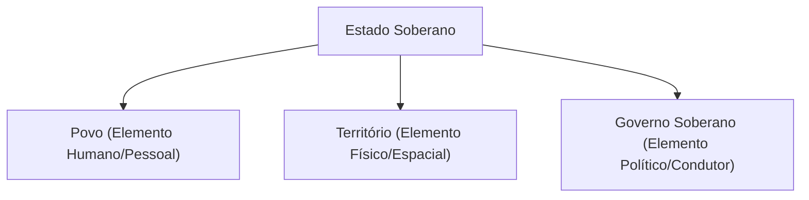
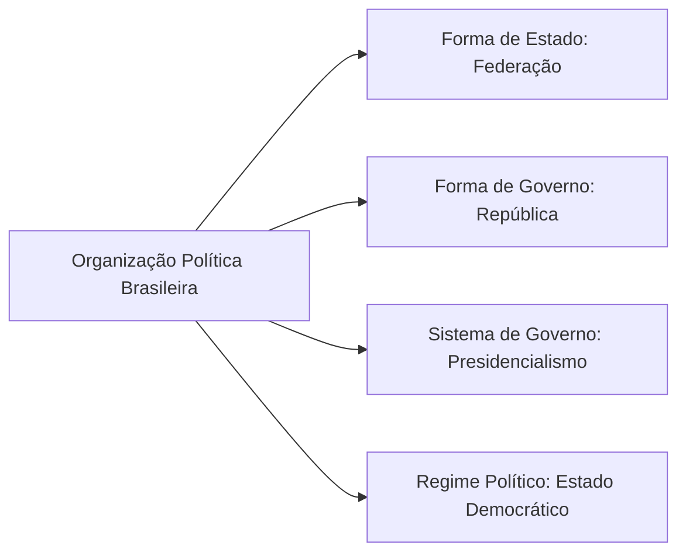
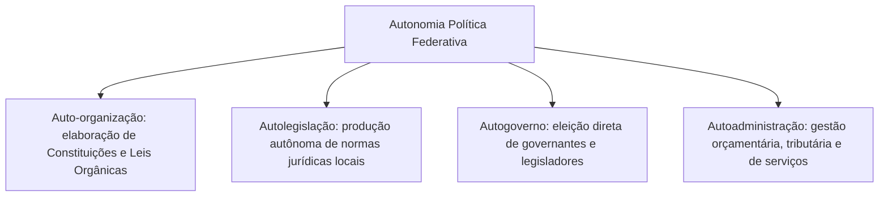
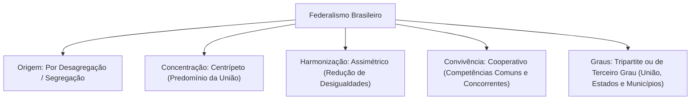

A compreensão da organização do Estado no Direito Constitucional pressupõe o domínio prévio dos conceitos fundamentais da Teoria Geral do Estado e da Ciência Política. O Estado não é uma entidade natural. Ele é uma construção histórica e jurídica orientada a disciplinar a convivência humana, ordenar a sociedade e promover o bem comum. No Brasil, o modelo de estruturação estatal encontra-se solenemente positivado no Título III da Constituição da República Federativa do Brasil de 1988. Esse título regulamenta a convivência harmônica entre os entes federativos autônomos.

> [!objetivos]
> - Identificar os elementos constitutivos essenciais do Estado de Direito: povo, território e governo soberano.
> - Diferenciar formas de Estado, formas de governo, sistemas de governo e regimes políticos.
> - Compreender a distinção dogmática entre federação e confederação e a vedação absoluta ao direito de secessão.
> - Analisar as quatro capacidades definidoras da autonomia política dos entes federativos no modelo constitucional brasileiro.
> - Dominar as classificações doutrinárias do federalismo e as peculiaridades do modelo cooperativo e tripartite consagrado no art. 18 da CF/88.

## O Estado: conceito e elementos constitutivos

Para a teoria geral do direito público, o Estado é uma sociedade politicamente organizada, fixada em determinado território, dotada de soberania e regida por uma ordem jurídica própria. A doutrina constitucional clássica estabelece que a existência do Estado moderno depende da presença simultânea de três elementos estruturais fundamentais:



O primeiro elemento é o **povo** (dimensão pessoal ou humana). Ele representa o conjunto de pessoas ligadas ao Estado pelo vínculo jurídico e político da nacionalidade. Esse grupo abrange tanto os brasileiros natos quanto os naturalizados. 

O conceito jurídico de povo não se confunde com *população*. População é um dado meramente demográfico e quantitativo. Ela engloba todos os indivíduos presentes no território em determinado momento, incluindo estrangeiros e apátridas. Povo também se distingue de *nação*. Nação é uma categoria sociológica e cultural, alicerçada em laços de identidade histórica, língua e tradições compartilhadas. Por fim, difere do conceito de *cidadãos*, reservado aos nacionais que exercem plenamente seus direitos políticos.

O segundo elemento é o **território** (dimensão física, espacial ou material). Ele define a base geográfica delimitada no espaço sobre a qual o Estado exerce o seu poder de império de forma exclusiva. Esse espaço compreende o solo terrestre continental e insular, os rios internos, lagos, o mar territorial e o espaço aéreo correspondente. O território marca o limite de vigência da ordem jurídica soberana do país.

O terceiro elemento é o **governo soberano** (dimensão política ou condutora). Ele consubstancia a cúpula diretiva investida de poder político supremo. A soberania apresenta dois ângulos inseparáveis. No plano interno, traduz o poder supremo sobre todas as pessoas, bens e relações jurídicas situadas no território nacional. No plano externo, expressa a independência do Estado perante a comunidade internacional, tratando as demais nações soberanas com base na igualdade jurídica.

> [!atencao]
> **Povo, População, Nação e Cidadãos:**
> - **Povo**: conceito jurídico. São os nacionais do Estado (natos ou naturalizados).
> - **População**: conceito demográfico. Abrange todos os habitantes do território (nacionais, estrangeiros e apátridas).
> - **Nação**: conceito sociológico. Trata-se da comunidade unida por laços culturais, língua e história comum.
> - **Cidadãos**: conceito político restrito. Envolve os nacionais aptos a votar e serem votados perante a Justiça Eleitoral.

## Classificação do poder político: formas, sistemas e regimes

A organização do poder estatal desdobra-se em quatro categorias analíticas autônomas: forma de Estado, forma de governo, sistema de governo e regime político.

| Categoria Dogmática | Pergunta Central de Definição | Modelos Teóricos Principais | Modelo Adotado pelo Brasil |
|---|---|---|---|
| **Forma de Estado** | Como o poder político é distribuído territorialmente? | Unitário, Regional ou Federal | **Federal** (Federação indissolúvel) |
| **Forma de Governo** | Como o poder é instituído e exercido pelos governantes? | República ou Monarquia | **República** (eletividade e periodicidade) |
| **Sistema de Governo** | Como se relacionam os Poderes Executivo e Legislativo? | Presidencialismo ou Parlamentarismo | **Presidencialismo** (mandato fixo) |
| **Regime Político** | Qual a origem e legitimação do poder estatal? | Democrático ou Autocrático | **Democrático** (Estado de Direito) |



### Formas de Estado: Unitário, Regional e Federal

A forma de Estado analisa o grau de centralização territorial do poder político:

No **Estado Unitário**, o poder político concentra-se em um único polo de autoridade central. Todas as principais decisões políticas e legislativas emanam de uma só cúpula governamental. O Estado unitário pode admitir desconcentração ou descentralização puramente administrativa. Contudo, suas divisões regionais não possuem autonomia política ou legislativa originária. Esse foi o modelo do Brasil Império sob a Constituição de 1824. Países como França, Uruguai e Portugal adotam essa estrutura.

No **Estado Regional**, observa-se uma posição intermediária entre o modelo unitário e o federalismo. O poder central concede expressiva autonomia legislativa e administrativa a determinadas regiões históricas. Porém, essas regiões não detêm soberania originária nem poder constituinte pleno. Exemplos contemporâneos são a Espanha e a Itália.

No **Estado Federal (ou Federação)**, verifica-se a união indissolúvel de coletividades territoriais autônomas. O poder político é dividido territorialmente entre um governo central soberano e governos regionais autônomos. Toda essa estrutura apoia-se em uma Constituição rígida. O Brasil adotou essa forma de Estado a partir da Proclamação da República e da Carta de 1891.

### Federação versus Confederação

A distinção teórica entre Federação e Confederação é relevante no Direito Constitucional:

| Critério de Comparação | Federação (Estado Federal) | Confederação de Estados |
|---|---|---|
| **Instrumento de Criação** | Fundada em uma **Constituição** rígida nacional. | Fundada em um **Tratado Internacional**. |
| **Soberania e Autonomia** | Apenas o **Estado Federal é soberano**; os membros são autônomos. | Cada um dos Estados integrantes **mantém sua soberania**. |
| **Direito de Secessão** | **Inexistente**. O vínculo de união é perpétuo e indissolúvel. | **Plenamente admitido**. Os participantes podem se retirar livremente. |
| **Nacionalidade** | **Nacionalidade única** em todo o espaço federativo. | Cada Estado confederado conserva sua **nacionalidade própria**. |
| **Personalidade Externa** | O Estado Federal é o sujeito perante a ordem internacional. | Cada membro mantém representação internacional independente. |

> [!pegadinha]
> **Vedação ao direito de secessão:** na Federação brasileira, nenhum ente federativo possui a faculdade de se separar para fundar um país autônomo. A tentativa de desmembramento separatista constitui grave violação da ordem constitucional. Essa conduta autoriza a decretação de **intervenção federal** pelo Presidente da República para manter a integridade nacional (art. 34, I, da CF/88). Além disso, a forma federativa de Estado foi erigida em **cláusula pétrea expressa** pelo constituinte originário (art. 60, § 4º, I, da CF/88).

## As quatro capacidades da autonomia política federativa

A essência da federação reside na concessão de autonomia política real aos entes que a compõem. No modelo brasileiro, a autonomia não equivale à soberania. A soberania é indivisível e pertence à República Federativa do Brasil. Por sua vez, os entes federados (União, Estados, Distrito Federal e Municípios) ostentam **autonomia política**, sustentada em quatro capacidades jurídicas:



A **auto-organização** confere aos entes a faculdade de estruturar o seu próprio ordenamento fundamental. Os Estados-membros exercem essa prerrogativa por meio do Poder Constituinte Derivado Decorrente, editando suas Constituições Estaduais (art. 25 da CF/88). O Distrito Federal e os Municípios exercem sua auto-organização aprovando suas respectivas **Leis Orgânicas** (arts. 29 e 32 da CF/88).

A **autolegislação** assegura a competência para criar normas jurídicas locais aplicáveis à sua população. Os entes editam leis ordinárias e complementares próprias, observando os limites fixados na Constituição Federal.

O **autogoverno** garante aos cidadãos locais o direito de eleger diretamente os seus governantes políticos. Os eleitores escolhem Governadores, Prefeitos, Deputados e Vereadores sem a interferência ou tutela de autoridades federais.

A **autoadministração** traduz a liberdade dos entes federados para planejar e executar seus serviços públicos. Eles organizam seu quadro de servidores públicos, instituem seus tributos constitucionais e executam suas peças orçamentárias anuais.

> [!bizu]
> **Mnemônico da Autonomia:** lembre-se da palavra **O-L-G-A**:
> - **O**rganização (Auto-organização)
> - **L**egislação (Autolegislação)
> - **G**overno (Autogoverno)
> - **A**dministração (Autoadministração)
> Se faltar qualquer uma dessas quatro prerrogativas, a unidade territorial não é ente federativo. Essa é a exata situação dos Territórios Federais.

## Traços caracterizadores e garantias da federação

A manutenção do equilíbrio federativo repousa sobre garantias institucionais sólidas:

A **repartição de competências** consiste na partilha constitucional de atribuições materiais e legislativas. A Carta Magna outorga poderes expressos à União (arts. 21 e 22), atribui competências remanescentes aos Estados (art. 25, § 1º) e reserva aos Municípios as matérias de interesse local (art. 30).

A **repartição de rendas tributárias** garante recursos próprios para cada ente político. A Constituição distribui os impostos privativos e cria fundos de participação obrigatórios (arts. 157 a 162). Essa medida visa a reduzir a dependência financeira dos governos locais.

O **órgão arbitral da federação** resolve os litígios constitucionais entre as esferas federativas. No Brasil, esse papel cabe privativamente ao Supremo Tribunal Federal. O art. 102, inciso I, alínea *f*, da CF/88 confere ao STF competência originária para julgar disputas federativas envolvendo a União frente aos governos estaduais, bem como litígios entre unidades federadas distintas.

A **representação paritária dos Estados no Senado** equilibra o peso político das unidades da federação. Na Câmara dos Deputados, o número de parlamentares varia conforme a população (art. 45). No Senado Federal, vigora o princípio federativo da igualdade: cada Estado e o Distrito Federal possuem exatamente três Senadores (art. 46).

A **intervenção federal** atua como instrumento extremo de contenção de crises. Ela permite que a União interfira temporariamente na autonomia de um Estado ou DF para repelir invasões, garantir o livre exercício dos poderes ou manter a unidade federativa (art. 34 da CF/88).

> [!jurisprudencia] STF, ACO 1048 (conflitos federativos)
> **STF: competência originária em litígios federativos (art. 102, I, f, da CF/88)**
> O Supremo Tribunal Federal fixou tese no sentido de que a sua competência originária somente incide em conflitos dotados de densidade federativa real. A disputa deve envolver diretamente a União, os Estados-membros ou o Distrito Federal. O STF não detém competência originária para apreciar litígios que envolvam Municípios, pois eles não constam no rol do art. 102, I, *f*, da CF/88.

## Classificações do federalismo

A doutrina especializada classifica os modelos federativos a partir de variados critérios:

### Quanto ao modo de formação histórica

O **federalismo por agregação (ou centrípeto na origem)** surge da união voluntária de Estados soberanos preexistentes. Esses Estados independentes abrem mão de sua soberania externa e criam um Estado Federal comum. Esse é o modelo histórico dos Estados Unidos da América (1787).

O **federalismo por desagregação ou segregação (ou centrífugo na origem)** surge quando um Estado Unitário centralizado resolve descentralizar o poder político. Ele cria unidades territoriais autônomas para acomodar as diferenças regionais. Esse é o modelo histórico brasileiro, implementado na transição do Império para a República.

### Quanto à concentração de competências

O **federalismo centrípeto** concentra a maior parte das competências legislativas e arrecadatórias nas mãos do governo central. É o caso brasileiro, no qual a União detém vasto rol de competências privativas no art. 22.

O **federalismo centrífugo** distribui a grande maioria das atribuições políticas e legislativas em favor dos entes regionais. O governo central preserva apenas as matérias indispensáveis à soberania nacional.

### Quanto à distribuição de poder e recursos

O **federalismo simétrico** concede tratamento jurídico idêntico a todas as unidades territoriais. Ele pressupõe certa homogeneidade cultural, demográfica e econômica entre as regiões.

O **federalismo assimétrico** reconhece as profundas disparidades socioeconômicas e geográficas existentes no país. Ele adota regras constitucionais compensatórias para equilibrar o desenvolvimento nacional. O Brasil consagra o federalismo assimétrico no art. 3º, inciso III, e no art. 151, inciso I, da CF/88, buscando erradicar a pobreza e mitigar os desníveis regionais.

### Quanto ao regime de convivência e cooperação

O **federalismo dual** adota uma separação rígida e inflexível de competências. Não há pontos de interseção entre a atuação do governo central e a dos governos regionais.

O **federalismo cooperativo** baseia-se na atuação compartilhada e no apoio mútuo entre as esferas federativas. A CF/88 consagra expressamente o federalismo cooperativo por meio das competências comuns administrativas (art. 23) e das competências legislativas concorrentes (art. 24).

### Quanto à estrutura dos graus federativos

O **federalismo de segundo grau (ou bipartite)** reconhece autonomia política apenas a dois polos governamentais: o governo central (União) e os governos regionais (Estados).

O **federalismo de terceiro grau (ou tripartite)** inova ao outorgar autonomia política direta a três esferas de poder: federal (União), regional (Estados e DF) e local (Municípios). A Constituição Federal de 1988 consagrou de forma pioneira o federalismo de terceiro grau ao equiparar os Municípios aos demais entes autônomos.



## A Federação Brasileira no art. 18 da Constituição Federal

O art. 18 da Carta Magna inaugura o Título III com a definição normativa da organização político-administrativa do país.

> [!lei] CF, art. 18, caput e § 1º
> **CF/88, art. 18, caput e § 1º:**
> "Art. 18. A organização político-administrativa da República Federativa do Brasil compreende a União, os Estados, o Distrito Federal e os Municípios, todos autônomos, nos termos desta Constituição.
> § 1º Brasília é a Capital Federal."

A análise das disposições do art. 18 revela preceitos fundamentais:

A **autonomia política recíproca** expressa que os quatro entes componentes da federação pátria personificam sujeitos de direito público interno. Não há hierarquia nem subordinação jurídica entre essas esferas. Cada ente político deve respeitar a esfera de atuação deferida diretamente pelo constituinte.

A **diferença entre Soberania e Autonomia** é basilar. A soberania é monopólio da República Federativa do Brasil (art. 1º, I). A União apenas representa a Federação nas relações diplomáticas internacionais (art. 21, I), mantendo autonomia no âmbito doméstico.

A **natureza dos Territórios Federais** decorre do art. 18, § 2º. Os Territórios integram a União. Eles ostentam a natureza jurídica de autarquias territoriais descentralizadas. Os Territórios **não são entes federativos**. Eles não possuem auto-organização nem autogoverno. Atualmente, não há territórios federais no Brasil. Os antigos territórios de Roraima e Amapá foram elevados a Estados pela CF/88, enquanto Fernando de Noronha foi reincorporado a Pernambuco.

A **definição de Brasília** no art. 18, § 1º, estabelece que a cidade é a Capital Federal. Em termos técnicos, Brasília é o local físico onde operam os Poderes da República. Ela não se confunde com o Distrito Federal, que é a pessoa política anômala que abriga a capital.

> [!esquema]
> **Entes Federativos versus Territórios Federais**
> 
> | Atributo Jurídico | Entes Federativos (União, Estados, DF, Municípios) | Territórios Federais (art. 18, § 2º, e art. 33) |
> |---|---|---|
> | **Natureza Jurídica** | Pessoas jurídicas de direito público interno. | Autarquias territoriais pertencentes à União. |
> | **Autonomia Política** | Plena: auto-organização, autolegislação, autogoverno e autoadministração. | Inexistente: não possuem poder constituinte próprio nem autonomia. |
> | **Senado Federal** | Três senadores por Estado e pelo Distrito Federal (art. 46). | Não possuem representação na cúpula do Senado Federal. |
> | **Câmara dos Deputados** | Deputados proporcionais à população (mínimo 8, máximo 70). | Têm bancada fixa de quatro Deputados Federais (art. 45, § 2º). |

## As finalidades do Estado moderno

Para além de sua estrutura interna, a teoria política estuda as finalidades do Estado. A meta suprema da sociedade politicamente organizada é a realização da segurança jurídica e do **bem comum**, assegurando a dignidade da pessoa humana.

A doutrina divide os fins do Estado em grupos essenciais:

### Quanto à extensão da atuação pública

Nos **fins limitados ou mínimos (Estado Liberal)**, o Poder Público atua de forma abstencionista. Ele limita suas atividades à manutenção da ordem pública interna, à defesa territorial e à aplicação das leis aos litígios privados.

Nos **fins expansivos ou totais (Estado Totalitário)**, o Estado anula a autonomia individual. Ele assume o controle absoluto da economia, da cultura e dos vínculos sociais, submetendo o cidadão ao poder governamental.

Nos **fins relativos ou sociais (Estado de Bem-Estar)**, o Estado preserva as liberdades civis e a livre iniciativa. Ao mesmo tempo, ele atua positivamente para garantir direitos fundamentais sociais, como saúde, educação, previdência e proteção ambiental. Esse é o modelo adotado na Carta de 1988.

### Quanto à exclusividade funcional

Nos **fins exclusivos (ou primários)**, o Estado desenvolve atividades indispensáveis à soberania. Essas tarefas não podem ser repassadas aos particulares. Incluem a segurança nacional externa, a prestação da jurisdição judicial e a preservação da segurança pública interna.

Nos **fins concorrentes (ou secundários)**, o Poder Público atua em parceria ou em regime de complementariedade com a iniciativa privada. São exemplos os serviços de ensino, saneamento básico, previdência e saúde.

| Característica da Federação Brasileira | Dispositivo Constitucional Pertinente | Repercussão Prática para Concursos |
|---|---|---|
| **Formação por Desagregação** | Proclamação da República e Carta de 1891 | Movimento centrífugo originado de um Estado Unitário prévio. |
| **Vínculo Indissolúvel** | Art. 1º e art. 18, caput, da CF/88 | Proibição categórica de secessão e cláusula pétrea (art. 60, § 4º, I). |
| **Pacto Tripartite de Terceiro Grau** | Art. 1º e art. 18 da CF/88 | Municípios alçados a entes federativos autônomos com Lei Orgânica. |
| **Federalismo Cooperativo** | Arts. 23 e 24 da CF/88 | Regime de cooperação material comum e concorrência legislativa. |
| **Federalismo Assimétrico** | Art. 3º, III, e art. 151, I, da CF/88 | Promoção de políticas públicas voltadas à redução de desigualdades. |
| **Equilíbrio no Senado Federal** | Art. 46 da CF/88 | Três Senadores por Estado e pelo DF, assegurando peso igual. |
| **Juízo Arbitral do STF** | Art. 102, inciso I, alínea *f*, da CF/88 | Competência originária em litígios entre a União e os Estados ou DF. |

## Mapa do capítulo

```mermaid Síntese do Capítulo: Teoria Geral do Estado e Federação Brasileira
flowchart TD
    M1["Elementos do Estado"] --> M1A["Povo (Vínculo Jurídico)"]
    M1 --> M1B["Território (Espaço Geográfico)"]
    M1 --> M1C["Governo Soberano (Poder Supremo)"]

    M2["Forma de Estado"] --> M2A["Federação Indissolúvel (art. 1º e 18)"]
    M2 --> M2B["Vedação à Secessão (Cláusula Pétrea)"]
    M2 --> M2C["Terceiro Grau (União, Estados, DF e Municípios)"]

    M3["Autonomia Política (OLGA)"] --> M3A["Auto-organização e Autolegislação"]
    M3 --> M3B["Autogoverno e Autoadministração"]

    M4["Classificações Centrais"] --> M4A["Desagregação / Centrípeto / Cooperativo / Assimétrico"]
    M4 --> M4B["Territórios: Autarquias Federais (Não são entes)"]
```

### Para fixar

1. **Elementos estruturais do Estado**: povo (nacionais), território (base espacial) e governo soberano (poder supremo interno e independente externo). População é dado estatístico, nação é conceito sociológico e cidadãos são eleitores alistados.
2. **Formas políticas fundamentais**: o Brasil é uma República (forma de governo), Federativa (forma de Estado), sob o Presidencialismo (sistema de governo) e um Estado Democrático de Direito (regime político).
3. **Pacto federativo e secessão**: o vínculo federativo é indissolúvel. Tentativas de secessão ensejam intervenção federal (art. 34, I). A federação é cláusula pétrea explícita (art. 60, § 4º, I).
4. **Autonomia política (OLGA)**: envolve auto-organização (Constituições Estaduais e Leis Orgânicas), autolegislação, autogoverno (eleições diretas) e autoadministração (tributos e serviços próprios).
5. **Classificações do federalismo brasileiro**: originado por desagregação (centrífugo na gênese), centrípeto na concentração de competências, cooperativo (arts. 23 e 24), assimétrico (redução de disparidades regionais) e tripartite ou de terceiro grau (Municípios autônomos).
6. **Posição jurídica dos Territórios**: integram a União na condição de autarquias territoriais descentralizadas (art. 18, § 2º). Não são entes federados e não possuem representação no Senado, dispondo de bancada fixa de 4 Deputados Federais na Câmara.
7. **Arbitragem federativa pelo STF**: compete ao Supremo processar e julgar originariamente causas entre a União e os Estados ou DF (art. 102, I, *f*). O preceito não abrange litígios que envolvam Municípios.
