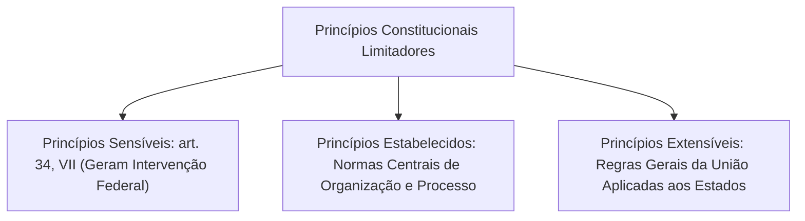
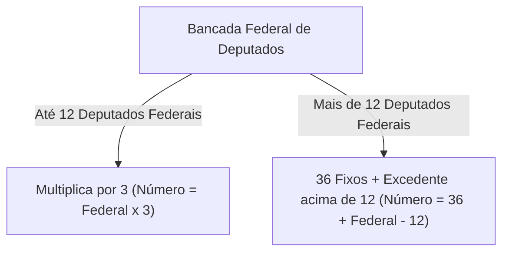
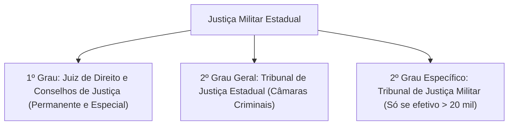
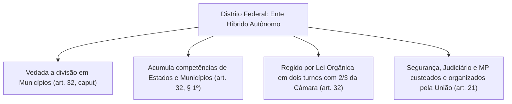
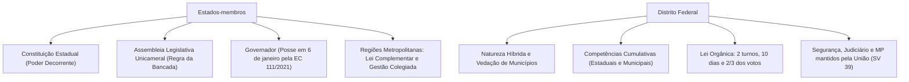

O pacto federativo brasileiro organiza o espaço geográfico e político mediante a distribuição de competências entre esferas autônomas. No nível intermediário ou regional, destacam-se os Estados-membros e o Distrito Federal. Conhecer a estrutura orgânica dessas unidades políticas é imperativo para os concursos da segurança pública, pois é no âmbito estadual e distrital que atuam as Polícias Militares, os Corpos de Bombeiros Militares e as Polícias Civis.

> [!objetivos]
> - Compreender a auto-organização dos Estados-membros, o Poder Constituinte Decorrente e seus princípios limitadores.
> - Dominar a regra constitucional de cálculo do número de Deputados Estaduais e o limite de reeleição das Mesas Diretoras.
> - Analisar a estrutura do Poder Executivo estadual, mandatos, regras de posse, subsídios e subtetos remuneratórios.
> - Identificar as balizas para a criação de Regiões Metropolitanas e os critérios do STF na ADI 1842.
> - Entender o regime jurídico anômalo do Distrito Federal, competências cumulativas e a tutela federal sobre a segurança pública.

## A autonomia dos Estados e o Poder Constituinte Decorrente

A capacidade de auto-organização dos Estados-membros concretiza-se por meio do exercício do **Poder Constituinte Derivado Decorrente**. A Constituição Federal de 1988 atribui aos Estados o poder de elaborar suas próprias Constituições Estaduais:

> [!lei] CF, art. 25, caput
> "Art. 25. Os Estados organizam-se e regem-se pelas Constituições e leis que adotarem, observados os princípios desta Constituição."

O Poder Constituinte Decorrente é jurídico, derivado, subordinado e condicionado. Ele deve estrita obediência aos limites impostos pelo constituinte originário federal. O processo de reforma das Constituições Estaduais exige simetria com o rito federal. As emendas à Constituição Estadual dependem da aprovação de três quintos dos membros da Assembleia Legislativa em dois turnos de votação.

A doutrina constitucional agrupa os limites à auto-organização estadual em três categorias de princípios:

1. **Princípios Constitucionais Sensíveis**: previstos expressamente no art. 34, inciso VII, da CF/88. Sua inobservância pelo Estado autoriza a medida mais drástica do pacto federativo: a **intervenção federal**. O rol é taxativo e abrange:
   - Forma republicana, sistema representativo e regime democrático.
   - Direitos da pessoa humana.
   - Autonomia municipal.
   - Prestação de contas da administração pública, direta e indireta.
   - Aplicação do mínimo exigido da receita em saúde e no desenvolvimento do ensino.
2. **Princípios Constitucionais Estabelecidos**: regras mandamentais explícitas espalhadas pelo texto constitucional que limitam a discricionariedade do legislador estadual. Compreendem as normas de repartição de competências, o processo legislativo obrigatório, as vedações federativas (art. 19), os princípios da administração pública (art. 37) e o regime previdenciário e estatutário dos servidores públicos civis e militares (arts. 39 a 42).
3. **Princípios Constitucionais Extensíveis**: normas concebidas originariamente para a estruturação dos Poderes da União que, por força do princípio da simetria, projetam-se compulsoriamente sobre os Estados, Distrito Federal e Municípios. Exemplos típicos incluem o rito do processo orçamentário, a iniciativa privativa do Chefe do Executivo para projetos que gerem despesas e as regras sobre imunidades parlamentares.

> [!pegadinha]
> **Ação Direta de Inconstitucionalidade Interventiva:** a violação aos princípios constitucionais sensíveis (art. 34, VII) enseja a propositura da ADI Interventiva. Essa ação corre perante o STF e possui legitimidade ativa privativa do Procurador-Geral da República (art. 36, III, da CF/88). Caso o STF julgue procedente a representação, o Presidente da República é comunicado para decretar a intervenção federal no Estado infrator.

## Poder Legislativo Estadual: Assembleia Legislativa

O Poder Legislativo estadual é exercido pela **Assembleia Legislativa**, composta por Deputados Estaduais eleitos para mandatos de quatro anos. Ao contrário do Congresso Nacional, que adota a estrutura bicameral, as Assembleias Legislativas estaduais adotam o modelo **unicameral**.

### Número de Deputados Estaduais: a regra da bancada

O número de Deputados na Assembleia Legislativa depende diretamente do tamanho da representação do respectivo Estado na Câmara dos Deputados (art. 27, caput, da CF/88). O cálculo obedece a uma fórmula matemática precisa:

- **Se a bancada federal tiver até 12 Deputados**: o número de Deputados Estaduais será o triplo da bancada federal. 
  - Exemplo 1: Estado com a bancada federal mínima de 8 parlamentares terá exatamente 24 Deputados Estaduais (8 x 3 = 24). É a situação de Sergipe, Acre, Roraima e Tocantins.
  - Exemplo 2: Estado com 12 Deputados Federais terá 36 Deputados Estaduais (12 x 3 = 36).
- **Se a bancada federal tiver mais de 12 Deputados**: o número de Deputados Estaduais corresponderá a 36 fixos acrescidos de quantos deputados federais passarem de doze.
  - Exemplo 1: Estado de Pernambuco possui 25 Deputados Federais. Sua Assembleia Legislativa terá: 36 + (25 - 12) = 36 + 13 = 49 Deputados Estaduais.
  - Exemplo 2: Estado de São Paulo possui a bancada federal máxima de 70 Deputados Federais. A Assembleia Legislativa paulista terá: 36 + (70 - 12) = 36 + 58 = 94 Deputados Estaduais.

> [!bizu]
> **Fórmula rápida para provas:**
> - Até 12 federais: **Estadual = 3 x Federal**.
> - Acima de 12 federais: **Estadual = Federal + 24**.
> Veja como bate perfeitamente: em Pernambuco, 25 + 24 = 49 deputados estaduais. Em São Paulo, 70 + 24 = 94 deputados estaduais.

### Subsídio dos Deputados Estaduais

O subsídio dos Deputados Estaduais é fixado por lei de iniciativa da própria Assembleia Legislativa em cada legislatura para a subsequente. O teto máximo constitucional desse subsídio equivale a **75% do subsídio estabelecido para os Deputados Federais** (art. 27, § 2º, da CF/88).

### Eleição e reeleição da Mesa Diretora

A composição e renovação da Mesa Diretora da Assembleia Legislativa submetem-se à jurisprudência vinculante do Supremo Tribunal Federal (ADIs 6524, 6688 e correlatas). O STF assentou que:

- É permitida **apenas uma única reeleição sucessiva** dos membros da Mesa Diretora para o mesmo cargo.
- Essa vedação à terceira investidura contínua aplica-se independentemente de os mandatos recaírem na mesma legislatura ou em legislaturas consecutivas.
- É permitida a reeleição para cargo diverso dentro da mesma Mesa Diretora (por exemplo, o Presidente eleger-se Primeiro Secretário).

> [!jurisprudencia] STF, ADI 6524 (reeleição da Mesa Diretora)
> **STF: limite de reeleição nos órgãos diretivos legislativos**
> O Supremo Tribunal Federal pacificou que o postulado republicano impede a perpetuação indefinida de parlamentares na cúpula do Poder Legislativo. Permite-se apenas uma recondução sucessiva para o mesmo cargo na Mesa Diretora da Assembleia Legislativa ou da Câmara dos Deputados e Senado Federal, vedada a terceira reeleição consecutiva.

## Poder Executivo Estadual: Governador e Vice-Governador

O Poder Executivo estadual é chefiado pelo **Governador do Estado**, auxiliado pelos Secretários de Estado. O Governador e o Vice-Governador são eleitos para mandatos de quatro anos pelo sistema majoritário de dois turnos, aplicando-se as mesmas regras de eleição do Presidente da República (art. 28 da CF/88).

### Data da posse: a inovação da Emenda Constitucional nº 111/2021

Historicamente, o Governador e o Vice-Governador tomavam posse no dia 1º de janeiro do ano seguinte ao da eleição. A Emenda Constitucional nº 111/2021 alterou essa data:

- O Governador e o Vice-Governador tomarão posse no **dia 6 de janeiro** do ano subsequente à eleição.
- Essa regra visa a evitar a coincidência de solenidades de posse entre o Governador e o Presidente da República (cuja posse passou para o dia 5 de janeiro).
- A nova data possui eficácia programada a partir da posse dos eleitos nas eleições gerais de 2026.

### Incompatibilidades e perda do mandato

O Governador e o Vice-Governador sujeitam-se a incompatibilidades estritas. A investidura em outro posto administrativo estatal acarreta a perda automática do mandato no Executivo, ressalvada unicamente a aprovação em concurso público com o afastamento funcional previsto na Carta Magna (art. 28, § 1º, c/c art. 38 da CF/88).

### Subtetos remuneratórios nos Estados

O art. 37, inciso XI, da Carta Magna disciplina os limites remuneratórios no âmbito estadual:

| Poder ou Órgão Estadual | Teto Específico Aplicável | Referência Financeira |
|---|---|---|
| **Poder Executivo Estadual** | Subsídio mensal do **Governador do Estado**. | Fixado por lei da Assembleia Legislativa. |
| **Poder Legislativo Estadual** | Subsídio dos **Deputados Estaduais**. | Até 75% do subsídio dos Deputados Federais. |
| **Poder Judiciário Estadual** | Subsídio dos **Desembargadores do Tribunal de Justiça**. | Limitado a 90,25% do subsídio dos Ministros do STF. |
| **Ministério Público, Defensoria e Procuradorias** | Subteto do Judiciário estadual. | Aplicável aos membros e procuradores (90,25% do STF). |

> [!atencao]
> **Opção de Subteto Único Estadual (art. 37, § 12, da CF/88):** os Estados e o Distrito Federal podem fixar, mediante emenda à respectiva Constituição Estadual ou Lei Orgânica, um **subteto único** para toda a administração pública local. Esse subteto unificado é fixado no valor do subsídio mensal dos Desembargadores do TJ (90,25% do STF). Todavia, o texto constitucional faz uma ressalva expressa: o subteto único **não se aplica aos subsídios dos Deputados Estaduais e Distritais nem aos Vereadores**, que permanecem submetidos às suas próprias regras.

## Poder Judiciário Estadual e Justiça Militar dos Estados

A organização da Justiça Estadual cabe a cada Estado-membro, por meio de lei de iniciativa privativa do respectivo **Tribunal de Justiça** (art. 125 da CF/88).

A competência dos tribunais estaduais é residual: cabe-lhes processar e julgar todas as causas que não estejam atribuídas pela Constituição à Justiça Federal, à Justiça do Trabalho, à Justiça Eleitoral ou à Justiça Militar da União.

### A Justiça Militar Estadual

A Constituição de 1988 dedicou disciplina especial à Justiça Militar Estadual nos parágrafos do art. 125:

- A Justiça Militar estadual é constituída, em primeiro grau, pelos juízes de direito do juízo militar e pelos Conselhos de Justiça. Em segundo grau, a jurisdição cabe ao próprio **Tribunal de Justiça** ou a **Tribunal de Justiça Militar (TJM)**.
- A criação de Tribunal de Justiça Militar em segundo grau é restrita. Ela depende de proposta do Tribunal de Justiça e só pode ser instituída nos Estados em que o efetivo militar estadual (Polícia Militar somada ao Corpo de Bombeiros Militar) for **superior a vinte mil integrantes** (art. 125, § 3º).
- Atualmente, apenas três Estados contam com Tribunal de Justiça Militar próprio: São Paulo, Minas Gerais e Rio Grande do Sul. Nos demais Estados (inclusive Pernambuco), o julgamento dos recursos da Justiça Militar é exercido por câmaras especializadas do Tribunal de Justiça comum.

## Regiões metropolitanas, aglomerações urbanas e microrregiões

O art. 25, § 3º, da Carta da República disciplina a cooperação regional intermunicipal:

> [!lei] CF, art. 25, § 3º
> "§ 3º Os Estados poderão, mediante lei complementar, instituir regiões metropolitanas, aglomerações urbanas e microrregiões, constituídas por agrupamentos de municípios limítrofes, para integrar a organização, o planejamento e a execução de funções públicas de interesse comum."

Requisitos e características essenciais desse instituto:

- **Instrumento formal obrigatório**: a criação exige **lei complementar estadual**. Lei ordinária ou decreto não possuem aptidão jurídica para instituir região metropolitana.
- **Continuidade territorial**: os municípios agrupados devem ser necessariamente **limítrofes** (possuir fronteiras territoriais contíguas).
- **Funções públicas de interesse comum**: destina-se a gerir serviços de utilidade compartilhada, como transporte intermunicipal, saneamento básico, habitação e resíduos sólidos.

> [!jurisprudencia] STF, ADI 1842 (Regiões Metropolitanas)
> **STF: governança metropolitana e respeito à autonomia municipal**
> O Supremo Tribunal Federal fixou diretrizes fundamentais sobre o tema:
> 1. A instituição de região metropolitana independe de consulta plebiscitária aos munícipes, diferindo das regras de criação de municípios.
> 2. A participação dos municípios limítrofes na região metropolitana é de **natureza compulsória**, para viabilizar o planejamento urbano integrado.
> 3. O órgão de governança metropolitana deve ser colegiado. É inconstitucional conferir poder de veto absoluto ou hegemonia de votos ao Estado ou a um município polo, sob pena de esvaziar a autonomia política local.

## O regime jurídico anômalo do Distrito Federal

O Distrito Federal ostenta perfil singular no direito comparado. Ele é uma entidade federativa autônoma de natureza anômala ou híbrida, acumulando prerrogativas típicas de Estado e de Município.

As balizas constitucionais do Distrito Federal constam no art. 32 da Carta Magna:

1. **Vedação de divisão em Municípios**: o Distrito Federal não pode ser fracionado em municípios autônomos (art. 32, caput). Seu território divide-se administrativamente em Regiões Administrativas (como Ceilândia, Taguatinga e Sobradinho), geridas por Administradores Regionais de livre nomeação pelo Governador do DF.
2. **Competências cumulativas**: o Distrito Federal exerce, de forma concentrada, todas as competências legislativas, materiais e tributárias atribuídas aos Estados e aos Municípios (art. 32, § 1º). Por exemplo, o DF arrecada concomitantemente o ICMS e o IPVA (impostos estaduais) e o ISS e o IPTU (impostos municipais).
3. **Poder Legislativo Distrital**: a função legislativa distrital é exercida pela **Câmara Legislativa do Distrito Federal**, composta por Deputados Distritais. Aplicam-se aos Deputados Distritais as mesmas regras constitucionais pertinentes aos Deputados Estaduais (art. 32, § 3º).
4. **Lei Orgânica do Distrito Federal**: a auto-organização do DF opera-se por meio de **Lei Orgânica**. Sua edição requer deliberação em dois turnos com intervalo não inferior a dez dias, exigindo o quórum qualificado de dois terços dos Deputados Distritais (art. 32, caput).

### A tutela federal sobre serviços essenciais no Distrito Federal

Embora o Distrito Federal seja um ente federativo autônomo, a Constituição Federal submeteu parte de seus serviços essenciais à tutela e custeio da União. A proximidade da sede dos Poderes da República justificou esse desenho institucional específico:

- **Poder Judiciário e Ministério Público**: compete privativamente à União organizar e manter o Tribunal de Justiça do Distrito Federal e dos Territórios (TJDFT) e o Ministério Público do Distrito Federal e Territórios (art. 21, inciso XIII). Os juízes e promotores do DF são mantidos por verbas federais.
- **Forças de Segurança Pública**: a corporação policial militar distrital, os bombeiros militares, a polícia civil e a polícia penal do Distrito Federal têm sua estrutura orgânica e funcional mantida e organizada diretamente pela União (art. 21, inciso XIV). 
- **Fundo Constitucional do Distrito Federal (FCDF)**: a União mantém fundo financeiro específico destinado a prover os recursos necessários ao custeio da segurança pública e a apoiar a saúde e a educação distritais.

> [!lei] STF, Súmula Vinculante 39
> **STF, Súmula Vinculante 39:**
> "Compete privativamente à União legislar sobre vencimentos dos membros das polícias civil e militar e do corpo de bombeiros militar do Distrito Federal."
> Logo, lei distrital aprovada pela Câmara Legislativa não pode alterar a remuneração ou a estrutura de carreira dos policiais civis, militares ou bombeiros do DF. Qualquer modificação depende de lei federal de iniciativa do Presidente da República.

A tabela a seguir consolida o confronto estrutural entre os Estados e o Distrito Federal:

| Elemento Institucional | Estados-membros | Distrito Federal |
|---|---|---|
| **Instrumento de Auto-organização** | Constituição Estadual (Poder Derivado Decorrente). | Lei Orgânica Distrital (aprovada por dois terços). |
| **Órgão do Poder Legislativo** | Assembleia Legislativa (Deputados Estaduais). | Câmara Legislativa (Deputados Distritais). |
| **Divisão Territorial Interna** | Divididos em Municípios autônomos. | Vedada a divisão em Municípios (Regiões Administrativas). |
| **Competências Tributárias** | Apenas impostos estaduais (ITCMD, ICMS e IPVA). | Cumulativas: impostos estaduais e municipais (IPTU e ISS). |
| **Manutenção da Segurança Pública** | Próprio Estado (recursos estaduais). | União (custeio federal via FCDF e SV 39). |
| **Justiça e Ministério Público** | Organizados e custeados pelo próprio Estado. | Organizados e custeados pela União (art. 21, XIII). |

## Mapa do capítulo

### Para fixar

1. **Auto-organização estadual**: os Estados criam suas próprias Constituições por meio do Poder Constituinte Derivado Decorrente, submetendo-se aos princípios sensíveis, estabelecidos e extensíveis. Emendas estaduais exigem 3/5 da Assembleia.
2. **Cálculo dos Deputados Estaduais**: até 12 deputados federais, multiplica-se por 3 (ex.: 8 federais geram 24 estaduais). Passando de 12 federais, somam-se 36 fixos ao número de federais que exceder 12 (fórmula prática: bancada federal + 24).
3. **Limitação na Mesa Diretora**: o STF veda a reeleição consecutiva para o mesmo cargo na Mesa Diretora além de uma única recondução sucessiva, na mesma legislatura ou na seguinte.
4. **Executivo estadual e posse**: o mandato do Governador dura 4 anos. A EC 111/2021 fixou a data da posse em 6 de janeiro do ano seguinte à eleição, com aplicação a partir de 2026.
5. **Subtetos estaduais**: o Governador é o teto do Executivo; os Deputados limitam o Legislativo; e os Desembargadores (90,25% do STF) balizam a Justiça, o MP e a Defensoria. O subteto único opcional não alcança deputados e vereadores.
6. **Justiça Militar Estadual**: Tribunal de Justiça Militar em segundo grau só pode ser criado se o efetivo militar estadual superar 20 mil homens. Caso contrário, os recursos vão para o Tribunal de Justiça.
7. **Regiões Metropolitanas**: exigem lei complementar estadual, municípios limítrofes e funções de interesse comum. A participação é compulsória e a governança deve ser compartilhada, sem hegemonia isolada do Estado (ADI 1842).
8. **Distrito Federal**: não pode ser dividido em municípios. Acumula competências estaduais e municipais. A segurança pública, o Judiciário e o Ministério Público são organizados e custeados pela União (Súmula Vinculante 39).
