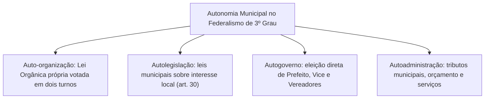
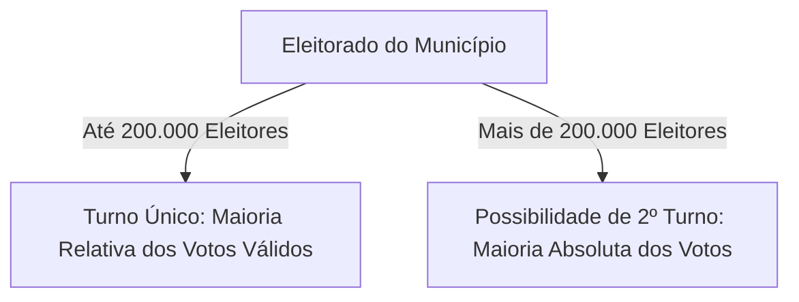
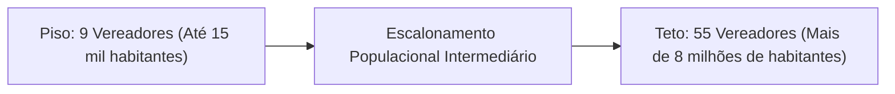
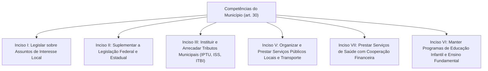
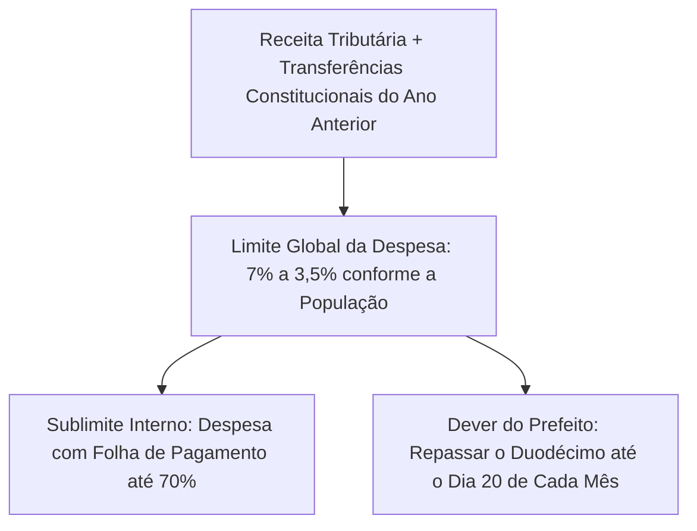
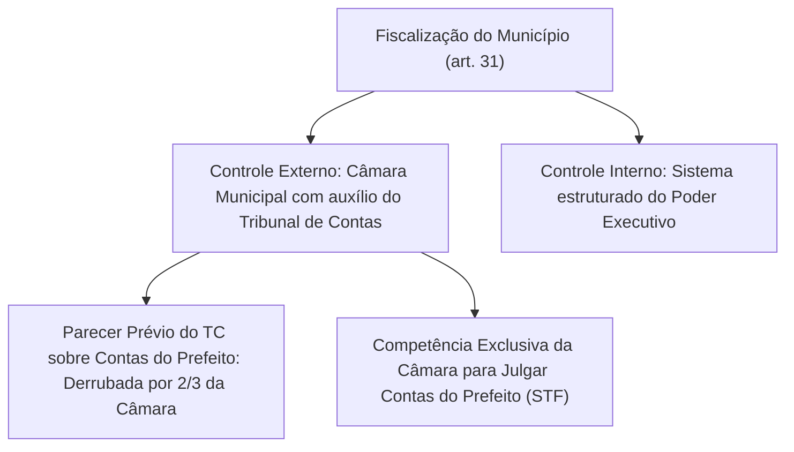
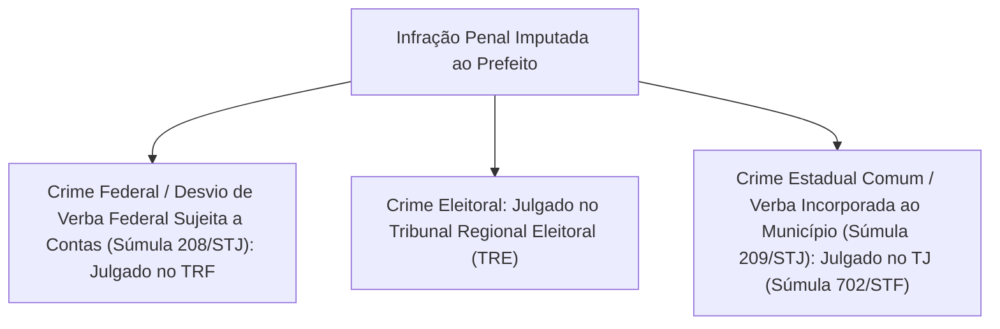

A consagração do Município como ente federativo autônomo é uma das maiores inovações da Constituição da República Federativa do Brasil de 1988. Ao contrário do que ocorre na maioria das federações contemporâneas, nas quais as cidades são meras divisões administrativas dos Estados regionais, o constituinte originário brasileiro alçou as comunas ao status de pessoas políticas dotadas de autonomia constitucional direta. O Título III da Carta Magna destina os arts. 29 a 31 à estruturação orgânica, orçamentária e funcional das cidades.

> [!objetivos]
> - Compreender a autonomia política municipal e a auto-organização por meio da Lei Orgânica.
> - Dominar as regras de eleição de Prefeito, a posse em 1º de janeiro e o critério de segundo turno.
> - Analisar o cálculo de Vereadores, os limites remuneratórios e as balizas da imunidade material.
> - Estudar as competências legislativas e materiais do art. 30 e a jurisprudência das Súmulas Vinculantes.
> - Compreender os limites fiscais do art. 29-A, o controle de contas (art. 31) e o foro do Prefeito.

## A autonomia municipal e a Lei Orgânica

A autonomia municipal apoia-se no conjunto de capacidades políticas outorgadas a todas as entidades federativas da República. O Município goza de auto-organização, autolegislação, autogoverno e autoadministração:

Diferentemente dos Estados, que elaboram Constituições Estaduais, os Municípios exercem a sua auto-organização mediante a aprovação de sua **Lei Orgânica Municipal**. O rito de elaboração e emenda dessa norma fundamental local encontra-se previsto no caput do art. 29:

> [!lei] CF, art. 29, caput
> "Art. 29. O Município reger-se-á por lei orgânica, votada em dois turnos, com o interstício mínimo de dez dias, e aprovada por dois terços dos membros da Câmara Municipal, que a promulgará, atendidos os princípios estabelecidos nesta Constituição, na Constituição do respectivo Estado e os seguintes preceitos:"

O processo legislativo da Lei Orgânica Municipal exige rigor formal:

- **Dois turnos de votação**: a proposta deve ser submetida a duas sessões deliberativas distintas pelo plenário da Câmara Municipal.
- **Interstício temporal**: entre a primeira e a segunda votação, é obrigatório observar um intervalo temporal mínimo de dez dias.
- **Quórum qualificado de dois terços**: a aprovação em ambas as rodadas deliberativas reclama a concordância de dois terços dos vereadores componentes da Casa.
- **Promulgação direta**: a Lei Orgânica é promulgada privativamente pela Mesa Diretora da Câmara Municipal, não se sujeitando a veto ou sanção do Poder Executivo.
- **Dupla subordinação jurídica**: o diploma básico municipal deve manter perfeita harmonia com os preceitos da Constituição Federal e da Constituição do respectivo Estado.

> [!pegadinha]
> **Inexistência de Poder Judiciário no Município:** o Município não possui Poder Judiciário próprio nem Ministério Público local. A função jurisdicional e a fiscalização da ordem jurídica nos limites territoriais do Município são exercidas pela Justiça Estadual e pelo Ministério Público do respectivo Estado. A estrutura orgânica do Município é composta exclusivamente por dois Poderes: o Poder Executivo (exercido pelo Prefeito) e o Poder Legislativo (exercido pela Câmara Municipal).

## Poder Executivo Municipal: eleição e mandato do Prefeito

O Poder Executivo local é chefiado pelo **Prefeito Municipal**, auxiliado pelos Secretários Municipais. O mandato do Prefeito e do Vice-Prefeito tem duração de quatro anos, com possibilidade de uma única reeleição consecutiva (art. 14, § 5º, da CF/88).

### Regras eleitorais e critério para a ocorrência de segundo turno

A eleição para os cargos de Prefeito e Vice-Prefeito realiza-se no primeiro domingo de outubro do ano anterior ao encerramento do mandato vigente. O regramento constitucional diferencia os municípios com base na dimensão de seu eleitorado (art. 29, incisos I e II, da CF/88):

- **Municípios com até 200 mil eleitores**: a eleição rege-se pelo princípio majoritário simples (maioria relativa). Será proclamado eleito o candidato que obtiver o maior número de votos válidos, em um único turno de votação.
- **Municípios com mais de 200 mil eleitores**: a eleição obedece ao princípio majoritário absoluto. Para ser eleito em primeiro turno, o candidato deve obter a maioria absoluta dos votos válidos (metade mais um dos votos, desconsiderados os brancos e nulos). Se nenhum candidato alcançar esse patamar, realiza-se o **segundo turno de votação** no último domingo de outubro entre os dois mais votados.

> [!atencao]
> **Atenção ao termo eleitores:** para a realização de segundo turno, a Constituição Federal exige **mais de 200 mil eleitores**, e não 200 mil habitantes. Diversos municípios contam com população superior a 200 mil habitantes, mas com colégio eleitoral inferior a 200 mil eleitores cadastrados. Nesses municípios, a eleição é resolvida compulsoriamente em turno único.

### Data da posse do Prefeito e do Vice-Prefeito

A posse do Prefeito e do Vice-Prefeito realiza-se solenemente no **dia 1º de janeiro** do ano subsequente ao da eleição (art. 29, inciso III, da CF/88).

É fundamental atentar para as alterações promovidas pela Emenda Constitucional nº 111/2021:
- A posse do Presidente da República foi transferida para o dia 5 de janeiro.
- A posse dos Governadores de Estado e do DF foi transferida para o dia 6 de janeiro.
- **A posse dos Prefeitos Municipais permaneceu inalterada no dia 1º de janeiro.**

### Consultas populares coincidentes com as eleições municipais

A Emenda Constitucional nº 111/2021 acrescentou o § 12 ao art. 14 da Carta Magna, autorizando a realização de consultas populares sobre questões estritamente locais juntamente com as eleições municipais. Essas consultas devem ser aprovadas pelas respectivas Câmaras Municipais e enviadas à Justiça Eleitoral até noventa dias antes da data do pleito. É vedada a veiculação de propaganda gratuita no rádio e na televisão para manifestação sobre as consultas.

## Poder Legislativo Municipal: composição e funcionamento da Câmara

A função legislativa municipal é exercida pela **Câmara Municipal**, composta por **Vereadores** eleitos pelo sistema representativo proporcional para mandatos de quatro anos.

### Número de Vereadores: a escala populacional obrigatória

A Carta de 1988 estabelece limites máximos rigorosos para a composição das Câmaras Municipais, vinculados estritamente à faixa populacional do município (art. 29, inciso IV, da CF/88). A legislação local deve obedecer aos tetos fixados pelo texto constitucional:

| Faixa Populacional do Município | Limite Máximo de Vereadores | Exemplos Práticos de Aplicação |
|---|---|---|
| **Até 15.000 habitantes** | **9 vereadores** | Municípios de pequeno porte (piso constitucional). |
| **Mais de 15.000 até 30.000 habitantes** | **11 vereadores** | Cidades de pequeno porte demográfico. |
| **Mais de 30.000 até 50.000 habitantes** | **13 vereadores** | Cidades em transição de porte. |
| **Mais de 100.000 até 120.000 habitantes** | **19 vereadores** | Cidades médias no interior dos Estados. |
| **Mais de 1.000.000 até 1.300.000 habitantes** | **37 vereadores** | Grandes centros urbanos regionais. |
| **Mais de 1.500.000 até 1.800.000 habitantes** | **39 vereadores** | Município de Recife/PE. |
| **Mais de 8.000.000 de habitantes** | **55 vereadores** | Município de São Paulo/SP (teto máximo nacional). |

### Limites para o subsídio dos Vereadores

O subsídio dos Vereadores é disciplinado pelos incisos V, VI e VII do art. 29 da Constituição da República:

- **Critério de fixação**: o subsídio é fixado pelas respectivas Câmaras Municipais em cada legislatura para ter vigência na subsequente.
- **Percentual máximo em relação aos Deputados Estaduais**: o teto varia de acordo com o número de habitantes da localidade:
  - Municípios de até 10.000 habitantes: subsídio máximo de **20%** do Deputado Estadual.
  - Municípios de 10.001 a 50.000 habitantes: subsídio máximo de **30%** do Deputado Estadual.
  - Municípios de 50.001 a 100.000 habitantes: subsídio máximo de **40%** do Deputado Estadual.
  - Municípios de 100.001 a 300.000 habitantes: subsídio máximo de **50%** do Deputado Estadual.
  - Municípios de 300.001 a 500.000 habitantes: subsídio máximo de **60%** do Deputado Estadual.
  - Municípios de mais de 500.000 habitantes: subsídio máximo de **75%** do Deputado Estadual.
- **Teto da receita municipal**: o montante total da despesa com a remuneração de todos os Vereadores não pode ultrapassar o limite de **5% da receita do Município** (art. 29, inciso VII).

### Prerrogativas e imunidades dos Vereadores

O regime jurídico dos Vereadores é mais restrito do que aquele conferido aos parlamentares federais e estaduais. O art. 29, inciso VIII, delimita a imunidade parlamentar municipal:

> [!lei] CF, art. 29, inciso VIII
> "VIII - inviolabilidade dos Vereadores por suas opiniões, palavras e votos no exercício do mandato e na circunscrição do Município;"

A aplicação desse dispositivo impõe a observância de duas balizas cumulativas:

1. **Nexo funcional**: as manifestações, críticas ou votos devem guardar relação direta com o desempenho das atribuições do mandato legislativo.
2. **Circunscrição territorial**: a proteção da inviolabilidade material (civil e penal) opera-se exclusivamente nos limites territoriais do Município em que o parlamentar atua. Palavras proferidas fora do território do município não são albergadas pela imunidade.

> [!pegadinha]
> **Ausência de Imunidade Processual Formal aos Vereadores:** a Constituição Federal não estendeu aos Vereadores a imunidade formal contra a prisão (art. 53, § 2º) nem a faculdade de sustação do processo penal pela Casa Legislativa (art. 53, § 3º). O vereador pode ser preso em flagrante delito ou por força de mandado de prisão preventiva expedido por juiz competente. Além disso, a Carta da República não prevê foro por prerrogativa de função para os Vereadores.

## Competências constitucionais do Município: o art. 30 da CF/88

O art. 30 da Constituição Federal elenca as competências materiais e legislativas atribuídas aos Municípios. Esse rol consagra a atuação municipal nas matérias que tocam o cotidiano da cidadania local:

### O conceito de interesse local e a jurisprudência sumulada

A competência prevista no art. 30, inciso I, autoriza o Município a legislar sobre assuntos de **interesse local**. O interesse local não significa exclusividade absoluta, mas sim a predominância do interesse municipal em face do regional ou nacional.

Os Tribunais Superiores editaram verbetes vinculantes consolidando o alcance dessa prerrogativa:

> [!lei] STF, Súmula Vinculante 38
> "É competente o Município para fixar o horário de funcionamento de estabelecimento comercial."
> O funcionamento do comércio atinge diretamente o sossego público, o trânsito e a rotina local, cabendo ao Município definir os horários de abertura e fechamento.

> [!lei] STF, Súmula Vinculante 49
> "Ofende o princípio da livre concorrência lei municipal que impede a instalação de estabelecimentos comerciais do mesmo ramo em determinada área."
> A pretexto de ordenar a cidade, o legislador municipal não pode fixar distâncias mínimas obrigatórias entre farmácias, postos de combustíveis ou drogarias, violando a liberdade econômica.

No que tange às agências bancárias, o STF firmou distinção indispensável para concursos:
- Compete privativamente à União legislar sobre o sistema financeiro, moeda e horário de funcionamento dos bancos (art. 22, VI e VII).
- Compete ao Município legislar sobre medidas de segurança, conforto, sanitários e tempo máximo de atendimento em filas nas agências bancárias situadas em seu território, por se tratar de matéria de interesse local do consumidor.

### As Guardas Municipais e o Sistema de Segurança Pública

O art. 144, § 8º, da Carta Magna prevê que os Municípios poderão constituir guardas municipais destinadas à proteção de seus bens, serviços e instalações, conforme dispuser a lei.

No julgamento histórico da **ADPF 995**, o Supremo Tribunal Federal assentou que as Guardas Municipais integram formalmente o Sistema de Segurança Pública brasileiro. Reconheceu-se a legitimidade das guardas municipais para exercer atividades de policiamento comunitário preventivo, efetuar prisões em flagrante e fiscalizar o trânsito, atuando em colaboração harmônica com as Polícias Militares e Civis.

## Limites de gastos do Poder Legislativo Municipal: o art. 29-A da CF/88

O art. 29-A da Constituição Federal estabelece freios fiscais contra a expansão desordenada dos custos do Poder Legislativo municipal. A regra disciplina o repasse de recursos financeiros da Prefeitura para a Câmara de Vereadores (o chamado *duodécimo*).

### Limite percentual da despesa total da Câmara Municipal

Os dispêndios financeiros da Casa Legislativa, compreendendo as verbas de representação dos edis e dispensando as aposentadorias de inativos, ficam subordinados a tetos proporcionais calculados sobre a arrecadação de tributos próprios e repasses constitucionais do exercício antecedente:

| Faixa Populacional do Município | Limite Máximo da Despesa do Legislativo |
|---|---|
| **Até 100.000 habitantes** | **7,0%** da receita base |
| **De 100.001 a 300.000 habitantes** | **6,0%** da receita base |
| **De 300.001 a 500.000 habitantes** | **5,0%** da receita base |
| **De 500.001 a 3.000.000 de habitantes** | **4,5%** da receita base |
| **De 3.000.001 a 8.000.000 de habitantes** | **4,0%** da receita base |
| **Acima de 8.000.000 de habitantes** | **3,5%** da receita base |

### Sublimite com a folha de pagamento da Câmara

A Carta da República restringe severamente as despesas com pessoal do Legislativo. O montante destinado à folha de pagamento da Câmara não pode exceder o patamar de **setenta por cento de sua dotação orçamentária**, englobando os valores pagos a título de subsídio aos seus parlamentares (art. 29-A, § 1º).

O descumprimento desse teto fiscal enseja severa punição: o § 3º do art. 29-A qualifica expressamente o ato como **crime de responsabilidade do Presidente da Câmara Municipal**.

### Repasse do duodécimo pelo Poder Executivo

O Prefeito Municipal tem o dever de transferir os recursos orçamentários devidos à Câmara Municipal até o **dia 20 de cada mês** (art. 29-A, § 2º).

O texto constitucional estabelece que incorre em **crime de responsabilidade do Prefeito Municipal** a prática de qualquer das seguintes infrações:

1. Deixar de enviar o repasse financeiro devido até o dia 20 de cada mês.
2. Efetuar o repasse a menor em relação à dotação orçamentária aprovada.
3. Efetuar o repasse a maior do que os limites percentuais estabelecidos no art. 29-A.

> [!atencao]
> **Repasse a maior também é crime:** preste atenção a esse detalhe em provas. Repassar recursos acima dos limites percentuais permitidos pelo art. 29-A também configura crime de responsabilidade do Prefeito. O chefe do Executivo não pode repassar nem a menos, nem a mais, devendo observar estritamente a dotação legal.

## Fiscalização contábil, financeira e os Tribunais de Contas: art. 31 da CF/88

A fiscalização contábil, financeira, orçamentária, operacional e patrimonial do Município é disciplinada no art. 31 da Carta Magna:

1. **Exercício do controle externo**: o controle externo é exercido pelo Poder Legislativo municipal, com o auxílio técnico indispensável do Tribunal de Contas do respectivo Estado (ou do Município, onde houver).
2. **Eficácia do parecer prévio**: o parecer prévio emitido pelo Tribunal de Contas sobre as contas anuais prestadas pelo Prefeito somente deixará de prevalecer se for rejeitado por voto de **dois terços dos vereadores da Câmara** (art. 31, § 2º).
3. **Julgamento de contas e inelegibilidade (Temas 157 e 835 do STF)**: o Supremo Tribunal Federal firmou tese vinculante assentando que a competência para julgar as contas prestadas pelo Prefeito (sejam as contas anuais de governo, sejam os atos de ordenação de despesas) é **exclusiva da Câmara Municipal**. O parecer técnico do Tribunal de Contas não gera inelegibilidade automática da Lei Complementar nº 64/1990; a desaprovação com efeito eleitoral depende indelevelmente de julgamento político-institucional pela Câmara de Vereadores.
4. **Vedação à criação de novos Tribunais de Contas Municipais**: o art. 31, § 4º, veda terminantemente a instituição de novas cortes municipais de contas. Os únicos Tribunais de Contas de Município existentes no Brasil foram recepcionados porque já haviam sido criados antes de 1988: o TCM de São Paulo e o TCM do Rio de Janeiro. É vedado a qualquer outro município instituir órgão próprio de contas.

> [!bizu]
> **Tribunais de Contas dos Municípios versus do Município:** não confunda esses órgãos:
> - **Tribunais de Contas do Município (TCM-SP e TCM-RJ)**: são órgãos municipais próprios. A CF/88 proibiu a criação de novos (art. 31, § 4º).
> - **Tribunais de Contas dos Municípios (como TCM-BA, TCM-PA e TCM-GO)**: são órgãos pertencentes à estrutura orgânica do **Estado-membro**, encarregados de fiscalizar todos os municípios daquele Estado. A criação de novos TCMs estaduais também foi vedada pelo STF, mas os existentes mantêm regular funcionamento.

## Responsabilidade penal e foro por prerrogativa de função do Prefeito

A responsabilidade do Prefeito desdobra-se nos planos penal comum, político-administrativo e civil sancionatório. O Decreto-Lei nº 201/1967 estabelece a disciplina das infrações penais e político-administrativas dos Chefes do Executivo municipal.

### Jurisprudência vinculante sobre crimes de responsabilidade

O Supremo Tribunal Federal editou a Súmula Vinculante 46, pacificando a competência para legislar sobre a matéria:

> [!lei] STF, Súmula Vinculante 46
> "A definição dos crimes de responsabilidade e o estabelecimento das respectivas normas de processo e julgamento são de competência legislativa privativa da União."

Consequentemente, Constituições Estaduais ou Leis Orgânicas Municipais não podem tipificar novos crimes de responsabilidade nem alterar o rito de julgamento estabelecido pela legislação federal.

### Foro especial por prerrogativa de função do Prefeito

O art. 29, inciso X, da Carta Magna assegura ao Prefeito o julgamento perante o **Tribunal de Justiça**. No entanto, a fixação do foro especial depende da natureza da infração penal e da origem dos bens lesados:

Os Tribunais Superiores consolidaram verbetes sumulares de observância obrigatória:

> [!lei] STF, Súmula 702
> "A competência do Tribunal de Justiça para julgar prefeitos restringe-se aos crimes de competência da justiça comum estadual; nos demais casos, a competência originária caberá ao respectivo tribunal de segundo grau."

> [!lei] STJ, Súmula 208 e Súmula 209
> **STJ, Súmula 208:** "Compete à Justiça Federal processar e julgar prefeito municipal por desvio de verba sujeita a prestação de contas perante órgão federal."
> **STJ, Súmula 209:** "Compete à Justiça Estadual processar e julgar prefeito por desvio de verba transferida e incorporada ao patrimônio municipal."

> [!lei] STF, Súmula 703
> "A extinção do mandato do prefeito não impede a instauração de processo pela prática dos crimes previstos no art. 1º do Decreto-Lei nº 201/1967."

A tabela a seguir sistematiza as regras essenciais relativas ao Poder Executivo e ao Poder Legislativo municipal:

| Instituto Municipal | Regra Constitucional Principal | Fundamento na CF/88 |
|---|---|---|
| **Auto-organização** | Lei Orgânica em dois turnos, dez dias de intervalo e quórum de 2/3. | Art. 29, caput |
| **Eleição do Prefeito** | Turno único (até 200 mil eleitores) ou dois turnos (mais de 200 mil eleitores). | Art. 29, incisos I e II |
| **Data da Posse** | Dia 1º de janeiro do ano subsequente à eleição. | Art. 29, inciso III |
| **Câmara de Vereadores** | Composição escalonada proporcional à população: 9 a 55 parlamentares. | Art. 29, inciso IV |
| **Imunidade Material** | Inviolabilidade por opiniões, palavras e votos na circunscrição do município. | Art. 29, inciso VIII |
| **Interesse Local** | Competência privativa para horários comerciais e serviços locais essenciais. | Art. 30, incisos I e V |
| **Limite de Despesa** | Despesa global da Câmara entre 7% e 3,5% da receita arrecadada. | Art. 29-A, caput |
| **Gasto com Folha** | Limite máximo de 70% da receita da Câmara (crime do Presidente). | Art. 29-A, § 1º e § 3º |
| **Repasse do Duodécimo** | Envio até o dia 20 de cada mês (infração gera crime do Prefeito). | Art. 29-A, § 2º |
| **Controle de Contas** | Julgamento exclusivo pela Câmara; parecer do TC derrubado por 2/3. | Art. 31, §§ 1º e 2º |

## Mapa do capítulo

```mermaid Síntese do Capítulo: Municípios, Organização e Limites Fiscais
flowchart TD
    M1["Organização Municipal"] --> M1A["Lei Orgânica: 2 turnos, 10 dias e 2/3"]
    M1 --> M1B["Sem Poder Judiciário nem Ministério Público local"]

    M2["Poder Executivo"] --> M2A["Prefeito (Mandato de 4 anos; Posse em 1º de janeiro)"]
    M2 --> M2B["2º Turno apenas com mais de 200 mil eleitores"]
    M2 --> M2C["Foro especial: TJ (estadual), TRF (federal) e TRE (eleitoral)"]

    M3["Poder Legislativo"] --> M3A["Vereadores: 9 a 55 conforme população"]
    M3 --> M3B["Inviolabilidade material restrita à circunscrição municipal"]
    M3 --> M3C["Despesa global de 7% a 3,5% e folha limitada a 70%"]

    M4["Competências e Controle"] --> M4A["Interesse local (art. 30, I, SV 38 e 49) e ADPF 995"]
    M4 --> M4B["Controle de contas: Câmara com auxílio do TC (vedados novos TCMs)"]
```

### Para fixar

1. **Auto-organização municipal**: exercida mediante Lei Orgânica, votada em dois turnos com intervalo mínimo de dez dias e quórum de dois terços dos vereadores. É promulgada pela Mesa Diretora e subordina-se à Constituição Federal e à Constituição Estadual.
2. **Eleição do Prefeito**: mandato de quatro anos. Há segundo turno somente em municípios com mais de 200 mil eleitores. A posse realiza-se no dia 1º de janeiro do ano seguinte ao pleito.
3. **Consultas populares municipais**: podem coincidir com as eleições municipais mediante aprovação da Câmara enviada à Justiça Eleitoral até 90 dias antes, vedada a propaganda gratuita no rádio e na televisão (EC 111/2021).
4. **Número de Vereadores**: varia de 9 (municípios de até 15 mil habitantes) a 55 vereadores (municípios com mais de 8 milhões de habitantes). O subsídio situa-se entre 20% e 75% do pago ao Deputado Estadual, não podendo a despesa com remuneração dos parlamentares superar 5% da receita local.
5. **Imunidades parlamentares municipais**: a inviolabilidade por palavras, opiniões e votos depende de nexo funcional e limita-se territorialmente à circunscrição do Município. Os vereadores não possuem imunidade formal contra prisão nem foro privilegiado na CF/88.
6. **Competências municipais (art. 30)**: cabe ao Município legislar sobre interesse local e suplementar normas federais e estaduais. Fixa horário de funcionamento comercial (SV 38), não podendo impor distância mínima entre farmácias (SV 49). As Guardas Municipais integram a segurança pública e exercem policiamento comunitário (ADPF 995).
7. **Limites de gastos da Câmara (art. 29-A)**: o total das despesas varia de 7% (até 100 mil habitantes) a 3,5% (mais de 8 milhões de habitantes) da receita tributária e transferências do ano anterior. A folha de pagamento não pode superar 70% da receita da Casa (crime de responsabilidade do Presidente da Câmara).
8. **Repasse do duodécimo**: o Prefeito deve repassar as verbas até o dia 20 de cada mês. Configura crime de responsabilidade repassar a menor, a maior ou com atraso.
9. **Fiscalização das contas (art. 31)**: o julgamento das contas do Prefeito é privativo da Câmara Municipal (Temas 157 e 835 do STF). O parecer prévio do Tribunal de Contas só cai por decisão de 2/3 dos vereadores. É proibida a criação de novos Tribunais de Contas municipais (art. 31, § 4º).
10. **Competência criminal sobre o Prefeito**: o Tribunal de Justiça julga crimes comuns estaduais (Súmula 702/STF). O TRF julga desvios de verbas sujeitas a contas federais (Súmula 208/STJ). A Justiça Estadual julga verbas já incorporadas ao patrimônio do Município (Súmula 209/STJ). A extinção do mandato não impede a persecução criminal (Súmula 703/STF). Crimes de responsabilidade são matéria de competência privativa da União (Súmula Vinculante 46).
