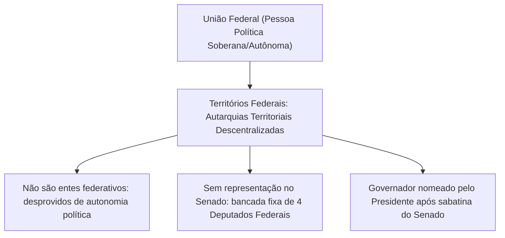
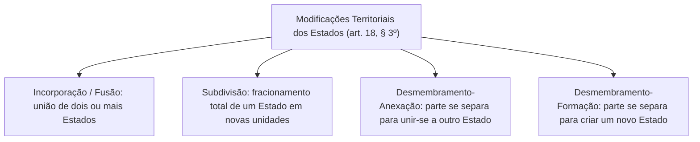
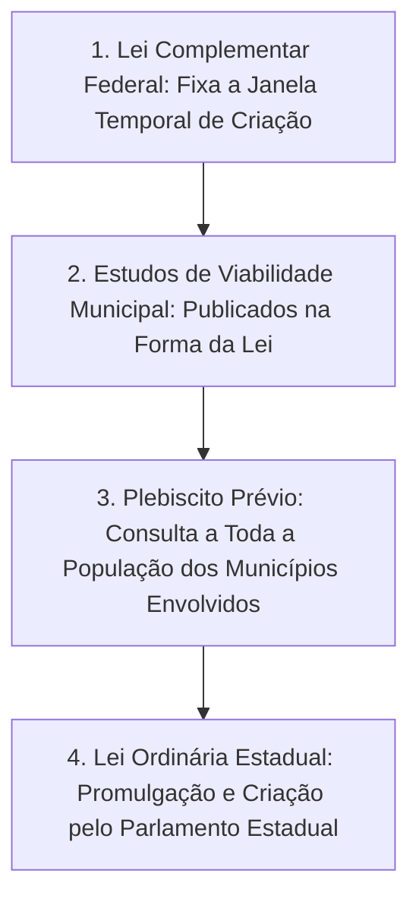
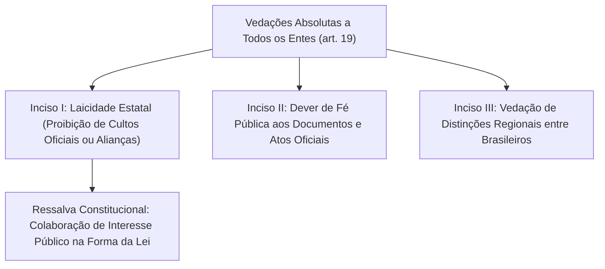
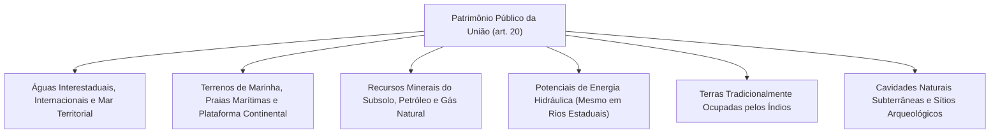
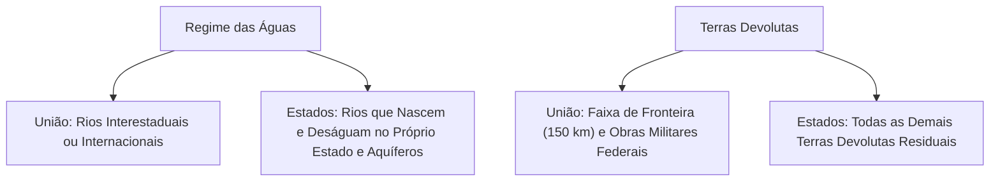

A organização político-administrativa da federação brasileira não é estática. A Constituição Federal estabelece procedimentos formais rígidos para a alteração das fronteiras internas dos Estados e Municípios, resguardando a integridade do pacto federativo. Paralelamente, o texto constitucional disciplina a figura dos Territórios Federais, impõe vedações categóricas a todos os entes políticos e discrimina com precisão o patrimônio público da União e dos Estados-membros.

> [!objetivos]
> - Compreender a natureza jurídica e a estrutura administrativa dos Territórios Federais (art. 33).
> - Dominar os requisitos constitucionais para a fusão, incorporação e desmembramento de Estados (art. 18, § 3º).
> - Analisar o rito de criação, fusão e desmembramento de Municípios segundo o art. 18, § 4º.
> - Estudar as vedações federativas absolutas insculpidas no art. 19 da Constituição da República.
> - Diferenciar a titularidade dos bens públicos da União (art. 20) e dos Estados-membros (art. 26).

## Territórios Federais: natureza e regime jurídico no art. 33 da CF/88

Os Territórios Federais constituem descentralizações administrativas e geográficas pertencentes à União. Conforme preceitua o art. 18, § 2º, da Carta Magna, os Territórios integram a pessoa jurídica da União.



Os traços fundamentais dos Territórios Federais delineiam-se no art. 33 da Carta da República:

- **Natureza de autarquia territorial**: os Territórios não são entes federativos autônomos. Eles não possuem poder constituinte decorrente nem capacidade de auto-organização. São autarquias territoriais descentralizadas subordinadas administrativamente ao Poder Executivo da União.
- **Inexistência atual de territórios**: atualmente não existem territórios federais no Brasil. A Carta de 1988 transformou os antigos territórios de Roraima e Amapá em Estados-membros e reintegrou o arquipélago de Fernando de Noronha ao Estado de Pernambuco. Contudo, novos territórios podem ser criados por lei complementar federal.
- **Chefia do Poder Executivo territorial**: o Poder Executivo territorial é exercido por um **Governador do Território**. O Chefe do Executivo é nomeado pelo Presidente da República, após prévia aprovação de seu nome pelo Senado Federal em escrutínio secreto (art. 84, XIV, c/c art. 52, III, *c*, da CF/88).
- **Controle e prestação de contas**: a prestação anual de contas do Poder Executivo territorial é apreciada pelo Congresso Nacional, após a emissão de parecer prévio pelo Tribunal de Contas da União (art. 33, § 2º).
- **Representação no Congresso Nacional**: cada Território Federal elege exatamente **quatro Deputados Federais** para a Câmara dos Deputados, independentemente do número de habitantes (art. 45, § 2º). Os Territórios **não possuem representação no Senado Federal**, visto que a Câmara Alta representa unicamente os Estados e o Distrito Federal.
- **Divisão administrativa interna**: os Territórios Federais podem ser divididos em Municípios autônomos, aplicando-se a esses municípios territoriais todas as regras constitucionais de organização municipal (art. 33, § 1º).

> [!lei] CF, art. 33, § 3º
> "§ 3º Nos Territórios Federais com mais de cem mil habitantes, além do Governador nomeado na forma desta Constituição, haverá órgãos judiciários de primeira e segunda instâncias, membros do Ministério Público e defensores públicos federais; a lei disporá sobre as eleições para a Câmara Territorial e sua competência deliberativa."

Caso um Território alcance população superior a cem mil habitantes, a Constituição determina a estruturação de Poder Judiciário próprio (com primeiro e segundo graus), Ministério Público e Defensoria Pública mantidos pela União, além de prever a eleição de uma Câmara Territorial deliberativa com poderes legislativos e fiscalizatórios.

## Alterações na estrutura federativa dos Estados: o art. 18, § 3º, da CF/88

A modificação da divisão territorial interna dos Estados-membros exige o cumprimento simultâneo de requisitos constitucionais rigorosos:

> [!lei] CF, art. 18, § 3º
> "§ 3º Os Estados podem incorporar-se entre si, subdividir-se ou desmembrar-se para se anexarem a outros, ou formarem novos Estados ou Territórios Federais, mediante aprovação da população diretamente interessada, através de plebiscito, e do Congresso Nacional, por lei complementar, ouvidas as respectivas Assembléias Legislativas."



### Modalidades de alteração territorial dos Estados

A doutrina constitucionalista identifica quatro modalidades fundamentais de mutação territorial dos Estados federados:

- **Fusão (ou incorporação recíproca)**: dois ou mais Estados-membros preexistentes extinguem-se simultaneamente para dar origem a um novel Estado federado. Exemplo histórico ocorreu na fusão do antigo Estado da Guanabara com o antigo Estado do Rio de Janeiro pela Lei Complementar nº 20/1974.
- **Incorporação (ou anexação integral)**: um Estado-membro perde sua personalidade jurídica originária e é absorvido territorialmente por outro Estado vizinho, que mantém incólume a sua identidade institucional.
- **Subdivisão (ou partilha integral)**: um Estado-membro extingue-se por completo ao ser repartido em duas ou mais novas unidades estatais autônomas.
- **Desmembramento-anexação**: parte de um Estado-membro é desmembrada de seu território originário para ser anexada ao território de outro Estado fronteiriço. O Estado doador perde fração territorial, mas permanece existindo.
- **Desmembramento-formação**: parte de um Estado-membro é desmembrada para formar um novo Estado federativo ou um novo Território Federal. O Estado original sofre redução geográfica, mas continua existindo. Foi o caso do desmembramento do norte de Goiás para criar o Estado do Tocantins (art. 13 do ADCT da CF/88) e do desmembramento do sul de Mato Grosso para criar o Estado de Mato Grosso do Sul (Lei Complementar nº 31/1977).

### Rito constitucional e requisitos cumulativos

Para que qualquer modificação territorial ocorra validamente, a Constituição Federal exige três etapas sequenciais obrigatórias:


A primeira etapa consiste na **aprovação em plebiscito pela população diretamente interessada**. O plebiscito é uma consulta popular prévia à deliberação parlamentar. Se o resultado da consulta for desfavorável (vitória da opção pelo "não"), o processo legislativo é compulsoriamente arquivado, ficando o Congresso Nacional impedido de apreciar o tema.

A segunda etapa é a **audiência prévia das Assembleias Legislativas envolvidas**. As Casas Legislativas dos Estados afetados devem ser formalmente ouvidas antes da votação federal. Todavia, a manifestação dos parlamentares estaduais ostenta natureza **meramente opinativa**. O parecer desfavorável emitido pela Assembleia Legislativa estadual não vincula nem impede a deliberação do Congresso Nacional caso a população tenha aprovado a mudança no plebiscito.

A terceira etapa consubstancia-se na **aprovação pelo Congresso Nacional mediante Lei Complementar Federal**. A criação, anexação ou fusão é concretizada por lei complementar federal aprovada pela maioria absoluta dos membros de cada uma das Casas do Congresso Nacional (Câmara dos Deputados e Senado Federal). O Parlamento exerce juízo político discricionário de conveniência e oportunidade. Mesmo que o resultado do plebiscito tenha sido favorável à emancipação, o Congresso Nacional não está juridicamente obrigado a aprovar o projeto de lei complementar.

> [!jurisprudencia] STF, ADI 2650 (População Diretamente Interessada)
> **STF: alcance da consulta plebiscitária no desmembramento de Estados**
> O Supremo Tribunal Federal fixou a interpretação autêntica da expressão "população diretamente interessada" constante do art. 18, § 3º, da CF/88. Em sintonia com a Lei Federal nº 9.709/1998, a consulta plebiscitária deve abranger **todo o eleitorado do Estado ou Estados afetados**, e não somente a parcela da população que reside na fração territorial que pretende se emancipar.

Essa tese jurisprudencial foi aplicada no histórico plebiscito de 2011 no Estado do Pará. Na ocasião, pretendia-se desmembrar o território paraense para a criação de dois novos Estados (Tapajós e Carajás). Por força do entendimento do STF, todo o eleitorado do Pará votou na consulta popular, resultando na ampla vitória do "não" na capital Belém e nas demais regiões, o que arquivou a proposta.

## Formação, fusão e desmembramento de Municípios: o art. 18, § 4º

A criação e reorganização de municípios passou por profunda alteração com o advento da Emenda Constitucional nº 15/1996, que conferiu nova redação ao § 4º do art. 18:

> [!lei] CF, art. 18, § 4º
> "§ 4º A criação, a incorporação, a fusão e o desmembramento de Municípios, far-se-ão por lei estadual, dentro do período determinado por Lei Complementar Federal, e dependerão de consulta prévia, mediante plebiscito, às populações dos Municípios envolvidos, após divulgação dos Estudos de Viabilidade Municipal, apresentados e publicados na forma da lei."



O procedimento constitucional compõe-se de quatro requisitos cumulativos:

1. **Janela temporal em Lei Complementar Federal**: a criação municipal só pode ocorrer dentro do período determinado por lei complementar de competência do Congresso Nacional. Até o momento, o Congresso Nacional não editou essa lei complementar geral para criação de novos municípios. Em razão dessa omissão legislativa federal, a jurisprudência do STF consolidou a proibição de edição de novas leis estaduais emancipatórias (ADI 2240 e ADI 3682).
2. **Estudos de Viabilidade Municipal (EVM)**: exige-se a elaboração, apresentação e divulgação pública de estudos técnicos rigorosos que comprovem a sustentabilidade econômica, financeira, ambiental e político-administrativa da localidade a ser emancipada e do município remanescente.
3. **Plebiscito prévio com as populações envolvidas**: a consulta popular abrange o eleitorado tanto da área territorial que pretende se emancipar quanto do município-mãe de origem que sofrerá a perda de área e de receitas.
4. **Lei Ordinária Estadual**: aprovada a criação no plebiscito e atendidos os estudos prévios na janela federal, a criação materializa-se por meio de lei ordinária aprovada pela Assembleia Legislativa do respectivo Estado.

> [!pegadinha]
> **A Convalidação da EC nº 57/2008 (art. 96 do ADCT):** diante da mora legislativa do Congresso Nacional em aprovar a lei complementar federal, vários Estados continuaram criando municípios por meio de leis estaduais isoladas. Para evitar a anulação dessas cidades em funcionamento regular, a Emenda Constitucional nº 57/2008 introduziu o art. 96 no ADCT. Esse dispositivo convalidou os municípios cuja lei estadual tenha sido publicada até 31 de dezembro de 2006, desde que preenchidos os requisitos da legislação estadual da época, mantendo a nulidade daqueles criados sem plebiscito.

## As vedações federativas absolutas: o art. 19 da Constituição Federal

Para resguardar o equilíbrio republicano, a laicidade do Estado e a igualdade civil em todo o território nacional, o art. 19 da Carta da República impõe proibições expressas a todas as entidades políticas:

> [!lei] CF, art. 19
> "Art. 19. É vedado à União, aos Estados, ao Distrito Federal e aos Municípios:
> I - estabelecer cultos religiosos ou igrejas, subvencioná-los, embaraçar-lhes o funcionamento ou manter com eles ou seus representantes relações de dependência ou aliança, ressalvada, na forma da lei, a colaboração de interesse público;
> II - recusar fé aos documentos públicos;
> III - criar distinções entre brasileiros ou preferências entre si."



### Laicidade estatal e liberdade religiosa

O Brasil é um Estado Laico (não confessional). A ordem constitucional proíbe a instituição de religião oficial e o custeio financeiro governamental de cultos ou templos. É defeso embaraçar o exercício de liturgias religiosas ou estabelecer vínculos de dependência com confissões ou lideranças eclesiásticas.

A própria Constituição estabelece uma ressalva expressa: admite-se, na forma da lei, a **colaboração de interesse público** entre o Poder Público e as instituições religiosas. Essa cooperação concentra-se em atividades de amparo a populações vulneráveis, serviços hospitalares, recuperação de dependentes químicos, assistência educacional e salvaguarda do patrimônio artístico e histórico nacional.

### Fé pública dos documentos oficiais

Os documentos emitidos por qualquer órgão estatal no território nacional presumem-se autênticos e legítimos. É vedado a qualquer ente federativo (como um Município ou Estado) recusar validade a certidões de nascimento, carteiras de identidade, diplomas universitários ou certidões de regularidade expedidas por autoridades públicas de outro Estado da Federação. Essa regra assegura a segurança jurídica e a livre circulação documental no país.

### Vedação de discriminações federativas e interpessoais

O pacto federativo baseia-se na igualdade civil e política de todos os cidadãos do país. É nula de pleno direito qualquer lei estadual ou municipal que pretenda estabelecer vantagens, isenções, prioridades de atendimento ou reserva de vagas em concursos públicos com base na naturalidade, domicílio de origem ou tempo de residência no território do ente federado.

> [!jurisprudencia] STF, ADI 3069 (Vedação de Discriminação Federativa)
> **STF: inconstitucionalidade de privilégios com base em residência local**
> O Supremo Tribunal Federal pacificou que a fixação de critérios de desempate em concursos públicos ou de concessão de incentivos fiscais vinculados ao fato de o cidadão ter nascido ou residir no próprio Estado viola frontalmente o art. 19, III, da CF/88.

## Bens da União: a discriminação do art. 20 da CF/88

O art. 20 da Constituição da República detalha o acervo patrimonial originário de domínio privativo da União:



### Análise minuciosa dos bens federais

1. **Águas e rios federais**: integram o patrimônio federal os rios interestaduais (que atravessam dois ou mais Estados-membros, como o São Francisco e o Paraná), os mananciais fronteiriços ou internacionais, as bacias hídricas situadas em terras federais, bem como as respectivas praias fluviais e faixas marginais de servidão pública.
2. **Mar territorial e recursos marítimos**: são bens federais o mar territorial brasileiro (doze milhas marítimas de largura), o leito marinho correspondente à plataforma continental, a zona econômica exclusiva de duzentas milhas e as praias oceânicas marítimas.
3. **Terrenos de marinha e seus acrescidos**: faixas costeiras continentais ou insulares medidas a partir da linha de preamar média de 1831 (faixa com cerca de trinta e três metros de largura ao longo do litoral). Permanecem sob domínio da União mesmo quando situados em ilhas que abriguem sede de Município (conforme decidido pelo STF na interpretação da EC nº 46/2005).
4. **Potenciais de energia hidráulica**: pertencem privativamente à União os potenciais energéticos decorrentes dos cursos de água, **mesmo quando situados em rios de domínio puramente estadual**. A exploração energética é matéria de soberania e segurança nacional.
5. **Recursos minerais e jazidas do subsolo**: os recursos minerais, compreendidos os hidrocarbonetos líquidos, gás natural e minérios do subsolo, pertencem à União. A propriedade do solo não abrange a do subsolo no que concerne às riquezas minerais. Aos Estados, Distrito Federal e Municípios é assegurada compensação financeira ou participação no resultado da exploração (os chamados *royalties*, art. 20, § 1º).
6. **Terras tradicionalmente ocupadas pelos povos indígenas**: as terras delimitadas para ocupação tradicional dos povos originários pertencem à União (art. 20, XI). A posse permanente e o usufruto exclusivo das riquezas do solo e dos rios cabem aos próprios indígenas (art. 231, § 2º).
7. **Cavidades naturais e sítios históricos**: as cavernas, grutas subterrâneas e sítios arqueológicos e pré-históricos são de propriedade da União, voltados à proteção do patrimônio cultural e científico da humanidade.
8. **Faixa de fronteira e terras devolutas estratégicas**: a faixa de até cento e cinquenta quilômetros de largura ao longo das fronteiras terrestres internacionais é considerada fundamental para a segurança nacional (art. 20, § 2º). As terras devolutas situadas nessa faixa e as necessárias a fortificações militares e rodovias federais pertencem à União.

> [!lei] STF, Súmula 650
> "Os incisos I e XI do art. 20 da Constituição não alcançam terras de aldeamentos extintos, ainda que ocupadas por indígenas em passado remoto."

O enunciado sumular consolidou que a tutela constitucional sobre terras tradicionalmente ocupadas exige a presença contemporânea e a posse efetiva da comunidade indígena. Áreas que abrigaram antigos aldeamentos coloniais desativados há séculos não constituem bens da União com fulcro no art. 20, XI.

## Bens dos Estados-membros: a discriminação do art. 26 da CF/88

O patrimônio imobiliário e hidrográfico atribuído aos Estados-membros apoia-se em critério predominantemente residual:

> [!lei] CF, art. 26
> "Art. 26. Incluem-se entre os bens dos Estados:
> I - as águas superficiais ou subterrâneas, fluentes, emergentes e em depósito, ressalvadas, neste caso, na forma da lei, as decorrentes de obras da União;
> II - as áreas, nas ilhas oceânicas e costeiras, que estiverem no seu domínio, excluídas aquelas sob domínio da União, Municípios ou terceiros;
> III - as ilhas fluviais e lacustres não pertencentes à União;
> IV - as terras devolutas não compreendidas entre as da União."

### Comparativo prático: águas e terras devolutas

O confronto entre os bens da União e dos Estados é matéria recorrente em certames públicos:



O **regime das águas doces** depende do trajeto geográfico da bacia hidrográfica:
- Se um rio nasce, percorre todo o seu trajeto e deságua dentro dos limites geográficos de um único Estado-membro (rio intraestadual), ele pertence ao respectivo Estado.
- As águas subterrâneas (lençóis freáticos e aquíferos) integram o patrimônio dos Estados-membros (art. 26, I).
- Se o rio banhar mais de um Estado ou servir de divisa estadual ou internacional, é bem da União (art. 20, III).

O **regime das terras devolutas** apoia-se em discriminação funcional:
- Terras devolutas são áreas públicas que nunca foram incorporadas validamente ao patrimônio privado de particulares e não receberam destinação pública específica.
- Pertencem à União as terras devolutas situadas na faixa de fronteira (150 km ao longo da divisa internacional) e as indispensáveis à defesa territorial, construção de vias de comunicação federais e obras militares (art. 20, II).
- Todas as demais terras devolutas situadas no território nacional pertencem residualmente aos **Estados-membros** (art. 26, IV).

No que concerne às **ilhas fluviais e lacustres**, as ilhas situadas em lagos ou rios de domínio estadual pertencem aos Estados. Pertencem à União apenas as ilhas fluviais localizadas em rios internacionais, interestaduais ou fronteiriços.

A tabela a seguir consolida as principais distinções patrimoniais entre a União e os Estados:

| Categoria de Bem Público | Bens de Domínio da União (art. 20) | Bens de Domínio dos Estados (art. 26) |
|---|---|---|
| **Rios e Cursos de Água** | Interestaduais, fronteiriços ou internacionais. | Intraestaduais (nascem e deságuam no próprio Estado). |
| **Águas Subterrâneas** | Não constam no art. 20 (ressalvadas obras federais). | Pertencem aos Estados (art. 26, inciso I). |
| **Terras Devolutas** | Faixa de fronteira (150 km), defesa e vias federais. | Regra geral residual: todas as demais terras devolutas. |
| **Recursos Minerais** | Pertencem todos à União (solo difere do subsolo). | Não pertencem aos Estados (têm direito a royalties). |
| **Energia Hidráulica** | Pertence à União mesmo em cursos d'água estaduais. | Não detêm titularidade sobre os potenciais hidrelétricos. |
| **Terras Indígenas** | Pertencem originariamente à União (art. 20, XI). | Não possuem titularidade sobre áreas tradicionalmente ocupadas. |
| **Cavernas e Fósseis** | Cavidades subterrâneas e sítios pré-históricos. | Não contemplados no rol patrimonial estadual. |

## Mapa do capítulo

```mermaid Síntese do Capítulo: Territórios, Modificações, Vedações e Bens Públicos
flowchart TD
    T1["Territórios Federais (art. 33)"] --> T1A["Autarquias da União sem autonomia política"]
    T1 --> T1B["Governador aprovado pelo Senado e bancada fixa de 4 Deputados"]

    M1["Modificações Territoriais"] --> M1A["Estados (art. 18, § 3º): Plebiscito de toda a população e Lei Complementar Federal"]
    M1 --> M1B["Municípios (art. 18, § 4º): Janela em Lei Complementar Federal, EVM, Plebiscito e Lei Estadual"]

    V1["Vedações Absolutas (art. 19)"] --> V1A["Laicidade estatal (salvo cooperação de interesse público)"]
    V1 --> V1B["Recusa de fé pública e distinção entre brasileiros"]

    B1["Bens Públicos"] --> B1A["União (art. 20): águas interestaduais, minérios, marinha e terras indígenas"]
    B1 --> B1B["Estados (art. 26): rios intraestaduais, águas subterrâneas e terras devolutas residuais"]
```

### Para fixar

1. **Territórios Federais**: são autarquias territoriais pertencentes à União, sem autonomia política (art. 33). O Governador é nomeado pelo Presidente após sabatina do Senado. Possuem 4 Deputados Federais e nenhum Senador. Com mais de 100 mil habitantes, contam com Justiça, MP, Defensoria e Câmara Territorial.
2. **Modificação territorial dos Estados (art. 18, § 3º)**: abrange fusão, incorporação e desmembramento. Requer plebiscito de toda a população do Estado ou Estados envolvidos (ADI 2650), parecer opinativo das Assembleias Legislativas e aprovação final discricionária por Lei Complementar Federal.
3. **Criação de Municípios (art. 18, § 4º)**: exige janela temporal fixada por Lei Complementar Federal, Estudos de Viabilidade Municipal publicados, plebiscito com os munícipes envolvidos e Lei Ordinária Estadual (EC 15/1996). A EC 57/2008 convalidou criações até 31/12/2006.
4. **Vedações federativas (art. 19)**: proíbe a todos os entes subvencionar ou criar cultos (laicidade), ressalvada a cooperação de interesse público; veda recusar fé aos documentos públicos; e proíbe criar distinções entre brasileiros ou preferências regionais.
5. **Bens da União (art. 20)**: compreendem rios interestaduais e internacionais, mar territorial, terrenos de marinha, potenciais de energia hidráulica (mesmo em rios estaduais), riquezas minerais do subsolo, cavernas e terras tradicionalmente ocupadas pelos índios (Súmula 650/STF).
6. **Bens dos Estados (art. 26)**: abrangem rios intraestaduais (que nascem e deságuam no próprio território), águas subterrâneas (aquíferos), ilhas fluviais e lacustres não federais e as terras devolutas residuais não afetadas à União.
