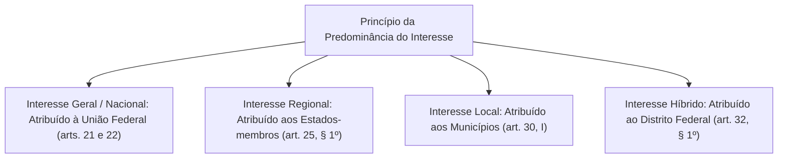
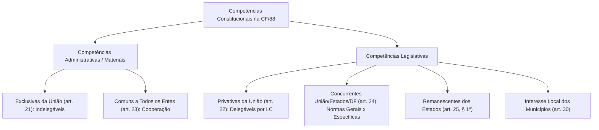
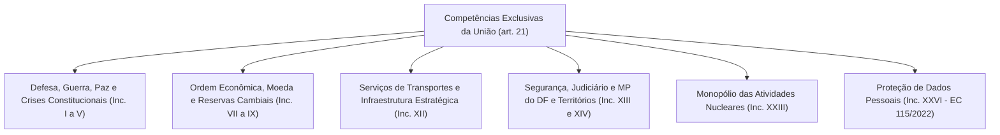
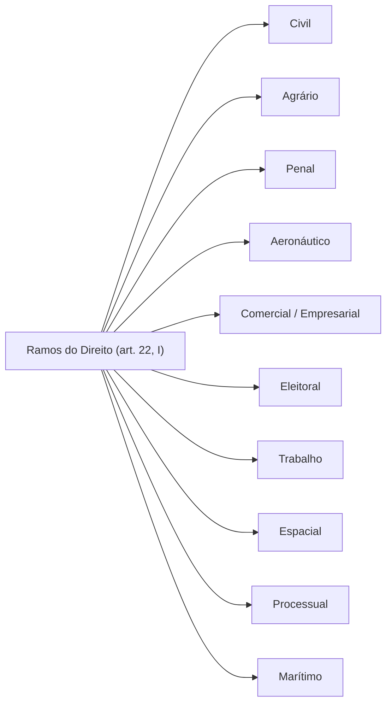

O princípio federativo requer uma divisão técnica e precisa de atribuições entre o governo central e as esferas locais. Sem uma partilha explícita de poderes fixada na Constituição, o pacto federativo dissolver-se-ia em conflitos de autoridade ou na centralização autoritária. O Título III da Constituição da República Federativa do Brasil de 1988 adota um modelo estruturado de repartição de competências, reservando os arts. 21 e 22 para delimitar o núcleo do poder federal.

> [!objetivos]
> - Compreender os critérios reitores da repartição constitucional de competências: predominância do interesse e cooperação.
> - Diferenciar competência administrativa exclusiva (art. 21) de competência legislativa privativa (art. 22).
> - Analisar as atribuições materiais estratégicas da União no art. 21, inclusive os reflexos da EC nº 115/2022.
> - Dominar o rol de matérias de competência legislativa privativa federal e o mnemônico dos ramos jurídicos.
> - Identificar as exigências constitucionais cumulativas para a delegação legislativa por lei complementar aos Estados.

## Fundamentos da repartição de competências na Federação

A distribuição de competências no Estado Federal brasileiro orienta-se pelo **princípio da predominância do interesse**:



- **Interesse nacional ou geral**: matérias que afetam a soberania, a defesa externa, as relações exteriores e a estabilidade monetária. São conferidas expressamente à União.
- **Interesse regional**: matérias que demandam coordenação intermediária no território estadual. Cabem aos Estados-membros, segundo a técnica residual ou remanescente (art. 25, § 1º).
- **Interesse local**: matérias que tocam a rotina direta da vida urbana municipal. Pertencem aos Municípios (art. 30, inciso I).
- **Interesse híbrido**: matérias regionais e locais atribuídas de forma cumulativa ao Distrito Federal (art. 32, § 1º).

### Técnicas de repartição: modelos horizontal e vertical

O constitucionalismo comparado conhece duas formas de distribuição de competências:

No **modelo horizontal**, a Constituição delimita blocos estanques de atribuições exclusivas para cada ente federativo, sem pontos de contato ou sobreposição material. É o padrão do federalismo dual.

No **modelo vertical**, a Constituição estipula matérias compartilhadas, cabendo à União editar diretrizes ou normas gerais, enquanto os Estados, DF e Municípios editam normas complementares e suplementares. É a marca do federalismo cooperativo.

A Constituição brasileira de 1988 combina harmonicamente ambos os métodos:
- Adota a técnica horizontal nas competências materiais exclusivas da União (art. 21) e nas competências privativas legislativas (art. 22).
- Adota a técnica vertical nas competências materiais comuns de todos os entes (art. 23) e nas competências legislativas concorrentes entre União, Estados e DF (art. 24).



## Competências materiais exclusivas da União: o art. 21 da CF/88

O art. 21 da Carta Magna enumera as competências de natureza administrativa ou material da União. Trata-se de encargos e tarefas de gestão pública.

> [!lei] CF, art. 21, caput
> "Art. 21. Compete à União:
> I - manter relações com Estados estrangeiros e participar de organizações internacionais;
> II - declarar a guerra e celebrar a paz;
> III - assegurar a defesa nacional;
> IV - permitir, nos casos previstos em lei complementar, que forças estrangeiras transitem pelo território nacional ou nele permaneçam temporariamente;
> V - decretar o estado de sítio, o estado de defesa e a intervenção federal;..."

A característica estrutural primordial do art. 21 é a sua **indelegabilidade**. A União não pode transferir a gestão de suas competências exclusivas a nenhum outro ente federativo.

### Núcleos temáticos essenciais do art. 21

As competências do art. 21 agrupam-se em blocos funcionais estratégicos:



### Relações internacionais, defesa e crises institucionais
A condução das relações diplomáticas com países estrangeiros, a defesa da soberania territorial, a declaração de guerra e a celebração da paz pertencem privativamente à União. Cabe também ao Presidente da República, como Chefe de Estado da União, decretar as medidas extraordinárias de contenção de crises constitucionais: estado de defesa, estado de sítio e intervenção federal.

### Serviços postais e telecomunicações
Compete à União manter o serviço postal e o correio aéreo nacional (art. 21, X). O STF assentou que a atividade de entrega de cartas e correspondências fechadas constitui serviço postal privativo da União em regime de monopólio constitucional (ADPF 46). Compete-lhe igualmente explorar os serviços de telecomunicações e de radiodifusão sonora e de sons e imagens (art. 21, XI e XII, *a*).

### Transportes e infraestruturas estratégicas
A exploração direta ou mediante concessão ou permissão abrange:
- Serviços de instalações de energia elétrica e aproveitamento energético de cursos hídricos (art. 21, XII, *b*).
- Navegação aérea, aeroespacial e infraestrutura portuária e aeroportuária (art. 21, XII, *c* e *f*).
- Transporte ferroviário e aquaviário interestadual e internacional (art. 21, XII, *d*).
- Transporte rodoviário interestadual e internacional de passageiros (art. 21, XII, *e*).

> [!pegadinha]
> **Transporte Intermunicipal versus Interestadual:** preste muita atenção aos limites de transporte:
> - Transporte **interestadual ou internacional**: competência material exclusiva da União (art. 21, XII, *e*).
> - Transporte **intermunicipal** (entre cidades do mesmo Estado): competência do respectivo Estado-membro.
> - Transporte **intramunicipal ou local**: competência do respectivo Município (art. 30, V).

### Regime das atividades nucleares
O art. 21, inciso XXIII, consagra o regime jurídico estrito da energia nuclear no Brasil:
- Toda atividade nuclear em território nacional somente é admitida para **fins pacíficos** e mediante prévia aprovação do Congresso Nacional.
- A responsabilidade civil por danos decorrentes de acidentes nucleares independe da existência de culpa (responsabilidade objetiva sob a teoria do risco integral).
- Emenda Constitucional flexibilizou o monopólio federal para autorizar a produção, comercialização e utilização de radioisótopos para pesquisa e uso médico por entidades privadas.

### Proteção de dados pessoais e inovação da EC nº 115/2022
A Emenda Constitucional nº 115/2022 introduziu o inciso XXVI no art. 21, atribuindo à União o encargo indelegável de estruturar a regulação e auditar o fluxo e a salvaguarda de dados dos cidadãos em território nacional, consolidando o papel regulador da Autoridade Nacional de Proteção de Dados (ANPD).

## Competências legislativas privativas da União: o art. 22 da CF/88

Enquanto o art. 21 disciplina tarefas administrativas, o art. 22 estabelece o rol de matérias que somente a União pode legislar.

> [!lei] CF, art. 22, caput
> "Art. 22. Compete privativamente à União legislar sobre:
> I - direito civil, comercial, penal, processual, eleitoral, agrário, marítimo, aeronáutico, espacial e do trabalho;..."



> [!bizu]
> **Mnemônico: CAPACETE de PIMENTA (Ramos do Direito do art. 22, I)**
> Lembre-se da palavra **CAPACETE PM**:
> - **C**ivil
> - **A**grário
> - **P**enal
> - **A**eronáutico
> - **C**omercial
> - **E**leitoral
> - **T**rabalho
> - **E**spacial
> - **P**rocessual
> - **M**arítimo
> Estados e Municípios não podem editar leis tratando sobre nenhum desses dez ramos essenciais do direito.

### Outras matérias de forte cobrança no art. 22

- **Desapropriação** (art. 22, II): normas gerais sobre o rito desapropriatório são privativas da União.
- **Trânsito e transporte** (art. 22, XI): o Código de Trânsito Brasileiro é federal. Leis estaduais ou municipais que imponham regras de circulação ou equipamentos obrigatórios são inconstitucionais.
- **Material bélico e armamento** (art. 22, XXI): o porte, registro, comércio e posse de armas de fogo submetem-se à legislação federal. O STF declara sistematicamente inconstitucionais leis estaduais que concedem porte de arma a categorias funcionais locais.
- **Diretrizes e bases da educação nacional** (art. 22, XXIV): o currículo e as bases da educação básica e superior são federais (LDB).
- **Normas gerais de licitação e contratação** (art. 22, XXVII): normas gerais de compras e contratos públicos (como a Lei nº 14.133/2021) vinculam todos os poderes de todas as esferas federativas.
- **Normas gerais de organização e mobilização militar** (art. 22, XXI): a União estabelece normas gerais para as Polícias Militares e Corpos de Bombeiros Militares dos Estados.
- **Proteção e tratamento de dados pessoais** (art. 22, XXX, acrescentado pela EC nº 115/2022).

> [!lei] STF, Súmula Vinculante 2
> "É inconstitucional a lei ou ato normativo estadual ou distrital que disponha sobre sistemas de consórcios e sorteios, inclusive bingos e loterias."
> A matéria vincula-se ao direito penal e comercial privativo da União (art. 22, I e XX).

### Jurisprudência relevante do STF sobre a usurpação de competências federais

O Supremo Tribunal Federal atua de forma rigorosa para anular diplomas estaduais ou municipais que transgridem a esfera privativa federal (art. 22):

- **Bloqueadores de sinal de celular em presídios (ADI 3835)**: o STF julgou inconstitucionais sucessivas leis estaduais que impunham às empresas concessionárias de telefonia móvel a obrigação de instalar aparelhos bloqueadores de radiocomunicação em penitenciárias. A Corte Suprema fixou que a obrigação interfere diretamente no contrato de concessão de telecomunicações, cuja disciplina pertence privativamente à União (art. 22, IV).
- **Porte de armas de fogo a categorias funcionais (ADI 3112)**: o Estatuto do Desarmamento (Lei nº 10.826/2003) é diploma federal de aplicação cogente em todo o território nacional. São manifestamente inconstitucionais leis estaduais que pretendem outorgar porte funcional de armas a procuradores autárquicos, defensores públicos, agentes socioeducativos ou auditores estaduais, dado que material bélico é matéria privativa da União (art. 22, XXI).
- **Proibição de interrupção de serviços de energia elétrica**: o STF tem invalidado leis estaduais que interferem no contrato de fornecimento de energia elétrica, como a do Tocantins que proibia o corte por inadimplência em véspera de feriado e no fim de semana (ADI 5798), porque energia é matéria de competência privativa da União (art. 22, IV). A jurisprudência não é uniforme: na ADI 5961, o STF manteve lei do Paraná que vedava o corte de água e luz em certos dias da semana. Na prova, a regra cobrada é a competência privativa da União.
- **Tempo de espera em filas bancárias (Tema 272 do STF, RE 610.221)**: por outro lado, leis municipais que estabelecem tempo máximo de atendimento em caixas bancárias, instalação de sanitários e assentos para clientes são plenamente constitucionais. O Município exerce competência legislativa sobre interesse local e proteção ao consumidor (art. 30, I), não se imiscuindo na regulação monetária da União.

## A regra de ouro da delegação legislativa: art. 22, parágrafo único

Ao contrário das competências materiais do art. 21, as competências legislativas privativas do art. 22 admitem **delegação aos Estados e ao Distrito Federal**. 

> [!lei] CF, art. 22, parágrafo único
> "Parágrafo único. Lei complementar poderá autorizar os Estados a legislar sobre questões específicas das matérias relacionadas neste artigo."

```mermaid Requisitos Cumulativos da Delegação Legislativa (art. 22, parágrafo único)
flowchart TD
    DEL["Delegação Legislativa da União para os Estados"] --> V1["1. Veículo Normativo: Exclusivamente por LEI COMPLEMENTAR Federal"]
    DEL --> V2["2. Objeto Material: Apenas QUESTÕES ESPECÍFICAS (Não ramos inteiros)"]
    DEL --> V3["3. Destinatários: Todos os ESTADOS e DF de Forma Isonômica (Sem privilégios)"]
    DEL --> V4["4. Exclusão: Não pode delegar aos MUNICÍPIOS"]
```

A validade da delegação condiciona-se à observância de quatro requisitos cumulativos:

1. **Instrumento formal indispensável**: a autorização deve ser conferida exclusivamente por meio de **Lei Complementar Federal**. Lei ordinária ou medida provisória não possuem aptidão para delegar.
2. **Objeto específico**: a delegação pode alcançar tão somente **questões pontuais e específicas** das matérias do rol do art. 22. A União não pode transferir a disciplina de um ramo do direito por inteiro (como todo o direito penal ou civil). Exemplo concreto é a Lei Complementar Federal nº 103/2000, que autorizou os Estados a instituírem piso salarial regional para empregados que não possuam piso definido em lei federal ou convenção coletiva.
3. **Generalidade e isonomia federativa**: a lei complementar autorizadora deve abranger **todos os Estados-membros e o Distrito Federal**. É inconstitucional delegar competência legislativa com privilégios seletivos a favor de apenas um Estado específico.
4. **Impossibilidade de delegação aos Municípios**: a norma do parágrafo único contempla expressamente apenas os Estados e o DF. Os Municípios estão excluídos do mecanismo de delegação de matérias privativas da União.

| Critério de Comparação | Competência Exclusiva da União (art. 21) | Competência Privativa da União (art. 22) |
|---|---|---|
| **Natureza Jurídica** | Administrativa ou material (atos de gestão). | Legislativa (edição de leis). |
| **Possibilidade de Delegação** | **Indelegável**. A União deve exercer privativamente. | **Delegável** aos Estados e DF nos termos do parágrafo único. |
| **Instrumento de Delegação** | Inexiste mecanismo de transferência. | Exige **Lei Complementar Federal**. |
| **Alcance da Delegação** | Não admitida. | Restrita a **questões específicas** das matérias do rol. |
| **Destinatários da Delegação** | Não admitida. | Todos os Estados e o Distrito Federal (não aos Municípios). |

## Mapa do capítulo

```mermaid Síntese do Capítulo: Competências Exclusivas e Privativas da União
flowchart TD
    R1["Princípio Reitor"] --> R1A["Predominância do Interesse: Nacional, Regional e Local"]
    R1 --> R1B["Federalismo de Cooperação: Técnicas Horizontal e Vertical"]

    A1["Art. 21: Competência Administrativa"] --> A1A["Exclusiva e indelegável"]
    A1 --> A1B["Defesa, relações exteriores, energia, portos e segurança do DF"]
    A1 --> A1C["Monopólio nuclear para fins pacíficos e dados pessoais (EC 115)"]

    L1["Art. 22: Competência Legislativa"] --> L1A["Privativa: CAPACETE PM (10 ramos do direito)"]
    L1 --> L1B["Trânsito, material bélico e normas gerais de licitação"]
    L1 --> L1C["Delegação por Lei Complementar sobre questões específicas"]
```

### Para fixar

1. **Predominância do interesse**: orienta a repartição na CF/88. Matérias nacionais vão para a União; regionais cabem aos Estados; e locais pertencem aos Municípios. O Distrito Federal acumula competências estaduais e municipais.
2. **Competências do art. 21**: são administrativas materiais, exclusivas e indelegáveis. Abrangem defesa externa, declaração de guerra, decretação de sítio e intervenção, serviço postal, transportes interestaduais e segurança pública do DF.
3. **Regime nuclear e dados pessoais**: atividades nucleares têm monopólio federal e exigem fins pacíficos, com responsabilidade civil objetiva por risco integral (art. 21, XXIII). A EC 115/2022 incluiu a proteção e fiscalização de dados pessoais nos arts. 21 e 22.
4. **Ramos do direito no art. 22, I**: competência legislativa privativa da União sintetizada no mnemônico **CAPACETE PM**: Civil, Agrário, Penal, Aeronáutico, Comercial, Eleitoral, Trabalho, Espacial, Processual e Marítimo.
5. **Matérias federais de alta incidência**: trânsito e transporte (CTB), armas e material bélico (Estatuto do Desarmamento), diretrizes da educação (LDB), loterias e consórcios (Súmula Vinculante 2) e normas gerais de licitação e contratação (Lei 14.133/2021).
6. **Invasão de competências privativas**: são inconstitucionais leis estaduais que impõem bloqueadores de celular em presídios (telecomunicações) ou ampliam porte de arma funcional (material bélico). Leis municipais sobre tempo de espera em filas bancárias são constitucionais (interesse local).
7. **Delegação legislativa aos Estados (art. 22, parágrafo único)**: requer Lei Complementar Federal, restringe-se a questões específicas e deve alcançar todos os Estados e o DF com base na isonomia, sendo vedada a extensão aos Municípios.
