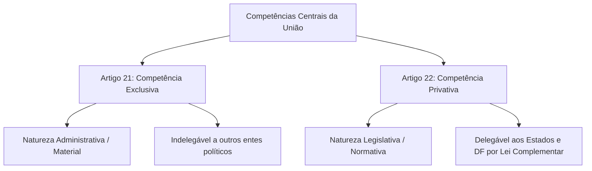
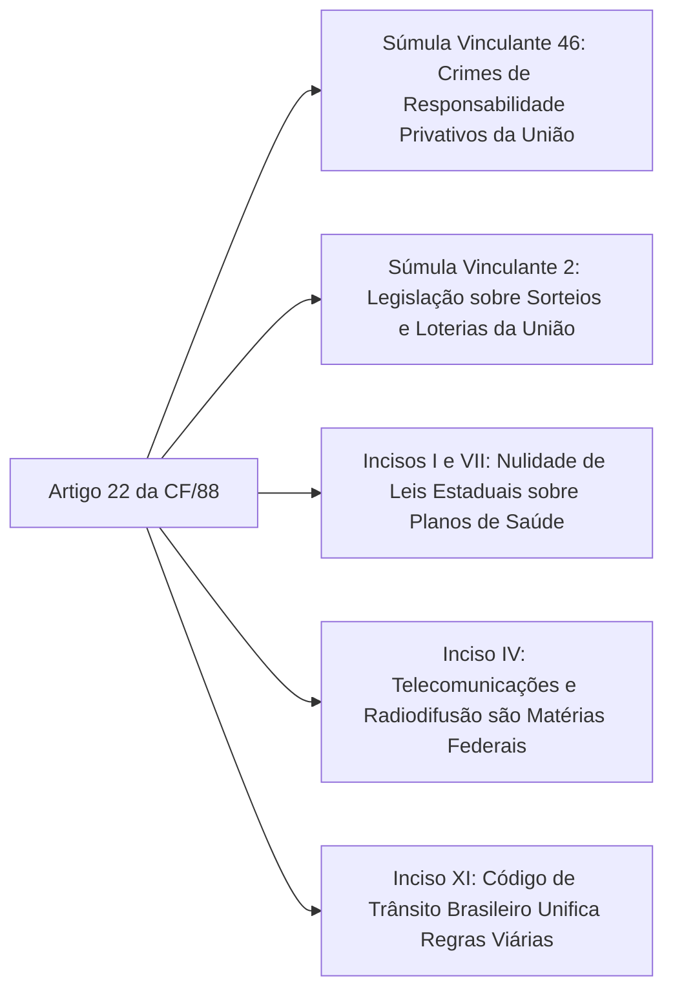

A repartição constitucional de competências constitui o alicerce estrutural de qualquer Estado federal. No modelo federativo brasileiro inaugurado pela Constituição de 1988, a distribuição do poder normativo busca equilibrar a necessária uniformidade nacional com a autonomia política dos entes subnacionais. O art. 22 da Carta Magna desempenha papel de protagonista nesse arranjo institucional ao elencar as matérias cuja prerrogativa de editar leis recai originariamente sobre a União. O domínio desse regramento é vital para identificar a higidez de leis estaduais de segurança pública e de organização funcional.

> [!objetivos]
> - Compreender a natureza jurídica da competência privativa legislativa da União e sua distinção em relação à competência exclusiva (art. 21).
> - Analisar os requisitos constitucionais da delegação legislativa aos Estados e ao Distrito Federal mediante lei complementar (art. 22, parágrafo único).
> - Dominar o rol dos trinta incisos do art. 22 organizados por blocos temáticos de maior incidência em provas.
> - Conhecer a jurisprudência vinculante do STF, com ênfase nas Súmulas Vinculantes 46 e 2, trânsito, telecomunicações e proteção de dados.

## Natureza da competência do artigo 22: privativa e delegável

No direito constitucional positivo, a precisão terminológica é decisiva para o acerto das questões de concurso. A Constituição de 1988 opera uma distinção categórica entre a competência administrativa exclusiva da União (art. 21) e a competência legislativa privativa da União (art. 22):

1. **Competência exclusiva (art. 21):** possui natureza administrativa ou material. Traduz tarefas operacionais, atos de gestão e serviços públicos de atribuição indelegável do ente central federal (como emitir moeda, declarar guerra e manter relações com Estados estrangeiros).
2. **Competência privativa (art. 22):** possui natureza legislativa e abstrata. Traduz a prerrogativa de inovar na ordem jurídica mediante a edição de leis federais sobre as matérias elencadas em seus trinta incisos.

A característica marcante da competência privativa é a sua **delegabilidade condicionada**:

> [!lei] Art. 22, parágrafo único, da Constituição Federal de 1988
> Lei complementar poderá autorizar os Estados a legislar sobre questões específicas das matérias relacionadas neste artigo.

### Requisitos formais e materiais da delegação aos Estados

A transferência de competência para legislar sobre matérias do art. 22 não opera de forma livre ou automática. O STF estabelece requisitos rígidos e cumulativos:
- **Espécie normativa qualificada:** a autorização exige expressamente a edição de **lei complementar federal**, aprovada por maioria absoluta no Congresso Nacional;
- **Destinatários qualificados:** a delegação pode beneficiar apenas os **Estados e o Distrito Federal** (art. 22, parágrafo único c/c art. 32, § 1º). É terminantemente inconstitucional a delegação legislativa em favor dos Municípios;
- **Objeto restrito:** a autorização não pode transferir a matéria como um todo em caráter genérico, devendo versar unicamente sobre **questões específicas** e particularidades locais ou regionais;
- **Tratamento isonômico federativo:** o Congresso Nacional não pode outorgar autorização legislativa a um único Estado de forma discriminatória, devendo a lei complementar estender a faculdade a todas as unidades federadas em condições paritárias.

> [!pegadinha]
> **Municípios não recebem delegação do art. 22:** as bancas costumam afirmar que lei complementar federal pode autorizar Municípios a legislar sobre questões específicas de direito do trabalho ou trânsito. Essa afirmação é falsa. A delegação autorizada pelo parágrafo único do art. 22 alcança exclusivamente os Estados-membros e o Distrito Federal.

## Os incisos do artigo 22 organizados por blocos temáticos

O art. 22 contempla trinta incisos que abrangem as pilares fundamentais da ordem jurídica nacional. Para facilitar a fixação e evitar a simples memorização mecânica, organizamos os ramos normativos em sete blocos estruturais:

### Bloco 1: Ramos fundamentais do Direito (inciso I)

O art. 22, inciso I, reúne os principais ramos jurídicos de competência privativa da União. O mnemônico clássico utilizado pelos concurseiros é o **CAPACETE DE PM**:
- **C**ivil;
- **A**grário;
- **P**enal;
- **A**eronáutico;
- **C**omercial (empresarial);
- **E**leitoral;
- **T**rabalho;
- **E**spacial;
- **D**esapropriação (inciso II);
- **E**nergia (inciso IV);
- **P**rocessual (civil, penal e trabalhista);
- **M**arítimo.

> [!esquema]
> Note que os ramos de direito **tributário, financeiro, penitenciário, econômico e urbanístico** não estão no art. 22, mas sim no art. 24 da CF/88 (competência legislativa concorrente).

### Bloco 2: Infraestrutura, transportes e comunicações (incisos IV, V, IX, X e XI)

- **Água, energia, informática e telecomunicações (inciso IV):** radiodifusão sonora e de sons e imagens (rádio e televisão);
- **Serviço postal e correios (inciso V):** monopólio e regras dos serviços postais;
- **Diretrizes da política nacional de transportes (inciso IX):** planejamento das malhas modais terrestres, fluviais e aéreas;
- **Regime dos portos e navegação (inciso X):** navegação lacustre, fluvial, marítima, aérea e aeroespacial;
- **Trânsito e transporte (inciso XI):** regras de tráfego viário, circulação e habilitação de condutores em todo o território nacional.

### Bloco 3: Economia, moeda, crédito e comércio (incisos VI, VII, VIII, XIX e XX)

- **Moeda, pesos e medidas (inciso VI):** títulos de garantia de metais preciosos e sistema de metrologia;
- **Política de crédito, câmbio e seguros (inciso VII):** transferência e remessa de valores ao exterior;
- **Comércio exterior e interestadual (inciso VIII):** circulação mercantil entre as unidades federativas e com outros países;
- **Sistemas de poupança, captação e garantia da poupança popular (inciso XIX);**
- **Sistemas de consórcios e sorteios (inciso XX):** títulos de capitalização, loterias e concursos de prognósticos.

### Bloco 4: Forças militares e segurança pública (incisos XXI, XXII e XXVIII)

- **Normas gerais sobre as Polícias Militares e Corpos de Bombeiros Militares (inciso XXI):** organização, efetivos, material bélico, garantias, convocação, mobilização, inatividade e pensões das corporações militares estaduais;
- **Competência das polícias da União (inciso XXII):** atribuições institucionais da Polícia Federal, da Polícia Rodoviária Federal e da Polícia Ferroviária Federal;
- **Defesa e mobilização nacional (inciso XXVIII):** defesa territorial, aeroespacial, marítima e defesa civil nacional.

### Bloco 5: Mineração, nacionalidade e populações indígenas (incisos XII a XV)

- **Jazidas, minas e recursos minerais e metalurgia (inciso XII);**
- **Nacionalidade, cidadania e naturalização (inciso XIII);**
- **Proteção e direitos das populações indígenas (inciso XIV);**
- **Imigração, emigração e extradição (inciso XV):** regras de ingresso, expulsão e extradição de estrangeiros.

### Bloco 6: Trabalho, educação e registros públicos (incisos XVI a XXV)

- **Condições para o exercício de profissões (inciso XVI):** habilitação profissional e conselhos de fiscalização;
- **Organização judiciária e do MP do Distrito Federal e Territórios (inciso XVII):** organização da Defensoria Pública dos Territórios;
- **Sistemas nacionais de estatística, cartografia e geologia (inciso XVIII);**
- **Seguridade social (inciso XXIII):** previdência, saúde e assistência social no plano normativo geral;
- **Diretrizes e bases da educação nacional (inciso XXIV):** Lei de Diretrizes e Bases da Educação (LDB);
- **Registros públicos (inciso XXV):** registro civil das pessoas naturais, registros imobiliários e tabelionatos.

### Bloco 7: Licitações, dados e publicidade comercial (incisos XXVI a XXX)

- **Atividades nucleares de qualquer natureza (inciso XXVI);**
- **Normas gerais de licitação e contratação pública (inciso XXVII):** para administrações públicas diretas, autárquicas e fundacionais de todos os entes federados;
- **Propaganda comercial (inciso XXIX):** publicidade de produtos e serviços no mercado de consumo;
- **Proteção e tratamento de dados pessoais (inciso XXX):** matéria inserida pela Emenda Constitucional nº 115/2022, alinhada à Lei Geral de Proteção de Dados (LGPD).

## Jurisprudência vinculante do STF sobre o artigo 22

A jurisprudência do Supremo Tribunal Federal sobre o art. 22 é prolífica e representa tema indispensável nas provas:

### Crimes de responsabilidade e a Súmula Vinculante 46

A definição de crimes de responsabilidade e as regras de seu processamento e julgamento inserem-se na competência legislativa privativa da União por força do art. 22, inciso I, da Carta Política:

> [!jurisprudencia] STF, Súmula Vinculante 46
> Compete com privatividade legislativa ao Congresso Nacional tipificar os crimes de responsabilidade e estruturar o respectivo rito processual e de julgamento.

Por essa razão, o STF declara sistematicamente inconstitucionais normas de Constituições Estaduais ou Leis Orgânicas Municipais que tipifiquem novos crimes de responsabilidade para Governadores ou Prefeitos, ou que alterem o rito da Lei nº 1.079/1950 e do Decreto-Lei nº 201/1967.

### Sistemas de consórcios e sorteios: Súmula Vinculante 2 e loterias

O art. 22, inciso XX, reserva à União a competência para legislar sobre sistemas de consórcios e sorteios:

> [!jurisprudencia] STF, Súmula Vinculante 2
> Padece de inconstitucionalidade formal ato normativo estadual ou distrital que pretenda legislar sobre consórcios, sorteios, bingos e atividades lotéricas.

Atenção à evolução jurisprudencial firmada na **ADPF 492 e ADPF 493**: embora a competência *legislativa* sobre a disciplina jurídica de sorteios e loterias seja privativa da União, a competência *material* para explorar serviços de loteria é comum a todos os entes federados. Os Estados e o DF podem explorar seus próprios serviços lotéricos para arrecadação de receitas públicas, desde que respeitem as parâmetros da legislação federal de regência.

### Trânsito e transporte: Súmula Vinculante 38 e serviços locais

A competência para legislar sobre trânsito e transporte (art. 22, XI) é privativa da União. O Código de Trânsito Brasileiro (Lei nº 9.503/1997) centraliza essas matérias:
- **Inconstitucionalidade de leis estaduais de trânsito:** são nulas leis estaduais que criem novos requisitos para emplacamento de veículos, imponham obrigatoriedade de extintores em automóveis particulares, instituam cursos adicionais de reciclagem não previstos no CTB ou proíbam o uso de capacetes específicos em motocicletas;
- **Transporte intermunicipal e interestadual:** lei estadual não pode disciplinar transporte clandestino com apreensão sumária fora das regras federais do CTB;
- **Competência municipal legítima (Súmula Vinculante 38):** a fixação do horário de funcionamento bancário e regras de conforto em agências (como instalação de bebedouros, banheiros e tempo de espera em filas) inserem-se na competência municipal de interesse local (art. 30, I). Todavia, normas sobre segurança bancária interna e blindagem competem à União por versarem sobre o sistema financeiro e atividades de vigilância armada.

### Telecomunicações, planos de saúde e direito civil

O STF consolidou entendimento pela inconstitucionalidade de diversas leis estaduais com base no art. 22:
- **Telecomunicações (inciso IV):** são inconstitucionais leis estaduais que proíbam cláusula de fidelização em contratos de telefonia celular, internet e TV por assinatura, ou que obriguem operadoras a fornecer dados cadastrais diretamente à polícia sem ordem judicial;
- **Planos de saúde e seguros (incisos I e VII):** lei estadual não pode obrigar operadoras de planos de saúde privados a cobrir procedimentos médicos não previstos no rol da Agência Nacional de Saúde Suplementar (ANS);
- **Direito civil e estacionamentos (inciso I):** leis estaduais e municipais que vedem a cobrança de tarifa em estacionamentos privados ou imponham gratuidade após determinado período violam a competência privativa da União para legislar sobre direito civil e propriedade privada.

> [!resolvido]
> **Caso prático de prova:**
> A Assembleia Legislativa do Estado de Pernambuco aprovou projeto de lei ordinária estadual com dois artigos: o artigo 1º estabeleceu a obrigatoriedade de instalação de câmeras de reconhecimento facial no interior de todos os veículos de transporte coletivo intermunicipal; o artigo 2º tipificou como crime de responsabilidade do Secretário de Segurança Pública a omissão na fiscalização dos aparelhos no prazo de noventa dias.
>
> **Análise da constitucionalidade:**
> 1. O artigo 1º versa sobre segurança nos transportes intermunicipais de passageiros, matéria que pode amoldar-se à fiscalização de concessões estaduais (art. 25, § 1º), desde que não crie novas regras de circulação de trânsito violadoras do art. 22, XI, da CF/88.
> 2. O artigo 2º é flagrantemente inconstitucional. Conforme preceitua a Súmula Vinculante 46 do Supremo Tribunal Federal, a definição da definição de crimes de responsabilidade e o respectivo procedimento cabem privativamente à União (CF/88, art. 22, I), sendo vedado ao legislador estadual tipificar novas condutas político-administrativas.

## Mapa do capítulo

A tabela a seguir compila os temas estruturantes da competência privativa da União:

| Tema Central | Regra Constitucional | Fundamento Normativo |
|---|---|---|
| **Natureza Jurídica** | Privativa, legislativa e delegável aos Estados e ao Distrito Federal. | Art. 22, caput e parágrafo único |
| **Requisitos da Delegação** | Lei complementar federal versando sobre questões específicas; vedada a Municípios. | Art. 22, parágrafo único |
| **Ramos do Direito (CAPACETE DE PM)** | Direito civil, penal, processual, comercial, agrário, eleitoral, marítimo, espacial e aeronáutico. | Art. 22, inciso I |
| **Crimes de Responsabilidade** | Competência legislativa privativa da União; vedada criação por lei estadual. | STF (Súmula Vinculante 46) |
| **Sistemas de Sorteios e Consórcios** | Legislação privativa da União; exploração material permitida aos Estados. | STF (Súmula Vinculante 2 e ADPF 492) |
| **Trânsito e Transporte** | Privativa da União; leis estaduais não podem criar exigências em veículos. | Art. 22, inciso XI |
| **Proteção de Dados Pessoais** | Competência privativa da União inserida pela EC nº 115/2022. | Art. 22, inciso XXX |
| **Normas Gerais de Licitação** | Privativa da União para todos os entes públicos da Federação. | Art. 22, inciso XXVII |

### Para fixar

- A competência do art. 22 da CF/88 possui natureza privativa legislativa, distinguindo-se da competência administrativa exclusiva do art. 21.
- Lei complementar federal pode autorizar os Estados e o Distrito Federal a legislar sobre questões específicas das matérias do art. 22, vedada qualquer delegação aos Municípios.
- Os ramos jurídicos civil, penal, processual, comercial, agrário, eleitoral, marítimo, aeronáutico e trabalhista inserem-se na esfera privativa federal (art. 22, I).
- Os crimes de responsabilidade e a disciplina do respectivo procedimento processual cabem privativamente à União (Súmula Vinculante 46).
- A legislação sobre consórcios e sorteios é privativa da União (Súmula Vinculante 2), mas os Estados possuem competência material para explorar loterias estaduais.
- As matérias de trânsito e transporte são privativas federais (art. 22, XI), sendo inconstitucionais normas estaduais que inovem no Código de Trânsito Brasileiro.
- A proteção e o tratamento de dados pessoais inserem-se na competência privativa da União por expressa determinação da Emenda Constitucional nº 115/2022 (art. 22, XXX).
- As normas gerais de licitação e contratos administrativos para todos os entes da Federação constituem competência privativa da União (art. 22, XXVII).
