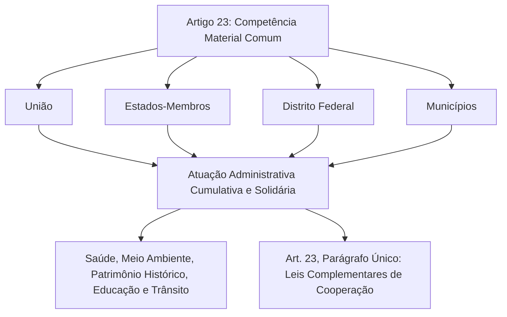
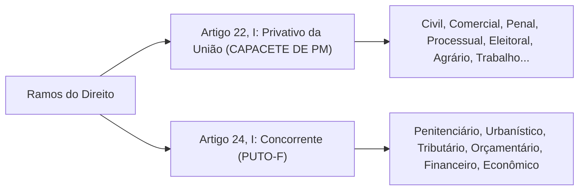
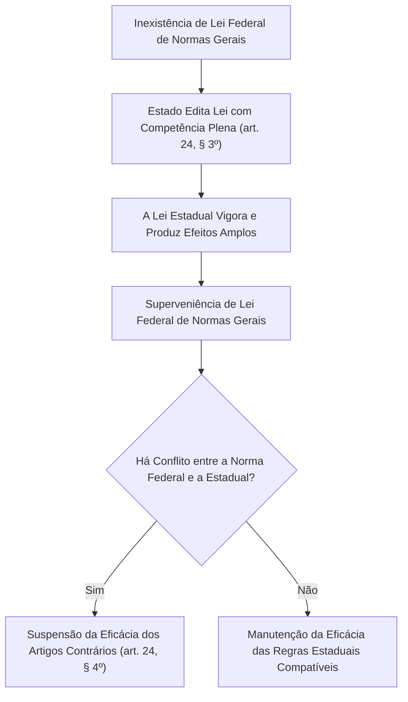

O federalismo de cooperação concebido pela Carta de 1988 rompeu com o modelo separatista clássico. Em vez de erguer muralhas estanques entre os entes políticos, a Constituição estruturou mecanismos de atuação simultânea, compartilhamento de atribuições administrativas e convivência legislativa vertical. Os arts. 23, 24 e 25 da Constituição Federal compõem o núcleo dessa engenharia federativa. Neles, convivem as competências materiais comuns a todos os entes federados, a competência legislativa concorrente reservada à União, Estados e Distrito Federal, e a competência residual deferida aos Estados-membros.

> [!objetivos]
> - Compreender a natureza administrativa cumulativa das competências comuns do art. 23 e o papel das leis complementares de cooperação.
> - Dominar o campo material da competência legislativa concorrente do art. 24 e o mnemônico clássico dos ramos jurídicos compartilhados (PUTO-F).
> - Analisar a dinâmica da repartição vertical entre normas gerais federais e competência suplementar ou plena dos Estados (art. 24, §§ 1º a 4º).
> - Identificar as competências reservadas aos Estados-membros (art. 25), a exploração de serviços locais de gás canalizado e a criação de regiões metropolitanas.
> - Conhecer os entendimentos jurisprudenciais do STF na ADI 6341 e na fiscalização de medidas sanitárias e ambientais.

## Competências materiais comuns: artigo 23

O art. 23 da Constituição Federal disciplina a **competência material comum** (também denominada competência administrativa cumulativa ou paralela). Diferentemente das competências legislativas, que resultam na criação de diplomas legais, a competência comum traduz deveres de execução de políticas públicas, prestação de serviços essenciais e proteção do bem-estar social.

A característica determinante do art. 23 reside na sua **universalidade federativa**: todos os quatro entes da Federação (União, Estados, Distrito Federal e Municípios) encontram-se simultaneamente investidos dessas atribuições executivas:

> [!lei] Art. 23, caput, da Constituição Federal de 1988
> É competência comum da União, dos Estados, do Distrito Federal e dos Municípios:
> I - zelar pela guarda da Constituição, das leis e das instituições democráticas e conservar o patrimônio público;
> II - cuidar da saúde e assistência pública, da proteção e garantia das pessoas portadoras de deficiência;
> [...]
> VI - proteger o meio ambiente e combater a poluição em qualquer de suas formas;
> VII - preservar as florestas, a fauna e a flora;
> [...]
> XII - estabelecer e implantar política de educação para a segurança do trânsito.

O rol do art. 23 abrange ainda a salvaguarda de monumentos e acervos históricos (incisos III e IV), o fomento ao acesso cultural, científico e educacional (inciso V), o incentivo à agropecuária e ao abastecimento (inciso VIII), a melhoria habitacional e do saneamento (inciso IX), as ações contra a miséria (inciso X) e o acompanhamento de concessões minerais e hídricas (inciso XI).

### O parágrafo único do artigo 23 e as leis de cooperação

Para evitar a sobreposição desordenada de ações fiscais e o desperdício de recursos públicos, a Carta da República previu a necessidade de harmonização federativa. Por força do art. 23, parágrafo único, leis complementares federais devem fixar normas de cooperação mútua entre União, Estados, DF e Municípios, buscando o equilíbrio do desenvolvimento nacional.

O exemplo emblemático de concretização desse comando constitucional é a **Lei Complementar nº 140/2011**, que disciplinou a cooperação entre os entes políticos nas ações administrativas voltadas ao meio ambiente. Essa lei fixou critérios objetivos para definir qual ente possui competência para licenciar empreendimentos, evitando exigências contraditórias e fiscalizações sobrepostas.

> [!jurisprudencia] STF, ADI 6341: Competência comum na saúde pública
> O plenário do Supremo Tribunal Federal assentou que a União, os Estados, o Distrito Federal e os Municípios possuem competência material comum para adotar medidas administrativas de proteção à saúde pública (art. 23, II). A atuação do governo federal no planejamento nacional não impede que Governadores e Prefeitos adotem providências sanitárias locais de isolamento, quarentena e restrição de circulação no enfrentamento de epidemias e emergências de saúde.

## Competência legislativa concorrente: artigo 24

Enquanto o art. 23 cuida da atuação administrativa de todos os entes, o art. 24 da Constituição disciplina a **competência legislativa concorrente**. Trata-se de hipótese em que a prerrogativa de editar leis é compartilhada verticalmente entre a União, os Estados e o Distrito Federal.

> [!pegadinha]
> **Municípios não participam do rol do art. 24:** preste muita atenção nas pegadinhas de concurso. O art. 24, caput, expressamente reúne apenas a **União, os Estados e o Distrito Federal**. Os Municípios não integram a competência legislativa concorrente do art. 24, suplementando a legislação federal e estadual no que couber por força de sua competência própria prevista no art. 30, inciso II, da Carta Política.

### Os ramos jurídicos da competência concorrente: o mnemônico PUTO-F

O art. 24, inciso I, elenca os ramos do direito sujeitos à legislação concorrente. Para memorizá-los com facilidade e não confundi-los com os ramos privativos da União do art. 22, utiliza-se a clássica fórmula mnemônica **PUTO-F**:
- **P**enitenciário;
- **U**rbanístico;
- **T**ributário;
- **O**rçamentário (art. 24, II);
- **F**inanceiro;
- **E**conômico.

Além desses ramos basilares, o art. 24 contempla matérias cruciais para a sociedade:
- Custas dos serviços forenses (inciso IV);
- Produção e consumo (inciso V);
- Tutela ambiental, recursos florestais, caça, pesca, fauna e conservação do solo (inciso VI);
- Salvaguarda do acervo histórico, artístico, turístico e paisagístico (inciso VII);
- Reparação civil por danos causados ao ecossistema, ao consumidor e a bens protegidos (inciso VIII);
- Atividades de ensino, manifestações culturais, práticas desportivas e incentivo científico-tecnológico (inciso IX);
- Criação, funcionamento e processo do juizado de pequenas causas (inciso X);
- Procedimentos em matéria processual (inciso XI);
- Seguridade social e defesa da saúde (inciso XII);
- Assistência jurídica integral e Defensoria Pública (inciso XIII);
- Amparo e promoção social de indivíduos com deficiência (inciso XIV);
- Salvaguarda dos direitos da criança e do jovem (inciso XV);
- Tarifas e preços públicos estaduais (inciso XVI).

**Distinção decisiva entre Processual e Procedimental:** a competência para legislar sobre **direito processual** (rito da ação, recursos, prazos processuais e teoria da prova) é privativa da União (art. 22, I). Por outro lado, a competência para legislar sobre **procedimentos em matéria processual** (práticas de secretaria, protocolo e tramitação forense regional) é concorrente entre União, Estados e DF (art. 24, XI).

## A dinâmica vertical da legislação concorrente: parágrafos do artigo 24

A convivência harmônica entre leis federais e estaduais sobre as matérias do art. 24 subordina-se a um modelo escalonado de repartição vertical previsto em seus quatro parágrafos:

### Normas gerais versus competência suplementar: §§ 1º e 2º

A distribuição de atribuições legislativas organiza-se nos seguintes moldes:
- **Papel da União (§ 1º):** na legislação concorrente, o Parlamento Federal atua traçando diretrizes amplas e uniformes denominadas normas gerais. É vedado à União descer a pormenores locais ou anular a autonomia do legislador regional;
- **Papel dos Estados e DF (§ 2º):** a edição das diretrizes gerais pela União não exclui a competência suplementar dos Estados. Cabe ao parlamento estadual suprir as lacunas normativas e detalhar as regras gerais federais em harmonia com as particularidades de cada território.

### Competência legislativa plena e lei federal superveniente: §§ 3º e 4º

As situações de inércia ou omissão do legislador federal recebem disciplina constitucional expressa:

> [!lei] Art. 24, §§ 3º e 4º, da Constituição Federal de 1988
> § 3º Inexistindo lei federal sobre normas gerais, os Estados exercerão a competência legislativa plena, para atender a suas peculiaridades.
> § 4º A superveniência de lei federal sobre normas gerais suspende a eficácia da lei estadual, no que lhe for contrário.

Essa dinâmica temporal opera em duas fases sucessivas:
1. **Competência plena temporária (§ 3º):** se a União ainda não editou a diretriz geral sobre determinado assunto do art. 24, os Estados-membros não ficam paralisados. O Estado adquire autorização para legislar amplamente sobre o assunto, criando normas gerais e pormenores locais;
2. **Efeito da lei federal superveniente (§ 4º):** quando a União posteriormente promulga o diploma de diretrizes gerais, a lei estadual antecedente não sofre revogação nem padece de inconstitucionalidade superveniente. Ocorre unicamente a **suspensão da eficácia** dos dispositivos estaduais estritamente incompatíveis com o regramento geral da União.

> [!pegadinha]
> **A lei superveniente suspende, não revoga:** questão certa em concursos. O posterior advento de diploma nacional de diretrizes gerais **suspende a eficácia** da regra estadual contrastante, sem gerar revogação. Se a norma geral federal for declarada inconstitucional pelo STF ou revogada pelo Congresso Nacional sem substituta, o diploma estadual outrora suspenso recupera automaticamente sua plena eficácia.

## Competências dos Estados-Membros e do Distrito Federal: artigo 25

O modelo federativo brasileiro reservou aos Estados-membros o critério da competência residual ou remanescente.

### A competência residual ou remanescente (art. 25, § 1º)

Enquanto as competências da União e dos Municípios são expressamente enumeradas na Constituição, a regra aplicável aos Estados é a reserva do que não lhes foi expressa ou implicitamente vedado. Nos precisos termos do art. 25, § 1º, aos Estados-membros pertencem todas as atribuições materiais e legislativas que a Lei Maior não lhes tenha proibido expressamente.

Tudo aquilo que a Constituição Federal não outorgou com exclusividade à União, não conferiu em concorrência e não atribuiu ao interesse local dos Municípios pertence residualmente aos Estados-membros. O exemplo clássico reside na estruturação e organização interna da Polícia Civil, da Polícia Militar e do Corpo de Bombeiros Militar, nos termos da Constituição Estadual e das leis estaduais específicas, observadas as normas gerais federais do art. 22, XXI.

### Exploração de serviços de gás canalizado (art. 25, § 2º)

O art. 25, § 2º, confere aos Estados-membros o monopólio da exploração dos serviços locais de gás canalizado, podendo executá-los diretamente ou mediante regime de concessão pública. O próprio texto constitucional impõe uma blindagem expressa: proíbe taxativamente o uso de medida provisória para disciplinar essa atividade.

Preste atenção em dois pontos fundamentais com frequência cobrados pela comissão organizadora:
1. Os serviços de distribuição local de gás pertencem aos **Estados**, e não aos Municípios;
2. É terminantemente vedada a edição de medida provisória para o seu regramento, impedindo que o Chefe do Poder Executivo estadual ou federal utilize tal instrumento na matéria.

### Regiões metropolitanas, aglomerações urbanas e microrregiões (art. 25, § 3º)

Para congregar o planejamento, a articulação e a realização conjunta de funções de interesse comum em agrupamentos conurbados, a Constituição autoriza os Estados a instituírem regiões metropolitanas, aglomerações urbanas e microrregiões (art. 25, § 3º).

Os requisitos constitucionais cumulativos para essa criação são:
- **Iniciativa e veículo normativo:** aprovação de **lei complementar estadual** pela respectiva Assembleia Legislativa;
- **Requisito geográfico:** agrupamento obrigatório de **municípios limítrofes** que apresentem contiguidade territorial;
- **Finalidade pública:** coordenação de funções de utilidade pública comum (como transporte metropolitano intermunicipal, esgotamento sanitário e segurança viária).

No julgamento paradigmático da **ADI 1842/RJ**, o Supremo Tribunal Federal assentou que a instituição de região metropolitana não suprime a autonomia dos Municípios integrantes, mas institui uma gestão colegiada compartilhada entre o Estado e as municipalidades envolvidas, sendo inconstitucional a concentração do poder decisório hegemônico nas mãos do Governador.

> [!resolvido]
> **Caso prático de prova:**
> Diante da ausência de legislação federal dispondo sobre normas gerais de proteção ao meio ambiente contra queimadas agrícolas, o Estado de Pernambuco editou lei ordinária estadual disciplinando integralmente o procedimento e as penalidades para infrações na colheita da cana-de-açúcar. Três anos após a promulgação da norma estadual, o Congresso Nacional aprovou e promulgou lei federal veiculando normas gerais sobre a prevenção de incêndios florestais e queimadas em todo o país, contendo dispositivo que contrariava expressamente o prazo de transição fixado na lei pernambucana.
>
> **Análise jurídica do conflito normativo:**
> 1. A edição originária da lei estadual foi plenamente legítima e constitucional. Conforme preceitua o art. 24, § 3º, da CF/88, inexistindo lei federal sobre normas gerais ambientais (matéria concorrente do art. 24, VI), os Estados exercem a competência legislativa plena para atender às suas peculiaridades regionais.
> 2. Com a superveniência da lei federal de normas gerais, a lei estadual pernambucana não é revogada nem declarada nula. Opera-se, com fundamento expresso no art. 24, § 4º, da Constituição da República, a **suspensão da eficácia** da lei estadual exclusivamente naquilo em que for contrária à nova norma geral da União, preservando-se a validade e aplicação de todos os demais preceitos estaduais compatíveis.

## Mapa do capítulo

A tabela a seguir consolida a repartição de competências comuns, concorrentes e estaduais:

| Espécie de Competência | Entes Titulares | Objeto e Dinâmica Constitucional | Dispositivo da CF/88 |
|---|---|---|---|
| **Comum (Material)** | União, Estados, DF e Municípios | Atuação administrativa solidária (saúde, meio ambiente e educação); leis complementares de cooperação. | Art. 23, caput e parágrafo único |
| **Concorrente (Legislativa)** | União, Estados e DF (sem Municípios) | União edita normas gerais (§ 1º); Estados suplementam (§ 2º) ou exercem competência plena (§ 3º). | Art. 24, caput e §§ 1º a 3º |
| **Lei Federal Superveniente** | União | **Suspende a eficácia** das regras estaduais contrastantes, sem revogá-las. | Art. 24, § 4º |
| **Residual dos Estados** | Estados-Membros | Matérias reservadas que não sejam vedadas pela Constituição Federal. | Art. 25, § 1º |
| **Gás Canalizado** | Estados-Membros | Exploração direta ou por concessão; vedada medida provisória. | Art. 25, § 2º |
| **Regiões Metropolitanas** | Estados-Membros | Instituídas por lei complementar estadual com municípios limítrofes para funções de interesse comum. | Art. 25, § 3º |

### Para fixar

- As competências do art. 23 da CF/88 possuem natureza material administrativa e são titularizadas cumulativamente por União, Estados, DF e Municípios.
- Leis complementares federais fixam normas para a cooperação federativa nas matérias comuns do art. 23 (como a LC nº 140/2011 no campo ambiental).
- O STF fixou na ADI 6341 a competência comum e concorrente de Estados e Municípios para adotar providências administrativas sanitárias locais no combate a epidemias.
- A competência concorrente do art. 24 abrange apenas União, Estados e Distrito Federal, estando os Municípios fora desse dispositivo.
- Os ramos jurídicos da competência concorrente são identificados pelo mnemônico PUTO-F (penitenciário, urbanístico, tributário, orçamentário, financeiro e econômico).
- Na competência concorrente, a União limita-se a fixar normas gerais (§ 1º) e os Estados exercem competência suplementar (§ 2º).
- Inexistindo lei federal de normas gerais, os Estados exercem competência legislativa plena temporária (§ 3º).
- O posterior advento de diretrizes gerais federais paralisa a eficácia do diploma estadual apenas no que for incompatível, sem extingui-lo do ordenamento (§ 4º).
- Aos Estados cabem as competências residuais não vedadas pela Carta Magna, a exploração do gás canalizado (vedada medida provisória) e a criação de regiões metropolitanas por lei complementar estadual.
