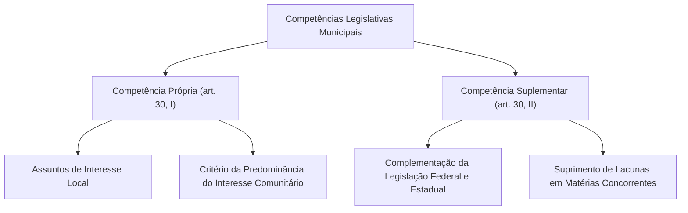
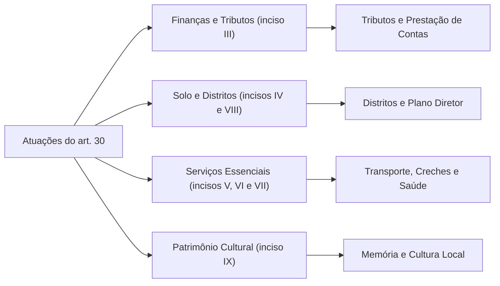
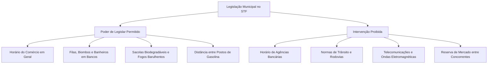
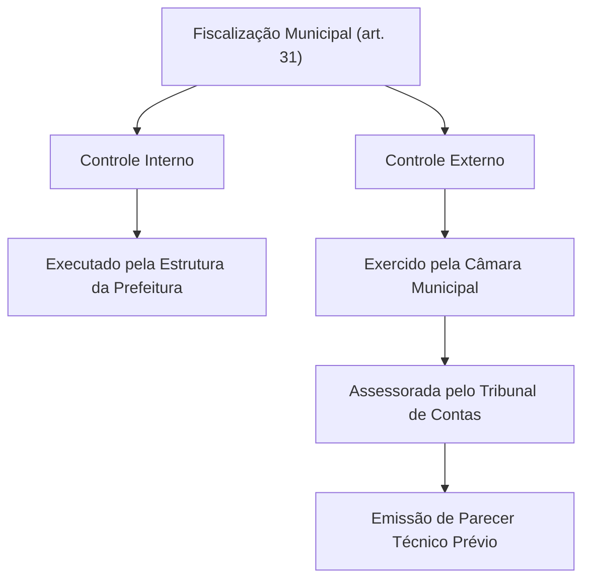
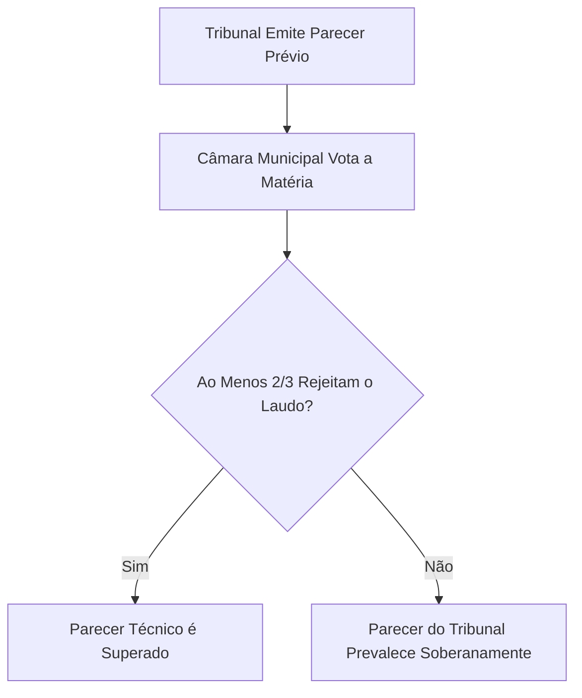

A consagração do Município como ente integrante da Federação é traço singular da Constituição de 1988. No modelo brasileiro, as municipalidades possuem autonomia política, administrativa, financeira e legislativa própria (arts. 1º e 18 da CF/88). Elas não são meras divisões territoriais subordinadas aos Estados.

Os arts. 30 e 31 da Carta Política equilibram essa ampla autonomia com mecanismos de controle democrático das contas públicas.

> [!objetivos]
> - Compreender a competência legislativa municipal sobre interesse local e atuação suplementar (art. 30, I e II).
> - Analisar os serviços públicos locais e a essencialidade do transporte coletivo (art. 30, III a IX).
> - Dominar a jurisprudência do STF sobre limites normativos municipais (SV 38, SV 49 e bancos).
> - Examinar a fiscalização contábil, orçamentária e a vedação a novos órgãos municipais de contas (art. 31).
> - Diferenciar contas de governo e de gestão sob a ótica dos Temas 157 e 835 e da ADPF 982 do STF.

## Competências legislativas municipais: artigo 30, I e II

A produção legislativa municipal desenvolve-se em duas vertentes previstas expressamente no texto constitucional:

> [!lei] Art. 30, I e II, da Constituição Federal de 1988
> Compete aos Municípios:
> I - legislar sobre assuntos de interesse local;
> II - suplementar a legislação federal e a estadual no que couber.

### O critério da predominância do interesse local (art. 30, I)

A repartição constitucional de competências apoia-se no **princípio da predominância do interesse**:
- À **União** tocam os temas de interesse predominantemente geral;
- Aos **Estados** cabem os assuntos de interesse regional;
- Aos **Municípios** incumbem as demandas de interesse local (art. 30, I).

O interesse local não exige exclusividade municipal. Praticamente todo assunto possui reflexos gerais. O que define a competência municipal é a predominância direta da utilidade comunitária.

> [!atencao]
> A autonomia municipal e sua competência legislativa decorrem diretamente da Constituição (arts. 18 e 30, I). Não representam favor ou concessão da União ou dos Estados. O Município possui auto-organização por Lei Orgânica, autogoverno por eleições próprias e autoadministração dos serviços locais.

### A competência suplementar municipal (art. 30, II)

O art. 30, inciso II, autoriza o Município a suplementar diplomas federais e estaduais no que for cabível. O constituinte facultou a adaptação das diretrizes gerais às realidades concretas da comunidade.

Essa suplementação opera sob duas formas práticas:
1. **Suplementação complementar:** pormenoriza leis existentes para atender a peculiaridades urbanas ou rurais locais;
2. **Suplementação supletiva:** cobre a inércia temporária dos entes maiores em matérias que exijam regulamentação imediata no território local.

Essa prerrogativa autoriza detalhar ramos do art. 24 da CF/88 (como direito urbanístico e tributário), desde que respeitadas as normas gerais federais e as leis estaduais. Se a União editar norma geral superveniente, o regramento municipal incompatível perde a eficácia no que colidir com a regra federal.

## Competências materiais e serviços públicos: artigo 30, III a IX

O art. 30 confere ao Município expressivas atribuições de gestão executiva:

### Tributos próprios e autonomia financeira (inciso III)

O Município institui e arrecada seus impostos privativos:
- Imposto sobre a Propriedade Predial e Territorial Urbana (IPTU);
- Imposto sobre Serviços de Qualquer Natureza (ISSQN);
- Imposto sobre Transmissão Inter Vivos de Bens Imóveis (ITBI).

Além dos impostos, a municipalidade institui taxas pelo exercício do poder de polícia e pela prestação de serviços públicos específicos e divisíveis. Pode ainda cobrar contribuição de melhoria por obras públicas que valorizem imóveis privados. Deve gerir suas rendas e divulgar balancetes periódicos para assegurar a transparência fiscal.

Em reforço a essa autonomia financeira, o art. 160 da Carta Magna estabelece o princípio da vedação à retenção de receitas tributárias. É proibido à União e aos Estados reter ou restringir o repasse das cotas tributárias municipais, especialmente do Fundo de Participação dos Municípios (FPM) e dos percentuais constitucionais sobre ICMS e IPVA. A Constituição apenas admite a retenção para quitação de créditos da União ou para garantia do cumprimento dos limites de aplicação em saúde e educação.

### Organização distrital (inciso IV)

O Município cria, estrutura e suprime distritos administrativos por lei municipal. Todavia, deve observar obrigatoriamente os parâmetros gerais definidos pela legislação estadual. Essa limitação evita o desmembramento desordenado de distritos sem sustentabilidade administrativa.

### Serviços públicos e essencialidade do transporte (inciso V)

Incumbe ao Município gerir os serviços de interesse local, diretamente ou sob concessão ou permissão. O texto constitucional destaca o **transporte coletivo urbano como serviço público de caráter essencial**.

Compete à administração municipal definir itinerários, fiscalizar veículos e estipular as tarifas das linhas urbanas. Caso a concessionária interrompa a prestação sem motivo justo, a prefeitura pode intervir no serviço para garantir a continuidade da locomoção popular.

### Educação infantil, ensino fundamental e saúde básica (incisos VI e VII)

O Município atua de forma prioritária em cooperação com União e Estado:
- **Educação infantil e ensino fundamental (inciso VI):** custeia creches, pré-escolas e colégios de ensino básico, garantindo atendimento pedagógico prioritário;
- **Saúde pública local (inciso VII):** opera postos de saúde e unidades de pronto atendimento da atenção primária e ambulatorial do Sistema Único de Saúde.

### Ordenamento do solo urbano e Plano Diretor (inciso VIII)

Compete ao Poder Executivo municipal planejar a ocupação do espaço urbano. O instrumento orientador da política urbana é o **Plano Diretor**, disciplinado pelo art. 182 da Carta Magna e pelo Estatuto da Cidade (Lei nº 10.257/2001).

O Plano Diretor é **obrigatório para cidades com mais de vinte mil habitantes**, cidades integrantes de regiões metropolitanas, áreas de especial interesse turístico ou inseridas em áreas de influência de grandes empreendimentos. Ele expressa as exigências fundamentais de ordenação da cidade para que a propriedade cumpra sua função social.

Caso o proprietário mantenha imóvel urbano não edificado, subutilizado ou não utilizado em desacordo com o Plano Diretor, o Município pode aplicar instrumentos sucessivos de coerção urbanística:
1. Notificação para parcelamento ou edificação compulsórios;
2. IPTU progressivo no tempo, com alíquotas aumentadas anualmente durante cinco anos consecutivos;
3. Desapropriação com pagamento mediante títulos da dívida pública da emissão previamente aprovada pelo Senado Federal, resgatáveis em até dez anos.

### Preservação cultural local (inciso IX)

O Município protege monumentos, paisagens notáveis e acervos históricos municipais, cooperando ativamente com os órgãos de proteção do patrimônio estadual e federal.

## Jurisprudência do STF sobre competência municipal

O Supremo Tribunal Federal estabeleceu fronteiras nítidas para o exercício do poder normativo municipal em matérias econômicas e regulatórias.

### O que o Município pode disciplinar

A jurisprudência constitucional chancela as seguintes iniciativas municipais:

1. **Horário do comércio (SV 38):** cabe ao Município regular o horário de funcionamento das lojas e farmácias locais. A matéria está pacificada pelo enunciado vinculante da **Súmula Vinculante 38**;
2. **Conforto e segurança em bancos:** a municipalidade pode exigir portas de segurança, câmeras, biombos, assentos, sanitários e bebedouros para clientes em agências bancárias;
3. **Tempo de fila:** é válida a fixação de tempo limite de espera em guichês bancários e serventias cartorárias, com aplicação de multas administrativas aos estabelecimentos recalcitrantes;
4. **Proteção ambiental diferenciada:** o Município pode fixar regras ambientais mais rigorosas quando fundadas em peculiaridades ecológicas comprovadas de seu território;
5. **Sacolas biodegradáveis (Tema 970):** o STF julgou válida a norma municipal que determina a troca de sacos plásticos convencionais por opções biodegradáveis em supermercados e comércios locais;
6. **Vedação a fogos com estampido:** leis locais que proíbem fogos sonoros são constitucionais, pois protegem crianças, pessoas do espectro autista, idosos e animais domésticos;
7. **Distância de postos de combustíveis:** o Município pode impor distanciamento de segurança entre revendas de combustíveis e estabelecimentos sensíveis por motivos de segurança e prevenção de sinistros;
8. **Fiscalização do solo por antenas:** admite-se taxa municipal pelo uso do solo e espaço aéreo urbano por postes e torres, mensurada estritamente pelo custo da atividade de polícia urbanística.

### O que o Município não pode disciplinar

Por outro lado, o STF considera inválidas as intervenções municipais nas seguintes hipóteses:

1. **Horário de agências bancárias:** o funcionamento das instituições financeiras afeta a circulação monetária nacional e a compensação de títulos. Trata-se de competência privativa da União (art. 22, VI e VII);
2. **Trânsito e circulação viária:** matérias de trânsito dependem de legislação uniforme federal (art. 22, XI). É inconstitucional criar exigências de segurança veicular não previstas no Código de Trânsito Brasileiro;
3. **Telecomunicações e limites de radiação:** cabe apenas à União legislar sobre radiodifusão e campos eletromagnéticos gerados por torres transmissoras (art. 22, IV);
4. **Livre concorrência e barreiras territoriais (SV 49):** a **Súmula Vinculante 49** veda leis municipais que impeçam a abertura de estabelecimentos comerciais do mesmo segmento em dada área sob pretexto de zoneamento;
5. **Interferência em empresas privadas:** são nulas regras locais impondo itens regionais obrigatórios em cardápios de restaurantes ou empacotadores compulsórios em supermercados.

> [!pegadinha]
> Não confunda em prova: o Município define o horário do **comércio** (SV 38). Contudo, o horário dos **bancos** subordina-se à regulação privativa federal.

## Fiscalização do Município: artigo 31

A gestão orçamentária municipal submete-se ao controle desenhado pelo art. 31 da Carta de 1988:

### O controle externo e interno municipal

O art. 31 distribui as atribuições fiscalizatórias em dois polos bem delimitados:
- **Controle externo:** atribuído com exclusividade ao Poder Legislativo local (Câmara de Vereadores), auxiliado pela Corte de Contas competente;
- **Controle interno:** operado pelo próprio Poder Executivo sobre suas repartições e secretarias para verificar a conformidade dos atos de gestão.

### Vedação a novos tribunais municipais de contas (art. 31, § 4º)

A Carta de 1988 vedou taxativamente a estruturação de novos órgãos de contas municipais (art. 31, § 4º). Em face dessa proibição, a fiscalização orçamentária no Brasil organiza-se em três formatos:

| Modelo de Tribunal | Alcance e Funcionamento | Unidades Existentes |
|---|---|---|
| **Tribunal de Contas Municipal Próprio** | Órgãos criados antes de 1988 e mantidos pela ordem constitucional. | **TCM-SP** e **TCM-RJ**. |
| **Tribunal Estadual dos Municípios** | Entes da estrutura estadual dedicados exclusivamente às prefeituras do território. | **TCM-BA**, **TCM-GO** e **TCM-PA**. |
| **Tribunal de Contas do Estado (TCE)** | Corte estadual que audita simultaneamente os órgãos estaduais e todas as prefeituras locais. | Maioria dos Estados (como o TCE-PE). |

Na **ADI 5763**, o STF declarou constitucional a emenda estadual que extinguiu o Tribunal de Contas dos Municípios do Ceará, transferindo suas funções ao TCE estadual. A Corte assentou que os Estados detêm discricionariedade para extinguir tais órgãos regionais.

Além disso, multas aplicadas pelo Tribunal de Contas a agentes municipais por danos locais geram créditos em favor do próprio **Município prejudicado**, que deve executá-los em juízo.

## Julgamento das contas do Prefeito: governo versus gestão

A apreciação das contas do Chefe do Executivo municipal obedece a regras procedimentais detalhadas no texto da Carta Magna.

### Contas de governo versus contas de gestão

O direito financeiro consagra duas modalidades de prestação de contas:
1. **Contas de governo:** refletem o equilíbrio financeiro global e a execução anual das diretrizes orçamentárias. Seu exame possui natureza estritamente política;
2. **Contas de gestão:** traduzem atos concretos de ordenação de pagamentos, contratos e despesas rotineiras. Seu exame é eminentemente técnico.

### Parecer prévio e quórum qualificado de dois terços (art. 31, § 2º)

Sobre as contas anuais do Prefeito, a Corte de Contas emite relatório opinativo chamado **parecer prévio**. A deliberação definitiva cabe à Câmara de Vereadores:

> [!lei] Art. 31, §§ 1º e 2º, da Constituição Federal de 1988
> § 1º O controle externo da Câmara Municipal será exercido com o auxílio dos Tribunais de Contas dos Estados ou do Município e dos Conselhos ou Tribunais de Contas dos Municípios, onde houver.
> § 2º O parecer prévio, emitido pelo órgão competente sobre as contas que o Prefeito deve anualmente prestar, só deixará de prevalecer por decisão de dois terços dos membros da Câmara Municipal.

Se o laudo técnico sugerir a desaprovação das contas, essa conclusão técnica prevalecerá. Ela só é derrotada se houver votação contrária de pelo menos dois terços de toda a composição da Câmara de Vereadores.

### Jurisprudência do STF: Temas 157 e 835

Nos Municípios menores, o Prefeito costuma atuar cumulativamente como ordenador de despesas. Ao julgar os **Temas 157 e 835 de Repercussão Geral**, o STF fixou diretrizes consolidadas para fins eleitorais:
- **Competência da Câmara Municipal:** a apreciação das contas do Prefeito para gerar a inelegibilidade da Lei da Ficha Limpa (LC nº 64/1990) é monopólio da Câmara de Vereadores;
- **Inexistência de julgamento ficto:** a inércia dos vereadores em julgar as contas não acarreta inelegibilidade automática por decurso de prazo. A perda temporária da elegibilidade exige deliberação formal do plenário legislativo.

### ADPF 982 e a sanção do Tribunal de Contas

No julgamento da **ADPF 982**, o Supremo pacificou a eficácia sancionatória direta das Cortes de Contas sobre agentes municipais.

A distinção opera nos seguintes moldes:
1. **Âmbito eleitoral:** a competência para gerar inelegibilidade pertence com exclusividade à Câmara Municipal;
2. **Ressarcimento patrimonial:** quando o Prefeito atua como ordenador de despesas e pratica desvios, o Tribunal de Contas detém competência originária para condená-lo ao ressarcimento (art. 71, II).

Essa decisão técnica ostenta **eficácia imediata de título executivo** (art. 71, § 3º). O Município pode cobrá-la judicialmente sem depender do crivo da Câmara Municipal.

> [!resolvido]
> **Caso prático simulado:**
> O Tribunal de Contas sugeriu a rejeição das contas do Prefeito de determinado Município com 15 vereadores. Na votação em plenário, 9 parlamentares votaram contra o laudo da Corte de Contas e 6 votaram a favor. Qual a consequência jurídica desse resultado?
>
> **Solução analítica:**
> Para derrubar o parecer prévio do órgão de contas, a Carta Magna exige dois terços dos votos da Casa Legislativa (art. 31, § 2º). Em uma Câmara com 15 vereadores, o patamar mínimo corresponde a 10 votos.
> Como apenas 9 parlamentares rejeitaram o parecer, o quórum qualificado não foi alcançado. Dessa forma, o laudo técnico prevaleceu soberanamente, restando rejeitadas as contas de governo do gestor.

## Mapa do capítulo

A síntese abaixo reúne as principais diretrizes sobre competências e fiscalização municipal:

| Tema Central | Regra Constitucional e Jurisprudência | Base Normativa |
|---|---|---|
| **Interesse Local** | Competência legislativa privativa sobre assuntos de relevância comunitária. | Art. 30, I, da CF/88 |
| **Norma Suplementar** | Prerrogativa de detalhar preceitos federais e estaduais no âmbito local. | Art. 30, II, da CF/88 |
| **Transporte Urbano** | Qualificado como serviço público de natureza essencial gerido pela municipalidade. | Art. 30, V, da CF/88 |
| **Horário do Comércio** | Fixação atribuída à competência normativa da municipalidade. | Súmula Vinculante 38 |
| **Horário dos Bancos** | Atribuição privativa da União decorrente do Sistema Financeiro Nacional. | Art. 22, VI e VII, da CF/88 |
| **Livre Concorrência** | Inconstitucionalidade de normas que criem barreiras territoriais artificiais. | Súmula Vinculante 49 |
| **Órgãos de Contas** | Vedada a instituição de novos tribunais ou conselhos de contas municipais. | Art. 31, § 4º, da CF/88 |
| **Parecer Técnico** | Pronunciamento opinativo sobre contas do Prefeito, superável apenas por 2/3 dos edis. | Art. 31, § 2º, da CF/88 |
| **Inelegibilidade** | Julgamento privativo da Casa Legislativa para fins de inelegibilidade da Ficha Limpa. | STF, Temas 157 e 835 |
| **Sanção Financeira** | Competência autônoma da Corte de Contas para imputar débito ao Prefeito ordenador. | STF, ADPF 982 |

### Para fixar

- O Município goza de competência legislativa privativa sobre assuntos de predominante interesse local (art. 30, I).
- A prerrogativa suplementar municipal permite suprir lacunas e detalhar regras federais e estaduais (art. 30, II).
- O transporte coletivo urbano é categorizado constitucionalmente como serviço essencial de gestão municipal (art. 30, V).
- O Município fixa o horário comercial (SV 38), mas o horário bancário subordina-se à regulação exclusiva federal.
- A municipalidade pode exigir regras de atendimento bancário, sacolas biodegradáveis e proibir fogos sonoros.
- A Carta de 1988 proíbe a criação de novas cortes de contas municipais, preservando apenas as preexistentes (art. 31, § 4º).
- O parecer prévio do Tribunal de Contas sobre as contas do Prefeito prevalece, salvo rejeição por dois terços dos vereadores.
- A competência para julgar contas de Prefeito para gerar inelegibilidade é privativa da Câmara (Temas 157 e 835).
- O Tribunal de Contas pode imputar débito autônomo ao Prefeito ordenador de despesas para recomposição do erário (ADPF 982).
