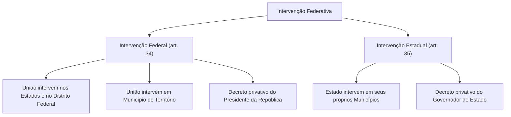
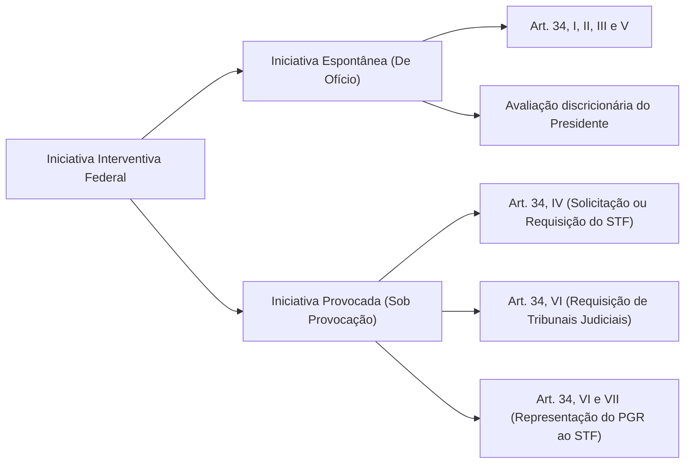
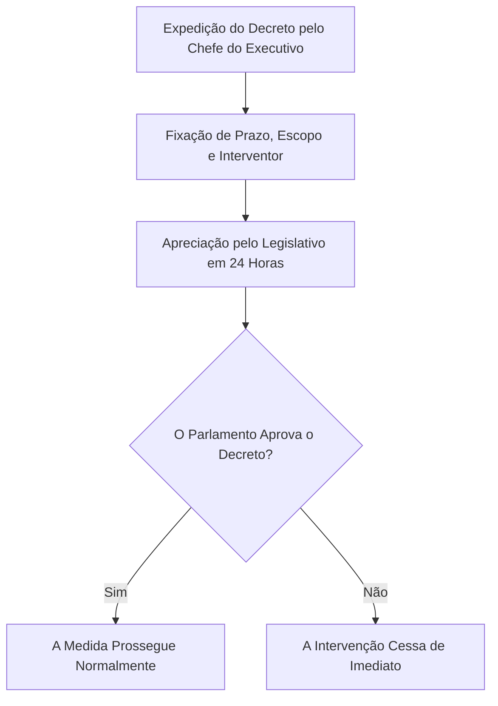

A autonomia política, administrativa e financeira dos entes federados é a regra central do Estado federal brasileiro (art. 18 da CF/88). Em situações excepcionais de anormalidade institucional, a Constituição autoriza o mecanismo da **intervenção federativa**. Trata-se da supressão temporária da autonomia de um ente político para proteger o pacto federativo.

Por constituir providência extrema, a intervenção subordina-se a um **rol taxativo** (*numerus clausus*). Ela não admite analogia ou ampliações por lei ordinária. Deve observar sempre a proporcionalidade e o tempo mínimo indispensável.

> [!objetivos]
> - Compreender a natureza jurídica e os limites da intervenção federativa.
> - Dominar as hipóteses da intervenção federal (art. 34) e suas formas de deflagração.
> - Diferenciar a atuação espontânea da iniciativa provocada por solicitação, requisição e representação.
> - Analisar a intervenção estadual nos Municípios (art. 35) e a diretriz da Súmula 637 do STF.
> - Conhecer os requisitos do decreto interventivo e o controle político em vinte e quatro horas (art. 36).

## Espécies de intervenção e competência para decretação

O sistema constitucional brasileiro reparte a intervenção em duas categorias fundamentais, definidas pela esfera de poder que executa o ato:

Na **intervenção federal**, a União atua sobre os Estados-membros, sobre o Distrito Federal ou sobre Municípios localizados em Territórios Federais (art. 34 da CF/88). O ato é privativo do Presidente da República.

Na **intervenção estadual**, o Estado-membro intervém diretamente sobre seus próprios Municípios (art. 35 da CF/88). A competência para expedir o decreto pertence com exclusividade ao Governador do Estado.

> [!pegadinha]
> **A União não intervém diretamente em Municípios de Estados:** preste atenção nos enunciados de prova. Se uma prefeitura descumprir decisões ou repasses, a decretação caberá ao Governador do Estado. A União só atua em Municípios se eles integrarem Território Federal.

## Hipóteses de intervenção federal: artigo 34

A intervenção federal decorre exclusivamente das seguintes causas taxativas:
1. **Defesa da integridade nacional (inciso I):** combate a tentativas separatistas ou ameaças à unidade do território;
2. **Repulsa a invasão (inciso II):** reação armada contra ofensiva estrangeira ou invasão de um Estado por outro;
3. **Grave comprometimento da ordem pública (inciso III):** resposta a crises graves de segurança e perturbação social generalizada;
4. **Livre exercício dos Poderes (inciso IV):** garantia de funcionamento normal ao Executivo, Legislativo ou Judiciário coagidos;
5. **Reorganização das finanças estaduais (inciso V):** resposta à inadimplência da dívida fundada por biênio consecutivo, ou falta de repasse das receitas tributárias municipais;
6. **Cumprimento de ordens judiciais e leis federais (inciso VI):** execução forçada de diplomas legais da União ou de mandados judiciais;
7. **Defesa dos princípios constitucionais sensíveis (inciso VII):** salvaguarda da forma republicana, sistema representativo, regime democrático, direitos humanos, autonomia municipal, prestação de contas e pisos da saúde e da educação.

## A iniciativa da intervenção federal: espontânea versus provocada

A deflagração da intervenção federal classifica-se quanto à origem da iniciativa do Presidente da República:

### Iniciativa espontânea (de ofício)

Nas hipóteses dos incisos I, II, III e V, o Presidente da República age **de ofício**. Ele analisa discricionariamente a conveniência política e a gravidade dos fatos. O decreto não depende de pedido prévio de outros órgãos.

### Iniciativa provocada

Nas demais hipóteses, o Chefe do Executivo depende de provocação externa para agir:

| Hipótese da CF/88 | Origem da Provocação | Instrumento Utilizado | Natureza do Decreto |
|---|---|---|---|
| **Coação ao Legislativo ou Executivo (art. 34, IV)** | O próprio Poder coagido | **Solicitação** | Discricionário |
| **Coação ao Judiciário Estadual (art. 34, IV)** | Supremo Tribunal Federal | **Requisição** | Vinculado |
| **Descumprimento de ordem judicial (art. 34, VI)** | STF, STJ ou TSE | **Requisição judicial** | Vinculado |
| **Recusa a cumprir lei federal (art. 34, VI)** | PGR perante o STF | Ação de executoriedade de lei | Vinculado após acolhimento |
| **Ofensa a princípios sensíveis (art. 34, VII)** | PGR perante o STF | ADI Interventiva | Vinculado após procedência |

A distribuição da **requisição judicial** (art. 34, VI) obedece à jurisdição da causa:
- Ordem do foro eleitoral gera requisição pelo **Tribunal Superior Eleitoral (TSE)**;
- Decisão da Justiça comum federal ou estadual enseja requisição pelo **Superior Tribunal de Justiça (STJ)**;
- Julgado da Justiça Militar, do Trabalho ou tema constitucional atrai requisição pelo **Supremo Tribunal Federal (STF)**.

> [!atencao]
> A **solicitação** é simples pedido. O Presidente analisa a conveniência política. A **requisição**, por outro lado, é imposição judicial vinculante. O Presidente não pode recusar o cumprimento do ato.

## Intervenção estadual nos Municípios: artigo 35

O Estado só intervém em seus Municípios nos termos restritos do art. 35:

> [!lei] Art. 35 da Constituição Federal de 1988
> O Estado não intervirá em seus Municípios, nem a União nos Municípios localizados em Território Federal, exceto quando:
> I - deixar de ser paga, sem motivo de força maior, por dois anos consecutivos, a dívida fundada;
> II - não forem prestadas contas devidas, na forma da lei;
> III - não tiver sido aplicado o mínimo exigido da receita municipal na manutenção e desenvolvimento do ensino e nas ações e serviços públicos de saúde;
> IV - o Tribunal de Justiça der provimento a representação para assegurar a observância de princípios indicados na Constituição Estadual, ou para prover a execução de lei, de ordem ou de decisão judicial.

No julgamento da **ADI 6616/AC**, o STF proibiu as Constituições Estaduais de ampliarem as hipóteses de intervenção municipal. O rol constitucional é taxativo.

Na hipótese do inciso IV, a iniciativa cabe unicamente ao **Procurador-Geral de Justiça**. Uma vez acolhida a representação pelo Tribunal de Justiça, a expedição do decreto pelo Governador é vinculada.

Por constituir decisão político-administrativa de controle regional, o STF editou a **Súmula 637**, inadmitindo recurso extraordinário em face de decisão colegiada de Tribunal de Justiça que acolha pedido interventivo estadual.

## O decreto interventivo e o controle político: artigo 36

O procedimento de formalização do decreto e sua revisão parlamentar seguem prazos rígidos:

### Requisitos formais do decreto

O decreto interventivo deve conter expressamente:
- A delimitação da amplitude da medida;
- O prazo determinado de duração;
- As condições concretas de sua execução;
- A indicação de **interventor**, quando couber o afastamento de gestores locais.

### Apreciação legislativa em vinte e quatro horas

O decreto submete-se ao Legislativo no prazo de **vinte e quatro horas** (Congresso Nacional na via federal; Assembleia Legislativa na estadual). Se as Casas estiverem em recesso, serão convocadas imediatamente. Se o Parlamento rejeitar o decreto, os efeitos cessam de imediato.

### Hipótese de dispensa do crivo parlamentar

O controle parlamentar é dispensado quando o decreto **apenas suspende a eficácia do ato impugnado** com esteio no art. 34, VI e VII, ou no art. 35, IV (art. 36, § 3º). Havendo eficácia suficiente nessa providência, não há necessidade de envio do decreto ao Poder Legislativo.

Com o fim da intervenção, os governantes afastados retornam aos seus cargos, salvo impedimento legal.

> [!resolvido]
> **Caso prático simulado:**
> Manifestantes armados invadiram o plenário de Assembleia Legislativa estadual e impediram votações. O Presidente da Casa encaminhou pedido ao Presidente da República para reestabelecer o funcionamento do Poder Legislativo. Qual o rito aplicável?
>
> **Solução jurídica:**
> A hipótese enquadra-se no art. 34, IV, da CF/88. Por envolver o Legislativo, a atuação depende de **solicitação** do Poder atingido. O Presidente decide discricionariamente pela expedição do decreto. Expedido o ato, este deverá ser enviado ao Congresso Nacional em vinte e quatro horas para controle político.

## Mapa do capítulo

A tabela sintetiza as diretrizes da intervenção federal e estadual:

| Aspecto Institucional | Intervenção Federal (art. 34) | Intervenção Estadual (art. 35) |
|---|---|---|
| **Ente Interventor** | União nos Estados, DF ou Municípios em Território. | Estado-membro em seus Municípios. |
| **Autoridade Decretante** | Presidente da República privativamente. | Governador do Estado privativamente. |
| **Iniciativa Espontânea** | De ofício nos incisos I, II, III e V. | De ofício nas hipóteses fazendárias (incisos I a III). |
| **Iniciativa Provocada** | Solicitação do lesado; Requisição judicial ou Representação do PGR. | Representação pelo Procurador-Geral de Justiça provida pelo TJ. |
| **Recurso Cabível** | Instrumentos constitucionais perante o STF. | Não cabe recurso extraordinário contra acórdão do TJ (Súmula 637). |
| **Controle Político** | Congresso Nacional em 24 horas. | Assembleia Legislativa em 24 horas. |
| **Dispensa de Controle** | Decreto que apenas suspende o ato questionado (art. 36, § 3º). | Decreto que apenas suspende o ato com base em decisão do TJ. |

### Para fixar

- A intervenção federativa é providência extrema e temporária, com rol taxativo e proporcional.
- A União intervém nos Estados e no DF; intervenção em Municípios cabe ao Governador do Estado.
- O Presidente intervém de ofício nos incisos I, II, III e V do art. 34 da CF/88.
- Coação ao Judiciário reclama requisição vinculante emanada do STF.
- Descumprimento de ordens judiciais gera requisição por TSE, STJ ou STF conforme a jurisdição do processo.
- A intervenção estadual do art. 35, IV, exige representação do Procurador-Geral de Justiça provida pelo Tribunal de Justiça.
- A Súmula 637 do STF veda recurso extraordinário contra acórdão do TJ que defere intervenção municipal.
- O decreto interventivo submete-se à apreciação parlamentar em vinte e quatro horas.
- Dispensa-se o envio ao Legislativo quando o decreto limitar-se a suspender a eficácia do ato impugnado.
