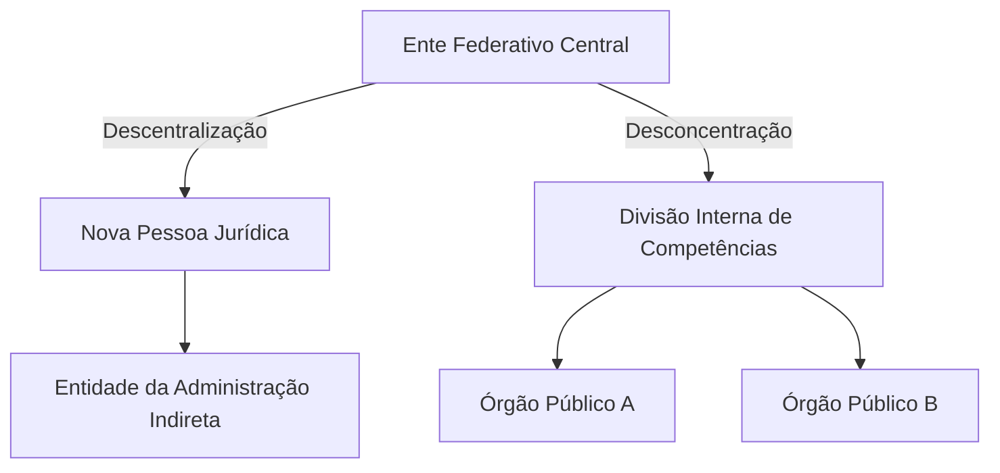
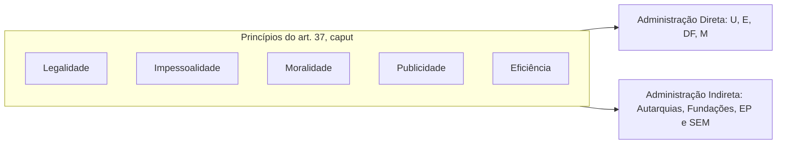
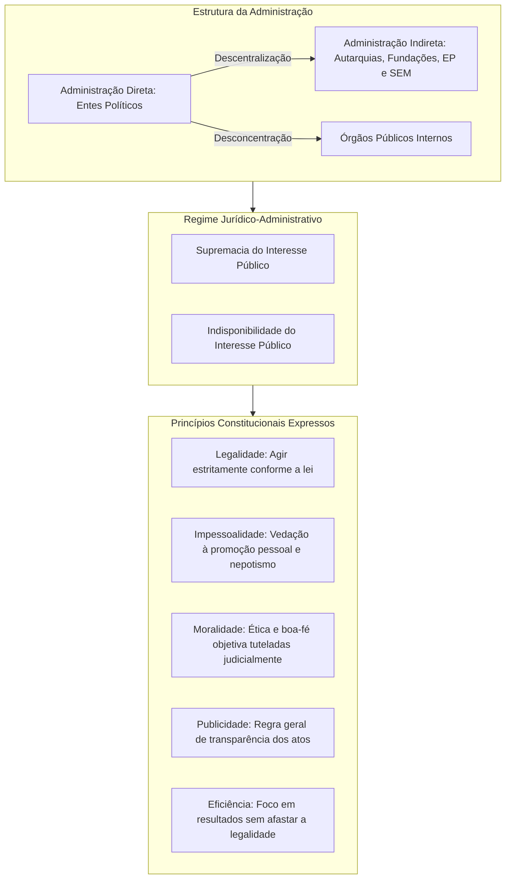

A Administração Pública constitui o aparelho do Estado encarregado de executar as leis, prestar serviços públicos essenciais e concretizar os objetivos fundamentais da República. Na Constituição Federal de 1988, o tema ganha disciplina detalhada no Capítulo VII do Título III, a partir do art. 37. Compreender os sentidos da Administração e os princípios que regem sua conduta é indispensável, pois esses conceitos orientam todas as normas administrativas subsequentes.

> [!objetivos]
> - Diferenciar a Administração Pública em seus sentidos objetivo e subjetivo, amplo e estrito.
> - Distinguir com precisão descentralização de desconcentração e reconhecer as formas de criação das entidades da Administração Indireta.
> - Contrastar o regime jurídico da Administração com o regime jurídico-administrativo.
> - Analisar os cinco princípios expressos no art. 37, *caput*, da Constituição Federal e suas repercussões jurisprudenciais.

## Conceito e sentidos da Administração Pública

O termo Administração Pública comporta múltiplos significados no direito brasileiro. Sob a ótica constitucional, é fundamental reconhecer que as funções estatais são distribuídas entre os Poderes Executivo, Legislativo e Judiciário (CF, art. 2º). Embora o Poder Executivo exerça a função administrativa como sua tarefa típica e predominante, os Poderes Legislativo e Judiciário também administram em caráter atípico. Quando um tribunal de justiça realiza concurso público para servidores ou quando uma assembleia legislativa adquire materiais por licitação, ambos atuam materialmente como Administração Pública.

Para organizar esses conceitos, a doutrina divide a expressão em dois critérios principais: o critério da extensão (sentido amplo versus sentido estrito) e o critério do enfoque (sentido subjetivo versus sentido objetivo).

### Sentido amplo e sentido estrito

No **sentido amplo**, a Administração Pública compreende tanto os órgãos governamentais e políticos, responsáveis pela formulação de diretrizes e planos de governo, quanto os órgãos e pessoas administrativas, incumbidos de executar os programas aprovados. Abrange, portanto, a cúpula que toma as decisões políticas superiores e a máquina técnica subordinada.

No **sentido estrito**, a expressão é restrita aos órgãos e entidades que exercem exclusivamente a função administrativa típica. Ficam de fora os órgãos de cunho meramente político de condução das diretrizes nacionais. Em sentido estrito, administrar é aplicar a lei de ofício, prestando serviços, gerindo bens e atendendo às necessidades coletivas.

### Sentido subjetivo e sentido objetivo

Essa divisão é a mais explorada em provas de concurso público.

No **sentido subjetivo**, também denominado **formal** ou **orgânico**, a Administração Pública define *quem* exerce a função administrativa. Designa o conjunto de agentes, órgãos públicos e pessoas jurídicas instituídos pelo ordenamento para integrar o aparelho estatal. No Brasil, vigora o critério formal: somente integra a Administração Pública em sentido subjetivo quem a legislação expressamente define como tal. Assim, concessionárias privadas prestadoras de serviço público, embora executem atividades de interesse geral, não fazem parte da Administração formal.

No **sentido objetivo**, denominado ainda **material** ou **funcional**, a expressão designa *o que* é feito, isto é, a própria atividade administrativa em concreto. Sob esse ângulo, a Administração abrange quatro atividades nucleares:
1. **Serviço público**: toda prestação direta ou indireta de utilidade aos cidadãos sob regime de direito público, como transporte coletivo, fornecimento de energia e saneamento básico.
2. **Polícia administrativa**: atividade estatal de condicionamento ou limitação do exercício de direitos individuais e do uso da propriedade em benefício do bem-estar coletivo e da segurança pública.
3. **Fomento**: incentivo estatal a atividades privadas de interesse coletivo, por meio de subvenções, isenções fiscais ou parcerias com o terceiro setor.
4. **Intervenção**: atuação do Estado no domínio econômico e regulatório, fiscalizando ou operando setores estratégicos nos termos autorizados pelo art. 173 da Constituição.

A tabela a seguir sistematiza as diferenças entre essas acepções conceituais.

| Critério | Sentido | Pergunta-chave | Conteúdo |
| --- | --- | --- | --- |
| Extensão | **Amplo** | Qual a amplitude da atuação? | Órgãos políticos superiores somados ao aparato técnico de execução |
| Extensão | **Estrito** | Apenas execução? | Exclusivamente os órgãos e entidades que executam a função administrativa |
| Enfoque | **Subjetivo** (formal ou orgânico) | **Quem** faz? | O conjunto de pessoas jurídicas, órgãos e agentes públicos estatais |
| Enfoque | **Objetivo** (material ou funcional) | **O que** faz? | A atividade administrativa: polícia, serviço público, fomento e intervenção |

> [!pegadinha]
> A banca costuma inverter os termos: afirmar que o sentido subjetivo é a atividade e o sentido objetivo são os órgãos. Lembre-se: objetivo foca no objeto (a tarefa); subjetivo foca no sujeito (quem realiza).

## Organização administrativa: descentralização e desconcentração

O Estado estrutura sua máquina administrativa para prestar serviços de maneira ágil e organizada. Para atingir essa finalidade, recorre a duas técnicas fundamentais que não podem ser confundidas: a descentralização e a desconcentração.

### Descentralização administrativa

A **descentralização** ocorre quando o Estado distribui competências administrativas para **outra pessoa jurídica**, distinta do ente político central. Há sempre a presença de duas ou mais pessoas jurídicas na relação. A descentralização pode ocorrer por outorga (quando a lei transfere a titularidade e a execução do serviço a uma entidade da Administração Indireta) ou por delegação (quando o poder público transfere apenas a execução do serviço a particulares, como ocorre nos contratos de concessão e permissão).

A Administração Pública brasileira divide-se estruturalmente em:
- **Administração Direta**: composta pelos próprios entes federativos dotados de soberania ou autonomia política: União, Estados, Distrito Federal e Municípios.
- **Administração Indireta**: reúne as pessoas jurídicas dotadas de autonomia que desempenham funções de forma descentralizada. Abrange quatro espécies fundamentais: autarquias, fundações estatais, empresas públicas e sociedades de economia mista.

### Desconcentração administrativa

A **desconcentração**, por outro lado, é uma técnica interna de distribuição de atribuições **dentro da mesma pessoa jurídica**. Não cria pessoas jurídicas novas; cria apenas **órgãos públicos**. Os órgãos são centros despersonalizados de competências, integrados à estrutura de uma pessoa jurídica única.

Um exemplo clássico ocorre quando a Secretaria de Defesa Social de um Estado divide suas atribuições territoriais entre diversos batalhões de bombeiros e delegacias de polícia. Todos esses batalhões e delegacias são órgãos internos desprovidos de personalidade jurídica própria. Os atos por eles praticados são juridicamente imputados ao respectivo Estado-membro.

O fluxograma abaixo esquematiza a diferença estrutural entre essas duas técnicas de organização administrativa.

> [!bizu]
> Guarde a letra marcante de cada instituto:
> - Desconcen**tra**ção tem **O**: cria **Ó**rgãos (distribuição interna na mesma pessoa).
> - Descen**tra**lização tem **E**: cria **E**ntidades (pessoas jurídicas autônomas).

### Criação das entidades da Administração Indireta

A Constituição Federal estabelece regras estritas para a instituição de entidades descentralizadas em seu art. 37, incisos XIX e XX. Essas regras definem se a pessoa jurídica nasce diretamente com a vigência da lei ou se necessita de registro posterior de seus atos constitutivos em cartório ou junta comercial.

> [!lei] CF, art. 37, XIX
> somente por lei específica poderá ser criada autarquia e autorizada a instituição de empresa pública, de sociedade de economia mista e de fundação, cabendo à lei complementar, neste último caso, definir as áreas de sua atuação;

O texto constitucional estabelece um tratamento diferenciado:
1. **Autarquias**: são pessoas jurídicas de direito público com patrimônio e receita próprios, criadas para desempenhar atividades típicas de Estado. A autarquia é **criada diretamente por lei ordinária específica**. A publicação da lei cria a entidade de pleno direito, independentemente de registro civil.
2. **Empresas públicas e sociedades de economia mista**: ostentam personalidade jurídica de direito privado. A lei ordinária específica não opera seu surgimento automático; apenas **autoriza** sua criação. A existência legal dessas empresas estatais inicia-se com o registro de seus atos constitutivos no órgão registral competente (Junta Comercial ou Cartório).
3. **Fundações públicas**:
   - Se possuírem personalidade de **direito público** (fundações autárquicas), seguem o regime das autarquias e são criadas diretamente por lei específica.
   - Se possuírem personalidade de **direito privado**, sua instituição é autorizada por lei específica, e cabe obrigatoriamente a uma **lei complementar** definir suas áreas de atuação material (saúde, assistência social, pesquisa científica).

O inciso XX do art. 37 complementa essa sistemática determinando que a criação de subsidiárias das entidades da Administração Indireta, bem como sua participação em empresas privadas, depende de autorização legislativa em cada caso. O Supremo Tribunal Federal fixou entendimento de que essa autorização legislativa para subsidiárias não precisa constar de lei individual para cada nova empresa: basta uma autorização genérica prevista na própria lei instituidora da empresa estatal matriz.

A tabela abaixo compara as entidades da Administração Indireta quanto à personalidade jurídica e forma de criação.

| Entidade | Personalidade jurídica | Forma de nascimento | Exigência constitucional |
| --- | --- | --- | --- |
| Autarquia | Pública | Criada por lei específica | Vigência imediata da lei instituidora |
| Fundação pública de direito público | Pública | Criada por lei específica | Equiparada à autarquia (autarquia fundacional) |
| Fundação pública de direito privado | Privada | Autorizada por lei específica | Lei complementar define as áreas de atuação |
| Empresa pública | Privada | Autorizada por lei específica | Registro civil dos atos constitutivos no órgão de comércio |
| Sociedade de economia mista | Privada | Autorizada por lei específica | Registro civil; capital com maioria de ações com voto estatal |

> [!atencao] Criação versus autorização
> As bancas costumam afirmar que "todas as entidades da administração indireta são criadas por lei". Isso está errado. Apenas as autarquias são criadas diretamente por lei. As empresas públicas, sociedades de economia mista e fundações privadas têm sua instituição meramente autorizada pelo parlamento.

## Regime jurídico da Administração versus regime jurídico-administrativo

A atuação estatal submete-se a regras que conciliam a autoridade pública com os direitos individuais. A teoria geral do direito público distingue a expressão geral "regime jurídico da Administração" da fórmula técnica "regime jurídico-administrativo".

### O regime jurídico da Administração (gênero)

O **regime jurídico da Administração** é uma categoria ampla (gênero). Engloba a totalidade dos regimes jurídicos que incidem sobre o Estado no exercício de suas variadas atribuições. O poder público atua sob regime de **direito público** quando desempenha suas funções típicas e presta serviços públicos universais. Entretanto, o Estado também pode atuar sob regime de **direito privado**, de modo derrogado ou atenuado, quando explora atividade econômica ou celebra negócios civis comuns, como um contrato de locação em que a Administração figura como locatária de um imóvel particular.

### O regime jurídico-administrativo (espécie)

O **regime jurídico-administrativo** é uma espécie qualificada de direito público. Trata-se do conjunto harmônico de princípios e regras especiais que concedem à Administração Pública privilégios jurídicos e, em contrapartida, impõem restrições que não existem no direito civil comum. Esse regime apoia-se sobre dois pilares fundamentais articulados pela doutrina de Celso Antônio Bandeira de Mello:

1. **Supremacia do interesse público sobre o privado**: confere à Administração prerrogativas e poderes especiais destinados a fazer prevalecer o bem comum sobre os interesses particulares. Essas prerrogativas manifestam-se na presunção de legitimidade dos atos administrativos, na autoexecutoriedade de medidas urgentes, na imperatividade e nas cláusulas exorbitantes em contratos administrativos (como a alteração unilateral do contrato e a rescisão unilateral por interesse público).
2. **Indisponibilidade do interesse público**: atua como contrapeso indispensável às prerrogativas. Os administradores públicos não são proprietários da coisa pública; são meros gestores de bens e interesses que pertencem à coletividade. Por isso, a autoridade não pode renunciar a direitos, tolerar desperdício, conceder privilégios nem deixar de cumprir a lei. A indisponibilidade impõe sujeições severas, tais como a obrigatoriedade de licitação para contratações públicas, a exigência de concurso público para provimento de cargos e a submissão a prazos e ritos formais rígidos.

A tabela comparativa a seguir destaca as particularidades de cada regime.

| Instituto | Natureza | Abrangência | Fundamento central |
| --- | --- | --- | --- |
| **Regime jurídico da Administração** | Gênero | Abrange regimes de direito público e privado | Aplicação do direito comum temperado ou do direito especial |
| **Regime jurídico-administrativo** | Espécie | Exclusivo de direito público | Binômio supremacia e indisponibilidade do interesse público |

## Princípios expressos da Administração Pública

O art. 37, *caput*, da Carta Magna impõe diretrizes éticas e jurídicas de observância compulsória em todas as esferas federativas (União, Estados, Distrito Federal e Municípios), incidindo sobre os três Poderes e alcançando a estrutura governamental centralizada e as entidades descentralizadas. São conhecidos pelo consagrado mnemônico **LIMPE**: Legalidade, Impessoalidade, Moralidade, Publicidade e Eficiência.

> [!lei] CF, art. 37, caput
> A administração pública direta e indireta de qualquer dos Poderes da União, dos Estados, do Distrito Federal e dos Municípios obedecerá aos princípios de legalidade, impessoalidade, moralidade, publicidade e eficiência e, também, ao seguinte:

Esses cinco princípios possuem aplicação universal em todos os níveis federativos e poderes da República. O esquema a seguir ilustra a convergência desses vetores sobre a conduta administrativa.

A seguir, analisamos cada um dos princípios expressos de forma pormenorizada.

### Princípio da legalidade

A legalidade é a base basilar do Estado Democrático de Direito e representa a garantia do cidadão contra arbítrios e desmandos estatais. O conteúdo desse princípio assume feições radicalmente opostas quando aplicado aos particulares ou à Administração Pública.

Para os **particulares**, a legalidade vigora em sentido amplo e de autonomia da vontade, conforme o art. 5º, inciso II, da Constituição: ninguém será obrigado a fazer ou deixar de fazer alguma coisa senão em virtude de lei. Ao cidadão comum, tudo o que a lei não proíbe expressamente é juridicamente permitido.

Para a **Administração Pública**, vigora o princípio da **estrita legalidade** (ou vinculação positiva à lei). O agente público só pode atuar quando houver prévia e expressa autorização ou determinação em lei formal. O silêncio da lei não confere liberdade de escolha ao gestor; pelo contrário, veda a atuação. Enquanto o particular pode fazer tudo o que a lei não impede, a autoridade pública só pode agir nos exatos termos em que a lei ordena ou autoriza.

Diferenciam-se ainda a **legalidade formal** (observância do processo legislativo regular previsto na Constituição) e a **legalidade material** (conformidade substancial do ato com os valores e direitos fundamentais assegurados pelo texto constitucional, conceito frequentemente chamado de princípio da juridicidade).

### Princípio da impessoalidade

O princípio da impessoalidade impõe que a atividade administrativa seja direcionada ao atendimento exclusivo do interesse público, sem favorecimentos indevidos nem perseguições a pessoas determinadas. A doutrina e a jurisprudência desdobram a impessoalidade em quatro vertentes essenciais:

1. **Finalidade pública**: o ato administrativo só é válido se buscar atingir a finalidade que a lei lhe assinalou, que é sempre o interesse coletivo. Praticar um ato para prejudicar um adversário político ou beneficiar um aliado configura desvio de finalidade (ou desvio de poder), tornando o ato nulo.
2. **Igualdade e isonomia**: todos os administrados em situações equivalentes devem receber tratamento paritário do Estado. Disso decorrem as exigências universais de concurso público para seleção de pessoal (art. 37, II) e de processo licitatório para contratações públicas (art. 37, XXI).
3. **Imputação volitiva (teoria do órgão)**: os atos praticados pelos agentes públicos no exercício de suas funções não são atribuídos à pessoa física do servidor, mas sim ao órgão ou entidade pública a que pertencem. Quando um bombeiro militar realiza uma vistoria técnica contra incêndio, quem atuou juridicamente foi o Corpo de Bombeiros Militar, corporação do Estado, e não a pessoa física do militar.
4. **Vedação à promoção pessoal**: expressamente disciplinada no § 1º do art. 37 da Constituição Federal.

> [!lei] CF, art. 37, § 1º
> A publicidade dos atos, programas, obras, serviços e campanhas dos órgãos públicos deverá ter caráter educativo, informativo ou de orientação social, dela não podendo constar nomes, símbolos ou imagens que caracterizem promoção pessoal de autoridades ou servidores públicos.

A publicidade oficial deve ter como objetivo exclusivo informar e orientar a população. A inserção de nomes de prefeitos, governadores ou comandantes em placas de obras, viaturas oficiais, uniformes ou folhetos informativos viola diretamente o princípio da impessoalidade e configura ato de improbidade administrativa.

> [!exemplo]
> O comandante de uma unidade bombeiro militar inaugura um posto de resgate com recursos do orçamento público estadual. No portal de entrada, afixa uma placa contendo sua fotografia pessoal em tamanho destacado e a frase: "Homenagem ao brilhante comando do Tenente-Coronel Rocha". Essa conduta afronta frontalmente o art. 37, § 1º, da Constituição. Os recursos e a obra pertencem à corporação pública e ao Estado, sendo vedada a utilização do aparato estatal para autopromoção pessoal de autoridade.

### A Súmula Vinculante 13 e o nepotismo

A vertente da impessoalidade e da moralidade fundamenta a vedação ao **nepotismo** na Administração Pública. Para conferir eficácia prática a essa diretriz, o Supremo Tribunal Federal editou a Súmula Vinculante 13.

> [!jurisprudencia] STF, Súmula Vinculante 13
> O STF veda a indicação de familiares (cônjuge, companheiro ou parentes até terceiro grau) da autoridade ou de ocupante de cargo de chefia para postos comissionados ou funções de confiança na Administração direta e indireta de qualquer Poder, alcançando ajustes por nomeações cruzadas.

A súmula vinculante estabelece três aspectos fundamentais:
- Alcança o parentesco consanguíneo ou afim até o **terceiro grau** (pais, filhos, avós, netos, irmãos, tios e sobrinhos).
- Proíbe tanto o nepotismo direto quanto o **nepotismo cruzado** (designações recíprocas entre autoridades de órgãos distintos que trocam nomeações de parentes).
- Não depende de lei ordinária para produzir efeitos: a proibição decorre diretamente dos princípios constitucionais da moralidade e da impessoalidade.

> [!pegadinha] Nepotismo e cargos políticos
> A jurisprudência consolidada do STF afasta a incidência automática da Súmula Vinculante 13 em relação a **cargos de natureza estritamente política**, como Ministros de Estado e Secretários Estaduais ou Municipais. A nomeação de um irmão ou cônjuge para o cargo de Secretário de Estado é admitida em regra, exceto se houver manifesta falta de qualificação técnica ou inequívoca demonstração de fraude à lei e má-fé.

### Princípio da moralidade

O princípio da moralidade administrativa não se confunde com a moral comum ou com as noções subjetivas de justiça de cada indivíduo. Trata-se de uma **moralidade jurídica e objetiva**, que exige dos agentes estatais conduta leal, honesta, transparente e orientada pela boa-fé.

A moralidade administrativa possui **autonomia jurídica**: um ato pode ser formalmente legal (cumprir os requisitos da lei escrita) e, não obstante, ser manifestamente imoral. Em tais circunstâncias, o ato é nulo e passível de invalidação pelo próprio Poder Público ou pelo Poder Judiciário. A Constituição confere a qualquer cidadão legitimidade ativa para ajuizar **ação popular**, instrumento processual voltado a desconstituir atos prejudiciais aos cofres públicos, à conduta ética na gestão, ao meio ambiente e ao acervo histórico e cultural (CF, art. 5º, LXXIII).

Outro desdobramento fundamental da moralidade é a repressão rigorosa aos atos de **improbidade administrativa**, previstos no art. 37, § 4º, que acarretam sanções como suspensão dos direitos políticos, perda da função pública, indisponibilidade dos bens e ressarcimento ao erário.

### Princípio da publicidade

O princípio da publicidade determina a divulgação ampla e acessível dos atos administrativos e das decisões estatais aos cidadãos. A transparência cumpre duas funções centrais:
1. **Condição de eficácia**: os atos administrativos que produzem efeitos externos ou impõem obrigações aos cidadãos (como editais de concurso, regulamentos e nomeações) só passam a produzir efeitos jurídicos após sua publicação no órgão oficial de imprensa.
2. **Controle social e institucional**: a publicidade viabiliza a fiscalização da conduta dos governantes pelo povo e pelos órgãos de controle externo, como os Tribunais de Contas e o Ministério Público.

A publicidade é a regra geral da atividade estatal. Todavia, a própria Constituição consagra **exceções legítimas** ao dever de divulgação ampla, nos seguintes casos taxativos:
- Quando o **sigilo for imprescindível à segurança da sociedade e do Estado** (CF, art. 5º, XXXIII).
- Na defesa da **intimidade, da vida privada, da honra e da imagem das pessoas** (CF, art. 5º, X e LX), momento em que a lei pode restringir a publicidade de atos processuais ao interesse da intimidade das partes.

A regulamentação geral do direito de acesso a informações públicas foi fixada pela Lei 12.527/2011 (Lei de Acesso à Informação - LAI), que consolidou o princípio da máxima divulgação (a publicidade é a regra geral; o sigilo é a exceção pontual e justificada).

### Princípio da eficiência

O princípio da eficiência foi introduzido no texto do art. 37, *caput*, pela Emenda Constitucional 19/1998, no contexto da Reforma do Aparelho do Estado. Enquanto os princípios da legalidade e da moralidade enfatizam a forma e a ética da conduta, a eficiência volta-se para a **gestão por resultados**, a qualidade dos serviços públicos e o uso econômico dos recursos financeiros do erário.

A eficiência desdobra-se em duas perspectivas:
- Em relação aos **servidores públicos**: exige atuação com dedicação, presteza, rendimento técnico e constante aperfeiçoamento profissional. Fundamenta a perda do cargo de servidor estável mediante procedimento de avaliação periódica de desempenho (CF, art. 41, § 1º, III) e a criação de escolas de governo (CF, art. 39, § 2º).
- Em relação à **estrutura administrativa**: impõe que a máquina pública seja enxuta, adote procedimentos modernos e busque o melhor custo-benefício na aplicação do dinheiro arrecadado da população. Fundamenta o contrato de gestão (CF, art. 37, § 8º), mediante o qual a autonomia gerencial, orçamentária e financeira de órgãos e entidades pode ser ampliada com base em metas previamente pactuadas.

> [!atencao] Eficiência não atropela a legalidade
> O administrador público não pode invocar o princípio da eficiência para dispensar formalidades legais obrigatórias ou ignorar garantias fundamentais dos cidadãos. A eficiência atua em harmonia com a legalidade, jamais como pretexto para a prática de atos arbitrários ou sem amparo em lei.

A tabela abaixo sintetiza os pontos nucleares dos cinco princípios expressos no art. 37, *caput*.

| Princípio | Núcleo do conceito | Desdobramentos fundamentais | Exceções ou limitações |
| --- | --- | --- | --- |
| **Legalidade** | Atuação estritamente autorizada ou determinada em lei | Vinculação positiva do gestor; tutela contra arbítrios | Inexistentes na atividade regular; estado de sítio ou defesa atenuam formalidades |
| **Impessoalidade** | Atuação impessoal focada no bem comum | Vedação à promoção pessoal (§ 1º); combate ao nepotismo (SV 13) | Cargos estritamente políticos não sofrem vedação automática de parentesco |
| **Moralidade** | Ética, lealdade, honestidade e boa-fé objetiva | Autonomia jurídica do vício moral; tutela por ação popular | Não se confunde com a moralidade comum individual do administrador |
| **Publicidade** | Transparência dos atos e decisões administrativas | Condição de eficácia dos atos externos; controle social da gestão | Segurança da sociedade e do Estado; intimidade e vida privada |
| **Eficiência** | Busca por produtividade, rapidez e qualidade no gasto | Avaliação de desempenho; contratos de gestão (art. 37, § 8º) | Subordina-se à legalidade; não autoriza supressão de garantias |

## Mapa do capítulo

### Para fixar

- No sentido subjetivo ou formal, a Administração Pública compreende exclusivamente as pessoas jurídicas, órgãos e agentes públicos reconhecidos pelo direito estatal.
- No sentido objetivo ou funcional, a Administração corresponde à própria atividade administrativa desempenhada: serviço público, polícia administrativa, fomento e intervenção.
- A descentralização transfere competências para outra pessoa jurídica distinta, enquanto a desconcentração distribui competências internamente em uma mesma pessoa jurídica, criando órgãos despersonalizados.
- As autarquias são criadas diretamente por lei específica, enquanto empresas públicas, sociedades de economia mista e fundações têm sua criação autorizada por lei.
- O regime jurídico-administrativo apoia-se no binômio composto pela supremacia do interesse público (prerrogativas) e indisponibilidade do interesse público (sujeições).
- A legalidade impõe ao gestor a vinculação positiva à lei, agindo estritamente nos termos expressamente permitidos ou determinados pela legislação.
- A publicidade oficial tem caráter educativo, informativo ou de orientação social, vedada qualquer menção, símbolo ou imagem que identifique promoção pessoal de agentes públicos (CF, art. 37, § 1º).
- A Súmula Vinculante 13 do STF proíbe o nepotismo direto e cruzado até o terceiro grau na Administração direta e indireta, ressalvados em regra os cargos de natureza estritamente política.
- A moralidade administrativa é jurídica e objetiva, permitindo a anulação de atos formalmente legais que sejam substancialmente desonestos ou lesivos à ética coletiva.
- A eficiência exige busca constante de produtividade e qualidade na prestação dos serviços públicos, mas não autoriza o descumprimento dos ditames da legalidade estrita.
