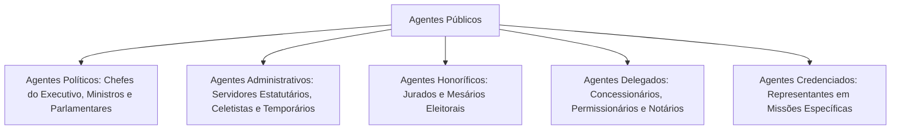
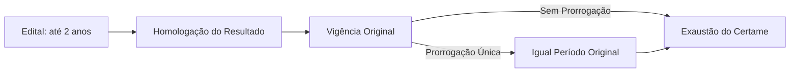
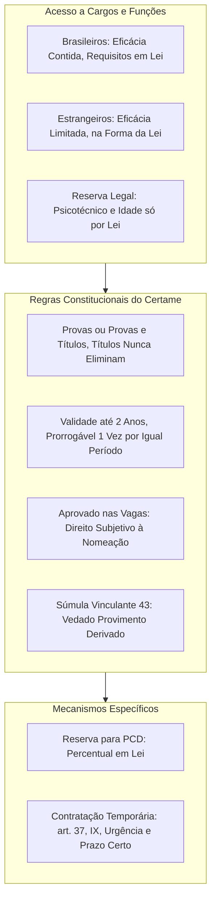

Além dos postulados expressos no art. 37 da Constituição, a atividade estatal submete-se a postulados implícitos que decorrem do regime democrático e da separação de Poderes. Este capítulo analisa esses postulados fundamentais, a classificação dos agentes que atuam em nome do Estado e o regramento constitucional do concurso público, porta de entrada universal para o serviço público efetivo. O tema é cobrado intensamente em provas de segurança pública e carreiras civis e militares.

> [!objetivos]
> - Identificar os principais princípios implícitos da Administração e suas manifestações práticas.
> - Categorizar as diferentes espécies de agentes públicos que compõem o aparelho do Estado.
> - Dominar as regras constitucionais de investidura, validade e prioridade em concursos públicos.
> - Aplicar a jurisprudência consolidada dos tribunais superiores relativa a cotas, requisitos de edital e contratação temporária.

## Princípios implícitos da Administração Pública

O texto constitucional não esgota nos cinco mandamentos do art. 37, *caput*, os deveres impostos aos gestores. O sistema jurídico brasileiro abriga princípios implícitos (ou reconhecidos), deduzidos diretamente do Estado Democrático de Direito e das garantias fundamentais.

A seguir, estudamos os princípios implícitos de maior repercussão nas provas de concurso público.

### Autotutela e controle judicial

O princípio da **autotutela** confere à Administração Pública o poder e o dever de controlar os seus próprios atos, sem necessitar de prévia autorização judicial. Esse controle ocorre sob duas vertentes fundamentais:

1. **Anulação de atos ilegais**: quando o ato nasce em desconformidade com a lei, a Administração deve anulá-lo de ofício ou mediante provocação. A anulação opera efeitos retroativos (*ex tunc*), desconstituindo as consequências jurídicas desde a origem, ressalvados os direitos de terceiros de boa-fé.
2. **Revogação de atos inconvenientes ou inoportunos**: incide exclusivamente sobre atos válidos e discricionários. A autoridade extingue o ato porque sua manutenção deixou de atender ao interesse público no momento presente. A revogação opera efeitos prospectivos (*ex nunc*), preservando todos os efeitos pretéritos.

> [!jurisprudencia] STF, Súmula 473
> A Administração detém a prerrogativa de anular os seus atos quando viciados de ilegalidade, dos quais não decorrem direitos, bem como revogá-los por conveniência e oportunidade, resguardados os direitos consolidados e assegurado sempre o controle judicial.

A parte final da Súmula 473 consagra o princípio da **sindicabilidade** (ou controle judicial). O Brasil adota o sistema de **jurisdição una** (sistema inglês), segundo o qual o Poder Judiciário tem competência exclusiva para dirimir conflitos com força definitiva de coisa julgada (CF, art. 5º, XXXV). Nenhum litígio administrativo pode ser subtraído da análise judicial. Diferencia-se do sistema francês de contencioso administrativo, no qual tribunais administrativos especiais julgam em caráter terminal as causas contra o Estado.

### Segurança jurídica e proteção da confiança

O princípio da **segurança jurídica** visa garantir estabilidade às relações jurídicas constituídas e proteger a confiança legítima dos cidadãos na atuação regular do Estado. Esse princípio manifesta-se de três formas principais:
- **Vedação de aplicação retroativa de nova interpretação**: quando a Administração altera sua interpretação sobre determinada norma, o novo entendimento só pode ser aplicado aos casos futuros. Não é permitido desconstituir situações consolidadas sob a interpretação anterior.
- **Decadência do direito de anular**: a lei fixa prazos para que a Administração anule atos ilegais que geraram efeitos favoráveis aos administrados (na esfera federal, o prazo decadencial é de cinco anos, ressalvada má-fé comprovada).
- **Proteção do direito adquirido, do ato jurídico perfeito e da coisa julgada**: garantias fundamentais consagradas no art. 5º, XXXVI, da Constituição.

### Motivação

O princípio da **motivação** exige que a autoridade administrativa exponha os fundamentos de fato (os acontecimentos concretos) e os fundamentos de direito (os artigos de lei aplicáveis) que justificam a edição de determinado ato. A motivação permite ao cidadão fiscalizar se a decisão foi arbitrária e viabiliza o controle pelo Poder Judiciário e pelos órgãos externos de controle.

Como regra geral, todo ato administrativo deve ser motivado, especialmente quando impõe sanções, restringe direitos, nega benefícios ou resulta de processo seletivo ou disciplinar. A exceção pontual é a exoneração de ocupante de cargo em comissão (cargo de livre nomeação e livre exoneração), na qual a autoridade não necessita justificar os motivos da dispensa.

### Razoabilidade e proporcionalidade

A **razoabilidade** e a **proporcionalidade** funcionam como freios ao arbítrio administrativo, especialmente no exercício de competências discricionárias. Exigem que o Estado atue com bom senso, moderação e adequação entre os meios empregados e os fins que a lei busca alcançar.

A jurisprudência constitucional divide a proporcionalidade em três elementos de análise sucessiva:
1. **Adequação**: o meio adotado é apto e suficiente para atingir o objetivo pretendido pela Administração?
2. **Necessidade (ou exigibilidade)**: entre os meios aptos disponíveis, o meio escolhido é o menos gravoso aos direitos dos administrados?
3. **Proporcionalidade em sentido estrito**: as vantagens públicas geradas pela medida superam os prejuízos e sacrifícios suportados pelo cidadão?

> [!bizu]
> Lembre-se do mnemônico **PAN** para as três dimensões da proporcionalidade:
> - **P**: Proporcionalidade em sentido estrito (custo-benefício real).
> - **A**: Adequação (o meio serve ao fim).
> - **N**: Necessidade (o meio menos danoso).

### Continuidade do serviço público

O princípio da **continuidade** estabelece que os serviços públicos, por atenderem a necessidades indispensáveis da coletividade, não devem sofrer interrupções injustificadas. É dele que decorrem normas rígidas sobre o exercício do direito de greve dos servidores públicos civis e a proibição absoluta de greve para os militares (CF, art. 42, § 1º c/c art. 142, § 3º, IV).

A tabela abaixo resume os princípios implícitos essenciais da atuação administrativa.

| Princípio | Conceito fundamental | Consequência jurídica prática |
| --- | --- | --- |
| **Autotutela** | Poder de controle interno dos próprios atos | Anulação de atos ilegais (*ex tunc*) e revogação de inoportunos (*ex nunc*) |
| **Sindicabilidade** | Submissão dos atos estatais ao crivo judicial | Sistema de jurisdição una (CF, art. 5º, XXXV); não há coisa julgada administrativa |
| **Segurança jurídica** | Estabilidade das relações e proteção da confiança | Vedação de aplicação retroativa de nova interpretação jurídica |
| **Motivação** | Explicitação dos fatos e fundamentos legais | Nulidade do ato quando ausentes ou falsos os motivos declarados |
| **Proporcionalidade** | Equilíbrio entre meios estatais e fins legais | Teste tríplice: adequação, necessidade e proporcionalidade em sentido estrito |
| **Continuidade** | Serviços públicos não admitem interrupção indevida | Restrições ao direito de greve e regras estritas de reversão de bens |

## Agentes públicos e regras constitucionais de acesso

O conceito de **agente público** é amplo e engloba toda pessoa física que exerce, ainda que transitoriamente ou sem remuneração, por eleição, nomeação, designação, contratação ou qualquer outra forma de investidura ou vínculo, mandato, cargo, emprego ou função nas entidades estatais.

A doutrina clássica classifica os agentes públicos em cinco categorias fundamentais:

1. **Agentes políticos**: integram os escalões superiores do poder estatal e exercem mandatos, participando da formação da vontade política soberana da nação (Chefes do Poder Executivo, membros do Legislativo, Ministros de Estado, Secretários e magistrados).
2. **Agentes administrativos**: mantêm vínculo funcional profissional e permanente ou temporário com o Estado. Dividem-se em:
   - **Servidores públicos em sentido estrito (estatutários)**: titulares de cargos públicos efetivos ou em comissão, submetidos a regime jurídico estatutário próprio.
   - **Empregados públicos**: contratados sob o regime da Consolidação das Leis do Trabalho (CLT), ocupantes de empregos públicos, típicos de empresas públicas e sociedades de economia mista.
   - **Servidores temporários**: admitidos transitoriamente para atender a excepcional interesse público em regime administrativo especial (CF, art. 37, IX).
3. **Agentes honoríficos**: cidadãos convocados ou nomeados para prestar serviços específicos ao Estado em razão de sua honra e cidadania, sem vínculo empregatício profissional e geralmente sem remuneração (como jurados do Tribunal do Júri e mesários eleitorais).
4. **Agentes delegados**: particulares que recebem a incumbência de executar um serviço público em nome próprio e por sua conta e risco, sob fiscalização do poder público (como concessionários e permissionários de serviços de transporte e titulares de cartórios extrajudiciais).
5. **Agentes credenciados**: pessoas que recebem do poder público autorização para representar o Estado em missão internacional ou evento técnico determinado.

### Regras constitucionais de acesso aos cargos públicos

O art. 37, inciso I, da Constituição Federal estabelece os parâmetros fundamentais para o ingresso no quadro funcional estatal.

> [!lei] CF, art. 37, I
> os cargos, empregos e funções públicas são acessíveis aos brasileiros que preencham os requisitos estabelecidos em lei, assim como aos estrangeiros, na forma da lei;

A análise detalhada do dispositivo revela diretrizes de suma relevância:

- **Acesso de brasileiros**: a norma é de **eficácia contida**. O direito de acesso é imediato, mas a lei ordinária pode instituir restrições e requisitos específicos compatíveis com a natureza do cargo (como grau de instrução, aptidão física e capacitação técnica). Na ausência de lei, o acesso é amplo.
- **Acesso de estrangeiros**: a norma é de **eficácia limitada**. Estrangeiros não possuem direito automático de acesso a qualquer cargo; dependem de lei que expressamente regulamente e autorize o ingresso. O art. 207, § 1º, da Constituição, por exemplo, autoriza universidades e instituições de pesquisa científica a admitir docentes, pesquisadores e cientistas estrangeiros.

### Princípio da reserva legal estrita para requisitos de ingresso

Uma das pegadinhas mais recorrentes em concursos públicos diz respeito à exigência de requisitos impostos aos candidatos em editais.

O Supremo Tribunal Federal fixou diretriz pacífica: **todo requisito de acesso a cargo público deve estar obrigatoriamente previsto em lei formal em sentido estrito**. O edital de concurso não pode criar requisitos, limitações ou barreiras que não constem expressamente da lei criadora da carreira. O edital limita-se a detalhar o que a lei já previu.

Três temas merecem destaque minucioso:

### Aspectos do exame psicotécnico

A realização de avaliação psicológica em concursos públicos exige previsão em lei formal, critérios objetivos e direito a recurso. Essa matéria gerou a Súmula Vinculante 44 do STF.

> [!jurisprudencia] STF, Súmula Vinculante 44
> A submissão de candidato em certame público a avaliação psicotécnica depende obrigatoriamente de expressa previsão em lei formal.

Para que o exame psicotécnico seja juridicamente válido, três requisitos cumulativos devem ser observados pela Administração:
- Previsão expressa em lei em sentido formal (não basta constar do edital ou de portaria).
- Objetividade dos critérios de correção e avaliação (vedada avaliação subjetiva ou sigilosa).
- Publicidade dos resultados e garantia de ampla defesa e contraditório ao candidato não recomendado.

### Critérios de limite de idade

A imposição de limites de idade mínimo ou máximo para inscrição ou posse em concurso público é tema de extrema relevância, especialmente em carreiras militares e de segurança pública.

O STF sumulou (Súmula 683) que a fixação de limite de idade para inscrição em certames depende de amparo em lei em sentido formal e necessita de fundamentação estrita nas particularidades e exigências físicas das tarefas do cargo. Para as corporações militares estaduais, a exigência de limite de idade encontra amparo legal no desgaste físico e nos rigores operacionais próprios da carreira militar.

Além disso, o STF firmou o entendimento de que a comprovação do limite máximo de idade deve ocorrer no momento da **inscrição no concurso público**, e não no ato da posse, haja vista que a duração do certame não pode prejudicar quem preenchia os requisitos legais quando se candidatou. Em contrapartida, as demais exigências de titulação e registro profissional devem ser comprovadas na data da **posse** (STJ, Súmula 266).

### Diretrizes sobre tatuagens

O STF fixou tese em repercussão geral (Tema 856) estabelecendo que **editais de concurso público não podem estabelecer restrições a pessoas com tatuagem**, salvo situações excepcionais em que os desenhos expressem incitação à violência, apologia ao crime, discriminação racial ou ofensa grave aos valores e princípios constitucionais. Tatuagens comuns e visíveis são manifestações da liberdade individual e não autorizam a exclusão sumária de candidatos a postos policiais ou militares.

A tabela comparativa a seguir organiza os momentos em que cada requisito deve ser comprovado pelo candidato.

| Requisito do certame | Momento de comprovação | Fundamento jurisprudencial |
| --- | --- | --- |
| **Limite máximo de idade** | No ato da **inscrição** no concurso | STF (garantia contra a morosidade do certame) |
| **Grau de escolaridade / diploma** | No ato da **posse** no cargo | STJ, Súmula 266 |
| **Habilitação técnica e registro de classe** | No ato da **posse** no cargo | STJ, Súmula 266 |
| **Atividade jurídica (Magistratura e MP)** | Na **inscrição definitiva** do concurso | CF, arts. 93, I e 129, § 3º |
| **Aptidão física e mental** | Durante as **etapas do certame** | Previsão em lei específica e edital convocatório |

## Normas e jurisprudência do concurso público

O concurso público consagra os princípios republicano, da igualdade e da impessoalidade, garantindo a todos os cidadãos qualificados a oportunidade de disputar posições na estrutura do Estado em igualdade de condições.

> [!lei] CF, art. 37, II
> a investidura em cargo ou emprego público depende de aprovação prévia em concurso público de provas ou de provas e títulos, de acordo com a natureza e a complexidade do cargo ou emprego, na forma prevista em lei, ressalvadas as nomeações para cargo em comissão declarado em lei de livre nomeação e exoneração;

Da leitura atenta desse dispositivo, extraem-se regras mandatórias:
- O concurso pode ser de **provas** ou de **provas e títulos**.
- É **vedado o concurso exclusivamente de títulos**. A avaliação de títulos possui natureza estritamente **classificatória**, e jamais eliminatória. O candidato não pode ser reprovado apenas por não possuir títulos acadêmicos complementares.
- A exigência alcança tanto a **Administração Direta** quanto a **Administração Indireta**, abrangendo cargos estatutários e empregos públicos de empresas estatais (sociedades de economia mista e empresas públicas).
- Excepcionam-se da regra os cargos em comissão de livre nomeação e exoneração, as contratações temporárias (art. 37, IX) e os mandatos eletivos.

### Vedação a provimentos derivados transversais

No passado, admitiam-se institutos administrativos que permitiam a transposição ou ascensão funcional de servidores de uma carreira para outra sem aprovação em novo concurso. Essa prática foi banida pela ordem constitucional de 1988, resultando na edição da Súmula Vinculante 43.

> [!jurisprudencia] STF, Súmula Vinculante 43
> O STF reputa inconstitucional qualquer mecanismo de provimento derivado que viabilize a investidura de servidor, sem novo concurso público, em cargo estranho à carreira originária na qual foi legalmente admitido.

O provimento derivado só é admitido quando opera movimentações no interior da própria carreira do servidor (como na promoção funcional de uma classe para a classe subsequente) ou nos casos de reintegração, recondução, readaptação e aproveitamento regular.

### Prazo de validade do concurso e direito à nomeação

O art. 37, incisos III e IV, estabelece as diretrizes temporais dos certames:
- O concurso público terá validade de **até dois anos**, podendo ser prorrogado **uma única vez, por igual período**.
- O prazo de validade é discricionariamente fixado pelo edital (por exemplo, seis meses ou um ano), mas a prorrogação deve respeitar obrigatoriamente idêntica duração da fixação original. Se o certame foi aberto com validade de um ano, sua prorrogação será de exatamente um ano.
- A contagem do prazo inicia-se a partir da data de publicação da **homologação do resultado final**.
- Durante a vigência improrrogável consignada no instrumento convocatório, os classificados no certame detêm **prioridade de convocação** diante de aprovados em concursos supervenientes para a respectiva carreira.

> [!pegadinha] Realização de novo concurso durante validade do anterior
> A Constituição Federal não proíbe a abertura de novo concurso público enquanto vigente o concurso anterior. O que o art. 37, IV, proíbe é a nomeação de novos aprovados com preterição daqueles aprovados no certame precedente que ainda se encontre no prazo de validade.

O fluxograma abaixo detalha a contagem e as fases temporais da validade dos concursos.

### O direito subjetivo à nomeação

A jurisprudência do Supremo Tribunal Federal (RE 598.099, Tema 161) pacificou que o candidato aprovado **dentro do número de vagas previsto no edital** possui **direito subjetivo à nomeação** durante o período de validade do certame. A Administração não possui mais discricionariedade para decidir se convoca ou não esse aprovado; o preenchimento dessas vagas tornou-se ato vinculado.

A recusa excepcional do poder público em nomear candidato aprovado dentro das vagas somente é admitida se demonstradas quatro condições cumulativas:
1. Superveniência do fato (ocorrido após a publicação do edital).
2. Imprevisibilidade da circunstância fática.
3. Gravidade extrema da crise que impeça a despesa pública.
4. Necessidade da medida de contenção com demonstração cabal pelo Estado.

Por sua vez, os candidatos classificados no chamado **cadastro de reserva** (além do número de vagas editalícias) possuem, em regra, mera expectativa de direito à nomeação. Essa expectativa converte-se em direito subjetivo em três situações excepcionais:
- Se houver preterição arbitrária da ordem classificatória.
- Se surgirem novas vagas durante a validade do certame e a Administração Pública realizar contratações precárias ou terceirizações ilegais para exercer as atribuições do cargo efetivo vago.
- Se lei posterior criar novas vagas definitivas e for formalmente manifestada pelo poder público a necessidade inadiável do provimento do cargo.

### Questões polêmicas da jurisprudência de concursos

A atuação dos tribunais consolidou entendimentos indispensáveis para as provas atuais:

- **Controle jurisdicional dos atos da banca examinadora (STF, Tema 485)**: o Poder Judiciário não pode reexaminar critérios de correção de provas e atribuição de notas pela banca, nem substituir-se aos examinadores para avaliar respostas. O controle judicial restringe-se ao exame da legalidade do procedimento e à verificação de que o conteúdo das questões cobradas constava expressamente do conteúdo programático do edital.
- **Cláusula de barreira (STF, Tema 376)**: é plenamente constitucional a regra editalícia que limita a quantidade de candidatos aptos a avançar para as fases seguintes (como o teste físico ou curso de formação), eliminando os excedentes, mesmo que tenham obtido a nota mínima na prova objetiva. A cláusula de barreira visa selecionar os mais bem preparados e não ofende a isonomia.
- **Remarcação de teste físico para candidata gestante (STF, Tema 973)**: é constitucional o direito de candidata gestante à remarcação de teste de aptidão física em momento posterior ao término do período gestacional, independentemente de previsão expressa no edital. Protege-se a maternidade, a dignidade da mulher e a saúde do nascituro.
- **Presunção de inocência e investigação social (STF, Tema 22)**: a simples existência de inquérito policial ou de ação penal em curso sem trânsito em julgado não autoriza a exclusão automática de candidato na fase de investigação social ou sindicância de vida pregressa, em respeito ao princípio constitucional da presunção de não culpabilidade (CF, art. 5º, LVII).

## Reserva de vagas e contratação temporária

A Constituição estabelece mecanismos de inclusão social e de flexibilidade para contingências emergenciais da Administração.

### Reserva de vagas para pessoas com deficiência

O art. 37, VIII, impõe a fixação legal de cota mínima de vagas para candidatos com deficiência em certames públicos, delegando à lei ordinária a disciplina dos critérios de avaliação adaptada. O percentual e a forma de adaptação dependem de lei de cada ente federativo. Na esfera federal, a Lei 8.112/1990 fixa a reserva de até 20% das vagas oferecidas no concurso público. As atribuições do cargo pretendido devem guardar compatibilidade funcional com a deficiência apresentada.

### Contratação temporária por excepcional interesse público

A contratação temporária disciplinada no art. 37, IX, representa uma exceção autorizada à exigência de concurso público permanente.

> [!lei] CF, art. 37, IX
> a lei estabelecerá os casos de contratação por tempo determinado para atender a necessidade temporária de excepcional interesse público;

Para que a contratação temporária seja válida e não configure burla ao concurso público, o STF (ADI 3.116) exige o preenchimento cumulativo de **três requisitos indispensáveis**:
1. **Previsão expressa em lei do respectivo ente**: a lei de cada ente da Federação deve especificar as hipóteses autorizadoras, não se admitindo fórmulas genéricas ou conceitos vagos de emergência.
2. **Determinabilidade temporal**: o contrato deve vigorar por prazo pré-fixado e determinado na lei e no instrumento contratual, vedadas prorrogações sucessivas que descaracterizem a transitoriedade.
3. **Excepcional interesse público e transitoriedade fática**: a atividade contratada deve atender a situação urgente e passageira (como combate a surtos epidêmicos, calamidades naturais ou pesquisas censitárias periódicas).

> [!atencao] Contratação temporária para atividades permanentes
> É inconstitucional a edição de leis que autorizem contratações temporárias para o exercício de atividades rotineiras, habituais e permanentes do Estado, como segurança pública, policiamento ostensivo e vagas permanentes do quadro docente escolar. Em tais hipóteses, a única via legítima de provimento é o concurso público efetivo.

Os servidores contratados temporariamente mantêm vínculo jurídico-administrativo especial de direito público. Não adquirem estabilidade funcional, vinculam-se obrigatoriamente ao Regime Geral de Previdência Social (RGPS) e eventuais litígios contratuais com a Administração são processados e julgados perante a Justiça Comum, e não na Justiça do Trabalho.

## Mapa do capítulo

### Para fixar

- A autotutela autoriza a anulação de atos ilegais com efeito retroativo (*ex tunc*) e a revogação de atos inoportunos com efeito prospectivo (*ex nunc*), sujeitando-se ao controle judicial.
- A sindicabilidade funda-se na inafastabilidade da jurisdição (CF, art. 5º, XXXV), adotando o Brasil o sistema de jurisdição una, no qual apenas o Judiciário profere decisões com eficácia definitiva de coisa julgada.
- Os requisitos de acesso a cargos públicos dependem obrigatoriamente de lei formal em sentido estrito, sendo inconstitucional a criação de exigências e restrições exclusivamente em edital.
- O exame psicotécnico depende de previsão em lei formal, critérios estritamente objetivos e garantia de contraditório e recurso (Súmula Vinculante 44).
- O limite máximo de idade para ingresso deve ter previsão legal, justificar-se pelas atribuições do cargo e ser comprovado na data da inscrição no certame.
- O concurso público tem validade de até dois anos, prorrogável uma única vez por igual período, contando-se o prazo a partir da homologação do resultado final.
- O candidato aprovado dentro do número de vagas previsto no edital tem direito subjetivo à nomeação durante o prazo de validade do concurso público.
- É inconstitucional qualquer forma de provimento derivado que permita ao servidor investir-se em cargo de carreira diversa daquela para a qual prestou concurso (Súmula Vinculante 43).
- O controle jurisdicional sobre provas de concurso limita-se ao exame da legalidade e da compatibilidade das questões com o edital, sem reavaliação de notas atribuídas pela banca examinadora.
- A contratação temporária (CF, art. 37, IX) exige previsão em lei, prazo determinado e necessidade transitória de excepcional interesse público, sendo inconstitucional para atividades estatais rotineiras e permanentes.
