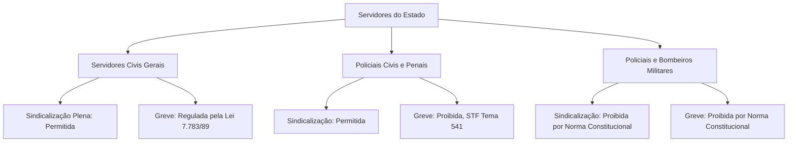
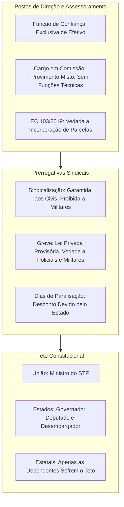

A organização funcional do Estado moderno exige mecanismos equilibrados para a escolha de suas lideranças. É preciso garantir direitos básicos aos trabalhadores estatais e controlar os gastos remuneratórios. A Constituição Federal disciplina minuciosamente esses temas nos artigos 37 e 39. Este capítulo examina as funções de chefia, as garantias sindicais e de greve e a estrutura dos tetos salariais. O tema possui cobrança constante nas bancas examinadoras.

> [!objetivos]
> - Diferenciar funções de confiança e cargos comissionados quanto à investidura e às atribuições.
> - Compreender a aplicação dos direitos sociais e as restrições de greve na segurança pública.
> - Distinguir as espécies remuneratórias aplicáveis aos servidores civis e aos militares estaduais.
> - Aplicar a disciplina constitucional do teto e dos subtetos aos entes da Federação.

## Funções de confiança e cargos em comissão

O art. 37, V, da Constituição Federal estabelece postos diferenciados para a gestão da máquina estatal. Trata-se das funções de confiança e dos cargos em comissão. Embora ambos atendam a necessidades de comando, seus requisitos de preenchimento são distintos.

> [!lei] CF, art. 37, V
> as funções de confiança, exercidas exclusivamente por servidores ocupantes de cargo efetivo, e os cargos em comissão, a serem preenchidos por servidores de carreira nos casos, condições e percentuais mínimos previstos em lei, destinam-se apenas às atribuições de direção, chefia e assessoramento;

O texto constitucional impõe distinções nítidas entre os dois modelos funcionais:

1. **Funções de confiança**: são destinadas **apenas a quem já possui cargo efetivo**. O titular é um servidor previamente aprovado em concurso público. Ele assume encargos de chefia mediante designação interna temporária. Recebe uma gratificação enquanto durar a função.
2. **Cargos em comissão**: são de **livre nomeação e livre exoneração**. Podem ser providos por servidores estáveis ou por cidadãos sem vínculo prévio com o Estado. Contudo, a lei deve fixar uma cota mínima desses cargos voltada exclusivamente aos servidores de carreira.

### Atribuições de comando e limites materiais

A Constituição fixa uma restrição material expressa. Tanto as funções de confiança quanto os cargos comissionados destinam-se unicamente às atribuições de **direção, chefia e assessoramento**.

Essas atribuições exigem vínculo especial de confiança pessoal entre a autoridade e o subordinado. É vedada a criação de cargos comissionados para atividades rotineiras, técnicas ou operacionais. 

O Supremo Tribunal Federal firmou tese vinculante no **Tema 1010 de Repercussão Geral** (RE 1.041.210). O tribunal estabeleceu balizas rígidas para a instituição desses cargos:
- A lei de criação deve especificar com clareza as tarefas do posto comissionado.
- As tarefas descritas devem traduzir atividades genuínas de liderança ou assessoramento.
- A proporção entre postos em comissão e cargos efetivos deve ser equilibrada e justificada.

> [!atencao] Atribuições técnicas não admitem cargo em comissão
> Leis que criam cargos comissionados para serviços de perícia, engenharia, informática ou funções religiosas são inconstitucionais. Essas funções exigem concurso público de provas e títulos.

A tabela a seguir contrasta as características centrais de cada instituto.

| Critério funcional | Função de confiança | Cargo em comissão |
| --- | --- | --- |
| **Quem pode assumir** | Apenas titulares de cargo efetivo | Servidores de carreira e particulares |
| **Forma de ingresso** | Designação pelo superior hierárquico | Nomeação discricionária (*ad nutum*) |
| **Forma de desligamento** | Dispensa do encargo de chefia | Exoneração livre (*ad nutum*) |
| **Finalidade material** | Direção, chefia e assessoramento | Direção, chefia e assessoramento |
| **Vínculo antecedente** | Exigência obrigatória de cargo efetivo | Não exigido para a parcela sem concurso |

> [!exemplo]
> O Secretário de Saúde nomeia um técnico de informática particular para cargo em comissão de manutenção de redes. A nomeação é ilegal. Manutenção de redes é atividade técnica rotineira. Não configura direção nem assessoramento superior. O posto deveria ser provido por concurso público.

### Distinção entre exoneração e demissão

A distinção entre exoneração e demissão é cobrada com frequência em certames. A **exoneração** não possui caráter punitivo. No caso dos cargos comissionados, decorre da simples perda de confiança da autoridade nomeante ou de solicitação formulada pelo próprio servidor. Não exige instauração de processo disciplinar nem fundamentação formal na portaria de dispensa.

Por outro lado, a **demissão** constitui penalidade disciplinar de natureza punitiva. É imposta em decorrência do cometimento de falta funcional grave expressamente capitulada no estatuto da respectiva carreira. A aplicação de demissão exige processo administrativo disciplinar prévio, no qual sejam assegurados o contraditório e a ampla defesa. Enquanto a exoneração de cargo em comissão não macula o histórico do cidadão, a demissão acarreta incompatibilização temporária para novo ingresso no serviço público.

### Proibição de incorporação de vantagens transitórias

A Emenda Constitucional 103/2019 incluiu o § 9º no art. 39 da Carta Magna. O dispositivo proibiu a incorporação de parcelas temporárias aos vencimentos definitivos:

> [!lei] CF, art. 39, § 9º
> É vedada a incorporação de vantagens de caráter temporário ou vinculadas ao exercício de função de confiança ou de cargo em comissão à remuneração do cargo efetivo.

Essa regra extinguiu em todo o país a antiga incorporação de décimos ou quintos. O servidor recebe a retribuição do encargo apenas enquanto durar a designação. Ao retornar às suas atribuições normais, a gratificação cessa de imediato. A parcela transitória não pode integrar a remuneração nem a base de cálculo de proventos de aposentadoria.

## Direitos sociais dos servidores públicos

O art. 39, § 3º, da Constituição assegura aos ocupantes de cargo público garantias fundamentais da ordem social. Trata-se de direitos trabalhistas adaptados às peculiaridades do regime estatutário:

- Piso salarial nacional capaz de garantir a subsistência digna do trabalhador e de seus dependentes.
- Salário não inferior ao mínimo para quem aufere ganhos variáveis.
- Gratificação natalina calculada com base na remuneração integral de dezembro.
- Retribuição financeira adicional para o trabalho realizado em horário noturno.
- Salário-família em favor dos dependentes do servidor de baixa renda.
- Limite de jornada normal fixado em 8 horas diárias e 44 horas por semana.
- Descanso semanal remunerado, preferencialmente aos domingos.
- Adicional de horas extras de pelo menos 50% sobre a hora regular.
- Férias remuneradas anuais acrescidas de um terço do valor mensal.
- Licença de maternidade remunerada de no mínimo 120 dias para a servidora.
- Licença remunerada para o pai por ocasião do nascimento do filho.
- Normas de segurança e saúde no trabalho para reduzir riscos operacionais.

O STF consolidou no **Tema 900** que nenhum servidor pode receber remuneração total menor que o salário mínimo. Essa garantia incide inclusive sobre jornadas semanais inferiores à jornada padrão.

Por outro lado, servidores estatutários **não possuem direito ao FGTS**, à participação em lucros ou a aviso prévio. Esses mecanismos são exclusivos dos trabalhadores celetistas da iniciativa privada e das empresas públicas.

No que tange à proteção da maternidade e da infância, o Supremo Tribunal Federal fixou tese marcante no **Tema 782 de Repercussão Geral**. O tribunal proibiu qualquer diferenciação entre mães biológicas e mães adotantes quanto aos prazos de licença remunerada. Em ambas as situações, a servidora tem direito ao período integral de afastamento remunerado previsto em lei. O objetivo da norma é priorizar o acolhimento e a adaptação do infante no novo ambiente familiar. Além disso, ocorrendo o falecimento da mãe biológica ou adotante durante o período de licença, os dias restantes transferem-se ao pai sobrevivente que detenha a guarda da criança.

Quanto ao cálculo do piso salarial, as **Súmulas Vinculantes 15 e 16 do STF** pacificaram que a remuneração total do servidor não pode ser inferior ao salário mínimo, mas o vencimento básico (vencimento isolado sem vantagens) pode ser fixado em patamar menor, desde que a soma das parcelas permanentes atinja o piso nacional. As gratificações criadas por lei podem tomar como base de incidência o vencimento básico, vedada a vinculação direta ao salário mínimo nacional para evitar reajustes automáticos (CF, art. 7º, IV).

### Sindicalização no serviço público civil

O art. 37, VI, da Constituição assegura ao servidor público civil a liberdade de associação sindical. Trata-se de norma de **eficácia plena**. O funcionário civil pode fundar sindicatos ou filiar-se a eles sem interferência estatal prévia.

Contudo, essa prerrogativa não permite a celebração de acordos coletivos para fixação de salários. O Supremo Tribunal Federal consolidou a **Súmula 679**: a remuneração dos servidores públicos depende exclusivamente de lei formal. Ela não pode ser estipulada em negociação coletiva ou convenção de trabalho.

### A disciplina da greve e os limites na segurança pública

O art. 37, VII, estabelece que o direito de greve dos servidores civis opera nos termos de legislação específica. Esse dispositivo é classificado como norma de **eficácia limitada**.

> [!lei] CF, art. 37, VII
> o direito de greve será exercido nos termos e nos limites definidos em lei específica;

O Congresso Nacional não aprovou a norma regulamentadora até o momento. Diante dessa inércia, o STF julgou os Mandados de Injunção 670, 708 e 712. O tribunal decidiu que se aplicam provisoriamente aos servidores civis as regras da Lei 7.783/1989. Essa norma disciplina a greve nos serviços essenciais da iniciativa privada.

A partir desse julgamento, os tribunais superiores fixaram três teses determinantes:

1. **Vedação absoluta de greve aos órgãos de segurança pública (STF, Tema 541)**: a ordem jurídica proíbe a paralisação de policiais civis, policiais penais e guardas municipais. Esses profissionais desempenham a defesa da ordem social e não podem interromper suas atribuições. Em contrapartida, o poder público deve participar das mediações instauradas pelas entidades de classe.
2. **Proibição absoluta de greve e filiação sindical aos militares**: a Constituição Federal proíbe greve e sindicato a policiais militares e bombeiros militares (CF, art. 42, § 1º c/c art. 142, § 3º, IV). O descumprimento sujeita o infrator a sanções disciplinares severas e a processos criminais perante a Justiça Militar.
3. **Desconto dos dias de ausência funcional (STF, Tema 531)**: a Administração Pública deve descontar os dias não trabalhados durante a greve. Admite-se a compensação de horários mediante acordo entre as partes. O corte só não é exigido caso a paralisação decorra de conduta manifestamente ilícita do próprio Estado.

> [!jurisprudencia] STF, Tema 541
> O direito de greve não pode ser exercido por policiais civis nem por agentes públicos que exerçam atividades na área da segurança pública.

## Sistema remuneratório e limites fiscais

A retribuição financeira do trabalho público obedece ao princípio da reserva legal estrita. A Carta Magna consagra três espécies principais de contraprestação monetária:

- **Vencimentos (remuneração)**: compreendem o padrão básico do cargo efetivo somado às vantagens pessoais e transitórias. Aplica-se à maioria das carreiras burocráticas civis.
- **Subsídio**: modalidade fixada em **parcela monetária única**. Fica proibida a adição de qualquer gratificação, adicional, abono ou prêmio de produtividade (CF, art. 39, § 4º). É compulsório para detentores de mandato eletivo, magistrados, promotores de justiça, defensores públicos, procuradores de Estado, policiais e bombeiros militares.
- **Salário**: valor pago aos empregados públicos contratados pelas empresas estatais sob a regência da CLT.

### Diretrizes gerais dos incisos X a XV do art. 37

A Constituição estabelece comandos rígidos para evitar desequilíbrios remuneratórios nas contas públicas:

### Reserva de lei e revisão geral anual

O inciso X do art. 37 exige **lei formal ordinária de iniciativa privativa** para fixar ou majorar padrões salariais. O Governador do Estado propõe leis de seus servidores; o Tribunal de Justiça apresenta propostas para seus quadros funcionais; a Assembleia Legislativa cuida de seu pessoal próprio.

O mesmo inciso prevê a revisão geral anual na mesma data para todos os servidores. O STF pacificou que o Executivo não pode ser obrigado a conceder aumentos anuais sem capacidade orçamentária. Cabe ao chefe do poder justificar formalmente ao parlamento a impossibilidade fiscal de concessão da recomposição.

### O teto nacional e a estrutura dos subtetos

Nenhum agente público pode auferir retribuição superior ao **subsídio mensal dos Ministros do Supremo Tribunal Federal**. Esse montante constitui o patamar remuneratório supremo do país.

> [!lei] CF, art. 37, XI
> a remuneração e o subsídio dos ocupantes de cargos, funções e empregos públicos (...) não poderão exceder o subsídio mensal, em espécie, dos Ministros do Supremo Tribunal Federal, aplicando-se como limite, nos Municípios, o subsídio do Prefeito, e nos Estados e no Distrito Federal, o subsídio mensal do Governador no âmbito do Poder Executivo, o subsídio dos Deputados Estaduais e Distritais no âmbito do Poder Legislativo e o subsidio dos Desembargadores do Tribunal de Justiça (...) no âmbito do Poder Judiciário;

Nas esferas descentralizadas, vigoram os chamados subtetos remuneratórios:

- **Âmbito municipal**: vigora teto unitário para os servidores de todos os poderes locais, igual ao subsídio mensal do **Prefeito**.
- **Âmbito estadual e distrital**: o limite divide-se conforme o respectivo Poder orgânico:
  - Poder Executivo: subsídio fixado para o **Governador do Estado**.
  - Poder Legislativo: subsídio dos **Deputados Estaduais**.
  - Poder Judiciário: subsídio dos **Desembargadores do Tribunal de Justiça**, alcançando também membros do Ministério Público, Procuradores e Defensores Públicos estaduais.

Os Estados e o Distrito Federal podem aprovar emenda constitucional para adotar o **subteto único estadual** (art. 37, § 12). Nesse arranjo, o subsídio de Desembargador incide sobre todos os poderes, excluindo-se apenas os deputados.

A tabela abaixo esquematiza a distribuição das balizas remuneratórias na Federação.

| Ente federativo | Poder ou órgão de atuação | Autoridade de referência | Regime do limite |
| --- | --- | --- | --- |
| **União** | Todos os Poderes federais | Ministro do STF | Teto absoluto unificado |
| **Municípios** | Executivo e Legislativo | Prefeito | Subteto municipal único |
| **Estados / DF** | Poder Executivo | Governador | Subteto do Executivo |
| **Estados / DF** | Poder Legislativo | Deputado Estadual | Subteto do Legislativo |
| **Estados / DF** | Judiciário, MP e Defensoria | Desembargador do TJ | Subteto do Judiciário estadual |
| **Estados / DF** | Subteto único estadual facultativo | Desembargador do TJ | Adotado por emenda local (§ 12) |

> [!pegadinha] Teto em empresas estatais independentes
> As empresas públicas e sociedades de economia mista só se submetem ao teto constitucional caso recebam repasses estatais para custeio operacional ou folha salarial (art. 37, § 9º). Empresas lucrativas que disputam mercado com recursos próprios não se submetem ao teto salarial do art. 37, XI.

> [!bizu]
> Grave a regra dos subtetos estaduais associando o cargo à autoridade do Poder correspondente:
> - Executivo estadual obedece ao Governador.
> - Legislativo estadual segue o Deputado.
> - Judiciário estadual vincula-se ao Desembargador.

### Incidência do teto na acumulação de cargos

Um aspecto de expressiva cobrança em provas de alto rendimento diz respeito à aplicação do teto remuneratório nas situações em que a Constituição autoriza a acumulação de cargos (como dois cargos privativos de profissionais de saúde ou um cargo de magistério com outro de qualquer natureza).

O Supremo Tribunal Federal pacificou a controvérsia nos **Temas 377 e 384 de Repercussão Geral**. A Corte estabeleceu que, nas hipóteses de acumulação lícita constitucionalmente amparadas, o teto remuneratório deve incidir isoladamente sobre a remuneração de cada cargo ou emprego público considerado individualmente. Não se admite a soma dos rendimentos das duas fontes pagadoras para fins de aplicação do abate-teto. Cada vínculo estatal deve observar o seu respectivo limite remuneratório de forma autônoma. Essa orientação visa preservar a devida remuneração pelo trabalho legitimamente desempenhado em cada uma das jornadas cumpridas.

### Parcelas indenizatórias excluídas do cômputo

Valores percebidos a título de indenização funcional não integram a base do teto constitucional. É o caso de diárias de viagem, auxílio-transporte e indenizações por uso de veículo próprio em serviço.

A Emenda Constitucional 135/2024 alterou a disciplina do art. 37, § 11. O novo texto exige **lei ordinária nacional aprovada pelo Congresso** para definir expressamente as parcelas indenizatórias isentas do cômputo do teto salarial.

### Proibições aos regimes de remuneração pública

Os incisos XII a XV do art. 37 consagram vedações protetivas para a moralidade administrativa:

- **Paridade funcional (inciso XII)**: os quadros do Legislativo e do Judiciário não podem receber valores superiores aos atribuídos a funções equivalentes no Executivo.
- **Vedação à vinculação ou equiparação (inciso XIII)**: é proibido atrelar espécies remuneratórias diferentes para reajustes simultâneos automáticos. A Súmula Vinculante 42 veda atrelar aumentos estaduais ou municipais a índices da União.
- **Vedação ao repique remuneratório (inciso XIV)**: as gratificações e adicionais funcionais incidem estritamente sobre o vencimento básico. É proibido computar acréscimos pecuniários anteriores para gerar novos cálculos em cadeia sucessiva.
- **Irredutibilidade dos vencimentos (inciso XV)**: o valor nominal dos subsídios e vencimentos públicos não pode ser reduzido pelo Estado. A Constituição excepciona dessa proteção o abatimento do teto salarial, a glosa de parcelas ilegais e a incidência normal de tributos como o Imposto de Renda.

## Mapa do capítulo

### Para fixar

- A função de confiança é exercida unicamente por titular de cargo efetivo; o cargo comissionado é de livre nomeação e livre exoneração.
- Funções de confiança e cargos comissionados voltam-se unicamente ao desempenho de tarefas de comando, coordenação e consultoria, vedada sua instituição para serviços burocráticos ou operacionais (STF, Tema 1010).
- É proibido incorporar vantagens financeiras temporárias de cargo em comissão ou função de chefia aos vencimentos do cargo efetivo (CF, art. 39, § 9º).
- A sindicalização do servidor público civil é garantia de eficácia plena, mas os padrões de vencimentos não podem ser alterados por negociação coletiva (Súmula 679 do STF).
- A greve dos servidores públicos civis é regida provisoriamente pelas normas da Lei 7.783/1989, com desconto salarial obrigatório dos dias não trabalhados (STF, Tema 531).
- É vedada a deflagração de qualquer modalidade de greve por policiais civis e por todos os agentes atuantes na segurança pública (STF, Tema 541).
- Policiais e bombeiros militares são terminantemente impedidos de realizar greve ou filiar-se a sindicatos (CF, art. 42, § 1º c/c art. 142, § 3º, IV).
- O subsídio é fixado em parcela pecuniária única, sendo compulsório para membros de Poder, policiais civis e militares estaduais.
- O teto geral do serviço público equivale ao subsídio de Ministro do STF, dividindo-se os subtetos estaduais entre o Governador, o Deputado e o Desembargador do Tribunal de Justiça.
- As empresas públicas e sociedades de economia mista só obedecem ao teto constitucional caso dependam de aportes financeiros estatais para pagamento de pessoal ou despesas de custeio (CF, art. 37, § 9º).
