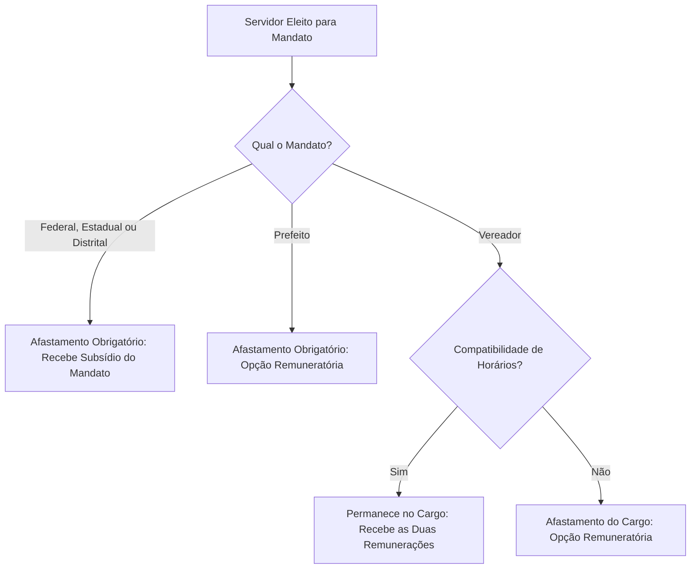
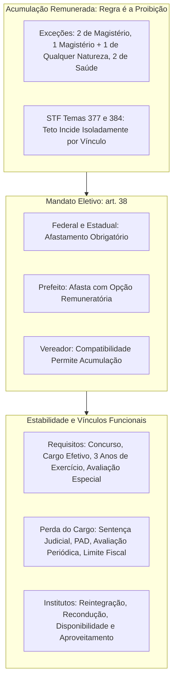

A dedicação do agente público às suas funções estatais constitui a diretriz central da Administração republicana. Para evitar a dispersão de esforços e a concentração indevida de rendas públicas, a Constituição impõe a vedação geral de acumulação remunerada de funções, ressalvando hipóteses estritas. Além disso, a Carta Magna traça as regras para os servidores eleitos a mandatos políticos e disciplina o regime de estabilidade do cargo efetivo. Este capítulo analisa esses temas nucleares para as carreiras civis e militares.

> [!objetivos]
> - Identificar a regra geral e as exceções constitucionais de acumulação remunerada de cargos, empregos e funções públicas.
> - Aplicar o regramento do art. 38 aos servidores investidos em mandato eletivo federal, estadual e municipal.
> - Compreender a evolução do regime jurídico dos servidores e a decisão do STF na ADI 2.135.
> - Dominar os requisitos de estabilidade no cargo efetivo e os institutos da reintegração, recondução, disponibilidade e aproveitamento.

## Acumulação remunerada de cargos, empregos e funções públicas

A regra fundamental que rege o serviço público brasileiro é a **proibição de acumulação remunerada** de cargos, funções ou empregos estatais. O Estado exige dedicação primordial do agente ao posto assumido. Essa diretriz visa assegurar a eficiência da prestação pública e a ampla distribuição de oportunidades de trabalho.

### Abrangência subjetiva da vedação

A vedação à acumulação possui alcance universal no aparelho estatal. O art. 37, inciso XVII, da Constituição determina que a proibição atinge:
- A Administração Direta de todos os entes federativos (União, Estados, Distrito Federal e Municípios).
- Todos os Poderes da República (Executivo, Legislativo e Judiciário), além do Ministério Público e dos Tribunais de Contas.
- As autarquias e fundações públicas da Administração Indireta.
- As empresas públicas e sociedades de economia mista, bem como suas subsidiárias.
- As sociedades controladas direta ou indiretamente pelo Poder Público.

> [!atencao] Empregados de empresas estatais sofrem a proibição
> A proibição de acumular não se restringe aos ocupantes de cargos efetivos estatutários. Empregados de empresas públicas (como Caixa Econômica Federal e Correios) e de sociedades de economia mista (como Petrobras e Banco do Brasil) não podem acumular seus empregos com cargos públicos, salvo nas exceções constitucionais.

### Hipóteses excepcionais de acumulação lícita

A Constituição consagra exceções taxativas à regra de não acumulação no art. 37, inciso XVI. Para que a acumulação seja lícita, exige-se obrigatoriamente a presença cumulativa de **compatibilidade de horários** e a submissão de cada retribuição ao teto remuneratório do art. 37, XI.

> [!lei] CF, art. 37, XVI (alínea b na redação da EC 138/2025)
> é vedada a acumulação remunerada de cargos públicos, exceto, quando houver compatibilidade de horários, observado em qualquer caso o disposto no inciso XI: (...) b) a de um cargo de (...) com outro **de qualquer natureza**; c) a de dois cargos ou empregos privativos de profissionais de saúde, com profissões regulamentadas;

As três hipóteses expressas do art. 37, XVI, desdobram-se da seguinte forma:

1. **Dois cargos de magistério**: autoriza o exercício simultâneo de dois postos docentes em quaisquer entes da Federação (dois cargos municipais, ou um estadual e um federal).
2. **Um cargo de magistério com outro de qualquer natureza**: permite somar uma função docente a qualquer outro cargo, técnico ou não. Até a Emenda Constitucional 138/2025, o outro cargo precisava ser "técnico ou científico" (o que exigia habilitação específica e excluía cargos burocráticos de nível médio); provas antigas cobram essa redação, que não vale mais.
3. **Dois postos privativos de profissionais de saúde, com profissões regulamentadas**: alcança médicos, enfermeiros, fisioterapeutas, farmacêuticos, psicólogos e odontólogos. É necessário que ambas as funções exijam registro em conselho profissional regulamentado por lei.

Além dessas hipóteses do art. 37, XVI, outros dispositivos da Constituição autorizam acumulações específicas:
- **Magistrados e membros do Ministério Público**: podem exercer, cumulativamente com a função judicante ou ministerial, **um único cargo de magistério** (CF, arts. 95, parágrafo único, I, e 128, § 5º, II, "d").
- **Militares das Forças Armadas**: podem exercer cumulativamente o posto fardado e uma vaga privativa da área de saúde cuja profissão seja legalmente regulamentada (CF, art. 142, § 3º, II), assegurada a precedência do serviço castrense.
- **Militares dos Estados e do DF (PM e CBM)**: aplica-se a eles o art. 37, XVI, inteiro, com prevalência da atividade militar (CF, art. 42, § 3º, incluído pela EC 101/2019). Valem, portanto, as mesmas três hipóteses do servidor civil.

> [!exemplo]
> Um bombeiro militar ou policial militar estadual pode acumular seu posto na corporação com um cargo público de magistério ou mesmo com um cargo de saúde regulamentado, desde que haja efetiva conciliação de escalas e prevalência do serviço militar estadual (CF, art. 42, § 3º). Já um oficial do Exército Brasileiro somente pode acumular o posto das Forças Armadas com um cargo ou emprego civil privativo da área de saúde (CF, art. 142, § 3º, II e VIII).

A tabela a seguir sistematiza as hipóteses constitucionais admitidas de acumulação funcional.

| Vínculos acumuláveis | Requisitos específicos | Previsão constitucional |
| --- | --- | --- |
| **Dois cargos de magistério** | Compatibilidade de horários e teto | CF, art. 37, XVI, "a" |
| **Um de magistério + um de qualquer natureza** | Compatibilidade de horários e teto (redação da EC 138/2025) | CF, art. 37, XVI, "b" |
| **Dois cargos privativos de saúde** | Profissões formalmente regulamentadas | CF, art. 37, XVI, "c" |
| **Juiz ou Promotor + um cargo de magistério** | Vedada qualquer outra atividade | CF, arts. 95 e 128 |
| **Militar estadual + as hipóteses do art. 37, XVI** | Prevalência da atividade militar | CF, art. 42, § 3º |
| **Militar das Forças Armadas + um cargo de saúde** | Só profissional de saúde; prevalência da atividade militar | CF, art. 142, § 3º, II, III e VIII |

### Limite máximo de jornada semanal

A compatibilidade de horários é requisito indispensável para a legalidade da acumulação. Durante muitos anos, a Administração Pública federal limitou a jornada total de acumulação a 60 horas semanais.

Contudo, o Supremo Tribunal Federal e o Superior Tribunal de Justiça firmaram entendimento pacífico de que **não existe limite numérico rígido de horas semanais fixado na Constituição**. O que a lei exige é a efetiva conciliação física dos horários de entrada, trabalho e descanso, assegurada a higidez física e mental do servidor e o rendimento adequado do serviço público. Atestada a compatibilidade real e o cumprimento das escalas, a acumulação de 64 ou 70 horas semanais pode ser admitida em casos concretos.

### Teto remuneratório e acumulação de proventos

Conforme consolidado pelo STF nos **Temas 377 e 384 de Repercussão Geral**, nas situações de acumulação legítima, o teto salarial incide de forma isolada sobre a remuneração de cada cargo. Não se somam os vencimentos para aplicação do redutor constitucional.

Quanto aos servidores inativos, o art. 37, § 10, estabelece a vedação de recebimento conjunto de proventos de aposentadoria de regime próprio com remuneração de cargo ou emprego público. Existem apenas três exceções admitidas:
1. Cargos acumuláveis na atividade (exemplo: inativo de um cargo de magistério que ingressa em outro de magistério por concurso).
2. Exercício de mandato eletivo (o aposentado que se elege para cargo político recebe os proventos e o subsídio do mandato).
3. Provimento em cargos em comissão de livre nomeação e exoneração no serviço público.

## Servidores públicos e mandato eletivo

O art. 38 da Constituição Federal estabelece regras precisas para o servidor da administração direta, autárquica e fundacional que venha a ser diplomado e empossado em mandato político.

> [!lei] CF, art. 38
> Ao servidor público da administração direta, autárquica e fundacional, no exercício de mandato eletivo, aplicam-se as seguintes disposições: I - tratando-se de mandato eletivo federal, estadual ou distrital, ficará afastado de seu cargo, emprego ou função; II - investido no mandato de Prefeito, será afastado do cargo, emprego ou função, sendo-lhe facultado optar pela sua remuneração; III - investido no mandato de Vereador, havendo compatibilidade de horários, perceberá as vantagens de seu cargo, emprego ou função, sem prejuízo da remuneração do cargo eletivo, e, não havendo compatibilidade, será aplicada a norma do inciso anterior;

A sistemática do art. 38 divide-se em três regimes operacionais:

1. **Mandatos federais, estaduais e distritais**: alcança Presidente da República, Governadores, Senadores e Deputados Federais, Estaduais ou Distritais. O afastamento do cargo, emprego ou função pública é **obrigatório**. O servidor deixa de exercer suas atribuições de origem e passa a receber exclusivamente a remuneração do mandato eletivo.
2. **Mandato de Prefeito**: o afastamento do cargo é compulsório. Entretanto, a Constituição assegura ao eleito o direito de **optar pela remuneração**. O servidor pode escolher receber o subsídio de Prefeito ou continuar percebendo a remuneração de seu cargo efetivo de origem.
3. **Mandato de Vereador**: a regra depende da existência de compatibilidade física de jornadas:
   - **Havendo compatibilidade de horários**: o servidor não se afasta do cargo. Continua exercendo suas tarefas funcionais e comparece às sessões legislativas da Câmara Municipal, auferindo **cumulativamente as duas remunerações**.
   - **Não havendo compatibilidade de horários**: opera-se o afastamento do cargo efetivo, com faculdade de opção remuneratória entre os dois estipêndios, idêntica à disciplina aplicável aos Prefeitos.

O diagrama a seguir esquematiza as decisões exigidas em cada modalidade de mandato eletivo.

> [!pegadinha] Afastamento do vereador
> É incorreto afirmar que o servidor investido no mandato de vereador será sempre afastado do cargo público. A regra para o vereador é a permanência no cargo com acúmulo de remunerações, caso exista conciliação horária. O afastamento só ocorre na incompatibilidade comprovada.

A tabela comparativa a seguir destaca os efeitos funcionais e remuneratórios de cada mandato político.

| Natureza do mandato | Regra de permanência no cargo | Regime remuneratório aplicável |
| --- | --- | --- |
| **Federal, Estadual ou Distrital** | Afastamento funcional obrigatório | Recebe o estipêndio do cargo político |
| **Prefeito** | Afastamento funcional obrigatório | Direito de opção entre as remunerações |
| **Vereador (com compatibilidade)** | Permanece no exercício das funções | Percebe cumulativamente ambos os valores |
| **Vereador (sem compatibilidade)** | Afastamento funcional obrigatório | Direito de opção entre as remunerações |

### Direitos funcionais e previdenciários durante o mandato

Os incisos IV e V do art. 38 consagram garantias protetivas para a carreira do servidor afastado:
- **Cômputo do período de mandato**: sempre que houver necessidade de afastamento funcional para desempenhar cargo político, esse lapso temporal entra na contagem ordinária de carreira para fins de antiguidade e inatividade, **vedado apenas o seu aproveitamento na promoção por merecimento**. A promoção por merecimento exige aferição real de desempenho e produtividade nas atribuições da carreira. Conta-se, contudo, normalmente para promoção por antiguidade, adicionais de tempo e contagem para aposentadoria.
- **Vínculo previdenciário**: o servidor público submetido a Regime Próprio de Previdência Social (RPPS) que se afasta para exercer mandato permanece filiado ao regime de previdência de origem no respectivo ente federativo. Ele continua recolhendo suas contribuições previdenciárias para o seu instituto previdenciário próprio.
- **Fixação de valores em caso de afastamento**: para efeito de qualquer benefício previdenciário calculado sobre os rendimentos do servidor, os parâmetros contributivos e de benefício permanecem vinculados ao cargo efetivo titularizado.

## Regime jurídico dos servidores públicos

O art. 39 da Constituição Federal define as linhas mestras da organização dos quadros de pessoal do Estado. A história desse dispositivo reflete uma das maiores disputas interpretativas da ordem constitucional contemporânea.

### A evolução do Regime Jurídico Único (RJU) e o julgamento da ADI 2.135

Na redação original promulgada em 1988, o art. 39 impunha a instituição de um **Regime Jurídico Único (RJU)** e planos de carreira unificados para os servidores da administração direta, autárquica e fundacional em cada esfera da Federação. Cada ente escolhia um modelo (geralmente o estatutário) e deveria submeter a totalidade de seus servidores a ele.

Em 1998, a Emenda Constitucional 19 suprimiu a exigência do regime único. Essa alteração facultou aos entes admitir servidores sob o regime estatutário ou celetista na administração direta e autárquica.

Contudo, em 2007, o Supremo Tribunal Federal concedeu liminar na **Ação Direta de Inconstitucionalidade 2.135**, suspendendo a nova redação por vício formal de tramitação legislativa (ausência de aprovação em dois turnos na Câmara dos Deputados). Com a liminar, a redação original do RJU voltou a vigorar durante quase duas décadas.

Finalmente, no julgamento definitivo do mérito concluído pelo STF em novembro de 2024, a Corte alterou seu posicionamento anterior e declarou a **plena constitucionalidade da Emenda 19/1998**. O STF fixou os seguintes parâmetros:
- Os entes federativos podem adotar modelos diferenciados de contratação (regime estatutário e celetista) na administração direta e indireta, conforme a conveniência de gestão.
- A decisão produz efeitos prospectivos (*ex nunc*), a partir da publicação do julgamento.
- A migração de cargos estatutários para empregos públicos celetistas exige edição de lei específica, sendo vedada qualquer alteração retroativa que prejudique os atuais ocupantes de cargos efetivos.

### Critérios constitucionais de remuneração

O art. 39, § 1º, da Constituição determina que a fixação dos padrões de vencimento e das parcelas remuneratórias observará três diretrizes imperativas:
1. O **nível de complexidade técnica, a envergadura das atribuições e o peso decisório** inerentes aos postos que compõem a respectiva estrutura funcional.
2. Os **requisitos de formação e capacitação** exigidos para a investidura regular.
3. As **peculiaridades e riscos específicos** das funções atribuídas a cada cargo.

Adicionalmente, a União, os Estados, o Distrito Federal e os Municípios devem manter um colegiado voltado à gestão funcional e à política remuneratória, composto por agentes designados no âmbito de cada Poder (CF, art. 39, *caput*).

## Estabilidade ordinária e garantias do servidor

A **estabilidade** é uma garantia constitucional conferida ao servidor público para assegurar a continuidade do serviço e a independência funcional do agente perante pressões políticas ou ingerências ilegais.

### Requisitos cumulativos para aquisição da estabilidade

Nos termos do art. 41, *caput*, da Carta da República, o vínculo de estabilidade ordinária consolida-se quando o agente, aprovado em certame público e investido em cargo de caráter efetivo, completa **um triênio de exercício real** nas funções.

A aquisição da estabilidade ordinária pressupõe o preenchimento de **quatro requisitos cumulativos**:

1. **Aprovação prévia em certame seletivo** de provas ou de provas e títulos.
2. **Investidura em cargo de caráter efetivo** (cargos em comissão não geram estabilidade em nenhuma circunstância).
3. **Triênio de desempenho efetivo**: o prazo é contado a partir da entrada em atividade real, e não da data da posse ou do ato de nomeação.
4. **Aprovação obrigatória em avaliação especial de desempenho**: conduzida por comissão instituída especificamente para essa finalidade (CF, art. 41, § 4º).

### Hipóteses taxativas de perda do cargo do estável

Uma vez adquirida, a estabilidade não é absoluta. O servidor estável pode perder o cargo exclusivamente nas **quatro hipóteses taxativas** disciplinadas pela Constituição Federal:

1. **Sentença judicial transitada em julgado**: decorrente de condenação criminal que imponha a perda do cargo ou de sentença em ação de improbidade administrativa sem mais recursos cabíveis.
2. **Processo administrativo disciplinar (PAD)**: com garantia de contraditório e ampla defesa, instaurado para apurar infração funcional cominada com demissão.
3. **Procedimento de avaliação periódica de desempenho**: regulamentado em **lei complementar federal**, assegurada ampla defesa. A inaptidão reiterada apurada nos termos legais autoriza a desvinculação funcional.
4. **Excesso de despesas com pessoal (CF, art. 169, § 4º)**: quando o ente federativo ultrapassar os limites fiscais fixados na Lei de Responsabilidade Fiscal e as medidas anteriores não forem suficientes.

> [!bizu]
> Guarde as etapas sucessivas do art. 169 para corte de despesas com pessoal:
> 1. Redução de pelo menos 20% dos gastos com comissionados e funções de confiança.
> 2. Exoneração dos servidores não estáveis.
> 3. Se a despesa persistir, exoneração de servidores estáveis (com indenização de um mês por ano trabalhado).

A tabela abaixo compara as quatro hipóteses de desligamento compulsório do servidor estável.

| Causa de perda do cargo | Requisito processual | Instrumento exigido |
| --- | --- | --- |
| **Sentença judicial** | Trânsito em julgado | Ação penal ou de improbidade |
| **Infração disciplinar** | Contraditório e ampla defesa | Processo Administrativo Disciplinar (PAD) |
| **Insuficiência de desempenho** | Avaliação periódica regular | Lei complementar definidora do rito |
| **Limite de gastos fiscais** | Fracasso de medidas prévias | Decreto motivado nos termos do art. 169 |

### Reintegração, recondução, disponibilidade e aproveitamento

A dinâmica da estabilidade produz institutos funcionais protetivos que operam quando ocorrem alterações na situação jurídica do cargo ou da demissão:

- **Reintegração (CF, art. 41, § 2º)**: ocorre quando a demissão de um servidor estável é invalidada por decisão judicial ou administrativa. O servidor reintegrado retorna ao seu cargo de origem com ressarcimento integral de todos os vencimentos e vantagens pecuniárias que deixou de auferir durante o afastamento indevido.
- **Recondução**: é o retorno do servidor estável ao seu cargo de origem. Na Constituição, ocorre quando o cargo primitivo do servidor reintegrado encontrava-se ocupado por outro servidor estável. O ocupante da vaga é reconduzido ao seu cargo anterior, sem direito a qualquer indenização.
- **Disponibilidade (CF, art. 41, § 3º)**: extinto o cargo ou declarada sua desnecessidade pela Administração, o servidor estável ficará em disponibilidade, percebendo remuneração proporcional ao seu tempo de contribuição, até o seu adequado aproveitamento em outro cargo.
- **Aproveitamento**: é o retorno à atividade funcional do servidor que se encontrava em disponibilidade remunerada, mediante investidura em cargo com atribuições e vencimentos compatíveis com o anteriormente ocupado.

A tabela comparativa a seguir destaca a aplicação de cada instituto no quadro de servidores estáveis.

| Instituto funcional | Situação geradora | Destino do agente público | Compensação financeira |
| --- | --- | --- | --- |
| **Reintegração** | Invalidação da demissão do estável | Retorno obrigatório ao cargo de origem | Ressarcimento total de todas as parcelas |
| **Recondução** | Retorno do reintegrado à vaga ocupada | Volta ao cargo anterior que ocupava | Não gera direito a indenização |
| **Disponibilidade** | Extinção ou desnecessidade do cargo | Afastamento provisório remunerado | Vencimentos proporcionais ao tempo |
| **Aproveitamento** | Chamamento do servidor disponível | Retorno ativo em cargo compatível | Restabelecimento do estipêndio integral |

## Mapa do capítulo

### Para fixar

- A proibição de acumulação remunerada é ampla e atinge todos os Poderes e entes federativos, estendendo-se a autarquias, fundações, empresas públicas e sociedades de economia mista.
- As exceções constitucionais de acumulação exigem compatibilidade de horários e abrangem dois cargos de magistério, um de magistério com outro de qualquer natureza (EC 138/2025), e dois de profissionais de saúde regulamentados.
- Nos casos de acumulação autorizada pela Constituição, o teto remuneratório incide isoladamente sobre os estipêndios de cada cargo, sem somatório de valores (STF, Temas 377 e 384).
- O servidor investido em mandato eletivo federal, estadual ou distrital afasta-se compulsoriamente de seu cargo funcional, percebendo a remuneração do mandato.
- O servidor eleito Prefeito afasta-se obrigatoriamente de suas funções, sendo-lhe assegurada a faculdade de optar pela remuneração de seu cargo de origem.
- O servidor eleito Vereador que disponha de compatibilidade de horários mantém o exercício de seu cargo e aufere cumulativamente as duas remunerações.
- O STF declarou a constitucionalidade da Emenda 19/1998 na ADI 2.135 com efeitos prospectivos, facultando aos entes a adoção do regime estatutário ou celetista na administração direta e indireta.
- A estabilidade ordinária no cargo efetivo exige concurso público, três anos de efetivo exercício e aprovação em avaliação especial de desempenho (CF, art. 41).
- O servidor estável perde o cargo apenas por sentença judicial transitada em julgado, processo administrativo disciplinar, avaliação periódica em lei complementar ou redução de despesas fiscais do art. 169.
- A reintegração devolve o estável demitido ilegalmente ao cargo com ressarcimento integral, e a disponibilidade assegura remuneração proporcional ao tempo de contribuição até futuro aproveitamento.
