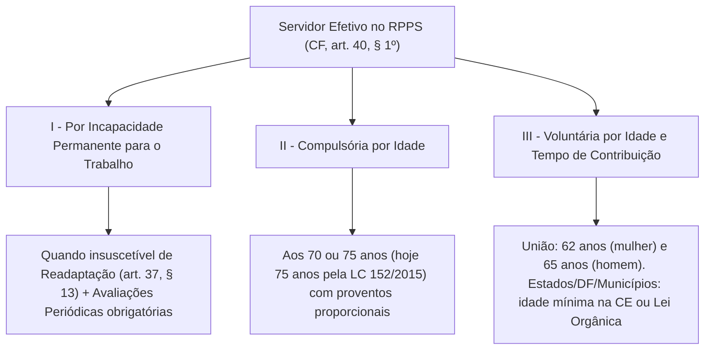

A proteção do vínculo funcional contra desligamentos arbitrários e a organização do sistema previdenciário público constituem pilares do regime constitucional dos agentes estatais. Ao lado da estabilidade ordinária conquistada após o concurso público (CF, art. 41), o constituinte de 1988 instituiu uma regra de transição específica no Ato das Disposições Constitucionais Transitórias (ADCT, art. 19) para amparar os agentes antigos que já integravam a Administração antes da nova ordem constitucional. Paralelamente, o art. 40 da Carta da República estrutura o Regime Próprio de Previdência Social (RPPS) dos ocupantes de cargos efetivos, profundamente reformulado pela Emenda Constitucional nº 103/2019. Nas provas, a distinção entre estabilidade e efetividade, o instituto da readaptação e as regras de aposentadoria, abono de permanência e pensão por morte estão entre os pontos de maior incidência.

> [!objetivos]
> - Compreender o instituto da disponibilidade remunerada (CF, art. 41, § 3º) e os requisitos da estabilidade extraordinária do art. 19 do ADCT.
> - Diferenciar estabilidade e efetividade segundo a jurisprudência consolidada do Supremo Tribunal Federal, identificando os servidores excluídos do benefício transitório.
> - Distinguir o campo de aplicação do Regime Próprio de Previdência Social (RPPS) e do Regime Geral de Previdência Social (RGPS) após a EC nº 103/2019.
> - Dominar as modalidades de aposentadoria do servidor efetivo (por incapacidade permanente, compulsória e voluntária), os requisitos da readaptação funcional e as regras de cálculo, teto e previdência complementar.
> - Analisar as hipóteses de aposentadoria especial, a redução de idade para o magistério da educação básica, o abono de permanência e a disciplina constitucional da pensão por morte.

## Disponibilidade e estabilidade extraordinária (ADCT, art. 19)

Antes de adentrar a regra transitória do ADCT, convém recordar o desfecho protetivo da estabilidade ordinária diante da reorganização administrativa. Conforme dispõe o art. 41, § 3º, da Constituição Federal, quando o cargo público é suprimido por lei ou tem sua desnecessidade formalmente reconhecida pelo Poder Público, o servidor estável não é demitido: ele é colocado em **disponibilidade**, percebendo vencimentos **proporcionais ao período trabalhado**, até que ocorra seu retorno ativo mediante aproveitamento em outro posto compatível.

Ao promulgar a Constituição de 5 de outubro de 1988, o constituinte deparou-se com milhares de agentes civis que haviam ingressado na Administração Pública sob a ordem anterior, sem concurso público. Para pacificar a situação funcional desses quadros sem lhes outorgar titularidade de carreira, o **art. 19 do ADCT** instituiu a **estabilidade extraordinária** (ou excepcional).

### Requisitos cumulativos do art. 19 do ADCT

Pelo *caput* do art. 19 do ADCT, foram declarados estáveis no serviço público os agentes que preenchiam quatro condições em 5 de outubro de 1988:

1. **Vínculo de natureza civil**: aplicável aos quadros civis das esferas federal, estadual, distrital e municipal.
2. **Lotação em pessoa jurídica de direito público**: exercício na Administração Direta, autarquias ou fundações públicas (excluídos empregados de estatais).
3. **Admissão sem concurso público**: ingresso anterior sem a aprovação em certame regulada no art. 37, II, da CF.
4. **Tempo mínimo de exercício continuado**: estar em atividade funcional na promulgação da CF/1988 há, pelo menos, **cinco anos continuados** (ingresso até 5 de outubro de 1983).

```mermaid Requisitos e efeitos da estabilidade extraordinária do art. 19 do ADCT
flowchart TD
  ING["Servidor Civil da Adm. Direta, Autárquica ou Fundacional"] --> COND{"5 anos contínuos até 05/10/1988 sem concurso?"}
  COND -->|Sim| EST_EX["Adquire Estabilidade Extraordinária (ADCT, art. 19)"]
  COND -->|Não| NAO_EST["Não adquire a estabilidade excepcional"]
  EST_EX --> EFEITO1["Garantia de permanência na função ocupada"]
  EST_EX --> EFEITO2["Não possui efetividade nem integra carreira"]
  EFEITO2 --> CONC["Só adquire efetividade se aprovado em Concurso Público (tempo conta como título)"]
```

Para o STF, no caso do magistério, breves intervalos contratuais entre anos letivos não afastam a continuidade do quinquênio. Ademais, faltas eventuais ao serviço não impedem o direito, pois o ADCT exigiu exercício continuado, e não assiduidade absoluta (STF, RE 187.955).

### Distinção entre estabilidade e efetividade na jurisprudência do STF

O ponto mais cobrado sobre o art. 19 do ADCT reside na diferença entre **estabilidade** e **efetividade** (STF, ADI 114, ADI 180, RE 167.635 e ADI 3.609):

- **Efetividade**: atributo intrínseco ao **cargo público**, conferido desde a nomeação oriunda de concurso público (CF, art. 37, II). Só é efetivo quem ingressa por concurso.
- **Estabilidade**: garantia subjetiva de **permanência no serviço público**, adquirida após requisitos temporais e legais, que protege contra dispensa imotivada.

Dessa distinção resultam três regras firmadas pelo STF:
1. O agente admitido sem concurso há pelo menos cinco anos antes de 5 de outubro de 1988 é **estável** (ADCT, art. 19), mas **não é efetivo**: permanece na função, mas não titulariza cargo efetivo, não integra carreira nem tem direito a progressão funcional ou benefícios privativos da carreira.
2. Para adquirir **efetividade** e ingressar na carreira, deve submeter-se a **concurso público** (CF, art. 37, II; ADCT, art. 19, § 1º), computando-se o tempo de serviço anterior **como título**.
3. É **inconstitucional qualquer lei que promova o reenquadramento** de servidor estabilizado pelo art. 19 do ADCT em novo Plano de Cargos, Carreiras e Remuneração (PCCR) ao lado dos concursados (STF, ADI 3.609 e ARE 1.306.505).

> [!pegadinha] Estável pelo ADCT não vira efetivo sem concurso
> As bancas frequentemente afirmam que o servidor amparado pelo art. 19 do ADCT "foi efetivado no cargo" pela Constituição de 1988 ou que adquiriu direito à progressão na carreira após cinco anos. A assertiva é falsa: o benefício transitório conferiu apenas **estabilidade** (garantia contra demissão arbitrária), jamais **efetividade**. Sem aprovação em concurso público, o agente não integra a carreira nem pode ser reenquadrado em novo plano de cargos.

### Agentes excluídos da estabilidade extraordinária

Os §§ 2º e 3º do art. 19 do ADCT excluem expressamente determinadas categorias do alcance da estabilidade excepcional, ainda que o agente contasse com mais de cinco anos de exercício em outubro de 1988:

- **Titulares de postos comissionados ou funções de confiança** (ADCT, art. 19, § 2º): por possuírem vínculo precário baseado na fidúcia da autoridade nomeante, nunca adquirem estabilidade.
- **Agentes cujos vínculos a lei declare de livre exoneração** (*ad nutum*), submetidos à dispensa discricionária da Administração.
- **Docentes do ensino superior** (ADCT, art. 19, § 3º): a estabilidade excepcional não se aplica às funções de magistério de nível superior (universidades e faculdades públicas), nos termos da lei.

| Critério comparativo | Estabilidade Ordinária (CF, art. 41) | Estabilidade Extraordinária (ADCT, art. 19) |
| --- | --- | --- |
| **Forma de ingresso prévio** | Aprovação obrigatória em concurso público | Admissão sem concurso antes da CF/1988 |
| **Requisito temporal** | 3 anos de efetivo exercício após a nomeação | Mínimo de 5 anos continuados até 05/10/1988 |
| **Atributo de efetividade** | O servidor é titular de cargo efetivo e integra carreira | O servidor é estável, mas **não é efetivo** |
| **Progressão e reenquadramento** | Possui direito normal à evolução na carreira | Vedado reenquadramento em novo PCCR sem concurso |
| **Exclusões expressas** | Cargos em comissão e empregos celetistas estatais | Comissionados, livre exoneração e docentes de nível superior |

## Regime previdenciário dos servidores públicos (CF, art. 40)

O art. 40 da Constituição Federal disciplina o **Regime Próprio de Previdência Social (RPPS)**, sistema público específico voltado à cobertura dos riscos sociais (incapacidade, idade avançada e morte) dos servidores investidos em cargos efetivos. A Emenda Constitucional nº 103/2019 (Reforma da Previdência) promoveu profunda reestruturação nesse dispositivo, desconstitucionalizando regras de cálculo e endurecendo a governança atuarial dos entes federativos.

### Delimitação subjetiva: quem se vincula ao RPPS e ao RGPS

A primeira regra fundamental imposta pelo art. 40, *caput*, combinado com o § 13 do mesmo artigo, é a restrição estrita do público-alvo do regime próprio: o RPPS aplica-se **exclusivamente aos servidores titulares de cargos efetivos** das esferas federal, estadual, distrital e municipal, incluídas suas autarquias e fundações públicas.

Por exclusão constitucional expressa (CF, art. 40, § 13), vinculam-se obrigatoriamente ao **Regime Geral de Previdência Social (RGPS)**, gerido pelo INSS, todas as demais categorias de trabalhadores e agentes públicos:
1. **Agentes investidos exclusivamente em cargo comissionado** (de livre provimento e dispensa).
2. **Ocupantes de outro cargo temporário**, incluídos os admitidos em caráter temporário para suprir demanda excepcional de interesse público (CF, art. 37, IX).
3. **Detentores de mandato eletivo** (como Prefeitos, Vereadores, Governadores e Parlamentares que não sejam titulares de cargo efetivo de origem — novidade expressa da EC nº 103/2019).
4. **Ocupantes de emprego público** (regime celetista da Administração Direta e Indireta), abrangidos os empregados de empresas públicas, sociedades de economia mista, consórcios públicos e conselhos de fiscalização de profissões regulamentadas (STF, ADI 5.367).

| Categoria funcional | Regime previdenciário aplicável | Fundamento constitucional |
| --- | --- | --- |
| **Servidor titular de cargo efetivo** (União, Estados, DF, Municípios, autarquias e fundações) | **RPPS** (ou RGPS, se o Município não possuía RPPS até a EC 103/2019) | CF, art. 40, *caput* |
| **Ocupante exclusivamente de cargo em comissão** | **RGPS** (Regime Geral / INSS) | CF, art. 40, § 13 |
| **Contratado temporário (art. 37, IX)** | **RGPS** (Regime Geral / INSS) | CF, art. 40, § 13 |
| **Detentor de mandato eletivo** (sem vínculo efetivo anterior) | **RGPS** (Regime Geral / INSS) | CF, art. 40, § 13 |
| **Empregado público celetista** (estatais, consórcios e conselhos profissionais) | **RGPS** (Regime Geral / INSS) | CF, art. 40, § 13, e STF, ADI 5.367 |

### Caráter contributivo e solidário, unidade de gestão e vedação a novos RPPS

O *caput* do art. 40 estabelece que o RPPS possui **caráter contributivo e solidário**, devendo observar critérios que preservem o equilíbrio financeiro e atuarial.

- **Caráter contributivo**: significa que o direito à fruição dos benefícios previdenciários depende do recolhimento efetivo de contribuições (natureza tributária) pelas quatro fontes de custeio previstas na Constituição: o **ente federativo** (cota patronal), os **servidores ativos**, os **aposentados** e os **pensionistas**.
- **Caráter solidário**: traduz o pacto intergeracional pelo qual toda a coletividade de segurados e o Estado financiam conjuntamente os benefícios daqueles que passam à inatividade ou deixam dependentes, mitigando desigualdades sociais.

Para estancar a multiplicação desordenada de caixas previdenciárias deficitárias nos entes subnacionais, a EC nº 103/2019 introduziu duas travas institucionais nos §§ 20 e 22 do art. 40:

1. **Unidade de regime e de unidade gestora (CF, art. 40, § 20)**: é **proibida a manutenção de mais de um RPPS** ou a multiplicidade de entidades gestoras previdenciárias dentro do mesmo ente político, unificando-se obrigatoriamente a cobertura de todos os Poderes (Executivo, Legislativo e Judiciário), órgãos autônomos e autarquias ou fundações. Assim, um Estado não pode manter um regime previdenciário para o Executivo e outro separado para o Judiciário ou para a Assembleia Legislativa.
2. **Proibição absoluta de criação de novos RPPS (CF, art. 40, § 22)**: ficou **proibida a criação de novos regimes previdenciários próprios** a partir da promulgação da EC nº 103/2019. Os Municípios que não possuíam RPPS próprio em novembro de 2019 não podem mais criá-lo, mantendo seus servidores efetivos vinculados ao RGPS. Para os regimes próprios que já existiam, cabe a **lei complementar federal** estabelecer normas gerais de organização, funcionamento e responsabilidade na gestão — incluindo requisitos para extinção do RPPS e consequente migração para o RGPS, fiscalização pela União, equacionamento de déficit atuarial e parâmetros de alíquotas ordinárias e extraordinárias.

> [!atencao] Proibição de novos RPPS e princípio da unicidade
> A partir da EC nº 103/2019, nenhum ente federativo pode criar um novo Regime Próprio de Previdência Social (CF, art. 40, § 22). Além disso, onde o RPPS já existe, vigora o princípio da unicidade (CF, art. 40, § 20): cada ente político só pode ter **um único RPPS** e **uma única entidade gestora**, reunindo obrigatoriamente os servidores efetivos de todos os Poderes, autarquias e fundações.

## Modalidades de aposentadoria no RPPS e readaptação funcional

O § 1º do art. 40 da Constituição Federal contempla três modalidades gerais de aposentadoria para os servidores efetivos abrangidos pelo RPPS: por incapacidade permanente para o trabalho, compulsória e voluntária.



### Aposentadoria por incapacidade permanente e o instituto da readaptação

Substituindo a antiga nomenclatura "aposentadoria por invalidez", a EC nº 103/2019 passou a denominar o benefício de **aposentadoria por incapacidade permanente para o trabalho** (CF, art. 40, § 1º, I). Sua concessão ocorre no cargo em que o servidor estiver investido e exige dois pressupostos cumulativos:
- Constatação médica de incapacidade permanente para o exercício laborativo; e
- Impossibilidade de **readaptação** do servidor para outro posto compatível.

Uma vez concedida a aposentadoria por incapacidade permanente, é **obrigatória a realização de avaliações periódicas** para verificar a continuidade das condições que ensejaram o benefício, na forma da lei do respectivo ente federativo.

A **readaptação** ganhou disciplina constitucional expressa no **art. 37, § 13, da CF** (incluído pela EC nº 103/2019). Trata-se de forma de provimento pela qual o servidor titular de cargo efetivo que sofreu limitação em sua capacidade física ou mental é investido em outro cargo de atribuições e responsabilidades compatíveis com sua condição, enquanto esta perdurar. Para que a readaptação seja válida, a Constituição exige três condições:
1. O servidor deve possuir a **habilitação profissional** exigida para o novo posto.
2. O servidor deve deter o **nível de escolaridade** requerido para a nova função (um agente de nível médio não pode ser readaptado em cargo de nível superior).
3. É preservado o **estipêndio correspondente ao cargo de origem**, independentemente de o padrão remuneratório da nova atribuição ser maior ou menor.

Se o servidor readaptado recuperar plenamente sua capacidade física ou mental, retorna ao cargo de origem; se o quadro clínico agravar-se a ponto de inviabilizar qualquer atividade compatível, será aposentado por incapacidade permanente.

> [!lei] CF, art. 37, § 13
> O servidor público titular de cargo efetivo poderá ser readaptado para exercício de cargo cujas atribuições e responsabilidades sejam compatíveis com a limitação que tenha sofrido em sua capacidade física ou mental, enquanto permanecer nesta condição, desde que possua a habilitação e o nível de escolaridade exigidos para o novo posto, preservada a remuneração do vínculo de origem.

### Aposentadoria compulsória (EC nº 88/2015 e LC nº 152/2015)

Nos termos do art. 40, § 1º, II, da Constituição (com a redação dada pela EC nº 88/2015, conhecida como "PEC da Bengala"), o servidor efetivo passará à inatividade compulsória, percebendo proventos proporcionais ao tempo contribuído, ao atingir 70 anos ou **75 anos de idade**, conforme disciplinado em lei complementar.

A norma constitucional foi regulamentada em caráter nacional pela **Lei Complementar nº 152/2015**, que fixou o patamar de **75 anos de idade** para os servidores efetivos de todas as esferas da Federação (União, Estados, DF e Municípios, incluídas suas autarquias e fundações), bem como para os membros do Poder Judiciário, do Ministério Público, das Defensorias Públicas e dos Tribunais e Conselhos de Contas.

Três aspectos jurisprudenciais consolidados pelo Supremo Tribunal Federal cercam a aposentadoria compulsória:
- **Inaplicabilidade aos cargos exclusivamente em comissão**: no julgamento do RE 786.540 (Tema 763), o STF fixou a tese de que os servidores ocupantes de cargo exclusivamente em comissão **não se submetem à regra da aposentadoria compulsória** prevista no art. 40, § 1º, II, da CF, a qual atinge apenas os titulares de cargos efetivos, inexistindo também limite etário máximo para a nomeação em cargo comissionado.
- **Superação do art. 100 do ADCT e inconstitucionalidade de nova sabatina**: a EC nº 88/2015 havia inserido o art. 100 no ADCT para aplicar imediatamente os 75 anos aos Ministros do STF, dos Tribunais Superiores e do TCU até que viesse a lei complementar, mencionando que a permanência dar-se-ia "nas condições do art. 52 da Constituição Federal" (o que sugeria nova sabatina perante o Senado Federal). Na **ADI 5.316**, o STF suspendeu cautelarmente a exigência de nova sabatina por violação à separação de Poderes e à independência da magistratura; logo em seguida, com a entrada em vigor da LC nº 152/2015, a regra transitória do art. 100 do ADCT exauriu sua eficácia.
- **Norma de reprodução obrigatória**: os preceitos constitucionais sobre aposentadoria dos servidores efetivos constituem normas gerais de observância compulsória pelas Constituições Estaduais e Leis Orgânicas.

### Aposentadoria voluntária e repartição federativa de competências

A Emenda Constitucional nº 103/2019 promoveu uma profunda mudança federativa no art. 40, § 1º, III, da Constituição ao separar a disciplina da União daquela aplicável aos entes subnacionais:

- **No âmbito da União**: a própria Constituição Federal fixa a idade mínima de **62 anos para a mulher** e de **65 anos para o homem**, cumpridos o período contributivo e as demais exigências fixadas em lei complementar federal.
- **Nas esferas estadual, distrital e municipal**: o requisito etário mínimo passou a ser definido por **emenda à Constituição do Estado ou à Lei Orgânica**, enquanto o tempo de contribuição e os requisitos adicionais são regulados em **lei complementar de cada ente**.

> [!bizu] Qual veículo normativo fixa o quê nos Estados e Municípios?
> Memorize a dupla exigência do art. 40, § 1º, III, para Estados, DF e Municípios após a EC nº 103/2019:
> - **Idade mínima** para aposentadoria voluntária → fixada na **Constituição Estadual** ou na **Lei Orgânica** (por emenda).
> - **Tempo de contribuição e demais requisitos** → fixados em **lei complementar** do respectivo ente federativo.
> Na União, a idade mínima já consta diretamente do texto da CF/1988 (**62 anos mulher / 65 anos homem**).

As regras de transição destinadas aos servidores que ingressaram no serviço público até a data de promulgação da EC nº 103/2019 — incluindo regimes diferenciados para policiais civis do DF, policiais legislativos federais, policiais federais, rodoviários e ferroviários federais, agentes federais penitenciários ou socioeducativos e docentes da educação básica — constam do corpo autônomo da própria Emenda Constitucional nº 103/2019.

### Valor dos proventos e regime de previdência complementar

Com a Reforma de 2019, a sistemática de cálculo e o limite máximo dos benefícios do RPPS sofreram três alterações estruturais (CF, art. 40, §§ 2º, 3º e 14 a 16):

1. **Piso e teto dos proventos (CF, art. 40, § 2º)**: os proventos de inatividade não podem ficar abaixo do **salário-mínimo** nem ultrapassar o **teto de benefícios pago pelo Regime Geral de Previdência Social (RGPS)**, observado o disposto nos §§ 14 a 16.
2. **Desconstitucionalização do cálculo (CF, art. 40, § 3º)**: as regras para o cálculo dos proventos de aposentadoria deixaram de constar do texto constitucional e passaram a ser **disciplinadas em lei do respectivo ente federativo**.
3. **Obrigatoriedade de instituição do Regime de Previdência Complementar — RPC (CF, art. 40, §§ 14 a 16)**: todos os entes da Federação ficaram **obrigados a criar**, mediante lei de iniciativa privativa do Chefe do Poder Executivo, um sistema de previdência complementar voltado aos titulares de cargos efetivos, estruturado na modalidade de contribuição definida. Com a instituição do RPC, o valor das aposentadorias e pensões concedidas pelo RPPS fica limitado ao teto do RGPS (para os servidores que ingressaram antes da vigência do RPC, a submissão ao teto do RGPS depende de prévia e expressa opção, nos termos do § 16). Para o servidor, a adesão ao plano de previdência complementar é **sempre facultativa**; para o ente federativo, contudo, a criação do regime tornou-se **obrigatória**. A Constituição veda qualquer complementação de aposentadorias de servidores públicos e de pensões por morte a seus dependentes que não seja decorrente desse regime de previdência complementar ou que não seja prevista em lei que extinga o RPPS (§ 15).

> [!esquema]
> **Piso do RPPS**: 1 salário-mínimo (CF, art. 40, § 2º).
> **Teto do RPPS**: limite máximo dos benefícios do RGPS/INSS.
> **Previdência Complementar (RPC)**: instituição **obrigatória** para o ente federativo (por lei de iniciativa do Executivo, em contribuição definida) e adesão **facultativa** para o servidor (CF, art. 40, §§ 14 a 16).

## Aposentadoria especial, abono de permanência, pensão e vedações

A parte final do art. 40 regula as exceções à regra de isonomia previdenciária, os estímulos à permanência em atividade e os benefícios devidos aos dependentes.

### Aposentadoria especial no RPPS (CF, art. 40, §§ 4º a 5º)

A diretriz geral estampada no art. 40, § 4º, da Constituição é a **proibição de fixar parâmetros diferenciados** para a outorga de benefícios previdenciários no regime próprio. Todavia, o próprio texto constitucional ressalva quatro hipóteses taxativas (nos §§ 4º-A, 4º-B, 4º-C e 5º), nas quais **lei complementar do respectivo ente federativo** poderá estabelecer idade e tempo de contribuição diferenciados:

1. **Servidores com deficiência (§ 4º-A)**: desde que passem previamente por **avaliação biopsicossocial** conduzida por comissão multiprofissional e interdisciplinar.
2. **Agentes de segurança e sistema prisional/socioeducativo (§ 4º-B)**: ocupantes dos cargos de **agente penitenciário, de agente socioeducativo ou de policial** dos órgãos de que tratam o inciso IV do *caput* do art. 51 (polícia da Câmara dos Deputados), o inciso XIII do *caput* do art. 52 (polícia do Senado Federal) e os incisos I a IV do *caput* do art. 144 (polícia federal, polícia rodoviária federal, polícia ferroviária federal e polícias civis).
3. **Exposição efetiva a agentes nocivos (§ 4º-C)**: agentes que desempenhem atribuições sob **comprovada exposição a substâncias químicas, físicas ou biológicas nocivas à saúde**, ou combinação desses fatores, ficando **proibido o enquadramento por simples categoria profissional ou ocupação**.
4. **Magistério da educação básica (§ 5º)**: os ocupantes de cargo de magistério terão a **idade mínima reduzida em 5 anos** em relação às idades mínimas da aposentadoria voluntária comum (na União, portanto, **57 anos se mulher** e **60 anos se homem**), desde que demonstrem atuação efetiva nas atribuições docentes exclusivamente na **educação infantil, no ensino fundamental ou no ensino médio**, conforme o tempo exigido em lei complementar do respectivo ente (não alcança o magistério de ensino superior).

| Hipótese de aposentadoria especial | Dispositivo | Regra constitucional essencial |
| --- | --- | --- |
| **Servidor com deficiência** | CF, art. 40, § 4º-A | Exige avaliação biopsicossocial prévia por equipe multiprofissional e interdisciplinar, nos termos de LC do ente |
| **Policiais (PF, PRF, PFF, PC e Legislativos) e Agentes Penitenciários/Socioeducativos** | CF, art. 40, § 4º-B | Idade e tempo de contribuição diferenciados definidos em LC do respectivo ente federativo |
| **Agentes químicos, físicos e biológicos nocivos** | CF, art. 40, § 4º-C | Exige comprovação de exposição efetiva; **vedada** a concessão por simples categoria profissional ou ocupação |
| **Magistério na educação básica** | CF, art. 40, § 5º | Redução de **5 anos** na idade mínima (57 mulher / 60 homem na União) para atuação na educação infantil, fundamental e médio |

> [!pegadinha] Vedação de enquadramento por categoria profissional e alcance do magistério
> Duas armadilhas clássicas caem em todas as bancas sobre os §§ 4º-C e 5º do art. 40:
> 1. Na aposentadoria especial por insalubridade (§ 4º-C), é **proibida** a presunção por categoria profissional: exige-se prova da **efetiva exposição** a agentes químicos, físicos ou biológicos prejudiciais à saúde.
> 2. A redução de 5 anos na idade mínima do magistério (§ 5º) beneficia apenas quem atua na **educação infantil e no ensino fundamental e médio**, não contemplando docentes universitários.

### Abono de permanência (CF, art. 40, § 19)

O **abono de permanência** é um incentivo financeiro pago ao servidor titular de cargo efetivo que já completou todas as exigências para a aposentadoria voluntária, mas opta por permanecer em atividade funcional até atingir a idade da aposentadoria compulsória.

Antes da EC nº 103/2019, a concessão do abono era obrigatória para todos os entes e seu valor correspondia exatamente à contribuição previdenciária do servidor. Com a nova redação dada ao **art. 40, § 19**, ocorreram duas flexibilizações fundamentais:
- A instituição do benefício passou a ser **facultativa** para cada ente federativo ("poderá fazer jus", segundo os parâmetros fixados na legislação própria de cada ente).
- O valor do abono passou a ser equivalente, **no máximo**, ao valor da contribuição previdenciária do servidor (podendo a lei local fixar percentual inferior).

> [!exemplo]
> Uma escrivã da Polícia Civil de determinado Estado completa todos os requisitos legais para se aposentar voluntariamente, mas decide continuar trabalhando na delegacia. Se a legislação estadual previr o abono de permanência em seu patamar máximo, ela receberá mensalmente um crédito equivalente à sua contribuição previdenciária até decidir se aposentar ou completar 75 anos. Contudo, nos termos do art. 40, § 19 (redação da EC nº 103/2019), a lei do ente federativo pode estabelecer critérios próprios e fixar o abono em valor inferior à contribuição.

### Pensão por morte, vedação de tempo fictício e rompimento do vínculo

O benefício de **pensão por morte** é devido aos dependentes do servidor falecido. Seguindo a diretriz de desconstitucionalização da EC nº 103/2019, o **art. 40, § 7º**, estabelece que a pensão será concedida **nos termos de lei do respectivo ente federativo**. A Constituição manteve, contudo, duas garantias diretas:
- Por substituir a renda do trabalho do segurado, o benefício não pode ser inferior ao **salário-mínimo** quando se tratar da única fonte de renda formal auferida pelo dependente.
- A lei do ente federativo **poderá tratar de forma diferenciada** a hipótese de morte dos servidores de segurança pública (policiais e agentes penitenciários/socioeducativos do § 4º-B) decorrente de **agressão sofrida no exercício ou em razão da função**, assegurando maior proteção à família do agente vitimado em serviço.

No controle de constitucionalidade, o Supremo Tribunal Federal consolidou o entendimento de que são **inconstitucionais** leis estaduais ou municipais que instituam subsídios mensais vitalícios ou pensões por morte especiais em favor de ex-governadores, ex-prefeitos, ex-vereadores e seus dependentes, por violação aos princípios republicano, da igualdade e da moralidade administrativa (STF, ADPFs 368 e 764).

Por fim, fecham o regime previdenciário constitucional três regras proibitivas e de contagem recíproca:

1. **Vedação de contagem de tempo fictício (CF, art. 40, § 10)**: o ordenamento proíbe que a legislação crie mecanismos de cômputo de tempo contributivo fictício. Somente o período efetivamente trabalhado e acompanhado de contribuição previdenciária pode ser computado para fins de aposentadoria.
2. **Contagem recíproca de tempo de contribuição e de serviço (CF, art. 40, § 9º)**: os períodos contribuídos nas esferas federal, estadual, distrital ou municipal somam-se para efeito de **aposentadoria** (assegurada a compensação financeira entre os regimes), enquanto o tempo de serviço correspondente é computado para fins de **disponibilidade**.
3. **Rompimento obrigatório do vínculo funcional (CF, art. 37, § 14)**: a concessão de aposentadoria que utilize o tempo contributivo de cargo, emprego ou função pública (mesmo pelo RGPS) **extingue automaticamente o vínculo funcional** gerador daquele período. Assim, o agente público que se aposenta utilizando o tempo daquele cargo ou emprego público não pode permanecer em atividade no mesmo posto.

## Mapa do capítulo

```mermaid Síntese da estabilidade extraordinária e do regime previdenciário (CF, art. 40 e ADCT, art. 19)
flowchart LR
  subgraph ADCT19["Estabilidade Extraordinária (ADCT, art. 19)"]
    REQ19["5 anos contínuos até 05/10/1988 sem concurso (Adm. Direta, Autarquias e Fundações)"]
    EFE19["Estável, mas NÃO efetivo: exige concurso para efetivar e veda reenquadramento"]
    EXC19["Excluídos: comissionados, livre exoneração e docentes do ensino superior"]
  end

  subgraph RPPS40["Estrutura do RPPS (CF, art. 40)"]
    ESC40["Exclusivo de Cargo Efetivo; caráter contributivo e solidário"]
    UNI40["Vedado criar novos RPPS; 1 único regime e 1 único órgão gestor por ente"]
    COM40["Comissionados, temporários, celetistas e eleitos vinculam-se ao RGPS"]
  end

  subgraph BEN40["Benefícios e Regras da EC 103/2019"]
    MOD40["Incapacidade (se sem readaptação), Compulsória (75 anos) e Voluntária (62/65 na União)"]
    TET40["Teto do RGPS + Previdência Complementar obrigatória para o ente"]
    ESP40["Especiais: PcD, Policiais/Agentes, Nocivos (sem categoria) e Magistério (-5 anos)"]
  end

  ADCT19 --> RPPS40
  RPPS40 --> BEN40
```

### Para fixar

- Suprimido o cargo ou reconhecida sua desnecessidade, o servidor estável permanece em disponibilidade, percebendo vencimentos proporcionais ao tempo trabalhado até seu aproveitamento em cargo compatível (CF, art. 41, § 3º).
- A estabilidade extraordinária do art. 19 do ADCT alcançou os servidores civis da Administração Direta, autárquica e fundacional em exercício há pelo menos cinco anos continuados em 5 de outubro de 1988 que ingressaram sem concurso público, excluídos os comissionados, os de livre exoneração e os docentes de nível superior.
- Segundo o STF, o servidor amparado pelo art. 19 do ADCT é estável, mas não é efetivo: não integra carreira, não pode ser reenquadrado em novo plano de cargos e depende de aprovação em concurso público para adquirir efetividade (contando o tempo anterior como título).
- O Regime Próprio de Previdência Social (RPPS) tem caráter contributivo e solidário e abrange exclusivamente titulares de cargos efetivos; comissionados, temporários, empregados públicos e detentores de mandato eletivo vinculam-se ao RGPS (CF, art. 40, *caput* e § 13).
- Após a EC nº 103/2019, é vedada a criação de novos RPPS e a manutenção de mais de um RPPS ou de mais de uma entidade gestora em cada ente federativo (CF, art. 40, §§ 20 e 22).
- A aposentadoria por incapacidade permanente exige que o servidor seja insuscetível de readaptação e submete-se a avaliações periódicas obrigatórias; na readaptação (CF, art. 37, § 13), exige-se habilitação e escolaridade do novo posto, preservada a remuneração de origem.
- A aposentadoria compulsória ocorre aos 75 anos de idade nos termos da LC nº 152/2015, com proventos proporcionais, e não se aplica aos ocupantes de cargos exclusivamente em comissão (STF, Tema 763).
- Na aposentadoria voluntária, a idade mínima de 62 anos (mulher) e 65 anos (homem) aplica-se à União; nos Estados, DF e Municípios, a idade mínima é fixada por emenda à Constituição Estadual ou à Lei Orgânica, e o tempo de contribuição por lei complementar do ente (CF, art. 40, § 1º, III).
- Os proventos do RPPS respeitam o piso do salário-mínimo e o teto do RGPS, sendo obrigatória para todos os entes a instituição de previdência complementar (com adesão facultativa do servidor); o abono de permanência é facultativo ao ente, é vedada a contagem de tempo fictício e a aposentadoria rompe o vínculo público que gerou o tempo utilizado.
