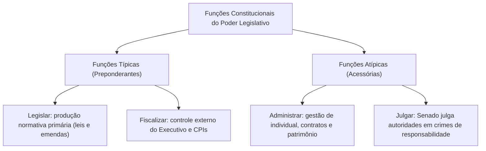
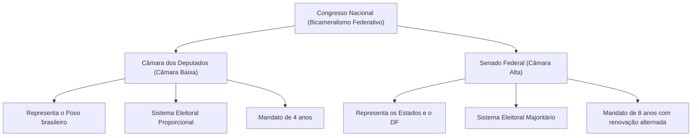
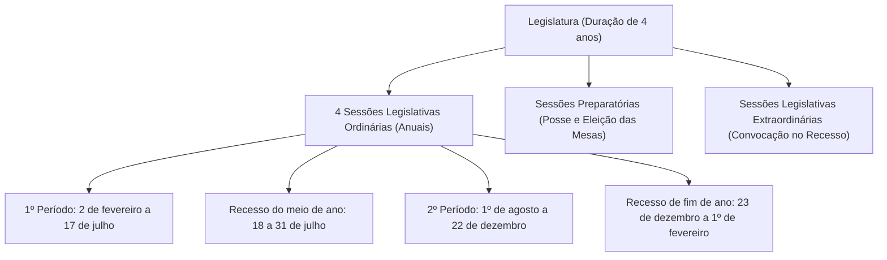
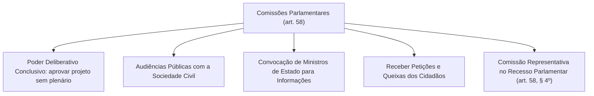

O Poder Legislativo ocupa posição de proeminência no arranjo republicano delineado pela Constituição Federal de 1988. Como depositário primário da representação soberana da cidadania, cabe-lhe dar voz à pluralidade de interesses da sociedade brasileira, convertendo aspirações sociais em diplomas normativos e exercendo vigilância contínua sobre a administração pública. No âmbito federal, a opção pelo bicameralismo federativo busca harmonizar a vontade do povo com o equilíbrio das unidades federadas.

> [!objetivos]
> - Compreender a separação de poderes e a distribuição entre funções típicas e atípicas no Poder Legislativo.
> - Diferenciar a estrutura bicameral federal do unicamarismo adotado nos Estados, Distrito Federal e Municípios.
> - Identificar as regras sobre legislatura, sessões ordinárias, extraordinárias e preparatórias no Congresso Nacional.
> - Analisar os critérios de composição da Câmara dos Deputados e do Senado Federal, com foco nos sistemas eleitorais.
> - Dominar a organização das Mesas Diretoras, a vedação de reeleição e o papel constitucional das comissões temáticas.

## Funções do Poder Legislativo: típicas e atípicas

O art. 2º da Carta Magna consagra a divisão entre os Poderes da União: Legislativo, Executivo e Judiciário, independentes e harmônicos. O poder estatal é uno e emana do povo; o que se reparte são as funções especializadas. O ordenamento adota a separação flexível: cada órgão exerce predominantemente uma função típica, desempenhando de modo acessório funções atípicas autorizadas pela Constituição:

### Funções típicas

O Poder Legislativo possui duas funções típicas de idêntica hierarquia e relevância política:
1. **Função legislativa:** consiste na prerrogativa primária de inovar no ordenamento jurídico positivo, criando, alterando ou revogando leis e espécies normativas previstas no art. 59 da Constituição;
2. **Função fiscalizatória:** abrange o controle externo da atividade governamental e administrativa, englobando o controle financeiro, contábil e orçamentário dos atos da administração pública, em conjunto com o Tribunal de Contas, além de apurações promovidas por Comissões Parlamentares de Inquérito.

### Funções atípicas

No plano atípico, o Legislativo exerce atribuições executivas e judicantes:
- **Função administrativa atípica:** manifesta-se na gestão interna de seus próprios recursos materiais e humanos, na realização de concursos públicos para seu quadro funcional, na concessão de férias a servidores e na celebração de contratos de licitação;
- **Função jurisdicional atípica:** expressa-se no processamento e julgamento do Presidente da República e do Vice-Presidente da República por crimes de responsabilidade pelo Senado Federal (art. 52, I), bem como de Ministros de Estado, Ministros do Supremo Tribunal Federal e do Procurador-Geral da República.

| Modalidade Funcional | Conteúdo da Atribuição | Exemplo Prático na CF/88 |
|---|---|---|
| **Típica Normativa** | Elaboração primária de normas jurídicas gerais e abstratas | Votação de leis ordinárias, leis complementares e emendas |
| **Típica Fiscalizatória**| Controle financeiro, político e contábil da Administração | Fiscalização com o TCU (art. 70) e atuação das CPIs |
| **Atípica Administrativa**| Gestão orgânica interna de serviços e recursos da Casa | Provimento de cargos por concurso público e licitações |
| **Atípica Julgadora** | Julgamento político de altas autoridades estatais | Senado julga Presidente da República por impeachment (art. 52) |

## Estrutura do Poder Legislativo e bicameralismo federativo

No Direito Constitucional comparado, o Poder Legislativo pode organizar-se sob a forma unicameral (uma única assembleia representativa) ou bicameral (divisão em duas câmaras com papéis distintos).

Na Federação brasileira:
- **União:** adota o modelo bicameral federativo previsto no art. 44 da Carta Magna, atuando o parlamento federal por meio da integração harmônica entre a Câmara dos Deputados e o Senado Federal;
- **Estados e Distrito Federal:** adotam o modelo **unicameral**, sendo o Legislativo exercido pela Assembleia Legislativa estadual e pela Câmara Legislativa distrital;
- **Municípios:** adotam o modelo **unicameral**, materializado na Câmara Municipal. Os Municípios não possuem representação própria no plano federal, participando de forma indireta por meio dos deputados federais eleitos pelo povo em cada Estado.

O bicameralismo brasileiro é qualificado pela doutrina como **igualitário** (ou de equilíbrio relativo): não há subordinação hierárquica entre a Câmara dos Deputados e o Senado Federal. Salvo hipóteses constitucionais expressas de iniciativa ou revisão de projetos, ambas as Casas exercem papéis simétricos no aperfeiçoamento da legislação federal.

### Sessões conjuntas e sessões unicamerais

Em regra, a Câmara e o Senado deliberam de forma isolada em seus respectivos plenários. Todavia, a Constituição impõe a reunião em **sessão conjunta** em ocasiões expressas (art. 57, § 3º):
1. Para inaugurar solenemente a sessão legislativa ordinária;
2. Para elaborar o regimento comum e regular serviços compartilhados por ambas as Casas;
3. Para receber o compromisso de posse do Presidente e do Vice-Presidente da República;
4. Para conhecer do veto presidencial e sobre ele deliberar;
5. Para discutir e votar o projeto da Lei Orçamentária Anual, LDO e PPA (art. 166);
6. Para apreciar a concessão de delegação legislativa ao Presidente da República.

> [!pegadinha]
> Não confunda **sessão conjunta** com **sessão unicameral**. Na sessão conjunta, deputados e senadores reúnem-se no mesmo recinto físico (plenário da Câmara), mas a apuração dos votos faz-se de modo estritamente **separado por Casa legislativa**. Para rejeitar um veto presidencial, por exemplo, exige-se a maioria absoluta dos votos da Câmara e a maioria absoluta dos votos do Senado. Já na sessão unicameral, os votos de todos os parlamentares somam-se conjuntamente em contagem única. A CF/88 previu uma única sessão unicameral transitória: a revisão constitucional do art. 3º do ADCT, realizada em 1993.

### Quórum geral de deliberação (art. 47)

Salvo previsão constitucional em sentido diverso (como maiorias absolutas para leis complementares ou de três quintos para emendas constitucionais), o art. 47 da CF/88 estipula a regra geral: as deliberações de cada Casa e de suas comissões são tomadas por **maioria simples (ou maioria relativa)** de votos, exigindo-se a presença obrigatória da **maioria absoluta** dos membros da Casa no início da sessão.

> [!esquema] Funcionamento do Poder Legislativo
> - **Congresso Nacional:** órgão bicameral composto pela Câmara dos Deputados e Senado Federal.
> - **Câmara dos Deputados:** 513 deputados eleitos pelo sistema proporcional para representar a população.
> - **Senado Federal:** 81 senadores eleitos pelo sistema majoritário para representar os 26 Estados e o DF (3 por ente).
> - **Princípio deliberativo:** deliberação autônoma em cada Casa regida por regimento interno próprio, reunindo-se conjuntamente apenas nas hipóteses taxativas do art. 57, § 3º, da CF/88.
> - **Quórum ordinário (art. 47):** abertura e deliberação por maioria simples com quórum presencial de maioria absoluta.

| Unidade Federativa | Modelo Adotado | Órgão Titular do Poder Legislativo | Sistema Eleitoral Adotado |
|---|---|---|---|
| **União** | Bicameral | Congresso Nacional (Câmara e Senado) | Proporcional (Câmara) e Majoritário (Senado) |
| **Estados** | Unicameral | Assembleia Legislativa | Proporcional (Deputados Estaduais) |
| **Distrito Federal** | Unicameral | Câmara Legislativa do Distrito Federal | Proporcional (Deputados Distritais) |
| **Municípios** | Unicameral | Câmara Municipal de Vereadores | Proporcional (Vereadores) |

## Reuniões do Congresso Nacional: legislatura e sessões legislativas

A compreensão temporal da atuação parlamentar envolve três conceitos basilares distintos:

1. **Legislatura (art. 44, parágrafo único):** período temporal de quatro anos correspondente à duração integral do mandato dos deputados federais;
2. **Sessão legislativa ordinária (art. 57, caput):** período anual ordinário de funcionamento do Congresso Nacional, que se desenvolve em Brasília de **2 de fevereiro a 17 de julho** (primeiro período) e de **1º de agosto a 22 de dezembro** (segundo período);
3. **Recesso parlamentar:** intervalos regimentais compreendidos entre 18 e 31 de julho e entre 23 de dezembro e 1º de fevereiro do ano seguinte.

### A vedação de interrupção pela Lei de Diretrizes Orçamentárias

O art. 57, § 2º, da Constituição impõe uma condicionante temporal severa ao calendário parlamentar: o recesso legislativo do mês de julho fica terminantemente obstado caso o Congresso não conclua a votação da lei de diretrizes orçamentárias. Se os parlamentares não concluírem a votação da LDO até o dia 17 de julho, o Congresso não ingressa no recesso de meio de ano, mantendo-se os trabalhos deliberativos ininterruptos em Brasília até a deliberação final da matéria.

### Sessões preparatórias

> [!lei] Art. 57, caput e § 4º, da Constituição Federal
> O Congresso Nacional reunir-se-á, anualmente, na Capital Federal, de 2 de fevereiro a 17 de julho e de 1º de agosto a 22 de dezembro.
> [...]
> § 4º Cada uma das Casas reunir-se-á em sessões preparatórias, a partir de 1º de fevereiro, no primeiro ano da legislatura, para a posse de seus membros e eleição das respectivas Mesas, para mandato de 2 (dois) anos, vedada a recondução para o mesmo cargo na eleição imediatamente subsequente.

Realizam-se em cada Casa legislativa a partir de 1º de fevereiro no primeiro ano da legislatura:
- Na primeira sessão legislativa ordinária (início do mandato): destina-se à posse formal dos congressistas eleitos e à eleição dos membros das Mesas Diretoras para mandato de dois anos;
- Na terceira sessão legislativa ordinária (meio do mandato): destina-se à realização de nova eleição para recomposição dos cargos das Mesas Diretoras para o biênio final da legislatura.

### Convocação extraordinária do Congresso Nacional (art. 57, §§ 6º a 8º)

Durante os períodos de recesso parlamentar, o Congresso Nacional pode ser convocado para funcionar extraordinariamente:

1. **Convocação privativa pelo Presidente do Senado Federal (inciso I):** ocorre de pleno direito, independentemente de votação dos demais parlamentares, em quatro situações graves de crise institucional:
   - Decretação de estado de defesa;
   - Decretação de intervenção federal;
   - Pedido de autorização do Presidente para decretar estado de sítio;
   - Compromisso e posse formal do Presidente e Vice-Presidente da República.
2. **Convocação por iniciativa de autoridades com aprovação do plenário (inciso II):** requerida pelo Presidente da República, pelos Presidentes da Câmara e do Senado conjuntamente, ou por requerimento da maioria dos membros de ambas as Casas, fundamentada em situação de urgência ou relevante interesse público. Nessa hipótese, a convocação depende de prévia **aprovação pela maioria absoluta de cada uma das Casas**.

Na sessão legislativa extraordinária, o Congresso delibera exclusivamente sobre as matérias que motivaram expressamente o ato convocatório e sobre as **medidas provisórias em vigor** na data da abertura dos trabalhos (art. 57, § 8º).

> [!bizu]
> Vedação de remuneração extra: o art. 57, § 7º, da CF/88 veda terminantemente o pagamento de qualquer parcela indenizatória ou verba extra aos parlamentares em virtude da convocação extraordinária. Essa norma de moralidade pública constitui princípio de reprodução compulsória para os Estados, Distrito Federal e Municípios, sendo inconstitucional qualquer lei estadual ou municipal que preveja pagamento de jeton por sessão extraordinária.

| Autoridade / Iniciativa | Hipóteses Constitucionais | Requisito de Deliberação |
|---|---|---|
| **Presidente do Senado Federal** | Estado de defesa, intervenção federal, estado de sítio, posse presidencial | Convocação de ofício imediata; dispensa votação prévia |
| **Presidente da República** | Urgência ou interesse público de alta relevância nacional | Exige aprovação por maioria absoluta da Câmara e do Senado |
| **Presidentes da Câmara e Senado**| Situação emergencial de relevante interesse parlamentar | Exige aprovação por maioria absoluta da Câmara e do Senado |
| **Maioria dos membros de cada Casa**| Iniciativa parlamentar coletiva e relevante para o país | Exige aprovação por maioria absoluta da Câmara e do Senado |

## Câmara dos Deputados: composição e sistema proporcional (art. 45)

A Câmara dos Deputados representa o povo brasileiro, compondo-se de cidadãos eleitos pelo **sistema proporcional** em cada Estado, no Distrito Federal e em eventuais Territórios Federais (art. 45).

### Fixação do número de deputados federais

O quantitativo total de vagas e a bancada de cada Estado e do DF são fixados por lei complementar. A distribuição observa a proporção da população aferida pelo censo demográfico:
- **Piso e teto constitucionais (art. 45, § 1º):** nenhuma unidade da Federação pode possuir menos de **oito** nem mais de **setenta** deputados federais;
- **Total atual:** 513 deputados federais em exercício;
- **Territórios Federais (§ 2º):** caso venham a ser criados, cada Território Federal elegerá número fixo de **quatro deputados federais**, independentemente de sua população.

O piso de 8 e o teto de 70 atenuam a proporcionalidade pura, equilibrando a representação política dos Estados menos populosos frente aos grandes colégios eleitorais.

### Funcionamento do sistema proporcional

No sistema proporcional, as vagas legislativas não são atribuídas simplesmente aos candidatos que obtiveram maior votação nominal individual. A conquista de cadeiras depende de dois cálculos sucessivos regulados pelo Código Eleitoral:
1. **Quociente Eleitoral (QE):** obtém-se pela divisão do total de votos válidos da eleição (votos nominais + votos de legenda, excluídos os brancos e nulos) pelo número de vagas disponíveis na circunscrição eleitoral;
2. **Quociente Partidário (QP):** define quantas vagas cabem a cada agremiação partidária ou federação, dividindo-se o número de votos válidos obtidos pelo partido pelo quociente eleitoral apurado.

As vagas obtidas pela legenda são preenchidas pelos seus candidatos mais votados em ordem decrescente, desde que tenham atingido a votação nominal mínima exigida em lei (cláusula de barreira individual de 10% do quociente eleitoral).

> [!exemplo] Cálculo Prático dos Quocientes Eleitoral e Partidário
> Em determinado Estado com 10 vagas de deputado federal em disputa, apuram-se 1.000.000 de votos válidos.
> - O Quociente Eleitoral será de 100.000 votos (1.000.000 ÷ 10 vagas).
> - Se o Partido Alfa obteve 300.000 votos no total da legenda, seu Quociente Partidário será de 3 vagas (300.000 ÷ 100.000).
> - O Partido Alfa ocupará 3 cadeiras na Câmara dos Deputados, preenchidas pelos seus 3 candidatos que obtiveram as maiores votações individuais dentro da lista partidária, desde que cumprida a votação mínima legal.

### Fidelidade partidária no sistema proporcional

Como os votos no sistema proporcional destinam-se precipuamente a conferir força representativa às legendas partidárias, o Supremo Tribunal Federal firmou que **o mandato parlamentar pertence ao partido político**, e não à pessoa do deputado. Desse modo, o parlamentar que se desfilia sem justa causa comete infidelidade partidária e perde o mandato eletivo em favor do suplente da agremiação de origem.

Consideram-se hipóteses de justa causa reconhecidas pela jurisprudência: mudança substantiva de programa partidário, grave discriminação política pessoal comprovada ou desfiliação operada durante a chamada "janela partidária" que antecede eleições proporcionais. Desde a Emenda Constitucional nº 97/2017, resta vedada a celebração de coligações nas eleições proporcionais, facultando-se apenas a criação de federações partidárias de caráter nacional duradouro.

| Parâmetro Constitucional | Regra Aplicável à Câmara dos Deputados |
|---|---|
| **Representação Política** | O povo brasileiro em sua totalidade demográfica |
| **Composição Total** | 513 parlamentares (definido pela LC 78/1993) |
| **Limites por Estado e DF** | Mínimo de 8 e máximo de 70 deputados federais |
| **Representação de Territórios**| Fixa em 4 deputados federais por território criado |
| **Duração do Mandato** | 4 anos (coincidente com uma legislatura integral) |
| **Sistema Eleitoral Adotado** | Sistema Proporcional de listas abertas partidárias |

## Senado Federal: representação paritária e sistema majoritário (art. 46)

O Senado Federal representa a Câmara Alta do parlamento brasileiro, incumbindo-lhe a representação equânime dos entes federados autônomos que integram a República Federativa do Brasil: os vinte e seis Estados e o Distrito Federal.

### Representação paritária e composição

Diferente da Câmara dos Deputados, o Senado Federal pauta-se pela igualdade federativa estrita:
- Cada Estado e o Distrito Federal elegem **três senadores** (art. 46, § 1º), totalizando **81 senadores** da República;
- A representação é paritária: todos os Estados e o DF possuem rigorosamente três senadores, desconsiderando-se a densidade demográfica. Eventuais Territórios Federais não elegem senadores por não ostentarem autonomia política federativa.

### Mandato e renovação alternada

O mandato dos senadores da República é de **oito anos** (art. 46, § 1º), correspondendo à duração de duas legislaturas ordinárias consecutivas.

A renovação do Senado opera-se de quatro em quatro anos, de forma alternada:
- Em uma eleição geral (exemplo: 2026), renova-se **um terço** das cadeiras de cada unidade da Federação (cada Estado e o DF elegem 1 senador);
- Na eleição geral subsequente (exemplo: 2030), renovam-se **dois terços** da representação (cada Estado e o DF elegem 2 senadores).

### Sistema majoritário simples e suplência

A eleição dos senadores rege-se pelo **sistema majoritário simples (ou relativo)** em turno único: considera-se eleito o candidato que obtiver o maior número de votos válidos na eleição de um terço, ou os dois candidatos mais votados na eleição de dois terços, independentemente de atingirem metade dos votos da circunscrição.

Cada senador da República é eleito conjuntamente com **dois suplentes** registrados na mesma chapa eleitoral (art. 46, § 3º). O primeiro suplente assume temporariamente nos casos de licença ou definitivamente em caso de vacância definitiva (morte, renúncia ou cassação). Caso vagando o cargo inexista suplente disponível, realizar-se-á eleição suplementar se faltarem **mais de quinze meses** para a conclusão do mandato (art. 56, § 2º).

Para concorrer ao Senado Federal, o cidadão deve ostentar a idade mínima constitucional de **trinta e cinco anos** (art. 14, § 3º, VI, "a"), sendo brasileiro nato ou naturalizado.

| Aspecto Dogmático | Câmara dos Deputados (Art. 45) | Senado Federal (Art. 46) |
|---|---|---|
| **Polo Representado** | População brasileira (Povo) | Estados-membros e Distrito Federal |
| **Critério de Composição** | Proporcional à população (8 a 70 por ente) | Rigorosamente paritário: 3 por Estado e DF |
| **Total de Membros** | 513 parlamentares | 81 parlamentares |
| **Sistema Eleitoral** | Sistema Proporcional de legenda | Sistema Majoritário Simples (turno único) |
| **Duração do Mandato** | 4 anos (uma legislatura) | 8 anos (duas legislaturas consecutivas) |
| **Forma de Renovação** | Integral a cada quatro anos | Alternada a cada 4 anos (1/3 e 2/3) |
| **Idade Mínima Exigida** | 21 anos completados na data da posse | 35 anos completados na data da posse |
| **Suplência Eleitoral** | Suplentes da lista do partido eleitoral | Dois suplentes fixos eleitos na mesma chapa |

## Mesas Diretoras e a vedação de recondução (art. 57, §§ 4º e 5º)

A direção dos trabalhos legislativos e dos serviços administrativos compete às Mesas Diretoras da Câmara dos Deputados e do Senado Federal. A Mesa do Congresso Nacional (art. 57, § 5º) possui estrutura mista presidida pelo Presidente do Senado, revezando-se os demais cargos entre as duas Casas. A composição das Mesas assegura, quanto possível, a proporcionalidade partidária (art. 58, § 1º).

### Regra de recondução e mandatos diretivos

O texto constitucional estabelece no art. 57, § 4º, que as Casas legislativas reúnem-se em sessões preparatórias para posse e escolha das Mesas para mandato de dois anos, impedindo-se a reeleição contígua para a mesma função diretiva.

O alcance dessa proibição gerou intensos debates constitucionais:
- **Proibição estrita na mesma legislatura:** o STF consolidou que a vedação de recondução para o mesmo cargo da Mesa incide de modo absoluto dentro da **mesma legislatura** (eleição preparatória da 3ª sessão legislativa ordinária);
- **Permissão entre legislaturas distintas:** em legislaturas diferentes (passagem da última sessão ordinária de uma legislatura para a primeira da legislatura seguinte), o Supremo admite a reeleição de membro da Mesa para o mesmo cargo;
- **Cargos diversos:** a vedação constitucional atinge unicamente a recondução ao **mesmo cargo** diretivo. Um Presidente da Câmara pode candidatar-se na eleição seguinte a Vice-Presidente ou Primeiro-Secretário.

> [!jurisprudencia] STF, ADI 6524: Limites da Reeleição nas Mesas Diretoras do Congresso e das Assembleias Legislativas
> O Supremo Tribunal Federal, ao julgar a ADI 6524 e precedentes correlatos, estabeleceu parâmetros constitucionais fundamentais:
> 1. No âmbito do Congresso Nacional (Câmara dos Deputados e Senado Federal), a vedação do art. 57, § 4º, proíbe expressamente a recondução ao mesmo cargo da Mesa na eleição imediatamente subsequente realizada na mesma legislatura;
> 2. No âmbito das Assembleias Legislativas Estaduais e da Câmara Legislativa do Distrito Federal, em homenagem à simetria constitucional com mitigação federativa, o STF firmou tese vinculante permitindo **uma única reeleição sucessiva** aos mesmos cargos diretivos, independentemente de os mandatos recaírem na mesma legislatura ou na transição para a legislatura seguinte.

## Comissões Parlamentares permanentes e temporárias (art. 58)

As comissões constituem órgãos técnicos compostos por grupos restritos de parlamentares destinados a descentralizar a análise das matérias legislativas e especializar o controle fiscalizatório.

Podem pertencer a uma única Casa ou configurar **comissões mistas** (formadas por deputados e senadores em conjunto, a exemplo da comissão mista permanente de orçamento prevista no art. 166 da CF/88 ou das comissões mistas de medidas provisórias do art. 62, § 9º).

### Comissões permanentes e temporárias

O art. 58 reparte as comissões em duas grandes classes:
1. **Comissões permanentes:** integram a estrutura duradoura e perene da Casa legislativa, com competência temática definida nos respectivos regimentos internos (como a Comissão de Constituição e Justiça, Comissão de Segurança Pública ou de Finanças e Tributação);
2. **Comissões temporárias:** criadas por ato específico para cumprir missão transitória ou estudar tema conjuntural delimitado, extinguindo-se com o atingimento do objeto, decurso do prazo fixado ou término da legislatura.

### Competências das comissões temáticas (art. 58, § 2º)

Às comissões parlamentares incumbe:
- **Poder conclusivo sobre projetos de lei (inciso I):** discutir e votar projetos de lei que dispensarem a apreciação do Plenário, nos termos regimentais. Esse poder conclusivo é obstado caso haja recurso formal subscrito por no mínimo **um décimo dos membros da Casa**, hipótese em que o projeto é obrigatoriamente submetido ao crivo do Plenário;
- **Audiências públicas (inciso II):** ouvir entidades representativas da sociedade civil;
- **Convocação de Ministros de Estado (inciso III):** convocar Ministros de Estado ou titulares de órgãos subordinados à Presidência da República para prestar esclarecimentos diretos sobre assuntos inerentes a suas pastas; a ausência injustificada da autoridade convocada configura **crime de responsabilidade** (art. 50, caput);
- **Recebimento de queixas populares (inciso IV):** processar representações e petições de qualquer cidadão contra atos ou omissões do poder público;
- **Emissão de pareceres (inciso VI):** opinar tecnicamente sobre planos nacionais, regionais e setoriais de desenvolvimento econômico.

### Comissão representativa durante o recesso (art. 58, § 4º)

Durante os intervalos de recesso parlamentar, as Casas legislativas elegem na última sessão ordinária a chamada **Comissão Representativa do Congresso Nacional**. Esse órgão colegiado extraordinário compõe-se de deputados e senadores, assegurada a proporcionalidade partidária, exercendo atribuições regimentais de urgência e zelando pelas prerrogativas institucionais do parlamento enquanto perdurar a interrupção ordinária das atividades legislativas.

| Atribuição da Comissão | Previsão Constitucional | Consequência Jurídica em Caso de Recurso ou Descumprimento |
|---|---|---|
| **Poder Terminativo de Projetos** | Art. 58, § 2º, I | Recurso de 1/10 dos membros transfere a votação ao Plenário |
| **Convocação de Ministros** | Art. 50 c/c art. 58, § 2º, III | Não comparecimento injustificado configura crime de responsabilidade |
| **Audiências Públicas** | Art. 58, § 2º, II | Instrumento de controle democrático e participação social |
| **Comissão Representativa** | Art. 58, § 4º | Órgão que atua no recesso parlamentar para matérias urgentes |

## Mapa do capítulo

A tabela a seguir sistematiza as regras essenciais relativas à estrutura, funcionamento e reuniões do Poder Legislativo na Carta Magna:

| Órgão / Instituto | Dispositivo Constitucional | Parâmetro Normativo Central | Finalidade Política / Princípio |
|---|---|---|---|
| **Congresso Nacional** | Art. 44 | Órgão bicameral da União (Câmara + Senado) | Equilíbrio entre soberania popular e federação |
| **Câmara dos Deputados** | Art. 45 | 513 deputados proporcionais (8 a 70 por ente) | Representação demográfica do povo brasileiro |
| **Senado Federal** | Art. 46 | 81 senadores (3 por Estado e DF; mandato de 8 anos) | Representação paritária dos entes federados |
| **Quórum Geral** | Art. 47 | Maioria simples de votos com maioria absoluta presente | Regra padrão de deliberação parlamentar |
| **Legislatura** | Art. 44, parágrafo único | Período de 4 anos de mandato dos deputados | Ciclo temporal básico da atividade política |
| **Sessão Ordinária** | Art. 57, caput | 2/2 a 17/7 e 1/8 a 22/12 em Brasília | Período de trabalho; não interrompe sem LDO |
| **Sessão Extraordinária** | Art. 57, §§ 6º a 8º | Convocada no recesso; veda parcela indenizatória | Atendimento de crise ou urgência pública |
| **Mesas Diretoras** | Art. 57, § 4º | Mandato de 2 anos; vedada reeleição imediata no biênio | Renovação do comando e representatividade interna |
| **Comissões Parlamentares**| Art. 58 | Órgãos técnicos permanentes, temporários e mistos | Poder terminativo de projetos e instrução técnica |

### Para fixar

- O Poder Legislativo exerce com preponderância as funções típicas de legislar e fiscalizar, ostentando funções atípicas de administrar seus serviços e julgar autoridades.
- O bicameralismo federal compõe-se da Câmara dos Deputados (representantes do povo pelo sistema proporcional) e do Senado Federal (representantes paritários dos Estados e DF pelo sistema majoritário).
- A legislatura tem duração de quatro anos e compreende quatro sessões legislativas ordinárias; a sessão ordinária não pode ser interrompida em julho sem a aprovação do projeto da LDO.
- A sessão legislativa extraordinária só delibera sobre a pauta convocatória e medidas provisórias em vigor, sendo vedado o pagamento de parcela indenizatória aos parlamentares.
- A eleição das Mesas Diretoras realiza-se para mandato de dois anos, sendo vedada a recondução para o mesmo cargo na escolha sucessiva no biênio seguinte dentro da mesma legislatura.
- As comissões parlamentares possuem competência terminativa para aprovar projetos de lei sem passar pelo Plenário, salvo recurso firmado por um décimo dos membros da Casa legislativa.
