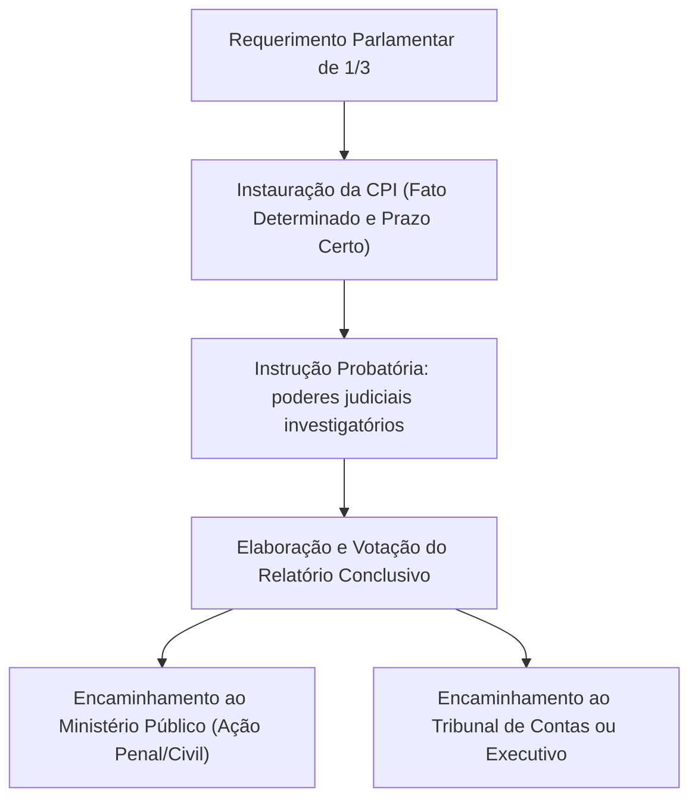
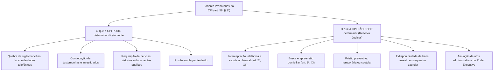

A fiscalização política e contábil constitui atribuição indispensável à dinâmica dos freios e contrapesos no Estado Democrático de Direito. Entre os instrumentos mais contundentes colocados à disposição do Poder Legislativo para o exercício dessa função fiscalizatória destacam-se as Comissões Parlamentares de Inquérito (CPIs). Dotadas de poderes instrutórios assemelhados aos das autoridades judiciais, as CPIs destinam-se a apurar fatos determinados de relevante interesse público, assegurando a transparência governamental e a contenção de desvios na gestão do patrimônio coletivo.

> [!objetivos]
> - Compreender a natureza jurídica investigatória e a finalidade constitucional das CPIs no modelo de freios e contrapesos.
> - Analisar os três requisitos constitucionais indispensáveis para a instauração de uma CPI como direito público subjetivo das minorias.
> - Identificar as diligências probatórias que a CPI pode determinar diretamente com esteio em seus poderes judiciais próprios.
> - Dominar os limites materiais da atuação parlamentar decorrentes da cláusula de reserva de jurisdição e dos direitos fundamentais.
> - Examinar os direitos e garantias processuais conferidos a testemunhas e investigados durante os depoimentos.

## Natureza jurídica e finalidade das CPIs

As Comissões Parlamentares de Inquérito constituem órgãos colegiados temporários criados no âmbito do Poder Legislativo para exercer a sua função típica de fiscalização e controle externo. A atuação da CPI é de índole pré-processual, inquisitorial e eminentemente instrutória.

A comissão legislativa não julga, não condena, não impõe sanções administrativas e não formula acusação formal perante o Poder Judiciário. Sua atividade traduz-se na produção de um inquérito parlamentar destinado a colher elementos de informação sobre atos ilícitos ou desvios de conduta. Concluída a apuração, o relatório final é aprovado pelo colegiado e encaminhado ao Ministério Público, à Advocacia-Geral da União, à Defensoria Pública ou ao Tribunal de Contas, para que os órgãos legitimados promovam a respectiva responsabilidade civil, administrativa ou criminal dos infratores (art. 58, § 3º).

As CPIs podem ser instauradas de forma autônoma pela Câmara dos Deputados, pelo Senado Federal ou conjuntamente pelas duas Casas, hipótese em que configuram Comissão Parlamentar Mista de Inquérito (CPMI).

## Requisitos constitucionais de instauração

O art. 58, § 3º, da Carta da República disciplina a criação das comissões investigatórias, estabelecendo três requisitos cumulativos de observância cogente:

> [!lei] Art. 58, § 3º, da Constituição Federal de 1988
> As comissões parlamentares de inquérito, que terão poderes de investigação próprios das autoridades judiciais, além de outros previstos nos regimentos das respectivas Casas, serão criadas pela Câmara dos Deputados e pelo Senado Federal, em conjunto ou separadamente, mediante requerimento de um terço de seus membros, para a apuração de fato determinado e por prazo certo, sendo suas conclusões, se for o caso, encaminhadas ao Ministério Público, para que promova a responsabilidade civil ou criminal dos infratores.

### Requerimento de um terço dos membros da Casa

A iniciativa reclama subscrição de pelo menos um terço dos deputados federais (171 assinaturas) ou um terço dos senadores (27 assinaturas). Tratando-se de comissão mista (CPMI), exige-se a adesão simultânea de um terço dos membros de cada uma das Casas legislativas.

O Supremo Tribunal Federal consolidou o entendimento de que a instauração de CPI configura **direito público subjetivo das minorias parlamentares** (MS 24.831 e MS 37.760). Preenchidos os três requisitos constitucionais, a Mesa Diretora tem o dever de instaurar a comissão, não se admitindo que a maioria parlamentar governista submeta o requerimento à votação plenária ou bloqueie o início dos trabalhos deixando de indicar representantes para compor o colegiado.

### Fato determinado

A apuração deve recair sobre acontecimento concreto, delimitado e individualizado no tempo e no espaço, que ostente relevância para a vida pública e a ordem social ou econômica do país. É inconstitucional a instalação de CPI com objeto vago, difuso ou genérico ("devassa indiscriminada"). Admite-se a investigação simultânea de múltiplos fatos, desde que todos sejam certos e identificados no ato convocatório. Fatos novos e imprevistos surgidos no decorrer da investigação podem ser incorporados mediante aditamento formal do objeto.

### Prazo certo

A comissão deve ser criada com duração pré-fixada. Admitem-se prorrogações sucessivas de prazo deliberadas pela própria comissão ou previstas regimentalmente, contanto que o funcionamento não ultrapasse o termo final da legislatura ordinária quadrienal em curso. O término da legislatura acarreta a extinção automática da CPI.

| Requisito Constitucional | Conteúdo Normativo | Entendimento Vinculante do STF |
|---|---|---|
| **Quórum de 1/3 (Iniciativa)** | Subscrição de no mínimo um terço dos parlamentares da Casa | Direito público subjetivo da minoria; dispensa votação do Plenário |
| **Fato Determinado** | Delimitação estrita do acontecimento investigado | Veda investigações genéricas; admite fatos conexos aditados |
| **Prazo Certo** | Fixação de período temporal prévio de funcionamento | Admite prorrogações sucessivas limitadas ao fim da legislatura |

> [!atencao]
> Princípio federativo e limites temáticos da CPI: em obediência ao pacto federativo, as CPIs do Congresso Nacional (Câmara, Senado ou Mista) possuem competência restrita à apuração de fatos relacionados à administração federal ou aplicação de verbas da União. A CPI federal não pode investigar a gestão exclusiva dos Governos Estaduais ou Municipais. Do mesmo modo, a CPI instaurada em Assembleia Legislativa estadual não possui competência para apurar atos do governo federal ou das prefeituras municipais.

## Poderes investigatórios próprios das autoridades judiciais

A Constituição atribui às CPIs "poderes de investigação próprios das autoridades judiciais". Isso significa que, no campo da colheita probatória preliminar, a comissão parlamentar pode determinar diligências que ordinariamente dependeriam de autorização judicial, sem intervenção de magistrado togado:

### Convocação e tomada de depoimentos

A comissão tem poder de convocar testemunhas, servidores públicos, peritos e investigados para prestar depoimento em audiência pública:
- **Testemunhas:** possuem o dever legal de comparecimento e de dizer a verdade sob compromisso, sujeitando-se a condução coercitiva em caso de ausência injustificada e a processo por falso testemunho;
- **Investigados:** têm o dever de comparecer perante o colegiado, mas não prestam compromisso de dizer a verdade e encontram-se amparados pelo privilégio constitucional contra a autoincriminação;
- **Limitações funcionais:** magistrados e membros do Ministério Público não podem ser convocados para prestar esclarecimentos sobre o mérito de decisões jurisdicionais ou manifestações processuais privativas, em obséquio à independência funcional.

### Quebra de sigilos: fiscal, bancário e telefônico

As CPIs possuem competência direta para determinar o afastamento do sigilo bancário, fiscal e telefônico (dados cadastrais e registros de chamadas pretéritas) de pessoas físicas ou jurídicas investigadas. A decretação da medida exige fundamentação fática e jurídica robusta, nexo de pertinência com o fato determinado investigado e deliberação tomada pela maioria absoluta do colegiado parlamentar.

> [!pegadinha]
> Distinção clássica de concurso: a CPI pode decretar a **quebra do sigilo de dados telefônicos** (acesso ao extrato das ligações com número de origem, número de destino, data e tempo de duração dos telefonemas passados). Todavia, a CPI **não pode decretar a interceptação telefônica** (escuta em tempo real do teor das conversas em áudio), providência submetida à cláusula pétrea de reserva absoluta de jurisdição (art. 5º, XII, da CF/88).

## Limites da atuação parlamentar: o que a CPI não pode fazer

Embora detenha poderes judiciais instrutórios, a CPI não constitui órgão jurisdicional. A sua atuação encontra barreiras inultrapassáveis nos direitos fundamentais da cidadania e na cláusula de reserva de jurisdição:

1. **Prisão preventiva ou cautelar:** a comissão não pode decretar prisão preventiva ou temporária de suspeitos. A privação cautelar da liberdade é prerrogativa privativa do Poder Judiciário. A CPI só pode prender alguém em situação de flagrante delito (como no flagrante de falso testemunho cometido durante a sessão);
2. **Busca e apreensão domiciliar:** o asilo domiciliar inviolável (art. 5º, XI, da CF/88) somente pode ser penetrado mediante mandado judicial formal emanado de magistrado competente. A CPI pode realizar busca e apreensão em repartições públicas, mas não em domicílio particular;
3. **Medidas cautelares patrimoniais:** a decretação de indisponibilidade de bens, arresto, sequestro cautelar ou retenção de passaporte exige intervenção judicial estrita;
4. **Anulação de atos do Poder Executivo:** o parlamento investiga, mas não detém poder administrativo para revogar contratos públicos, desconstituir licitações ou anular decretos de nomeação governamentais;
5. **Convocação do Chefe do Executivo:** a CPI não pode convocar o Presidente da República, governadores ou prefeitos para depor sobre atos funcionais, em virtude da harmonia dos Poderes e da separação de funções estatais (art. 50).

| Categoria da Medida | Situação Perante a CPI | Fundamento Constitucional |
|---|---|---|
| **Quebra de Sigilo Bancário** | **Permitida** (decisão fundamentada colegiada) | Poderes investigatórios judiciais próprios (art. 58, § 3º) |
| **Quebra de Sigilo Fiscal** | **Permitida** (decisão fundamentada colegiada) | Poderes investigatórios judiciais próprios (art. 58, § 3º) |
| **Quebra de Registro Telefônico**| **Permitida** (dados de ligações pretéritas) | Poderes investigatórios judiciais próprios (art. 58, § 3º) |
| **Interceptação Telefônica** | **Proibida** (escuta em tempo real de voz) | Reserva de jurisdição estrita (art. 5º, XII, da CF/88) |
| **Busca e Apreensão Domiciliar** | **Proibida** (admissível apenas judicial) | Inviolabilidade domiciliar absoluta (art. 5º, XI, da CF/88) |
| **Prisão Cautelar / Preventiva** | **Proibida** (admite apenas prisão em flagrante) | Reserva constitucional de jurisdição da liberdade física |
| **Bloqueio de Bens / Cautelar** | **Proibida** (reserva de jurisdição patrimonial) | Tutela privativa dos órgãos do Poder Judiciário |

> [!jurisprudencia] STF: Poderes da CPI e Cláusula de Reserva de Jurisdição
> O Supremo Tribunal Federal consolidou vasta jurisprudência delimitadora da competência das CPIs:
> 1. **Dever de fundamentação formal:** a decisão que determina quebra de sigilo bancário ou fiscal não pode apoiar-se em modelo genérico ou padronizado, sob pena de nulidade absoluta por violação ao art. 93, IX, da CF/88 (MS 23.452);
> 2. **Colegialidade da deliberação:** o Presidente ou relator da CPI não pode determinar medidas invasivas isoladamente de ofício; a medida reclama prévia votação majoritária do colegiado;
> 3. **Sigilo profissional e confissão:** o investigado ou depoente amparado por segredo profissional (padres, médicos, advogados) não pode ser forçado a revelar confidências obtidas no exercício da atividade;
> 4. **Falta de legitimidade recursal do Presidente da CPI:** o Presidente da CPI não ostenta legitimidade ativa para interpor agravo regimental ou recurso contra decisão monocrática de Ministro do STF que concede habeas corpus para salvaguardar direitos de depoente.

## Direitos e garantias fundamentais do depoente

O investigado e a testemunha perante a comissão parlamentar ostentam status de sujeitos de direito, merecendo proteção integral da Carta Constitucional:

- **Privilégio contra a autoincriminação (*nemo tenetur se detegere*):** consagrado no art. 5º, LXIII, da CF/88. Ninguém é obrigado a produzir prova contra si mesmo. Todo investigado tem direito público ao silêncio em relação a perguntas cujas respostas possam incriminá-lo direta ou indiretamente;
- **Direito à assistência técnica de advogado:** assegurado pelo art. 133 da Carta da República e pelo Estatuto da Advocacia (Lei nº 8.906/1994). O defensor tem a prerrogativa de permanecer sentado ao lado de seu cliente, comunicar-se reservadamente com ele, intervir oralmente para suscitar questões de ordem e reclamar contra abusos cometidos pela presidência da comissão;
- **Proteção da integridade moral e de imagem:** a CPI deve resguardar o respeito à honra, à intimidade e à dignidade humana de todos os participantes dos atos instrutórios.

> [!bizu]
> CPIs no âmbito dos Estados e dos Municípios:
> - **Assembleias Legislativas:** as CPIs estaduais submetem-se ao modelo federal por força do princípio da simetria (CF, art. 75). O STF assentou que as CPIs estaduais podem quebrar sigilo bancário, fiscal e telefônico (ACO 730), pois atuam com esteio no Poder Judiciário estadual correspondente;
> - **Câmaras Municipais:** as CPIs municipais de vereadores **não possuem poder para determinar quebra de sigilo bancário, fiscal ou telefônico**. O Município não possui Poder Judiciário próprio nem Ministério Público municipal; logo, para obter dados acobertados por sigilo, a CPI municipal deve obrigatoriamente requerer autorização ao juiz de direito da comarca.

> [!esquema] O que a CPI pode e o que não pode fazer
> - **A CPI PODE:**
>   - Convocar testemunhas (com dever de depor e risco de condução coercitiva);
>   - Ouvir investigados (com garantia irrenunciável ao silêncio e sem compromisso);
>   - Requisitar relatórios, perícias e documentos de órgãos públicos;
>   - Quebrar sigilo bancário, fiscal e de dados telefônicos mediante decisão colegiada fundamentada;
>   - Realizar vistorias técnicas e inspeções em órgãos públicos;
>   - Prender em flagrante delito qualquer pessoa no recinto da comissão.
> - **A CPI NÃO PODE:**
>   - Decretar prisão temporária ou preventiva;
>   - Ordenar busca e apreensão domiciliar;
>   - Determinar interceptação telefônica (escuta de voz) ou telemática em tempo real;
>   - Determinar arresto, sequestro de bens ou retenção de passaporte;
>   - Convidar ou convocar magistrados para debater conteúdo de sentenças;
>   - Convocar o Chefe do Poder Executivo (Presidente, Governador ou Prefeito);
>   - Anular decisões judiciais ou atos administrativos regulares do Executivo.

## Mapa do capítulo

A tabela consolida o regime constitucional e jurisprudencial das Comissões Parlamentares de Inquérito:

| Elemento / Instituto | Regra Constitucional Aplicável | Observação Dogmática e Jurisprudencial |
|---|---|---|
| **Natureza Jurídica** | Órgão parlamentar temporário de fiscalização | Inquérito legislativo preliminar; não julga nem acusa |
| **Requisitos de Criação** | 1/3 de assinaturas, fato determinado e prazo certo | Direito público subjetivo das minorias; sem veto da maioria |
| **Quebras de Sigilo** | Bancário, fiscal e telefônico permitidos | Exige deliberação da maioria absoluta e fundamentação |
| **Interceptação Telefônica**| Vedada terminantemente à comissão | Cláusula de reserva absoluta de jurisdição (art. 5º, XII) |
| **Busca Domiciliar** | Vedada terminantemente à comissão | Inviolabilidade do domicílio protegida (art. 5º, XI) |
| **Prisão Cautelar** | Vedada (admite exclusivamente flagrante) | Privação cautelar da liberdade cabe apenas ao Judiciário |
| **Garantia do Depoente** | Silêncio, advogado e não autoincriminação | Nemo tenetur se detegere pleno para investigados |
| **CPI Municipal** | Não pode quebrar sigilos diretamente | Ausência de Poder Judiciário no plano municipal |
| **Destinação Conclusiva** | Relatório ao Ministério Público ou TCU | MP titulariza promoção de ações penais e de improbidade |

### Para fixar

- A CPI exerce a função fiscalizatória típica do Poder Legislativo, possuindo natureza investigatória; suas conclusões são encaminhadas ao Ministério Público para promoção da responsabilidade.
- A instalação de CPI reclama três requisitos constitucionais cumulativos (art. 58, § 3º): requerimento de um terço dos membros, apuração de fato determinado e fixação de prazo certo.
- A criação da CPI configura direito público subjetivo das minorias, sendo inconstitucional exigir autorização ou votação prévia do Plenário da Casa legislativa.
- A CPI pode quebrar diretamente o sigilo bancário, fiscal e telefônico (registros) mediante decisão fundamentada e tomada pela maioria absoluta de seus membros.
- A CPI não pode determinar interceptação telefônica (escuta de voz), busca e apreensão domiciliar nem decretar prisões cautelares, atos submetidos à reserva de jurisdição.
- O investigado perante a CPI goza do direito ao silêncio, da não autoincriminação e da assistência de advogado; a testemunha tem o dever de comparecer e dizer a verdade.
- As CPIs estaduais podem quebrar sigilo bancário e fiscal; as CPIs municipais de vereadores não detêm esse poder instrutório direto, devendo requerer ao Judiciário.
