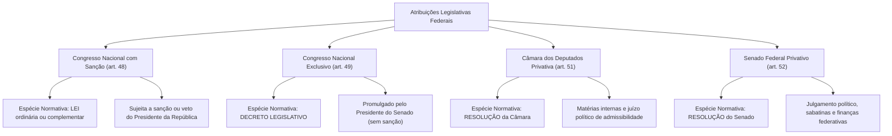
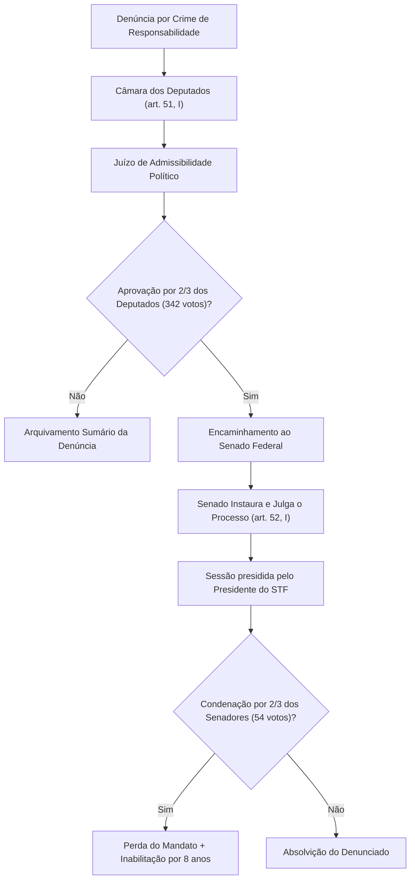

A repartição das atribuições constitucionais entre os órgãos do Poder Legislativo federal reflete a complexidade do arranjo federativo e o sistema de freios e contrapesos da Constituição Federal de 1988. O constituinte originário estruturou as competências parlamentares em blocos específicos, distinguindo matérias que reclamam a colaboração harmônica entre o Legislativo e o Executivo mediante sanção presidencial daquelas reservadas com exclusividade ao Congresso Nacional, à Câmara dos Deputados ou ao Senado Federal.

> [!objetivos]
> - Diferenciar os instrumentos normativos cabíveis para cada espécie de competência parlamentar federal.
> - Compreender o rol exemplificativo de matérias que dependem de lei com sanção do Presidente da República.
> - Analisar as competências exclusivas do Congresso Nacional veiculadas por meio de decreto legislativo.
> - Identificar as atribuições privativas da Câmara dos Deputados e o juízo de admissibilidade de autoridades.
> - Dominar as competências privativas do Senado Federal, com foco no julgamento de autoridades e sabatinas.

## Visão panorâmica dos instrumentos normativos

A compreensão das competências do Poder Legislativo federal exige a prévia correlação entre o órgão titular da atribuição, a espécie normativa formalmente exigida e a necessidade ou dispensa de sanção ou veto do Chefe do Poder Executivo:

Embora o texto constitucional utilize o vocábulo "privativas" para as competências da Câmara (art. 51) e do Senado (art. 52), a doutrina constitucional majoritária esclarece que tais atribuições são, em rigor técnico, **exclusivas e indelegáveis**. Elas não admitem delegação legislativa a outro órgão nem submetem-se a interferência do Poder Executivo.

| Dispositivo Constitucional | Órgão Titular | Instrumento Normativo Adequado | Sanção / Veto Presidencial? |
|---|---|---|---|
| **Artigo 48** | Congresso Nacional | **Lei** (ordinária ou complementar) | **Sim**, submete-se a sanção ou veto |
| **Artigo 49** | Congresso Nacional | **Decreto Legislativo** | **Não**, promulgado pelo Presidente do Senado |
| **Artigo 51** | Câmara dos Deputados | **Resolução** da Câmara | **Não**, promulgado pela Mesa da Câmara |
| **Artigo 52** | Senado Federal | **Resolução** do Senado | **Não**, promulgado pela Mesa do Senado |

## Matérias sujeitas a lei com sanção presidencial (art. 48)

> [!lei] Art. 48 da Constituição Federal de 1988
> Cabe ao Congresso Nacional, com a sanção do Presidente da República, não exigida esta para o especificado nos arts. 49, 51 e 52, dispor sobre todas as matérias de competência da União [...].

O art. 48 da Carta Magna delimita o campo de atuação legislativa ordinária da União. Trata-se de rol meramente exemplificativo: sempre que a regulação normativa federal demandar lei em sentido formal, será obrigatória a deliberação bicameral e o envio do texto para sanção ou veto presidencial.

Entre os temas mais cobrados destacam-se:
1. **Direito tributário e finanças:** instituição de tributos federais, repartição de receitas tributárias, regime cambial e limites do endividamento mobiliário (incisos I, II e XIV);
2. **Leis orçamentárias periódicas:** aprovação das diretrizes orçamentárias, do plano plurianual e dos orçamentos anuais da União (inciso II);
3. **Defesa e segurança pública:** quantitativo de efetivo militar das Forças Armadas (inciso III);
4. **Divisão territorial da Federação:** demarcação das fronteiras terrestres, espaço aéreo e fusão ou desmembramento de unidades federadas (incisos V e VI);
5. **Estrutura administrativa federal:** criação, alteração ou supressão formal de postos de trabalho públicos e desenho dos Ministérios e autarquias (incisos X e XI);
6. **Remuneração da cúpula judiciária:** fixação do subsídio mensal dos magistrados do STF, cuja iniciativa legislativa pertence privativamente à Suprema Corte (inciso XV).

> [!pegadinha]
> Distinção clássica: a criação e a extinção de cargos, empregos e funções públicas exigem lei em sentido formal aprovada pelo Congresso e sancionada pelo Presidente (art. 48, X). Todavia, nos termos do art. 84, VI, "b", da Constituição, o Presidente da República pode dispor mediante **decreto autônomo** sobre a **extinção de cargos ou funções públicas quando vagos**, dispensando inteiramente a edição de lei parlamentar.

## Competência exclusiva do Congresso Nacional (art. 49)

> [!lei] Art. 49, I e V, da Constituição Federal de 1988
> É da competência exclusiva do Congresso Nacional:
> I - resolver definitivamente sobre tratados, acordos ou atos internacionais que acarretem encargos ou compromissos gravosos ao patrimônio nacional;
> [...]
> V - sustar os atos normativos do Poder Executivo que exorbitem do poder regulamentar ou dos limites de delegação legislativa.

O art. 49 detalha as matérias deliberadas soberanamente pelo parlamento brasileiro sem qualquer sanção executiva, corporificadas por decreto legislativo.

### Relações exteriores e soberania nacional

- **Atos e tratados internacionais (inciso I):** chancelar em definitivo convenções ou tratados firmados com potências estrangeiras que impliquem ônus financeiro ao erário. O Presidente assina; o Congresso aprova por decreto legislativo; e o Presidente ratifica e promulga por decreto executivo;
- **Conflito bélico e trânsito armado (inciso II):** autorizar previamente o Chefe do Executivo a deflagrar guerra, pactuar a paz ou permitir que contingentes militares de outros países atravessem o solo pátrio.

### Fiscalização e controle político dos Poderes

- **Afastamento do território pátrio (inciso III):** dar licença prévia para que o Chefe do Executivo ou seu Vice ausentem-se do país por tempo superior a quinze dias, sob pena de vacância e perda do cargo eletivo;
- **Medidas de emergência constitucional (inciso IV):** deliberar sobre a decretação de estado de defesa e intervenção federal, bem como autorizar a decretação de estado de sítio;
- **Controle repressivo de decretos (inciso V):** cassar a eficácia de atos regulamentares governamentais que inovem indevidamente ou ultrapassem os limites da delegação concedida pelo parlamento;
- **Apreciação das contas do Chefe de Estado (inciso IX):** exercer o julgamento anual das contas governamentais após a emissão de parecer técnico prévio elaborado pelo Tribunal de Contas;
- **Vigilância da administração pública (inciso X):** auditar e fiscalizar diretamente a atuação dos órgãos federais e suas entidades autárquicas e fundacionais;
- **Defesa das prerrogativas normativas (inciso XI):** resguardar as atribuições legislativas parlamentares contra usurpações provenientes dos demais Poderes.

### Demais deliberações exclusivas

O texto constitucional enumera ainda outras atribuições sem sanção:
- Estabelecer remuneração equânime para congressistas (inciso VII) e fixar o subsídio dos chefes do Executivo e Ministros (inciso VIII);
- Analisar a outorga e prorrogação de serviços de radiodifusão sonora e de imagens (inciso XII);
- Indicar seis dos nove ministros integrantes do TCU (inciso XIII);
- Convocar consultas plebiscitárias e autorizar a realização de referendos (inciso XV);
- Permitir a mineração e o uso energético de cursos de água em reservas indígenas (inciso XVI);
- Avalizar previamente negócios imobiliários de terras devolutas com dimensão superior a 2.500 hectares (inciso XVII);
- Decretar estado de calamidade pública de âmbito nacional (inciso XVIII, inserido pela EC 109/2021).

| Área de Incidência | Dispositivo do Artigo 49 | Atribuição Exclusiva do Congresso Nacional |
|---|---|---|
| **Relações Internacionais** | Art. 49, I e II | Avalizar acordos internacionais onerosos e autorizar beligerância ou passagem de tropas |
| **Controle Institucional** | Art. 49, V | Trancar atos normativos do Executivo que extrapolem os limites regulamentares |
| **Afastamento do País** | Art. 49, III | Chancelar viagens presidenciais ao exterior que ultrapassem quinze dias consecutivos |
| **Controle de Contas** | Art. 49, IX | Julgamento das contas do Chefe do Executivo mediante parecer técnico do TCU |
| **Composição do TCU** | Art. 49, XIII | Eleição parlamentar de 6 dos 9 ministros do Tribunal de Contas da União |
| **Participação Popular** | Art. 49, XV | Convocação de plebiscitos e referendos para deliberação soberana popular |
| **Terras Públicas** | Art. 49, XVII | Aval prévio para cessão de áreas territoriais públicas superiores a 2.500 hectares |

## Convocação de autoridades e pedidos de informação (art. 50)

O art. 50 disciplina os mecanismos diretos de fiscalização exercidos pela Câmara dos Deputados, pelo Senado Federal e por suas respectivas comissões parlamentares:

> [!lei] Art. 50, caput e § 2º, da Constituição Federal de 1988
> A Câmara dos Deputados e o Senado Federal, ou qualquer de suas Comissões, poderão convocar Ministro de Estado ou quaisquer titulares de órgãos diretamente subordinados à Presidência da República para prestarem, pessoalmente, informações sobre assunto previamente determinado, importando crime de responsabilidade a ausência sem justificação adequada.
> [...]
> § 2º As Mesas da Câmara dos Deputados e do Senado Federal poderão encaminhar pedidos escritos de informações a Ministros de Estado ou a qualquer das pessoas referidas no caput deste artigo, importando em crime de responsabilidade a recusa, ou o não atendimento, no prazo de trinta dias, bem como a prestação de informações falsas.

A Emenda Constitucional nº 132/2023 inseriu expressamente a autoridade máxima encarregada da gestão colegiada do IBS no rol de autoridades sujeitas à convocação e pedidos formais de informação parlamentar.

> [!atencao]
> Impossibilidade de convocar o Chefe do Executivo: a prerrogativa parlamentar de convocação restringe-se a Ministros de Estado e titulares de órgãos subordinados à Presidência. Nem o Plenário nem as comissões da Câmara ou do Senado possuem competência para convocar o próprio Presidente da República ou Governadores para depor obrigatoriamente perante o Legislativo, sob pena de violação à independência e harmonia dos Poderes da República.

## Atribuições privativas da Câmara dos Deputados (art. 51)

A Câmara dos Deputados atua com protagonismo no juízo inicial de responsabilização de altas autoridades do Poder Executivo, competindo-lhe privativamente nos termos do art. 51:

1. **Juízo político de admissibilidade (inciso I):** chancelar por quórum qualificado de dois terços (342 votos) a abertura de ação penal comum ou processo de impeachment contra o Presidente, o Vice ou Ministros de Estado em conduta conexa;
2. **Tomada de contas supletiva (inciso II):** inaugurar a apuração das contas presidenciais caso o Executivo não as encaminhe em até sessenta dias após o início dos trabalhos anuais legislativos;
3. **Autonomia funcional e regimental (incisos III e IV):** redigir o regimento interno, prover a segurança de seus recintos e estruturar seus quadros administrativos próprios;
4. **Definição salarial de servidores (inciso IV, parte final):** apresentar projeto legislativo para fixação dos vencimentos de seu corpo funcional;
5. **Conselho da República (inciso V):** escolher dois representantes da sociedade civil para assento no Conselho da República.

## Atribuições privativas do Senado Federal (art. 52)

O Senado Federal ostenta atribuições exclusivas de envergadura superior, destacando-se o julgamento político de autoridades, a sabatina de dirigentes públicos e a fixação de parâmetros financeiros e tributários para toda a Federação brasileira.

### Julgamento por crimes de responsabilidade

> [!lei] Art. 52, I e parágrafo único, da Constituição Federal
> Compete privativamente ao Senado Federal:
> I - processar e julgar o Presidente e o Vice-Presidente da República nos crimes de responsabilidade, bem como os Ministros de Estado e os Comandantes da Marinha, do Exército e da Aeronáutica nos crimes da mesma natureza conexos com aqueles;
> Parágrafo único. Nos casos previstos nos incisos I e II, funcionará como Presidente o do Supremo Tribunal Federal, limitando-se a condenação [...] à perda do cargo, com inabilitação, por oito anos, para o exercício de função pública [...].

Nos termos do art. 52, cabe ao Senado instaurar e julgar os processos de impeachment de altas autoridades:
- O Chefe do Executivo nacional e o Vice-Presidente da República;
- Os Ministros de Estado e Comandantes Militares, desde que em fatos conexos aos do Chefe de Estado;
- Os integrantes da Suprema Corte, membros do CNJ e CNMP, o Chefe do Ministério Público da União e o Advogado-Geral da União.

O procedimento solene é dirigido pelo Presidente da Suprema Corte, exigindo maioria de dois terços (54 votos) para condenação política, cujas sanções se restringem à destituição do mandato e inabilitação por oito anos para encargos públicos.

### Sabatina e aprovação prévia de autoridades

O Senado Federal exerce relevante controle institucional ao aprovar previamente, mediante **arguição pública** e **voto secreto**, os titulares dos seguintes cargos estatais (art. 52, III e IV):
- Magistrados indicados para as Cortes Superiores de Justiça nos moldes constitucionais;
- Membros do TCU cuja escolha pertença à cota do Chefe do Poder Executivo;
- Governadores de Territórios Federais;
- Presidente e Diretores do Banco Central do Brasil;
- Procurador-Geral da República;
- Chefes de missão diplomática permanente (cuja arguição ocorre em **sessão secreta** perante comissão temática, nos termos do inciso IV).

### Regulação financeira e limites da dívida pública

Em seu papel de equilíbrio federativo, cabe privativamente ao Senado:
- Conceder aval para contratação de empréstimos internacionais pretendidos por Estados ou Municípios (inciso V);
- Deliberar sobre tetos de endividamento público consolidado propostos pelo Executivo (inciso VI);
- Estabelecer limites globais e condições para operações de crédito externo e interno e para a concessão de garantia da União (incisos VII e VIII);
- Determinar limites globais para a dívida mobiliária dos Estados, DF e Municípios (inciso IX);
- Avaliar periodicamente a eficácia do Sistema Tributário Nacional (inciso XV).

### Suspensão de lei inconstitucional (art. 52, X)

O Senado exerce a faculdade de suspender a eficácia normativa de diplomas declarados nulos em decisão definitiva do Supremo Tribunal Federal no modelo difuso.

> [!jurisprudencia] STF: O Papel do Senado no Controle Difuso e a Teoria da Mutação Constitucional
> A interpretação tradicional do art. 52, X, assentava que a decisão do STF em controle difuso produzia efeitos apenas entre as partes (*inter partes*), dependendo de resolução do Senado Federal para expandir a eficácia contra todos (*erga omnes*).
> Todavia, a jurisprudência mais recente do Supremo Tribunal Federal (notadamente na ADI 3406 e ADI 3470) desenvolveu a tese da **mutação constitucional**: a declaração de inconstitucionalidade proferida pelo Plenário do STF, mesmo no modelo difuso, já ostenta eficácia expansiva e vinculante imediata, cabendo ao Senado Federal atuar precipuamente dando publicidade à decisão da Suprema Corte.

| Categoria Temática | Dispositivo Constitucional | Atribuição Privativa do Senado Federal |
|---|---|---|
| **Julgamento de Autoridades** | Art. 52, I e II | Processar e julgar Presidente, Ministros do STF, PGR e AGU |
| **Sabatina Pública** | Art. 52, III | Arguição e voto secreto para aprovar Ministros de Tribunais e PGR |
| **Sabatina Diplomática** | Art. 52, IV | Arguição em sessão secreta para aprovar chefes de embaixadas |
| **Operações Externas** | Art. 52, V | Autorizar empréstimos internacionais de Estados e Municípios |
| **Dívida Consolidada** | Art. 52, VI | Fixar limites globais de endividamento para toda a Federação |
| **Controle de Leis** | Art. 52, X | Suspender a execução de lei declarada inconstitucional pelo STF |

> [!bizu]
> Regra prática de memorização:
> - Juízo de admissibilidade para processar o Presidente -> Exclusivo da Câmara dos Deputados por 2/3 (art. 51, I).
> - Julgamento definitivo do Presidente em crime de responsabilidade -> Exclusivo do Senado Federal por 2/3 (art. 52, I).
> - Julgamento do Presidente em crime comum -> Competência privativa do Supremo Tribunal Federal (art. 102, I, "b"), sempre após autorização prévia da Câmara.

## Mapa do capítulo

A tabela consolida a distribuição constitucional de competências legislativas no plano federal:

| Esfera Deliberativa | Dispositivo na CF/88 | Forma do Ato | Dependência de Sanção | Exemplos Marcantes |
|---|---|---|---|---|
| **Congresso com Sanção** | Art. 48 | Lei ordinária ou complementar | **Sim** (Presidente sanciona ou veta) | Matéria tributária, orçamentos (PPA/LOA) e criação de cargos |
| **Congresso Exclusivo** | Art. 49 | Decreto Legislativo | **Não** (Promulgado pelo Presidente do Senado) | Tratados internacionais, sustação de decretos e contas do Executivo |
| **Câmara Privativa** | Art. 51 | Resolução da Câmara | **Não** (Promulgado pela Mesa da Câmara) | Admissibilidade de impeachment (2/3) e tomada de contas |
| **Senado Privativo** | Art. 52 | Resolução do Senado | **Não** (Promulgado pela Mesa do Senado) | Julgamento de impeachment, sabatinas e limites da dívida pública |

### Para fixar

- O art. 48 elenca matérias que dependem de lei aprovada pelo Congresso com sanção ou veto do Presidente da República (tributos, orçamento e criação de cargos públicos).
- O art. 49 prevê competências exclusivas do Congresso Nacional veiculadas por decreto legislativo, dispensando sanção executiva (tratados, sustação de atos e 2/3 do TCU).
- O art. 50 autoriza a convocação pessoal de Ministros de Estado para prestar informações em audiência, tipificando crime de responsabilidade a ausência injustificada.
- Compete privativamente à Câmara dos Deputados (art. 51, I) autorizar por dois terços a instauração de processo por crime comum ou de responsabilidade contra o Presidente da República.
- O Senado Federal julga privativamente o Presidente da República nos crimes de responsabilidade (art. 52, I), sessão presidida pelo Presidente do STF e com sanção restrita à perda do cargo e inabilitação por 8 anos.
- Compete ao Senado sabatinar por voto secreto magistrados de Tribunais Superiores e o Procurador-Geral da República, bem como fixar os limites globais da dívida consolidada nacional.
- O art. 52, X, confere ao Senado a prerrogativa de suspender a execução de lei declarada definitivamente inconstitucional pelo Supremo Tribunal Federal.
