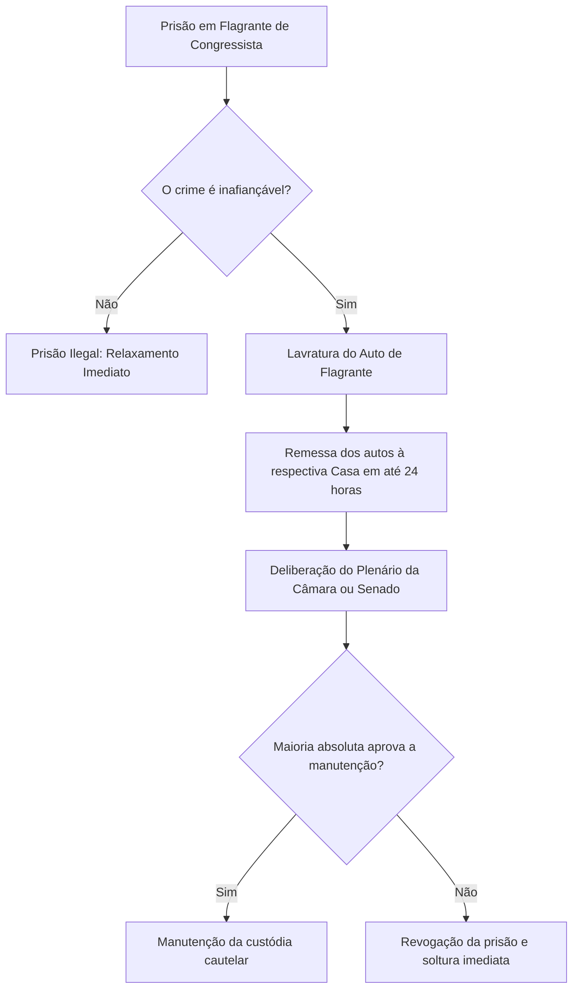
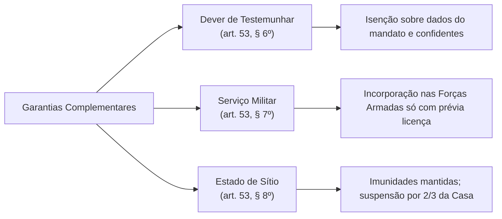

O Estatuto dos Congressistas reúne o conjunto de prerrogativas, imunidades, direitos e deveres outorgados aos membros da Câmara dos Deputados e do Senado Federal. Longe de configurarem privilégios pessoais, essas garantias possuem natureza estritamente funcional. Seu objetivo central reside em blindar o Parlamento contra interferências indevidas dos demais Poderes. Dessa maneira, protege-se a independência do mandato conferido pelo corpo eleitoral.

> [!objetivos]
> - Compreender a natureza jurídica e a finalidade institucional das imunidades parlamentares.
> - Distinguir com precisão a imunidade material da imunidade formal prisional e processual.
> - Analisar os parâmetros do foro por prerrogativa de função perante o Supremo Tribunal Federal.
> - Identificar as prerrogativas complementares relativas a testemunho, serviço militar e estado de sítio.

## Conceito e Natureza do Estatuto dos Congressistas

O regime jurídico dos congressistas encontra sua base no artigo 53 da Constituição Federal de 1988. Trata-se de salvaguarda concebida para resguardar a soberania popular, materializada na atuação livre dos mandatários eleitos. Sem essas prerrogativas, parlamentares estariam expostos a pressões abusivas do Executivo ou a decisões judiciais temerárias. A independência do Legislativo restaria comprometida.

Por isso, o Supremo Tribunal Federal consolidou a tese de que as imunidades parlamentares possuem natureza institucional e pública. Elas pertencem ao órgão legislativo e à própria função republicana exercida. Em razão desse fundamento, tais garantias são irrenunciáveis e indisponíveis. O parlamentar individual não pode renunciar à sua proteção constitucional.

Outro ponto pacificado diz respeito à titularidade das garantias. As imunidades protegem com exclusividade os parlamentares em exercício efetivo. Os suplentes de deputados e senadores não desfrutam dessas proteções enquanto ostentarem apenas a condição de substitutos eventuais. A blindagem constitucional alcança o suplente apenas quando este assume a cadeira legislativa.

| Atributo das Imunidades | Caracterização Jurídica | Fundamento Constitucional |
| :--- | :--- | :--- |
| **Natureza Institucional** | Proteção concedida ao cargo e à função legislativa, não ao indivíduo. | Separação dos Poderes (art. 2º da CF/88) |
| **Irrenunciabilidade** | O mandatário não pode dispor das salvaguardas constitucionais. | Interesse público da representação |
| **Titularidade Efetiva** | Restrita aos membros em exercício; não socorre suplentes não empossados. | Jurisprudência consolidada do STF |
| **Divisão Fundamental** | Imunidade material de conteúdo e imunidade formal de processo e custódia. | Art. 53, caput e parágrafos, da CF/88 |

## Imunidade Material: Liberdade de Expressão e Voto

A imunidade material, também chamada de inviolabilidade ou imunidade substancial, vem fixada no caput do artigo 53 da Constituição Federal de 1988. Esse preceito assegura aos membros da Câmara e do Senado a prerrogativa da inviolabilidade diante de suas opiniões, palavras e votos proferidos no exercício da atividade política.

> [!lei] CF, art. 53, caput
> Os Deputados e Senadores são invioláveis, civil e penalmente, por quaisquer de suas opiniões, palavras e votos.

A jurisprudência do Supremo Tribunal Federal confere amplitude total a essa garantia. A inviolabilidade afasta a responsabilidade civil, penal, administrativa e disciplinar perante órgãos externos. No âmbito criminal, opera como verdadeira exclusão da tipicidade dos crimes de palavra, a exemplo de calúnia, difamação e injúria. No campo cível, impede a condenação ao pagamento de indenizações por danos morais decorrentes do discurso parlamentar.

Para definir o alcance prático da proteção, o STF estabeleceu distinção baseada no local da manifestação:

1. **Manifestações dentro do Congresso Nacional:** Nos recintos parlamentares, comissões e CPIs, vigora presunção absoluta de vínculo com o mandato. A proteção incide de forma automática, dispensando prova de nexo funcional.
2. **Manifestações fora do recinto parlamentar:** Em discursos públicos, redes sociais ou entrevistas à imprensa, a presunção é relativa. Exige-se comprovação inequívoca de ligação direta entre as declarações e o exercício das funções legislativas.

> [!jurisprudencia] STF, Inq 3.817: Nexo Funcional em Declarações Externas
> Declarações de congressista fora do recinto legislativo exigem demonstração de nexo direto com o desempenho do mandato parlamentar para que incida a imunidade material do art. 53, caput, da CF/88.

A imunidade material não autoriza o cometimento de atos ilícitos direcionados contra a ordem constitucional democrática. Pronunciamentos que incitem o fechamento violento de instituições ou atentados contra autoridades não contam com proteção jurídica. Além disso, o parlamentar que exerce profissão na comunicação atua como jornalista comum, submetendo-se às leis gerais.

Quanto ao tempo de vigência, a imunidade material surge com a posse parlamentar. Seus efeitos perduram para sempre em relação aos atos praticados durante o mandato. Mesmo após o término da legislatura, o ex-parlamentar jamais responderá por opiniões e votos manifestados no período de sua atuação legislativa.

| Dimensão Espacial | Presunção do Vínculo | Condição de Aplicação | Consequência Jurídica |
| :--- | :--- | :--- | :--- |
| **Intramuros** (no Parlamento) | Absoluta (*juris et de jure*) | Ocorrência no recinto legislativo ou CPI | Exclusão imediata da tipicidade penal e dano civil |
| **Extramuros** (fora do Congresso) | Relativa (necessita comprovação) | Demonstração de vínculo direto com a função | Proteção admitida unicamente com nexo funcional |
| **Atividade Profissional Privada** | Inexistente | Exercício autônomo de jornalismo | Aplicação plena das normas da legislação ordinária |
| **Atos Antidemocráticos** | Inexistente | Incitação à destruição do Estado de Direito | Responsabilização criminal plena perante o Judiciário |

## Imunidade Formal quanto à Prisão

A imunidade formal, adjetiva ou processual, tutela a liberdade pessoal e o curso processual contra congressistas. Ao contrário da imunidade material, ela incide a partir da expedição do diploma pela Justiça Eleitoral e vigora durante o mandato.

O artigo 53, parágrafo 2º, da Carta Magna disciplina expressamente a custódia cautelar de congressistas diplomados:

> [!lei] CF, art. 53, § 2º
> Desde a expedição do diploma, os membros do Congresso Nacional não poderão ser presos, salvo em flagrante de crime inafiançável. Nesse caso, os autos serão remetidos dentro de vinte e quatro horas à Casa respectiva, para que, pelo voto da maioria de seus membros, resolva sobre a prisão.

Deputados e senadores diplomados não podem sofrer prisão preventiva nem prisão temporária. Da mesma forma, veda-se a prisão em flagrante por infrações afiançáveis. A única hipótese de prisão cautelar admitida consiste no flagrante de crime inafiançável.

Efetivada a prisão em flagrante por crime inafiançável, o Judiciário deve remeter os autos à respectiva Casa Legislativa em 24 horas. O Plenário deliberará em votação aberta e nominal sobre a custódia. Para que a prisão seja confirmada ou revogada, exige-se o voto favorável da maioria absoluta dos membros da Casa (artigo 53, parágrafo 2º, da CF/88).

> [!atencao]
> A vedação do artigo 53, parágrafo 2º, protege contra prisões processuais ou cautelares. A execução de pena fixada em sentença penal condenatória transitada em julgado ocorre regularmente, sem necessidade de referendo legislativo para a execução prisional definitiva.

Quanto a medidas cautelares alternativas à prisão (como monitoração eletrônica ou recolhimento domiciliar noturno), o STF decidiu na ADI 5.526 que o Judiciário detém competência para decretá-las. Todavia, se a providência inviabilizar o exercício direto das atividades parlamentares, a decisão deverá ser encaminhada em 24 horas à respectiva Casa para chancela por maioria absoluta.

| Modalidade Prisional | Admissibilidade Constitucional | Encaminhamento Obrigatório |
| :--- | :--- | :--- |
| **Prisão Temporária ou Preventiva** | Inadmissível em qualquer hipótese | Vedada desde a diplomação até o fim do mandato |
| **Flagrante em Crime Afiançável** | Vedada pela Constituição | Relaxamento de ofício pela autoridade judicial |
| **Flagrante em Crime Inafiançável** | Permitida em caráter taxativo | Remessa à Casa em 24h para voto de maioria absoluta |
| **Medida Cautelar com Efeito no Mandato** | Cabível pelo Judiciário com controle | Submissão à Casa em 24h para votação por maioria absoluta |
| **Prisão por Sentença com Trânsito** | Plenamente permitida | Cumprimento imediato da condenação criminal |

## Imunidade Formal quanto ao Processo: Sustação da Ação Penal

No texto original da Constituição de 1988, o STF dependia de licença prévia da respectiva Casa para instaurar ação penal contra parlamentar. Essa exigência gerava atrasos expressivos. Esse cenário foi superado com a promulgação da Emenda Constitucional 35/2001, que remodelou o regime processual dos congressistas.

Atualmente, o Supremo Tribunal Federal recebe denúncias e queixas-crime contra parlamentares federais sem demandar autorização legislativa. Contudo, preservou-se o equilíbrio institucional por intermédio da sustação da ação penal, prevista no artigo 53, parágrafos 3º a 5º, da Carta Magna.

> [!lei] CF, art. 53, § 3º
> Recebida a denúncia contra o Senador ou Deputado, por crime ocorrido após a diplomação, o Supremo Tribunal Federal dará ciência à Casa respectiva, que, por iniciativa de partido político nela representado e pelo voto da maioria de seus membros, poderá, até a decisão final, sustar o andamento da ação.

O instituto da sustação processual apresenta requisitos rigorosos que costumam ser exigidos em concursos públicos:

1. **Momento da prática do delito:** Apenas infrações cometidas **após a diplomação** autorizam o pedido de sustação. Crimes anteriores seguem trâmite regular sem qualquer ingerência política do Legislativo.
2. **Legitimidade partidária exclusiva:** O pedido de sustação não pode partir do próprio réu, mas sim de **partido político com representação** na respectiva Casa Legislativa.
3. **Prazo de deliberação:** A Casa Parlamentar dispõe de **quarenta e cinco dias** improrrogáveis para apreciar o pleito após o recebimento pela Mesa.
4. **Quórum decisório:** O deferimento da sustação reclama aprovação por **maioria absoluta** dos integrantes da Câmara ou do Senado.
5. **Efeito prescricional:** O deferimento da sustação acarreta a **suspensão automática da prescrição** penal pelo período de duração do mandato parlamentar (artigo 53, parágrafo 5º, da CF/88).

> [!pegadinha]
> A sustação da ação penal acarreta a **suspensão** e não a interrupção da prescrição. Logo, o prazo prescricional para de correr e retoma de onde parou após o mandato, impedindo a perda da pretensão punitiva do Estado.

| Parâmetro Constitucional | Imunidade Material (art. 53, caput) | Imunidade Formal (art. 53, §§ 2º a 5º) |
| :--- | :--- | :--- |
| **Objeto Central** | Opiniões, palavras e votos proferidos | Prisão cautelar e marcha da ação penal |
| **Início dos Efeitos** | Posse formal no mandato eletivo | Expedição do diploma pela Justiça Eleitoral |
| **Duração Temporal** | Perpétua quanto aos atos praticados | Temporária, findando com o término do mandato |
| **Natureza Jurídica** | Causa de exclusão material da tipicidade | Prerrogativa formal de procedimento processual |
| **Sustação de Ações** | Inaplicável por ausência de crime | Aplicável aos crimes praticados após diplomação |

## Foro por Prerrogativa de Função no Supremo Tribunal Federal

O artigo 53, parágrafo 1º, da Constituição da República preconiza que deputados federais e senadores serão processados e julgados perante o Supremo Tribunal Federal a contar da expedição do diploma eleitoral. Esse regramento confere julgamento perante a cúpula do Poder Judiciário, assegurando a necessária serenidade decisória.

O foro especial aplica-se unicamente a infrações penais comuns. Ações populares, ações civis públicas por improbidade administrativa ou ações cíveis ordinárias em face de congressistas não tramitam no STF, correndo nos juízos comuns de primeira instância.

Durante anos, a Corte adotou interpretação ampla do dispositivo. Esse critério foi substancialmente redefinido pelo Plenário do STF no julgamento da Questão de Ordem na Ação Penal 937.

> [!jurisprudencia] STF, AP 937 QO: Restrição do Foro por Prerrogativa de Função
> O foro por prerrogativa de função de parlamentares federais aplica-se exclusivamente aos crimes cometidos no cargo e em razão das funções relacionadas ao mandato eletivo.

A Corte Suprema instituiu, assim, o duplo filtro do foro especial:
1. **Filtro temporal:** O delito deve ter sido perpetrado durante o exercício efetivo do mandato parlamentar.
2. **Filtro funcional:** O ato delituoso deve possuir nexo direto com as atribuições políticas inerentes ao cargo ocupado.

Além disso, o STF assentou novo precedente no Habeas Corpus 232.627: para crimes funcionais praticados durante o mandato, o foro no STF permanece fixado mesmo após o término do cargo, independentemente de renúncia ou não reeleição. A prerrogativa adere ao fato praticado no exercício da função pública representativa.

Em procedimentos criminais com múltiplos réus, a regra processual consiste no desmembramento do processo. O parlamentar permanece sob a jurisdição do STF, enviando-se os autos dos coautores sem foro à primeira instância judicial. Excepcionalmente, nos termos da Súmula 704 do STF, a atração de corréu comum ao julgamento conjunto perante o Pretório Excelso não viola a garantia do juiz natural.

| Hipótese Fática da Conduta | Juízo Competente | Fundamento Aplicável |
| :--- | :--- | :--- |
| **Crime anterior à diplomação** | Justiça de Primeira Instância | Tese do STF na AP 937 QO |
| **Crime comum sem nexo com a função** | Justiça de Primeira Instância | Ausência de vinculação funcional |
| **Crime funcional praticado no mandato** | Supremo Tribunal Federal | Art. 53, § 1º, da CF/88 e AP 937 QO |
| **Fim do mandato em crime funcional** | Mantido no Supremo Tribunal Federal | Jurisprudência fixada no HC 232.627 |
| **Coautor sem foro por prerrogativa** | Regra: desmembramento para 1º grau | Exceção: julgamento no STF (Súmula 704) |

## Demais Garantias e Prerrogativas Parlamentares

No que concerne às salvaguardas complementares do mandato, os parágrafos 6º, 7º e 8º do artigo 53 da Carta Política estabelecem proteções direcionadas ao sigilo funcional, à prestação de serviços militares e à manutenção das imunidades durante situações de emergência institucional.

A primeira garantia consagra a **isenção do dever de depor como testemunha**, estatuída no parágrafo 6º do artigo 53 da Constituição Federal. O texto constitucional determina que congressistas não estão obrigados a testemunhar sobre informações recebidas ou transmitidas em decorrência do mandato, nem sobre as pessoas que lhes confiaram tais dados. Essa salvaguarda confere sigilo profissional qualificado, protegendo fontes e denunciantes de pressões estatais.

A segunda garantia trata da **incorporação às Forças Armadas**, disciplinada no parágrafo 7º do artigo 53 da Constituição. Ainda que o serviço militar represente obrigação constitucional relevante nos termos do artigo 143 da CF/88, os deputados e senadores, mesmo militares da ativa ou da reserva e ainda que em tempo de guerra, somente poderão ser incorporados às tropas militares com prévia licença concedida pela Casa a que pertençam.

A terceira salvaguarda versa sobre as **imunidades durante o Estado de Sítio**, prevista no parágrafo 8º do artigo 53 da Carta Magna. As garantias parlamentares subsistem intactas durante a vigência da medida extrema. A suspensão temporária de tais prerrogativas reclama requisitos cumulativos estritos: prática de atos fora do recinto do Parlamento, condutas manifestamente incompatíveis com o estado de sítio e aprovação por voto de dois terços dos membros da respectiva Casa.

> [!bizu]
> Durante a vigência de Estado de Defesa (artigo 136 da CF/88), a Constituição não autoriza qualquer suspensão de imunidades parlamentares. A suspensão excepcional restringe-se ao Estado de Sítio (artigo 137 da CF/88), com o quórum qualificado de dois terços.

| Prerrogativa Adicional | Fundamento Constitucional | Regra Principal | Hipótese de Supressão |
| :--- | :--- | :--- | :--- |
| **Isenção Testemunhal** | Art. 53, § 6º, da CF/88 | Sigilo profissional sobre fontes e dados | Prerrogativa indeclinável do mandato |
| **Serviço Militar** | Art. 53, § 7º, da CF/88 | Não incorporação às Forças Armadas | Depende de licença prévia da Casa |
| **Regime no Estado de Sítio** | Art. 53, § 8º, da CF/88 | Manutenção integral das imunidades | Quórum de 2/3 por atos externos incompatíveis |
| **Regime no Estado de Defesa** | Art. 136 da CF/88 | Permanência absoluta das garantias | Inexistência de autorização constitucional |

## Mapa do capítulo

```mermaid Síntese do Estatuto dos Congressistas
graph TD
    A["Estatuto dos Congressistas (Art. 53 da CF/88)"] --> B["Imunidade Material"]
    A --> C["Imunidade Formal"]
    A --> D["Foro Especial (STF)"]
    A --> E["Garantias Adicionais"]

    B --> B1["Inviolabilidade civil e penal por opiniões, palavras e votos"]
    B --> B2["Intramuros: presunção absoluta"]
    B --> B3["Extramuros: exige nexo funcional"]
    B --> B4["Início na posse; eficácia perpétua"]

    C --> C1["Prisional (art. 53, § 2º)"]
    C1 --> C1a["Desde a diplomação: só cabe flagrante de crime inafiançável"]
    C1 --> C1b["Remessa à Casa em 24h: deliberação por maioria absoluta aberta"]
    C --> C2["Processual (art. 53, § 3º)"]
    C2 --> C2a["Sustação da ação penal para crimes pós-diplomação"]
    C2 --> C2b["Iniciativa de partido; prazo de 45 dias; maioria absoluta"]
    C2 --> C2c["Efeito: suspensão da prescrição penal"]

    D --> D1["Restrito a crimes comuns funcionais (AP 937 QO)"]
    D --> D2["Praticados durante o cargo e por causa dele"]
    D --> D3["Permanência no STF pós-mandato (HC 232.627)"]
    D --> D4["Regra: desmembramento (exceção: Súmula 704)"]

    E --> E1["Isenção do dever de testemunhar (§ 6º)"]
    E --> E2["Licença prévia para serviço militar (§ 7º)"]
    E --> E3["Estado de sítio: suspensão apenas por quórum de 2/3 (§ 8º)"]
```

### Para fixar

- **Natureza jurídica das imunidades:** Garantias institucionais indisponíveis e irrenunciáveis, outorgadas ao Poder Legislativo e não estensíveis a suplentes não empossados.
- **Imunidade material (art. 53, caput):** Inviolabilidade civil e penal por palavras, votos e opiniões. Vigora da posse para a posteridade. Presunção absoluta no parlamento e exigência de nexo funcional inequívoco em manifestações externas.
- **Imunidade formal quanto à prisão (art. 53, § 2º):** Vigora desde a diplomação. Proíbe prisões preventivas e temporárias. Admite exclusivamente flagrante de crime inafiançável, com remessa em 24 horas para deliberação da Casa por maioria absoluta em votação aberta.
- **Sustação da ação penal (art. 53, §§ 3º a 5º):** Limitada a crimes ocorridos após a diplomação. Requer iniciativa de partido político com assento na Casa, prazo de deliberação de 45 dias e maioria absoluta. Causa a suspensão da prescrição penal.
- **Foro no Supremo Tribunal Federal (art. 53, § 1º):** Aplicável a crimes penais comuns praticados durante o mandato e em razão das funções (AP 937 QO). Permanece fixado no STF mesmo após o término do mandato (HC 232.627). A cisão processual de coautores comuns é a regra geral.
- **Garantias adicionais:** Isenção de testemunho sobre fontes e informações do mandato, serviço militar subordinado a licença prévia e manutenção das imunidades no estado de sítio, com suspensão admitida unicamente por dois terços dos votos para condutas externas incompatíveis.
