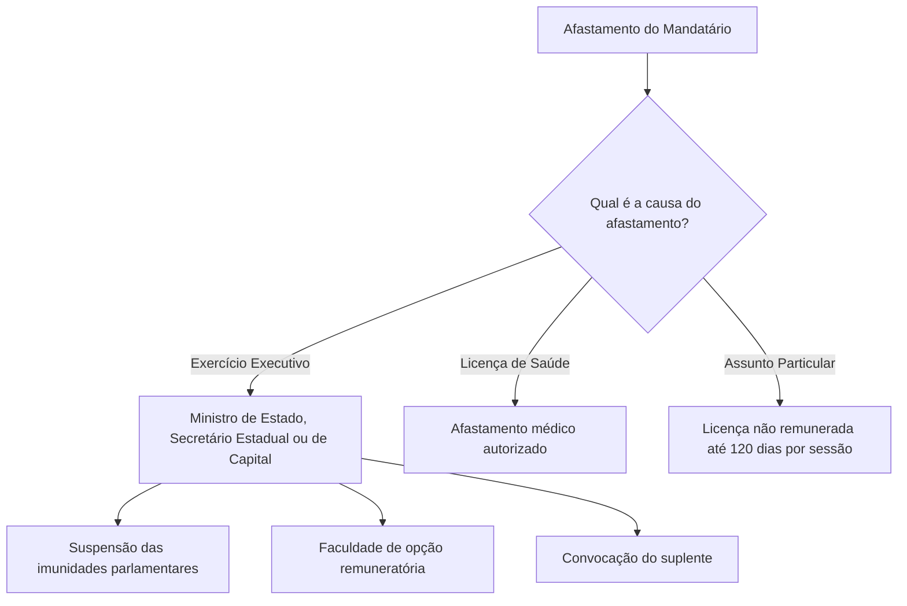
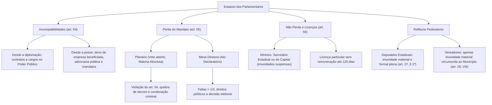

O exercício do mandato parlamentar submete-se a restrições éticas e funcionais delineadas na Constituição Federal. O constituinte estabeleceu proibições específicas destinadas a coibir o tráfico de influência, a promiscuidade com o poder econômico e o conflito de interesses. O descumprimento dessas regras pode deflagrar a cassação ou a extinção do mandato, garantindo a lisura representativa no Congresso Nacional.

> [!objetivos]
> - Identificar as incompatibilidades parlamentares divididas pelos marcos temporais da diplomação e da posse.
> - Diferenciar as hipóteses de perda de mandato deliberadas pelo Plenário daquelas declaradas pela Mesa Diretora.
> - Compreender as hipóteses de licença e assunção de cargos no Executivo em que não ocorre a perda do mandato.
> - Analisar a extensão das prerrogativas constitucionais aos deputados estaduais e vereadores municipais.

## Incompatibilidades Parlamentares: Diplomação versus Posse

As incompatibilidades parlamentares constituem proibições de direito estrito que limitam a liberdade contratual, profissional e política de deputados e senadores. O artigo 54 da Constituição Federal divide essas vedações em dois grupos temporais distintos: impedimentos que incidem desde a expedição do diploma eleitoral e proibições aplicáveis a partir da posse no cargo.

> [!lei] CF, art. 54, I
> Os Deputados e Senadores não poderão, desde a expedição do diploma, firmar ou manter contrato com pessoa jurídica de direito público, autarquia, empresa pública, sociedade de economia mista ou empresa concessionária de serviço público, salvo quando o contrato obedecer a cláusulas uniformes.

A partir da **expedição do diploma**, os parlamentares eleitos ficam impedidos de firmar ou manter contrato com a administração direta ou indireta e concessionárias. Admite-se uma única ressalva expressa: contratos que obedeçam a cláusulas uniformes, oferecidas indistintamente a qualquer cidadão (como contas bancárias padrão ou tarifas públicas). Nesse mesmo marco inicial, proíbe-se aceitar ou exercer cargo, função ou emprego remunerado nas referidas entidades públicas, inclusive cargos de livre nomeação e exoneração.

A contar da **posse parlamentar**, ampliam-se os impedimentos éticos nos moldes do inciso II do artigo 54. O congressista não pode ser proprietário, controlador ou diretor de empresa beneficiada com privilégio decorrente de contrato com entidade pública, nem exercer nela função remunerada. Igualmente, proíbe-se ocupar cargo ou função demissível discricionariamente nas entidades da administração pública direta ou indireta. No campo advocatício, é vedado patrocinar causas em que os referidos entes públicos sejam partes interessadas. Por fim, veda-se a titularidade de mais de um cargo ou mandato público eletivo.

> [!pegadinha]
> A proibição de cumular mandatos eletivos vigora apenas **desde a posse**, e não desde a diplomação. O candidato eleito pode ser diplomado em novo cargo sem perder o mandato anterior, devendo formalizar a renúncia ou opção até o momento da posse no novo posto.

| Marco Temporal | Vedações Constitucionais Expressas (Art. 54 da CF/88) | Exceção Admissível |
| :--- | :--- | :--- |
| **Desde a Diplomação** (art. 54, I) | Firmar ou manter contrato com o Poder Público, estatais e concessionárias; aceitar ou exercer cargo, emprego ou função remunerada nesses entes. | Contratos com cláusulas uniformes para todo o público. |
| **Desde a Posse** (art. 54, II) | Ser dono ou diretor de empresa favorecida por contrato público; ocupar cargo de livre exoneração na administração; advogar contra ou a favor do Poder Público; titularizar outro mandato eletivo. | Inexistência de exceção (proibições absolutas). |

## Hipóteses e Regimes de Perda do Mandato

O artigo 55 da Carta da República disciplina os casos em que deputados e senadores perdem o mandato legislativo. A ordem constitucional desenhou dois regimes procedimentais distintos, separando as situações que demandam juízo de conveniência política daquelas que constituem mera averiguação de fatos jurídicos objetivos já consumados.

> [!esquema] Esquematizando a Perda do Mandato (CF/88, art. 55)
> **Deliberação do Plenário (Votação aberta e Maioria Absoluta):**
> 1. Violação das proibições do art. 54 (incompatibilidades).
> 2. Conduta incompatível com o decoro parlamentar (art. 55, II e § 1º).
> 3. Condenação criminal transitada em julgado (art. 55, VI).
> 
> **Declaração da Mesa Diretora (Ato Vinculado Declaratório):**
> 1. Não comparecimento a um terço das sessões ordinárias (art. 55, III).
> 2. Perda ou suspensão dos direitos políticos (art. 55, IV).
> 3. Decretada pela Justiça Eleitoral (art. 55, V).

No primeiro regime (artigo 55, parágrafo 2º), a perda do mandato assume natureza constitutiva e sancionatória, sendo deliberada pelo **Plenário da Casa respectiva**. A decisão ocorre por maioria absoluta, mediante provocação da Mesa Diretora ou de partido político representado no Congresso Nacional, assegurada a ampla defesa. Desde a Emenda Constitucional 76/2013, essa deliberação realiza-se obrigatoriamente por **voto aberto e nominal**, eliminando-se a votação secreta.

Submetem-se a esse julgamento político três hipóteses:
1. Infração a qualquer das proibições de incompatibilidade estabelecidas no artigo 54 da CF/88.
2. Prática de conduta declarada incompatível com o decoro parlamentar, compreendendo o abuso de prerrogativas ou a percepção de vantagens indevidas (artigo 55, parágrafo 1º).
3. Condenação criminal transitada em julgado imposta pela jurisdição penal.

No segundo regime (artigo 55, parágrafo 3º), a perda do mandato ostenta natureza eminentemente declaratória. O evento extintivo opera-se no plano dos fatos, cabendo à **Mesa Diretora** unicamente declarar a vacância do cargo, de ofício ou mediante provocação de parlamentar ou partido, garantida a oportunidade de contraditório sumário.

Inserem-se nesse procedimento declaratório:
1. Omissão injustificada de presença a mais de um terço das sessões ordinárias da Casa em cada sessão legislativa anual, salvo licença ou missão autorizada.
2. Perda ou suspensão dos direitos políticos do congressista.
3. Decretação de perda emanada da Justiça Eleitoral nos termos da legislação eleitoral.

> [!jurisprudencia] STF: Perda de Mandato por Condenação Criminal
> A aplicação do art. 55, VI, gerou divergência nas Turmas do STF. A Primeira Turma adotou entendimento de que condenações penais definitivas a regime fechado superiores a 120 dias ensejam perda automática declarada pela Mesa, pois o parlamentar estará impedido de cumprir a frequência mínima do mandato. Em contraste, a Segunda Turma reafirma a necessidade indeclinável de deliberação soberana do Plenário da Casa.

| Hipótese de Perda | Órgão Competente | Procedimento Exigido | Natureza do Ato |
| :--- | :--- | :--- | :--- |
| **Incompatibilidades** (art. 54) | Plenário da Casa | Provocação da Mesa/partido; voto aberto; maioria absoluta | Decisão política constitutiva |
| **Quebra de decoro** (art. 55, II) | Plenário da Casa | Provocação da Mesa/partido; voto aberto; maioria absoluta | Decisão política constitutiva |
| **Condenação penal definitiva** | Plenário da Casa | Maioria absoluta aberta (com divergência sobre regime fechado) | Julgamento legislativo |
| **Faltas ordinárias** (> 1/3) | Mesa Diretora | Provocação ou de ofício; ampla defesa formal | Ato estritamente declaratório |
| **Suspensão de direitos políticos** | Mesa Diretora | Declaração de vacância com posse imediata do suplente | Ato estritamente declaratório |
| **Ordem da Justiça Eleitoral** | Mesa Diretora | Execução de determinação da autoridade judiciária eleitoral | Ato vinculado declaratório |

## Hipóteses de Não Perda do Mandato e Afastamentos

O artigo 56 da Constituição da República consagra as hipóteses taxativas em que o congressista afasta-se de suas atividades legiferantes ordinárias sem perder a titularidade do mandato parlamentar conquistado nas urnas.

O deputado ou senador não perde a cadeira quando convocado para chefiar ministérios, pastas estaduais, distritais, secretarias de capitais ou liderar delegação diplomática transitória. Nessa conjuntura, o congressista licencia-se da Casa Legislativa, convoca-se o respectivo suplente para o exercício do mandato e faculta-se ao titular o direito de optar pela remuneração do cargo político do Executivo ou pelo subsídio de parlamentar.

O Supremo Tribunal Federal pacificou que a investidura de congressista em cargo no Poder Executivo acarreta a **suspensão automática de suas imunidades parlamentares** (tanto materiais quanto formais), já que a proteção constitucional destina-se ao desempenho da atividade legislativa. Contudo, o parlamentar licenciado continua submetido à jurisdição disciplinar de sua Casa de origem, podendo ser processado por quebra de decoro caso cometa atos incompatíveis com a dignidade da representação popular.

Ademais, não perde o mandato quem se licenciar por motivo de saúde devidamente atestado, ou quem obtiver licença para tratar de interesse particular. Na licença por interesse privado, impõe-se a ausência de remuneração pública e o limite máximo improrrogável de **cento e vinte dias** em cada sessão legislativa anual.

| Modalidade de Afastamento | Remuneração Aplicável | Regime de Imunidades | Situação do Suplente |
| :--- | :--- | :--- | :--- |
| **Cargo no Poder Executivo** | Opção expressa entre subsídio legislativo ou subsídio executivo | Imunidades suspensas durante o exercício do cargo | Suplente convocado assume o mandato |
| **Licença de Saúde** | Mantida remuneração regular na forma regulamentar | Garantias parlamentares preservadas | Convocado se a licença superar 120 dias |
| **Licença Particular** (≤ 120 dias) | Sem remuneração durante o afastamento | Preservação formal do vínculo do mandato | Não convocado se o prazo não exceder limite |

## Extensão do Estatuto aos Parlamentares Estaduais e Municipais

A disciplina federativa do Estatuto dos Congressistas projeta-se sobre as esferas estaduais, distritais e municipais, observando contornos específicos traçados pelo poder constituinte originário.

O artigo 27, parágrafo 1º, da Constituição Federal estabelece simetria obrigatória entre os parlamentares federais e os deputados estaduais e distritais. A jurisprudência consolidada do STF assevera que as imunidades parlamentares federais (material e formal), o regime de prisão em flagrante por crime inafiançável, a prerrogativa de sustação da ação penal, as incompatibilidades e os procedimentos de perda de mandato aplicam-se integralmente aos membros das Assembleias Legislativas e da Câmara Legislativa do Distrito Federal.

Em relação aos vereadores municipais, o modelo constitucional adota tratamento diferenciado e mais restritivo. Nos moldes do artigo 29, inciso VIII, da Carta Magna, os edis desfrutam **unicamente de imunidade material** por suas opiniões, palavras e votos. Essa inviolabilidade restringe-se estritamente à **circunscrição do Município** e ao exercício do mandato político. Vereadores não possuem imunidade formal: podem ser presos cautelarmente nos termos da lei penal comum e não contam com o mecanismo de sustação processual pela Câmara Municipal.

| Esfera Federativa | Dispositivo | Imunidade Material | Imunidade Formal | Alcance Geográfico |
| :--- | :--- | :--- | :--- | :--- |
| **Federal** (Deputados e Senadores) | Art. 53 da CF/88 | Plena (civil e penal) | Plena (prisão e sustação de ação) | Nacional |
| **Estadual/Distrital** (Deputados) | Art. 27, § 1º, da CF/88 | Plena (civil e penal) | Plena (regras simétricas à União) | Nacional na função |
| **Municipal** (Vereadores) | Art. 29, VIII, da CF/88 | Plena por opiniões e votos | Inexistente (sem blindagem formal) | Restrita ao Município |

## Mapa do capítulo

### Para fixar

- **Incompatibilidades desde a diplomação (art. 54, I):** Proibição de firmar contratos com entes públicos (salvo cláusulas uniformes) e de ocupar cargos ou funções remuneradas na administração.
- **Incompatibilidades desde a posse (art. 54, II):** Vedações para comandar empresas com contratos favorecidos, advogar contra entes públicos e acumular mandatos eletivos.
- **Perda deliberada pelo Plenário (art. 55, I, II e VI):** Votação aberta por maioria absoluta nos casos de quebra de incompatibilidade, quebra de decoro e condenação criminal transitada em julgado.
- **Perda declarada pela Mesa (art. 55, III, IV e V):** Ato vinculado nas hipóteses de faltas ordinárias superiores a um terço, perda/suspensão de direitos políticos ou ordem judicial eleitoral.
- **Divergência sobre condenação penal:** Primeira Turma do STF defende perda automática em regime fechado com pena superior a 120 dias; Segunda Turma exige deliberação do Plenário.
- **Não perda do mandato (art. 56):** Investidura em pastas de Ministro ou Secretário com suspensão temporária de imunidades e opção remuneratória; licença médica ou particular não remunerada de até 120 dias.
- **Simetria federativa:** Deputados estaduais têm imunidade formal e material plena (art. 27, § 1º). Vereadores possuem apenas imunidade material circunscrita aos limites de seu Município (art. 29, VIII).
