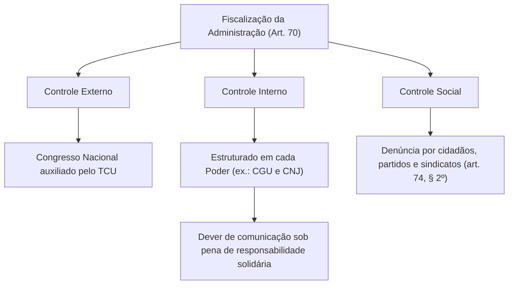
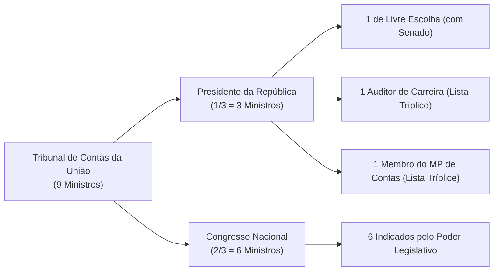
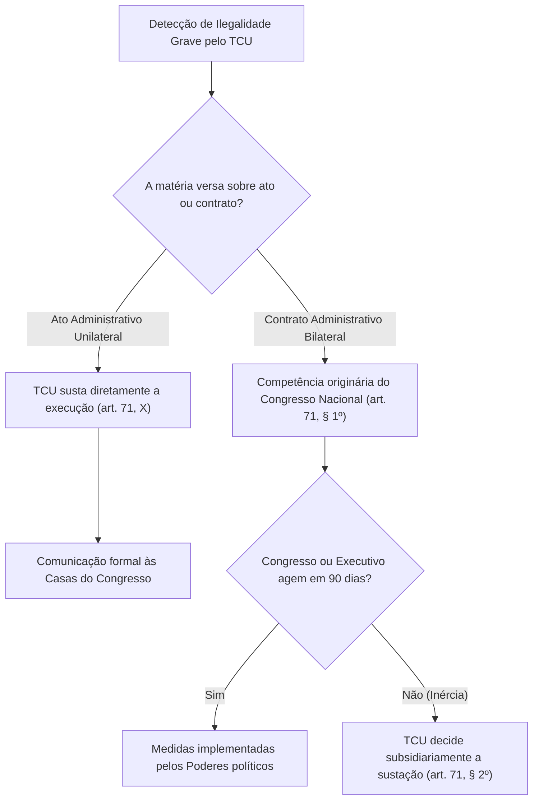

O controle das finanças, orçamentos, bens patrimoniais e eficiência operacional do Estado consagra o princípio republicano da prestação de contas. Na ordem constitucional brasileira, o controle do erário estrutura-se em dois eixos complementares: o controle externo, exercido pelo Poder Legislativo com o auxílio técnico indispensável do Tribunal de Contas da União, e o sistema integrado de controle interno mantido por cada um dos Poderes republicanos.

> [!objetivos]
> - Compreender a abrangência material e os princípios orientadores da fiscalização descrita no artigo 70 da CF/88.
> - Analisar a estrutura, os requisitos de investidura e a composição constitucional dos Ministros do Tribunal de Contas da União.
> - Diferenciar a competência para emitir parecer prévio nas contas presidenciais do poder de julgar as contas dos demais gestores.
> - Identificar as regras aplicáveis ao registro de pessoal e concessão de aposentadorias à luz da Súmula Vinculante 3 do STF.
> - Dominar o procedimento específico de sustação de atos e contratos e os poderes cautelares admitidos na jurisprudência.

## Princípios e Alcance da Fiscalização Contábil, Financeira e Orçamentária

O artigo 70 da Carta Magna estabelece a espinha dorsal do sistema de controle financeiro da União. A fiscalização governamental incide sobre os órgãos da administração pública direta e as entidades da administração indireta, alcançando todas as pessoas que interajam com verbas públicas.

> [!lei] CF, art. 70, caput
> A fiscalização contábil, financeira, orçamentária, operacional e patrimonial da União e das entidades da administração direta e indireta, quanto à legalidade, legitimidade, economicidade, aplicação das subvenções e renúncia de receitas, será exercida pelo Congresso Nacional, mediante controle externo, e pelo sistema de controle interno de cada Poder.

A verificação do gasto público transcende o mero exame formal da legalidade. O controle desdobra-se em múltiplos vetores materiais de avaliação:
1. **Legalidade estrita:** Avalia a conformidade dos atos de gestão com o ordenamento normativo vigente.
2. **Legitimidade:** Atesta a observância do interesse público, da moralidade administrativa e da finalidade coletiva.
3. **Economicidade:** Mede a relação de custo-benefício dos dispêndios, permitindo verificar o mérito e a eficiência na alocação de recursos escassos.
4. **Aplicação de subvenções:** Fiscaliza repasses e incentivos financeiros outorgados pelo Estado a setores estratégicos.
5. **Renúncia de receitas:** Examina desonerações tributárias, anistias e subsídios, garantindo que não mascarem favorecimentos indevidos.

O dever de prestar contas apresenta dimensão universal na forma do parágrafo único do artigo 70. Qualquer entidade ou cidadão que manuseie, conserve, administre ou empregue verbas, valores e ativos do erário tem a obrigação jurídica indeclinável de prestar contas ao órgão competente.

Paralelamente, o artigo 74 determina que os Poderes Legislativo, Executivo e Judiciário mantenham sistemas integrados de controle interno. No Poder Executivo Federal, essa missão cabe à Controladoria-Geral da União (CGU), enquanto no Judiciário sobressai a atuação correicional do Conselho Nacional de Justiça (CNJ). Os órgãos de controle interno desempenham papel de apoio preventivo e pedagógico. Seus titulares respondem solidariamente com o gestor infrator caso tomem ciência de qualquer irregularidade ou ilegalidade e deixem de comunicar o fato ao Tribunal de Contas da União.

Por fim, consagra-se a participação da sociedade no controle do patrimônio público. Conforme preceitua o parágrafo 2º do artigo 74, qualquer cidadão, agremiação partidária, entidade associativa ou organização sindical ostenta legitimidade ativa para denunciar irregularidades ou fraudes perante o Tribunal de Contas da União.

| Vetor de Análise | Objeto de Exame Técnico | Finalidade Constitucional |
| :--- | :--- | :--- |
| **Legalidade** | Conformidade estrita dos atos com as leis | Assegurar a submissão do Estado ao Direito |
| **Legitimidade** | Atendimento à moralidade e aos fins públicos | Coibir desvios de poder e fraudes éticas |
| **Economicidade** | Relação de custo, rendimento e benefício | Avaliar a racionalidade e modicidade do gasto |
| **Subvenções e Renúncias** | Destinação de auxílios e isenções fiscais | Impedir privilégios tributários injustificados |
| **Patrimônio e Operações** | Gestão de bens, créditos e avais públicos | Resguardar a integridade dos ativos estatais |

## Natureza Jurídica, Composição e Estrutura do Tribunal de Contas da União

A definição da natureza jurídica do Tribunal de Contas da União desperta atenção técnica. Embora atue como órgão auxiliar e técnico do Congresso Nacional no exercício do controle externo, o TCU não se subordina hierárquica, funcional ou administrativamente ao Poder Legislativo. O Pretório Excelso categoriza a Corte de Contas como órgão autônomo e independente, dotado de estatura constitucional própria, autogoverno e orçamento desvinculado.

O artigo 73 da Constituição Federal disciplina a arquitetura orgânica do Tribunal de Contas da União. A Corte possui sede na Capital Federal, quadro de servidores próprio e jurisdição contábil estendida por todo o território nacional, compondo-se de **nove Ministros**.

Para ser investido no cargo de Ministro do TCU, o postulante deve atender a critérios constitucionais taxativos (artigo 73, parágrafo 1º):
1. Idade compreendida na faixa etária entre 35 e 70 anos completos;
2. Idoneidade moral inatacável e reputação ilibada perante a sociedade;
3. Notório saber jurídico, contábil, econômico e financeiro ou de administração pública;
4. Mais de dez anos de exercício efetivo de atividade profissional que exija os referidos conhecimentos específicos.

A repartição das vagas obedece a um equilíbrio federativo e institucional traçado pelo constituinte originário:
- **Um terço (três Ministros)** é escolhido pelo Presidente da República, dependendo de aprovação prévia do Senado Federal. Dentre essas três vagas do Executivo, uma é de livre indicação do Presidente, enquanto duas devem recair, alternadamente, sobre auditores de carreira e membros do Ministério Público de Contas, indicados em lista tríplice elaborada pelo próprio TCU por critérios de antiguidade e merecimento.
- **Dois terços (seis Ministros)** são escolhidos com exclusividade pelo Congresso Nacional, refletindo a representação política das Casas parlamentares.

Quanto às prerrogativas funcionais, os Ministros do TCU contam com o mesmo estatuto protetivo dos Ministros do Superior Tribunal de Justiça (STJ), desfrutando das garantias da vitaliciedade, inamovibilidade e irredutibilidade de subsídio (artigo 73, parágrafo 3º, da CF/88).

Junto ao TCU atua o Ministério Público de Contas, órgão dotado de regime funcional peculiar. Seus procuradores contam com as garantias e vedações próprias do Ministério Público ordinário (artigo 130 da CF/88). Todavia, o Ministério Público de Contas vincula-se administrativamente à estrutura do próprio Tribunal, não compondo o Ministério Público da União nem possuindo autonomia orçamentária própria para propositura de ações cíveis gerais.

| Agente ou Órgão | Vínculo Institucional | Garantias Asseguradas | Competência Específica |
| :--- | :--- | :--- | :--- |
| **Ministro do TCU** | Membro de órgão constitucional independente | Equiparado aos Ministros do STJ | Deliberação colegiada sobre o controle externo |
| **Auditor Substituto** | Carreira técnica interna do TCU | Equiparado a juiz federal de TRF | Substituição de Ministros e instrução de processos |
| **Ministério Público de Contas** | Vinculado à estrutura do Tribunal de Contas | Estatuto do art. 130 da Constituição | Guarda da ordem jurídica em matérias de contas |

## Competências do TCU: Julgamento versus Parecer Prévio de Contas

O artigo 71 da Constituição Federal discrimina as atribuições técnicas do Tribunal de Contas da União. Entre essas atribuições, ganha destaque para fins de concursos públicos a diferença entre apreciar e julgar contas públicas.

> [!lei] CF, art. 71, I e II
> O controle externo, a cargo do Congresso Nacional, será exercido com o auxílio do Tribunal de Contas da União, ao qual compete:
> I - apreciar as contas prestadas anualmente pelo Presidente da República, mediante parecer prévio que deverá ser elaborado em sessenta dias a contar de seu recebimento;
> II - julgar as contas dos administradores e demais responsáveis por dinheiros, bens e valores públicos da administração direta e indireta, incluídas as fundações e sociedades instituídas e mantidas pelo Poder Público federal, e as contas daqueles que derem causa a perda, extravio ou outra irregularidade de que resulte prejuízo ao erário público.

No tocante às **contas do Presidente da República** (artigo 71, I), o TCU não dispõe de autorização jurídica para julgá-las em definitivo. A competência da Corte de Contas limita-se à emissão de um **parecer prévio de caráter opinativo**, elaborado no prazo estrito de sessenta dias. Quem detém a competência política e soberana para efetivamente julgar as contas anuais prestadas pelo Presidente da República é o **Congresso Nacional** em sessão conjunta, nos termos do artigo 49, inciso X, da Carta Magna.

Em contrapartida, em relação a **todos os demais ordenadores de despesas e gestores públicos** (artigo 71, II), o TCU **julga em caráter definitivo**. Essa competência de julgamento técnico alcança os administradores de órgãos públicos dos três Poderes da União (incluindo Judiciário e Legislativo), dirigentes de autarquias, fundações públicas e estatais, conselhos de fiscalização profissional e quaisquer particulares que causem danos ao patrimônio federal.

> [!pegadinha]
> Preste atenção nas questões que afirmam que o TCU julga as contas do Chefe do Executivo: o TCU apenas **aprecia** as contas globais do Presidente da República mediante parecer prévio. Em contraposição, o TCU **julga** as contas dos dirigentes e administradores de todos os órgãos e entes da União.

Outro desdobramento relevante reside na fiscalização de verbas federais repassadas a Estados e Municípios por meio de convênios, acordos ou ajustes administrativos (artigo 71, VI). Sempre que houver transferência de recursos originários dos cofres federais com destinação vinculada, a competência fiscalizatória e sancionatória recai sobre o TCU. 

Por outro lado, o STF firmou no Mandado de Segurança 24.312 que as receitas decorrentes de **royalties da exploração de petróleo e gás** pertencem originariamente aos Estados e Municípios por força do artigo 20, parágrafo 1º, da Carta Magna. Logo, a auditoria sobre tais receitas incumbe aos Tribunais de Contas locais, e não ao Tribunal de Contas da União.

As decisões da Corte de Contas que resultem na imputação de débito restitutório ou na aplicação de multas pecuniárias aos gestores condenados possuem eficácia imediata de **título executivo extrajudicial**, consoante determina expressamente o artigo 71, parágrafo 3º, da Carta da República. Não cabe ao próprio TCU executar judicialmente a cobrança; a deflagração da respectiva ação de execução fiscal no Judiciário incumbe à Advocacia-Geral da União (AGU) ou aos procuradores das pessoas jurídicas lesadas.

| Espécie de Prestação | Autoridade Responsável | Papel Constitucional do TCU | Juízo Definitivo de Julgamento |
| :--- | :--- | :--- | :--- |
| **Contas de Governo do Executivo** | Presidente da República | Emissão de parecer prévio em 60 dias | Julgamento exclusivo do Congresso Nacional |
| **Contas de Gestão Administrativa** | Ordenadores de despesas e diretores | Julgamento técnico e condenatório | Próprio TCU com trânsito administrativo |
| **Recursos Federais por Convênio** | Governadores e Prefeitos conveniados | Julgamento e aplicação de débito | Próprio TCU perante a verba transferida |
| **Receitas Próprias de Royalties** | Estados e Municípios beneficiários | Sem competência fiscalizatória | Tribunais de Contas estaduais e municipais |

## Fiscalização de Servidores, Aposentadorias e o Princípio do Contraditório

Dentre as atribuições finalísticas da Corte de Contas, o artigo 71, inciso III, prevê a apreciação da legalidade dos atos de admissão funcional na administração pública e das concessões de aposentadorias, reformas e pensões de servidores estatutários civis e militares.

> [!lei] CF, art. 71, III
> Apreciar, para fins de registro, a legalidade dos atos de admissão funcional a qualquer título, na administração direta e indireta, incluídas as fundações instituídas e mantidas pelo Poder Público, excetuadas as nomeações para cargo de provimento em comissão, bem como a das concessões de aposentadorias, reformas e pensões, ressalvadas as melhorias posteriores que não alterem o fundamento legal do ato concessório.

O registro concedido pelo Tribunal de Contas possui natureza estritamente vinculada ao princípio da legalidade. O Tribunal não avalia o mérito, conveniência ou oportunidade da admissão ou do benefício previdenciário, limitando-se a verificar se os requisitos da legislação foram rigorosamente atendidos. Se identificar irregularidade intransponível, o TCU recusa o registro do ato administrativo, cabendo ao órgão público originário promover as correções formais necessárias ou o retorno do servidor ao serviço ativo.

No Direito Administrativo brasileiro, a concessão originária de aposentadoria é conceituada como **ato administrativo complexo**. O ato apenas atinge sua perfeição definitiva após a conjunção de vontades entre o órgão público empregador e o Tribunal de Contas mediante a homologação do registro. Em razão dessa natureza embrionária, o Supremo Tribunal Federal editou a célebre Súmula Vinculante 3.

> [!jurisprudencia] STF, Súmula Vinculante 3: Contraditório e Registro Inicial de Aposentadoria
> A jurisprudência do Pretório Excelso consolidada na Súmula Vinculante 3 consagra que o contraditório e a ampla defesa são de observância necessária perante a Corte de Contas nas hipóteses em que a deliberação puder desconstituir ato favorável ao administrado, excluindo-se dessa exigência o exame originário da legalidade na concessão de aposentadoria, reforma e pensão.

O entendimento sumulado estabelece que, no momento do exame inicial da concessão de aposentadoria, pensão ou reforma, não há obrigatoriedade de instaurar contraditório ou audiência prévia do servidor beneficiado.

Contudo, para evitar a insegurança jurídica decorrente de deliberações tardias, o Supremo Tribunal Federal fixou balizamento temporal em repercussão geral (Tema 445): o Tribunal de Contas da União dispõe do **prazo decadencial de cinco anos** para examinar a legalidade do ato de concessão inicial de aposentadoria, contado da entrada do processo na respectiva Corte. Ultrapassado o interregno quinquenal sem pronunciamento da Corte de Contas, a concessão considera-se tacitamente estabilizada, de modo que qualquer alteração ou anulação posterior exigirá a prévia garantia do contraditório e da ampla defesa ao servidor.

| Situação Processual no TCU | Necessidade de Contraditório | Fundamento Jurisprudencial |
| :--- | :--- | :--- |
| **Exame inicial em até 5 anos** | Dispensado o contraditório prévio | Aplicação expressa da SV 3 do STF |
| **Exame inicial após 5 anos** | Obrigatório contraditório e ampla defesa | Tese do STF no Tema 445 de repercussão geral |
| **Anulação de atos consolidados** | Pleno contraditório e contradita formal | Garantia do devido processo (art. 5º, LV, da CF) |
| **Nomeação para cargo comissionado** | Excluída da apreciação do Tribunal | Ressalva literal do art. 71, III, da CF/88 |

## Mecanismos Coercitivos: Sustação de Atos e Contratos e Poderes Cautelares

Para assegurar a efetividade de suas decisões, a Constituição Federal outorgou ao Tribunal de Contas prerrogativas fiscalizatórias dotadas de força sancionatória e coercitiva. Quando a Corte apura irregularidades na gestão pública, ela assina prazo razoável para que o órgão responsável adote as providências necessárias ao exato cumprimento da lei (artigo 71, IX). Se a autoridade pública permanecer inerte, entram em ação os procedimentos previstos no artigo 71, incisos X e XI, e parágrafos correspondentes.

> [!lei] CF, art. 71, §§ 1º e 2º
> § 1º No caso de contrato, o ato de sustação será adotado diretamente pelo Congresso Nacional, que solicitará, de imediato, ao Poder Executivo as medidas cabíveis.
> § 2º Se o Congresso Nacional ou o Poder Executivo, no prazo de noventa dias, não efetivar as medidas previstas no parágrafo anterior, o Tribunal decidirá a respeito.

Impõe-se a compreensão rigorosa da distinção entre a sustação de atos e a sustação de contratos administrativos:
1. **Sustação de ato administrativo comum:** Se a irregularidade reside em ato administrativo unilateral (como edital irregular, ato de nomeação indevido ou portaria ilegítima), o **próprio TCU susta diretamente** a execução do ato, dando ciência de sua decisão à Câmara dos Deputados e ao Senado Federal (artigo 71, X).
2. **Sustação de contrato administrativo bilateral:** Por envolver vínculos contratuais com terceiros e impactos econômicos de monta, a competência originária para sustar contrato administrativo pertence com exclusividade ao **Congresso Nacional** (§ 1º do art. 71). O Legislativo assume a decisão política e solicita as providências ao Poder Executivo. Caso o Congresso ou o Executivo não adotem as medidas no prazo peremptório de **noventa dias**, abre-se competência subsidiária para que o **próprio Tribunal de Contas decida** sobre a sustação (§ 2º do art. 71).

Quanto a medidas acauteladoras, o Supremo Tribunal Federal consolidou a tese de que a Corte de Contas goza de poderes cautelares implícitos, necessários à salvaguarda do erário. Com base nessa premissa doutrinária, o TCU dispõe de legitimidade para decretar, motivadamente e pelo prazo de até um ano, a **indisponibilidade cautelar de bens** de gestores ou empresas sob investigação por danos ao patrimônio público. Da mesma forma, o Tribunal pode aplicar a **desconsideração da personalidade jurídica** quando comprovada a utilização fraudulenta de pessoas jurídicas para ocultação de desvios.

Por outro lado, o STF estabelece limites categóricos à atuação do TCU:
- **Ausência de poder jurisdicional:** O TCU é órgão de natureza eminentemente administrativa. Suas decisões condenatórias não fazem coisa julgada em sentido material, podendo ser questionadas no Poder Judiciário em atenção ao princípio da inafastabilidade da jurisdição (artigo 5º, XXXV, da CF/88).
- **Vedação de quebra de sigilo bancário:** O TCU não dispõe de poder constitucional para quebrar sigilo bancário de cidadãos ou empresas, prerrogativa privativa do Judiciário e das CPIs. Contudo, a Corte pode requisitar registros de operações bancárias que envolvam a aplicação direta de dinheiros públicos (como contratos de financiamento do BNDES), já que a movimentação de recursos estatais ostenta publicidade inerente.

> [!jurisprudencia] STF, Súmula 347 e MS 35.410: Controle de Constitucionalidade pelo TCU
> O verbete 347 da Súmula do STF admitia que o Tribunal de Contas examinasse a validade constitucional de diplomas legais no exercício de sua missão institucional. Apesar dessa previsão histórica, o entendimento contemporâneo do Pretório Excelso (fixado no MS 35.410) assevera que a Corte de Contas não pode afastar a vigência de legislação com eficácia geral e vinculante, restringindo-se à recusa pontual de atos que colidam frontalmente com jurisprudência vinculante dos tribunais judiciais.

| Medida ou Providência | Legitimidade do TCU | Limites Constitucionais Fixados pelo STF |
| :--- | :--- | :--- |
| **Sustação de atos administrativos** | Plena e direta | Notificação imediata ao Congresso Nacional |
| **Sustação de contratos públicos** | Apenas subsidiária | Opera unicamente após 90 dias de inércia parlamentar |
| **Indisponibilidade cautelar de bens** | Admitida por poder implícito | Prazo máximo improrrogável de um ano |
| **Desconsideração da personalidade** | Admitida na apuração de fraudes | Respeito estrito ao contraditório do acusado |
| **Quebra de sigilo bancário** | Absolutamente vedada | Restrita ao Poder Judiciário e comissões parlamentares de inquérito |

## Mapa do capítulo

```mermaid Síntese do Sistema de Controle e TCU
graph TD
    A["Fiscalização Financeira e Orçamentária"] --> B["Controle Externo e Interno (arts. 70 e 74)"]
    A --> C["Tribunal de Contas da União (art. 73)"]
    A --> D["Competências Finalísticas (art. 71)"]
    A --> E["Medidas Coercitivas e Limites"]

    B --> B1["Legalidade, legitimidade, economicidade, subvenções e renúncias"]
    B --> B2["Dever universal de prestar contas e controle social por denúncia"]
    B --> B3["CGU e CNJ integrados com dever de comunicação solidária"]

    C --> C1["9 Ministros com garantias equivalentes ao STJ"]
    C --> C2["1/3 Presidente (2 vinculados a auditores e MP de Contas) e 2/3 Congresso"]

    D --> D1["Parecer prévio nas contas do Presidente da República em 60 dias"]
    D --> D2["Julgamento definitivo de contas dos demais ordenadores públicos"]
    D --> D3["Registro funcional e aposentadorias (SV 3 do STF e prazo de 5 anos)"]

    E --> E1["Sustação direta de atos versus sustação parlamentar de contratos em 90 dias"]
    E --> E2["Decisões condenatórias com força de título executivo extrajudicial (§ 3º)"]
    E --> E3["Poderes cautelares admitidos; vedação peremptória a quebra de sigilo bancário"]
```

### Para fixar

- **Pilares da fiscalização (art. 70):** O controle externo cabe ao Congresso Nacional auxiliado pelo TCU, complementado pelo controle interno integrado em cada Poder e pela participação cidadã via denúncia.
- **Abrangência do controle:** Avaliação não apenas da legalidade estrita, mas também da legitimidade, economicidade, aplicação regular de subvenções e gestão de renúncias de receitas.
- **Estrutura do TCU (art. 73):** Composto por nove Ministros (35 a 70 anos), equiparados aos Ministros do STJ. Um terço é indicado pelo Presidente da República e dois terços pelo Congresso Nacional.
- **Parecer prévio versus julgamento (art. 71, I e II):** O TCU opina sobre as contas do Presidente da República mediante parecer prévio em 60 dias (julgadas pelo Congresso). O TCU julga as contas dos demais ordenadores e administradores.
- **Registro de aposentadorias (art. 71, III):** Ato complexo. Aplica-se a Súmula Vinculante 3, dispensando contraditório no exame inicial. O STF fixou prazo decadencial de cinco anos para essa apreciação.
- **Sustação de atos versus contratos (§§ 1º e 2º):** O TCU susta diretamente atos administrativos. A sustação de contratos cabe privativamente ao Congresso Nacional, cabendo ao TCU decidir apenas se houver inércia de noventa dias.
- **Eficácia executiva (art. 71, § 3º):** Decisões do TCU que cominam débito ou multa têm força de título executivo extrajudicial, cobradas em juízo pela Advocacia-Geral da União.
- **Limites e prerrogativas da Corte:** O TCU goza de poderes cautelares implícitos (como indisponibilidade de bens por até um ano), mas não exerce função jurisdicional e não tem autorização para quebrar sigilo bancário.
