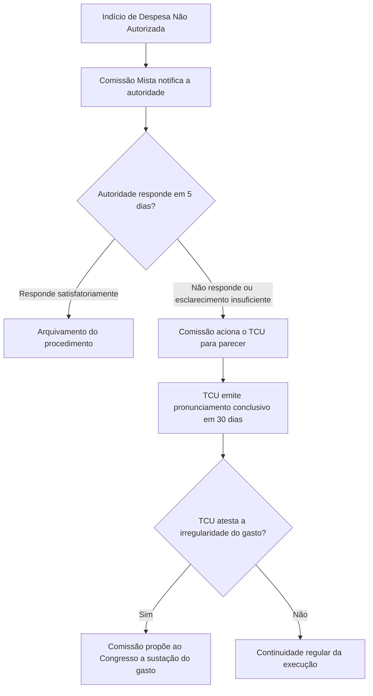
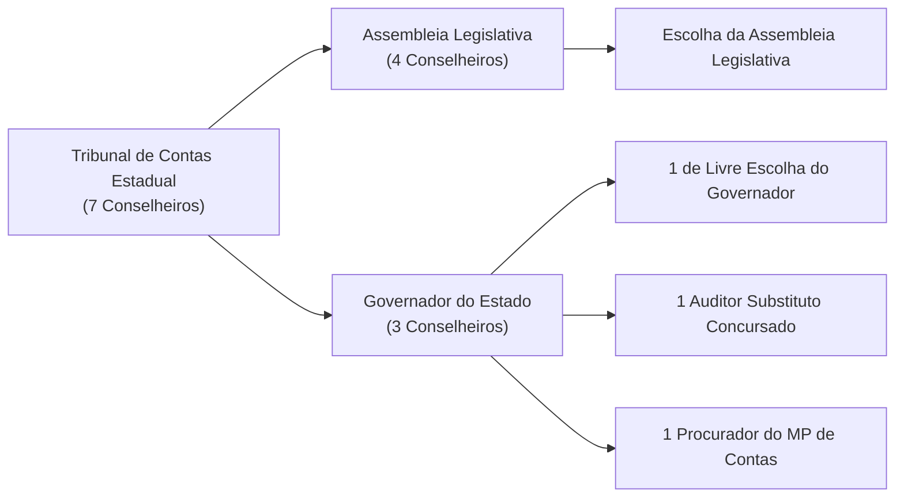
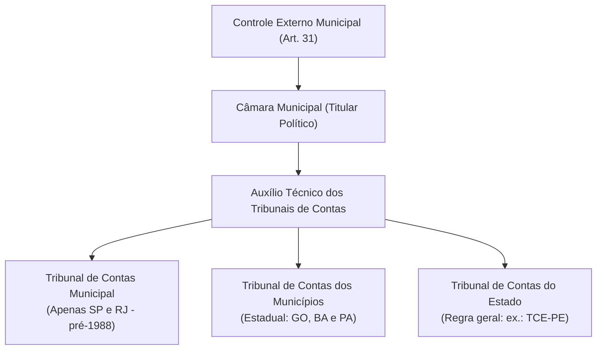

O sistema de controle externo da administração pública brasileira projeta-se sobre todas as unidades federativas mediante regras de simetria constitucional. Além da fiscalização ordinária de contas, a ordem constitucional prevê mecanismos procedimentais específicos de contenção de despesas orçamentárias irregulares por meio da Comissão Mista de Orçamento. Da mesma forma, delineia a arquitetura institucional dos Tribunais de Contas estaduais e a fiscalização orçamentária das Câmaras Municipais.

> [!objetivos]
> - Dominar o procedimento conjunto entre a Comissão Mista de Orçamento (CMO) e o TCU na fiscalização de despesas não autorizadas.
> - Compreender a aplicação do princípio da simetria na organização e composição dos Tribunais de Contas dos Estados e do DF.
> - Analisar a estrutura do controle externo municipal e a vedação à criação de novos órgãos de contas municipais.
> - Diferenciar o julgamento das contas de governo e de gestão dos Chefes do Poder Executivo municipal.

## O TCU e a CMO: Procedimento Especial de Despesas Não Autorizadas

A proteção da lei orçamentária anual demanda instrumentos rápidos de controle preventivo para evitar desvios e danos irreparáveis aos cofres da União. O artigo 72 da Constituição Federal disciplina a atuação integrada entre a comissão mista permanente de orçamento e o Tribunal de Contas da União.

> [!lei] CF, art. 72, §§ 1º e 2º
> § 1º Diante de indícios de despesas não autorizadas, ainda sob a forma de investimentos não programados ou de subsídios não aprovados, a Comissão mista permanente referida no art. 166, § 1º, poderá solicitar à autoridade governamental responsável que, no prazo de cinco dias, preste os esclarecimentos necessários.
> § 2º Não prestados os esclarecimentos, ou considerados estes insuficientes, a Comissão solicitará ao Tribunal pronunciamento conclusivo sobre a matéria, no prazo de trinta dias.

Esse procedimento especial estrutura-se em etapas cronológicas bem delineadas:
1. **Identificação de indícios de irregularidade:** Constatam-se sinais de despesas sem autorização legal, investimentos não contemplados no orçamento ou incentivos fiscais sem base normativa. Nesse momento, a comissão mista intervém formalmente.
2. **Pedido inicial de esclarecimentos:** O colegiado parlamentar notifica a autoridade responsável. Esta deve apresentar justificativas e documentos técnicos no prazo de **cinco dias**.
3. **Atuação do Tribunal de Contas da União:** Se as justificativas não forem apresentadas ou forem julgadas insuficientes, a comissão solicita pronunciamento conclusivo ao TCU. O órgão de controle emite manifestação em até **trinta dias**.
4. **Proposição de sustação da despesa:** Se o parecer técnico confirmar a ilegalidade do gasto e houver risco de dano grave à economia pública, a comissão propõe ao Congresso Nacional a sustação imediata do desembolso (artigo 72, parágrafo 3º).

No campo da repartição tributária federativa, o artigo 161, parágrafo único, da Constituição confere à Corte de Contas federal atribuição técnica privativa. Cabe ao TCU apurar anualmente os coeficientes de distribuição e as quotas pertencentes aos Estados e aos Municípios nos fundos de participação constitucional.

| Etapa do Procedimento (Art. 72) | Órgão Responsável | Prazo Fixado | Consequência Jurídica |
| :--- | :--- | :--- | :--- |
| **Notificação de Esclarecimentos** | Comissão Mista de Orçamento (CMO) | 5 dias | Oitiva prévia do gestor público competente |
| **Pronunciamento Conclusivo** | Tribunal de Contas da União (TCU) | 30 dias | Avaliação técnica da legalidade da despesa |
| **Sustação Definitiva do Dispêndio** | Congresso Nacional | Sessão conjunta | Bloqueio imediato da execução da verba pública |
| **Cálculo das Quotas de Repasse** | TCU (art. 161, parágrafo único) | Anual | Distribuição financeira dos fundos constitucionais |

## Tribunais de Contas dos Estados e do Distrito Federal: Princípio da Simetria

A organização das instituições de controle externo nas unidades federativas rege-se pelo princípio da simetria, consagrado no artigo 75 da Constituição da República de 1988.

> [!lei] CF, art. 75, caput
> As normas estabelecidas nesta seção aplicam-se, no que couber, à organização, composição e fiscalização dos Tribunais de Contas dos Estados e do Distrito Federal, bem como dos Tribunais e Conselhos de Contas dos Municípios.

Por força dessa matriz simétrica, os Tribunais de Contas dos Estados (TCEs) e do Distrito Federal (TCDF) reproduzem regionalmente o modelo estrutural federal. Em razão do porte do colegiado, os órgãos estaduais compõem-se de **sete Conselheiros**, diferindo do modelo federal de nove Ministros.

A indicação e o provimento das vagas nas Cortes estaduais foram consolidados pelo Supremo Tribunal Federal na Súmula 653.

> [!jurisprudencia] STF, Súmula 653: Composição dos Tribunais de Contas Estaduais
> A orientação do verbete 653 do STF estabelece que, no colegiado de sete conselheiros dos Tribunais de Contas estaduais, a escolha de quatro membros pertence à Assembleia Legislativa. As três vagas restantes cabem ao Governador do Estado, sendo duas técnicas (auditor e membro do MP de Contas) e uma de livre escolha, com aprovação parlamentar.

A divisão das sete cadeiras colegiadas obedece ao seguinte arranjo:
- **Quatro Conselheiros** são indicados com exclusividade pelo Poder Legislativo estadual;
- **Três Conselheiros** são indicados pelo Governador do Estado com aprovação prévia do Legislativo. Dentre as três vagas governamentais, uma é de livre escolha do Governador, uma recai sobre auditor concursado e a terceira sobre procurador do Ministério Público de Contas, a partir de listas tríplices.

Os Conselheiros dos Tribunais estaduais contam com as mesmas garantias e impedimentos atribuídos aos Desembargadores do Tribunal de Justiça local (artigo 73, parágrafo 3º, c/c artigo 75 da CF/88). Desfrutam de vitaliciedade, inamovibilidade e irredutibilidade de vencimentos.

No tocante ao alcance da fiscalização, a Corte estadual audita os três Poderes regionais. O STF assentou na ADI 1.779 que é inconstitucional dispositivo de Constituição estadual que reserve à Assembleia Legislativa o julgamento final de suas próprias contas. As contas do Parlamento estadual submetem-se ao julgamento técnico do Tribunal de Contas respectivo.

| Aspecto Institucional | Regra Federal (TCU) | Regra Estadual e Distrital (TCE/TCDF) |
| :--- | :--- | :--- |
| **Número de Integrantes** | Nove Ministros | Sete Conselheiros |
| **Escolha pelo Legislativo** | Seis indicados pelo Congresso Nacional | Quatro indicados pela Assembleia Legislativa |
| **Escolha pelo Executivo** | Três pelo Presidente (com Senado) | Três pelo Governador (com Assembleia) |
| **Vagas Técnicas do Executivo** | Dois (um auditor e um do MP de Contas) | Dois (um auditor e um do MP de Contas) |
| **Paradigma Remuneratório** | Ministros do Superior Tribunal de Justiça | Desembargadores do Tribunal de Justiça |

## Controle Externo da Administração Municipal: O Artigo 31 da CF/88

A fiscalização dos Municípios brasileiros é disciplinada pelo artigo 31 da Carta Política. A titularidade do controle externo municipal pertence à Câmara Municipal, que atua com o auxílio técnico de um Tribunal de Contas.

> [!lei] CF, art. 31, §§ 1º e 4º
> § 1º O controle externo da Câmara Municipal será exercido com o auxílio dos Tribunais de Contas dos Estados ou do Município e dos Conselhos ou Tribunais de Contas dos Municípios, onde houver.
> § 4º É vedada a criação de Tribunais, Conselhos ou órgãos de Contas Municipais.

O parágrafo 4º do artigo 31 veda terminantemente aos Municípios a criação de novos órgãos de contas. Essa proibição busca impedir a fragmentação burocrática e frear o crescimento de despesas nas cidades brasileiras.

Em virtude dessa restrição constitucional, convivem no país três modelos de órgãos de contas municipais:
1. **Tribunal de Contas Municipal Próprio:** Criado pelo próprio Município para fiscalizar unicamente a sua administração. Existem apenas dois no país: São Paulo (TCM-SP) e Rio de Janeiro (TCM-RJ). Foram mantidos porque foram instalados antes da Constituição de 1988.
2. **Tribunal de Contas dos Municípios (Estadual):** Órgão de natureza estadual encarregado de fiscalizar conjuntamente todos os municípios do respectivo Estado. Modelo adotado em Goiás (TCM-GO), Bahia (TCM-BA) e Pará (TCM-PA).
3. **Tribunal de Contas do Estado (TCE):** Órgão estadual que audita as contas do Estado e de todos os seus Municípios. É a regra geral da Federação, adotada em Pernambuco pelo TCE-PE.

Quanto à execução das multas aplicadas a gestores públicos municipais, a jurisprudência do STF firmou distinções práticas:
- Em condenações por **dano causado ao patrimônio municipal**, a legitimidade para executar a quantia cabe ao Município lesado (STF, RE 1.003.433);
- Em **multas simples sancionatórias**, impostas pelo Tribunal de Contas estadual em virtude de infrações formais, a legitimidade pertence ao Estado (STF, ADPF 1.011).

| Modelo Institucional de Contas | Esfera Mantenedora | Jurisdição Fiscalizatória | Casos Concretos no Brasil |
| :--- | :--- | :--- | :--- |
| **Órgão Próprio do Município** | Municipal | Apenas a respectiva Capital | Apenas São Paulo e Rio de Janeiro |
| **Tribunal dos Municípios** | Estadual | Todos os Municípios daquele Estado | Goiás, Bahia e Pará |
| **Tribunal de Contas Estadual** | Estadual | Contas do Estado e de seus Municípios | Pernambuco e maioria das unidades |

## O Julgamento das Contas do Prefeito: Contas de Governo versus Contas de Gestão

O artigo 31, parágrafo 2º, disciplina o procedimento decisório das contas anuais apresentadas pelo Prefeito:

> [!lei] CF, art. 31, § 2º
> O parecer prévio, emitido pelo órgão competente sobre as contas que o Prefeito deve anualmente prestar, só deixará de prevalecer por decisão de dois terços dos membros da Câmara Municipal.

O parecer emitido pela Corte de Contas possui presunção qualificada. Ele prevalece integralmente, salvo se for rejeitado pela manifestação expressa de **dois terços dos membros da Câmara Municipal**.

A doutrina e a prática administrativa distinguem duas espécies de contas prestadas pelo Chefe do Executivo:
1. **Contas de governo:** Relativas ao cumprimento das metas orçamentárias, índices constitucionais e diretrizes gerais da gestão;
2. **Contas de gestão:** Relativas à autorização concreta de compras, liquidação de despesas e celebração de convênios, nas quais o prefeito atua diretamente como ordenador de despesas.

Em pequenos municípios, o Prefeito atua frequentemente como ordenador direto de gastos. Essa realidade gerou disputas sobre a competência para julgamento das contas sob a ótica da Lei de Inelegibilidade (Lei Complementar 64/1990). O Supremo Tribunal Federal fixou tese em repercussão geral nos Recursos Extraordinários 848.826 e 729.744.

> [!jurisprudencia] STF, RE 848.826 e RE 729.744: Julgamento das Contas do Prefeito
> Para fins de inelegibilidade eleitoral, a competência para julgar as contas do Prefeito, tanto as de governo quanto as de gestão quando atuar como ordenador de despesas, é privativa da Câmara Municipal. A manifestação do Tribunal de Contas opera como parecer prévio opinativo.

Conforme a jurisprudência da Suprema Corte, a imposição de inelegibilidade depende de deliberação conclusiva da Câmara de Vereadores. A rejeição das contas pelo Tribunal de Contas, desprovida de apreciação pelo Legislativo, não gera inelegibilidade automática. O direito pátrio rejeita a figura do julgamento ficto por decurso de prazo.

Apesar desse entendimento voltado ao campo eleitoral, o STF reiterou na ADPF 982 que a Corte de Contas mantém competência plena para julgar as contas de gestão do Prefeito quando atuar como ordenador de despesas para fins de **imputação de débito e aplicação de multas**. Essa cobrança não depende de confirmação parlamentar.

| Dimensão da Responsabilidade | Órgão com Competência Julgadora | Efeito Jurídico Produzido |
| :--- | :--- | :--- |
| **Contas de Governo Anuais** | Câmara Municipal (parecer prévio do TCE) | Avaliação política; quórum de 2/3 para rejeitar o parecer |
| **Contas de Gestão (Inelegibilidade)** | Câmara Municipal (exclusividade eleitoral) | Incidência de inelegibilidade da LC 64/1990 |
| **Contas de Gestão (Débito e Multa)** | Tribunal de Contas competente | Título executivo extrajudicial (imputação de dano) |
| **Inércia da Câmara Municipal** | Inexistência de julgamento ficto | Parecer do TCE não gera inelegibilidade imediata |

## Mapa do capítulo

```mermaid Síntese do Controle Federativo e Municipal
graph TD
    A["Controle Externo Federativo e Municipal"] --> B["CMO e TCU (Art. 72)"]
    A --> C["Tribunais de Contas Estaduais (Art. 75)"]
    A --> D["Controle Externo Municipal (Art. 31)"]
    A --> E["Contas do Prefeito"]

    B --> B1["Esclarecimentos em 5 dias; parecer conclusivo do TCU em 30 dias"]
    B --> B2["Proposta de sustação pelo Congresso e cálculo dos fundos constitucionais"]

    C --> C1["Sete Conselheiros: 4 pela Assembleia e 3 pelo Governador (Súmula 653)"]
    C --> C2["Garantias equivalentes aos Desembargadores do TJ"]
    C --> C3["Fiscaliza a Assembleia Legislativa estadual (ADI 1.779)"]

    D --> D1["Vedação expressa à criação de novos tribunais municipais (§ 4º)"]
    D --> D2["Preservação exclusiva dos órgãos pré-88 (TCM-SP e TCM-RJ)"]
    D --> D3["Modelos: órgão municipal, tribunal dos municípios ou TCE estadual"]

    E --> E1["Parecer prévio do TCE só cai por dois terços da Câmara (§ 2º)"]
    E --> E2["Inelegibilidade depende de julgamento pela Câmara (RE 848.826)"]
    E --> E3["Imputação de débito e multa técnica são exigíveis pelo próprio TCE"]
```

### Para fixar

- **Despesas não autorizadas (art. 72):** A comissão de orçamento solicita esclarecimentos em cinco dias, o TCU pronuncia-se em trinta dias e a sustação é proposta ao Congresso.
- **Competência de repasses do TCU:** O Tribunal de Contas da União calcula anualmente as quotas devidas dos fundos constitucionais de participação (artigo 161, parágrafo único).
- **Simetria nos Tribunais estaduais (art. 75):** Composição fixada em sete Conselheiros, com garantias idênticas às dos Desembargadores de Justiça.
- **Divisão das vagas nos TCEs (Súmula 653 do STF):** Quatro Conselheiros escolhidos pelo Parlamento local e três pelo Governador (dois técnicos e um de livre indicação).
- **Fiscalização das Assembleias:** A Corte estadual julga as contas do próprio Poder Legislativo regional, vedado o autojulgamento pelo Parlamento (ADI 1.779).
- **Proibição de tribunais municipais (art. 31, § 4º):** Veda-se a criação de novos órgãos de contas municipais, mantendo-se apenas os instalados antes de 1988 (TCM-SP e TCM-RJ).
- **Parecer prévio sobre contas do Prefeito (art. 31, § 2º):** O parecer opinativo do Tribunal só é rejeitado pelo voto de dois terços dos vereadores da Câmara.
- **Tese do STF sobre inelegibilidade (RE 848.826):** Para efeitos da Lei Complementar 64/1990, compete com exclusividade à Câmara Municipal o julgamento das contas do Prefeito.
