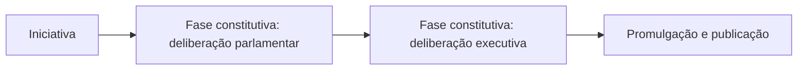

Todo estudo do Poder Legislativo começa pelo caminho que uma norma percorre até virar lei. Este capítulo apresenta as espécies normativas do art. 59 da Constituição, explica por que o desrespeito ao caminho gera inconstitucionalidade, mostra quando o Judiciário pode intervir antes de a lei existir e detalha a primeira fase do processo: a iniciativa. A prova gosta de perguntar quem pode propor cada tipo de projeto e o que acontece quando alguém propõe o que não podia.

> [!objetivos]
> - Listar as espécies normativas do art. 59 e distinguir atos primários e secundários.
> - Explicar o vício de processo e o controle judicial preventivo.
> - Diferenciar processo e procedimento legislativo e reconhecer os tipos de procedimento.
> - Identificar quem tem iniciativa geral, privativa e popular e o que ocorre com o vício de iniciativa.

## Conceito e espécies normativas

**Processo legislativo** é o conjunto de regras da Constituição que organiza a produção dos **atos normativos primários**, isto é, aqueles que retiram sua validade diretamente da própria Constituição. Ele não se confunde com o "processo regimental", que fica nos regimentos internos de cada Casa e cuida de detalhes como o tempo de fala. As regras do processo legislativo constitucional **não são cláusulas pétreas**: podem ser mudadas por emenda, como ocorreu com o regime das medidas provisórias.

> [!lei] CF, art. 59
> O processo legislativo compreende a elaboração de: I - emendas à Constituição; II - leis complementares; III - leis ordinárias; IV - leis delegadas; V - medidas provisórias; VI - decretos legislativos; VII - resoluções. Parágrafo único. Lei complementar disporá sobre a elaboração, redação, alteração e consolidação das leis.

A lei complementar mencionada no parágrafo único é a LC 95/1998, que traz as regras de técnica legislativa, como a estrutura em artigos, parágrafos, incisos e alíneas.

| Espécie | Para que serve | Característica marcante |
| --- | --- | --- |
| Emenda à Constituição | Alterar o texto constitucional | Rito mais difícil e limites materiais |
| Lei complementar | Regular matérias que a Constituição reservou a ela | Maioria absoluta |
| Lei ordinária | Disciplinar o que não exige lei complementar | Maioria simples, em regra |
| Lei delegada | Norma elaborada pelo Presidente com autorização do Congresso | Delegação por resolução |
| Medida provisória | Ato do Presidente com força de lei, em caso de relevância e urgência | Vigência temporária |
| Decreto legislativo | Matérias de competência exclusiva do Congresso | Não vai à sanção |
| Resolução | Matérias de competência privativa de cada Casa ou do Congresso | Não vai à sanção |

Algumas normas são primárias, mas **ficam fora** do processo legislativo do art. 59: os **decretos autônomos** e os **regimentos internos dos tribunais**. Os **atos secundários**, como o decreto regulamentar e a portaria, também ficam fora, porque apenas detalham uma lei.

> [!pegadinha]
> A banca afirma que as emendas constitucionais não fazem parte do processo legislativo por serem obra do poder constituinte. Prevalece o contrário: elas estão listadas no art. 59 e, por isso, fazem parte dele.

### Classificações do processo legislativo

Quanto à **organização política**, o processo pode ser autocrático (o governante edita a norma sozinho), direto (o povo discute e vota), semidireto (o povo confirma por referendo) ou indireto, também chamado de representativo (os eleitos votam). O modelo brasileiro é, em regra, **indireto**, com instrumentos de participação popular direta, como a iniciativa popular.

Quanto à **sequência das fases**, o processo é **comum**, usado na lei ordinária, ou **especial**, usado nas demais espécies e nas leis financeiras (plano plurianual, diretrizes orçamentárias, orçamento e créditos adicionais).

### Atos primários e atos secundários

A distinção entre os dois tipos de atos ajuda a separar o que é e o que não é processo legislativo.

| Característica | Ato normativo primário | Ato normativo secundário |
| --- | --- | --- |
| Fundamento de validade | A própria Constituição | Uma lei ou outro ato primário |
| Exemplos | Lei ordinária, lei complementar, medida provisória, decreto legislativo, resolução, decreto autônomo | Decreto regulamentar, portaria, instrução normativa |
| Controle por ação direta no STF | Cabe, se houver ofensa à Constituição | Em regra não cabe: o vício seria de ilegalidade |
| Faz parte do art. 59? | Sim, na maior parte | Não |

Quando um decreto regulamentar extrapola a lei que deveria detalhar, o problema é de ilegalidade, e não de inconstitucionalidade direta. A exceção são os decretos autônomos, que a Constituição autoriza em poucas hipóteses (art. 84, VI), porque extraem a validade diretamente dela.

### Princípios do processo legislativo

Algumas ideias organizam todo o tema e servem para resolver questões sobre casos novos:

- **Devido processo legislativo:** as normas só valem se forem produzidas pelo caminho que a Constituição exige.
- **Não convalidação das nulidades:** um vício de processo não desaparece por ato posterior, como a sanção ou o passar do tempo.
- **Simetria:** os Estados, o Distrito Federal e os Municípios copiam as regras básicas do processo federal, como a iniciativa privativa do chefe do Executivo.
- **Bicameralismo:** na esfera federal, o projeto passa por duas Casas, uma iniciadora e outra revisora.
- **Separação de Poderes:** os atos de cada Poder devem respeitar a competência dos demais, o que justifica a reserva de iniciativa.

> [!bizu]
> Decore a lista do art. 59 na ordem: emenda, complementar, ordinária, delegada, medida provisória, decreto legislativo e resolução. Entre elas, **não vão à sanção** a emenda, o decreto legislativo e a resolução: a emenda é promulgada pelas Mesas das duas Casas, e os outros dois, pelo Presidente do Senado, na qualidade de Presidente do Congresso.

## Vício de processo e controle preventivo

Quando se desrespeita uma regra do processo legislativo, a norma nasce com **inconstitucionalidade formal**, também chamada de **nomodinâmica**. Há três modos de vício formal:

- **Orgânico:** o ente ou o órgão não tinha competência para legislar.
- **Subjetivo:** quem apresentou o projeto não tinha iniciativa.
- **Objetivo (propriamente dito):** foi violada alguma regra do rito, como o quórum ou a ordem de votação.

A tabela traz um exemplo de cada modo de vício formal.

| Vício formal | Exemplo | Efeito |
| --- | --- | --- |
| Orgânico | Um Estado edita lei sobre direito penal, matéria de competência privativa da União | A lei é inconstitucional |
| Subjetivo | Um deputado propõe lei sobre o regime dos servidores do Executivo | A lei é inconstitucional, mesmo sancionada |
| Objetivo | Uma proposta de emenda é aprovada em turno único, e não em dois | A emenda é inconstitucional |

Esses vícios são **insanáveis** e podem ser reconhecidos pelo STF em ação direta ou por qualquer juiz no caso concreto. A diferença em relação ao vício material é que aqui não se discute o que a norma diz, e sim **como** ela foi produzida. Uma lei com conteúdo perfeito, mas produzida por quem não tinha competência, continua inválida.

Dois princípios orientam esse tema. O primeiro é a **não convalidação das nulidades**: nenhum ato posterior corrige o vício. Por isso a **sanção presidencial não cura o vício de iniciativa**. A antiga Súmula 5 do STF dizia o contrário e está superada. O segundo é a **simetria**: as regras básicas do processo legislativo federal são de observância obrigatória pelos Estados, pelo Distrito Federal e pelos Municípios.

> [!exemplo]
> Um deputado estadual de Pernambuco propõe e a Assembleia Legislativa aprova uma lei que aumenta a remuneração dos servidores do Poder Executivo. O governador, pressionado, sanciona. A lei continua inconstitucional, pois a iniciativa dessa matéria é do governador e o projeto nasceu com defeito. A sanção não conserta a falha.

### Controle judicial preventivo

O controle de constitucionalidade comum é repressivo: ocorre depois que a lei existe. No Brasil, o Judiciário só atua **antes** da lei em um caso estreito: o **mandado de segurança impetrado por parlamentar**, para impedir que continue a tramitar proposta que viola o devido processo legislativo ou, no caso de proposta de emenda, que pretende abolir cláusula pétrea. Os pontos que a prova cobra:

- Só o **parlamentar em exercício** tem legitimidade: ele tem direito líquido e certo a participar de um processo legislativo constitucional.
- O objeto é a violação de **regra constitucional do processo**, e não de regra meramente regimental.
- O Judiciário não barra um projeto de lei comum apenas por seu **conteúdo** ser inconstitucional, porque a discussão do mérito pertence ao Legislativo e o veto e o controle repressivo ainda poderão corrigi-lo.

> [!atencao] Regimento interno
> Violações de regras que estão só no regimento interno são **atos internos do Legislativo** (*interna corporis*) e, em regra, não são revistas pelo Judiciário. A exceção é quando a regra regimental concretiza uma norma constitucional.

### Os três controles preventivos

O controle preventivo existe em três formas, e a prova costuma pedir a correspondência entre o órgão e o instrumento. A tabela separa cada uma.

| Quem controla | Instrumento | Momento |
| --- | --- | --- |
| Poder Legislativo | Parecer da Comissão de Constituição e Justiça, que analisa a constitucionalidade do projeto | Durante a tramitação |
| Poder Executivo | Veto jurídico, quando o Presidente considera o projeto inconstitucional (art. 66, § 1º) | Depois da aprovação e antes da lei |
| Poder Judiciário | Mandado de segurança de parlamentar | Durante a tramitação |

O controle **repressivo**, ao contrário, ocorre depois que a lei já existe e é feito, em regra, pelo Judiciário, tanto de forma difusa, por qualquer juiz, quanto de forma concentrada, pelo STF. Por exceção, o Legislativo também pode atuar de modo repressivo, por exemplo quando o Congresso susta um ato normativo do Executivo que extrapola o poder de regulamentar (art. 49, V) e quando uma medida provisória é rejeitada por inconstitucionalidade.

> [!exemplo]
> Um senador percebe que uma proposta de emenda constitucional deixou de cumprir o rito de dois turnos de votação. Ele impetra mandado de segurança no STF, que tem competência originária para julgar o caso. O pedido tem fundamento, pois a violação é de regra constitucional do processo. Já um cidadão comum que discorda do conteúdo de um projeto não pode usar a mesma via.

## Procedimentos legislativos

**Processo** é o conjunto de etapas que leva à edição de uma norma. **Procedimento** é o modo como cada etapa se desenvolve. A Constituição prevê diferentes procedimentos:

| Procedimento | Quando é usado | Característica |
| --- | --- | --- |
| Ordinário (comum) | Leis ordinárias em geral | Sem prazo fixo para a votação |
| Sumário | Projetos de iniciativa do Presidente com pedido de urgência | 45 dias em cada Casa e 10 para as emendas do Senado |
| Especial | Emendas, leis complementares, delegadas, medidas provisórias e leis financeiras | Regras próprias |
| Abreviado | Projetos que as comissões podem aprovar sem votação em plenário | Decisão terminativa da comissão |

No **procedimento sumário** (art. 64), o Presidente da República pode pedir urgência para projeto de sua iniciativa. Se a Câmara e o Senado não se manifestarem, cada um em até 45 dias, passam a **trancar a pauta** da respectiva Casa, com exceção das matérias de prazo constitucional determinado. Os prazos não correm no recesso e **não se aplicam aos projetos de código**. A apreciação das emendas do Senado pela Câmara é feita em 10 dias. Nos projetos do Presidente, do STF e dos Tribunais Superiores, a discussão **começa pela Câmara dos Deputados**.

No **procedimento abreviado**, o regimento pode dispensar o plenário e permitir que as comissões aprovem projetos de lei de certos temas. Se um décimo dos membros da Casa apresentar recurso, o projeto vai a plenário.

### Passo a passo do procedimento ordinário

Para entender os prazos e as exceções, vale seguir um projeto de lei ordinária de ponta a ponta:

1. **Apresentação.** Um parlamentar ou outro legitimado protocola o projeto na Casa iniciadora (em regra, a Câmara).
2. **Comissões.** O projeto é distribuído às comissões temáticas e à Comissão de Constituição e Justiça. Elas emitem pareceres sobre o mérito e sobre a constitucionalidade.
3. **Plenário da Casa iniciadora.** O projeto é discutido, pode receber emendas e é votado. Para aprovar uma lei ordinária, exige-se maioria simples, desde que presente a maioria absoluta dos membros.
4. **Casa revisora.** Aprovado, o projeto segue para a outra Casa, que o examina em um só turno de discussão e votação. Se rejeitar, o projeto é arquivado. Se aprovar sem mudanças, vai à sanção. Se aprovar com emendas, **volta à Casa iniciadora**, que decide apenas sobre as mudanças.
5. **Sanção ou veto.** O Presidente tem 15 dias úteis para decidir.
6. **Promulgação e publicação.**

> [!atencao] Rejeição e reapresentação
> O projeto rejeitado só pode ser reapresentado na mesma sessão legislativa se a proposta vier da **maioria absoluta** dos membros de qualquer das Casas (art. 67). Sessão legislativa é o período anual de funcionamento do Congresso. A regra impede que o Legislativo reabra a todo momento uma discussão já vencida.

### Quórum, sanção e promulgação por espécie

| Espécie | Quórum de aprovação | Sanção? | Quem promulga |
| --- | --- | --- | --- |
| Emenda à Constituição | 3/5 em cada Casa, em dois turnos | Não | Mesas da Câmara e do Senado |
| Lei complementar | Maioria absoluta | Sim | Presidente da República |
| Lei ordinária | Maioria simples | Sim | Presidente da República |
| Lei delegada | Conforme a resolução de delegação | Não há; a lei é elaborada pelo Presidente | Presidente da República |
| Medida provisória | Maioria simples, na conversão | Só se o Congresso alterar o texto (projeto de lei de conversão) | Presidente da República, se houve sanção; Presidente da Mesa do Congresso, se o texto foi aprovado sem alteração |
| Decreto legislativo | Maioria simples, em regra | Não | Presidente do Senado |
| Resolução | Maioria simples, em regra | Não | Presidente da Casa ou do Congresso |

As medidas provisórias, as leis delegadas e as emendas ganham capítulos próprios neste volume. A tabela serve de visão geral para a prova: a banca costuma comparar o quórum de uma espécie com o de outra.

## Fases do processo legislativo

O processo legislativo ordinário tem três fases. A tabela das fases mostra o que cada uma faz.

- **Fase introdutória:** a iniciativa, que é o ato de apresentar o projeto.
- **Fase constitutiva:** a deliberação das duas Casas (discussão, emendas e votação) e a deliberação do Presidente (sanção ou veto). É nesta fase que o projeto vira lei.
- **Fase complementar:** a promulgação, que atesta a existência da lei, e a publicação, que a torna conhecida e obrigatória.

A divisão em três fases tem uma consequência prática: a lei só **existe** depois da fase constitutiva, mas só **vincula** depois da fase complementar. Um projeto aprovado e sancionado ainda não obriga ninguém enquanto não for publicado. Os próximos capítulos detalham a fase constitutiva. Neste, o foco é a primeira etapa.

### Casos práticos de iniciativa

A melhor forma de fixar a iniciativa é aplicar a regra a situações. Em cada caso, pergunte primeiro qual é a matéria e depois quem poderia propor.

1. **Vereador propõe lei que cria o cargo de fiscal no quadro da prefeitura.** A criação de cargos na administração é matéria reservada ao chefe do Executivo; por simetria, o prefeito. O projeto tem vício de iniciativa e será inconstitucional mesmo que o prefeito sancione.
2. **Deputado federal propõe lei que institui o Dia Nacional do Bombeiro.** Datas comemorativas não reservam a iniciativa a ninguém e não alteram a estrutura do Executivo. Qualquer parlamentar pode propor.
3. **Deputado estadual propõe lei que obriga a rede pública a instalar extintores em todas as escolas.** A lei cria despesa, mas não mexe na estrutura nem no regime de servidores. Pela tese do STF sobre despesa, não há vício de iniciativa.
4. **Senador propõe projeto que altera a promoção dos oficiais do Exército.** A matéria, militares das Forças Armadas, é de iniciativa privativa do Presidente da República. O projeto nasce viciado.
5. **Cidadãos reúnem 0,5% do eleitorado nacional e apresentam um projeto.** O percentual é insuficiente, porque a Constituição exige 1% do eleitorado nacional, em cinco Estados, com 0,3% em cada um.

> [!pegadinha]
> Em questões sobre vício de iniciativa, a banca costuma afirmar que a sanção do chefe do Executivo "supre" a falta de iniciativa. Essa tese era da Súmula 5 do STF, que ficou superada. Hoje, o vício é insanável.

### Emendas aos projetos e vedação de despesa

A iniciativa privativa tem um complemento no art. 63: os parlamentares podem apresentar **emendas** aos projetos de iniciativa do Presidente, mas não podem aumentar a despesa prevista neles. O mesmo vale para projetos sobre os serviços administrativos da Câmara, do Senado, dos tribunais federais e do Ministério Público. Há uma ressalva para as emendas ao orçamento, que seguem as regras próprias do art. 166. O objetivo é impedir que o Legislativo, por meio de emendas, aumente os gastos que só o titular da iniciativa pode propor. A emenda também precisa guardar **pertinência temática** com o projeto: não se pode enxertar no texto um assunto estranho.

## A fase introdutória: iniciativa

**Iniciativa** é o poder de apresentar um projeto. Ela pode ser geral, concorrente, privativa, popular ou de outros órgãos autorizados.

### Iniciativa geral e concorrente

Pela regra do art. 61, podem propor projetos de lei ordinária ou complementar: deputados e senadores, individualmente ou reunidos em comissão; o **Presidente da República**; o **STF** e os **tribunais superiores**; o **Procurador-Geral da República**; e os **cidadãos**, nos casos e na forma que a Constituição prevê. Quando todos esses agentes podem propor, a iniciativa é **concorrente** (ou comum), e o projeto não nasce viciado, seja qual for o autor.

### Iniciativa privativa

Em algumas matérias, só um agente pode propor. É a iniciativa **privativa** (também chamada de reservada ou exclusiva). O art. 61, § 1º, reserva ao **Presidente da República** os projetos sobre os assuntos da tabela.

| Assunto reservado ao Presidente | Exemplo prático |
| --- | --- |
| Efetivos das Forças Armadas | Aumentar o número de soldados do Exército |
| Cargos e remuneração na administração direta e autárquica | Criar o cargo de analista ou reajustar o salário de uma categoria |
| Territórios: organização, tributos, orçamento e pessoal | Reorganizar um Território federal |
| Servidores da União: regime jurídico, provimento, estabilidade e aposentadoria | Alterar as regras de estágio probatório |
| Ministério Público da União e Defensoria Pública da União; normas gerais para os Estados | Reestruturar a carreira de um desses órgãos |
| Criação e extinção de Ministérios e órgãos | Extinguir um ministério |
| Militares das Forças Armadas: regime, promoções, remuneração e reserva | Mudar as regras de promoção de oficiais |

Também há iniciativa privativa de outros agentes, como mostra a tabela a seguir.

| Agente | Matéria de iniciativa própria |
| --- | --- |
| STF | Estatuto da Magistratura (lei complementar) |
| STF, tribunais superiores e tribunais de justiça | Número de membros dos tribunais, cargos e remuneração dos serviços auxiliares, criação de tribunais inferiores e divisão judiciária (art. 96, II) |
| Ministério Público | Criação e extinção de cargos, serviços auxiliares, política remuneratória e planos de carreira (art. 127, § 2º) |
| Câmara e Senado | Remuneração dos servidores de cada Casa; a organização interna sai por resolução |
| Presidente da República | Plano plurianual, diretrizes orçamentárias e orçamento anual (art. 165) |

> [!bizu] Como lembrar
> Se a lei mexe na **estrutura** do Executivo, na **carreira** dos servidores ou na **remuneração** deles, o projeto deve partir do chefe do Executivo. Se mexe em temas gerais, qualquer parlamentar pode propor.

> [!atencao] Despesa não é, por si só, iniciativa privativa
> Uma lei de iniciativa de parlamentar que apenas gera despesa não é, por isso, inconstitucional. O STF fixou que não invade a competência do chefe do Executivo a lei que, embora crie despesa, não trate da estrutura e da atribuição de órgãos nem do regime dos servidores.

> [!jurisprudencia] STF, Tema 917 da repercussão geral
> Não usurpa a competência privativa do chefe do Poder Executivo lei que, embora crie despesa para a administração pública, não trata da sua estrutura ou da atribuição de seus órgãos nem do regime jurídico de servidores públicos.

### Estados, Distrito Federal e Municípios

Por simetria, o governador tem iniciativa privativa sobre o regime dos servidores estaduais, inclusive dos **militares estaduais**: polícia militar e corpo de bombeiros. O prefeito tem a mesma iniciativa para os servidores municipais. A Constituição Estadual não pode ampliar a iniciativa dos deputados nem reduzir a do governador. As regras de iniciativa não podem ser alteradas pela constituição do Estado nem pela lei orgânica do Município, porque são normas de reprodução obrigatória.

A iniciativa popular também existe nos outros entes. A Constituição fala que a lei estadual disporá sobre ela (art. 27, § 4º), e, nos Municípios, exige a manifestação de pelo menos **5% do eleitorado** para projetos de interesse específico do município, da cidade ou de bairros (art. 29, XIII).

### Como resolver uma questão de iniciativa

Uma questão sobre esse tema quase sempre pode ser resolvida em três passos:

1. **Identifique a matéria.** O projeto trata de cargos, remuneração, regime de servidores, estrutura de órgãos ou de algo geral?
2. **Descubra o titular da iniciativa.** Se a matéria é reservada, só ele pode propor. Se é geral, qualquer legitimado pode.
3. **Compare com o autor do projeto.** Autor diferente do titular significa vício de iniciativa, que a sanção não corrige.

### Iniciativa popular

A iniciativa popular, prevista no art. 61, § 2º, é exercida por **projeto de lei subscrito por pelo menos 1% do eleitorado nacional**, distribuído em no mínimo **5 Estados**, com **não menos de 0,3% dos eleitores de cada um deles**. O projeto é apresentado à **Câmara dos Deputados**. Há, portanto, três números para memorizar: 1%, cinco Estados e 0,3%.

> [!pegadinha]
> Trocar o número de Estados, o percentual do eleitorado ou a Casa em que o projeto é apresentado. Lembre: **1% do eleitorado, cinco Estados, 0,3% em cada um, Câmara dos Deputados**.

## Mapa do capítulo

A tabela resume quem tem iniciativa e como os vícios aparecem.

| Tema | Regra | Cuidado |
| --- | --- | --- |
| Processo legislativo | Elabora as espécies do art. 59 | Decreto autônomo e regimento de tribunal ficam fora |
| Vício de iniciativa | Inconstitucionalidade formal subjetiva | Sanção não convalida |
| Controle preventivo | Mandado de segurança de parlamentar | Só contra violação de regra constitucional do processo |
| Procedimento sumário | Urgência do Presidente: 45 dias em cada Casa | Não vale para códigos e não corre no recesso |
| Iniciativa privativa | Art. 61, § 1º, para o Presidente da República | Simetria nos Estados |
| Iniciativa popular | 1%, cinco Estados, 0,3% em cada | Apresentada à Câmara |

### Para fixar

- O art. 59 lista sete espécies normativas: emenda, lei complementar, lei ordinária, lei delegada, medida provisória, decreto legislativo e resolução.
- Decretos autônomos, regimentos de tribunais e atos secundários ficam fora do processo legislativo do art. 59.
- Violar o processo legislativo gera inconstitucionalidade formal.
- A sanção não convalida o vício de iniciativa.
- O controle judicial preventivo ocorre por mandado de segurança de parlamentar.
- O procedimento sumário depende de pedido de urgência do Presidente e fixa 45 dias em cada Casa.
- A iniciativa privativa do art. 61, § 1º, reserva ao Presidente a matéria de cargos, remuneração e regime de servidores.
- Lei de iniciativa parlamentar que só cria despesa não é inconstitucional por isso.
- A iniciativa popular exige 1% do eleitorado, em cinco Estados, com 0,3% em cada um.
- Os Estados seguem a simetria do processo legislativo federal.
