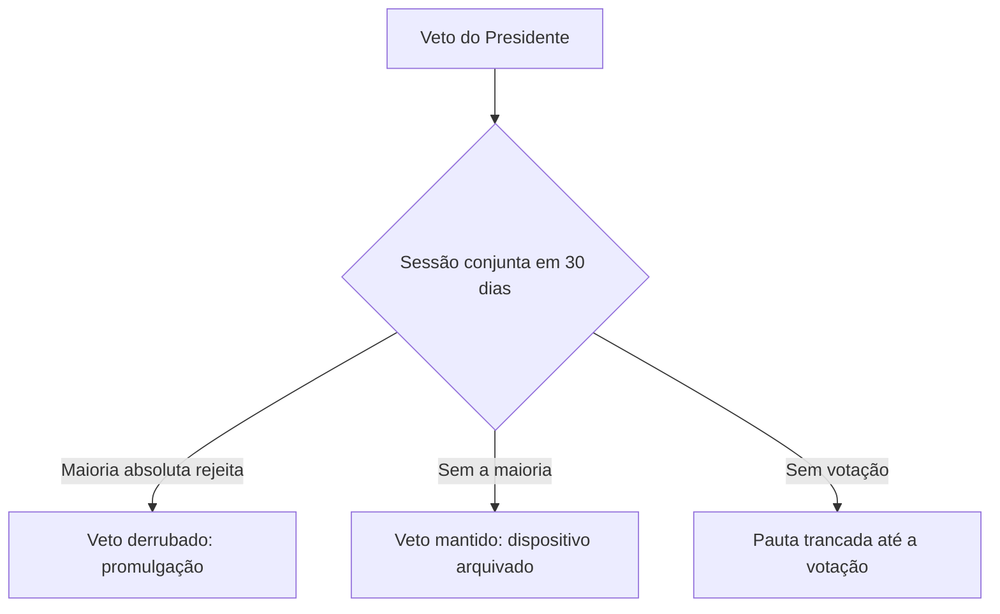

Depois de apresentado, o projeto de lei passa pela etapa que realmente o transforma em lei: a fase constitutiva. Nela, as duas Casas do Congresso discutem e votam, os parlamentares apresentam emendas e o Presidente da República decide entre sancionar e vetar. Se há veto, o Congresso pode derrubá-lo. Em seguida vêm a promulgação e a publicação. Esse capítulo trata dessa sequência, com os prazos e os quóruns que a prova cobra.

> [!objetivos]
> - Descrever a votação nas Casas iniciadora e revisora e o destino das emendas.
> - Classificar as emendas parlamentares e apontar seus limites.
> - Diferenciar sanção e veto, expressos e tácitos, totais e parciais, e contar os prazos.
> - Explicar o trâmite do veto no Congresso e a fase complementar.

## Deliberação parlamentar

A deliberação parlamentar ocorre nas duas Casas. A Casa onde o projeto começa é a **iniciadora**. A outra é a **revisora**. A iniciadora, em regra, é a Câmara dos Deputados. A Constituição impõe a Câmara como Casa iniciadora para os projetos do Presidente da República, do STF e dos Tribunais Superiores, e para os projetos de iniciativa popular. Os projetos de autoria de senadores começam no Senado.

Em cada Casa, o projeto é discutido e votado. A regra geral é a **maioria simples** dos votos, presente a maioria absoluta dos membros (art. 47). Quando a Constituição exige quórum maior, como a maioria absoluta para lei complementar, o quórum especial prevalece.

### Quóruns de votação

Quórum de **instalação** (presença) e quórum de **aprovação** (votos) são coisas diferentes. A Casa só delibera com a presença da maioria absoluta de seus membros. Depois, o número de votos exigido varia conforme a matéria.

| Quórum | Como se calcula | Onde aparece |
| --- | --- | --- |
| Maioria simples | Mais da metade dos votos dos presentes | Lei ordinária e, em regra, resolução e decreto legislativo |
| Maioria absoluta | Mais da metade de todos os membros da Casa | Lei complementar; derrubada de veto; reapresentação de projeto rejeitado |
| Três quintos | 3/5 dos membros | Emenda à Constituição |
| Dois terços | 2/3 dos membros | Admissão de acusação contra o Presidente pela Câmara |

Um exemplo numérico ajuda: no Senado, com 81 membros, a maioria absoluta é de **41 votos**. Se estão presentes 50 senadores, a maioria simples é de 26 votos. Já para uma emenda constitucional, 3/5 de 81 são **49 votos**.

> [!bizu]
> Maioria **simples** olha para quem está presente na sessão; maioria **absoluta** olha para o total de membros da Casa, estejam presentes ou não.

A Casa revisora examina o projeto em **um só turno** de discussão e votação (art. 65). Ela tem três caminhos:

- **Aprovar sem alterações:** o projeto vai à sanção ou à promulgação.
- **Rejeitar:** o projeto é arquivado.
- **Aprovar com emendas:** o projeto **volta à Casa iniciadora**, que se manifesta apenas sobre as mudanças. Ela pode aceitar ou rejeitar cada emenda, mas não pode inovar. Depois dessa decisão, o texto final segue para a sanção.

> [!esquema] Caminhos do projeto na Casa revisora
> - Aprovado sem mudanças: segue para a sanção.
> - Rejeitado: arquivado.
> - Emendado: volta à Casa iniciadora, que decide só sobre as emendas.

Uma mudança que apenas melhora a redação, sem alterar o sentido, não obriga o retorno à Casa iniciadora. Se a alteração muda o conteúdo da norma, o retorno é obrigatório, e sua falta gera inconstitucionalidade formal.

## Emendas parlamentares

**Emenda** é a proposta de alteração de um projeto em tramitação. Não se deve confundir com a emenda à Constituição, que é uma espécie normativa do art. 59. A tabela mostra os tipos que costumam aparecer em provas.

| Tipo de emenda | O que faz |
| --- | --- |
| Supressiva | Retira parte do texto |
| Aditiva | Acrescenta algo ao texto |
| Substitutiva | Troca o texto por outro, no todo ou em grande parte |
| Modificativa | Altera o texto sem suprimir nem acrescentar de forma substancial |
| Aglutinativa | Junta duas ou mais emendas ou o projeto em um texto só |

O poder de emendar tem **limites**:

1. **Pertinência temática:** a emenda precisa ter relação com o assunto do projeto. O STF reprova a inclusão de temas estranhos, prática conhecida como "contrabando legislativo" ou "jabuti", sobretudo em projetos de conversão de medidas provisórias.
2. **Vedação de aumento de despesa** nos projetos de iniciativa exclusiva do Presidente e nos que organizam os serviços administrativos do Legislativo, dos tribunais e do Ministério Público (art. 63).
3. **Respeito à reserva de iniciativa:** uma emenda não pode fazer de modo indireto o que o autor do projeto não podia fazer diretamente.

> [!atencao] Emenda e vício de iniciativa
> Se uma emenda de parlamentar acrescenta matéria de iniciativa privativa do Presidente a um projeto de iniciativa comum, o vício de iniciativa contamina a norma. A sanção não conserta o problema.

## Sanção e veto

Concluída a votação, a Casa em que ela terminou envia o projeto ao Presidente da República, que tem **15 dias úteis**, contados do recebimento, para decidir. O Presidente pode **sancionar** ou **vetar**.

> [!lei] CF, art. 66, § 1º
> Se o Presidente da República considerar o projeto, no todo ou em parte, inconstitucional ou contrário ao interesse público, vetá-lo-á total ou parcialmente, no prazo de quinze dias úteis, contados da data do recebimento, e comunicará, dentro de quarenta e oito horas, ao Presidente do Senado Federal os motivos do veto.

### Sanção

**Sanção** é a concordância do Presidente com o projeto. Ela é a manifestação final que transforma o projeto em lei.

- **Expressa:** o Presidente declara que sanciona.
- **Tácita:** o Presidente fica em silêncio durante os 15 dias úteis. O silêncio importa em sanção (art. 66, § 3º).
- **Total ou parcial:** sancionar o projeto inteiro ou apenas partes, quando há veto parcial.

### Veto

**Veto** é a discordância do Presidente. Ele é sempre **expresso e motivado**: o silêncio nunca é veto. Há dois fundamentos possíveis:

- **Veto jurídico:** o projeto é inconstitucional.
- **Veto político:** o projeto é contrário ao interesse público.

O veto pode ser **total**, quando atinge todo o projeto, ou **parcial**. O veto parcial só pode alcançar o **texto integral de um artigo, de um parágrafo, de um inciso ou de uma alínea** (art. 66, § 2º). Não é possível vetar uma palavra ou uma expressão. O veto é também **relativo**, porque o Congresso pode derrubá-lo.

> [!pegadinha]
> A banca afirma que o Presidente pode vetar "uma palavra" ou "uma expressão" do artigo para ajustar o sentido da norma. O veto parcial só atinge artigo, parágrafo, inciso ou alínea, em sua integralidade.

> [!exemplo]
> O Presidente recebe um projeto numa segunda-feira, e não há feriados no período. Contam-se apenas dias úteis, a partir do dia seguinte ao recebimento. O décimo quinto dia útil é a segunda-feira de três semanas depois. Se até esse dia ele não se manifestar, o projeto é considerado sancionado. Se vetar, deve avisar o Presidente do Senado, com os motivos, em até 48 horas.

A tabela compara os dois atos.

| Aspecto | Sanção | Veto |
| --- | --- | --- |
| Natureza | Concordância com o projeto | Discordância, total ou parcial |
| Forma | Expressa ou tácita | Sempre expresso e motivado |
| Prazo | 15 dias úteis | 15 dias úteis |
| Efeito | Torna o projeto lei | Devolve o projeto ao Congresso para análise |
| Controle | Não cura vício de iniciativa | Pode ser derrubado |

### O que acontece com o veto

O veto vai à **sessão conjunta** da Câmara e do Senado, que deve apreciá-lo em **30 dias**, contados do recebimento. O veto só é rejeitado pelo voto da **maioria absoluta dos Deputados e dos Senadores**, o que equivale, na prática, a 257 deputados e 41 senadores. A votação é aberta, porque a Emenda Constitucional 76/2013 suprimiu o voto secreto. Se o prazo passar sem apreciação, o veto passa a trancar a pauta da sessão conjunta, até a votação final (art. 66, § 6º).

- **Veto derrubado:** o projeto volta ao Presidente para promulgação, em 48 horas. Se ele não promulgar, o Presidente do Senado o fará em igual prazo, e, se também não o fizer, o Vice-Presidente do Senado (art. 66, § 7º).
- **Veto mantido:** o dispositivo vetado é arquivado.
- **Parte não vetada:** nos vetos parciais, a parte não vetada é, na prática, sancionada e publicada, enquanto o veto aguarda o exame do Congresso.

> [!bizu] Números do veto
> **15** dias úteis para o Presidente decidir; **48** horas para comunicar o veto ao Senado; **30** dias para o Congresso votar; maioria **absoluta** para derrubar; **48** horas para promulgar.

> [!pegadinha]
> Dizer que o veto é derrubado por dois terços ou por maioria simples. O quórum é de **maioria absoluta** dos deputados e dos senadores. Outra troca é afirmar que o voto é secreto: desde 2013, o voto é aberto.

### Onde há sanção e veto

Nem toda espécie normativa passa pelo crivo do Presidente. A tabela separa os casos.

| Espécie | Passa por sanção ou veto? | Observação |
| --- | --- | --- |
| Lei ordinária e lei complementar | Sim | Fase constitutiva completa |
| Emenda à Constituição | Não | O Presidente não participa da aprovação |
| Decreto legislativo e resolução | Não | Competência exclusiva do Congresso |
| Lei delegada | Não, no sentido comum | O próprio Presidente a elabora |
| Medida provisória | Não se submete a veto | O projeto de lei de conversão, se houver alteração, é que pode ser vetado |

### Casos práticos de prazo e veto

1. **Projeto recebido pelo Presidente em 10 de março; silêncio até o fim do prazo.** O projeto fica sancionado tacitamente. Cabe ao Presidente promulgá-lo em 48 horas; se não o fizer, a promulgação passa ao Presidente do Senado.
2. **Presidente veta apenas a expressão "e sem aviso prévio" de um inciso.** O veto é inválido, pois só se veta o inciso inteiro. O Congresso tem de analisar o inciso inteiro.
3. **O Congresso mantém um veto por 180 deputados e 30 senadores.** O dispositivo vetado é arquivado, porque não se atingiu a maioria absoluta nas duas Casas.
4. **Na sessão conjunta, 270 deputados e 45 senadores votam pela derrubada.** O veto cai, e o texto vetado vai à promulgação.
5. **O Presidente pede urgência para um projeto seu, e a Câmara não vota em 45 dias.** A pauta da Câmara fica trancada: as demais deliberações legislativas ficam sobrestadas, com exceção das que têm prazo constitucional determinado, até que o projeto seja votado. Se o projeto for um código, os prazos não se aplicam.

### Natureza da sanção e do veto

A sanção e o veto mostram que o Presidente participa do processo legislativo como colaborador do Congresso. Sem a sanção, ou a derrubada do veto, a lei não existe. O veto tem três características que a doutrina destaca:

- é **relativo**, porque o Congresso pode superá-lo;
- é **motivado**, pois o Presidente deve expor as razões;
- é **irretratável** depois de comunicado: o Presidente não pode voltar atrás e sancionar o que vetou.

Por fim, o veto tem efeito **suspensivo** sobre o projeto vetado, que fica pendente do exame do Congresso.

| Prazo | Valor | A que se refere |
| --- | --- | --- |
| Urgência do Presidente | 45 dias por Casa | Votação de projetos de sua iniciativa |
| Emendas do Senado na Câmara | 10 dias | Projetos com urgência |
| Sanção ou veto | 15 dias úteis | Decisão do Presidente |
| Comunicação do veto | 48 horas | Aviso ao Presidente do Senado |
| Apreciação do veto | 30 dias | Sessão conjunta |
| Promulgação | 48 horas | Presidente, depois Presidente do Senado, depois Vice-Presidente do Senado |

## Fase complementar

A fase complementar traz o projeto aprovado ao mundo jurídico. Ela tem dois atos.

### Promulgação

**Promulgação** é o ato que atesta a existência da lei e a torna executável. Em regra, quem promulga é o **Presidente da República**, em 48 horas após a sanção tácita ou a derrubada do veto. Se ele não o fizer, a competência passa ao Presidente do Senado e, depois, ao Vice-Presidente do Senado. A promulgação não pode alterar o conteúdo da lei.

### Publicação

**Publicação** é a divulgação oficial, feita pelo Diário Oficial. Ela dá conhecimento da lei a todos e marca o início da contagem do prazo para sua entrada em vigor. A lei deve indicar de modo expresso quando entra em vigor, com prazo razoável para ser conhecida; quando não diz nada, aplica-se a regra geral da Lei de Introdução às Normas do Direito Brasileiro, de **45 dias** depois de publicada.

| Ato | Função | Quem faz |
| --- | --- | --- |
| Promulgação | Atesta a existência da lei | Presidente da República (ou, em seguida, do Senado e Vice-Presidente do Senado) |
| Publicação | Torna a lei conhecida e obrigatória | Diário Oficial |

Quando a lei é publicada com erro e precisa de correção antes de entrar em vigor, o prazo de vigência recomeça a correr a partir da nova publicação. Se o texto já estava em vigor, as correções são consideradas **lei nova** (Lei de Introdução às Normas do Direito Brasileiro, art. 1º, §§ 3º e 4º).

> [!atencao] Existência, validade e eficácia
> A lei **existe** depois da sanção ou da derrubada do veto, é promulgada para ter sua existência atestada, e só **obriga** depois de publicada e em vigor. Uma questão pode chamar de "fase de eficácia" a fase complementar: a promulgação e a publicação são o que deixa a lei apta a produzir efeitos.

## Procedimento abreviado

No procedimento abreviado, as comissões podem aprovar projetos de lei **sem passar pelo plenário** da Casa, conforme o regimento (art. 58, § 2º, I). Se um décimo dos membros da Casa apresentar recurso, o projeto é levado ao plenário. Esse procedimento mostra que a votação em plenário não é obrigatória em todos os casos, embora o projeto precise sempre ser aprovado pelas duas Casas.

A regra existe para dar agilidade a projetos de menor repercussão: o regimento define quais temas podem seguir esse caminho. Ficam fora dele os assuntos que a própria Constituição reserva ao plenário, como as emendas constitucionais. Um exemplo é um projeto que apenas dá nome a uma rodovia ou denomina um prédio público: a comissão competente pode aprová-lo, e só vai ao plenário se um grupo mínimo de parlamentares recorrer.

Duas distinções ajudam a não confundir os procedimentos curtos. O **sumário** depende de um pedido do Presidente da República e fixa **prazos** que, ao vencer, trancam a pauta. O **abreviado** depende do regimento e dispensa o **plenário**, mas não fixa prazos. A banca costuma misturar os dois.

## Como a banca cobra este assunto

As questões sobre a fase constitutiva repetem alguns padrões. Reconhecê-los evita erros:

- **Troca de prazo:** 15 dias úteis, e não 15 dias corridos; 30 dias para o veto, 48 horas para comunicar e promulgar. A banca troca "úteis" por "corridos" e "48 horas" por "10 dias".
- **Troca de quórum:** derrubar o veto exige maioria absoluta dos Deputados e Senadores, e não dois terços.
- **Silêncio:** o silêncio do Presidente é sanção, nunca veto.
- **Alcance do veto parcial:** o veto abrange artigo, parágrafo, inciso ou alínea inteiros. Palavra solta não pode ser vetada.
- **Casa revisora:** o projeto emendado volta à iniciadora, e não ao Presidente nem à comissão.
- **Sanção e vício:** a sanção não corrige o vício de iniciativa.
- **Competência para promulgar:** o Presidente da República promulga; apenas se ele não o fizer em 48 horas a tarefa passa ao Presidente do Senado, e depois ao seu Vice-Presidente.

> [!atencao] Contar dias úteis
> O prazo de 15 dias úteis conta a partir do recebimento e não inclui sábados, domingos e feriados. Em prova, a data final é calculada pulando esses dias. A regra do silêncio só vale depois de esgotado o prazo inteiro.

Um último ponto de atenção é a diferença entre **rejeição** e **veto**. Quando uma Casa rejeita o projeto, ele é arquivado e só pode voltar na mesma sessão legislativa por proposta da maioria absoluta dos membros de uma das Casas. Quando o Presidente veta, o projeto não é arquivado: segue para o Congresso, que decide se mantém ou derruba o veto.

## Mapa do capítulo

A tabela organiza as regras da fase constitutiva.

| Tema | Regra | Cuidado |
| --- | --- | --- |
| Casa revisora | Um só turno; emendado volta à iniciadora | A iniciadora só decide sobre as emendas |
| Emendas | Pertinência temática e sem aumento de despesa | "Jabuti" é vedado |
| Sanção | Expressa ou tácita (silêncio em 15 dias úteis) | Não cura vício de iniciativa |
| Veto | Expresso e motivado; total ou parcial | Parcial só abrange artigo, parágrafo, inciso ou alínea |
| Apreciação do veto | Sessão conjunta em 30 dias | Maioria absoluta; voto aberto |
| Promulgação | Presidente em 48 horas, depois o do Senado e seu Vice | Não altera o conteúdo |
| Publicação | Diário Oficial | Vigência de 45 dias na falta de prazo |

### Para fixar

- A Casa revisora vota em um só turno; se emendar, o projeto volta à iniciadora, que só decide sobre as emendas.
- Emendas precisam ter pertinência temática e não podem aumentar a despesa em projetos de iniciativa privativa.
- O Presidente tem 15 dias úteis para sancionar ou vetar; o silêncio é sanção.
- O veto é sempre expresso e motivado, por inconstitucionalidade ou por contrariedade ao interesse público.
- O veto parcial atinge texto integral de artigo, parágrafo, inciso ou alínea.
- O Presidente comunica o veto ao Presidente do Senado em 48 horas.
- O veto é apreciado em sessão conjunta em 30 dias e só cai por maioria absoluta, em voto aberto.
- A promulgação cabe ao Presidente em 48 horas; depois, ao Presidente do Senado e ao seu Vice.
- A publicação em Diário Oficial torna a lei conhecida; sem prazo expresso, vale a regra de 45 dias.
- O procedimento abreviado dispensa o plenário, salvo recurso de um décimo dos membros.
