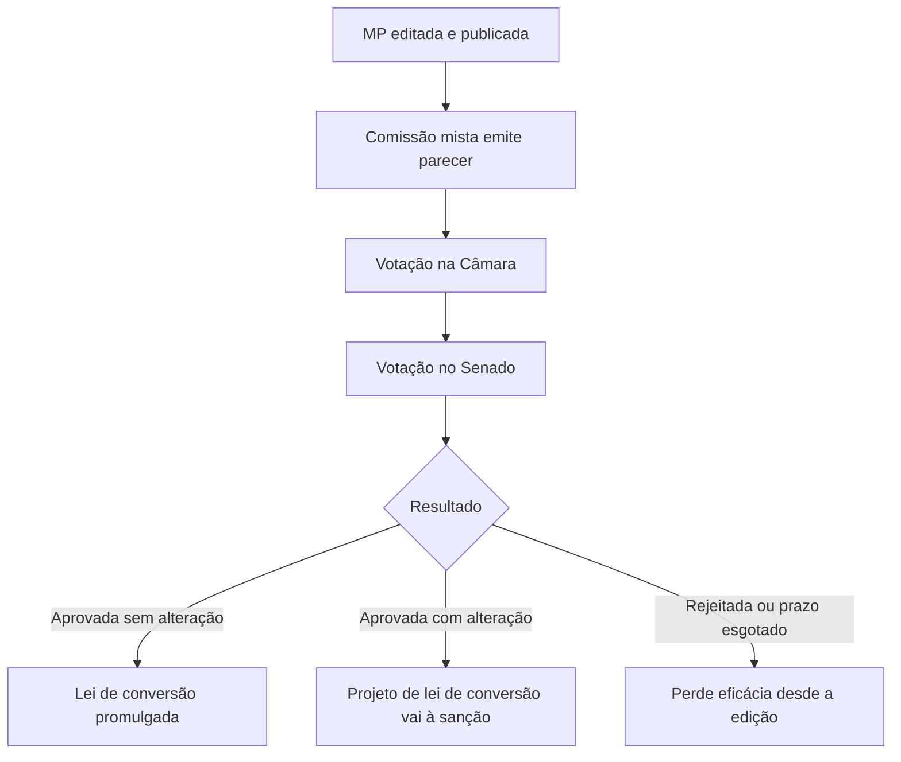

A Constituição prevê procedimentos próprios para três espécies normativas importantes: a emenda constitucional, a lei complementar e a medida provisória. Cada uma tem iniciativa, quórum e consequências diferentes da lei ordinária. As bancas gostam de comparar esses procedimentos entre si, porque as trocas de quórum, de prazo e de legitimado são simples de fazer e fáceis de errar. Este capítulo organiza o que muda em cada caso.

> [!objetivos]
> - Descrever iniciativa, votação, promulgação e irrepetibilidade da emenda constitucional.
> - Distinguir lei complementar e lei ordinária pelo quórum e pela matéria.
> - Descrever o rito da medida provisória, seus prazos e suas vedações.
> - Comparar os três procedimentos especiais em tabela.

## Emendas constitucionais

A Constituição de 1988 é **rígida**: ela só muda por um processo mais difícil que o de criação de leis. Esse processo está no art. 60 e tem iniciativa, deliberação e promulgação.

### Iniciativa

Podem propor uma emenda, ou PEC (proposta de emenda à Constituição):

- **um terço, no mínimo, dos membros da Câmara ou do Senado** (171 deputados ou 27 senadores);
- o **Presidente da República**;
- **mais da metade das Assembleias Legislativas**, cada uma se manifestando pela maioria relativa de seus membros.

Cinco características da iniciativa costumam ser cobradas:

1. **Não há iniciativa popular** para emenda, ao contrário do que ocorre com as leis.
2. **Não há iniciativa reservada:** qualquer legitimado pode propor emenda sobre qualquer assunto que não seja vedado.
3. **Os Municípios não participam**, nem para propor nem para votar, pois não têm representantes no Congresso.
4. **Os Estados participam** por meio das Assembleias Legislativas e do Senado.
5. **Não há Casa iniciadora obrigatória:** a PEC pode começar na Câmara ou no Senado.

> [!bizu]
> Para memorizar quem propõe emenda, use "1/3, Presidente e Assembleias": um terço de uma Casa, o chefe do Executivo federal e a maioria das Assembleias. O Judiciário, os Municípios e o povo não propõem.

### Deliberação

A PEC é discutida e votada em **dois turnos**, em cada Casa, e é aprovada se obtiver **três quintos** dos votos dos membros da Casa nos dois turnos. Em números, são **308 deputados** e **49 senadores**. Os mesmos números são obtidos arredondando 3/5 de 513 e de 81.

Como a Constituição não fala em Casa revisora para emendas, a segunda Casa trata o texto como se fosse novo e pode alterá-lo. O STF entende que o texto só precisa **voltar à Casa de origem** quando a alteração for **substancial**, isto é, quando muda o sentido da proposta. Mudanças de redação não exigem retorno.

### Promulgação e irrepetibilidade

Aprovada a emenda, quem a promulga são as **Mesas da Câmara e do Senado**, que lhe dão um número próprio de ordem (EC 1, EC 2 e assim por diante), distinto da numeração das leis. O Presidente da República não promulga nem sanciona, e a PEC não está sujeita a veto. É importante não confundir as Mesas das duas Casas, que se reúnem para promulgar a emenda, com a Mesa do Congresso Nacional.

> [!lei] CF, art. 60, § 5º
> A matéria constante de proposta de emenda rejeitada ou havida por prejudicada não pode ser objeto de nova proposta na mesma sessão legislativa.

A regra do § 5º é a **irrepetibilidade**. Ela é mais rígida que a do projeto de lei, que pode ser reapresentado na mesma sessão legislativa por proposta da maioria absoluta de uma das Casas. Para a emenda, não há exceção: a matéria só volta na sessão legislativa seguinte.

### Tabela do rito

| Etapa | Regra |
| --- | --- |
| Iniciativa | 1/3 de uma Casa, Presidente ou mais da metade das Assembleias |
| Votação | Dois turnos em cada Casa |
| Quórum | 3/5 dos membros, em ambos os turnos |
| Sanção ou veto | Não há |
| Promulgação | Mesas da Câmara e do Senado |
| Rejeitada | Nova proposta só na sessão legislativa seguinte |

Os limites ao poder de reforma, como as cláusulas pétreas e as circunstâncias em que a Constituição não pode ser emendada, são tratados no capítulo *Reforma constitucional, limites materiais e mutação constitucional*. Por ora, guarde apenas que o texto constitucional não pode mudar enquanto durar uma destas três situações de crise: intervenção federal, estado de defesa ou estado de sítio (art. 60, § 1º). Nesses períodos, a proposta pode tramitar, mas a emenda não pode ser promulgada.

> [!pegadinha]
> A banca diz que a emenda constitucional depende de sanção do Presidente, ou que pode ser proposta por iniciativa popular, ou que é promulgada pela Mesa do Congresso Nacional. Nada disso é verdade: não há sanção, a iniciativa popular não existe para emendas e quem promulga são as Mesas da Câmara e do Senado.

### Sessão legislativa e emendas nos Estados

A **sessão legislativa** é o período anual de funcionamento do Congresso, de 2 de fevereiro a 17 de julho e de 1º de agosto a 22 de dezembro. Já a **legislatura** dura quatro anos. A irrepetibilidade da PEC é medida pela sessão legislativa, e não pela legislatura: a proposta rejeitada em março de um ano pode voltar em fevereiro do ano seguinte.

Os Estados também têm constituições rígidas. Por simetria, elas devem seguir o quórum de **3/5** da Assembleia Legislativa para suas emendas. Uma Constituição estadual que previsse maioria absoluta, por exemplo, seria inconstitucional, porque a regra do processo de reforma federal é de reprodução obrigatória.

### Casos práticos de emenda

1. **Um grupo de 150 deputados apresenta uma PEC.** Não bastam: é preciso 1/3 da Câmara, ou seja, 171 deputados.
2. **A PEC é aprovada na Câmara em dois turnos, com 320 votos no primeiro e 300 no segundo.** Ela não está aprovada, pois exige-se 3/5 (308 votos) nos dois turnos.
3. **O Senado altera o texto de uma PEC, trocando uma palavra por sinônimo.** Não há mudança substancial, e a PEC não precisa voltar à Câmara.
4. **O Presidente da República resolve sancionar uma emenda aprovada pelo Congresso.** O ato é inócuo: a emenda não se submete à sanção e é promulgada pelas Mesas das duas Casas.
5. **Uma PEC é rejeitada em abril.** A mesma matéria só pode voltar em nova proposta na sessão legislativa seguinte.

## Leis complementares

A **lei complementar** regula matérias que a Constituição expressamente reservou a ela. A lei ordinária não pode tratar dessas matérias. A principal diferença é o **quórum**: a lei complementar é aprovada por **maioria absoluta** das duas Casas (art. 69), enquanto a lei ordinária exige maioria simples, desde que presente a maioria absoluta dos membros.

| Aspecto | Lei complementar | Lei ordinária |
| --- | --- | --- |
| Quórum de aprovação | Maioria absoluta | Maioria simples |
| Matéria | Apenas as que a Constituição reservou a ela | Residual: tudo que não exige lei complementar |
| Iniciativa | Segue o art. 61 | Segue o art. 61 |
| Sanção | Sim | Sim |
| Hierarquia | Não é superior à lei ordinária | Não é inferior |

Dois pontos precisam estar claros:

- **A reserva é expressa.** Só há reserva de lei complementar quando a Constituição usa essa expressão. Se o texto fala apenas em "lei", entende-se lei ordinária. Alguns exemplos de temas reservados: proteção contra despedida arbitrária (art. 7º, I), outros casos de inelegibilidade (art. 14, § 9º), normas gerais de direito tributário (art. 146), impostos novos além dos previstos (art. 154, I), estatuto da magistratura (art. 93), matérias financeiras como normas gerais de finanças públicas (art. 165, § 9º).
- **Não há hierarquia** entre lei complementar e ordinária. O que separa as duas é a **matéria** e o **quórum**. Se uma lei ordinária invade tema reservado à complementar, ela é inconstitucional por vício formal. E se uma lei complementar trata de assunto que poderia ser regulado por lei ordinária, ela vale como **lei ordinária**, e uma lei ordinária posterior pode revogá-la. O STF decidiu assim em relação à lei que instituiu a Cofins, tema clássico das provas.

A tabela lista alguns assuntos que a Constituição reserva expressamente à lei complementar. Em prova, o aluno deve reconhecer que, nesses temas, a lei ordinária não serve.

| Assunto | Dispositivo |
| --- | --- |
| Proteção da relação de emprego contra despedida arbitrária | Art. 7º, I |
| Outros casos de inelegibilidade e prazos de cessação | Art. 14, § 9º |
| Estatuto da Magistratura | Art. 93 |
| Normas gerais em matéria tributária | Art. 146 |
| Impostos não previstos na Constituição (competência residual) | Art. 154, I |
| Normas gerais de finanças públicas e do ciclo orçamentário | Art. 165, § 9º |
| Organização e estatuto do Ministério Público | Art. 128, § 5º |

> [!exemplo]
> Uma lei complementar federal cria regras sobre a organização do Ministério Público da União e, no mesmo texto, fixa o horário de funcionamento de um órgão administrativo. A primeira parte é matéria de lei complementar. A segunda é matéria comum, e uma lei ordinária posterior pode alterá-la sem observar o quórum qualificado.

> [!atencao]
> Em prova, a regra para decidir é sempre **matéria reservada, quórum e iniciativa**. O fato de uma norma ter sido aprovada por maioria absoluta não a torna "complementar" se a matéria não era reservada a ela.

## Decretos legislativos e resoluções

Duas espécies do art. 59 usam o processo especial e não passam pela sanção: o decreto legislativo e a resolução. A Constituição não descreve o rito detalhado delas, que fica nos regimentos internos, mas fixa o que cabe a cada uma.

- **Decreto legislativo:** trata das matérias de competência **exclusiva do Congresso Nacional** (art. 49), aprovadas pelas duas Casas. Exemplos: aprovar tratados internacionais assinados pelo Presidente, sustar atos do Executivo que ultrapassem o poder de regulamentar ou os limites da delegação, julgar as contas do Presidente da República e fiscalizar atos do Executivo, inclusive os da administração indireta. A fiscalização contábil, financeira e orçamentária é exercida com o auxílio dos **Tribunais de Contas** (art. 71), o que liga o decreto legislativo ao controle externo.
- **Resolução:** trata das matérias de competência **privativa** da Câmara, do Senado ou do Congresso, como a organização interna de cada Casa (arts. 51 e 52) e a delegação para o Presidente elaborar lei delegada.

| Espécie | Alcance | Promulgação |
| --- | --- | --- |
| Decreto legislativo | Competência exclusiva do Congresso (art. 49) | Presidente do Senado, como Presidente do Congresso |
| Resolução do Congresso | Matérias de interesse comum, como a delegação legislativa | Presidente do Senado |
| Resolução da Câmara ou do Senado | Competência privativa de cada Casa | Presidente da Casa |

Como esses atos não têm sanção, o Presidente da República não tem como vetá-los. Isso é uma forma de separação de Poderes: o Congresso decide sozinho sobre os temas que a Constituição lhe reservou.

## Medidas provisórias

**Medida provisória (MP)** é o ato do Presidente da República com força de lei, adotado em caso de **relevância e urgência** (art. 62). Ela entra em vigor na data da publicação e produz efeitos desde logo, mas precisa ser convertida em lei pelo Congresso. Por ser uma espécie de lei provisória, ela tem **prazo**.

### Pressupostos e controle

A relevância e a urgência são pressupostos de natureza política, avaliados primeiro pelo Presidente e depois pelo Congresso, que faz um juízo prévio sobre eles antes de analisar o mérito (art. 62, § 5º). O Judiciário só revê esses pressupostos em casos de **abuso evidente**.

### Vedações

A MP não pode tratar de certos assuntos (art. 62, § 1º):

- nacionalidade, cidadania, direitos políticos, partidos políticos e direito eleitoral;
- direito penal, processual penal e processual civil;
- organização do Judiciário e do Ministério Público, carreira e garantias de seus membros;
- leis do ciclo orçamentário (plano plurianual, diretrizes e orçamento) e créditos suplementares, com a ressalva do crédito extraordinário, que a Constituição admite por MP (art. 167, § 3º);
- sequestro de bens, poupança popular ou qualquer outro ativo financeiro;
- matéria reservada à lei complementar;
- tema já disciplinado em projeto de lei aprovado pelo Congresso e pendente de sanção ou veto.

Há ainda uma vedação do art. 246: não se pode usar MP para regulamentar artigo da Constituição alterado por emenda promulgada a partir de 1995.

> [!bizu] Matérias vedadas
> Agrupe em quatro blocos: **direitos políticos e eleições** (nacionalidade, cidadania, partidos, eleitoral); **direito penal e processos** (penal, processual penal e processual civil); **organização e dinheiro** (Judiciário, MP, orçamento, bloqueio de poupança); e **conflitos de espécie** (lei complementar e projeto já aprovado e pendente de sanção).

### Prazo e tramitação

O prazo de vigência da MP é de **60 dias**, prorrogável **uma vez** por igual período. Ele conta a partir da publicação e **fica suspenso durante o recesso** do Congresso. A tramitação segue estas regras:

1. A **comissão mista** de deputados e senadores examina a MP e emite parecer.
2. A votação **começa pela Câmara**.
3. Se a MP não for apreciada em **45 dias**, entra em **regime de urgência** em cada Casa: ficam sobrestadas, ou "trancadas", as demais deliberações legislativas da Casa em que ela estiver, até que seja votada.
4. Se o Congresso rejeitar a MP ou deixar passar o prazo, ela **perde a eficácia desde a edição**, e o Congresso deve disciplinar por decreto legislativo as relações jurídicas surgidas. Se o decreto não for editado em 60 dias, as relações constituídas durante a vigência da MP permanecem regidas por ela (art. 62, § 11).
5. Se o Congresso alterar o texto, aprova um **projeto de lei de conversão**, que vai à sanção. A MP continua integralmente em vigor até a sanção ou o veto do projeto (art. 62, § 12).

### Outras regras importantes

- **Reedição:** é vedada, na mesma sessão legislativa, a reedição de MP que tenha sido rejeitada ou perdido a eficácia por decurso de prazo (art. 62, § 10).
- **Impostos:** a MP que institui ou aumenta imposto só produz efeitos no exercício seguinte se for convertida em lei até o último dia do exercício em que foi editada. Ficam fora dessa regra os impostos de importação, de exportação, sobre produtos industrializados, sobre operações financeiras e os extraordinários de guerra (art. 62, § 2º).
- **Convocação extraordinária:** se o Congresso é convocado em recesso, as MPs em vigor entram automaticamente na pauta da convocação (art. 57, § 8º).

> [!pegadinha]
> A banca afirma que a MP perde a eficácia depois de 30 dias, ou que o prazo se conta em dias corridos sem suspensão no recesso, ou que a MP rejeitada pode ser reeditada na mesma sessão legislativa. O prazo é de 60 dias, prorrogável por mais 60, suspenso no recesso, e a reedição na mesma sessão legislativa é vedada.

### Medida provisória na prática

Um exemplo fixa os prazos. Suponha que uma MP seja publicada em 10 de agosto, com o Congresso em funcionamento normal.

- Em **9 de outubro**, completam-se 60 dias, e a MP é prorrogada automaticamente por mais 60 dias, desde que não tenha sido votada nas duas Casas.
- No **45º dia** (24 de setembro), se ela ainda não foi votada, passa a trancar a pauta da Casa em que estiver.
- Se o Congresso não a votar até o fim da prorrogação, ela **perde a eficácia desde a edição**. As relações constituídas nesse período são regidas pelo decreto legislativo do Congresso e, se este não for editado em 60 dias, pela própria MP.
- Se o recesso de fim de ano começar antes do fim do prazo, a contagem **fica suspensa**.

Outro ponto de prova é a MP estadual. O STF admite que a Constituição do Estado preveja medidas provisórias editadas pelo governador, desde que observadas as regras básicas do modelo federal. Isso mostra a força do princípio da simetria no processo legislativo.

> [!atencao] MP não é lei ordinária comum
> A MP tem **força de lei**, mas não passa pelas fases de iniciativa, sanção e promulgação das leis. Ela nasce de ato unilateral do Presidente. Só depois, na conversão, o Congresso participa. Por isso, a MP sofre controle político e jurídico a qualquer momento e pode ser suspensa ou revogada.

## Mapa do capítulo

A tabela compara os três procedimentos especiais.

| Aspecto | Emenda constitucional | Lei complementar | Medida provisória |
| --- | --- | --- | --- |
| Quem inicia | 1/3 de uma Casa, Presidente, Assembleias | Art. 61 | Presidente da República |
| Quórum | 3/5, em dois turnos | Maioria absoluta | Maioria simples, na conversão |
| Sanção ou veto | Não há | Há | Só no projeto de lei de conversão |
| Prazo | Sem prazo | Sem prazo | 60 dias, prorrogáveis por mais 60 |
| Rejeitada | Fica para a sessão seguinte | Pode voltar com maioria absoluta | Não pode ser reeditada na mesma sessão |

### Para fixar

- A Constituição é rígida e só muda por emenda, proposta por 1/3 de uma Casa, pelo Presidente ou por mais da metade das Assembleias.
- A PEC é votada em dois turnos, em cada Casa, com 3/5 dos membros (308 deputados e 49 senadores).
- A emenda é promulgada pelas Mesas da Câmara e do Senado, não passa por sanção e é irrepetível na mesma sessão legislativa.
- A lei complementar exige maioria absoluta e só vale para matéria expressamente reservada.
- Não há hierarquia entre lei complementar e lei ordinária; o que as separa é a matéria.
- A medida provisória exige relevância e urgência e tem força de lei desde a publicação.
- A MP vale por 60 dias, prorrogáveis por mais 60, com suspensão no recesso.
- Aos 45 dias sem votação, a MP tranca a pauta da Casa em que estiver.
- MP rejeitada ou vencida perde a eficácia desde a edição; não pode ser reeditada na mesma sessão legislativa.
- A MP não trata de penal, processual, eleitoral, orçamento, carreiras do Judiciário e MP, nem de matéria de lei complementar.
