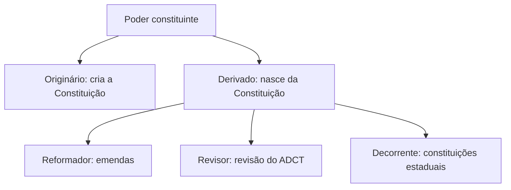

Uma Constituição escrita é feita para durar, mas a sociedade muda. Por isso o próprio texto prevê como pode ser alterado. Este capítulo mostra os caminhos da mudança formal, que são a emenda e a revisão constitucional, e o caminho da mudança informal, que é a mutação constitucional. Explica também os limites do poder de reforma: o que a emenda não pode tocar, quando não pode ser promulgada e como o Judiciário controla o processo. É um dos assuntos em que o aluno mais precisa separar conceitos parecidos.

> [!objetivos]
> - Distinguir poder constituinte originário, derivado reformador, derivado decorrente e derivado revisor.
> - Comparar a emenda e a revisão constitucional.
> - Classificar as limitações ao poder de reforma e citar as cláusulas pétreas.
> - Explicar o controle judicial do processo de reforma e o conceito de mutação constitucional.

## Poder constituinte e reforma da Constituição

**Poder constituinte** é a força que cria e organiza a Constituição. Ele se divide em dois grandes tipos.

- **Originário:** cria uma nova ordem constitucional, rompe com a anterior e não está sujeito a limites jurídicos prévios. É inicial, autônomo e incondicionado.
- **Derivado:** nasce da própria Constituição e se subordina a ela. Atua dentro de limites e condições.

O poder constituinte derivado tem três manifestações, e a prova gosta de cobrar o nome de cada uma.

| Poder | O que faz | Exemplo |
| --- | --- | --- |
| Reformador | Altera o texto da Constituição existente | As emendas constitucionais do art. 60 |
| Decorrente | Elabora as constituições dos Estados | A Constituição de Pernambuco |
| Revisor | Fez uma revisão geral única prevista no ADCT | As seis emendas de revisão de 1994 |

O poder reformador e o revisor são espécies do que a doutrina chama de **reforma constitucional**. O poder decorrente é o dos Estados-membros, que podem se organizar por constituições próprias, mas devem respeitar os princípios da Constituição Federal (art. 25 e art. 11 do ADCT).

### Poder originário e poder decorrente

O **poder constituinte originário** tem as seguintes características, que a prova costuma pedir como lista:

- **Inicial:** nenhum outro poder o precede; ele funda a ordem jurídica.
- **Ilimitado juridicamente:** não se submete a normas anteriores, embora esteja sujeito a valores sociais e históricos.
- **Incondicionado:** não depende de forma ou procedimento pré-fixado.
- **Autônomo:** decide livremente o conteúdo da nova Constituição.

O **poder decorrente**, por sua vez, é **derivado** (nasce da Constituição Federal), **subordinado** (deve respeitar a Constituição Federal) e **condicionado** (segue o procedimento que ela fixa, como o quórum de 3/5 para emendas estaduais). Os Estados, ao organizar suas constituições, devem obedecer aos princípios que a doutrina classifica como **sensíveis** (cuja violação autoriza a intervenção federal), **estabelecidos** (normas de organização que limitam os Estados) e **extensíveis** (normas federais que se estendem aos entes).

## Emenda e revisão constitucional

A reforma da Constituição pode ocorrer por dois procedimentos formais. O primeiro é a **emenda constitucional**, que continua a ser o único usado atualmente. O segundo foi a **revisão constitucional**, que existiu uma única vez.

### A emenda constitucional

O procedimento da emenda está no art. 60, e o capítulo anterior detalhou seu rito: iniciativa por um terço de uma Casa, pelo Presidente ou por mais da metade das Assembleias; votação em dois turnos, em cada Casa, com três quintos; promulgação pelas Mesas da Câmara e do Senado. A emenda pode ser aprovada a qualquer tempo, desde que respeite os limites que a Constituição impõe. Em razão da simetria, o procedimento federal é de **reprodução obrigatória** nas Constituições estaduais, que não podem facilitar nem dificultar a reforma.

### A revisão constitucional

A **revisão** foi um mecanismo transitório, previsto no art. 3º do ADCT: seria realizada cinco anos depois da promulgação, por **maioria absoluta** dos congressistas, reunidos em **sessão unicameral**. A ideia era permitir ajustes amplos em 1993, ano em que haveria plebiscito sobre forma e sistema de governo. Por ser procedimento mais simples, aprovou-se em 1994 um conjunto de seis emendas de revisão, promulgadas pela **Mesa do Congresso Nacional**. O prazo acabou, e a revisão não pode ser repetida. Os Estados não tinham revisão.

| Aspecto | Emenda | Revisão |
| --- | --- | --- |
| Previsão | Art. 60 | ADCT, art. 3º |
| Tempo | A qualquer momento | Uma vez, após cinco anos |
| Quórum | 3/5, em dois turnos | Maioria absoluta, em turno único |
| Sessão | Cada Casa separadamente | Unicameral |
| Promulgação | Mesas da Câmara e do Senado | Mesa do Congresso Nacional |
| Situação hoje | Em uso | Esgotada |

> [!bizu]
> **Emenda = 3/5 em dois turnos, Mesas (plural) da Câmara e do Senado. Revisão = maioria absoluta, sessão unicameral, Mesa (singular) do Congresso.** Quem lembra do plural e do singular não troca a promulgação.

> [!pegadinha]
> A banca fala em "revisão constitucional" como se fosse um procedimento ainda disponível, ou afirma que ela exige quórum de três quintos. A revisão do ADCT foi um evento único, de maioria absoluta e sessão unicameral, que já se esgotou.

## Limitações ao poder de reforma

O poder de reforma é limitado. A doutrina separa quatro tipos de limitações.

| Tipo | Ideia | Na CF/88 |
| --- | --- | --- |
| Temporais | Proíbem mudar o texto por um prazo | Não há |
| Circunstanciais | Proíbem mudar em momentos de crise | Sim, art. 60, § 1º |
| Formais (procedimentais) | Regras de iniciativa, votação e promulgação | Sim, art. 60, I a III e §§ 2º, 3º e 5º |
| Materiais | Assuntos que a emenda não pode abolir | Sim, art. 60, § 4º |

### Limitações temporais

Uma limitação temporal congela o texto por determinado período. A Constituição de 1988 **não tem** esse limite: desde a promulgação, qualquer parte do texto, desde que respeitados os demais limites, pode ser emendada. A Constituição do Império, de 1824, é o exemplo clássico de limitação temporal.

### Limitações circunstanciais

Enquanto durar uma **intervenção federal**, um **estado de defesa** ou um **estado de sítio**, o texto constitucional fica "congelado" (art. 60, § 1º). Nessas situações de instabilidade, ele é protegido de mudanças feitas sob pressão. A leitura majoritária é que a PEC pode ser **apresentada, discutida e votada**, mas a emenda aprovada **não pode ser promulgada** enquanto a crise durar.

> [!atencao] Qual intervenção
> A proibição vale para a intervenção **federal**, decretada pela União. A intervenção de um Estado em um de seus Municípios não impede a reforma da Constituição Federal.

### Limitações formais

São as regras do rito: iniciativa restrita aos legitimados do art. 60, votação em dois turnos com 3/5 dos membros, promulgação pelas Mesas e **irrepetibilidade** da proposta rejeitada ou prejudicada na mesma sessão legislativa (art. 60, § 5º). A prática reconhece ainda a "PEC paralela": quando o Senado altera uma PEC, ele pode promulgar a parte que as duas Casas já aprovaram e devolver o resto à Câmara, para não retardar a parte consensual. O STF aceitou esse procedimento, pois a parte promulgada manteve seu sentido.

### Rito entre as Casas: o vaivém da PEC

Na PEC, as duas Casas precisam chegar a um texto igual. Se a segunda Casa aprova uma emenda que **altera o sentido** da proposta, o texto volta à primeira Casa, que o examina por inteiro e pode mudá-lo de novo. O processo pode se repetir várias vezes, num vaivém que a prática chama de "pingue-pongue". Isso se explica porque, ao contrário do projeto de lei, a PEC não tem Casa iniciadora fixa nem Casa que apenas revise: as duas têm o mesmo poder sobre o texto.

Para fugir do vaivém, o Congresso criou a **PEC paralela**. A Casa que discorda de parte da proposta divide o texto em dois: a parte em que as duas Casas concordam é promulgada, e a parte controvertida volta para a Casa de origem como nova proposta. O STF considerou válida essa solução, desde que o trecho promulgado conserve sentido próprio.

> [!atencao] Retorno só quando há mudança de sentido
> Alterações de redação, que não mudam o sentido da proposta, não obrigam o retorno. A necessidade de volta à Casa de origem depende de mudança **substancial**.

### Tratados de direitos humanos com valor de emenda

A Constituição prevê que os **tratados e convenções internacionais sobre direitos humanos** aprovados em cada Casa do Congresso, em **dois turnos, por três quintos dos votos**, serão **equivalentes às emendas constitucionais** (art. 5º, § 3º, incluído pela EC 45/2004). A Convenção sobre os Direitos das Pessoas com Deficiência e seu protocolo facultativo foram aprovados por esse rito e, por isso, têm status de emenda. O tratado aprovado pelo rito comum tem, segundo o STF, valor supralegal: acima das leis, mas abaixo da Constituição.

| Tipo de tratado | Rito de aprovação | Posição |
| --- | --- | --- |
| Direitos humanos aprovado como emenda | Dois turnos, 3/5 em cada Casa | Equivale a emenda constitucional |
| Direitos humanos aprovado pelo rito comum | Maioria simples | Supralegal |
| Demais tratados | Decreto legislativo e ratificação | Lei ordinária |

### Limitações materiais: as cláusulas pétreas

As **limitações materiais** protegem núcleos da Constituição. O art. 60, § 4º, veda sequer a deliberação de proposta de emenda **tendente a abolir** quatro núcleos:

1. a **federação** (forma federativa de Estado);
2. o **voto**, que deve ser direto, secreto, universal e periódico;
3. a **divisão dos Poderes**;
4. os **direitos e garantias individuais**.

> [!lei] CF, art. 60, § 4º
> Não será objeto de deliberação a proposta de emenda tendente a abolir: I - a forma federativa de Estado; II - o voto direto, secreto, universal e periódico; III - a separação dos Poderes; IV - os direitos e garantias individuais.

Os pontos que mais caem em provas são:

- O verbo é **abolir**. A emenda pode **modificar** a matéria, até para reforçá-la, desde que não destrua seu núcleo essencial. A proteção atinge a proposta, e não apenas a emenda aprovada: o parlamentar tem direito de não ver a deliberação de PEC que ofenda uma cláusula pétrea.
- A lista é **taxativa**, mas a interpretação é ampla. Os **direitos individuais** não se limitam ao art. 5º. O STF já reconheceu como cláusula pétrea a garantia da anterioridade tributária, que está fora do rol do art. 5º (ADI 939).
- Há discussão sobre os **direitos sociais** e os coletivos. A doutrina majoritária inclui os direitos fundamentais de todas as espécies, mas a questão precisa ser lida no contexto.
- O voto é um núcleo, mas **a obrigatoriedade do voto não é cláusula pétrea**, pois o dispositivo protege o voto direto, secreto, universal e periódico, e não o voto obrigatório.

A doutrina também aponta limites **implícitos**: o titular do poder constituinte, o titular do poder de reforma e o próprio procedimento do art. 60 não podem ser alterados de forma a facilitar a reforma. A discussão do tema é teórica, e a prova costuma cobrar os limites expressos.

> [!pegadinha]
> A banca afirma que as cláusulas pétreas impedem qualquer alteração dos direitos individuais. O art. 60, § 4º, proíbe **abolir**, e não alterar. Uma emenda que amplia um direito individual é válida.

> [!exemplo]
> Uma PEC pretende acabar com o voto direto para Presidente e transferir a escolha ao Congresso. A proposta é inconstitucional, pois abole o voto direto. Já uma PEC que muda a data da eleição ou o número de mandatos de um cargo não ofende o núcleo do voto direto, secreto, universal e periódico.

### Como analisar uma PEC

Para decidir se uma proposta é válida, siga uma sequência de perguntas:

1. **Quem propôs?** Só os três legitimados do art. 60 podem propor. O cidadão, o Município e o Judiciário não podem.
2. **O momento é permitido?** Se há intervenção federal, estado de defesa ou estado de sítio, a emenda não pode ser promulgada.
3. **O rito foi seguido?** Dois turnos em cada Casa, com 3/5 dos membros em ambos.
4. **O conteúdo abole algum núcleo protegido?** Se sim, a proposta nem pode ser deliberada.
5. **A matéria já foi rejeitada nesta sessão legislativa?** Se sim, não pode voltar.

| Proposta | Válida? | Motivo |
| --- | --- | --- |
| Ampliar o prazo de licença-maternidade na Constituição | Sim | Amplia um direito, não o abole |
| Eliminar o voto secreto nas eleições | Não | Abole um atributo do voto protegido |
| Transformar o Brasil em Estado unitário | Não | Abole a forma federativa |
| Submeter o Judiciário ao controle do Executivo | Não | Fere a separação dos Poderes |
| Mudar o número de deputados por Estado | Sim | Não abole a federação nem a representação |

## Controle judicial da reforma

O Judiciário controla o processo de reforma de duas formas.

- **Controle preventivo:** o parlamentar impetra mandado de segurança no STF contra a tramitação de PEC que viole as regras do rito ou seja tendente a abolir cláusula pétrea. O STF julga o pedido, mas só o parlamentar em exercício tem legitimidade.
- **Controle repressivo:** depois de promulgada a emenda, é possível ajuizar ação direta de inconstitucionalidade, e o STF pode declarar que ela viola uma cláusula pétrea ou uma regra do procedimento. O tribunal já declarou inconstitucionais dispositivos de emendas constitucionais por essas razões.

O parâmetro do controle é a **Constituição originária** e suas cláusulas pétreas. O STF não aceita, porém, ação que alegue inconstitucionalidade de norma da própria Constituição originária. Essa ideia, a de "normas constitucionais inconstitucionais", é rejeitada: o poder originário não está sujeito a limites jurídicos.

### Casos práticos de controle

1. **Um cidadão impetra mandado de segurança contra uma PEC por violar cláusula pétrea.** Ele não tem legitimidade. Apenas parlamentar em exercício pode usar essa via, pois defende o seu direito ao devido processo legislativo.
2. **Uma emenda é promulgada sem a votação em dois turnos.** Cabe ação direta de inconstitucionalidade, por vício formal.
3. **Uma emenda é promulgada durante estado de sítio.** A emenda é inválida por vício formal, pois descumpre a limitação circunstancial.
4. **Alguém sustenta que um artigo do texto original de 1988 é inconstitucional por violar princípio suprapositivo.** A tese não é aceita: o STF não controla as normas do poder originário.

## Mutação constitucional

A **mutação constitucional** é a mudança de sentido de uma norma sem alterar o seu texto. É um processo **informal**, ao contrário da emenda e da revisão. A doutrina a atribui ao **poder constituinte difuso**, que se manifesta na prática política e social, no costume e, principalmente, na interpretação dos tribunais.

Características e limites:

- **Não altera as palavras** do texto, mas muda seu alcance ou seu sentido.
- Surge da **evolução social**, de mudança de valores ou de nova interpretação do tribunal.
- Tem **limites:** não pode contrariar o texto claro da Constituição nem as cláusulas pétreas. A mutação que vai contra o sentido possível das palavras é considerada inconstitucional.

A mutação pode ocorrer por **interpretação judicial** (a mais comum, feita pelo STF), por **costume constitucional** (prática reiterada e aceita pelos agentes públicos) e por mudança na **realidade social** que dá novo conteúdo ao texto. Ela se diferencia da **reforma** porque é um fenômeno, e não um procedimento: não há quórum, turnos nem promulgação.

Um exemplo conhecido é o reconhecimento pelo STF, em 2011, da união estável entre pessoas do mesmo sexo como entidade familiar (ADPF 132 e ADI 4.277), numa leitura do art. 226, § 3º, que não alterou o texto, mas ampliou o sentido de "entidade familiar".

| Aspecto | Reforma (emenda) | Mutação |
| --- | --- | --- |
| Formalidade | Formal | Informal |
| Texto | Altera as palavras | Mantém as palavras |
| Autor | Poder constituinte derivado | Poder constituinte difuso |
| Limites | Art. 60 | Texto da Constituição e cláusulas pétreas |

### Estados e Municípios diante da reforma

O poder de reforma do art. 60 vale para a Constituição Federal. Os Estados fazem suas próprias emendas, dentro dos limites que a simetria impõe. As Constituições estaduais devem prever rigidez igual à federal: iniciativa de um grupo qualificado, votação em dois turnos e quórum de 3/5 da Assembleia. Os Municípios, por sua vez, não participam do processo de emenda federal e se organizam por lei orgânica, votada em dois turnos e aprovada por dois terços dos membros da Câmara Municipal.

| Ente | Instrumento | Quórum |
| --- | --- | --- |
| União | Emenda à Constituição Federal | 3/5, dois turnos |
| Estado | Emenda à Constituição estadual | 3/5 da Assembleia, em dois turnos |
| Município | Lei orgânica | 2/3 da Câmara, em dois turnos |

A revisão do ADCT não valia para os Estados, pois só existiu porque a Assembleia Constituinte deixou em aberto a escolha da forma e do sistema de governo.

## Como a banca cobra este assunto

Os temas do capítulo repetem alguns padrões nas provas:

- **Troca de quórum:** emenda exige 3/5 em dois turnos; revisão exigiu maioria absoluta, em turno único.
- **Troca de promulgação:** emenda é promulgada pelas Mesas da Câmara e do Senado; revisão foi promulgada pela Mesa do Congresso.
- **Cláusula pétrea como proibição de mudar:** a proibição é de abolir. Ampliar ou aperfeiçoar a matéria é permitido.
- **Cláusulas pétreas além da lista:** a lista do art. 60, § 4º, é taxativa, mas a interpretação dos direitos individuais pode alcançar direitos fora do art. 5º.
- **Limites circunstanciais:** a banca cita "intervenção estadual" no lugar de intervenção federal, ou inclui o estado de emergência, que não existe no texto.
- **Mutação:** a banca descreve a mutação como mudança do texto, quando ela muda o sentido sem alterar as palavras.
- **Iniciativa popular de emenda:** não existe no texto da Constituição Federal, segundo a doutrina majoritária.

> [!atencao] Natureza da emenda
> A emenda aprovada passa a ser parte do texto constitucional e tem a mesma hierarquia das normas originárias, com um detalhe: ela pode ser controlada pelo STF quanto às cláusulas pétreas e ao rito, o que não ocorre com as normas do poder originário.

## Mapa do capítulo

A tabela organiza as limitações e os mecanismos de mudança.

| Tema | Ponto central | Cuidado |
| --- | --- | --- |
| Poder derivado | Reformador, decorrente e revisor | O decorrente cria as constituições estaduais |
| Emenda | 3/5, dois turnos, Mesas da Câmara e do Senado | Obedece às limitações do art. 60 |
| Revisão | Maioria absoluta, unicameral, Mesa do Congresso | Esgotada; ocorreu em 1993-1994 |
| Circunstanciais | Intervenção federal, estado de defesa e de sítio | PEC pode tramitar, mas não ser promulgada |
| Materiais | Forma federativa, voto, separação dos Poderes, direitos individuais | Veda abolir, não alterar |
| Temporais | Inexistentes na CF/88 | A Constituição de 1824 tinha |
| Mutação | Muda o sentido, não o texto | Tem limites |

### Para fixar

- O poder constituinte derivado tem três manifestações: reformador, decorrente e revisor.
- A reforma formal da Constituição ocorre hoje só por emenda; a revisão do ADCT, art. 3º, foi evento único, por maioria absoluta e sessão unicameral.
- A emenda precisa de 3/5 em dois turnos, em cada Casa, e é promulgada pelas Mesas da Câmara e do Senado.
- A Constituição não admite limitação temporal; tem limitações circunstanciais, formais e materiais.
- Durante intervenção federal, estado de defesa ou estado de sítio, a Constituição não pode ser alterada.
- A matéria de PEC rejeitada ou prejudicada não pode voltar na mesma sessão legislativa.
- As cláusulas pétreas protegem quatro núcleos: a federação, o voto (direto, secreto, universal e periódico), a divisão de Poderes e os direitos individuais.
- A proibição é de abolir; emenda pode modificar ou ampliar direitos.
- O mandado de segurança de parlamentar é o controle preventivo; a ADI é o repressivo.
- A mutação constitucional muda o sentido da norma sem alterar o texto e está sujeita a limites.
