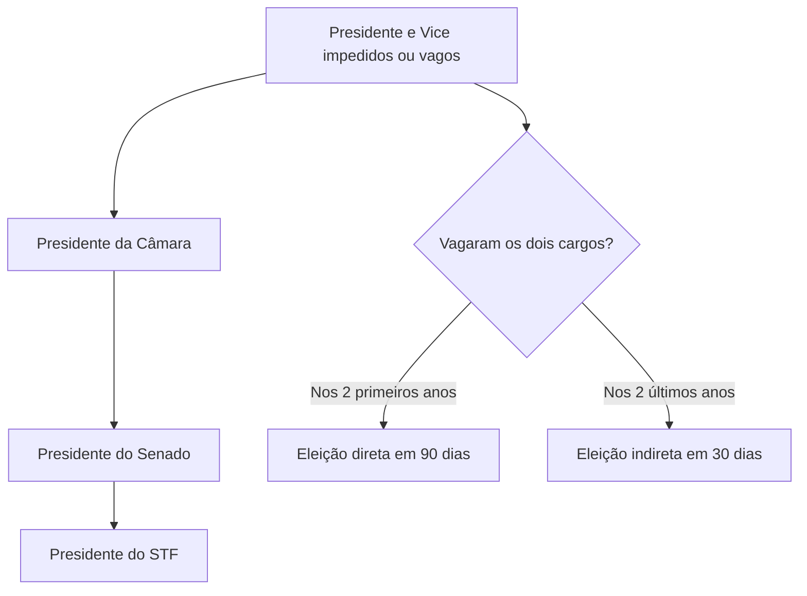

O Poder Executivo é o que administra o País e conduz a política externa. Antes de estudar suas atribuições, é preciso saber como o Brasil se organiza: qual é a forma e o sistema de governo, quem exerce a chefia do Estado e do governo e como o Presidente chega ao cargo. Este capítulo também explica o que acontece quando o Presidente não pode exercer o mandato, seja por um período curto (impedimento), seja de forma definitiva (vacância). Esses assuntos aparecem com frequência em provas, em especial a linha de substituição e a regra da eleição que cumpre o restante do mandato.

> [!objetivos]
> - Diferenciar forma de Estado, forma de governo, sistema de governo e regime político.
> - Distinguir chefia de Estado e chefia de governo.
> - Descrever os requisitos, a eleição, a posse e o mandato do Presidente da República.
> - Aplicar as regras de impedimento, vacância, substituição e sucessão.

## Forma e sistema de governo

Quatro expressões parecidas são cobradas juntas, e é fundamental distingui-las.

| Conceito | Pergunta que responde | No Brasil |
| --- | --- | --- |
| Forma de Estado | Como o poder se distribui no território? | Federação (art. 1º) |
| Forma de governo | Como o governante é escolhido e por quanto tempo? | República |
| Sistema de governo | Como se relacionam Executivo e Legislativo? | Presidencialismo |
| Regime político | Qual é o modo de exercício do poder? | Democracia |

Na **república**, os governantes são eleitos, exercem o mandato por tempo determinado e respondem por seus atos. Na monarquia, o cargo é, em regra, vitalício e hereditário. No **presidencialismo**, o chefe do Executivo é eleito pelo povo, tem mandato fixo e não depende de voto de confiança do Parlamento. No **parlamentarismo**, o governo depende da confiança do Parlamento e pode cair por moção de desconfiança.

A escolha entre monarquia e república e entre presidencialismo e parlamentarismo foi levada ao povo em **plebiscito**, em 21 de abril de 1993, conforme determinou o art. 2º do ADCT. O povo optou pela **república** e pelo **presidencialismo**.

### Chefia de Estado e chefia de governo

O Presidente da República acumula duas chefias.

- **Chefe de Estado:** representa o País nas relações internacionais e simboliza a unidade nacional. Exemplos: receber embaixadores, assinar tratados, conceder condecorações.
- **Chefe de governo:** conduz a administração e a política interna. Exemplos: nomear ministros, dirigir a administração federal, enviar o orçamento ao Congresso.

No parlamentarismo, as chefias são separadas: o rei ou presidente exerce a chefia de Estado, e o primeiro-ministro, a de governo. No presidencialismo brasileiro, elas se concentram numa só pessoa.

### Funções do Poder Executivo

Pelo art. 76, o Poder Executivo cabe ao Presidente da República, que conta com o **auxílio dos Ministros de Estado**. As funções se dividem em:

- **Típicas:** administrar e governar, o que inclui chefia de Estado e de governo, execução das leis e prestação de serviços públicos.
- **Atípicas:** editar medidas provisórias, que têm força de lei (função legislativa), e julgar processos administrativos (função de natureza jurisdicional, sem coisa julgada).

> [!bizu]
> Diga "Estado" para política externa e símbolo de unidade; diga "governo" para administração e política interna. O Presidente brasileiro é as duas coisas ao mesmo tempo.

## Eleição, posse e mandato

### Requisitos

Para ser Presidente da República, a pessoa precisa ser **brasileira nata** (art. 12, § 3º, I), estar no pleno exercício dos direitos políticos, estar alistada como eleitora, ter domicílio eleitoral na circunscrição, ser filiada a partido político e ter **idade mínima de 35 anos** (art. 14, § 3º). O Vice-Presidente tem os mesmos requisitos. A idade varia conforme o cargo, como mostra a tabela.

| Cargo | Idade mínima |
| --- | --- |
| Presidente, Vice-Presidente e Senador | 35 anos |
| Governador e Vice-Governador | 30 anos |
| Deputado federal, estadual ou distrital, Prefeito, Vice-Prefeito e juiz de paz | 21 anos |
| Vereador | 18 anos |

Como regra, a idade mínima é verificada na **data da posse**, e não na da eleição (Lei 9.504/1997, art. 11, § 2º).

### Eleição

A eleição do Presidente e do Vice é simultânea. O **primeiro turno** ocorre no **primeiro domingo de outubro** e o **segundo turno**, se houver, no **último domingo de outubro**, do ano anterior ao do término do mandato (art. 77). A chapa é única: eleito o Presidente, elege-se o Vice registrado com ele.

Será eleito Presidente o candidato que obtiver **maioria absoluta dos votos válidos**, sem contar os brancos e os nulos. Se ninguém a obtiver, haverá segundo turno entre os dois mais votados, em até **20 dias** da proclamação do resultado. Se um dos candidatos do segundo turno morrer, desistir ou ficar impedido antes da votação, o de maior votação entre os remanescentes é convocado. Havendo empate, vale o **mais idoso**.

### Posse e mandato

A posse ocorre em **sessão do Congresso Nacional**, quando o Presidente e o Vice prestam o compromisso de manter, defender e cumprir a Constituição (art. 78). Se, passados **10 dias** da data fixada, o eleito não tiver assumido, salvo motivo de força maior, o cargo é declarado vago.

O mandato é de **4 anos** e começa em **5 de janeiro** do ano seguinte ao da eleição (art. 82, com a redação da EC 111/2021). Antes dessa emenda, o início era em 1º de janeiro. A posse dos governadores, por sua vez, é em 6 de janeiro.

A **reeleição** é permitida **por um único período subsequente** (art. 14, § 5º). A regra vale também para quem **sucedeu ou substituiu** o titular durante o mandato: o Vice que assume pode concorrer à reeleição apenas uma vez para o mesmo cargo.

> [!lei] CF, art. 82
> O mandato do Presidente da República é de 4 (quatro) anos e terá início em 5 de janeiro do ano seguinte ao de sua eleição.

> [!pegadinha]
> A banca troca o prazo do mandato (cinco anos era o valor antes de 1994, e em 1º de janeiro é a data antiga), a idade mínima (30 e 35 são os números mais confundidos) ou afirma que a reeleição é permitida por tempo indeterminado. Lembre: 4 anos, 5 de janeiro, 35 anos, uma reeleição.

> [!exemplo]
> Num primeiro turno, nenhum candidato passou de 50% dos votos válidos: o mais votado teve 44%, e o segundo, 31%. Os dois disputam o segundo turno, marcado para o último domingo de outubro. Se o segundo colocado desistir antes da votação, o terceiro, com 18%, é convocado. Os votos em branco e os nulos não entram na conta: os percentuais são calculados somente sobre os votos dados a candidatos.

### Ausência do País

O Presidente e o Vice não podem ausentar-se do País por **mais de 15 dias** sem licença do Congresso Nacional, sob pena de **perda do cargo** (art. 83). Uma ausência de até 15 dias não precisa de autorização, mas, na prática, o Vice assume interinamente.

## Vice-Presidente

O Vice-Presidente tem três papéis:

- **Substituir** o Presidente nos impedimentos;
- **Suceder** o Presidente na vacância;
- **Auxiliar** o Presidente em missões especiais, quando convocado, e exercer outras atribuições que lei complementar lhe conferir (art. 79, parágrafo único).

O Vice integra, como membro nato, o Conselho da República (art. 89, I) e o Conselho de Defesa Nacional (art. 91, I), órgãos de consulta que são presididos pelo Presidente da República.

Embora seja eleito na mesma chapa, o Vice tem sua posse e sua elegibilidade avaliadas de forma independente. Se o Vice morre ou renuncia, o cargo fica vago, mas não se convoca eleição para preenchê-lo enquanto o Presidente estiver no cargo. A lei não prevê substituto específico para a vice-presidência: o País segue com a linha de substituição só para o caso em que o titular também se ausente.

## Impedimento e vacância

A diferença entre as duas situações é de tempo e de causa.

| Situação | Natureza | Exemplos | Consequência |
| --- | --- | --- | --- |
| Impedimento | Temporária | Viagem ao exterior, doença, suspensão do mandato por processo | O Vice **substitui** |
| Vacância | Definitiva | Morte, renúncia, perda do cargo, não posse no prazo | O Vice **sucede** |

Na **substituição**, o titular volta a ocupar o cargo quando cessa o impedimento. Na **sucessão**, o Vice passa a ser o Presidente e completa o mandato.

### Quando o cargo fica vago

A vacância da Presidência pode ter várias causas, e a prova costuma listá-las em alternativas. Provocam vacância:

- a **morte** do titular;
- a **renúncia**, ato unilateral, que se aperfeiçoa com a comunicação ao Congresso;
- a **condenação em crime de responsabilidade**, que leva à perda do cargo;
- a **declaração de vaga** quando o eleito não toma posse em 10 dias, sem justo motivo;
- a **ausência do País** por mais de 15 dias sem licença do Congresso;
- a **perda ou suspensão dos direitos políticos**, que impede a manutenção do cargo.

Já a **suspensão do exercício** das funções, decorrente do recebimento da denúncia pelo STF em crime comum ou da instauração de processo pelo Senado em crime de responsabilidade, é **impedimento**, e não vacância. O Presidente volta ao cargo se for absolvido ou se passarem 180 dias sem julgamento. O capítulo *Responsabilidade do Presidente da República, Ministros de Estado e Conselhos* detalha o tema.

### Linha de substituição

Se o Presidente e o Vice estiverem impedidos, ou se os dois cargos vagarem, a Constituição chama, em ordem (art. 80):

1. o **Presidente da Câmara dos Deputados**;
2. o **Presidente do Senado Federal**;
3. o **Presidente do Supremo Tribunal Federal**.

> [!lei] CF, art. 80
> Em caso de impedimento do Presidente e do Vice-Presidente, ou vacância dos respectivos cargos, serão sucessivamente chamados ao exercício da Presidência o Presidente da Câmara dos Deputados, o do Senado Federal e o do Supremo Tribunal Federal.

> [!bizu]
> Para lembrar a ordem, siga o tamanho das casas: **Câmara, Senado, STF**. O Presidente do Congresso (que é o do Senado) não vem antes do da Câmara.

Quem exerce a Presidência pela linha de substituição **não é eleito**: apenas exerce o cargo até que se realize nova eleição ou até que cesse o impedimento.

A linha de substituição não é aleatória. Todos os integrantes da linha ocupam cargos **privativos de brasileiro nato** (art. 12, § 3º), exigência que também vale para o Presidente. A tabela lista esses cargos.

| Cargo privativo de brasileiro nato | Observação |
| --- | --- |
| Presidente e Vice-Presidente da República | Chefia do Executivo |
| Presidente da Câmara dos Deputados | Primeiro na linha de substituição |
| Presidente do Senado Federal | Segundo na linha |
| Ministro do Supremo Tribunal Federal | O Presidente do STF é o terceiro |
| Carreira diplomática | Representação externa |
| Oficial das Forças Armadas | Inclui o ingresso na carreira de oficial |
| Ministro de Estado da Defesa | Chefia civil das Forças Armadas |

### Eleição para a vaga

Se os dois cargos, de Presidente e de Vice, ficarem vagos, a Constituição manda realizar nova eleição (art. 81). O momento do mandato define se a eleição é direta ou indireta:

| Quando vagam os cargos | Tipo de eleição | Prazo |
| --- | --- | --- |
| Nos **dois primeiros anos** do mandato | Direta, pelo povo | 90 dias depois de aberta a última vaga |
| Nos **dois últimos anos** do mandato | Indireta, pelo Congresso Nacional, na forma da lei | 30 dias depois da última vaga |

Em qualquer caso, os eleitos **cumprem o resto do período dos antecessores**: é o chamado **mandato-tampão**. O novo mandato não recomeça a contagem de quatro anos.

> [!exemplo]
> No segundo ano de mandato, o Presidente morre. O Vice assume como Presidente e sucede até o fim do mandato. No mesmo ano, o Vice também falece. Os dois cargos ficam vagos nos dois primeiros anos, e haverá eleição direta em 90 dias. Até lá, o Presidente da Câmara exerce a Presidência. O eleito exercerá apenas o tempo restante do mandato original.

## Executivo na federação

A Constituição organiza o Estado brasileiro como uma federação com quatro entes: a **União**, os **Estados**, o **Distrito Federal** e os **Municípios**, todos autônomos (art. 18). Cada um tem seu chefe do Executivo, eleito pelo voto direto, e as regras de eleição seguem o modelo federal.

| Ente | Chefe do Executivo | Mandato | Posse |
| --- | --- | --- | --- |
| União | Presidente da República | 4 anos | 5 de janeiro |
| Estado e Distrito Federal | Governador | 4 anos | 6 de janeiro |
| Município | Prefeito | 4 anos | 1º de janeiro |

Os **Territórios federais** seriam parte da União e não têm autonomia, mas hoje não existe nenhum. Em Estados e Municípios, a reeleição também é permitida por um único período subsequente. Nos Municípios com mais de 200 mil eleitores, a eleição pode ter segundo turno, como a presidencial; nos demais, vence quem tem mais votos em turno único.

> [!atencao] Presidencialismo e parlamentarismo
> No parlamentarismo, o chefe de governo depende da confiança do Parlamento e pode ser derrubado por moção de desconfiança, sem processo de crime. No presidencialismo, o mandato é fixo, e o presidente só perde o cargo em casos de crime de responsabilidade, renúncia ou morte.

## Casos práticos

1. **O Presidente viaja a trabalho por 12 dias.** Não precisa de licença do Congresso. O Vice o substitui no período, pois há impedimento.
2. **O Presidente fica 20 dias fora do País sem pedir licença.** Perde o cargo, pois o limite sem licença é de 15 dias.
3. **O eleito não toma posse em 12 dias, sem motivo de força maior.** Passados 10 dias da data fixada, o cargo é declarado vago.
4. **Cinco meses antes do fim do mandato, vagam os dois cargos.** A eleição é indireta, feita pelo Congresso em 30 dias.
5. **O Vice assume no meio do mandato por vacância e disputa a eleição seguinte.** Ele já exerceu o cargo e só pode se candidatar a um único mandato subsequente.

## Como a banca cobra este assunto

Os padrões de erro mais comuns nesta matéria:

- **Trocar forma de governo por sistema de governo:** república é forma de governo; presidencialismo é sistema.
- **Dizer que a chefia de Estado é separada da de governo:** no Brasil, as duas estão no Presidente.
- **Números do cargo:** 35 anos, 4 anos de mandato, 15 dias de ausência, 10 dias para tomar posse, 20 dias para o segundo turno.
- **Data da posse:** 5 de janeiro, e não 1º de janeiro, para o Presidente.
- **Vacância dos dois cargos:** eleição direta, em 90 dias, nos dois primeiros anos; indireta, em 30 dias, nos dois últimos. A banca inverte os prazos e os tipos.
- **Linha de substituição:** Câmara, Senado e STF; a banca coloca o Presidente do STF em primeiro lugar ou omite o da Câmara.
- **Quem assume na vacância:** o Vice **sucede**; o Presidente da Câmara apenas **exerce** a Presidência até a nova eleição.

> [!atencao] Quem exerce não é eleito
> Quem é chamado pela linha de substituição apenas exerce a Presidência, em caráter temporário. Ele não passa a ser o titular do cargo e não conta o tempo como mandato próprio. Quando a vacância é dos dois cargos, a Constituição manda realizar eleição para que alguém seja o titular.

## Mapa do capítulo

A tabela reúne os números e os conceitos do capítulo.

| Tema | Regra | Cuidado |
| --- | --- | --- |
| Forma de governo | República | Eleição e mandato temporário |
| Sistema de governo | Presidencialismo | Chefia de Estado e de governo no Presidente |
| Requisitos | Brasileiro nato, 35 anos | Vice tem os mesmos requisitos |
| Eleição | 1º turno no 1º domingo de outubro; 2º turno no último | Maioria absoluta dos votos válidos |
| Mandato | 4 anos, a partir de 5 de janeiro | Uma reeleição |
| Ausência do País | Licença do Congresso se passar de 15 dias | Sob pena de perda do cargo |
| Impedimento e vacância | Substituição e sucessão | Linha: Câmara, Senado e STF |
| Eleição para a vaga | Direta em 90 dias; indireta em 30 dias | Mandato-tampão |

### Para fixar

- O Brasil é uma república presidencialista e federativa, definida em plebiscito em 1993.
- O Presidente acumula a chefia de Estado e a chefia de governo.
- O Presidente da República deve ser brasileiro nato, com 35 anos ou mais.
- Vence quem obtém maioria absoluta dos votos válidos; senão, há segundo turno.
- O mandato é de 4 anos e começa em 5 de janeiro; a reeleição é permitida por um único período subsequente.
- A posse é em sessão do Congresso; passados 10 dias sem posse, o cargo é declarado vago.
- A ausência do País por mais de 15 dias exige licença do Congresso.
- Impedimento é temporário e leva à substituição; vacância é definitiva e leva à sucessão.
- Na linha de substituição vêm o Presidente da Câmara, o do Senado e o do STF.
- Se os dois cargos vagarem nos dois primeiros anos, a eleição é direta em 90 dias; nos dois últimos, indireta em 30 dias.
