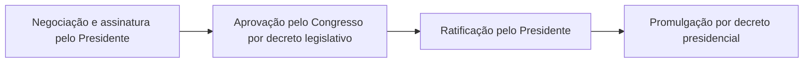

O art. 84 da Constituição reúne as atribuições privativas do Presidente da República. São quase trinta incisos, mas a prova costuma cobrar um grupo pequeno deles: a regulamentação por decreto, os tratados, as nomeações com aprovação do Senado, o indulto, o comando das Forças Armadas, a iniciativa de leis e as atribuições que podem ser delegadas. Este capítulo organiza o rol por temas e mostra o que depende de outro Poder.

> [!objetivos]
> - Agrupar as atribuições do art. 84 por tema.
> - Distinguir decreto regulamentar de decreto autônomo.
> - Explicar o caminho de um tratado internacional e das nomeações que dependem do Senado.
> - Identificar as atribuições que o Presidente pode delegar e a quem.

## O rol do art. 84

O art. 84 diz que as atribuições são **privativas**. "Privativa" significa que cabem a esse agente, mas que, em alguns casos, ele pode delegar. Isso difere da competência exclusiva, que é indelegável.

Uma forma prática de estudar é agrupar os incisos em quatro blocos.

| Bloco | Incisos | Exemplos |
| --- | --- | --- |
| Governo e administração | I, II, VI, XXV | Nomear ministros, dirigir a administração, prover cargos |
| Relação com o Legislativo | III, IV, V, XI, XXIII, XXIV, XXVI | Iniciar leis, sancionar, vetar, editar medidas provisórias, enviar orçamento |
| Estado e defesa | IX, X, XIII, XIX, XX | Decretar estado de defesa, comandar as Forças Armadas, declarar guerra |
| Relações externas e nomeações | VII, VIII, XIV a XVI, XXI | Tratados, embaixadores, ministros dos tribunais |

### Governo e administração

O Presidente nomeia e exonera os **Ministros de Estado** e exerce, com o auxílio deles, a **direção superior da administração federal** (incisos I e II). Também **provê e extingue** os cargos públicos federais, na forma da lei (inciso XXV).

### Relação com o Legislativo

O Presidente **inicia o processo legislativo** nos casos previstos (inciso III), **sanciona, promulga e publica** as leis e expede decretos e regulamentos para sua fiel execução (IV), **veta** projetos (V) e **edita medidas provisórias** (XXVI). Cabe a ele ainda enviar ao Congresso o plano plurianual, o projeto de lei de diretrizes e as propostas de orçamento (XXIII) e **prestar contas** do exercício anterior, dentro de **60 dias** contados da abertura da sessão legislativa (XXIV). Na abertura da sessão, remete **mensagem e plano de governo**, expondo a situação do País (XI).

## Natureza das atribuições

A doutrina separa as atribuições em três grupos, o que ajuda a lembrar o papel do Presidente.

| Papel | Exemplos de atribuições |
| --- | --- |
| Chefe de Estado | Relações com Estados estrangeiros, tratados, declaração de guerra, condecorações |
| Chefe de governo | Iniciar leis, vetar, editar medidas provisórias, enviar o orçamento, decretar a intervenção |
| Chefe da administração | Nomear e exonerar ministros, dirigir a administração, prover cargos, expedir regulamentos |

Essa classificação não aparece no texto constitucional, mas serve para organizar as respostas de prova. A tabela mostra, por exemplo, por que o Presidente acredita embaixadores como **chefe de Estado**, e não de governo. Convém lembrar que, no Brasil, as três funções ficam concentradas na mesma pessoa, o que distingue o presidencialismo brasileiro do parlamentarismo, em que a chefia de Estado e a de governo são separadas. Por isso, uma questão que pergunte "que função o Presidente exerce ao celebrar um tratado" aceita as duas respostas, conforme o enfoque: representação externa (chefe de Estado) e condução da política (chefe de governo).

## Decretos

O Presidente usa o **decreto** para duas finalidades diferentes.

- **Decreto regulamentar:** detalha uma lei para que ela seja bem executada (inciso IV). É ato **secundário**, que não inova na ordem jurídica.
- **Decreto autônomo:** inova, porque tira a validade direto da Constituição. É admitido apenas nas hipóteses do inciso VI.

> [!lei] CF, art. 84, VI
> dispor, mediante decreto, sobre: a) organização e funcionamento da administração federal, quando não implicar aumento de despesa nem criação ou extinção de órgãos públicos; b) extinção de funções ou cargos públicos, quando vagos;

Dois pontos precisam ser lembrados. Primeiro, o decreto autônomo **só organiza a administração** nos limites da alínea "a" e **extingue cargos vagos**, nunca cargos ocupados. Segundo, para **criar ou extinguir órgãos** ou aumentar despesa, é preciso lei. Ultrapassar esses limites torna o decreto inconstitucional.

> [!pegadinha]
> A banca afirma que o Presidente pode extinguir por decreto autônomo qualquer cargo público, ou criar um órgão novo por decreto. O decreto autônomo alcança apenas a organização da administração sem aumento de despesa e a extinção de cargos que estejam **vagos**.

## Tratados internacionais

O Presidente **mantém relações com Estados estrangeiros e acredita seus representantes diplomáticos** (VII) e **celebra tratados** e demais atos internacionais, que dependem de **referendo do Congresso** (VIII). O percurso do tratado envolve os dois Poderes.

1. O Poder Executivo negocia e **assina** o tratado.
2. O Congresso o **aprova** por decreto legislativo (art. 49, I), com quórum de maioria simples, salvo tratado de direitos humanos aprovado pelo rito de emenda.
3. O Presidente **ratifica**, ou seja, confirma perante os outros Estados que o Brasil se obriga.
4. O Presidente **promulga** o tratado por decreto, dando-lhe validade interna.

Em caso de agressão estrangeira, o Presidente pode ainda **declarar guerra**, com autorização do Congresso ou com seu referendo, se a agressão ocorrer entre uma sessão legislativa e outra. Pelas mesmas regras, ele **celebra a paz** (XIX e XX). Pode também **permitir** que forças estrangeiras transitem pelo território ou nele permaneçam temporariamente, nos casos previstos em lei complementar (XXII).

### Poder regulamentar na prática

O **poder regulamentar** é a faculdade de editar decretos e regulamentos que garantam a boa execução das leis (inciso IV). Ele tem três limites: não pode criar direitos ou obrigações novos, não pode contrariar a lei e não pode ir além do que a lei permitiu. Se o decreto extrapola, o Congresso pode **sustar** o ato por decreto legislativo (art. 49, V), e o Judiciário pode anulá-lo.

> [!exemplo]
> Uma lei federal determina que os bombeiros de órgãos federais devem realizar teste de aptidão física, mas não fixa a periodicidade. O Presidente edita um decreto regulamentando a periodicidade em um ano. O decreto é válido, porque detalha a lei. Se o mesmo decreto criasse uma taxa de inscrição no teste, seria inválido, pois nenhuma lei autorizou a cobrança.

## Forças Armadas e medidas de defesa

O Presidente exerce o **comando supremo das Forças Armadas**, **nomeia os Comandantes** da Marinha, do Exército e da Aeronáutica, **promove os oficiais-generais** e os nomeia para os cargos que lhes são privativos (XIII). Isso reforça o controle civil sobre as Forças Armadas. Na prática, o Presidente exerce esse comando por meio do **Ministro de Estado da Defesa**, cargo privativo de brasileiro nato, e os três comandantes ficam subordinados a ele. A organização das Forças Armadas é regulada por lei complementar (art. 142, § 1º), e a fixação ou modificação dos efetivos é matéria de iniciativa privativa do Presidente, como visto no capítulo sobre processo legislativo.

Cabe também ao Presidente **decretar o estado de defesa e o estado de sítio** (IX) e **decretar e executar a intervenção federal** (X). Para isso, ele deve ouvir o **Conselho da República** e o **Conselho de Defesa Nacional**, que são órgãos de consulta que ele convoca e preside (XVIII). Esses temas são estudados com detalhes em outro volume, ao tratar da defesa do Estado e das instituições democráticas.

## Indulto e comutação

O Presidente **concede indulto e comuta penas**, ouvindo, quando for o caso, os órgãos que a lei criar (XII). A tabela distingue os institutos.

| Instituto | Quem concede | Alcance |
| --- | --- | --- |
| Indulto | Presidente | Extingue a punibilidade, em regra de forma coletiva |
| Graça | Presidente | Indulto individual: beneficia pessoa determinada |
| Comutação | Presidente | Reduz ou substitui a pena, sem extingui-la |
| Anistia | Congresso Nacional, por lei | Apaga o fato criminoso |

A Constituição proíbe graça e anistia para crimes hediondos, tortura, tráfico e terrorismo (art. 5º, XLIII), e a lei estende a vedação ao indulto. A concessão é ato discricionário do Presidente, dentro desses limites. O decreto de indulto costuma fixar requisitos, como o tempo de pena já cumprido e a ausência de condenação por certos crimes. O STF já afirmou que o poder de indultar é amplo, mas não pode ser usado de forma a esvaziar a pena de crimes graves nem a violar a Constituição. Como o inciso XII é delegável, o Presidente pode, em tese, autorizar um Ministro de Estado a conceder indultos individuais.

## Nomeações

As nomeações do Presidente são de dois tipos: as que **dependem de aprovação do Senado** e as que **não dependem**.

| Cargo | Participação do Senado |
| --- | --- |
| Ministros do STF e dos Tribunais Superiores | Aprovação por maioria absoluta |
| Procurador-Geral da República | Aprovação por maioria absoluta |
| Presidente e diretores do banco central | Aprovação |
| Governadores de Territórios | Aprovação |
| Ministros do Tribunal de Contas da União (parte) | Aprovação em alguns casos, conforme o art. 73 |
| Ministros de Estado | Nenhuma |
| Comandantes das Forças Armadas | Nenhuma |
| Advogado-Geral da União | Nenhuma |

Merece destaque que o **Advogado-Geral da União** é livremente nomeado, enquanto o Procurador-Geral da República depende de aprovação do Senado. Os membros do Conselho da República que são cidadãos são nomeados pelo Presidente, dois deles, e os demais são eleitos pelo Senado e pela Câmara.

> [!bizu]
> Pense em "quem julga ou fiscaliza precisa passar pelo Senado": ministros dos tribunais superiores, PGR e banco central. Quem trabalha dentro do governo, como ministros de Estado, comandantes e AGU, é de livre nomeação.

## Competências delegáveis

O parágrafo único do art. 84 permite que o Presidente **delegue** apenas três atribuições:

1. a de dispor, por decreto, sobre a **organização e o funcionamento** da administração e a extinção de cargos vagos (inciso **VI**);
2. a de conceder **indulto** e comutar penas (inciso **XII**);
3. a de **prover cargos públicos federais** (inciso **XXV, primeira parte**).

Os destinatários da delegação são os **Ministros de Estado**, o **Procurador-Geral da República** e o **Advogado-Geral da União**, que devem respeitar os limites da delegação.

> [!atencao] Primeira parte do inciso XXV
> O inciso XXV tem duas partes: **prover** os cargos e **extinguir** os cargos. Só a primeira parte, prover, pode ser delegada. Extinguir cargo não pode ser delegado.

> [!exemplo]
> O Presidente delega ao Ministro da Defesa a nomeação de servidores civis do ministério. É válido, pois a atribuição de prover cargos está na lista. Se ele delegasse ao ministro a decretação de estado de sítio, a delegação seria inconstitucional, porque essa atribuição não pode ser transferida.

## Casos práticos

1. **O Presidente extingue por decreto um cargo ocupado na administração.** O decreto é inconstitucional: o decreto autônomo só extingue cargos vagos.
2. **O Presidente delega ao Advogado-Geral da União a concessão de indulto.** É válido, pois o inciso XII é delegável e o AGU é destinatário possível.
3. **O Presidente assina um tratado e ratifica, sem passar pelo Congresso.** O ato é inválido: o tratado depende de referendo por decreto legislativo.
4. **O Presidente nomeia o Procurador-Geral da República sem esperar o Senado.** A nomeação depende de aprovação do Senado por maioria absoluta.
5. **O Presidente nomeia um novo Comandante da Aeronáutica.** Não precisa da aprovação do Senado.

Um raciocínio útil para esses casos é perguntar se o ato **cria direito novo** (exige lei), se **envolve outro Poder** (exige referendo ou aprovação) ou se é **ato de organização interna** (cabe ao Presidente). Essa chave resolve a maior parte das questões do art. 84.

## Mapa do capítulo

A tabela resume as atribuições mais cobradas.

| Tema | Regra | Cuidado |
| --- | --- | --- |
| Decreto autônomo | Só organização sem despesa e extinção de cargos vagos | Não cria órgão nem extingue cargo ocupado |
| Tratado | Assina, o Congresso referenda, o Presidente ratifica e promulga | Referendo por decreto legislativo |
| Forças Armadas | Comando supremo; nomeia os três comandantes | Sem aprovação do Senado |
| Indulto | Concede e comuta penas | Delegável aos Ministros, PGR e AGU |
| Nomeações | STF, tribunais superiores, PGR e banco central passam pelo Senado | AGU e ministros de Estado não |
| Prestação de contas | Até 60 dias da abertura da sessão legislativa | Contas do exercício anterior |
| Delegação | Incisos VI, XII e XXV, primeira parte | Só a Ministros, PGR e AGU |

### Para fixar

- As atribuições do art. 84 são privativas: o Presidente pode delegar apenas as dos incisos VI, XII e XXV, primeira parte.
- Os destinatários da delegação são os Ministros de Estado, o PGR e o AGU.
- O decreto regulamentar detalha a lei; o decreto autônomo só organiza a administração sem aumento de despesa e extingue cargos vagos.
- Tratados são assinados pelo Presidente, aprovados por decreto legislativo do Congresso e ratificados pelo Presidente.
- A guerra e a paz dependem de autorização ou referendo do Congresso.
- O Presidente exerce o comando supremo das Forças Armadas e nomeia os comandantes.
- Ministros dos tribunais superiores, PGR, presidente e diretores do banco central dependem de aprovação do Senado.
- O AGU e os ministros de Estado são de livre nomeação.
- O Presidente presta ao Congresso as contas do exercício anterior, em 60 dias contados da abertura da sessão legislativa.
- A graça e a anistia não alcançam os crimes hediondos, a tortura, o tráfico e o terrorismo.
