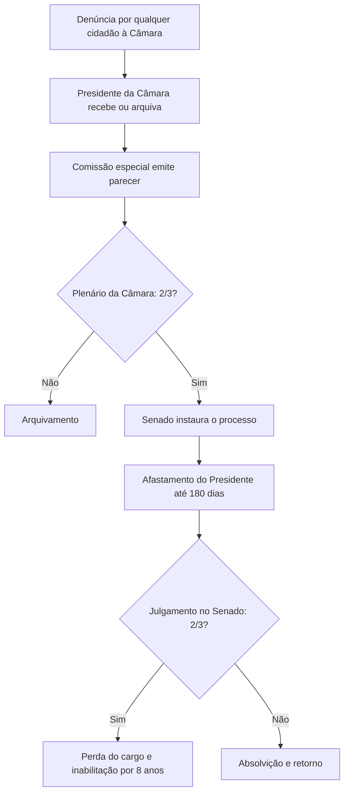

O Presidente da República responde por seus atos de duas formas muito diferentes: pelos crimes comuns, julgados pelo Supremo Tribunal Federal, e pelos crimes de responsabilidade, julgados pelo Senado. O capítulo mostra as regras de cada via, as garantias do mandato e a situação do Vice-Presidente e dos Ministros de Estado. Termina com os dois conselhos de consulta do Presidente, o da República e o de Defesa Nacional. A prova gosta de cobrar quem autoriza, quem julga, quantos votos são necessários e por quanto tempo o Presidente fica afastado.

> [!objetivos]
> - Distinguir crime comum de crime de responsabilidade e indicar quem julga cada um.
> - Descrever o rito do impeachment, os quóruns e as sanções.
> - Explicar as garantias do art. 86 e a situação do réu em ação penal na linha de substituição.
> - Descrever a responsabilidade e as funções dos Ministros de Estado e a composição dos Conselhos.

## Dois regimes de responsabilidade

A Constituição separa a responsabilidade do Presidente em dois regimes. A tabela compara os dois.

| Aspecto | Infração penal comum | Crime de responsabilidade |
| --- | --- | --- |
| Natureza | Crime comum, previsto em lei penal | Infração político-administrativa |
| Autorização | Dois terços da Câmara | Dois terços da Câmara |
| Quem julga | Supremo Tribunal Federal | Senado Federal |
| Afastamento | Com o recebimento da denúncia pelo STF | Com a instauração do processo pelo Senado |
| Pena | A prevista no crime | Perda do cargo e inabilitação por oito anos |
| Prazo máximo de afastamento | 180 dias | 180 dias |

Nos dois casos, o ponto de partida é a **admissão da acusação** pela Câmara dos Deputados, por **dois terços** dos votos de seus membros (art. 86, caput), o que corresponde a **342 deputados**, em um total de 513. Sem essa autorização, o processo não segue.

> [!lei] CF, art. 86, caput
> Admitida a acusação contra o Presidente da República, por dois terços da Câmara dos Deputados, será ele submetido a julgamento perante o Supremo Tribunal Federal, nas infrações penais comuns, ou perante o Senado Federal, nos crimes de responsabilidade.

## Crimes de responsabilidade

O art. 85 define os atos do Presidente que configuram **crime de responsabilidade**: aqueles que atentam contra a Constituição e, especialmente, contra:

1. a existência da União;
2. o livre exercício dos Poderes e dos poderes constitucionais das unidades da Federação;
3. o exercício dos direitos políticos, individuais e sociais;
4. a segurança interna do País;
5. a probidade na administração;
6. a lei orçamentária;
7. o cumprimento das leis e das decisões judiciais.

> [!bizu] Sete bens protegidos
> Agrupe em três ideias: **o Estado** (existência da União e segurança interna), **o funcionamento das instituições** (livre exercício dos Poderes e cumprimento das leis e decisões judiciais) e **a gestão correta** (direitos políticos, individuais e sociais, probidade e lei orçamentária). Em cada alternativa, a banca pode misturar um bem protegido que não está na lista.

Esses crimes são definidos em **lei especial**, que também estabelece as regras de processo e julgamento (art. 85, parágrafo único). A lei em vigor é a **Lei 1.079/1950**. Por ser matéria de lei federal, só a **União** pode legislar sobre o tema, o que o STF consolidou em súmula vinculante: os Estados não podem definir novos crimes de responsabilidade.

### Rito do impeachment

O processo por crime de responsabilidade, chamado de **impeachment**, segue etapas.

1. **Denúncia.** Qualquer cidadão pode denunciar o Presidente à Câmara.
2. **Admissibilidade na Câmara.** Uma comissão especial emite parecer, e o plenário vota. Para prosseguir, são necessários **dois terços** dos membros (342 deputados). A Câmara faz apenas um juízo de admissibilidade, e não julga o Presidente.
3. **Instauração no Senado.** Se a Câmara autoriza, o Senado decide se instaura o processo. A instauração suspende o Presidente de suas funções (art. 86, § 1º, II).
4. **Julgamento.** O Senado julga o processo sob a presidência do **Presidente do STF**. A condenação exige **dois terços** dos votos do Senado (54 senadores).
5. **Sanção.** A condenação leva à **perda do cargo, com inabilitação por oito anos** para o exercício de função pública, sem prejuízo das demais sanções judiciais cabíveis (art. 52, parágrafo único).

O Presidente fica **afastado por até 180 dias**. Se, nesse prazo, o julgamento não estiver concluído, o afastamento cessa, e o processo continua sem ele. Durante o afastamento, o Vice-Presidente exerce a Presidência.

> [!pegadinha]
> A banca afirma que o Senado condena por maioria absoluta, ou que a Câmara "julga" o Presidente e o Senado apenas executa a pena. A Câmara só **autoriza** (dois terços), e o Senado **julga** e condena por dois terços. Outra troca comum é dizer que o julgamento é presidido pelo Presidente do Senado: quem preside é o Presidente do STF.

### Natureza do impeachment e papel do Judiciário

O impeachment é um processo de natureza **político-jurídica**: as razões que levam à condenação são políticas, mas o procedimento deve respeitar o devido processo legal, a ampla defesa e o contraditório. O Judiciário **não reexamina o mérito** da decisão do Senado, mas pode controlar a **legalidade do procedimento**.

O STF já decidiu, ao fixar o rito, que a Câmara faz apenas um juízo de admissibilidade, que a instauração do processo no Senado exige **maioria simples** e que o Senado não fica preso à decisão da Câmara. Também reconheceu que o rito segue a Lei 1.079/1950 no que a Constituição de 1988 não revogou. Essa linha mostra que a Constituição fixa os quóruns centrais (dois terços na Câmara e dois terços no Senado), e a lei cuida do resto.

| Fase | Órgão | Quórum | Efeito |
| --- | --- | --- | --- |
| Admissibilidade | Câmara dos Deputados | 2/3 (342 deputados) | Autoriza o Senado a processar |
| Instauração | Senado | Maioria simples | Afasta o Presidente por até 180 dias |
| Julgamento | Senado, presidido pelo Presidente do STF | 2/3 (54 senadores) | Perda do cargo e inabilitação |

## Infrações penais comuns

Nas **infrações penais comuns** (crimes previstos na lei penal), a Câmara autoriza a acusação por dois terços, e o **STF** julga o Presidente (art. 102, I, b). O processo começa com a denúncia do Procurador-Geral da República. O Presidente fica **suspenso** de suas funções quando o STF **recebe a denúncia ou a queixa-crime** (art. 86, § 1º, I). Se o julgamento não terminar em **180 dias**, cessa o afastamento, sem prejuízo da continuação do processo.

| Marco | Consequência |
| --- | --- |
| Autorização da Câmara por 2/3 | Permite o processo no STF |
| Recebimento da denúncia pelo STF | Suspende o Presidente por até 180 dias |
| Sentença condenatória | Condenação criminal comum |

O Presidente pode ser denunciado por crimes comuns cometidos **durante o mandato e em razão das funções**, como a corrupção passiva ou a prevaricação. Já os crimes **estranhos às funções** e os anteriores ao mandato aguardam o fim dele, em razão da cláusula do § 4º, que será vista adiante. O Presidente pode ainda ser acionado nas esferas **civil e administrativa**, o que não se confunde com a responsabilidade penal e política.

## Garantias do art. 86

O Presidente tem duas garantias especiais, que não são privilégios pessoais, e sim proteção ao cargo.

1. **Imunidade à prisão** (art. 86, § 3º): enquanto não houver **sentença condenatória** em infração comum, o Presidente não está sujeito a prisão. Isso inclui a prisão cautelar, como a preventiva ou a temporária.
2. **Irresponsabilidade penal relativa** (art. 86, § 4º): enquanto dura o mandato, o Presidente **não responde por atos que nada têm a ver com o exercício de suas funções**. Fatos anteriores ao mandato ou sem relação com ele só serão apurados depois que o mandato terminar. A prescrição desses fatos fica suspensa nesse período.

Duas observações são fundamentais. A garantia do § 4º é uma **imunidade temporária** e **formal**, que adia o processo, e não uma isenção definitiva. E ela vale para o Presidente; segundo o STF, não se estende aos governadores, que seguem regras próprias definidas nas constituições estaduais.

> [!atencao] Atos em razão das funções
> Os atos **praticados em razão do cargo** podem ser objeto de apuração durante o mandato, mediante a autorização da Câmara. A cláusula do § 4º protege apenas os atos alheios às funções, como um crime comum cometido em fato anterior à posse.

## Réu em ação penal e linha de substituição

Na linha de substituição estão o Presidente da Câmara, o do Senado e o do STF. O STF analisou o caso de quem, estando nessa linha, torna-se **réu em ação penal por crime comum**, após o recebimento da denúncia. O raciocínio foi o seguinte: se o Presidente da República é suspenso quando o STF recebe a denúncia contra ele, não seria coerente que um réu da mesma situação assumisse a Presidência em substituição. O entendimento do STF foi que quem é réu em ação penal por crime comum **não pode ocupar o cargo de Presidente da República**, mesmo em substituição eventual. Ele **pode, porém, continuar à frente** da Casa que preside.

> [!jurisprudencia] STF, ADPF 402
> O réu em ação penal por infração penal comum, com denúncia recebida pelo STF, não pode substituir o Presidente da República, mas pode permanecer na presidência da Casa a que pertence.

## Vice-Presidente e Ministros de Estado

### Vice-Presidente

O Vice-Presidente é julgado pelo **STF** nas infrações penais comuns (art. 102, I, b) e pelo **Senado** nos crimes de responsabilidade (art. 52, I). Ele **não tem** as garantias do art. 86, § 3º e § 4º, que a Constituição concedeu apenas ao Presidente.

### Ministros de Estado

Os **Ministros de Estado** são escolhidos entre brasileiros maiores de 21 anos e no exercício dos direitos políticos (art. 87). O Ministro da Defesa deve ser brasileiro nato. Compete a eles (art. 87, parágrafo único):

- orientar, coordenar e supervisionar os órgãos de sua área e **referendar** atos e decretos do Presidente;
- editar **instruções** que facilitem a aplicação de leis, decretos e regulamentos;
- apresentar ao Presidente o **relatório anual** de sua gestão;
- praticar os atos que o Presidente lhes **delegar**.

A **referenda ministerial** é a assinatura do ministro no ato do Presidente. Ela mostra que o ministro divide a responsabilidade pelo ato. A criação e a extinção de Ministérios e de órgãos da administração dependem de **lei** (art. 88).

| Agente | Crimes comuns | Crimes de responsabilidade |
| --- | --- | --- |
| Presidente | STF | Senado |
| Vice-Presidente | STF | Senado |
| Ministros de Estado | STF | STF, salvo se conexos com os do Presidente, caso em que é o Senado |

O art. 51, I, cita os Ministros de Estado entre os que dependem da autorização da Câmara, por dois terços. Lido em conjunto com o art. 52, I, o entendimento é que a autorização é necessária quando o crime de responsabilidade do ministro é **conexo** com o do Presidente, caso em que o julgamento é do Senado. Fora disso, o ministro responde diretamente perante o STF.

### Crimes de responsabilidade em outros níveis

A Lei 1.079/1950 define os crimes de responsabilidade do Presidente, dos Ministros de Estado, dos Governadores e Secretários de Estado e de integrantes do Judiciário. Para os **Prefeitos**, o Decreto-Lei 201/1967 prevê infrações político-administrativas, cuja apuração cabe à Câmara Municipal. O que há de comum é que a União legisla sobre o tema, e os Estados e Municípios não podem criar tipos novos de crime de responsabilidade.

Por outro lado, a Constituição fixa que, nos crimes de responsabilidade, o julgamento é **político**, mas respeita as garantias do processo. Essa ideia explica por que o presidente do tribunal, um juiz, conduz a sessão do Senado: sua função é assegurar a legalidade do rito, enquanto o voto dos senadores é de natureza política.

### Natureza do cargo de Ministro

O Ministro de Estado é **agente político**, de livre nomeação e exoneração pelo Presidente. O cargo é de confiança, e por isso dispensa concurso público. Em razão da natureza política, o STF afasta, em regra, a incidência da Súmula Vinculante 13, que veda o nepotismo, sobre a nomeação de parentes para esses cargos, desde que não haja desvio de finalidade ou inidoneidade manifesta do nomeado.

O ministro responde politicamente ao Presidente, que pode exonerá-lo a qualquer tempo, e juridicamente perante os tribunais. A **referenda** do ministro é exigida dos atos e decretos assinados pelo Presidente (art. 87, parágrafo único, I) e mostra que o ministro divide a responsabilidade pelo ato.

Um parlamentar pode ser ministro. O deputado ou senador investido no cargo de Ministro de Estado **não perde o mandato**: fica licenciado (art. 56, I) e pode optar pela remuneração do mandato. Nesse período, é substituído pelo suplente, e retorna à cadeira se deixar o ministério. Esse arranjo liga o Executivo ao Legislativo e é uma característica do presidencialismo de coalizão no Brasil.

### Convocação de ministros

A Câmara, o Senado e as comissões podem **convocar** Ministros de Estado para prestarem pessoalmente informações sobre assunto previamente determinado. A **ausência sem justificativa** configura crime de responsabilidade (art. 50). As Mesas das duas Casas podem ainda enviar **pedidos escritos de informação**, a serem respondidos no prazo de **30 dias**. A recusa, o não atendimento no prazo ou a prestação de informação falsa também configuram crime de responsabilidade (art. 50, § 2º).

> [!exemplo]
> A Comissão de Segurança Pública da Câmara convoca o Ministro da Justiça para esclarecer a política nacional de combate ao crime. Ele não comparece e não apresenta justificativa. Está caracterizada a infração do art. 50, que a Constituição trata como crime de responsabilidade do ministro.

## Conselhos de consulta do Presidente

A Constituição criou dois conselhos que **aconselham** o Presidente em temas graves. Eles têm função **consultiva**: o Presidente ouve a opinião, mas não está vinculado a ela.

### Conselho da República

O **Conselho da República** é o órgão superior de consulta do Presidente (art. 89). Participam dele:

- o Vice-Presidente da República;
- os Presidentes da Câmara e do Senado;
- os líderes da maioria e da minoria nas duas Casas (quatro pessoas);
- o Ministro da Justiça;
- seis cidadãos brasileiros natos, com mais de **35 anos**, dois nomeados pelo Presidente, dois eleitos pelo Senado e dois eleitos pela Câmara, todos com **mandato de três anos**, vedada a recondução.

Ele se pronuncia sobre **intervenção federal, estado de defesa e estado de sítio** e sobre questões relevantes para a **estabilidade das instituições democráticas** (art. 90).

### Conselho de Defesa Nacional

O **Conselho de Defesa Nacional** opina nos assuntos de **soberania nacional** e de **defesa do Estado democrático** (art. 91). Ele reúne autoridades dos três grupos da tabela, todas como membros natos.

| Grupo | Integrantes |
| --- | --- |
| Poderes | Vice-Presidente da República e Presidentes da Câmara e do Senado |
| Ministros | Justiça, Defesa, Relações Exteriores e Planejamento |
| Militares | Comandantes da Marinha, do Exército e da Aeronáutica |

As competências do Conselho de Defesa Nacional são:

- manifestar-se sobre a **declaração de guerra** e a **celebração da paz**;
- opinar sobre o **estado de defesa**, o **estado de sítio** e a **intervenção federal**;
- propor os critérios de uso de **áreas indispensáveis à segurança** do território, em especial na **faixa de fronteira**;
- estudar e acompanhar medidas que assegurem a **independência nacional** e protejam o regime democrático.

| Aspecto | Conselho da República | Conselho de Defesa Nacional |
| --- | --- | --- |
| Foco | Instituições democráticas | Soberania e defesa |
| Cidadãos natos | Seis, com mandato de três anos | Não há |
| Militares | Não participam | Os três comandantes e o Ministro da Defesa |
| Temas comuns | Intervenção, estado de defesa e estado de sítio | Intervenção, estado de defesa e estado de sítio |

> [!pegadinha]
> A banca afirma que os conselhos têm poder de decisão ou que o Presidente é obrigado a seguir a opinião deles. Atuam apenas como órgãos de **consulta**, e o Presidente pode decidir de forma diferente. Outra troca é colocar os Comandantes das Forças Armadas no Conselho da República, quando eles pertencem ao Conselho de Defesa Nacional.

## Prerrogativas comparadas

A tabela mostra quem tem cada garantia e quem julga cada agente.

| Agente | Imunidade à prisão (art. 86, § 3º) | Cláusula de atos estranhos (art. 86, § 4º) | Autorização da Câmara |
| --- | --- | --- | --- |
| Presidente | Sim | Sim | Sim |
| Vice-Presidente | Não | Não | Sim, para crime de responsabilidade |
| Ministros de Estado | Não | Não | Só se o crime de responsabilidade for conexo com o do Presidente |
| Governadores | Não, segundo o STF | Não, segundo o STF | Conforme a Constituição estadual |

Essa tabela ajuda a evitar o erro de estender ao Vice-Presidente ou aos Ministros de Estado as garantias do art. 86. Elas protegem o cargo de Presidente, que representa o Estado e a Nação. Mesmo sem as garantias, o Vice e os Ministros têm **foro por prerrogativa de função**, isto é, só são julgados nos tribunais indicados pela Constituição.

## Casos práticos

1. **A Câmara admite a acusação por 330 votos.** Não atinge os 342 votos exigidos, que são os dois terços de 513 deputados. O processo é arquivado.
2. **O STF recebe a denúncia contra o Presidente por crime comum.** O Presidente é suspenso das funções por até 180 dias, e o Vice assume.
3. **O Senado condena o Presidente com 52 votos.** Não basta: a condenação exige dois terços, ou 54 dos 81 senadores.
4. **O Presidente é investigado por um crime que cometeu antes de tomar posse.** O processo fica suspenso até o fim do mandato, em razão da cláusula do art. 86, § 4º.
5. **Um Ministro de Estado é denunciado por crime comum, sem relação com o Presidente.** O julgamento é do STF (art. 102, I, c).
6. **O Presidente da Câmara torna-se réu em ação penal no STF.** Ele não poderá substituir o Presidente da República, mas pode continuar à frente da Câmara.

## Como a banca cobra este assunto

Os erros mais comuns nas alternativas desta matéria:

- **Quórum da Câmara:** é dois terços, e não maioria absoluta nem maioria simples.
- **Quem julga:** STF nos crimes comuns, Senado nos crimes de responsabilidade, e não o contrário.
- **Quem preside o julgamento:** o Presidente do STF, e não o do Senado.
- **Duração do afastamento:** 180 dias, nunca 90 nem 360.
- **Sanção:** perda do cargo e inabilitação por oito anos, e não perda de direitos políticos para sempre.
- **Quem define os crimes de responsabilidade:** lei federal; os Estados não podem criar crimes de responsabilidade.
- **Garantias do art. 86:** são do Presidente, e a banca as estende ao Vice, aos Ministros ou aos governadores.
- **Conselhos:** têm função consultiva, e a banca troca a composição de um pela do outro.

> [!atencao] Perder o cargo não é perder todos os direitos políticos
> A inabilitação por oito anos impede o exercício de função pública, mas não equivale à perda de direitos políticos de forma permanente. Questões costumam confundir os dois efeitos, que se baseiam em regras diferentes.

## Mapa do capítulo

A tabela reúne os pontos centrais do capítulo.

| Tema | Regra | Cuidado |
| --- | --- | --- |
| Admissão da acusação | Dois terços da Câmara (342 deputados) | A Câmara não julga |
| Crime comum | STF julga; afastamento com o recebimento da denúncia | Máximo de 180 dias |
| Crime de responsabilidade | Senado julga; afastamento com a instauração do processo | Condenação por 2/3; perda do cargo e inabilitação por oito anos |
| Quem preside o julgamento no Senado | Presidente do STF | Não o do Senado |
| Imunidade à prisão | Sem sentença condenatória | Só para o Presidente |
| Irresponsabilidade relativa | Atos estranhos às funções, durante o mandato | Imunidade temporária |
| Ministros de Estado | Mais de 21 anos, direitos políticos | Ministro da Defesa: brasileiro nato |
| Conselho da República | Seis cidadãos natos; mandato de três anos | Consultivo |
| Conselho de Defesa Nacional | Inclui Comandantes e Ministro da Defesa | Consultivo |

### Para fixar

- A Câmara autoriza a acusação por dois terços; o STF julga os crimes comuns e o Senado, os crimes de responsabilidade.
- O afastamento do Presidente vai até 180 dias; nos crimes comuns, começa com o recebimento da denúncia pelo STF, e nos de responsabilidade, com a instauração do processo pelo Senado.
- O julgamento no Senado é presidido pelo Presidente do STF e a condenação exige dois terços.
- A condenação por crime de responsabilidade traz perda do cargo e inabilitação por oito anos.
- Os crimes de responsabilidade são definidos por lei federal; os Estados não podem criá-los.
- Sem sentença condenatória, o Presidente não pode ser preso em infração comum.
- Durante o mandato, o Presidente não responde por atos estranhos ao exercício das funções.
- O réu em ação penal no STF não pode substituir o Presidente, mas pode continuar presidindo sua Casa.
- Os Ministros de Estado têm mais de 21 anos e referendam os atos do Presidente.
- O Conselho da República e o Conselho de Defesa Nacional têm função consultiva.
