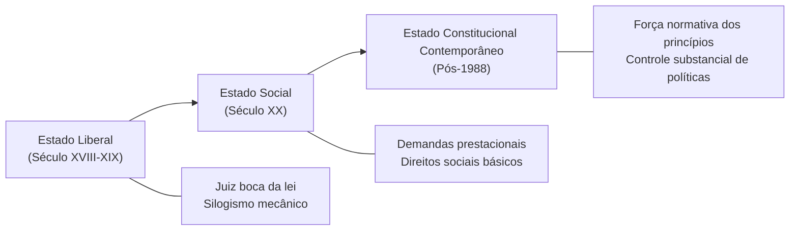
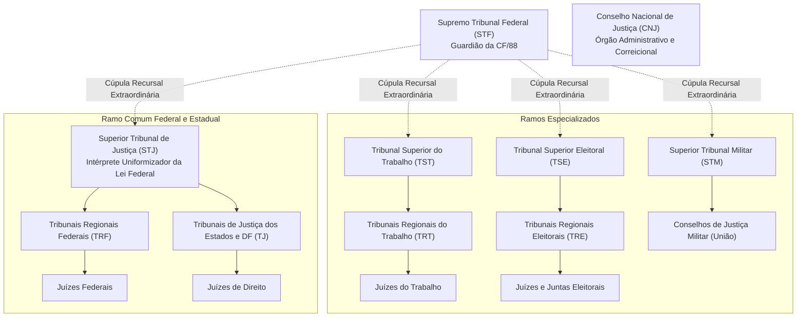
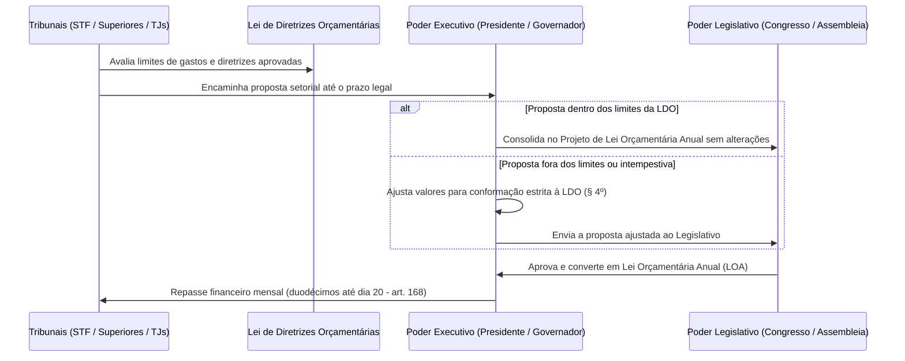
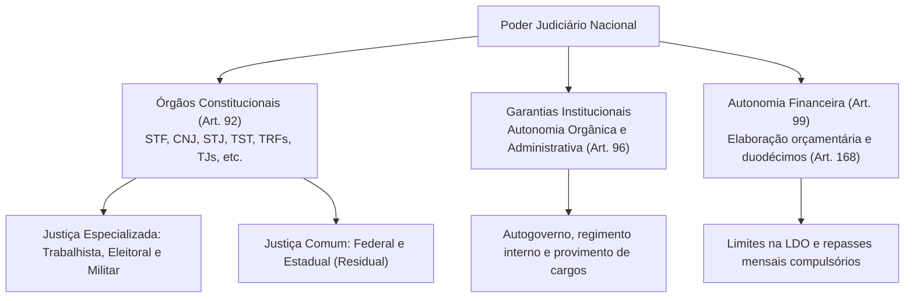

O Poder Judiciário desempenha a função jurisdicional típica do Estado soberano. Essa atividade consiste na aplicação imperativa e definitiva do ordenamento jurídico a casos concretos contenciosos, pacificando litígios e restaurando a ordem jurídica lesada ou ameaçada de lesão. No modelo tripartite consagrado pela Constituição Federal de 1988 em seu art. 2º, a separação dos poderes assegura independência e harmonia recíproca entre as funções estatais, erigindo o Judiciário como guardião das liberdades públicas e dos direitos fundamentais contra eventuais abusos ou omissões dos demais Poderes.

> [!objetivos]
> - Compreender a evolução histórica e o papel funcional do Poder Judiciário no Estado Constitucional contemporâneo.
> - Identificar o rol exaustivo dos órgãos integrantes do Poder Judiciário brasileiro estabelecido no art. 92 da Constituição Federal.
> - Diferenciar a jurisdição comum da jurisdição especializada, assim como os ramos federais e estaduais de distribuição da justiça.
> - Analisar as garantias institucionais de autonomia orgânico-administrativa e financeira asseguradas aos tribunais pelo art. 99 da Carta Magna.

## Introdução - Aspectos Gerais do Poder Judiciário

A jurisdição estatal ostenta atributos técnicos primordiais que a diferenciam substancialmente da função administrativa e legislativa. O primeiro atributo marcante é a inércia processual, consolidada no clássico brocardo latino segundo o qual não há juiz sem autor. Em regra geral, os órgãos judicantes não atuam de ofício para resolver conflitos de interesse. Exige-se sempre a devida provocação pelo titular do direito ou pelo órgão legitimado, como o Ministério Público e a Defensoria Pública. Uma vez validamente provocado o órgão competente, o processo passa a se desenvolver por impulso oficial até a entrega da tutela de mérito.

O segundo atributo central é a definitividade das decisões judiciais. Os atos administrativos praticados pelo Poder Executivo e pelo próprio Judiciário no exercício de atividade atípica ostentam imperatividade, mas comportam contínua revisão judicial sob a ótica da estrita legalidade. Em contrapartida, as sentenças e os acórdãos judiciais transitados em julgado assumem a autoridade de coisa julgada material, tornando-se imutáveis e indiscutíveis fora dos limites restritos da ação rescisória e da revisão criminal.

Por fim, a indeclinabilidade da jurisdição impede que o juiz se recuse a julgar sob alegação de lacuna ou obscuridade no texto da lei. Cabe ao magistrado togado decidir o pleito mediante recurso à analogia, aos costumes e aos princípios gerais de direito. A imparcialidade do julgador opera como pressuposto processual de validade, assegurando tratamento paritário às partes litigantes.

> [!atencao] Inafastabilidade da Jurisdição e Jurisdição Una (CF/88, art. 5º, XXXV)
> O preceito constitucional estabelece que nenhuma ameaça ou efetiva violação a direito subjetivo pode ter seu exame subtraído do crivo judicial. O ordenamento pátrio adota o sistema da jurisdição una, inspirado na tradição britânica e norte-americana. As decisões proferidas por conselhos fiscais ou comissões disciplinares administrativas não geram coisa julgada em sentido estrito, permanecendo sujeitas ao pleno controle de constitucionalidade e legalidade pelo juízo togado.

> [!exemplo] Exceções Relativas ao Esgotamento da Via Administrativa
> Como regra geral, o acesso ao Poder Judiciário dispensa o prévio requerimento ou exaurimento das instâncias administrativas. A própria Carta de 1988, contudo, consagrou exceções pontuais a esse postulado:
> 1. **Justiça Desportiva (art. 217, § 1º):** o interessado deve esgotar os órgãos disciplinares desportivos antes de acionar a via judicial, respeitado o prazo máximo de sessenta dias sem pronunciamento.
> 2. **Habeas Data (Súmula 2 do STJ):** exige a demonstração inequívoca de recusa administrativa da autoridade ou decurso de prazo sem resposta para configurar o interesse de agir.
> 3. **Ações Previdenciárias (STF, Tema 350 da Repercussão Geral):** o ajuizamento de pleito de benefício perante o INSS pressupõe prévio requerimento administrativo, dispensada a interposição de recurso ordinário.

### Funções Típicas e Atípicas do Poder Judiciário

Embora a jurisdição represente o núcleo essencial de sua missão republicana, o Poder Judiciário desempenha funções secundárias atípicas de cunho normativo e executivo:

1. **Função Atípica de Natureza Administrativa:** manifesta-se na gestão prática dos recursos humanos e patrimoniais da instituição. Inclui a abertura de concursos públicos de ingresso para juízes e servidores, a concessão de licenças, férias e vantagens funcionais a magistrados, a celebração de contratos de compras e serviços mediante licitação e a instauração de sindicâncias disciplinares internas contra servidores cartorários.
2. **Função Atípica de Natureza Normativa:** expressa-se na competência privativa assegurada aos colegiados dos tribunais para elaborar e votar seus respectivos regimentos internos. Esses atos normativos regulam o processamento dos feitos, o escalonamento das sessões colegiadas, a eleição dos cargos diretivos e o funcionamento dos órgãos fracionários.

## Jurisdição no Estado Social e no Estado Constitucional

A compreensão da atuação judicial exige analisar a evolução das instituições estatais. No Estado Liberal dos séculos XVIII e XIX, prevalecia a visão restrita da lei formal. O juiz era considerado apenas a voz que pronunciava o texto legislado, sem espaço para interpretação construtiva. Cabia ao aplicador realizar uma operação dedutiva fria, aplicando a regra geral sem examinar o impacto concreto da decisão sobre a sociedade.

Com o advento do modelo de bem-estar social no século XX, a população passou a exigir prestações materiais efetivas do Estado, incluindo serviços de saúde, previdência e instrução pública. A omissão do Estado não atendia mais aos anseios da cidadania. Nesse contexto histórico, o Judiciário no Estado Social e no Estado Constitucional foi chamado a dirimir controvérsias sobre políticas públicas e a garantir o cumprimento das promessas firmadas nos textos magnos, abandonando a postura de isolamento do século anterior.

No modelo constitucional contemporâneo, a Constituição Federal passa a ter aplicação imediata e força vinculante soberana. O sistema jurídico deixa de ser um mero catálogo de regras burocráticas e passa a incorporar valores éticos universais expressos em princípios fundamentais. O Judiciário assume o papel de guardião das regras democráticas, controlando a validade dos atos normativos para resguardar os direitos individuais e coletivos.

Esse cenário gerou o aumento expressivo de disputas levadas aos tribunais, fenômeno conhecido como judicialização da vida pública. Temas centrais de natureza moral, política e econômica passaram a ser decididos nas cortes de justiça. Diante disso, os tribunais equilibram a necessidade de agir contra ilegalidades flagrantes com o dever de respeitar as escolhas legítimas dos representantes eleitos pelo povo.

| Paradigma Estatal | Papel do Magistrado | Concepção da Norma | Pauta Primária da Tutela |
|---|---|---|---|
| **Estado Liberal** | Passivo e estritamente silogístico | Lei como comando soberano absoluto | Liberdades individuais negativas e propriedade |
| **Estado Social** | Moderador de conflitos coletivos | Proteção de vulneráveis e hipossuficientes | Direitos sociais de segunda dimensão e previdência |
| **Estado Constitucional** | Guardião principiológico e concretizador | Constituição dotada de força vinculante direta | Dignidade humana, controle material e minorias |

## Órgãos do Poder Judiciário (art. 92, CF/88)

A estrutura formal do Poder Judiciário brasileiro é delineada de maneira categórica pelo art. 92 da Constituição da República. Trata-se de rol taxativo de natureza constitucional, de modo que o legislador infraconstitucional ordinário ou as constituições estaduais não possuem competência material para criar órgãos jurisdicionais estranhos aos parâmetros normativos federais.

> [!lei] CF/88, art. 92
> **Art. 92.** São órgãos do Poder Judiciário:
> I - o Supremo Tribunal Federal;
> I-A o Conselho Nacional de Justiça;
> II - o Superior Tribunal de Justiça;
> II-A - o Tribunal Superior do Trabalho;
> III - os Tribunais Regionais Federais e Juízes Federais;
> IV - os Tribunais e Juízes do Trabalho;
> V - os Tribunais e Juízes Eleitorais;
> VI - os Tribunais e Juízes Militares;
> VII - os Tribunais e Juízes dos Estados e do Distrito Federal e Territórios.

A Emenda Constitucional nº 45/2004 inseriu no rol de órgãos judiciais o Conselho Nacional de Justiça (art. 92, inciso I-A). Embora integre organicamente a estrutura formal do Poder Judiciário, o CNJ ostenta natureza estritamente administrativa, orçamentária e financeira, sendo totalmente desprovido de função jurisdicional. Por sua vez, a Emenda Constitucional nº 92/2016 formalizou a inserção explícita do Tribunal Superior do Trabalho no catálogo do art. 92 (inciso II-A), consolidando sua condição de Tribunal Superior da União.

### Classificação e repartição das Justiças

A doutrina constitucional especializada classifica os órgãos judiciais sob múltiplos prismas de organização institucional:

1. **Quanto à matéria de competência:**
   - **Justiça Especializada:** engloba a Justiça do Trabalho (TST, TRTs e Juízes do Trabalho), a Justiça Eleitoral (TSE, TREs, Juízes Eleitorais e Juntas Eleitorais) e a Justiça Militar da União e dos Estados (STM e Conselhos de Justiça). Essa divisão processa matérias delimitadas em razão da matéria expressamente no texto constitucional.
   - **Justiça Comum:** engloba a Justiça Federal ordinária (TRFs e Juízes Federais) e a Justiça Estadual (Tribunais de Justiça e Juízes de Direito). A Justiça Comum possui competência residual, abrangendo todas as causas cíveis, criminais e administrativas não atribuídas às Justiças Especiais.

2. **Quanto ao âmbito federativo:**
   - **Justiça Federal:** abrange todos os ramos da Justiça Especializada (Trabalhista, Eleitoral e Militar da União) e a Justiça Federal comum. O custeio financeiro e o regime jurídico dessas carreiras vinculam-se diretamente à esfera da União.
   - **Justiça Estadual:** abrange os Tribunais de Justiça e os Juízes de Direito das comarcas estaduais, além da Justiça Militar Estadual (estruturada em Tribunais de Justiça Militar ou Câmaras Militares nos Estados onde o efetivo militar ultrapassa os patamares constitucionais). A Justiça do Distrito Federal e Territórios, embora preste jurisdição local, é organizada e mantida financeiramente pela União por força do art. 21, XIII, da Carta da República.

> [!pegadinha] Órgãos que Não Integram o Poder Judiciário
> Atenção recorrente nas bancas de concursos: os Tribunais de Contas da União, dos Estados e dos Municípios **não integram o Poder Judiciário**. Eles atuam como órgãos técnicos independentes que auxiliam o Poder Legislativo no controle externo. Do mesmo modo, o Ministério Público, a Defensoria Pública, a Ordem dos Advogados do Brasil e o Conselho Nacional do Ministério Público (CNMP) constituem funções essenciais à justiça ou conselhos de controle ministerial, jamais figurando como instâncias judiciais do art. 92.

> [!bizu] O Papel da Justiça Militar Estadual nos Concursos da PM e CBM
> A Justiça Militar Estadual integra o Poder Judiciário dos Estados (art. 125, § 3º da CF/88). Em primeiro grau de jurisdição, ela é exercida pelos juízes togados de direito do juízo militar e pelos colegiados dos Conselhos de Justiça (Conselho Especial para oficiais e Conselho Permanente para praças). Compete-lhe julgar os militares estaduais nas infrações castrenses tipificadas na lei penal militar e nas contendas judiciais que impugnam punições disciplinares da corporação, ressalvada a competência do tribunal do júri popular quando a vítima for civil.

## Garantias do Poder Judiciário: Autonomia Orgânica, Administrativa e Financeira

Para cumprir sua missão institucional sem subordinação fática perante os governantes de plantão, a Constituição Federal outorga ao Poder Judiciário um conjunto indissolúvel de prerrogativas institucionais. Essas garantias encontram-se estruturadas primordialmente no art. 96 e no art. 99 da Lei Fundamental. Elas se desdobram em duas grandes vertentes: a autonomia orgânico-administrativa e a autonomia orçamentário-financeira.

A autonomia orgânico-administrativa confere aos tribunais o autogoverno funcional. Nos termos do art. 96, I, da Constituição, compete privativamente aos tribunais eleger seus órgãos diretivos (Presidente, Vice-Presidente e Corregedor-Geral), elaborar seus próprios regimentos internos respeitando as diretrizes adjetivas e as prerrogativas de ampla defesa dos litigantes, e organizar seus serviços auxiliares e secretarias cartorárias. Compete-lhes igualmente prover os cargos de juiz de carreira e os cargos de seus servidores por concurso público, conceder licenças, férias e aposentadorias a seus membros, bem como exercer atos de polícia no recinto de suas dependências físicas.

> [!jurisprudencia] STF, ADI 2.321: Iniciativa Reservada para Leis de Organização Judiciária
> A deflagração de projetos de lei referentes à organização e divisão judiciárias, à criação e extinção de varas, tribunais ou cargos na magistratura, e à fixação dos vencimentos de seus membros e servidores pertence à iniciativa privativa exclusiva do Poder Judiciário (CF, art. 96, II). Projeto de lei deflagrado por membro do parlamento ou pelo Chefe do Executivo versando sobre tais matérias padece de inconstitucionalidade formal insanável por usurpação de iniciativa legislativa privativa.

Por outro lado, a autonomia financeira do Judiciário assegura a elaboração de suas próprias propostas orçamentárias em harmonia com as diretrizes aprovadas na lei orçamentária prévia. Essa prerrogativa é disciplinada de forma exaustiva pelo art. 99 da Carta Magna:

> [!esquema] Autonomia Orçamentária dos Tribunais (CF/88, art. 99)
> - **Iniciativa orçamentária:** Os tribunais elaboram suas propostas em harmonia com a LDO.
> - **Encaminhamento conjunto:** O STF e os Tribunais Superiores enviam suas propostas por seus Presidentes ao Poder Executivo. Os Tribunais de Justiça estaduais submetem suas propostas por seus respectivos Presidentes aos Governadores de Estado.
> - **Ajuste compulsório pelo Executivo (art. 99, § 4º):** Se os tribunais não encaminharem a proposta no prazo da LDO, o Executivo considerará os valores do orçamento vigente, ajustados aos limites legais. Se a proposta for enviada em desacordo com os limites da LDO, o Executivo promoverá os ajustes necessários para consolidar a Proposta de Lei Orçamentária Anual.
> - **Duodécimos obrigatórios (art. 168):** Os recursos orçamentários do Judiciário devem ser entregues até o dia 20 de cada mês, em duodécimos, sob pena de crime de responsabilidade do Chefe do Executivo.

O art. 99, § 5º, da Constituição veda expressamente a realização de despesas ou a assunção de obrigações que extrapolem os créditos orçamentários autorizados pela lei anual, salvo se previamente autorizadas pela via de créditos suplementares ou especiais votados pelo Legislativo. Essa sistemática harmoniza a indispensável independência dos juízes com o princípio federativo da higidez orçamentária e com os limites impostos pela Lei de Responsabilidade Fiscal.

## Mapa do capítulo

### Para fixar

1. **Função jurisdicional**: aplicação contenciosa, imparcial e imperativa do direito pelo Estado soberano, caracterizada pela inércia inicial, pela definitividade da coisa julgada material e pela indeclinabilidade do julgamento.
2. **Monopólio da jurisdição**: o Brasil adota o sistema de jurisdição una (art. 5º, XXXV da CF/88), assegurando que qualquer ato administrativo lesivo seja submetido ao crivo do Judiciário.
3. **Rol do art. 92**: catálogo constitucional taxativo que enumera os órgãos da jurisdição brasileira, incluindo o Supremo Tribunal Federal, o Superior Tribunal de Justiça e os tribunais especializados.
4. **Natureza do CNJ**: integra a estrutura formal do Poder Judiciário por força do art. 92, I-A, mas possui atribuição estritamente administrativa, financeira e disciplinar, sem função de julgamento jurisdicional.
5. **Divisão de Justiças**: reparte-se entre especializada (Trabalho, Eleitoral e Militar) e comum (Federal e Estadual), sendo a competência da Justiça Estadual eminentemente residual.
6. **Autonomia orgânica (art. 96)**: prerrogativa que outorga aos tribunais competência privativa para eleger dirigentes, elaborar regimentos internos e propor leis sobre organização judiciária.
7. **Autonomia financeira (art. 99)**: elaboração setorial do orçamento pelo Judiciário em conformidade com as diretrizes da Lei de Diretrizes Orçamentárias.
8. **Repasse duodecimal (art. 168)**: transferência obrigatória dos recursos orçamentários do Judiciário em duodécimos até o dia 20 de cada mês pelo Chefe do Poder Executivo.
