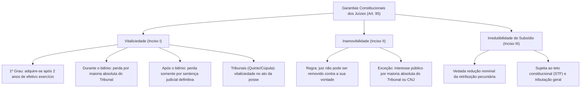
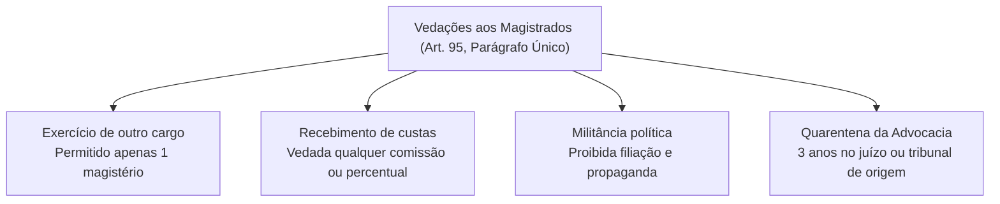
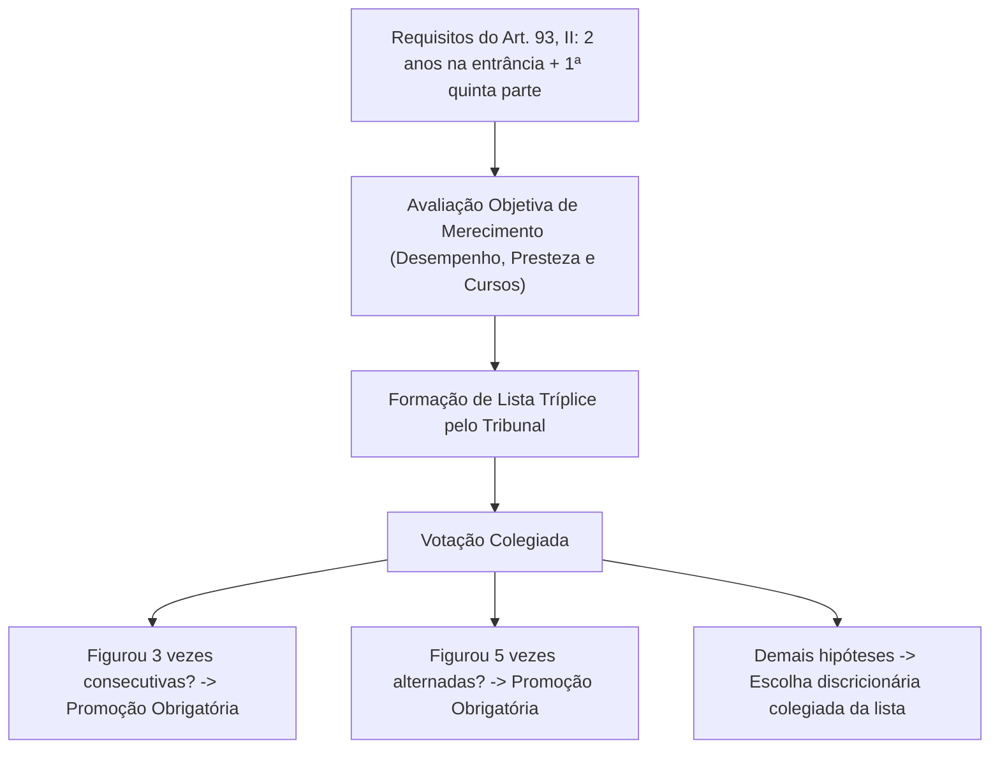
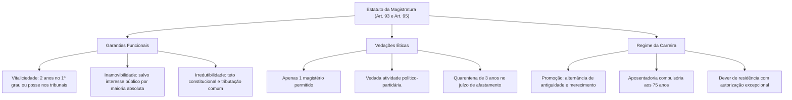

O exercício da jurisdição em um Estado Democrático de Direito impõe a existência de um corpo de magistrados independente, qualificado e protegido contra pressões políticas, econômicas ou corporativas. Para assegurar que o julgador decida as causas pautado exclusivamente na ordem jurídica e em sua consciência funcional, a Constituição Federal de 1988 instituiu um estatuto protetivo robusto no art. 93 e no art. 95. Esse arcabouço normativo equilibra garantias institucionais indispensáveis com deveres éticos severos e vedações funcionais taxativas.

> [!objetivos]
> - Compreender a reserva de iniciativa e a natureza de lei complementar do Estatuto da Magistratura (art. 93 da CF/88).
> - Analisar as três garantias fundamentais da magistratura: vitaliciedade, inamovibilidade e irredutibilidade de subsídio.
> - Dominar os critérios constitucionais objetivos de promoção por antiguidade e merecimento na carreira judicial.
> - Identificar as proibições éticas e funcionais impostas aos magistrados, com ênfase na quarentena de saída da advocacia.

## O Estatuto da Magistratura e sua Reserva Constitucional

O art. 93, *caput*, da Constituição Federal estabelece que lei complementar disporá sobre o regime dos magistrados em território nacional. Pertence privativamente ao Supremo Tribunal Federal a iniciativa para encaminhar o regramento geral dos juízes ao parlamento federal. Essa cláusula de reserva legal qualificada assegura que o regime jurídico dos juízes seja uniforme em todas as unidades federativas, evitando fragmentações estaduais ou intervenções conjunturais do Congresso Nacional. Enquanto não for promulgada a nova lei complementar nacional, permanece em vigor a Lei Orgânica da Magistratura Nacional (LOMAN - Lei Complementar nº 35/1979), naquilo em que foi recepcionada pela Carta de 1988.

O ingresso na carreira da magistratura ocorre no cargo de juiz substituto. O art. 93, I, da Carta Magna determina a realização de concurso público de provas e títulos, com a participação obrigatória da Ordem dos Advogados do Brasil em todas as suas fases. O candidato deve ser bacharel em direito e comprovar, no momento da inscrição definitiva, no mínimo três anos de atividade jurídica privativa ou regular. Essa exigência temporal visa resguardar a maturidade profissional e o conhecimento prático daqueles que irão ingressar na prestação da jurisdição.

> [!jurisprudencia] STF, Ação Direta de Inconstitucionalidade 3.460: Momento da Atividade Jurídica
> O Supremo Tribunal Federal consolidou o entendimento vinculante de que o preenchimento do requisito de três anos de atividade jurídica deve ser demonstrado na data da inscrição definitiva no concurso público, e não no momento da posse ou da inscrição preliminar. A atividade jurídica abrange o efetivo exercício da advocacia, de cargos privativos de bacharel em direito ou de funções públicas que demandem uso preponderante de conhecimento jurídico.

### Independência Judicial: Dimensões Interna e Externa

A doutrina constitucional divide a independência dos magistrados em duas vertentes operacionais complementares:

1. **Independência Externa:** protege os órgãos judicantes contra intromissões ou ordens diretas provenientes do Poder Executivo, do Poder Legislativo, de grupos de pressão midiática ou de grandes agentes econômicos. A inamovibilidade e a irredutibilidade de subsídios atuam como os principais escudos dessa dimensão.
2. **Independência Interna:** assegura que o juiz de primeiro grau não seja subordinado intelectual ou juridicamente aos desembargadores dos Tribunais de Justiça ou aos Ministros dos Tribunais Superiores. Os tribunais recursais podem reformar, anular ou manter as sentenças pelas vias recursais legalmente previstas, mas jamais possuem prerrogativa hierárquica para determinar previamente como o juiz singular deve decidir o mérito de um litígio.

## Garantias e Vedações dos Juízes e Estatuto da Magistratura

As garantias outorgadas aos magistrados não configuram privilégios pessoais ou prerrogativas corporativas odiosas. Elas representam verdadeiras garantias da própria cidadania, destinadas a proteger o jurisdicionado ao assegurar que o juiz julgue com liberdade e serenidade, sem temer represálias funcionais ou perseguições dos poderosos. O art. 95 da Constituição Federal disciplina essas garantias em três preceitos fundamentais:

> [!lei] CF/88, art. 95
> **Art. 95.** Os juízes gozam das seguintes garantias:
> I - vitaliciedade, que, no primeiro grau, só será adquirida após dois anos de exercício, dependendo a perda do cargo, nesse período, de deliberação do tribunal a que o juiz estiver vinculado, e, nos demais casos, de sentença judicial transitada em julgado;
> II - inamovibilidade, salvo por motivo de interesse público, na forma do art. 93, VIII;
> III - irredutibilidade de subsídio, ressalvado o disposto nos arts. 37, X e XI, 39, § 4º, 150, II, 153, III, e 153, § 2º, I.

### Vitaliciedade e Perda do Cargo

A vitaliciedade difere expressamente da estabilidade concedida aos servidores públicos civis (art. 41 da CF/88). Enquanto o servidor estatutário comum alcança a estabilidade após três anos de estágio probatório e pode perder o cargo por processo administrativo disciplinar com ampla defesa ou avaliação periódica de desempenho, o juiz vitalício goza de blindagem institucional muito mais intensa.

No primeiro grau de jurisdição, o juiz substituto cumpre o biênio de estágio probatório. Durante esses dois primeiros anos de exercício, a perda do cargo decorre de deliberação do tribunal ao qual estiver vinculado, tomada pelo voto da maioria absoluta de seus membros. Trata-se de juízo administrativo de não vitaliciamento. Contudo, superado o marco temporal de dois anos, o magistrado adquire a vitaliciedade plena. A partir desse momento, a perda do cargo somente pode ser decretada mediante ação judicial própria transitada em julgado (ação de perda de cargo proposta pelo Procurador-Geral de Justiça ou da República perante o tribunal competente).

Importa pontuar que os magistrados nomeados diretamente para os tribunais de segunda instância ou para os Tribunais Superiores através do Quinto Constitucional ou por escolha política não passam por estágio probatório bienal. Nesses casos especiais, a vitaliciedade é adquirida de forma imediata no instante em que o desembargador ou ministro toma posse no cargo judicial.

### Inamovibilidade

A inamovibilidade assegura que o juiz togado não seja removido, permutado ou transferido arbitrariamente de sua vara ou comarca para outra localidade, nem seja compulsoriamente promovido contra sua vontade. Essa garantia impede que o Poder Executivo ou a cúpula do tribunal afaste um julgador combativo que esteja processando autoridades locais ou desbaratando organizações criminosas.

A inamovibilidade não é absoluta. A Constituição Federal autoriza a movimentação involuntária do magistrado quando houver imperativo de interesse coletivo. Esse afastamento depende de deliberação motivada tomada pelo voto da maioria absoluta dos membros da corte competente ou do Conselho Nacional de Justiça, resguardado o pleno contraditório (CF, art. 93, VIII, com a redação dada pela Emenda Constitucional nº 103/2019). Vale destacar ainda que a remoção voluntária a pedido e a permuta de juízes entre comarcas de idêntica entrância e entre tribunais distintos do mesmo ramo de justiça foram normatizadas pela Emenda Constitucional nº 130/2023 nos incisos VIII-A e VIII-B do art. 93.

> [!exemplo] Aplicação Prática da Inamovibilidade
> Imagine que um juiz titular da comarca do interior do Estado presida instrução penal complexa contra agentes políticos influentes do município. O tribunal de justiça local não pode expedir portaria de remoção de ofício para transferir o julgador para outra região sob a justificativa genérica de conveniência de serviço. Qualquer deslocamento não voluntário pressupõe processo administrativo regular com quórum qualificado de maioria absoluta do respectivo tribunal ou do CNJ e demonstração cabal de grave interesse coletivo.

### Irredutibilidade de Subsídios

A garantia da irredutibilidade impede que os vencimentos ou subsídios dos magistrados sejam diminuídos por ato discricionário dos poderes políticos. A irredutibilidade protege o valor nominal da remuneração contra cortes direcionados ou retaliações legislativas. Contudo, ela não impede a incidência das regras constitucionais tributárias de caráter geral, como o Imposto sobre a Renda da Pessoa Física (IRPF) e a contribuição previdenciária oficial.

Da mesma forma, a irredutibilidade submete-se expressamente ao teto remuneratório constitucional fixado pelo art. 37, XI, da Carta da República. O limite remuneratório máximo no Poder Judiciário corresponde ao subsídio mensal recebido em espécie pelos Ministros do Supremo Tribunal Federal. Valores percebidos a título de parcelas de natureza estritamente indenizatória previstas em lei não entram no cômputo desse teto remuneratório.

| Garantia Constitucional | Regra Geral de Aplicação | Hipótese Excepcional de Flexibilização | Órgão ou Instrumento Competente |
|---|---|---|---|
| **Vitaliciedade** | Perda do cargo somente por sentença transitada em julgado | Estágio inicial de 2 anos no 1º grau admite exoneração administrativa | Maioria absoluta do Tribunal durante o biênio probatório |
| **Inamovibilidade** | Juiz permanece na comarca ou vara onde é titular | Remoção ou disponibilidade por motivo de relevante interesse público | Maioria absoluta do Tribunal competente ou do CNJ (art. 93, VIII) |
| **Irredutibilidade** | Proteção contra minoração nominal da retribuição | Incidência de imposto geral, previdência e teto do art. 37, XI | Aplicação automática da Constituição e da lei tributária |

## Vedações aos Magistrados (CF, art. 95, parágrafo único)

Para preservar a imagem de imparcialidade e neutralidade que deve nortear a jurisdição, a Constituição Federal impõe aos juízes uma série de vedações éticas e funcionais categóricas. Essas proibições aplicam-se a todos os magistrados em atividade e alcançam igualmente os juízes que se encontrem em disponibilidade remunerada:

> [!esquema] Rol de Vedações Constitucionais (CF/88, art. 95, parágrafo único)
> - **Outro cargo ou função:** Proibição de exercer qualquer outro encargo público ou privado, ainda que em disponibilidade, autorizada unicamente uma atividade de magistério.
> - **Custas ou participação:** Proibição absoluta de receber valores, porcentagens ou custas decorrentes de causas em julgamento.
> - **Atividade político-partidária:** Proibição de filiar-se a partidos políticos, manifestar apoio público eleitoral ou concorrer a mandatos na ativa.
> - **Auxílios e vantagens financeiras:** Proibição de receber recursos financeiros, doações ou favores econômicos de pessoas naturais ou pessoas jurídicas, exceto nas previsões legais.
> - **Quarentena da advocacia:** Proibição do exercício da advocacia no juízo ou tribunal do qual se desvinculou antes de decorrido o prazo de três anos da aposentadoria ou exoneração.

A vedação ao exercício de outro cargo ou função comporta uma única exceção constitucional: o magistrado pode acumular seu cargo jurisdicional com **uma única função de magistério** (ensino universitário ou técnico), desde que haja estrita compatibilidade de horários e não ocorra prejuízo à prestação jurisdicional. Qualquer outra acumulação com cargos técnicos, científicos ou comissionados é nula de pleno direito.

A proibição de dedicação à atividade político-partidária é rigorosa. O juiz não pode manter filiação a partido político, não pode disputar pleitos eletivos enquanto estiver na ativa nem pode manifestar apoio público ou preferência eleitoral por candidatos. Para concorrer a mandato eletivo, o magistrado togado que ingressou na carreira antes da EC 45/2004 deve se afastar, e os que ingressaram após devem obrigatoriamente exonerar-se do cargo público.

> [!pegadinha] A Quarentena de Saída nas provas
> As bancas costumam afirmar que o juiz aposentado fica impedido de advogar em qualquer lugar do território nacional por três anos. Isso é **falso**. A quarentena de saída do art. 95, parágrafo único, V, proíbe o exercício da advocacia apenas **no juízo ou tribunal do qual o magistrado se afastou** por aposentadoria ou exoneração, durante o período de três anos. Ele pode advogar livremente perante outros órgãos judiciais, varas distintas de outras comarcas ou tribunais diversos daquele em que atuava.

> [!jurisprudencia] STF, Súmula Vinculante 13: Nepotismo no Poder Judiciário
> A nomeação de cônjuge, companheiro ou parente em linha reta, colateral ou por afinidade, até o terceiro grau, inclusive, da autoridade nomeante ou de servidor da mesma pessoa jurídica investido em cargo de direção, chefia ou assessoramento, para o exercício de cargo em comissão ou de confiança viola frontalmente a Constituição Federal. Essa regra aplica-se de modo taxativo aos tribunais de justiça e juízos singulares em relação à contratação de familiares para cargos comissionados nos gabinetes judiciais.

## O Estatuto da Magistratura: Promoção, Estrutura e Regime de Trabalho

O art. 93 da Constituição Federal esmiúça as regras fundamentais que regem a carreira da magistratura, disciplinando as promoções, a remuneração, o regime previdenciário e a presença física dos juízes nas comarcas.

### Promoção na Carreira Judicial

A promoção dos juízes de primeiro grau opera de entrância para entrância, obedecendo de forma estrita à alternância sucessiva entre os critérios de **antiguidade** e **merecimento** (art. 93, II). Essa sistemática impede a formação de critérios puramente subjetivos ou clientelistas no avanço da carreira:

1. **Promoção por Antiguidade:**
   - O tribunal só pode recusar o magistrado de maior tempo de carreira mediante decisão motivada tomada por **dois terços** dos integrantes do colegiado, em procedimento próprio que assegure ampla defesa. A recusa deve ser fundamentada em razões graves de ordem funcional ou disciplinar.
   - Caso o mais antigo seja validamente recusado pelo quórum de dois terços, repete-se a votação com o segundo juiz da ordem cronológica, até a definição do promovido.

2. **Promoção por Merecimento:**
   - Exige que o magistrado togado conte com pelo menos **dois anos de exercício na respectiva entrância** e figure na **primeira quinta parte da lista de antiguidade** daquela entrância (exceto na ausência de candidatos qualificados que manifestem interesse pela vaga aberta).
   - A promoção por merecimento torna-se **compulsória e obrigatória** para o juiz que figurar por **três vezes consecutivas** ou **cinco vezes alternadas** em listas de merecimento organizadas pelo tribunal.
   - O merecimento é aferido por critérios objetivos estabelecidos pelo Conselho Nacional de Justiça: desempenho funcional, presteza e segurança na prestação jurisdicional, produtividade quantitativa e frequência com aproveitamento em cursos oficiais de aperfeiçoamento.

### Regime Disciplinar e Sanções Administrativas

A fiscalização funcional e ética dos magistrados é exercida pelas corregedorias dos próprios tribunais e pelo Conselho Nacional de Justiça. As penalidades administrativas disciplinares encontram-se elencadas na Lei Orgânica da Magistratura Nacional e na jurisprudência constitucional:

- **Advertência e Censura:** aplicáveis exclusivamente aos juízes de primeiro grau por negligência funcional no cumprimento dos deveres do cargo.
- **Remoção Compulsória:** imposta em virtude de interesse público relevante mediante votação por maioria absoluta dos integrantes da corte vinculada ou do plenário do CNJ (CF, art. 93, VIII, redação da EC 103/2019).
- **Disponibilidade com Vencimentos Proporcionais:** afasta o magistrado das funções judicantes por relevante interesse público, também pelo voto da maioria absoluta do colegiado competente ou do CNJ, mantendo a percepção de subsídios proporcionais ao tempo de serviço (CF, art. 93, VIII).
- **Aposentadoria Compulsória Disciplinar com Proventos Proporcionais:** penalidade disciplinar máxima da via administrativa, prevista no art. 42, V, da LOMAN (LC 35/1979). A EC 103/2019 suprimiu a menção expressa dessa penalidade do art. 93, VIII e do art. 103-B, § 4º, III da CF (que hoje citam remoção, disponibilidade e outras sanções administrativas), mas ela continua plenamente aplicável pelo CNJ e tribunais com fundamento na LOMAN recepcionada.
- **Perda do Cargo (Demissão):** privativa da esfera jurisdicional para o juiz vitalício, exigindo sentença judicial irrecorrível proferida em ação cível ou penal própria (CF, art. 95, I).

### Estrutura Remuneratória e Aposentadoria

A remuneração dos magistrados é fixada sob a modalidade de **subsídio**, composto por parcela pecuniária única, vedado o acréscimo de qualquer gratificação, adicional, abono ou verba de representação (CF, art. 39, § 4º c/c art. 93, V). A remuneração é escalonada verticalmente na carreira em níveis federais e estaduais, com diferença não superior a dez por cento nem inferior a cinco por cento entre as categorias funcionais sucessivas, não podendo a parcela máxima ultrapassar o subsídio mensal dos Ministros do Supremo Tribunal Federal.

O regime de aposentadoria dos magistrados e a concessão de pensão aos seus dependentes observam as normas gerais aplicáveis aos servidores públicos titulares de cargos efetivos (art. 40 da CF/88):

- **Aposentadoria Compulsória por Idade:** ocorre aos setenta e cinco anos de idade, na forma da Lei Complementar nº 152/2015, com proventos proporcionais ao tempo de contribuição previdenciária.
- **Aposentadoria por Incapacidade Permanente:** concedida ao magistrado que se tornar definitivamente inválido para o trabalho judicial, mediante avaliação médica pericial oficial.
- **Aposentadoria Voluntária:** deferida ao magistrado que atender cumulativamente aos requisitos de idade mínima e tempo de contribuição fixados pela reforma previdenciária da Emenda Constitucional nº 103/2019.

### Residência na Comarca

O art. 93, VII, da Carta da República determina que o juiz titular resida na respectiva comarca. Essa exigência assegura a proximidade material do magistrado com os problemas cotidianos da comunidade sob sua jurisdição, permitindo pronta atuação em medidas cautelares urgentes e fiscalização pessoal dos serviços públicos e prisionais da localidade.

A regra da residência admite dispensa excepcional: o magistrado pode residir fora da comarca somente mediante **autorização expressa e fundamentada do tribunal** ao qual estiver vinculado. A permanência injustificada fora da sede da comarca sem autorização do colegiado caracteriza falta funcional punível pelo órgão correcional.

> [!bizu] Resumo das Votações e Quóruns da Carreira Judicial
> - Recusa de promoção por antiguidade: **2/3** dos membros do Tribunal (art. 93, II, d).
> - Remoção ou disponibilidade compulsória por interesse público: **maioria absoluta** do Tribunal ou do CNJ (art. 93, VIII, redação da EC 103/2019).
> - Sessões de julgamento administrativo: públicas e com decisões fundamentadas (art. 93, IX e X).
> - Não vitaliciamento durante o estágio probatório bienal: **maioria absoluta** do Tribunal (art. 95, I).

## Mapa do capítulo

### Para fixar

1. **Estatuto da Magistratura**: veiculado por lei complementar de iniciativa exclusiva do Supremo Tribunal Federal (art. 93 da CF/88), aplicando-se a LOMAN naquilo que não colidir com o texto magno.
2. **Ingresso na carreira**: concurso público de provas e títulos com participação da OAB, exigindo-se três anos de atividade jurídica comprovados na inscrição definitiva.
3. **Vitaliciedade do primeiro grau**: adquirida após dois anos de exercício; antes disso, perda por maioria absoluta do tribunal; após isso, perda unicamente por sentença judicial definitiva.
4. **Vitaliciedade nos tribunais**: adquirida de forma imediata na posse pelos membros nomeados via quinto constitucional ou tribunais superiores.
5. **Inamovibilidade qualificada**: garantia contra remoção compulsória arbitrária, comportando exceção por interesse público respaldado por maioria absoluta do tribunal ou do CNJ (art. 93, VIII, com a redação da EC 103/2019).
6. **Irredutibilidade de subsídios**: preserva o valor nominal da remuneração, sujeitando-se ao teto dos Ministros do STF e ao desconto geral de tributos.
7. **Acumulação permitida**: apenas com um cargo de magistério, sendo vedada qualquer outra atividade profissional pública ou privada.
8. **Quarentena da advocacia**: proibição de três anos para advogar no juízo ou tribunal do qual o juiz se desvinculou por aposentadoria ou exoneração.
9. **Promoção obrigatória**: concedida ao juiz que constar por três vezes consecutivas ou cinco alternadas em listas de merecimento.
