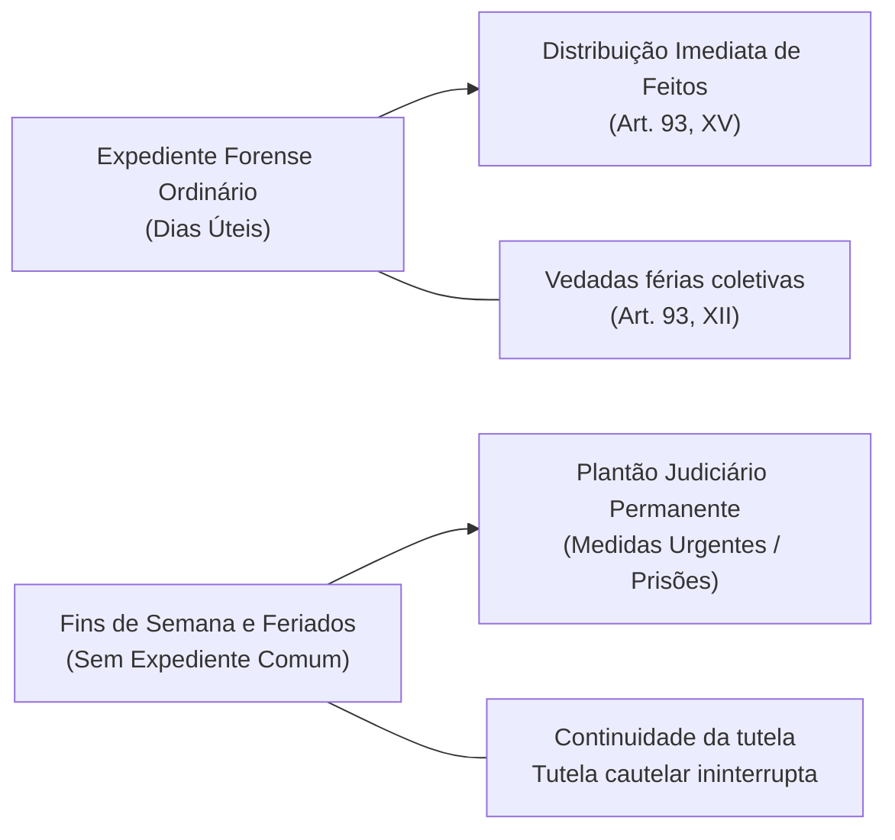
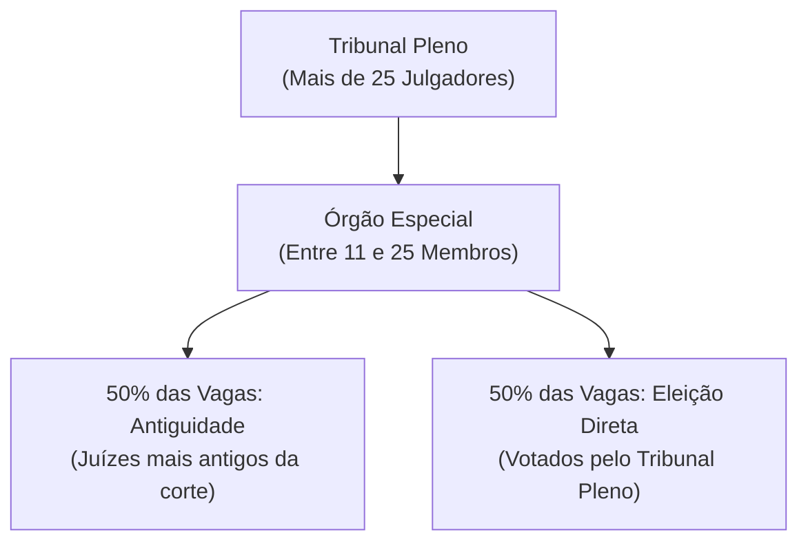
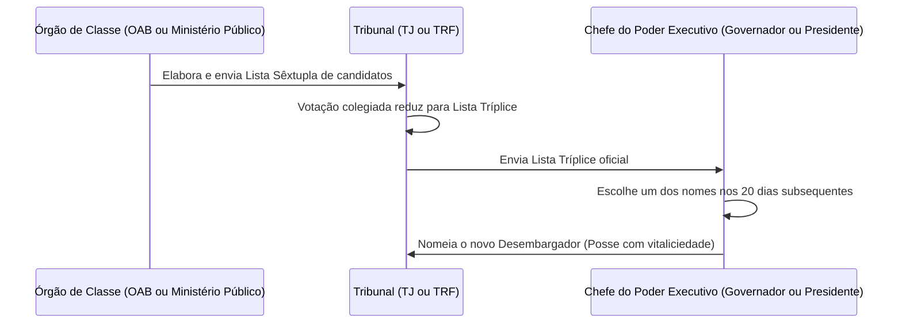
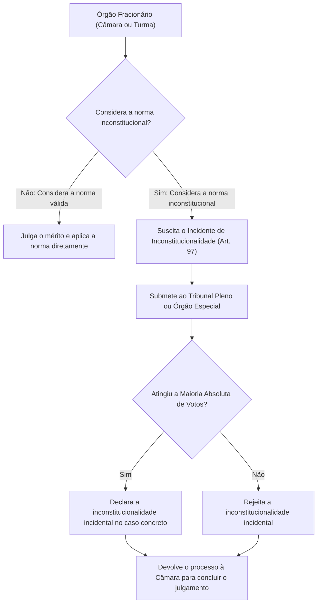
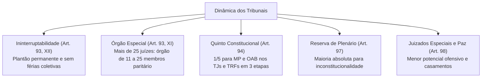

O funcionamento estrutural dos tribunais brasileiros equilibra agilidade decisória, representatividade social e rigor no controle de constitucionalidade. Para evitar a paralisação da tutela judicial e assegurar celeridade aos jurisdicionados, a Carta de 1988 reformulou a rotina dos foros, estabelecendo regras imperativas sobre plantão permanente, fracionamento colegiado e participação da sociedade civil na composição das cortes.

> [!objetivos]
> - Compreender o princípio da ininterruptabilidade da jurisdição e a vedação de férias coletivas nos tribunais.
> - Analisar a formação paritária e as atribuições delegadas do Órgão Especial nos tribunais de grande porte.
> - Dominar as três etapas do procedimento de preenchimento de vagas do Quinto Constitucional (art. 94 da CF/88).
> - Aplicar a cláusula de reserva de plenário (art. 97 da CF/88) e os efeitos da Súmula Vinculante 10 do STF.

## Ininterruptabilidade e Funcionamento dos Colegiados Forenses

A atividade jurisdicional é contínua e não pode sofrer solução de continuidade. O art. 93, XII, da Carta da República consagrou o princípio da ininterruptabilidade da prestação jurisdicional, vedando a concessão de férias coletivas nos juízos singulares e nos tribunais de segundo grau de jurisdição. Essa vedação abrange todos os órgãos fracionários, garantindo que os prazos processuais e as audiências tramitem regularmente ao longo de todo o ano forense.

Nos dias e horários em que não houver expediente forense regular, como finais de semana, feriados e períodos noturnos, o Judiciário opera obrigatoriamente por meio de juízes e desembargadores escalados em regime de plantão judiciário permanente. Esse plantão permanente destina-se a apreciar exclusivamente matérias urgentes que não possam aguardar a abertura do expediente ordinário, a exemplo de pedidos de habeas corpus contra prisões em flagrante ilegais, mandados de segurança preventivos e tutelas cautelares de busca e apreensão.

Complementando essa sistemática, o art. 93, XV, determina que a distribuição de todos os processos e feitos judiciais seja realizada de forma imediata em todos os graus de jurisdição, impedindo a retenção discricionária de autos nas secretarias de distribuição. Por sua vez, o art. 93, XIV, autoriza que os servidores das secretarias e cartórios pratiquem atos de mero expediente sem caráter decisório por delegação do magistrado titular, tais como juntada de petições, emissão de certidões e remessa de intimações rotineiras.

## O Órgão Especial nos Tribunais (CF, art. 93, XI)

Nos tribunais compostos por um número elevado de julgadores, reunir o Tribunal Pleno com dezenas de magistrados para apreciar atos administrativos e julgar questões cotidianas tornaria o trabalho excessivamente lento e ineficiente. Para solucionar esse impasse de gestão, o art. 93, XI, da Constituição Federal facultou a criação do Órgão Especial:

> [!esquema] Regras Estruturais do Órgão Especial (CF/88, art. 93, XI)
> - **Requisito numérico mínimo:** O tribunal deve possuir mais de vinte e cinco julgadores togados.
> - **Quantidade de integrantes:** O órgão especial deve ser composto por no mínimo onze e no máximo vinte e cinco membros.
> - **Competência delegada:** Exerce as atribuições administrativas e jurisdicionais que originalmente pertenceriam ao Tribunal Pleno.
> - **Composição mista e paritária:** Metade das vagas é provida com base na antiguidade cronológica na corte, e a outra metade é provida mediante eleição direta pelo próprio Tribunal Pleno.

A existência do Órgão Especial desonera a totalidade dos desembargadores de tarefas burocráticas complexas, permitindo que a grande maioria dos magistrados se concentre unicamente na atividade-fim de julgamento de recursos nas câmaras e turmas especializadas. As decisões tomadas pelo Órgão Especial equivalem plenamente àquelas proferidas pelo Tribunal Pleno, inclusive para fins de declaração de inconstitucionalidade de normas na via do controle difuso.

## O Quinto Constitucional nos Tribunais (CF, art. 94)

O Quinto Constitucional é o mecanismo jurídico que assegura a oxigenação dos tribunais colegiados, impedindo o isolamento corporativo da magistratura togada ao introduzir a visão prática da advocacia e a experiência fiscalizatória do Ministério Público.

Nos termos do art. 94 da Carta Magna, **um quinto (1/5) dos lugares** das cortes regionais da federação e dos tribunais estaduais de justiça ordinária deve ser ocupado por membros do Ministério Público e por advogados. Essa regra estende-se igualmente ao Tribunal Superior do Trabalho (art. 111-A, I) e aos Tribunais Regionais do Trabalho (art. 115, I).

> [!pegadinha] Cortes que Não Possuem Quinto Constitucional
> Fique atento: o **Supremo Tribunal Federal (STF)** e o **Superior Tribunal de Justiça (STJ)** **não possuem vagas reservadas ao Quinto Constitucional**. O STF é composto por onze ministros indicados livremente pelo Presidente da República. O STJ possui regras próprias de terços constitucionais fixadas no art. 104 da Carta de 1988, não se confundindo com o quinto do art. 94.

### Requisitos e Processamento da Escolha

Para concorrer à vaga reservada pelo Quinto Constitucional, os postulantes devem cumprir requisitos severos:

1. **Membros do Ministério Público:** devem contar com mais de **dez anos de carreira** na instituição ministerial estadual ou federal.
2. **Advogados:** devem comprovar **notório saber jurídico**, **reputação ilibada** e mais de **dez anos de efetiva atividade profissional** na advocacia privada.

O procedimento desenvolve-se rigorosamente em três etapas sucessivas:
1. **Formação da Lista Sêxtupla:** a entidade de classe correspondente (Conselho Seccional da OAB ou órgão colegiado do Ministério Público) reúne-se e escolhe seis nomes qualificados, encaminhando a lista sêxtupla ao presidente do tribunal de justiça ou tribunal regional federal.
2. **Formação da Lista Tríplice:** recebida a lista com seis indicados, o tribunal reúne seu colegiado em sessão pública fundamentada e vota para reduzir os nomes a uma lista tríplice.
3. **Escolha e Nomeação pelo Chefe do Executivo:** a lista tríplice é enviada ao Chefe do Poder Executivo (Governador do Estado nos TJs estaduais; Presidente da República nos TRFs federais). O Governante dispõe do prazo preclusivo de **vinte dias** para escolher livremente um dos três nomes e assinar o respectivo decreto de nomeação. O novo membro toma posse no cargo judicial já investido com as prerrogativas da vitaliciedade imediata.

## A cláusula de reserva de plenário (ou “full bench”)

O controle incidental de constitucionalidade de leis e atos normativos desempenha papel central na defesa da ordem constitucional. Ao examinar recursos ordinários e apelações cíveis ou criminais, as câmaras e turmas fracionárias dos tribunais deparam-se rotineiramente com teses de inconstitucionalidade de normas estatais. O constituinte originário, contudo, limitou o poder dos órgãos fracionários por meio do art. 97 da Carta Magna:

> [!lei] CF/88, art. 97
> **Art. 97.** Somente pelo voto da maioria absoluta de seus membros ou dos membros do respectivo órgão especial poderão os tribunais declarar a inconstitucionalidade de lei ou ato normativo do Poder Público.

A norma institui a chamada cláusula de reserva de plenário (*full bench*). Por força desse mandamento fundamental, nenhum órgão fracionário de tribunal (câmara, turma, seção ou divisão especializada) possui competência constitucional para proclamar a inconstitucionalidade de lei ou ato do poder público. Caso a turma recursal ou câmara cível entenda que a norma questionada no litígio é inconstitucional, ela deve suspender o julgamento do mérito e suscitar o incidente de inconstitucionalidade, submetendo a questão prejudicial ao Plenário do Tribunal ou ao Órgão Especial.

> [!jurisprudencia] STF, Súmula Vinculante 10: Alcance Prático da Reserva de Plenário
> A jurisprudência vinculante da Suprema Corte estabelece que incorre em nulidade por infringência ao art. 97 da Constituição o pronunciamento de câmara ou turma que, mesmo sem decretar expressamente a invalidade da norma legal, afasta a sua incidência prática no caso concreto sob o argumento de interpretação conforme. O afastamento tácito da lei viola a soberania da maioria absoluta colegiada.

Existem duas exceções fundamentais à necessidade de remessa ao Plenário consagradas na legislação processual civil: o órgão fracionário não precisa submeter o incidente caso o próprio Plenário do tribunal local já tenha declarado a inconstitucionalidade da norma em julgamento anterior, ou caso o plenário do Supremo Tribunal Federal já tenha firmado jurisprudência sobre o tema.

| Instituto Constitucional | Órgãos Sujeitos à Regra | Quórum de Votação Exigido | Exceção Legal Prevista |
|---|---|---|---|
| **Reserva de Plenário (Art. 97)** | Tribunais de 2º Grau e Tribunais Superiores | Maioria absoluta do Plenário ou Órgão Especial | Precedente anterior do próprio Pleno ou do Pleno do STF |
| **Juízo Monocrático (1º Grau)** | Juízes singulares de comarcas e varas | Julgamento individual pelo juiz togado | Não se sujeita ao art. 97; declaração direta na sentença |

## Justiça de Paz e Juizados Especiais

O art. 98 da Constituição Federal descentralizou o acesso à justiça e fomentou a resolução amigável de controvérsias por meio de órgãos próximos da sociedade:

### Juizados Especiais Cíveis e Criminais

A União e os Estados federados mantêm juizados especiais integrados por magistrados de carreira auxiliados por juízes leigos. Esse ramo da justiça é norteado pelos princípios da oralidade, simplicidade, informalidade, economia processual e celeridade, buscando prioritariamente a conciliação e o acordo pacífico entre os envolvidos:

- **Juizados Especiais Cíveis:** julgam causas cíveis de menor complexidade patrimonial (na esfera estadual, causas cujo valor econômico não ultrapasse quarenta salários mínimos, conforme a Lei nº 9.099/1995).
- **Juizados Especiais Criminais (JECRIM):** competentes para processar e julgar as infrações penais de menor potencial ofensivo, compreendendo todas as contravenções penais e os crimes cuja pena máxima privativa de liberdade cominada em abstrato não seja superior a dois anos, cumulada ou não com multa.
- **Turmas Recursais:** o julgamento de recursos contra sentenças proferidas nos juizados especiais compete colegiadamente a turmas de juízes de primeiro grau de jurisdição (turmas recursais). Não cabe recurso especial ao Superior Tribunal de Justiça contra decisões de turmas recursais (Súmula 203 do STJ), admitindo-se unicamente o recurso extraordinário ao Supremo Tribunal Federal quando demonstrada matéria constitucional de repercussão geral (Súmula 640 do STF).

### Justiça de Paz

A Justiça de Paz (art. 98, II) é exercida por cidadãos idôneos eleitos pelo voto direto, universal e secreto dos eleitores da comarca, para mandato de quatro anos, com remuneração fixada em lei. Suas atribuições limitam-se à celebração solene de casamentos civis, verificação dos processos de habilitação matrimonial e realização de conciliações prévias, não desempenhando atividade estritamente jurisdicional repressiva.

## Mapa do capítulo

### Para fixar

1. **Ininterruptabilidade jurisdicional**: vedação expressa de férias coletivas nos tribunais de segundo grau e juízos singulares, garantido plantão contínuo.
2. **Plantão judiciário**: regime emergencial mantido em feriados e recessos para apreciar tutelas cautelares e pedidos de soltura urgentes.
3. **Estrutura do Órgão Especial**: admissível em tribunais com mais de vinte e cinco membros, compondo-se de onze a vinte e cinco magistrados em divisão paritária de antiguidade e eleição.
4. **Abrangência do Quinto**: reserva de 20% das vagas para o Ministério Público e a Advocacia restrita aos Tribunais de Justiça e Tribunais Regionais Federais e Trabalhistas.
5. **Critérios do Quinto**: dez anos de carreira para promotores e procuradores; notório saber, idoneidade moral e dez anos de exercício para advogados.
6. **Tramitação do Quinto**: lista sêxtupla da entidade de classe, redução a lista tríplice pelo tribunal e nomeação pelo Chefe do Executivo em até vinte dias.
7. **Reserva de plenário**: exigência de maioria absoluta do Plenário ou Órgão Especial para declarar a inconstitucionalidade de lei por corte de justiça.
8. **Súmula Vinculante 10**: viola o art. 97 da Carta Magna a decisão de órgão fracionário que afasta a aplicação da lei sem declarar expressamente sua nulidade.
9. **Competência dos JECRIMs**: infrações penais de menor potencial ofensivo com pena máxima em abstrato de até dois anos e contravenções penais.
