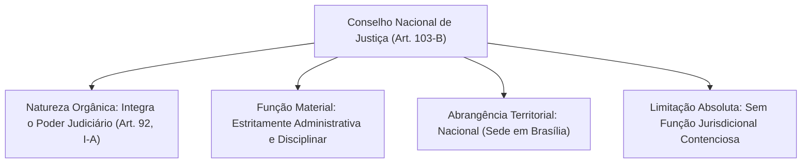
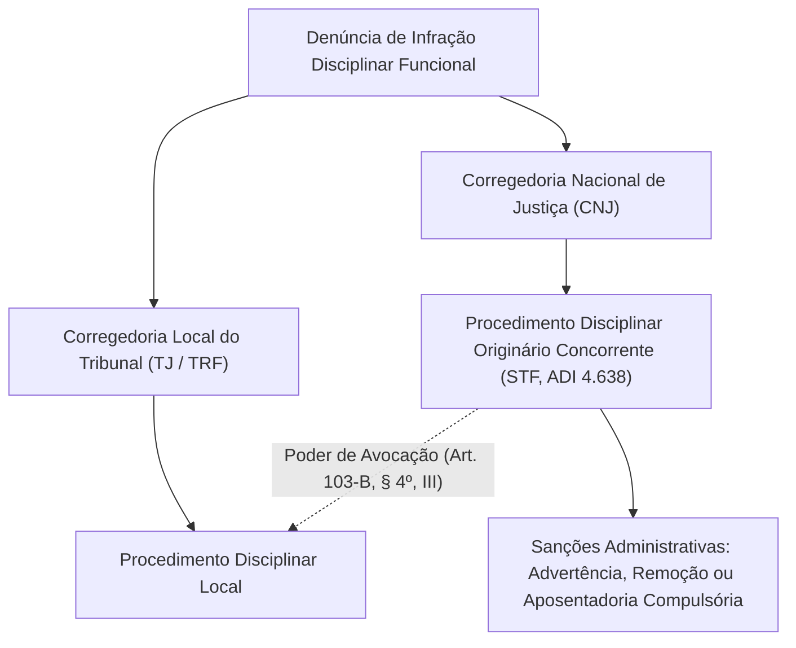
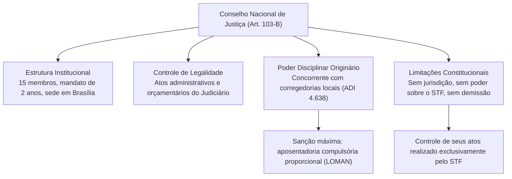

A criação do Conselho Nacional de Justiça representou o marco mais profundo da Reforma do Judiciário promovida pela Emenda Constitucional nº 45/2004. Concebido para conferir transparência, padronização administrativa e controle ético à prestação da justiça, o órgão consolidou-se como o centro do planejamento estratégico e da fiscalização financeira e disciplinar da magistratura brasileira.

> [!objetivos]
> - Compreender a natureza jurídica e os limites institucionais de atuação do Conselho Nacional de Justiça.
> - Detalhar a composição plural e heterogênea dos quinze conselheiros estabelecida no art. 103-B da Carta Magna.
> - Analisar as competências normativas, orçamentárias e disciplinares do conselho (art. 103-B, § 4º).
> - Compreender a tese da competência disciplinar originária concorrente fixada pelo Supremo Tribunal Federal na ADI 4638.

## Conselho Nacional de Justiça (art. 103-B, CF/88): Origem e Natureza

O Conselho Nacional de Justiça integra formalmente a estrutura orgânica do Poder Judiciário, figurando de modo expresso no art. 92, inciso I-A, da Constituição Federal. Sua sede situa-se na Capital Federal (Brasília) e sua competência fiscalizatória estende-se por todo o território nacional (art. 92, §§ 1º e 2º).

Apesar de integrar a estrutura judicial, o Conselho Nacional de Justiça é órgão estritamente administrativo, financeiro e correcional. Ele **não desempenha função jurisdicional**. O conselho não julga recursos ordinários, não profere sentenças de mérito em litígios privados e não possui competência processual para anular ou reformar provimentos de cunho estritamente jurisdicional emanados de juízes singulares ou colegiados de tribunais.

Outro postulado basilar consolidado na ordem jurídica refere-se à ausência de subordinação do Supremo Tribunal Federal perante o conselho. O STF é o órgão de cúpula máxima da jurisdição constitucional e não se submete à fiscalização administrativa, disciplinar ou financeira do CNJ. Os Ministros da Suprema Corte não estão sujeitos a sanções cominadas pelo conselho, e os atos administrativos expedidos pelos órgãos internos do STF não podem ser desconstituídos pelo colegiado do art. 103-B.

> [!pegadinha] O Controle dos Tribunais de Contas e o CNJ
> As provas costumam afirmar que a fiscalização financeira exercida pelo CNJ afasta o controle externo exercido pelo Tribunal de Contas da União. Isso é **falso**. O art. 103-B, § 4º, II, da Constituição afirma expressamente que a atuação do conselho ocorre sem prejuízo da fiscalização contábil e orçamentária conferida ao Tribunal de Contas da União. A corte de contas continua plenamente competente para auditar as despesas, convênios e contratos firmados pelos órgãos judiciários da União.

> [!atencao] Limites Materiais do Controle Administrativo do CNJ
> O Conselho Nacional de Justiça não pode intervir em matérias tipicamente jurisdicionais. Se um juiz togado profere uma decisão liminar fundamentada que contraria os interesses de uma das partes, o remédio processual cabível é a interposição do recurso jurisdicional próprio perante o tribunal competente (como o agravo de instrumento ou a apelação). O CNJ não atua como instância recursal e não tem atribuição para cassar ou reformar provimentos jurisdicionais motivados.

## Composição do Conselho Nacional de Justiça

A composição do Conselho Nacional de Justiça foi desenhada pelo legislador constituinte reformador para assegurar a convergência de olhares internos e externos sobre a administração judiciária. O colegiado compõe-se de **quinze membros**, investidos para um mandato de **dois anos**, admitida **uma única recondução** sucessiva (art. 103-B, *caput*).

```mermaid Distribuição das 15 Cadeiras do CNJ
flowchart TD
    CNJ["15 Conselheiros do CNJ (Mandato de 2 Anos / 1 Recondução)"]
    
    CNJ --> MAG["9 Magistrados (Maioria Judicial)"]
    CNJ --> MP["2 Membros do Ministério Público"]
    CNJ --> OAB["2 Advogados da OAB"]
    CNJ --> SOC["2 Cidadãos (Sociedade Civil)"]
    
    MAG --> M1["Presidente do STF (Presidente do Conselho)"]
    MAG --> M2["1 Ministro do STJ (Ministro-Corregedor Geral)"]
    MAG --> M3["1 Ministro do TST"]
    MAG --> M4["1 Desembargador de TJ (Indicado pelo STF)"]
    MAG --> M5["1 Juiz de Direito Estadual (Indicado pelo STF)"]
    MAG --> M6["1 Juiz de TRF (Indicado pelo STJ)"]
    MAG --> M7["1 Juiz Federal de 1º Grau (Indicado pelo STJ)"]
    MAG --> M8["1 Juiz de TRT (Indicado pelo TST)"]
    MAG --> M9["1 Juiz do Trabalho de 1º Grau (Indicado pelo TST)"]
    
    MP --> MP1["1 Membro do MPU (Indicado pelo PGR)"]
    MP --> MP2["1 Membro do MP Estadual (Escolhido pelo PGR)"]
    
    OAB --> O1["2 Advogados (Indicados pelo Conselho Federal da OAB)"]
    
    SOC --> S1["1 Cidadão (Indicado pela Câmara dos Deputados)"]
    SOC --> S2["1 Cidadão (Indicado pelo Senado Federal)"]
```

### Regras de Indicação, Sabatina e Investidura

A repartição minuciosa dos quinze assentos do Conselho Nacional de Justiça divide-se da seguinte forma:

1. **Nove membros originários da Magistratura:**
   - O Presidente do Supremo Tribunal Federal, que exerce compulsoriamente a presidência do conselho, votando também nas situações de empate colegiado (art. 103-B, § 1º). Nas suas ausências e impedimentos, a presidência é exercida pelo Vice-Presidente do STF.
   - Um Ministro do Superior Tribunal de Justiça, indicado pela respectiva corte, que desempenha com exclusividade as funções de Ministro-Corregedor Nacional de Justiça (art. 103-B, § 5º), ficando dispensado da distribuição ordinária de processos no tribunal de origem.
   - Um Ministro pertencente aos quadros do Tribunal Superior do Trabalho, escolhido por indicação do próprio colegiado trabalhista superior.
   - Um Desembargador de Tribunal de Justiça estadual, indicado pelo colegiado do Supremo Tribunal Federal.
   - Um Juiz de Direito de primeira instância estadual, escolhido por indicação do Supremo Tribunal Federal.
   - Um Juiz de Tribunal Regional Federal, escolhido por indicação do Superior Tribunal de Justiça.
   - Um Juiz Federal de primeira instância, escolhido por indicação do Superior Tribunal de Justiça.
   - Um Juiz integrante de Tribunal Regional do Trabalho, escolhido por indicação da corte superior trabalhista.
   - Um Juiz do Trabalho atuante em vara de primeira instância, indicado pelo colegiado do Tribunal Superior do Trabalho.

2. **Dois membros do Ministério Público:**
   - Um integrante da carreira do Ministério Público da União, formalmente indicado pelo Procurador-Geral da República.
   - Um membro dos Ministérios Públicos dos Estados, selecionado pelo Procurador-Geral da República a partir de listas formadas pelas unidades estaduais.

3. **Dois membros da Advocacia:**
   - Dois juristas regularmente inscritos na advocacia, indicados pela diretoria nacional do Conselho Federal da OAB.

4. **Dois membros da Sociedade Civil:**
   - Dois cidadãos com idade superior a trinta e cinco anos, detentores de reputação ilibada e comprovado saber jurídico, sendo um nome indicado pela Mesa da Câmara dos Deputados e outro indicado pelo Plenário do Senado Federal.

| Categoria Institucional | Quantidade | Órgão Indicador Competente | Observação Funcional Relevante |
|---|---|---|---|
| **STF (Presidência)** | 1 | Membro nato (Presidente do STF) | Preside o CNJ e vota no desempate colegiado |
| **STJ (Corregedoria)** | 1 | Superior Tribunal de Justiça | Efetiva a Corregedoria Nacional (Inspeções e Ordens) |
| **TST (Trabalhista)** | 1 | Tribunal Superior do Trabalho | Representa a cúpula judiciária do trabalho |
| **Magistratura Estadual** | 2 | Supremo Tribunal Federal | 1 Desembargador de TJ e 1 Juiz de Direito |
| **Magistratura Federal** | 2 | Superior Tribunal de Justiça | 1 Juiz de TRF e 1 Juiz Federal de primeira instância |
| **Magistratura do Trabalho**| 2 | Tribunal Superior do Trabalho | 1 Juiz de TRT e 1 Juiz do Trabalho de primeira instância |
| **Ministério Público** | 2 | Procurador-Geral da República | 1 do MPU e 1 dos Ministérios Públicos Estaduais |
| **Advocacia (OAB)** | 2 | Conselho Federal da OAB | Juristas com reputação ilibada e regularidade |
| **Cidadãos Parlamentares** | 2 | Congresso Nacional | 1 pela Câmara dos Deputados e 1 pelo Senado |

> [!bizu] Mnemônico da Composição: Fórmula 9 + 2 + 2 + 2 = 15
> Para fixar com facilidade os 15 assentos do CNJ nas provas de concurso:
> - **9 Magistrados:** 1 STF (Presidência), 1 STJ (Corregedoria), 1 TST, 2 Estaduais (indicados pelo STF), 2 Federais (indicados pelo STJ) e 2 Trabalhistas (indicados pelo TST).
> - **2 do Ministério Público:** 1 Federal (MPU) e 1 Estadual, ambos sob o crivo do PGR.
> - **2 Advogados:** indicados pelo Conselho Federal da OAB.
> - **2 Cidadãos:** indicados pelas casas legislativas (1 pela Câmara e 1 pelo Senado).

Com exceção do Presidente do STF, todos os demais quatorze conselheiros devem ser aprovados por **maioria absoluta do Senado Federal** em sabatina prévia e nomeados pelo **Presidente da República** (art. 103-B, § 2º). Caso as entidades indicadoras deixem de efetuar a escolha no prazo legal, a competência para formular as indicações remanescentes transfere-se de forma subsidiária ao Supremo Tribunal Federal (§ 3º). Junto ao conselho funcionarão, participando das sessões plenárias com direito a voz e apresentação de requerimentos, o Procurador-Geral da República e o Presidente nacional da Ordem dos Advogados do Brasil (§ 6º).

## Competências do CNJ

O art. 103-B, § 4º, da Constituição da República delimita o campo de competências do conselho, conferindo-lhe atribuições normativas, administrativas, financeiras e correcionais:

> [!lei] CF/88, art. 103-B, § 4º
> **§ 4º** Compete ao Conselho o controle da atuação administrativa e financeira do Poder Judiciário e do cumprimento dos deveres funcionais dos juízes, cabendo-lhe, além de outras atribuições que lhe forem conferidas pelo Estatuto da Magistratura:
> I - zelar pela autonomia do Poder Judiciário e pelo cumprimento do Estatuto da Magistratura, podendo expedir atos regulamentares, no âmbito de sua competência, ou recomendar providências;
> II - zelar pela observância do art. 37 e apreciar, de ofício ou mediante provocação, a legalidade dos atos administrativos praticados por membros ou órgãos do Poder Judiciário, podendo desconstituí-los, revê-los ou fixar prazo para que se adotem as providências necessárias ao exato cumprimento da lei, sem prejuízo da competência do Tribunal de Contas da União;

No exercício de sua competência normativa secundária (inciso I), o CNJ expede resoluções de caráter cogente e vinculante para todos os tribunais e magistrados do país, excetuado o Supremo Tribunal Federal. O exemplo mais notável dessa atuação regulamentar reside na Resolução nº 7/2005 do CNJ, que baniu a prática do nepotismo nas nomeações judiciais e serviu de paradigma direto para a formulação da Súmula Vinculante 13 do STF.

No âmbito da fiscalização da legalidade (inciso II), o conselho atua tanto por provocação de qualquer cidadão interessado quanto por iniciativa oficial própria. O conselho pode desconstituir licitações viciadas promovidas por tribunais, revogar concursos públicos realizados em desconformidade com as diretrizes constitucionais e anular promoções de magistrados operadas em desacordo com as regras de alternância entre antiguidade e merecimento. O prazo decadencial para rever atos disciplinares pretéritos de tribunais locais julgados há menos de um ano é fixado expressamente pelo inciso V.

### Poder Disciplinar e Correicional

As atribuições disciplinares do CNJ concentram-se no art. 103-B, § 4º, incisos III e V, e no § 5º, sob a liderança operacional do Ministro-Corregedor. Compete ao conselho receber reclamações, denúncias e representações contra magistrados, delegatários de serviços notariais e servidores judiciais, determinando inspeções e sindicâncias nos foros e tribunais.

> [!jurisprudencia] STF, Ação Direta de Inconstitucionalidade 4.638 e MS 28.003: Competência Concorrente Originária
> O Plenário do Supremo Tribunal Federal fixou a tese com repercussão geral de que a competência correcional e disciplinar do Conselho Nacional de Justiça é **originária e concorrente** com as corregedorias dos tribunais de justiça estaduais e regionais. A atuação sancionadora do CNJ não ostenta natureza meramente subsidiária. O conselho pode instaurar de ofício procedimento disciplinar contra juiz ou desembargador, sem necessidade de aguardar a manifestação da corregedoria local ou o esgotamento das instâncias do tribunal de origem.

> [!exemplo] Exemplo Prático de Atuação Disciplinar do CNJ
> Suponha que surjam denúncias graves de desvios éticos reiterados praticados por magistrados em tribunal de justiça estadual, havendo fortes indícios de que a corregedoria local esteja retardando a abertura de apuração por laços corporativos. Em tal conjuntura, o Ministro-Corregedor Nacional de Justiça pode instaurar diretamente a investigação no âmbito federal do CNJ, determinando correição extraordinária imediata e avocando os procedimentos preliminares em trâmite no Estado, sem necessidade de prévia provocação ou conclusão da via local.

### Fiscalização dos Serviços Notariais e Ouvidorias

O alcance da atuação correcional do Conselho Nacional de Justiça não se limita aos juízes e servidores do quadro funcional dos tribunais. Por mandamento expresso do art. 103-B, § 4º, III, a competência fiscalizatória estende-se sobre as estruturas de apoio administrativo dos tribunais e estabelecimentos privados que operam serviços de notas e registros públicos por delegação estatal. Os titulares de cartórios de notas e de registro de imóveis submetem-se aos provimentos, inspeções e penalidades administrativas aplicadas pelo CNJ.

Adicionalmente, o art. 103-B, § 7º, determina que a União e as unidades estaduais criem ouvidorias de justiça. Esses órgãos funcionam como canais de comunicação direta com a cidadania, sendo competentes para receber queixas, denúncias e sugestões de qualquer interessado sobre a conduta de juízes e servidores, encaminhando as peças pertinentes diretamente ao CNJ quando constatados indícios de desvio funcional.

### Planejamento Estratégico e Relatórios Estatísticos

No plano da gestão de dados e da modernização do Judiciário nacional, o Conselho Nacional de Justiça desempenha atribuição estatística indispensável, nos termos do art. 103-B, § 4º, incisos VI e VII:

1. **Relatório Semestral Estatístico:** o conselho publica semestralmente dados detalhados sobre o volume de processos distribuídos, tramitação dos feitos e sentenças prolatadas por comarca e tribunal em cada unidade da Federação. Essa atividade alimenta a formulação das Metas Nacionais do Judiciário e a consolidação do Relatório Anual "Justiça em Números".
2. **Relatório Anual e Mensagem ao Congresso:** compete ao conselho elaborar documento anual circunstanciado propondo as providências administrativas e legislativas necessárias para aprimorar a prestação jurisdicional. Esse relatório oficial é integrado à mensagem constitucional encaminhada pelo Presidente do Supremo Tribunal Federal ao Parlamento brasileiro no início dos trabalhos anuais das casas legislativas.
3. **Padronização Tecnológica:** sob a liderança do conselho, instituiu-se a governança unificada do Processo Judicial Eletrônico (PJe) e a Plataforma Digital do Poder Judiciário (PDPJ-Br), assegurando interoperabilidade de sistemas informatizados em todos os ramos da justiça nacional.

### Limites e Sanções Disciplinares do CNJ

O Conselho Nacional de Justiça pode impor as seguintes sanções administrativas contra magistrados faltosos, garantido o contraditório e a ampla defesa:
1. Advertência e censura;
2. Remoção compulsória para outra unidade judiciária por relevante interesse público;
3. Disponibilidade com subsídios proporcionais ao tempo de serviço;
4. Aposentadoria compulsória com subsídios proporcionais ao tempo de serviço, prevista no art. 42, V, da LOMAN (pena administrativa disciplinar máxima). Cumpre registrar que a EC 103/2019 reformulou o art. 103-B, § 4º, III, da Carta Magna para prever que o conselho pode ordenar a transferência compulsória, decretar a disponibilidade remunerada e impor demais penalidades disciplinares legalmente admitidas, suprimindo o termo 'aposentadoria' do dispositivo constitucional; a sanção, contudo, subsiste hígida no texto da LOMAN.

O conselho **não possui poder para decretar a demissão ou a perda de cargo** de juiz togado vitalício. Nos termos do art. 95, I, da Carta Magna, a perda definitiva da investidura judicial pressupõe o trânsito em julgado de sentença judicial proferida em ação condenatória própria. Caso vislumbre a prática de crime comum, delito funcional contra a administração pública ou abuso de autoridade, o CNJ limita-se a encaminhar representação oficial com as peças pertinentes ao Ministério Público competente para a deflagração da respectiva ação penal (art. 103-B, § 4º, IV).

Por fim, cabe destacar que todas as deliberações, portarias e acórdãos administrativos emanados do Conselho Nacional de Justiça estão sujeitos ao controle de legalidade exercido originariamente pelo Supremo Tribunal Federal, através de mandado de segurança ou ação ordinária ajuizada perante a Suprema Corte (art. 102, I, alínea *r* da CF/88).

## Mapa do capítulo

### Para fixar

1. **Inserção institucional**: o CNJ figura no art. 92, I-A, da Carta Magna, ostentando atribuição exclusivamente administrativa, financeira e disciplinar, sem qualquer função jurisdicional.
2. **Imunidade do STF**: a Suprema Corte não está sujeita à fiscalização do CNJ, cabendo ao STF julgar as ações contra atos do próprio conselho (art. 102, I, r).
3. **Composição numérica**: quinze conselheiros com mandato de dois anos, admitida uma recondução consecutiva, exigida maioria absoluta do Senado.
4. **Presidência nata**: exercida pelo Presidente do STF, com voto de qualidade em caso de empate nos julgamentos plenários.
5. **Corregedoria Nacional**: liderada por Ministro do Superior Tribunal de Justiça, incumbido de inspeções gerais e apurações funcionais.
6. **Competência concorrente**: o CNJ possui competência disciplinar originária concorrente com os tribunais locais (ADI 4638 do STF), podendo avocar feitos e agir diretamente.
7. **Poder normativo**: capacidade de expedir resoluções cogentes para uniformizar rotinas judiciais e combater o nepotismo (Resolução 7 do CNJ).
8. **Limite sancionador**: a sanção administrativa mais gravosa aplicável é a aposentadoria compulsória com subsídios proporcionais prevista na LOMAN (art. 42, V), cabendo ao CNJ impor remoção, disponibilidade e demais sanções legais (CF, art. 103-B, § 4º, III), vedada a decretação de perda de cargo.
9. **Cartórios e serventias**: o CNJ exerce fiscalização correcional direta sobre os serviços notariais e registrais delegados do poder público.
