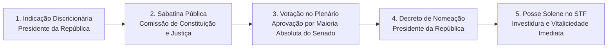
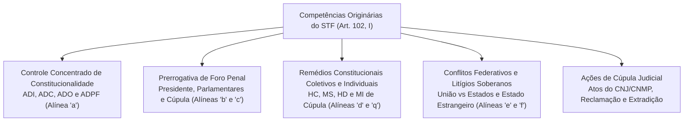
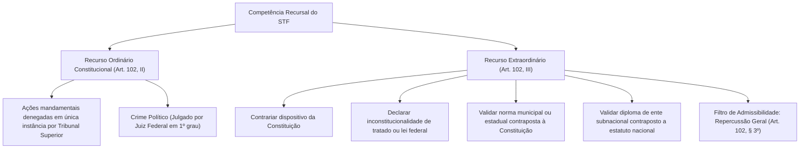
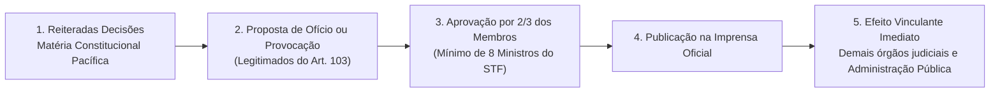
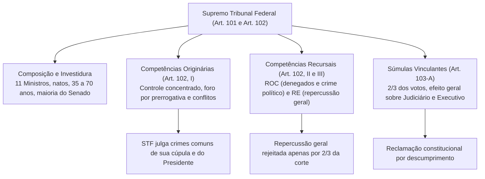

O Supremo Tribunal Federal posiciona-se no ápice da estrutura jurisdicional brasileira como o guardião supremo da Constituição da República de 1988 (art. 102, *caput*). Exercendo competências originárias de altíssima densidade política e atuando como instância recursal extraordinária definitiva em matéria constitucional, a Suprema Corte molda a interpretação dos direitos fundamentais, equilibra o pacto federativo e disciplina a conduta dos demais Poderes do Estado.

> [!objetivos]
> - Analisar a composição orgânica, os requisitos de investidura e o rito de escolha dos Ministros do Supremo Tribunal Federal (art. 101 da CF/88).
> - Diferenciar as competências originárias da Suprema Corte em matéria de controle concentrado, ações penais e remédios constitucionais (art. 102, I).
> - Compreender a distinção entre a competência recursal ordinária e a recursal extraordinária, com ênfase no filtro da repercussão geral.
> - Dominar os pressupostos de edição, revisão e cancelamento de súmulas vinculantes e seus instrumentos de tutela executiva (art. 103-A da CF/88).

## Supremo Tribunal Federal (art. 101 e art. 102, CF/88): Composição e Investidura

A composição e a forma de investidura dos membros do Pretório Excelso refletem a relevância institucional da corte na preservação do Estado Constitucional. A disciplina constitucional básica encontra-se fixada de forma lapidar no art. 101 da Carta Magna:

> [!lei] CF/88, art. 101
> **Art. 101.** O Supremo Tribunal Federal compõe-se de onze Ministros, escolhidos dentre cidadãos com mais de trinta e cinco e menos de setenta anos de idade, de notável saber jurídico e reputação ilibada.
> Parágrafo único. Os Ministros do Supremo Tribunal Federal serão nomeados pelo Presidente da República, depois de aprovada a escolha pela maioria absoluta do Senado Federal.

### Requisitos Constitucionais de Ingresso

Para que um cidadão seja validamente indicado e investido no cargo de Ministro do Supremo Tribunal Federal, a Constituição Federal exige o atendimento cumulativo a quatro requisitos fundamentais:

1. **Nacionalidade Brasileira Nata:** nos termos do art. 12, § 3º, IV, da Lei Maior, a investidura na magistratura suprema exige nacionalidade originária. Essa exigência justifica-se pelo fato de o Presidente do STF figurar na linha sucessória eventual da Chefia do Executivo da União (art. 80 da CF/88), além de a corte julgar pedidos de extradição e conflitos soberanos entre Estados estrangeiros.
2. **Faixa Etária Qualificada:** o candidato deve situar-se na faixa etária compreendida entre trinta e cinco e setenta anos no instante da formalização da investidura. O limite máximo de idade foi ampliado de 65 para 70 anos por força da **Emenda Constitucional nº 122/2022**, harmonizando as regras de ingresso aos parâmetros modernos de longevidade profissional.
3. **Notável Saber Jurídico e Reputação Ilibada:** o indicado deve ostentar profundo conhecimento do direito, reconhecido pela comunidade jurídica, e conduta ética e moral intocável no meio social. Não se exige diploma de bacharel em direito de modo explícito no texto literal, embora historicamente todos os indicados sejam juristas consagrados.
4. **Pleno Exercício dos Direitos Políticos:** pressupõe alistamento eleitoral regular e ausência de condenações por improbidade ou infrações penais que suspendam a cidadania ativa e passiva.

> [!pegadinha] Idade de Ingresso e Idade de Aposentadoria Compulsória
> Atenção recorrente nas provas: não confunda a idade máxima de **ingresso** no STF (menos de setenta anos, conforme a EC 122/2022) com a idade de **aposentadoria compulsória** de seus membros (setenta e cinco anos de idade, conforme a EC 88/2015 e a Lei Complementar nº 152/2015). O cidadão pode ingressar no STF aos 69 anos e permanecer na corte judicando até completar 75 anos de idade.

### Sucessão Presidencial e Linha de Substituição

O Presidente do Supremo Tribunal Federal ocupa posição singular na arquitetura republicana nacional. Nos termos do art. 80 da Carta da República, em caso de impedimento ou vacância simultânea dos cargos de Presidente e de Vice-Presidente da República, serão sucessivamente chamados ao exercício temporário da Presidência:
1. O Presidente da Câmara dos Deputados;
2. O Presidente do Senado Federal;
3. O Presidente do Supremo Tribunal Federal.

O Presidente do STF é a última autoridade na linha de substituição legal. Caso a vacância de ambos os cargos executivos ocorra nos dois primeiros anos do mandato, realizam-se eleições diretas no prazo de noventa dias; se ocorrer nos dois últimos anos, o Congresso Nacional elege indiretamente os novos mandatários em trinta dias (art. 81). Durante esse período de transição institucional, a chefia do Estado brasileiro pode ser confiada interinamente ao Presidente da corte suprema.

### Divisão Interna: Plenário e Turmas

O Supremo Tribunal Federal atua colegiadamente por meio de duas instâncias deliberativas:
- **Tribunal Pleno:** composto pela totalidade dos onze Ministros. Compete-lhe julgar as matérias de maior envergadura constitucional, tais como o controle concentrado abstrato (ADI, ADC, ADO e ADPF), crimes comuns atribuídos aos Chefes de Poder, extradições e a edição de súmulas vinculantes.
- **Turmas Julgadoras:** o tribunal divide-se em duas Turmas, cada uma integrada por cinco Ministros. O Presidente do Supremo Tribunal Federal não integra nenhuma das Turmas, dedicando-se com exclusividade à direção administrativa da corte e à condução dos trabalhos do Tribunal Pleno. As Turmas julgam a maioria dos recursos extraordinários cíveis e criminais, agravos regimentais e pedidos individuais de habeas corpus.

## Competências Originárias do Supremo Tribunal Federal (CF, art. 102, I)

O art. 102, I, da Constituição da República consagra o rol taxativo de competências originárias da Suprema Corte. Por se tratar de competência de direito estrito delineada pelo constituinte originário, esse catálogo não pode sofrer ampliação ou supressão por lei ordinária, constituições estaduais ou normas regimentais internas do tribunal.

### Controle Concentrado Abstrato de Constitucionalidade

A competência mais emblemática da Suprema Corte reside no julgamento das ações de controle direto da constitucionalidade das leis (art. 102, I, alínea *a*):
1. **Ação Direta de Inconstitucionalidade (ADI):** impugna lei ou ato normativo federal ou estadual que contrarie frontalmente o texto da Constituição Federal de 1988.
2. **Ação Declaratória de Constitucionalidade (ADC):** confere presunção absoluta de validade e certeza jurídica a lei ou ato normativo federal objeto de relevante controvérsia judicial.
3. **Ação Direta de Inconstitucionalidade por Omissão (ADO):** combate a inércia inconstitucional do legislador ou do administrador público quando a ausência de norma regulamentadora inviabiliza o exercício de direito constitucional.
4. **Arguição de Descumprimento de Preceito Fundamental (ADPF):** mecanismo subsidiário voltado a tutelar preceitos magnos contra atos do poder público federais, estaduais e municipais, abrangendo inclusive o direito pré-constitucional anterior a 1988.

> [!atencao] Modulação dos Efeitos no Controle Concentrado (Lei nº 9.868/1999, art. 27)
> Ao declarar a inconstitucionalidade de lei ou ato normativo em sede de ação direta, o Supremo Tribunal Federal pode, por razões de segurança jurídica ou excepcional interesse social, modular os efeitos temporais de sua decisão. Essa decisão exige quórum qualificado de **dois terços dos votos de seus membros** (oito votos favoráveis), permitindo fixar a eficácia da nulidade a partir do trânsito em julgado (efeito prospectivo *ex nunc*) ou de outro marco futuro expressamente estabelecido pelo colegiado.

### Julgamento Penal por Prerrogativa de Função

O art. 102, I, alíneas *b* e *c*, estabelece as autoridades públicas submetidas ao crivo penal originário do Supremo Tribunal Federal:

1. **Infrações Penais Comuns (art. 102, I, b):**
   - Presidente da República e Vice-Presidente da República;
   - Membros do Congresso Nacional (Deputados Federais e Senadores da República);
   - Os próprios Ministros do Supremo Tribunal Federal;
   - O Procurador-Geral da República.
   - *Nota didática:* Nos crimes de responsabilidade política, o Presidente da República, o Vice-Presidente, os Ministros do STF e o Procurador-Geral da República são julgados privativamente pelo **Senado Federal** (art. 52, I e II), e não pelo STF.

2. **Infrações Penais Comuns E Crimes de Responsabilidade (art. 102, I, c):**
   - Ministros de Estado e Comandantes da Marinha, do Exército e da Aeronáutica (salvo quando o crime de responsabilidade for conexo com o do Presidente da República, caso em que o julgamento ocorre no Senado Federal);
   - Membros dos Tribunais Superiores (Ministros do STJ, TST, TSE e STM);
   - Ministros do TCU e diplomatas de primeiro escalão chefiando embaixadas permanentes.

> [!jurisprudencia] STF, Questão de Ordem na Ação Penal 937 e Nova Orientação de Prerrogativa
> A competência penal do STF para julgar parlamentares federais e autoridades de cúpula restringe-se aos crimes cometidos **no cargo e em razão das funções institucionais**. A Suprema Corte pacificou que, uma vez formalmente encerrada a fase de instrução processual com a intimação para apresentação de alegações finais, a competência do STF prorroga-se em definitivo, não sendo mais deslocada para a primeira instância caso o réu renuncie ou perca o mandato parlamentar posteriormente.

| Autoridade Pública | Crimes Comuns | Crimes de Responsabilidade |
|---|---|---|
| **Presidente e Vice-Presidente** | STF (art. 102, I, b) | Senado Federal (art. 52, I) |
| **Deputados Federais e Senadores** | STF (art. 102, I, b) | Casa respectiva (Decoro) ou STF |
| **Ministros do STF** | STF (art. 102, I, b) | Senado Federal (art. 52, II) |
| **Procurador-Geral da República** | STF (art. 102, I, b) | Senado Federal (art. 52, II) |
| **Ministros de Estado** | STF (art. 102, I, c) | STF (ou Senado se conexo com Presidente) |
| **Ministros dos Tribunais Superiores**| STF (art. 102, I, c) | STF (art. 102, I, c) |
| **Governadores de Estado** | STJ (art. 105, I, a) | Assembleia Legislativa / Tribunal Misto |

### Remédios Constitucionais Originários

Compete originariamente ao Pretório Excelso processar e julgar:
- **Mandado de Segurança e Habeas Data (art. 102, I, d):** impetrados contra atos praticados pelo Presidente da República, pelas Mesas da Câmara dos Deputados e do Senado Federal, pelo Tribunal de Contas da União, pelo Procurador-Geral da República e pelo próprio Supremo Tribunal Federal.
- **Habeas Corpus (art. 102, I, d e i):** processado originariamente quando a autoridade coatora ou o paciente for qualquer das autoridades submetidas à jurisdição penal do STF, ou quando o ato coator for emanado de Tribunal Superior (como STJ, TST ou STM).
- **Mandado de Injunção (art. 102, I, q):** processado perante o STF quando a elaboração do ato normativo omisso for encargo das autoridades máximas da Federação, das mesas diretoras das casas do Parlamento nacional, da corte de contas ou do próprio Pretório Excelso.

### Conflitos Federativos, Extradição e Ações de Cúpula

O art. 102, I, alínea *f*, atribui ao STF o julgamento dos conflitos federativos travados entre a União e os Estados, a União e o Distrito Federal, ou entre os próprios entes federados estaduais reciprocamente, abrangendo entidades da administração pública indireta quando a contenda atingir o equilíbrio político da Federação.

No plano da cooperação jurídica internacional, o art. 102, I, alínea *g*, confere privativamente ao Supremo Tribunal Federal a competência para processar e julgar os pedidos de **extradição solicitada por Estado estrangeiro**:

> [!bizu] Regras Constitucionais da Extradição no STF (CF/88, art. 5º, LI e LII c/c art. 102, I, g)
> - **Brasileiro Nato:** jamais será extraditado pelo Brasil, sob qualquer hipótese ou pretexto.
> - **Brasileiro Naturalizado:** pode ser extraditado exclusivamente em duas hipóteses: por crime comum praticado antes da naturalização formal, ou por comprovado envolvimento em tráfico ilícito de entorpecentes a qualquer tempo.
> - **Estrangeiro:** pode ser extraditado regularmente, vedada a extradição por crime político ou de opinião.
> - **Exigência de Dupla Tipicidade:** o fato criminoso imputado ao extraditando deve ser punível simultaneamente pela lei estrangeira e pela lei penal brasileira.

Ademais, compete ao STF julgar a ação rescisória de seus próprios julgados e a revisão criminal de suas próprias condenações criminais irrecorríveis (art. 102, I, alínea *j*). O Pretório Excelso não julga ações rescisórias ou revisões criminais contra decisões de outros tribunais estaduais ou federais, limitando-se ao reexame exclusivo de seus próprios acórdãos soberanos.

Por sua vez, a **Reclamação Constitucional (art. 102, I, l)** constitui instrumento de preservação da higidez do ordenamento. Ela é manejada para preservar a competência jurisdicional do STF, garantir a autoridade material de suas decisões definitivas e assegurar a observância cogente de seus enunciados de súmula vinculante violados por qualquer juízo ou autoridade administrativa do país.

> [!bizu] O que Não Vai para o STF em Matéria Originária
> Atenção aos detalhes que derrubam candidatos:
> - Mandado de segurança contra ato de **Ministro de Estado** vai para o **Superior Tribunal de Justiça** (art. 105, I, b), e não para o STF.
> - Ação contra Governador de Estado por crime comum vai para o **STJ** (art. 105, I, a).
> - Mandado de segurança contra ato de Juiz Federal de primeiro grau vai para o **Tribunal Regional Federal** competente (art. 108, I, c).

## Competência Recursal do Supremo Tribunal Federal

A atuação do Supremo Tribunal Federal desenvolve-se igualmente por via recursal, dividindo-se entre o Recurso Ordinário Constitucional e o Recurso Extraordinário:

### Recurso Ordinário Constitucional (ROC - art. 102, II)

O Recurso Ordinário Constitucional opera funcionalmente como uma verdadeira apelação direcionada à Suprema Corte em hipóteses restritas:
1. **Remédios constitucionais denegados (alínea a):** cabe recurso ordinário em ações mandamentais e remédios tutelares julgados em grau originário conclusivo pelas instâncias superiores federais (STJ, TST, TSE ou STM), **quando a decisão for denegatória** do direito. Se o tribunal superior conceder a ordem pleiteada, não caberá recurso ordinário ao STF, admitindo-se tão somente o recurso extraordinário se demonstrada violação direta da Carta Magna.
2. **Crime Político (alínea b):** as infrações penais políticas tipificadas na lei de segurança do Estado são julgadas em primeiro grau de jurisdição por juízes federais singulares (art. 109, IV da CF/88). Da sentença absolutória ou condenatória proferida pelo juiz federal, cabe recurso ordinário **diretamente para o Supremo Tribunal Federal**, sem passar pela apreciação intermediária do Tribunal Regional Federal.

### Recurso Extraordinário (RE - art. 102, III) e Repercussão Geral

O Recurso Extraordinário é a via processual de controle difuso incidental destinada a manter a higidez e a harmonia do texto constitucional diante de decisões proferidas por outros tribunais e órgãos colegiados. O recurso cabe contra causas decididas em única ou última instância quando o acórdão recorrido:
- **Alínea a:** contrariar dispositivo da Constituição Federal.
- **Alínea b:** declarar formalmente a inconstitucionalidade de tratado internacional ou lei federal.
- **Alínea c:** reconhecer a legitimidade de regulamento ou norma municipal ou estadual contraposta ao texto constitucional.
- **Alínea d:** validar diploma editado por ente subnacional contraposto a estatuto legal de âmbito nacional (hipótese transferida do STJ para o STF pela EC 45/2004).

O art. 102, § 3º, da Carta da República instituiu o requisito indispensável da **repercussão geral** para o conhecimento do recurso extraordinário. O recorrente deve demonstrar, em preliminar formal fundamentada, a existência de questões constitucionais relevantes do ponto de vista econômico, político, social ou jurídico que transcendam os interesses individuais dos litigantes do caso concreto.

O exame da repercussão geral compete com exclusividade ao Supremo Tribunal Federal, através de votação informatizada em plenário virtual. A recusa do recurso pela ausência de repercussão geral somente pode ocorrer mediante o voto qualificado e fundamentado de **dois terços dos membros do STF** (oito Ministros). Reconhecida a repercussão geral de uma matéria, os processos análogos sobrestados em todo o território nacional aguardam a decisão de mérito, que terá eficácia vinculante vertical.

## Súmula Vinculante e Jurisprudência Temática do STF (art. 103-A)

A Emenda Constitucional nº 45/2004 dotou a Suprema Corte do poder de editar enunciados de súmula vinculante para conferir previsibilidade, segurança jurídica e racionalidade ao sistema de justiça:

### Requisitos e Efeitos do Art. 103-A

A aprovação, a revisão ou o cancelamento de súmula vinculante subordina-se a parâmetros severos fixados na Constituição e na Lei nº 11.417/2006:
- **Legitimação Ativa Ampla (art. 103-A, § 2º):** podem propor a edição, revisão ou cancelamento de enunciado vinculante os mesmos legitimados universais e especiais para a propositura da Ação Direta de Inconstitucionalidade (elencados no art. 103, incisos I a IX da Carta Magna), incluindo o Presidente da República, a Mesa do Senado Federal, a Mesa da Câmara dos Deputados, Governadores de Estado, o Procurador-Geral da República, o Conselho Federal da OAB, partidos políticos com representação no Congresso Nacional e confederações sindicais ou entidades de classe de âmbito nacional. Além destes, a lei confere legitimidade autônoma ao Defensor Público-Geral da União e aos Municípios pela via incidental no curso de processo em que sejam parte.
- **Quórum Qualificado:** decisão tomada por **dois terços dos membros** do Supremo Tribunal Federal (mínimo de oito votos favoráveis).
- **Pressuposto Material:** exigência de **reiteradas decisões judiciais prévias** sobre controvérsia constitucional atual entre órgãos judiciários ou entre esses e a administração pública.
- **Efeito Vinculante Geral:** vincula compulsoriamente todos os demais órgãos do Poder Judiciário (juízes e tribunais de todas as instâncias) e a administração pública direta e indireta das esferas federal, estadual e municipal.
- **Inaplicabilidade ao Poder Legislativo:** a súmula vinculante **não vincula o Poder Legislativo** em sua função típica de legislar. O Congresso Nacional pode aprovar lei em sentido diametralmente oposto ao enunciado sumular sem incidir em desobediência (fenômeno da superação legislativa ou *backlash* constitucional). Da mesma forma, a súmula não vincula o próprio plenário do STF, que pode revisá-la ou cancelá-la a qualquer tempo.

### Súmulas de Grande Relevância nos Concursos da Segurança Pública

A jurisprudência sumulada do Supremo Tribunal Federal apresenta temas centrais para as provas:

1. **Súmula Vinculante 10 (Reserva de Plenário):** impede que órgãos fracionários de tribunais afastem a aplicação de leis sem o quórum de maioria absoluta do Pleno ou Órgão Especial.
2. **Súmula Vinculante 11 (Uso de Algemas):** restringe o emprego de algemas a casos de resistência, fundado receio de fuga ou perigo à integridade física do preso ou de terceiros, justificada a excepcionalidade por escrito sob pena de responsabilidade e nulidade do ato.
3. **Súmula Vinculante 13 (Vedação ao Nepotismo):** proíbe a nomeação de parentes consanguíneos ou afins até o terceiro grau para cargos de direção, chefia e assessoramento comissionados em todos os Poderes.
4. **Súmula Vinculante 14 (Acesso a Inquéritos Policiais):** assegura ao advogado legalmente constituído amplo acesso aos elementos de prova já documentados em procedimento investigatório penal sigiloso conduzido por órgão de polícia judiciária.
5. **Súmula Vinculante 37 (Isonomia e Vencimentos):** estabelece que não cabe ao Poder Judiciário, que não possui função legislativa, conceder aumento de vencimentos a servidores sob o fundamento da isonomia.
6. **Súmula 330 do STF (Jurisdição em Mandado de Segurança Local):** confirma que o mandado de segurança contra ato de autoridade municipal ou estadual deve ser submetido às instâncias ordinárias do tribunal competente da respectiva localidade federativa.

> [!exemplo] Exemplo de Aplicação Prática da Súmula Vinculante 11 na Atividade Policial
> Uma guarnição de radiopatrulha efetua a prisão em flagrante de um indivíduo suspeito de roubo qualificado que não esboçou qualquer resistência física, obedeceu prontamente às ordens verbais e manteve-se calmo. Se os policiais militares empregarem algemas metálicas sem fundamentar por escrito a existência de risco concreto de fuga ou perigo iminente a terceiros, incidirão em descumprimento da Súmula Vinculante 11, ensejando eventual nulidade da prisão ou do ato processual subsequente, além de responsabilidade administrativa e civil do agente público.

> [!jurisprudencia] STF, Rcl 4.374: Descumprimento de Súmula Vinculante e Reclamação
> Do ato administrativo ou da decisão judicial que contrariar a súmula aplicável ou que indevidamente a aplicar, caberá reclamação direta perante o Supremo Tribunal Federal (art. 103-A, § 3º). Julgada procedente a reclamação, a Suprema Corte anulará o ato administrativo ilegal ou cassará a decisão judicial impugnada, determinando que outra seja proferida com observância do precedente vinculante. Tratando-se de reclamação contra ato da administração pública, exige-se o esgotamento prévio das vias administrativas recursais.

## Mapa do capítulo

### Para fixar

1. **Estrutura e ingresso**: composto por onze ministros brasileiros natos, com idade entre trinta e cinco e setenta anos (EC 122/2022), aprovados pela maioria absoluta do Senado Federal.
2. **Foro criminal de cúpula**: julga crimes comuns do Presidente da República, parlamentares federais, seus próprios membros e o Procurador-Geral da República.
3. **Crimes de responsabilidade política**: julgados privativamente pelo Senado Federal no tocante ao Presidente da República, Ministros do STF e Procurador-Geral.
4. **Controle concentrado**: competência originária exclusiva para processar e julgar as ações do modelo abstrato de constitucionalidade (ADI, ADC, ADO e ADPF).
5. **Crime político**: competência de primeiro grau da Justiça Federal, cabendo recurso ordinário direto ao STF (art. 102, II, b da CF/88).
6. **Remédios denegados**: recurso ordinário ao STF contra decisão denegatória de mandado de segurança ou habeas corpus proferida em única instância por tribunal superior.
7. **Repercussão geral**: requisito do recurso extraordinário destinado a demonstrar transcendência do litígio, recusável somente por dois terços dos ministros do STF.
8. **Efeitos da Súmula Vinculante**: vincula todos os juízos judiciais e a administração pública direta e indireta, não vinculando o Legislativo no exercício de legislar.
9. **Reclamação constitucional**: instrumento cabível perante o STF para garantir a autoridade de seus julgados e a eficácia prática das súmulas vinculantes.
