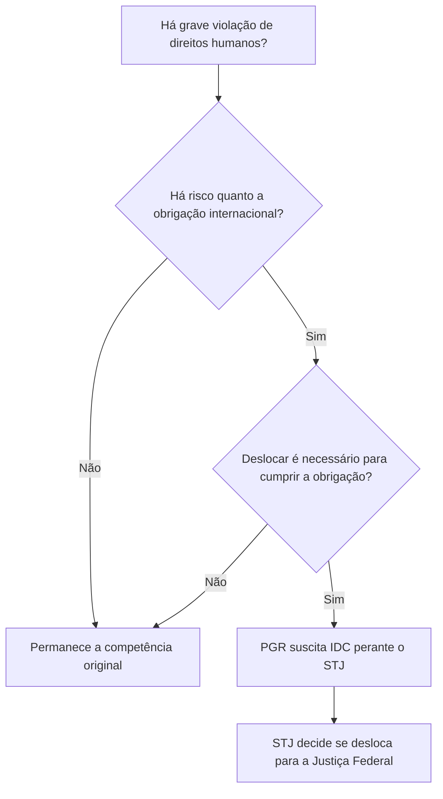
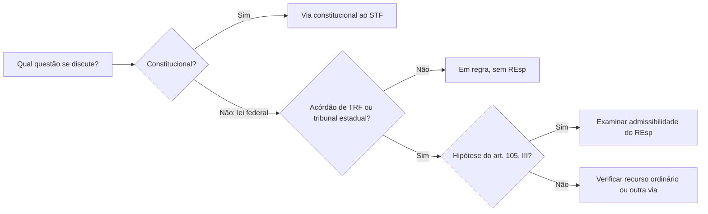

O Superior Tribunal de Justiça (STJ) é o tribunal superior responsável por dar unidade à interpretação da legislação federal infraconstitucional. Ele não funciona como uma terceira instância ampla: sua competência depende das hipóteses constitucionais. Este capítulo organiza as competências originárias, o recurso ordinário e o recurso especial, e explica o incidente de deslocamento de competência. O capítulo anterior apresentou o Supremo Tribunal Federal; aqui, o foco é reconhecer quando a controvérsia chega ao STJ e não confundir a defesa da Constituição, atribuída principalmente ao STF, com a interpretação uniforme das leis federais.

> [!objetivos]
> - Identificar a composição constitucional do STJ.
> - Separar competência originária, recurso ordinário e recurso especial.
> - Reconhecer os requisitos do incidente de deslocamento de competência.

## Organização e função do STJ

O STJ compõe-se de, no mínimo, 33 ministros. A Constituição prevê nomeação pelo Presidente da República, após aprovação da maioria absoluta do Senado. Os escolhidos são brasileiros com mais de 35 e menos de 70 anos, de notável saber jurídico e reputação ilibada. Um terço das vagas é destinado a juízes dos Tribunais Regionais Federais e um terço a desembargadores dos Tribunais de Justiça, indicados em lista tríplice pelo tribunal correspondente. O terço restante é preenchido, em partes iguais e alternadamente, por advogados e membros do Ministério Público, observados os requisitos do quinto constitucional.

A função central do STJ é assegurar interpretação uniforme da lei federal. A Constituição não o incumbiu de reexaminar qualquer caso só porque uma parte discorda do resultado. Em regra, o tribunal recebe questões jurídicas federais por recurso especial, depois de pronunciamento de tribunal em única ou última instância, nos limites do art. 105, III. Questões constitucionais são levadas ao STF pelas vias próprias.

> [!lei] CF, art. 104
> Art. 104. O Superior Tribunal de Justiça compõe-se de, no mínimo, **trinta e três** Ministros.
> Parágrafo único. (...) sendo:
> I - um terço dentre juízes dos Tribunais Regionais Federais e um terço dentre desembargadores dos Tribunais de Justiça, indicados em lista tríplice elaborada pelo próprio Tribunal;
> II - um terço, em partes iguais, dentre advogados e membros do Ministério Público Federal, Estadual, do Distrito Federal e Territórios, alternadamente, indicados na forma do art. 94.

Exemplo: se um tribunal estadual interpretar de maneira divergente uma regra de lei federal sobre responsabilidade civil, a parte pode avaliar o recurso especial. Se a controvérsia exigir definir o sentido de uma norma da própria Constituição, a via pertinente pode ser o recurso extraordinário ao STF. O tribunal superior competente decorre da natureza da questão, não do nome dado pela parte ao recurso.

## Competência originária

Competência originária significa que o processo começa no próprio tribunal, sem decisão anterior de juiz ou tribunal inferior sobre aquele processo. O art. 105, I, enumera as hipóteses de competência originária do STJ. Entre as mais cobradas estão: processar e julgar, quando se tratar de crime comum atribuído a governador estadual ou distrital; julgar, nos crimes comuns e nos de responsabilidade, determinadas autoridades, como desembargadores dos Tribunais de Justiça, membros dos Tribunais de Contas estaduais e membros dos TRFs, TREs e TRTs; e conhecer de mandado de segurança ou habeas data dirigido contra ato de Ministro de Estado, comandante militar ou do próprio STJ.

Também compete ao STJ julgar habeas corpus nas hipóteses constitucionais ligadas às autoridades mencionadas e a tribunais sujeitos à sua jurisdição, ressalvada a competência eleitoral. A Corte resolve conflitos de competência entre tribunais (salvadas as exceções constitucionais), entre órgãos judiciais de estruturas distintas, nos termos da alínea d. Julga ainda revisões criminais e ações rescisórias de seus julgados, reclamações para preservar sua competência e garantir a autoridade de suas decisões, e homologação de sentenças estrangeiras e exequatur de cartas rogatórias.

> [!exemplo]
> Um governador é acusado de crime comum. A competência originária prevista na Constituição é do STJ. Já uma ação comum contra um secretário estadual não passa automaticamente ao STJ: é necessário que a hipótese esteja expressamente prevista na Constituição.

Há competências específicas para mandado de injunção e conflitos de atribuições. O mandado de injunção será originário no STJ nas omissões normativas federais atribuídas a órgão, entidade ou autoridade, ressalvados os casos atribuídos ao STF e aos órgãos das Justiças Militar, Eleitoral, do Trabalho e Federal. Desde a EC 132/2023, o STJ também julga litígios federativos relativos aos tributos indicados, inclusive os que envolvam o Comitê Gestor do IBS, relacionados aos tributos indicados no texto constitucional.

> [!pegadinha]
> Foro por prerrogativa não se presume nem se amplia por analogia. A competência originária depende da autoridade, da natureza da infração ou do instrumento processual e da previsão constitucional específica.

## Competência recursal

O recurso ordinário e o recurso especial têm fundamentos diferentes. O recurso ordinário permite ao STJ rever determinadas decisões em hipóteses taxativas, com cognição que não se limita à interpretação da lei federal como ocorre no recurso especial. O art. 105, II, contempla, entre outros casos, habeas corpus denegado em única ou última instância por TRF ou tribunal estadual, distrital ou territorial; mandado de segurança denegado em única instância por esses tribunais; e causas entre Estado estrangeiro ou organismo internacional, de um lado, e Município ou pessoa residente ou domiciliada no Brasil, de outro.

O recurso especial é cabível contra causas decididas em única ou última instância por TRF ou tribunal dos Estados, do Distrito Federal e Territórios quando o acórdão contrariar tratado ou lei federal ou negar-lhes vigência; considerar válido ato de governo local questionado à luz de lei federal; ou der à lei federal interpretação divergente da atribuída por outro tribunal. Não cabe recurso especial diretamente contra decisão de juiz de primeiro grau, nem para reexaminar fatos e provas como regra geral. O recorrente deve observar os requisitos processuais, inclusive prequestionamento da questão federal.

| Via | Decisão de origem típica | O que a Constituição destaca |
| --- | --- | --- |
| Recurso ordinário | Decisão denegatória de HC ou MS de tribunal; causas com Estado estrangeiro ou organismo internacional | Hipóteses expressas do art. 105, II |
| Recurso especial | Causa decidida por TRF ou tribunal estadual, distrital ou territorial | Violação/negativa de vigência de lei ou tratado federal, ato local validado ou divergência interpretativa |

> [!lei] CF, art. 105, III
> III - julgar, em recurso especial, as causas decididas, em única ou última instância, pelos Tribunais Regionais Federais ou pelos tribunais dos Estados, do Distrito Federal e Territórios, quando a decisão recorrida:
> a) contrariar tratado ou lei federal, ou negar-lhes vigência;
> b) julgar válido **ato de governo local** contestado em face de lei federal;
> c) der a lei federal interpretação divergente da que lhe haja atribuído outro tribunal.

A EC 125/2022 acrescentou a exigência de demonstração da relevância da questão de direito federal infraconstitucional, nos termos da lei. O próprio texto constitucional prevê situações em que a relevância existe, como ações penais, ações de improbidade, causas com valor superior a 500 salários mínimos, ações que possam gerar inelegibilidade e acórdão que contrarie jurisprudência dominante do STJ. Para não conhecer do recurso com base exclusivamente na ausência de relevância, exige-se manifestação de dois terços dos membros do órgão competente. O tema deve ser acompanhado conforme regulamentação legal e aplicação do tribunal.

> [!pegadinha]
> A alínea “b” do recurso especial vigente fala em ato local impugnado por incompatibilidade com legislação federal. A hipótese antiga, que mencionava lei local, não deve ser repetida como redação atual.

## Incidente de deslocamento de competência

O incidente de deslocamento de competência (IDC) permite que um caso da Justiça estadual seja transferido para a Justiça Federal quando houver grave violação de direitos humanos e a medida for necessária para assegurar o cumprimento de obrigações internacionais assumidas pelo Brasil. O Procurador-Geral da República suscita o incidente perante o STJ. Não é o juiz da causa, a vítima ou o governador quem tem legitimidade constitucional para formular o pedido diretamente ao STJ.

São necessários, portanto, três elementos que devem ser avaliados em conjunto: grave violação de direitos humanos; risco de descumprimento de obrigação decorrente de tratado internacional de que o Brasil seja parte; e necessidade de deslocamento para assegurar resposta adequada. Não basta a repercussão pública do fato nem a simples referência a tratado. O instrumento busca evitar responsabilização internacional e permitir investigação, processamento e julgamento eficazes.

Exemplo: em investigação estadual marcada por graves violações e risco concreto de impunidade que comprometa dever internacional de proteção, o PGR pode pedir ao STJ a transferência do caso à Justiça Federal. O STJ examina os requisitos; a federalização não ocorre automaticamente pela natureza grave do crime.

> [!atencao]
> O deslocamento não transfere o processo ao próprio STJ. Se acolhido, o feito passa à Justiça Federal competente, preservada a decisão do STJ sobre o incidente.

### Relevância da questão federal

A demonstração da relevância, acrescentada pela EC 125/2022, funciona como filtro de acesso ao recurso especial. A parte deve indicar por que a questão federal ultrapassa o interesse subjetivo do processo, conforme disciplina legal. A Constituição, porém, presume a relevância em grupos definidos: ações penais, ações de improbidade administrativa, causas cujo valor exceda 500 salários mínimos, ações com potencial de gerar inelegibilidade e casos em que o acórdão contrariar jurisprudência dominante do STJ. A lei pode acrescentar outras hipóteses.

O filtro não transforma o STJ em instância de revisão geral dos fatos. A controvérsia continua sendo de direito federal, e o recurso precisa satisfazer às condições usuais de admissibilidade, como indicação clara da questão e impugnação dos fundamentos da decisão recorrida. Se o acórdão se baseia em fundamento constitucional autônomo, o recurso especial, sozinho, pode não ser suficiente.

> [!exemplo]
> Uma ação penal que chega ao STJ por recurso especial tem relevância presumida pelo texto constitucional. Isso não significa provimento automático: ainda é preciso demonstrar cabimento e apontar a questão federal decidida pelo tribunal de origem.

### Outras hipóteses que merecem distinção

O art. 105, I, também inclui conflitos de competência, revisão criminal e ação rescisória de julgado do STJ, reclamação, conflitos de atribuições em hipóteses constitucionais e mandado de injunção federal nos limites da competência residual do Tribunal. A homologação de sentença estrangeira e a concessão de exequatur são procedimentos de cooperação jurídica internacional; não são recursos contra sentenças brasileiras. O exequatur autoriza o cumprimento de carta rogatória, enquanto a homologação permite reconhecer no Brasil efeitos de decisão estrangeira, observadas as condições legais.

| Competência originária | Exemplo de objeto | Cuidado |
| --- | --- | --- |
| Reclamação | Preservar competência ou autoridade de decisão do STJ | Não substitui recurso cabível |
| Conflito de competência | Definir qual juízo ou tribunal julga | Verifique se os órgãos estão nas relações do art. 105, I, d |
| Cooperação internacional | Homologar sentença estrangeira ou autorizar carta rogatória | Não é julgamento originário da causa estrangeira |
| Recurso especial | Rever questão de lei federal em acórdão | Não reexamina livremente prova |

Para organizar a análise, primeiro identifique quem decidiu e em que grau; depois classifique a decisão e a matéria. Se o processo começa no STJ por previsão constitucional, trata-se de competência originária. Se existe acórdão de tribunal e a Constituição prevê impugnação, pode haver recurso ordinário ou especial. O nome do pedido não corrige a escolha de via inadequada.

### Como localizar a competência em uma questão

A identificação do STJ exige ler o sujeito do processo e o ato impugnado. Para mandado de segurança, pergunte quem praticou o ato: Ministro de Estado, comandante militar ou o próprio STJ leva à competência originária do STJ; ato de outras autoridades pode ficar com outro tribunal ou juiz. Para habeas corpus, identifique coator e paciente e considere a ressalva eleitoral. Uma alternativa pode citar corretamente o instrumento, mas trocar a autoridade, e por isso estar errada.

Conflito de competência também exige olhar os órgãos envolvidos. O STJ resolve conflitos entre tribunais que não sejam reservados ao STF; entre tribunal e juízo não vinculado a ele; e entre juízes vinculados a tribunais diferentes. Se os órgãos estão vinculados ao mesmo tribunal, em geral a solução cabe ao respectivo tribunal, observadas as regras legais. Não se deve confundir conflito de competência entre órgãos judiciais com conflito de atribuições administrativas.

O STJ também pode julgar reclamação para proteger sua competência e assegurar a autoridade de suas decisões. Reclamação não é sucedâneo recursal: se há recurso adequado, a parte deve usá-lo, e a reclamação só cabe para os fins admitidos constitucionalmente e em lei. Revisão criminal e ação rescisória, por sua vez, dirigem-se a decisões próprias do STJ.

| Termo do enunciado | O que conferir | Resultado possível |
| --- | --- | --- |
| “originariamente” | Se o caso aparece no art. 105, I | Processo começa no STJ |
| “decisão denegatória” | Se é HC ou MS e qual tribunal decidiu | Pode caber recurso ordinário |
| “lei federal” | Se existe acórdão de TRF ou tribunal estadual e hipótese do inciso III | Pode caber recurso especial |
| “norma constitucional” | Se o debate é diretamente constitucional | Examinar via extraordinária ao STF |

O esquema não substitui a leitura do dispositivo. Algumas causas têm competência originária em outro tribunal ainda que envolvam autoridade federal. Outras chegam ao STJ em recurso ordinário sem exigir demonstração de contrariedade a lei federal. A questão deve ser resolvida pelo conjunto: tipo de ação, parte ou autoridade, instância de origem e matéria. Faça essa checagem antes de escolher o recurso.

Em um item sobre foro, não generalize: cada tribunal superior tem uma lista constitucional própria, e competência originária é exceção ao juiz natural de primeiro grau. A mesma autoridade pode ser julgada em tribunal distinto conforme se trate de crime comum, crime de responsabilidade ou ação constitucional. A espécie de processo é tão importante quanto o cargo.

| Checagem de foro | Exemplo de pergunta | Por que importa|
|---|---|---|
| Cargo | Quem exerce a função? | O foro depende da autoridade descrita na Constituição|
| Infração | Crime comum ou de responsabilidade? | A competência pode mudar conforme a natureza|
| Ação | HC, MS, reclamação ou ação penal? | Cada remédio tem hipóteses próprias|
| Grau | Originário ou recurso? | Define a forma de chegada ao tribunal|

## Mapa do capítulo

| Tema | Regra de prova |
| --- | --- |
| Composição | Mínimo de 33 ministros; nomeação presidencial com aprovação da maioria absoluta do Senado |
| Função | Uniformizar interpretação da legislação federal infraconstitucional |
| Originária | Casos expressamente listados no art. 105, I |
| Ordinário | Hipóteses taxativas do art. 105, II |
| Especial | Hipóteses de violação ou divergência sobre lei federal no art. 105, III |
| IDC | PGR pede ao STJ; grave violação, obrigação internacional e necessidade |

| Pergunta sobre recurso | Resposta a localizar | Sinal de alerta|
|---|---|---|
| Há acórdão de tribunal? | Identifique sua origem | Decisão de juiz singular não basta para REsp|
| A lei federal foi discutida? | Verifique no acórdão recorrido | Matéria nova pode não estar prequestionada|
| O debate é constitucional? | Separe fundamento federal e constitucional | O STJ não substitui o STF|
| Existe regra expressa de recurso ordinário? | Compare com o art. 105, II | Não exija requisito próprio do especial|

### Para fixar
- O STJ tem no mínimo 33 ministros.
- O Senado aprova a escolha de ministro do STJ por maioria absoluta.
- Governadores respondem no STJ por crimes comuns, nos termos constitucionais.
- O recurso ordinário tem hipóteses constitucionais próprias.
- O recurso especial examina as questões federais previstas no art. 105, III.
- Recurso especial não é a via para discutir diretamente ofensa constitucional.
- O IDC é suscitado exclusivamente pelo Procurador-Geral da República perante o STJ.
- O IDC exige gravidade, dever internacional e necessidade de deslocamento.
